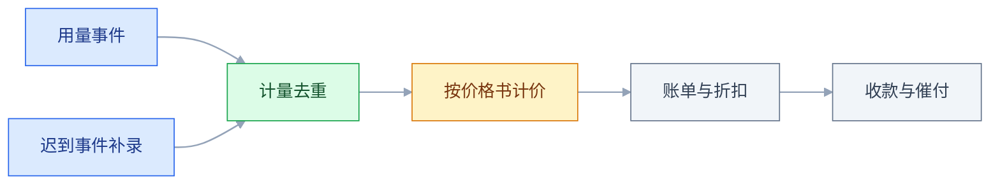
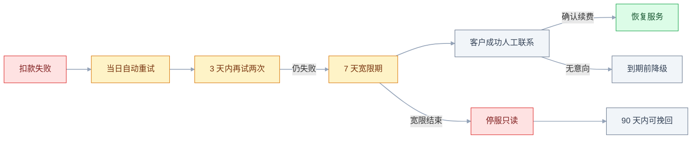

# SaaS 与商业化

## 一、工程案例：给一家项目管理 SaaS 重做计费模型与续费整改

**场景**：一家做项目管理工具的 SaaS 公司，30 人，800 个付费租户，ARR 示例 1200 万元，MRR 示例 100 万元（年初），NRR 88%，毛利率 62.6%（均为示例）。现有计费只有一个维度：**按席位 99 元/人/月**（示例）。全年新签约约 128 个租户（月均约 11 个），但老客户降级与流失把新增吃掉，年末 MRR 只涨到 104 万元，一年增长 4%。

三个具体问题摆在桌面上：

- 大客户把账号共享给全公司，只买 20 个席位，实际 200 人用；按席位收不到钱。
- 自动化任务与 API 调用是真实成本，但重度用户和轻度用户付一样的钱。
- 账单只有一行「本月席位费」，客户问「为什么比上月多 3000 元」，客服答不出来。

目标：8 周上线新计费系统；12 个月内 NRR 到 100% 以上、毛利率到 75%；**老客户不立即涨价**；账单必须能逐项复算。

**先做收入拆解的原因**：NRR 低有很多种原因，可能是获客不对、激活不足、降级、被动流失。不拆开就做「涨价」，往往会把还能救的客户先推走。

**动手前确认**：近 24 个月的合同、账单、收款流水；每个租户的席位、用量、工单量；云资源与第三方成本能否按租户归集；销售是否有私下折扣承诺。

**要交付的五样东西**：新价格书（三档 + 超额单价）、合同附件（计费单位、封顶、调价、数据导出）、可下钻的账单模板、老客户迁移方案、12 项验收清单。没有这五样，所谓「上线新计费」只是改了个价格页。

> 本节出现的金额、比例、折扣、套餐额度均为示例，只用于说明算法，不代表任何厂商的真实报价；实际数字以公司财务与合同为准。

### 1.1 收入桥：把 NRR 拆成四个动作

MRR 不是「上月加本月新签」这么简单。期初与期末之间只有四个动作：新签、扩容、降级、流失。留存类指标（NRR、GRR）通常按 **12 个月**看，也可以按季度，但同一张报表里周期必须一致；下面这张桥是一年的桥，不能把月度数字直接当年度 NRR。

```text
期初 MRR（年初）              100.0 万
+ 新签（New）                 +16.0 万   约 128 个租户 × ARPU 1250 元
+ 扩容（Expansion）            +8.0 万
- 降级（Contraction）          -8.0 万   约 32 个中客户
- 流失（Churn）               -12.0 万   约 120 个租户 × ARPU 1000 元
= 期末 MRR（年末）            104.0 万

NRR = (100 + 8 - 8 - 12) / 100 = 88%
GRR = (100 - 8 - 12) / 100     = 80%
```

注意 NRR **不含新签**。新签是增长，不是留存；把新签算进 NRR，会让一条正在漏水的船看起来在加速。

| 指标 | 公式 | 回答的问题 | 本案例（示例） |
|---|---|---|---|
| MRR | 活跃订阅的月度经常性收入 | 这个月稳定收多少 | 100 万（年初） |
| ARR | MRR × 12 | 年化口径 | 1200 万 |
| NRR | (期初 + 扩容 - 降级 - 流失) / 期初 | 老客户的钱变多还是变少 | 88% |
| GRR | (期初 - 降级 - 流失) / 期初 | 保住了多少 | 80% |
| Logo Churn | 流失客户数 / 期初客户数 | 客户数在不在 | 15%（120/800） |
| Revenue Churn | 流失 MRR / 期初 MRR | 钱在不在 | 12% |

拆完发现三件事：降级 8 万元集中在 32 个中客户（人均每月降约 200 元）；流失 12 万元来自约 120 个租户，平均 ARPU 只有 1000 元，小客户是重灾区；扩容只有 8 万元，说明老客户几乎没有自然增长。收入流失 12% 而 Logo Churn 15%，两个数的差正是「小客户走得多、单客金额小」。

### 1.2 单位经济：每个租户到底赚不赚钱

平均毛利率 62.6% 会掩盖结构问题。按租户规模分三层，把收入和成本分别归集（收入按租户加总，成本按单租户归集后相加）。

| 分层 | 租户数 | ARPU（元/月） | 月收入（万元） | 单租户服务成本（元/月） | 毛利率 |
|---|---|---|---|---|---|
| 小客户 | 600 | 500 | 30 | 150 | 70% |
| 中客户 | 160 | 2500 | 40 | 900 | 64% |
| 大客户 | 40 | 7500 | 30 | 3500 | 53% |
| 合计 | 800 | 1250 | 100 | — | 62.6% |

大客户毛利率最低，不是因为他们付得少，而是因为服务成本高：专属对接、数据迁移、审计要求、定制报表。**如果销售用同样的折扣签大客户，规模越大越亏。**

再看获客效率。市场与销售月费用 16.2 万元，月新增约 11 个付费租户（示例按 8 个小客户、2 个中客户、1 个大客户计），blended CAC = 16.2 万 / 11 ≈ 1.47 万元，与下面分层 CAC 的加权结果一致。

| 分层 | CAC（示例） | 月毛利/租户 | 回收期 |
|---|---|---|---|
| 小客户 | 1.2 万 | 350 | 34.3 个月 |
| 中客户 | 1.8 万 | 1600 | 11.3 个月 |
| 大客户 | 3.0 万 | 3975 | 7.5 个月 |

回收期不是「越短越好」，要和合同周期、流失率一起看。小客户 34 个月、年流失 30%，实际收不回；大客户 7.5 个月，但要求实施与定制，毛利被吃薄。**结构结论：小客户不能靠销售放量，要走自助；中客户是主力，但必须先治降级。**

### 1.3 计费维度：从「人头」改成「底座加用量」

计费维度不是越多越好。每加一个维度，销售要解释、客户要预测、财务要对账。先判断这个维度是否同时满足三条：**可计量、与成本相关、客户能理解**。

| 维度 | 可计量 | 与成本相关 | 客户能理解 | 结论 |
|---|---|---|---|---|
| 席位数 | 高 | 中 | 高 | 保留，作为底座 |
| 活跃用户数 | 中 | 中 | 中 | 不作为主维度，防止共享账号争议 |
| 自动化执行次数 | 高 | 高 | 中 | 采用，作为超额 |
| API 调用次数 | 高 | 高 | 中 | 并入自动化用量，不单独设维度 |
| 存储容量 | 高 | 高 | 高 | 采用，按 GB 计 |
| 项目数 | 高 | 低 | 高 | 不单独计费，也不设硬限制 |
| 业务收益分成 | 低 | 高 | 低 | 暂不采用，结算争议大 |

最终模型：**平台底座费 + 席位费 + 用量超额**。底座费覆盖固定成本，席位费跟随组织规模，用量费覆盖边际成本。

| 套餐 | 底座费（元/月） | 含席位 | 含自动化次数 | 含存储 | 席位超额（元/个） | 自动化超额（元/次） | 存储超额（元/GB） |
|---|---|---|---|---|---|---|---|
| Starter | 299 | 5 | 1000 | 20 GB | 59 | 0.02 | 0.5 |
| Pro | 999 | 20 | 10000 | 100 GB | 39 | 0.015 | 0.4 |
| Enterprise | 4999 | 50 | 50000 | 500 GB | 29 | 0.01 | 0.3 |

三档的单价随档位递减，是为量大客户留的升级空间。但要注意档位不能只靠额度区分：一个只要 50 席位的客户，如果选 Pro 是 999 + 30×39 = 2169 元，比 Enterprise 的 4999 元便宜得多。所以 Enterprise 必须另有 SSO、审计日志、SLA、专属支持这些「额度之外」的东西，否则这张价格表自己就把 Enterprise 打死了。

### 1.4 计费公式与封顶

月账单由底座、席位、用量三段相加，再套封顶与折扣。公式必须写进合同附件，不能只存在代码里。

```text
seat_overage  = max(0, seats - included_seats) × seat_price
usage_overage = max(0, automation_runs - included_runs) × run_price
              + max(0, storage_gb - included_storage) × storage_price

discount = 合同折扣（按租户，不按人）
cap      = 2 × base_fee（默认，可合同上调）

payable = (base_fee + seat_overage + min(usage_overage, cap)) × (1 - discount)

金额四舍五入到分，账单展示到元；取整规则写进合同。
```

封顶只封**用量**，不封底座，也不封席位。原因很实际：席位是客户主动加的、可预测；用量是机器跑出来的、可能失控。如果连席位一起封，Starter 客户买到 20 个席位时，15 个超额席位原本该收 885 元，封顶后超出部分只收 598 元，相当于打了六八折，正好回到了「按席位收不到钱」的老问题。

中途增减席位按天折算：

```text
新增席位费用 = 席位单价 × 剩余天数 / 计费周期天数 × 新增数量
减少席位：当期不退，下一周期生效
```

例（示例）：Pro 客户在第 16 天加 5 个席位，周期 30 天，剩余 15 天 → 39 × 15 / 30 × 5 = 97.5 元。

**为什么减少不退**：退款会带来坏账与对账复杂度；更稳妥的做法是「当期不退、下期生效」，并在合同里写清。若客户强烈要求，按未使用天数给 credit note，而不是退现金。

### 1.5 计量与出账链路

计费系统的核心不是页面，是**事件到账单的可复算链路**。任何一笔账单，给定事件流和价格书，必须能重算出同一个数。链路是顺序的，适合画流程图；唯一的分叉是迟到事件从旁路重新进入计量。



每个环节的硬要求：

| 环节 | 硬要求 | 失败后果 |
|---|---|---|
| 事件采集 | 带 `event_id`、`tenant_id`、发生时间 | 重复计费或漏计 |
| 计量 | 幂等，按事件 ID 去重 | 重试一次多收一次 |
| 迟到事件 | 允许 72 小时回补，归属发生月 | 跨月账单对不上 |
| 计价 | 价格书版本化，账单记录版本号 | 改价后历史账单无法解释 |
| 出账 | 明细可下钻到事件 | 客户不认账 |
| 收款 | 失败重试、宽限期、停服阈值 | 被动流失 |
| 总账 | 合同额、开票额、收款额三对账 | 收入确认错误 |

### 1.6 合同与政策

计费模型只有落到合同条款里才算完整。以下六条必须在标准合同里，不要靠销售口头承诺。

| 条款 | 写法 | 作用 |
|---|---|---|
| 计费单位 | 席位、次数、GB 的定义与取整规则 | 避免「一次算几次」争议 |
| 超额封顶 | 只封用量超额部分，默认 2 倍底座，合同可上调 | 防账单爆炸，又不误伤席位 |
| 价格调整 | 提前 180 天书面通知，老客户延迟 6 个月生效 | 给预算流程留时间，保续费口碑 |
| 年付折扣 | 12 个月付 10 个月（示例） | 改善现金流，代价是 16.7% 的折扣 |
| 数据导出 | 合同终止后 30 天内可导出全量数据 | 采购必问 |
| 服务等级 | 可用性口径、赔偿方式、排除情形 | 避免无限责任 |

**折扣必须走审批**。销售能给的折扣上限写进系统，超过上限走财务与 CEO；每一笔折扣记录原因、期限、审批人。折扣不是价格，是**未来续费的地板价**，今天给的 20% 会变成明年的起点。

### 1.7 客户成功与续费节奏

NRR 的修复不能只靠计费。降级的 32 个中客户里，多数不是「付不起」，而是「没用起来」：席位扩得太早，团队没跟上，到期只能缩回去。

| 阶段 | 时间点 | 动作 | 判定 |
|---|---|---|---|
| 激活 | 签约后 14 天 | 完成首个项目、邀请 3 个成员、导入数据 | 未完成即进入干预 |
| 采用 | 30 到 90 天 | 核心功能使用率、周活跃 | 低于阈值安排培训 |
| 扩容 | 90 天后 | 席位接近上限、用量接近 80% | 主动谈升级 |
| 续费 | 到期前 120 天 | 价值报告、续费报价 | 提前锁定 |
| 挽回 | 到期前 60 天 | 降级方案、付款计划 | 优于直接流失 |

客户健康分用四个信号加权：登录频次、核心功能使用率、席位使用率、工单情绪。分数只用于排序干预优先级，不用于自动停服。

### 1.8 老客户迁移

不能一上线就让老客户按新价重算。迁移按「合同优先、到期切换、用量保护」三条走。

| 客户类型 | 迁移方式 | 风险 |
|---|---|---|
| 年付未到期 | 原合同执行到期，到期前 120 天启动报价 | 到期集中，销售忙不过来 |
| 月付老客户 | 给 6 个月价格保护，之后切换 | 切换当月账单可能跳涨 |
| 重度用量客户 | 先给用量基线，超出部分打折 6 个月 | 成本先由公司承担 |
| 战略客户 | 单独签补充协议 | 条款不一致，财务难对账 |

迁移期必须双算：旧账单与新账单同时生成，只收旧账单，但把差额记下来。差额分布就是下一轮定价的依据。

### 1.9 验收（12 项全过才算交付）

| # | 检查项 | 怎么验 | 通过标准 |
|---|---|---|---|
| 1 | 计量幂等 | 同一 `event_id` 重放 3 次 | 只计 1 次，账单不变 |
| 2 | 迟到事件 | 补传上月事件 | 归属发生月，生成调整项 |
| 3 | 席位折算 | 周期第 16 天加 5 个 Pro 席位 | 账单增 39 × 15/30 × 5 = 97.5 元，可手算复现 |
| 4 | 升降级 | 月中升级、月末降级 | 升级立即生效，降级下周期生效 |
| 5 | 用量封顶 | 造一个用量超 10 倍的租户 | 用量超额部分不超过 2 倍底座，席位超额照收 |
| 6 | 账单复算 | 抽 20 张账单，用事件与价格书重算 | 20 张全部一致，误差为 0 |
| 7 | 折扣审批 | 上限设为 20%（示例），销售报 30% | 被系统拦截，转审批后才可出单 |
| 8 | 明细可解释 | 客户问「为什么多 3000」 | 能下钻到席位、次数、存储三项 |
| 9 | 支付失败 | 模拟卡失效 | 3 次重试 + 邮件提醒 + 7 天宽限，到期转只读 |
| 10 | 数据导出 | 合同终止后导出并导入测试实例 | 数据、附件、字段字典齐全，导入后关联完整 |
| 11 | 收入对账 | 合同额、开票额、收款额 | 三者差异有明细，能逐笔解释 |
| 12 | 租户毛利 | 抽 10 个租户手工核算 | 与系统报表差异小于 5%，成本项可追到来源 |

> **第 1 项要真的重放**，不要只看代码里有没有唯一索引。很多系统在应用层判重，消息重投时仍然会写两次。
> **第 6 项是整套系统的底线**。账单算错一次，后面所有「透明计费」的宣传都作废。

### 1.10 十二个月后的复核

| 信号 | 含义 | 动作 |
|---|---|---|
| NRR 回到 100% 但 GRR 仍低 | 靠少数大客户扩容掩盖流失 | 查 Logo Churn 与小客户激活 |
| 毛利率升了但投诉升了 | 降本降到服务上 | 看工单响应与流失意向 |
| 超额收入占比过高 | 客户不可预测，续费风险大 | 推年付与封顶套餐 |
| 折扣率持续上升 | 价格体系在松动 | 收紧审批，重做价格书 |
| 小客户回收期超过 24 个月 | 获客成本结构不成立 | 转自助或提价 |

---

## 二、高频问答：会卡住你的地方，也是面试最常问的

### 2.1 把合同额当收入

**现场**

看合同起止日、收款日、服务期三者是否对齐；抽一张年付合同，让财务给出每月确认金额，再与 MRR 表比对。

```text
签约当月（服务未开始）：收到 120 万现金，确认 0 收入
第 1 个月：确认 10 万收入，剩余 110 万是递延收入
```

**要点**

- 年付合同是预收款（新收入准则下记「合同负债」），收入要按月确认。
- 到账不等于赚到，现金流和收入是两张表。
- 现金流好不代表盈利好，年付折扣给得太大，增长越快越缺钱。

**追问**

- MRR 和回款有什么区别？→ MRR 是经常性收入的月度口径，回款是现金。
- 一次性实施费算 MRR 吗？→ 不算，它是一次性收入。
- 合同负债和预收账款是一回事吗？→ 新收入准则下叫合同负债，产品文档里别混写。

### 2.2 NRR 只看总数，不看分层

**现场**

按客户规模、行业、获客渠道分别算 NRR 与 Logo Churn；做 cohort 表，按签约月份分组，看每组 6 个月、12 个月后的留存与扩容。

```text
整体 NRR 105%
小客户 NRR 72%，流失 35%
大客户 NRR 140%，靠 3 家扩容
```

**要点**

- 少数大客户扩容可以盖住大量小客户流失，总数好看、结构在恶化。
- 平均数会掩盖分布，整体 105% 可能是小客户 72%、大客户 140% 靠三家撑起来。
- NRR 和 GRR 要一起看，GRR 只减不加，不会超过 100%。

**追问**

- NRR 含新签吗？→ 不含，新签是增长不是留存。
- GRR 和 NRR 差在哪？→ GRR 不加扩容，NRR 加。
- cohort 表看什么？→ 同一批客户 6 个月、12 个月后的留存与扩容。

### 2.3 只按席位计费，客户共享账号

**现场**

对比「售卖席位数」与「去重登录人数」，差距超过 30% 就说明有共享；再看同一账号的登录 IP、设备数、并发会话，并访谈客户的实际使用方式。

```text
席位 20 个，月活登录 180 人
→ 不是客户违规，是计费维度与使用方式不匹配
```

**要点**

- 共享账号让席位失去计量意义，客户越会用越能绕开计费。
- 这不是客户违规，是计费维度与使用方式不匹配。
- 换成「底座加用量」或按活跃用户计费，都比事后抓违规有效。

**追问**

- 怎么发现共享？→ 售卖席位与去重登录人数的差距，再看 IP 和设备数。
- 直接封共享行不行？→ 会伤客户体验，先改计费维度。
- 活跃用户能当主维度吗？→ 共享账号下争议大，一般只做辅助。

### 2.4 按用量计费，但没有封顶

**现场**

看历史用量的 P99 与最大值，是否出现单月突增 5 倍以上；拿过去 12 个月用量做压力测试，算出最坏账单，再问客户能否接受。

```text
需要三件套：用量告警（80%）、预算上限、超额封顶
缺一个，客户就不敢把核心业务放进来
```

**要点**

- 用多少付多少看起来公平，但客户无法预测账单，一次异常流量就可能产生十倍账单。
- 恐惧会直接导致流失，客户不敢把核心业务放进来。
- 需要三件套：用量告警、预算上限、超额封顶，缺一个都不成立。

**追问**

- 封顶封哪部分？→ 只封用量超额，底座和席位不封。
- 封顶会不会被薅？→ 会把超额变成固定价，要按套餐设倍数。
- 告警提前多久？→ 80% 就要提醒，留出调整时间。

### 2.5 计量口径与账单不一致

**现场**

抽一张账单，用原始事件手工重算，看能否对上；建每日对账任务，比较事件汇总与账单汇总，差异超过阈值就告警。

```text
常见差异：重试重复计费、跨月事件归属、折扣只打在部分明细
```

**要点**

- 计量、计价、出账是三段代码，重试、迟到事件、价格版本任何一处不同步都会差钱。
- 账单是系统算的，不代表算对了，必须能用手工复算。
- 迟到事件允许 72 小时回补并归属发生月，价格书要版本化并记进账单。

**追问**

- 常见差异有哪几种？→ 重试重复计费、跨月事件归属、折扣只打在部分明细。
- 为什么要记价格书版本？→ 改价后历史账单还要能解释。
- 对账频率多高？→ 每日跑，差异超阈值告警，不要等月结。

### 2.6 毛利只扣云成本

**现场**

随机抽 10 个租户，列出为他们发生的全部成本；让财务按租户出一张成本卡，和销售报价对比，看哪些客户实际亏损。

```text
容易漏：专属客服、数据迁移、定制报表、短信、支付手续费、审计配合
```

**要点**

- 收入减服务器费不是毛利，支持人力、实施、第三方接口、支付通道、模型调用都随客户增长。
- 大客户毛利率常常最低，因为专属对接、数据迁移、审计要求、定制报表都算成本。
- 分摊有主观性：对外披露用直接成本，内部经营用全成本，两套口径不要混。

**追问**

- 哪些成本最容易漏？→ 专属客服、数据迁移、定制报表、短信、支付手续费、审计配合。
- 大客户为什么不赚钱？→ 服务成本高，用同样折扣签就越签越亏。
- 成本卡和财务报表对不上怎么办？→ 先对齐分摊口径，再谈差异。

### 2.7 只盯新签，不盯激活

**现场**

看签约后 14 天内的激活率，以及激活与续费的相关性；把客户按「激活、未激活」分组，比较两组续费率。

```text
激活定义示例：建 1 个项目 + 邀 3 个成员 + 导入 1 批数据
未激活客户的 12 个月留存，通常显著低于激活客户
```

**要点**

- 签进来但没用起来，会在 6 到 12 个月后集中流失，获客成本白花。
- 激活要有可判定的定义，例如建 1 个项目、邀 3 个成员、导入 1 批数据。
- 两组续费率的差距就是激活的价值，比任何主观判断都硬。

**追问**

- 激活指标怎么定？→ 完成首个价值动作，能观测、能埋点、和续费相关。
- 未激活客户怎么救？→ 14 天内进干预，培训或客户成功介入。
- 新签和激活哪个优先？→ 先修激活，否则新签越多漏得越快。

### 2.8 被动流失没有催付

**现场**

把流失客户按「主动、被动」分类，看被动占比；抽 20 个流失客户回访，问「是否收到过续费提醒」「是否知道账号已过期」。



**要点**

- 一部分流失只是卡过期、发票没收到、采购流程卡住，根本没人做过挽留。
- 扣款失败要有状态机：当日重试、3 天内再试两次、7 天宽限、人工联系、停服只读、90 天内可挽回。
- 把所有流失都当产品问题，会漏掉最容易救的那一批。

**追问**

- 停服还是直接删数据？→ 停服只读，宽限后仍能靠归档数据挽回，删数据最差。
- 挽回窗口多长？→ 宽限期结束前最有效，停服后 90 天内还有机会。
- 怎么区分主动被动？→ 回访问「是否知道已过期」，加上支付失败记录。

### 2.9 折扣没有审批，价格体系崩掉

**现场**

导出近 12 个月成交折扣，按销售、行业、规模看分布；对比同规模客户的实付单价，离散度超过 20% 就说明价格失控。

```text
需要记录：折扣原因、期限、审批人、是否可续
最怕：口头承诺「永久 7 折」，合同里没写，续费时无法兑现
```

**要点**

- 折扣不是销售技巧，是未来的续费地板价，今天给的 20% 会变成明年的起点。
- 同一个客户群出现多个价格，老客户知道后会要求同价。
- 每一笔折扣要记录原因、期限、审批人、是否可续；超过上限走财务与 CEO。

**追问**

- 口头承诺永久 7 折怎么办？→ 合同里没写就无法兑现，续费时必然冲突。
- 折扣上限怎么定？→ 按毛利底线反推，写进系统强制审批。
- 离散度看什么？→ 同规模客户的实付单价，超过 20% 就该收口。

### 2.10 涨价通知太晚

**现场**

看合同里的价格调整条款，以及上次涨价的实际通知提前量；问三个续费客户「如果下季度涨 10%，你们的预算流程要走多久」。

```text
健康节奏：提前 120 到 180 天通知，老客户延迟 6 个月生效，给降级选项
```

**要点**

- 企业预算按年做，到期前一个月发通知来不及走采购流程，客户会用「没预算」作为流失理由。
- 健康节奏是提前 120 到 180 天通知，老客户延迟 6 个月生效，并给降级选项。
- 涨价是重新分配价值，没有新增价值支撑就会加速流失。

**追问**

- 为什么老客户要延迟生效？→ 给预算流程留时间，保续费口碑。
- 加量不加价算涨价吗？→ 算，但更容易被接受。
- 通知提前量怎么定？→ 问客户预算流程要走多久，答案就是提前量。

### 2.11 合同到期才发现数据导不出来

**现场**

拿一个真实租户做一次全量导出演练，把导出的包导进另一个实例，看关联是否完整。

```text
常见缺口：附件只导链接、评论丢父子关系、自定义字段没有定义表、历史版本只剩最新
导出包至少包含：数据文件 + 字段字典 + 附件 + 校验和 + 导入说明
```

**要点**

- 导出的是记录，客户要的是能迁走的结构：附件、评论层级、自定义字段定义、审批历史、创建人与时间。
- 常见缺口是附件只导链接、评论丢父子关系、自定义字段没有定义表、历史版本只剩最新。
- 企业客户把这条当采购门槛，答不上来单子就没了。

**追问**

- 导出包要包含什么？→ 数据文件、字段字典、附件、校验和、导入说明。
- 合同里怎么写？→ 终止后 30 天内可导出全量数据，写清格式与是否含附件。
- 怎么证明做得到？→ 工程做一次演练，导进另一个实例验证关联完整。

---

## 三、核心知识：从零开始要建立的东西

### 3.1 订阅收入的现金流结构

订阅制先收钱、后服务。年付合同带来的现金流入不等于当期收入，未服务部分叫递延收入。

| 项目 | 时点 | 财务处理 |
|---|---|---|
| 签约收款 | 第 0 天 | 现金增加，递延收入增加 |
| 按月服务 | 每月 | 递延收入转为收入 |
| 未到期退款 | 终止时 | 冲减递延收入与现金 |
| 逾期未收 | 账期结束 | 应收账款，计提坏账 |

**边界**：现金流好不代表盈利好。年付折扣给得太大，会把未来的收入提前折价，增长越快越缺钱。

### 3.2 MRR 与 ARR 的口径

MRR 只算**经常性**收入。一次性实施费、培训费、定制开发费不算 MRR，否则会高估订阅健康度。

| 收入类型 | 算 MRR | 原因 |
|---|---|---|
| 月度订阅 | 是 | 可重复 |
| 年度订阅 | 是，除以 12 | 可重复 |
| 席位扩容 | 是 | 可重复 |
| 用量超额 | 管理口径可计入，按近 3 月均值平滑 | 波动大；对外披露用当期实际 |
| 实施与培训 | 否 | 一次性 |
| 定制开发 | 否 | 项目制 |

**边界**：用量收入占比高时，MRR 会失真。应同时披露「订阅 MRR」与「总营收」，不要混成一个数。

### 3.3 收入桥的四个动作


四个动作要分开归因，因为对策完全不同：新签靠市场与销售，扩容靠客户成功，降级靠价值证明与套餐设计，流失靠激活与挽留。把这张桥里的新签去掉，剩下的就是 NRR 与 GRR 的口径。

### 3.4 流失率与降级率

| 指标 | 分子 | 分母 | 用途 |
|---|---|---|---|
| Logo Churn | 流失客户数 | 期初客户数 | 看客户数 |
| Revenue Churn | 流失 MRR | 期初 MRR | 看钱 |
| Contraction | 降级损失 MRR | 期初 MRR | 看套餐与定价 |
| Net Churn | (流失 + 降级 - 扩容) | 期初 MRR | 看净变化，负值即净扩张 |

**边界**：客户数少时，Logo Churn 波动极大。10 个客户流失 1 个就是 10%，不宜直接外推。另外「流失 MRR」要统一时点：按流失发生时该客户的 MRR 算，还是按期初 MRR 算，两种口径不能混用。

### 3.5 NRR 与 GRR

| 指标 | 含扩容 | 回答 | 低值含义 |
|---|---|---|---|
| NRR | 含 | 老客户的钱变多还是变少 | 存量在萎缩 |
| GRR | 不含 | 保住了多少 | 产品价值或服务出问题 |

口径有三点必须写死：分子分母都是**同一批期初客户**（不含期内新签）；NRR 分子加上扩容、减去降级与流失；GRR 只减不加，所以 GRR 不会超过 100%，NRR 可以超过 100%。

NRR 可以靠少数大客户扩容做到 110%，但 GRR 只有 70%，说明小客户在大量流失。两个数必须一起看。

> **面试**：常问「NRR 和 GRR 有什么区别？」答：NRR 含扩容、可以超过 100%，GRR 只减不加、不会超过 100%，两个数要一起看。

### 3.6 CAC 与回收期

```text
CAC = 同一周期内（销售费用 + 市场费用）/ 新增付费客户数
月毛利 = ARPU × 毛利率
回收期 = CAC / 月毛利
LTV ≈ ARPU × 毛利率 / 月收入流失率
```

LTV 对流失率极其敏感：月流失 3% 和 5%，同样 ARPU 下 LTV 差 67%。所以「LTV/CAC 大于 3」只能当参考线，不能当结论；回收期没算清之前，这个比值没有意义。

| 回收期 | 含义 | 判断 |
|---|---|---|
| 小于 6 个月 | 获客效率高 | 可以加速投入 |
| 6 到 12 个月 | 常见区间 | 看流失率是否可控 |
| 12 到 18 个月 | 偏长 | 需要提高客单或降低 CAC |
| 大于 18 个月 | 危险 | 除非 LTV 很高，否则停止放量 |

**边界**：CAC 要按渠道分，不要用 blended 数掩盖「一个渠道很便宜、另一个很贵」。

### 3.7 毛利与成本归属

SaaS 的毛利不是「收入减服务器」。成本至少五块：

| 成本 | 内容 | 归属方式 |
|---|---|---|
| 云资源 | 计算、存储、带宽、数据库 | 按租户标签或用量分摊 |
| 第三方 | 短信、邮件、支付、模型 | 按调用量直接归属 |
| 支持 | 客服、工单、培训 | 按工时或工单数分摊 |
| 实施 | 迁移、配置、联调 | 项目制，单独核算 |
| 成功 | 客户成功、续费运营 | 按客户分层分摊 |

**边界**：分摊永远有主观性。对外披露用「直接成本」，内部经营用「全成本」，两套口径不要混。

### 3.8 计费维度的选择

| 维度 | 优点 | 缺点 | 适合 |
|---|---|---|---|
| 席位 | 可预测、易理解 | 共享账号、增长受人数限制 | 协作工具 |
| 用量 | 与成本对齐 | 账单不可预测 | API、基础设施 |
| 功能 | 套餐清晰 | 功能边界难切 | 工具型产品 |
| 价值分成 | 与客户收益对齐 | 结算争议、难审计 | 交易、效果类 |
| 混合 | 兼顾底座与弹性 | 解释成本高 | 大多数 B 端 SaaS |

判断顺序：成本结构 → 客户使用方式 → 客户能否预测 → 销售能否解释。四条都过，才加维度。

### 3.9 混合计费的公式

```text
usage_overage = 自动化超额 + 存储超额
seat_overage  = 席位超额
cap           = 合同约定的用量封顶（默认 2 倍底座）

bill = base + seat_overage + min(usage_overage, cap)
payable = bill × (1 - discount)
```

三个容易错的地方：

1. **封顶只封用量**，底座和席位不封；席位是客户主动加的，封了等于打折。
2. **折扣作用在封顶后**，否则会出现「折后超过封顶」的怪账。
3. **取整规则写进合同**，例如「不足 1000 次按 1000 次计」，否则每个月的零头都会变成对账争议。

> **面试**：常问「混合计费的封顶为什么只封用量？」答：席位是客户主动加的、可预测，用量是机器跑出来的、可能失控；连席位一起封等于给席位打折。

### 3.10 计量管道的设计

计量管道要满足四个性质：幂等、可回放、可归属、可审计。

| 性质 | 做法 | 验证 |
|---|---|---|
| 幂等 | 事件 ID 唯一索引 | 重放 3 次只计 1 次 |
| 可回放 | 原始事件留存 13 个月 | 任取一月能重算 |
| 可归属 | 事件带租户、用户、资源 | 账单能下钻 |
| 可审计 | 计价版本、折扣、调整项留痕 | 财务能逐笔解释 |

### 3.11 超额、封顶与告警

| 机制 | 触发 | 客户感受 |
|---|---|---|
| 用量告警 | 达到额度 80% | 有时间调整 |
| 软上限 | 达到 100% | 继续可用，但提醒 |
| 硬上限 | 达到客户设定的绝对上限 | 停止或降级 |
| 预算上限 | 客户自设金额 | 可控 |
| 超额封顶 | 合同约定倍数 | 账单有上限，服务不停 |

**边界**：硬上限会影响业务连续性，适合非核心功能；核心功能用软上限加人工沟通。

### 3.12 定价的三个锚点

价格不是拍出来的，是三个约束夹出来的：

| 锚点 | 怎么算 | 作用 | 容易错在哪 |
|---|---|---|---|
| 成本下限 | 单租户服务成本 ÷（1 - 目标毛利率） | 保证不亏 | 只算云成本，漏了支持、实施、支付通道 |
| 竞品参照 | 同场景、同交付形态产品的公开报价 | 客户心里的比较基准 | 拿自助版价格去比私有化部署 |
| 价值上限 | 客户因此省下的人力成本或增加的收入 | 决定能收多高 | 用「效率提升 30%」这种无法验证的说法 |

三者不重合时先看差距：成本高于竞品，是成本结构问题，不是定价问题；价值远高于价格，是漏收，该做分层而不是直接涨价。任何对外报价都以实际合同为准，公开价格只作参照。

> **面试**：常问「定价的三个锚点是什么？」答：成本下限保证不亏，竞品参照决定客户心里的比较基准，价值上限决定能收多高。

### 3.13 套餐分层的原则

| 原则 | 做法 | 反例 |
|---|---|---|
| 分层可判断 | 客户能一眼知道自己属于哪层 | 用「高级功能」这种模糊词 |
| 升级自然 | 业务增长后撞到席位或用量 | 人为限制核心功能 |
| 免费有用 | 能完成一个完整任务 | 只能看演示 |
| 降级不痛苦 | 数据保留、功能可回退 | 降级即删数据 |

**边界**：套餐不是越多越好。超过四层，销售解释成本上升，客户选择困难。

### 3.14 免费增值的边界

| 限制方式 | 适合 | 风险 |
|---|---|---|
| 用量限制 | 个人、小团队 | 用量大的免费用户成本高 |
| 功能限制 | 工具型产品 | 免费版价值感不足 |
| 时间限制 | 企业试用 | 到期提醒与转化流程要顺 |
| 席位限制 | 协作产品 | 共享账号绕过 |

免费版的底线是：**免费用户的总服务成本，要能被同期转化客户带来的毛利覆盖**。算不清这条，就不要大规模放量。

### 3.15 PLG 与 SLG

| | PLG | SLG |
|---|---|---|
| 获客 | 自助注册、试用 | 销售拓展 |
| 决策 | 使用者发起 | 采购流程 |
| 客单价 | 低到中 | 中到高 |
| 成本结构 | 产品与自助支持 | 销售与实施 |
| 适合 | 轻量、可自证价值 | 复杂、需集成 |

PLG 的关键不是「免费」，是**产品能自证价值**。如果客户试用后还要销售讲半小时才明白价值，PLG 不成立。

### 3.16 客户健康分

健康分是排序工具，不是判决工具。常见四个信号：

| 信号 | 权重示例 | 数据来源 |
|---|---|---|
| 周活跃人数 | 30% | 登录与核心操作 |
| 核心功能使用率 | 30% | 功能埋点 |
| 席位使用率 | 20% | 活跃席位 / 已购席位 |
| 工单情绪 | 20% | 工单分类与满意度 |

**边界**：健康分低不等于会流失，健康分高也不等于安全。它只回答「先联系谁」。

### 3.17 合同与涨价机制

| 机制 | 做法 | 适用 |
|---|---|---|
| 提前通知 | 120 到 180 天 | 所有涨价 |
| 老客户延迟 | 6 到 12 个月生效 | 存量客户 |
| 锁价 | 老客户永久原价 | 战略客户，慎用 |
| 加量不加价 | 涨价同时增加额度 | 容易被接受 |
| 降级选项 | 提供更低套餐 | 保留客户 |

涨价的本质是**重新分配价值**，不是「多收钱」。没有新增价值支撑的涨价，会加速流失。

---

## 四、冷门知识汇总

这里只收**低频、出错代价小、用到时现查就够**的术语和口径细节。会算错钱、会丢客户的（计费口径、合同承诺、续费失败、数据迁移）都在第二节，不放这里。

| 知识点 | 为什么冷门 | 用到时的关键词 |
|---|---|---|
| 合同负债 | 新收入准则下的科目名，产品经理常顺手写成「预收账款」 | contract liability、递延收入 |
| 履约义务 | 收入按履约进度确认，一次性实施费也要分摊，不是收款即确认 | performance obligation、ASC 606 |
| NRR 的三个名字 | NRR、NDR、net revenue retention 基本指同一件事，但各家对「期内新增同客户」的处理不同 | net dollar retention、净收入留存 |
| 负流失 | 扩容超过流失时净流失率为负，容易被说成「产品很强」 | negative churn、净扩张 |
| 收缩收入 | contraction 与 churn 常被合并成一个数，其实一个治套餐、一个治激活 | contraction、降级损失 |
| ARPA 与 ARPU | 一个按账户、一个按用户，报表混用会差出一个数量级 | ARPA、ARPU |
| 实施收入 | professional services 常被误算进 ARR，抬高增长 | professional services、一次性收入 |
| 用量平滑 | 按用量计费时月度 MRR 波动大，管理报表常用 3 个月均值 | trailing average、平滑口径 |
| 按天折算 | 半月按 15/30 还是按实际天数，合同不写就会吵 | proration、剩余天数 |
| 信用票据 | 退款之外的处理方式，财务更常用 | credit note、调整项 |
| 价格保护 | 老客户迁移期的常用手段，也叫「祖父条款」 | grandfathering、延迟生效 |
| 席位定义 | 具名用户还是并发用户，直接影响报价和审计 | named user、concurrent user |
| 试用转付费 | 分母是注册数、激活数还是试用数，结论完全不同 | trial-to-paid、转化率分母 |
| 租户与账户 | tenant、account、workspace 在不同产品里不是同一层 | tenant、workspace、组织 |
