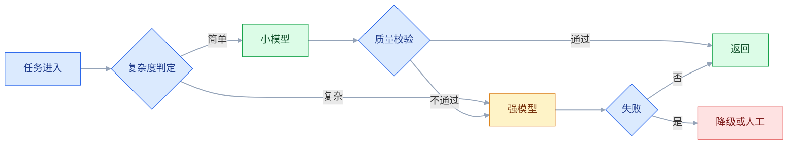
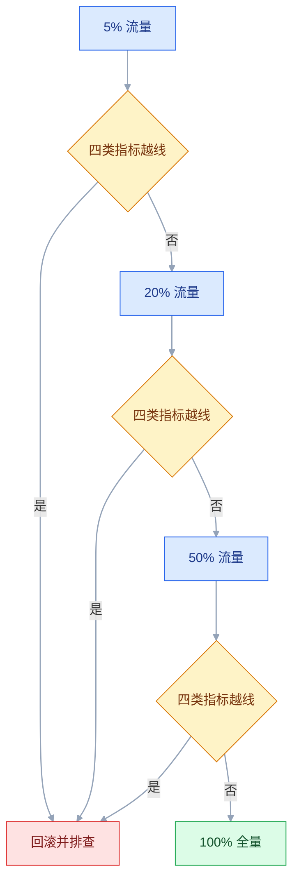

# AI 产品度量与成本

## 一、工程案例：给一个 AI 写作助手建立单位经济模型并压成本

**场景**：一个 AI 写作助手，月活 2 万，付费用户 3000，混合 ARPU 39 元/月（示例），月收入 11.7 万元。毛利率只有 42%，财务要求 4 周内看到成本结构，并把毛利率拉到 70% 以上。约束是**不能降质量**：盲测结果不差于基线（低 2 个百分点以内按抽样波动处理，超过即视为下降），事实错误率不能上升。

现有数据很粗：只记录了每天的总 token 数和模型账单，没有按任务、用户、租户归集。团队知道「模型贵」，但不知道贵在哪一类任务、哪一类用户，也不知道优化后会不会把质量改坏。

目标不是「换个便宜模型」，而是产出四样东西：**任务单元定义、成本拆解表、分群成本表、质量回归门槛**。做完之后，任何一次模型或 Prompt 改动，都能回答「成本降了多少、质量有没有掉、哪些用户在补贴哪些用户」。

**先定义任务单元的原因**：按「API 调用」算成本会漏掉重试、检索、后处理；按「用户」算又太粗，无法定位问题。只有按「一次完整生成」算，才能同时对上产品体验和财务账单。

**动手前确认**：近 60 天请求日志是否带 `request_id`；模型账单能否按日期与模型版本拆分；付费与免费用户的用量是否分开；有没有一套可复跑的质量评测集。

> 本节所有单价、用量、比例、门槛均为示例，只用于说明计算方法；模型单价、计费规则与缓存折扣以实际供应商账单为准。

### 1.1 定义任务单元

一次「生成」不是一次模型调用。用户点一次「生成文案」，背后可能是：意图识别、大纲、正文、润色、事实校验，共 3 到 5 次调用。

| 层次 | 单位 | 用途 |
|---|---|---|
| 调用 | 一次模型 API 请求 | 供应商账单 |
| 任务 | 一次完整生成（含重试与后处理） | 产品体验与单位成本 |
| 用户 | 一个付费账号一个月的全部任务 | 分群与定价 |
| 租户 | 一个企业客户一个月的全部任务 | B 端合同与毛利 |

统一口径：**任务成本 = 该任务下所有调用的成本 + 检索 + 重试 + 基础设施分摊 + 支持分摊**。只在任务层做优化，不在调用层做局部优化。

### 1.2 埋点与归集

没有埋点就没有度量。每次调用记录以下字段，缺一项后面就会有一块成本说不清。

| 字段 | 示例 | 用途 |
|---|---|---|
| request_id | req_8f21 | 串联调用与任务 |
| task_id | task_5d90 | 归集一次生成 |
| tenant_id / user_id | t_08 / u_1024 | 分群与合同 |
| model | model-large-v3 | 单价与版本 |
| prompt_version | writer_v17 | 质量回归 |
| input_tokens / output_tokens | 3000 / 600 | 成本计算 |
| retrieval_tokens | 800 | 检索成本 |
| retry_count | 1 | 放大系数 |
| cache_hit | false | 缓存效果 |
| first_token_ms / total_ms | 900 / 6200 | 体验 |
| user_action | accept / edit / regenerate | 质量信号 |

**最小要求**：`task_id` 必须能串起所有子调用；`tenant_id` 必须来自会话，不接受请求参数；`prompt_version` 与 `model` 必须能定位到具体版本。

### 1.3 成本拆解

先按账单拆，再按任务摊。月度成本示例：

| 成本项 | 月金额（万元） | 占比 | 随什么增长 |
|---|---|---|---|
| 模型调用 | 4.20 | 62% | 任务数、上下文长度、输出长度 |
| 基础设施 | 0.88 | 13% | 存储、带宽、向量库 |
| 人工支持 | 0.82 | 12% | 工单数、失败率 |
| 支付通道 | 0.27 | 4% | 收入 |
| 其他 | 0.63 | 9% | 日志、监控、第三方 |
| 合计 | 6.80 | 100% | — |

毛利率 = (11.7 - 6.8) / 11.7 ≈ 42%。模型占 62%，直觉上应该先砍模型；但先别急，模型成本里有一部分是**不必要的调用**，不是单价高。

### 1.4 单次任务成本

```text
单次生成（示例，单价以实际账单为准）：
大纲调用：输入 1200 token × 7 元/百万 + 输出 200 × 21 元/百万 = 0.0126 元
正文调用：输入 3000 token × 7 元/百万 + 输出 600 × 21 元/百万 = 0.0336 元
润色调用：输入 2600 token × 7 元/百万 + 输出 500 × 21 元/百万 = 0.0287 元
检索与重排：                                                = 0.0030 元
重试（15% 任务，平均 1.4 次）：                              = 0.0157 元
基础设施分摊：                                              = 0.0040 元
合计：                                                      ≈ 0.0976 元/次
```

加上支持与支付分摊后，按 34 万次/月计算，单次全成本约 0.20 元。之前团队说的「0.018 元」只是某一次短调用的单价，不是任务成本。

| 口径 | 数值（示例） | 问题 |
|---|---|---|
| 单次调用 | 0.018 元 | 漏掉多调用、重试、检索 |
| 单次任务（模型） | 0.098 元 | 接近真实，但仍漏支持 |
| 单次任务（全成本） | 0.20 元 | 用于定价与毛利 |
| 每付费用户月成本 | 22.6 元 | 用于分群 |

### 1.5 分群：谁在补贴谁

平均值会骗人。按用户用量分四群，按任务数归集成本。

| 用户群 | 人数 | 月任务数 | 人均任务 | 成本占比 | 收入占比 | 毛利 |
|---|---|---|---|---|---|---|
| 免费 | 17000 | 140000 | 8 | 41% | 0 | 负 |
| 轻度付费 | 2100 | 63000 | 30 | 19% | 70% | 高 |
| 中度付费 | 750 | 75000 | 100 | 22% | 25% | 中 |
| 重度付费 | 150 | 62000 | 413 | 18% | 5% | 负 |

重度用户只占付费人数 5%，成本却占 18%、收入只占 5%，是净亏；免费用户消耗 41% 的成本，转化率约 2%。这两块是成本治理的重点，但不能简单砍掉：免费用户是获客漏斗，重度用户可能是最具传播力的用户。

### 1.6 优化措施

按「先治理无效调用，再调单价，最后才动体验边界」排序；每一行都要单独跑一次质量回归，再决定是否保留。

| 措施 | 做法 | 成本影响（示例） | 质量风险 |
|---|---|---|---|
| 模型分级 | 大纲、润色、格式修复走小模型 | 模型成本降 40% | 低，需路由准确 |
| 上下文裁剪 | 只保留当前任务相关段落 | 输入 token 降 55% | 中，可能丢信息 |
| 缓存 | 相同模板与参数复用结果，键含租户与版本 | 命中 20%，成本降 12% | 低，需失效策略 |
| 输出长度约束 | 按模板限制字数与结构 | 输出 token 降 25% | 低，可能截断 |
| 重试收敛 | 只对格式错误重试，最多 1 次 | 重试成本降 50% | 低 |
| 免费额度 | 免费用户每日上限 | 免费成本降 30% | 中，影响转化 |

优化后的模型成本从 4.2 万降到约 1.5 万，总成本从 6.8 万降到约 3.4 万，毛利率约 71%。拆开看：模型 1.5 万、基础设施 0.75 万（缓存与裁剪后）、人工 0.55 万（重试下降）、支付 0.27 万、其他 0.33 万（均为示例）。**措施效果不能简单相加**，要按任务日志实测。**质量是否守住，要看 1.7 的回归，不看成本表。**

### 1.7 质量回归

成本优化必须与质量回归同时进行，否则只是把成本转移给用户。

| 检查 | 方法 | 门槛（示例） |
|---|---|---|
| 盲测胜率 | 新旧版本各生成一篇，人工盲选 | 不差于基线；低 2 个百分点以内按抽样波动处理，超过即拦截 |
| 事实错误 | 抽 200 条核对 | 不高于基线 |
| 品牌语气 | 按评分表打分 | 不低于基线 |
| 结构完整 | 检查标题、段落、CTA | 完整率 ≥ 98% |
| 用户行为 | 采纳率、修改率、重生成率 | 不显著恶化 |

**盲测要用同一批 brief**，不要让新版本拿到更简单的题目。评测集 400 条，按行业、长度、语气分层。

### 1.8 定价与额度

本项目价格不变，只改额度与封顶，并把这些规则写进产品，为下一轮定价留依据。

| 套餐 | 月费（示例） | 含任务数 | 超出单价 | 封顶 |
|---|---|---|---|---|
| 免费 | 0 | 1/天（合计约 30 次/月） | 不可超 | — |
| 标准 | 39 | 150 | 0.15 元/次 | 99 元 |
| 团队 | 199 | 800 | 0.10 元/次 | 499 元 |

**当前不限量套餐的风险**：重度用户 413 次/月，按全成本 0.20 元算，成本 82.6 元，收入 39 元，单用户亏损。下一轮定价必须把「不限量」改成「额度加封顶」，否则优化省下的钱会被重度用户吃掉。

### 1.9 验收（12 项全过才算完成）

| # | 检查项 | 怎么验 | 通过标准 |
|---|---|---|---|
| 1 | 单次成本 | 按任务日志重算 | ≤ 0.055 元/次（模型加检索） |
| 2 | 全成本 | 加支持与支付分摊 | ≤ 0.10 元/次（与 70% 毛利同口径） |
| 3 | 毛利率 | 财务口径重算 | ≥ 70% |
| 4 | 盲测结果 | 400 条 brief 盲测 | 不差于基线；低 2 个百分点以内视为抽样波动，超过即不通过 |
| 5 | 事实错误 | 抽 200 条核对 | 不高于基线 |
| 6 | 路由准确 | 1000 条任务分类 | ≥ 97%，且错分代价高的样本零误判 |
| 7 | 缓存命中 | 生产流量统计 | ≥ 20%，错命中 ≤ 0.5% |
| 8 | 重试率 | 按任务统计 | ≤ 8% |
| 9 | 首字延迟 | P95 | ≤ 1.5 秒 |
| 10 | 总延迟 | P95 | ≤ 10 秒 |
| 11 | 成本归集 | 随机抽 100 个任务 | 100% 能归到用户与租户 |
| 12 | 成本告警 | 模拟单用户超支 | 80% 与 100% 阈值都触发 |

> **第 1 项与第 2 项要分开看**。只优化模型成本，可能把成本转移到人工支持；只看全成本，又不知道是哪一段该改。
> **第 4 项必须盲测**。让标注者知道哪篇是新版本，会引入明显的期望偏差。

### 1.10 四周后的复核

| 信号 | 含义 | 动作 |
|---|---|---|
| 毛利率达标但重生成率上升 | 质量在下降，用户在用行为投票 | 回滚路由或上下文裁剪 |
| 模型成本降了，支持成本升了 | 失败率变高，问题转给人工 | 查重试与格式错误 |
| 缓存命中高但采纳率低 | 缓存了不合适的结果 | 缩小缓存键，增加失效 |
| 重度用户成本仍高 | 额度与封顶没落地 | 推套餐改造 |
| 免费成本占比上升 | 获客放量但转化没跟上 | 收紧免费额度 |

---

## 二、高频问答：会卡住你的地方，也是面试最常问的

### 2.1 用平均成本做决策

**现场**

按用量分群，算每群的收入、成本、毛利；画成本分位图，看 P50、P90、P99 的差距，差距超过 5 倍就必须分群。

```text
平均：22.6 元/用户，毛利 42%
实际：轻度 6 元，中度 20 元，重度 82.6 元（示例）
```

**要点**

- 成本分布长尾，少数重度用户吃掉大部分成本，平均值把亏损用户藏起来。
- 平均 22.6 元、毛利 42%，实际是轻度 6 元、中度 20 元、重度 82.6 元。
- 分群之后才谈定价和额度，用 blended 数做决策一定错。

**追问**

- 分几群够？→ 先按用量四群，能看出谁在补贴谁就够。
- 免费用户算不算亏损？→ 是获客成本，但要能算清被转化毛利覆盖。
- 分位图看哪几个点？→ P50、P90、P99，差距 5 倍以上必须分群。

### 2.2 只算 token 单价

**现场**

抽一个真实任务，把它的全部调用与 token 加总；用 `task_id` 聚合日志，对比调用数与任务数，比例超过 2 就说明漏算。

```text
单次调用 0.018 元
一次任务 3 到 5 次调用 + 检索 + 重试 ≈ 0.098 元
全成本加支持分摊 ≈ 0.20 元
```

**要点**

- 一次任务有多次调用、检索、重试、后处理，单价乘上真实 token 才是成本。
- 单次调用、一次任务、全成本相差一个数量级。
- 把「一次调用」当成「一次任务」是最常见的口径错误。

**追问**

- 任务和调用怎么区分？→ 任务是一次完整生成，包含若干次 API 请求。
- 为什么要含检索和后处理？→ 它们也产生费用，漏了就对不上账单。
- 调用与任务的比例多少正常？→ 3 到 5 次，超过 2 倍就要查是否漏算或重试异常。

### 2.3 忽略重试与失败成本

**现场**

统计重试率、重试次数分布、重试后的成功率；按任务统计 `retry_count`，把重试成本单独列一行。

```text
重试率 15%，重试任务平均 1.4 次
调用量放大 1 + 0.15 × 1.4 ≈ 1.21 倍
```

**要点**

- 格式错误、超时、内容审核失败都会重试，重试还会带来二次延迟与人工介入。
- 重试率乘平均重试次数才是成本放大倍数。
- 「重试率」和「平均重试次数」是两个数，不能只看其中一个。

**追问**

- 重试成本怎么摊？→ 按任务摊，不按成功请求摊。
- 重试几次该停？→ 格式错误最多一次，仍失败转人工。
- 怎么降重试率？→ 结构化输出加校验，限制次数并幂等。

### 2.4 忽略人工兜底

**现场**

统计每个任务对应的工单、审核、修改工时；让支持团队按任务类型记工时，一个月后算出真实分摊；再算一次「人工介入率翻倍」的敏感性。

```text
1% 的任务需要 2 分钟人工处理
按 1.15 元/分钟算，单次分摊约 0.023 元，占全成本 12%
若人工介入比例升到 10%，单次分摊 0.23 元，超过模型成本
```

**要点**

- 失败、投诉、审核、内容修正都要人，这部分随失败率上升，且不可自动伸缩。
- 人工只占一小部分时容易被忽略，介入比例一升就会超过模型成本。
- AI 成本不等于模型账单，人工兜底是最容易被漏掉的一块。

**追问**

- 为什么人工不可伸缩？→ 需要培训和排班，量涨了不能像算力一样扩容。
- 怎么记工时？→ 按任务类型记，别用全公司平均。
- 敏感性分析看什么？→ 人工介入率翻倍后毛利还剩多少。

### 2.5 缓存键设计太粗

**现场**

检查缓存键是否包含用户、租户、模板版本、关键参数；抽 100 条命中缓存的结果，人工判断是否适合当前用户。

```text
错误键：hash(prompt)
正确键：hash(tenant, template_version, normalized_input, tone, length)
```

**要点**

- 用户、租户、语气、长度、知识版本不同，粗粒度缓存会把 A 的结果给 B。
- 键里至少要有租户、模板版本、输入、语气、长度。
- 错命中超过 0.5% 就要收紧键，权限相关内容不进缓存。

**追问**

- 命中率越高越好吗？→ 不是，错命中率接近零才是底线。
- 语义缓存的风险？→ 相似不等于等价，问法一变就可能错配。
- 什么时候失效？→ 知识版本、模板版本、模型版本任一变化。

### 2.6 上下文带全部历史

**现场**

对比「全量历史」与「最近相关段落」的成本与质量；做一次 A/B，固定模型，只改上下文策略，比较质量与成本。

```text
全量：平均 4000 token，成本高，关键信息被淹没
裁剪：平均 1800 token（降约 55%），质量持平或更好
```

**要点**

- 无关历史会稀释关键信息、增加 token 成本，还可能把旧版本信息带进来。
- 全量 4000 token 与裁剪 1800 token 相比，成本降约 55%，质量持平或更好。
- 上下文长度不等于信息量，超过一定长度后中间段落会被忽略。

**追问**

- 怎么裁剪历史？→ 摘要加最近若干轮，不要只截断尾部。
- 上下文预算怎么分？→ 系统指令、当前任务、检索内容、历史对话各留比例，再扣输出预留。
- 裁剪会不会丢信息？→ 会，所以要用 A/B 证明质量没掉。

### 2.7 没有按租户或用户归集

**现场**

随机抽 10 笔模型账单，看能否落到具体租户；让财务与产品各出一份租户成本，差异超过 10% 就说明归集有问题。

```text
必须能回答：这个租户本月用了多少任务、花了多少模型费、毛利多少
```

**要点**

- B 端合同按租户定价，不知道租户成本就无法判断哪个合同亏损。
- C 端用户分层也依赖归集，否则免费和重度用户的补贴关系说不清。
- 归集越细埋点成本越高，先做到「用户加任务类型」，再补租户与渠道。

**追问**

- 最小归集做到哪一层？→ 用户加任务类型，能定位问题就够。
- 财务总账和经营账差在哪？→ 总账看公司，经营账看租户和分群。
- `tenant_id` 从哪来？→ 会话，不接受请求参数。

### 2.8 延迟只看总时长

**现场**

分别统计首字延迟与总延迟的 P50、P95；看前 3 秒的取消率与重复点击率，再对比首字延迟分布。

```text
首字 0.8 秒 + 总时长 6 秒 → 感觉流畅
首字 4 秒 + 总时长 6 秒 → 感觉卡死
```

**要点**

- 用户在前 2 秒没有看到任何输出就会觉得卡死，首字延迟比总时长更影响体感。
- 同样是 6 秒，首字早晚决定体验。
- 体感优先：先让用户看到第一个字，再考虑总时长。

**追问**

- 首字怎么优化？→ 流式输出、减少前置检索与调用。
- 总时长超标怎么办？→ 限制输出长度、换小模型、超时降级。
- 为什么不能只看平均？→ 平均值盖住长尾，要看 P95。

### 2.9 评测只看整体准确率

**现场**

按行业、任务类型、长度分层看准确率；要求评测报告必须带分层表，任何一层低于门槛就不能上线。

```text
整体 92%
长文 78%
法律行业 71%
短文案 96%
```

**要点**

- 某个行业或任务类型可能只有 70%，整体被简单样本拉高。
- 总分掩盖短板，分层表才是上线依据。
- 一层不达标就不能上，先限流或只放低风险场景。

**追问**

- 分层按什么维度？→ 行业、任务类型、长度，按业务风险选。
- 一层不达标能不能上？→ 不能，先限流或只放低风险场景。
- 样本少的分层怎么办？→ 补样本或合并相近层，别用小样本下结论。

### 2.10 A/B 测试混入多个模型版本

**现场**

看实验配置是否只改一个变量，日志是否记录模型与 Prompt 版本；查实验分组日志，确认两组的模型版本、参数与分流规则完全一致。

```text
一次只改一个：模型 / Prompt / 上下文 / 路由
其他变量固定，并在日志里记录
每一组样本量先算够，看置信区间是否跨 0
```

**要点**

- 实验组可能同时换了模型、Prompt、上下文策略，结果不同也无法归因。
- 一次只改一个变量，其他固定并记录。
- 同一用户按 ID 哈希固定分组，不按请求随机切，否则体验来回跳。

**追问**

- 样本量怎么算？→ 先算够，再看置信区间是否跨 0。
- 为什么按用户分组？→ 按请求随机会让同一用户看到不同版本。
- 只有相关没有因果怎么办？→ 拆变量重跑，不要靠解释。

### 2.11 不限量套餐

**现场**

算每个用户的实际成本与收入，看亏损用户占比；按用量分群，算「收入减全成本」，找出亏损群。

```text
不限量 39 元，重度用户成本 82.6 元
每 10 个重度用户，吃掉 430 元毛利
```

**要点**

- AI 的边际成本不为零，重度用户会把毛利吃穿，轻度用户补贴重度用户。
- 不限量套餐在 AI 产品上等于把成本风险全留给公司。
- 下一轮定价要把「不限量」改成「额度加封顶」。

**追问**

- 怎么改才不伤转化？→ 额度覆盖八成用户的正常用量，超额单价高于边际成本。
- 免费额度给多少？→ 够完成一次完整体验。
- 重度用户要不要砍？→ 不砍，可能是传播力最强的用户，用额度约束。

### 2.12 没有成本告警

**现场**

看是否有按租户、用户、任务类型的日预算与告警；模拟一个用户一小时调用 1 万次，看是否触发限流与告警。

```text
告警三层：日预算 80%、100%、异常增速（环比 3 倍）
动作：提醒 → 限流 → 降级 → 停用
```

**要点**

- 模型成本按小时增长，等月底发现已经超支。
- 异常调用、爬虫、死循环都可能在一天内烧掉预算。
- 告警要分三层并配动作：提醒、限流、降级、停用。

**追问**

- 告警落到哪一层？→ 租户、用户、任务类型都要能落。
- 告警之后干什么？→ 有明确的限流和降级动作，不能只发通知。
- 怎么验证告警有效？→ 模拟单用户一小时一万次，看是否触发。

**成本失控的前置信号**（都应在日看板上）：

| 信号 | 说明 |
|---|---|
| 单用户调用量环比翻倍 | 爬虫、脚本、账号共享，先查鉴权 |
| 上下文长度 P99 猛涨 | 某个 Prompt 版本带了全量历史 |
| 输出长度 P99 猛涨 | 缺少长度约束，或模型开始长篇拒答 |
| 重试率跳升 | 格式错误集中在某个版本 |
| 缓存命中率骤降 | 缓存键或版本号被改动 |

### 2.13 评测集泄漏

**现场**

查评测样本是否与 Prompt 库、微调数据有重叠，是否留了一份从未用过的 holdout；用 n-gram 重叠或 canary 样本抽查。

```text
常见泄漏：
1. few-shot 示例取自评测集
2. 用评测集调了 20 轮 Prompt
3. 标注员先看过模型输出，再写标准答案
```

**要点**

- 评测样本被写进 Prompt 示例、进了微调数据，或标注时见过答案，分数都会虚高。
- 同一批题反复调参，等于把评测集当训练集。
- 留一份 holdout 只在验收时跑一次；分数涨了但线上不动，先查泄漏。

**追问**

- 三种常见泄漏是什么？→ few-shot 取自评测集、用评测集调了 20 轮、标注员先看模型输出。
- canary 样本怎么用？→ 埋唯一标记，看在训练或提示数据里是否出现。
- holdout 能反复用吗？→ 不能，用一次就污染了。

### 2.14 质量下降没被感知

**现场**

按天看采纳率、修改率、重生成率、投诉率，并按场景拆分；对比上线前后 7 天的行为指标，任一场景跌幅超过预设阈值（示例 3 个百分点）就回滚。

```text
离线达标 ≠ 线上达标
质量看板：按天、按场景、带阈值告警
```

**要点**

- 线上输入分布会漂移，供应商可能静默升级模型，一次路由或缓存改动就能拖垮局部场景。
- 离线达标不等于线上达标，总账也看不出来。
- 质量看板要按天、按场景、带阈值告警；模型版本号写进日志。

**追问**

- 行为指标看哪几个？→ 采纳率、修改率、重生成率、投诉率。
- 供应商升级怎么发现？→ 版本号进日志，按天对比行为指标。
- 阈值定多少？→ 示例 3 个百分点，按历史波动调，宁可先紧后松。

---

## 三、核心知识：从零开始要建立的东西

### 3.1 三层度量

度量分三层，且是层层递进：模型层回答「准不准」，产品层回答「有没有用」，业务层回答「值不值」。三层不是并列关系：业务指标好，不能反推模型质量好；模型分数高，也不能证明用户愿意用。

| 层次 | 指标 | 回答 |
|---|---|---|
| 模型 | 准确率、召回、幻觉率、拒答率 | 技术是否达标 |
| 产品 | 采纳率、修改率、完成率、重生成率 | 用户是否买账 |
| 业务 | 毛利、留存、单位成本、满意度 | 是否值得投入 |

只做模型层会做出「指标很好但没人用」的产品；只做业务层会做出「便宜但质量差」的产品。

> **面试**：常问「AI 产品的度量为什么要分三层？」答：模型层回答准不准，产品层回答有没有用，业务层回答值不值，隔一层不能互相反推。

### 3.2 任务单元的定义

任务单元要满足三条：**用户能感知、成本能归集、质量能评估**。

| 产品 | 任务单元 | 不应按什么算 |
|---|---|---|
| 写作助手 | 一次生成（含重试与润色） | 一次 API 调用 |
| 客服机器人 | 一次会话解决 | 一条消息 |
| 文档抽取 | 一份文档抽取完成 | 一页 |
| 代码助手 | 一次补全或一次对话 | 一个 token |

**边界**：任务单元不是越细越好。太细无法对应体验，太粗无法定位成本。

### 3.3 效果指标的口径

| 指标 | 定义 | 样本要求 |
|---|---|---|
| 准确率 | 正确任务 / 总任务 | 必须有「正确」的判定标准 |
| 幻觉率 | 含编造事实的任务 / 总任务 | 以人工标注为准，自动检测只能做初筛 |
| 拒答率 | 明确拒答 / 总任务 | 区分「该拒」与「不该拒」 |
| 完成率 | 完成目标的任务 / 总任务 | 目标要可观察 |
| 采纳率 | 被采用的任务 / 生成任务 | 采用动作要埋点 |
| 修改率 | 被修改的任务 / 采用任务 | 修改幅度要分级 |

指标定义不写清，团队会各自解释。例如「准确率 90%」可能指「完全正确」，也可能指「不包含严重错误」。

### 3.4 采纳率与修改率

| 组合 | 含义 | 动作 |
|---|---|---|
| 高采纳、低修改 | 质量好 | 保持，扩大场景 |
| 高采纳、高修改 | 用户在用，但要大改 | 价值有限，查具体修改类型 |
| 低采纳、低修改 | 用户不看 | 入口或信任有问题 |
| 低采纳、高修改 | 质量与信任都差 | 先修质量 |

**边界**：采纳率可以通过「默认填入」刷高，修改率可以通过「不提供编辑」压低。指标必须和真实行为一起看。

### 3.5 成本构成

| 成本 | 内容 | 可控性 |
|---|---|---|
| 模型 | 输入、输出、缓存读写 | 高，靠路由与上下文 |
| 检索 | 向量查询、重排 | 中，靠 Top-K 与缓存 |
| 基础设施 | 计算、存储、带宽 | 中，靠架构 |
| 重试 | 失败放大 | 高，靠校验与限次 |
| 人工 | 审核、修正、客服 | 中，靠质量与自助 |
| 支付 | 通道费 | 低，随收入变化 |

**顺序**：先降「无效调用」，再降「单价」，最后才降「质量」。反过来做，会把成本转移给用户。

### 3.6 单次成本公式

```text
C_task = Σ(输入 token × 输入单价 + 输出 token × 输出单价) / 1,000,000
       + 检索成本
       + 重试成本
       + 基础设施分摊
       + 人工分摊
       + 支付分摊
```

三个易错点：

1. 输入 token 要含系统提示、上下文、检索段落，不只是用户问题。
2. 重试成本按「任务」摊，不按「成功请求」摊。
3. 人工分摊按任务类型分，不要用全公司平均值。

还有一个容易漏的：**缓存命中的调用按缓存读取单价计，未命中还会产生缓存写入费用**，同一份上下文重复使用的次数不同，摊到单次任务的成本也不同。具体单价与是否单独计费，以供应商账单为准。

> **面试**：常问「单次成本公式里最容易漏哪一项？」答：重试和人工分摊；输入 token 还要含系统提示、上下文和检索段落。

### 3.7 成本归集与分群

| 分群维度 | 用途 | 注意 |
|---|---|---|
| 用户 | C 端定价与额度 | 免费与付费分开 |
| 租户 | B 端合同与毛利 | 共享资源要分摊 |
| 渠道 | 获客成本 | 与 CAC 联动 |
| 任务类型 | 优化优先级 | 类型定义要稳定 |
| 模型版本 | 单价与路由 | 记录版本 |

**边界**：归集越细，埋点成本越高。先做到「用户 + 任务类型」，再补租户与渠道。

### 3.8 模型分级路由



路由的关键不是「分类准不准」，而是**分错的代价**。简单任务误判为复杂，浪费钱；复杂任务误判为简单，质量崩。后者更贵。所以先定判错边界：容易误判的任务（示例：法律、医疗、财务文案）默认走强模型，只有命中明确特征才下沉到小模型；路由规则本身要进版本号，改动时按 3.12 跑同一套评测集。

| 特征 | 走小模型 | 走强模型 |
|---|---|---|
| 任务长度 | 短（示例：输入 ≤ 1000 token） | 长，或多轮依赖 |
| 是否涉及事实引用 | 否 | 是 |
| 是否涉及结构化输出 | 简单 JSON | 嵌套结构、多约束 |
| 用户可容忍延迟 | 高 | 低 |
| 已知误判历史 | 简单任务误判为复杂，可接受 | 复杂任务误判为简单，不可接受 |

**上线顺序**：先影子跑，用同一批输入双跑两种模型并记录质量差；确认质量接近后再切流量，且按 3.13 的灰度节奏放量。

### 3.9 缓存的设计

| 缓存层 | 键 | 适合 | 风险 |
|---|---|---|---|
| 精确缓存 | 规范化输入加参数 | 模板化请求 | 参数遗漏导致错配 |
| 语义缓存 | 向量相似度 | 问法多变 | 相似不等于等价 |
| 结果片段 | 段落级 | 长文复用 | 上下文不匹配 |
| 检索缓存 | 查询加权限 | 高频知识问答 | 权限变化未失效 |

**失效策略**：知识版本、模板版本、模型版本任一变化，相关缓存必须失效；缓存键里带上版本号，比事后批量清理可靠。缓存命中率不是越高越好，错命中率接近零（示例：≤ 0.5%）才是底线。

### 3.10 上下文预算

| 部分 | 建议占比 | 说明 |
|---|---|---|
| 系统指令 | 5% 到 10% | 固定，不随任务膨胀 |
| 当前任务 | 25% 到 35% | 用户输入与关键参数 |
| 检索内容 | 30% 到 40% | 只放相关段落 |
| 历史对话 | 10% 到 15% | 摘要或最近若干轮 |
| 输出预留 | 按模型输出上限 | 避免被截断 |

**边界**：以上占比指输入部分，合计不超过 100%，并且要先扣掉输出预留。上下文不是越多越好，超过一定长度后，模型对中间段落的注意力会下降（研究里常说的「lost in the middle」），关键信息反而被淹没。压缩历史时优先做「摘要 + 最近若干轮」，不要只截断尾部。

### 3.11 延迟预算

```text
总延迟 = 排队 + 检索 + 首 token + 生成 + 后处理
```

| 阶段 | 目标（示例） | 优化 |
|---|---|---|
| 首 token | ≤ 1.5 秒 | 流式、减少前置调用 |
| 生成 | ≤ 8 秒 | 限制输出、换小模型 |
| 后处理 | ≤ 500 毫秒 | 并行校验 |
| 总时长 | ≤ 10 秒 | 超时降级 |

**体感优先**：先让用户看到第一个字，再考虑总时长。没有反馈的等待会被当成故障。

### 3.12 评测集与回归

| 来源 | 作用 |
|---|---|
| 真实任务 | 代表真实分布 |
| 边界输入 | 空、超长、多语言 |
| 对抗输入 | 诱导、越权、注入 |
| 历史错误 | 防重复犯错 |
| 新场景 | 扩展覆盖 |

规模（示例，按任务复杂度调整）：快速验证 50 到 100 条，上线前 300 到 500 条，运营期 1000 条以上。**每次改模型、Prompt、上下文策略，都跑同一套**，并固定评测脚本、评审模型与评分规则，否则分数不可比。评测集要版本化，改动评测集本身也要跑一次新旧两版，确认不是「题变简单了」。

### 3.13 A/B 与灰度

| 难点 | 应对 |
|---|---|
| 输出不确定 | 固定参数、多次取样 |
| 评估主观 | 盲测加多人标注 |
| 效果延迟 | 看留存与复用，不只看当天 |
| 版本混杂 | 日志记录模型与 Prompt 版本 |
| 样本不足 | 分层抽样，延长观察 |

灰度顺序：5% → 20% → 50% → 100%。每一阶段看质量、成本、延迟、投诉四类指标，任何一类越线就回滚。



**每一项都要有阈值和观察窗**（示例）：质量看采纳率与投诉率，成本看单任务成本，延迟看 P95，观察窗至少覆盖一个完整业务周期。没有阈值的灰度只是「分批上线」，越线也不会被发现。

### 3.14 定价与额度

| 方式 | 优点 | 风险 |
|---|---|---|
| 包月不限量 | 好卖 | 重度用户吃垮毛利 |
| 按次 | 公平 | 用户怕账单 |
| 额度加超额 | 兼顾体验与成本 | 规则复杂 |
| 分层套餐 | 覆盖不同需求 | 层级过多难选择 |

**额度设计**：免费额度让人完成一次完整体验；付费额度覆盖 80% 用户的正常用量；超出部分单价要高于边际成本，封顶要低于客户的心理上限。

### 3.15 单位经济模型

```text
单位毛利 = ARPU - 单用户服务成本        （也等于 ARPU × 毛利率）
LTV     = ARPU × 毛利率 / 月流失率
回收期  = CAC / (ARPU × 毛利率)
```

| 指标 | 健康线（示例） | 说明 |
|---|---|---|
| 毛利率 | 70% 以上 | AI 产品因推理成本，常低于传统 SaaS；免费用户要单独剔除再看 |
| LTV / CAC | 大于 3 | 低于 1 是卖一个亏一个 |
| 回收期 | 小于 12 个月 | 超过则增长越猛越缺钱 |
| 重度用户毛利 | 不为负 | 否则规模越大越亏 |

**边界**：单位经济模型要按群算，不能只用 blended 数。免费用户是获客成本，不是收入来源，但也不能无限补贴。

> **面试**：常问「单位经济模型为什么要按群算？」答：blended 数会把亏损用户藏起来，AI 产品成本长尾，要按群看毛利和回收期。

### 3.16 成本治理机制

| 机制 | 频率 | 负责 |
|---|---|---|
| 日成本看板 | 每日 | 产品加财务 |
| 周异常复盘 | 每周 | 工程 |
| 月度单价与毛利 | 每月 | 财务加业务 |
| 季度模型与路由评估 | 每季度 | 产品加算法 |
| 预算与告警 | 实时 | 平台 |

**治理的核心不是「省钱」，是「知道钱花在哪、值不值」**。没有归集与告警，成本优化只能靠猜。成本治理必须前移到发布流程：任何一次模型、Prompt、上下文、路由的改动，都要先过成本影响评估与质量回归，再进灰度。

改动的类型不同，必查项也不同：

| 改动类型 | 必查项 |
|---|---|
| 换模型或换版本 | 单次输入/输出单价、上下文上限、评测集回归 |
| 改 Prompt | 平均 token 变化、缓存键版本号 |
| 改上下文策略 | 输入 token P50/P99、关键信息是否仍在 |
| 改路由 | 两档流量占比、高代价场景误判率 |
| 改重试逻辑 | 重试率、重试成本、失败后的兜底路径 |

---

## 四、冷门知识汇总

以下条目低频、出错代价有限，遇到时查一次文档即可。

| 知识点 | 为什么冷门 | 用到时的关键词 |
|---|---|---|
| 前缀缓存命中条件 | 只有前缀完全一致才命中，改开头一句就整段失效 | prompt caching、prefix match |
| 缓存读写单价不同 | 命中价低、写入可能另计，按统一单价估会偏差 | cache read/write pricing |
| 批量接口的折扣与延迟 | 单价更低但以小时计出结果，不适合交互场景 | batch API、turnaround |
| 失败调用是否计费 | 超时、5xx、流式中断各家规则不同，对账时才发现 | billing on failure、aborted stream |
| 中英文 token 数差异 | 同一个意思不同分词器差很多，按字数估会偏 | tokenizer、token ratio |
| 图片与音频的计价单位 | 按 token、按张、按秒都有，混在一张成本表里会算错 | image tokens、per-second audio |
| 上下文窗口与输出上限 | 能读多长不等于能写多长，两个上限要分开看 | context window、max output |
| seed 不等于可复现 | 同 seed 同参数，并发与批次不同仍可能出不同结果 | determinism、seed |
| 计价币种与汇率 | 美元计价时，预算、账单、财务报表口径要对齐 | FX、billing currency |
| 承诺用量折扣 | 年框与预留吞吐的阶梯价，不写进模型会低估节省 | committed spend、volume discount |
| 评分者间一致性 | 两个标注员不一致时，指标本身没有意义 | Cohen's kappa、IAA |
| 评审模型的位置与长度偏差 | 自动评审偏爱靠前或更长的答案，换个顺序结论就变 | position bias、length bias |
| 同一用户固定分流 | 灰度按请求随机切，同一用户体验会来回跳 | sticky bucketing、hash |
| 缓存命中率的分母 | 按请求、按任务、按可缓存请求算出来完全不同 | hit rate denominator |
| 额度用尽的降级话术 | 直接报错会掉留存，提前准备「稍后再试」的路径 | quota exceeded、graceful limit |
