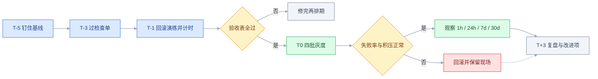
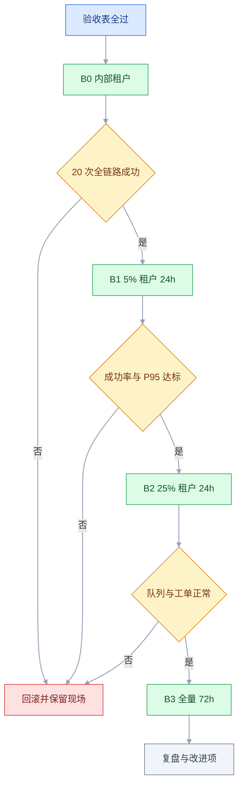

# 上线与发布

## 一、工程案例：一次灰度发布从上线清单到复盘

**场景**：一个多租户 SaaS 的报表模块，把「同步导出 Excel」改成「异步任务 + 完成后邮件与站内信通知」。改动跨前端导出按钮与进度页、后端新增 `report_job` 表、`report` 表加三个可空列、一个常驻 worker、一家第三方邮件服务。日活约 8000，付费客户 120 家。

**约束**（这些约束决定方案，不是背景装饰）：

| 约束 | 来源 | 对方案的影响 |
|---|---|---|
| 不能停机 | 客户 9:00–18:00 在用，合同 SLA 99.9% | 只能滚动发布，不开维护窗口 |
| 迁移只增不减 | 新列可空、有默认值，老代码能忽略 | 不删列、不改类型、不重命名 |
| 人力 4 人 | 1 运维、2 后端、1 前端 | 灰度压到 4 批，观察靠看板不靠人盯 |
| 3 家大客户要提前告知 | 合同写明重大变更提前 7 天 | 通知走客户成功，不走群公告 |
| 导出是高频动作 | 日均约 1.2 万次 | 出问题不是「少个功能」，是核心流程断 |

**先写假设，再谈灰度**。写不出假设，灰度只是「发得慢一点」：

| 假设 | 验证指标 | 达标线（示例） |
|---|---|---|
| 异步让用户感觉更快 | 点击到「已受理」的 P95 | 从 38s 降到 2s 内 |
| 用户能接受稍后取结果 | 导出成功率、重复点击率 | 成功率 ≥ 99.4%，重复点击不超基线 2 倍 |
| 通知能带回用户 | 导出后 10 分钟回站率 | 不低于基线 31% |
| 不把成本转给客服 | 导出相关工单 | 7 天日均 ≤ 基线 1.5 倍 |

**整条节奏和门禁**（时间点按实际排期调整，门禁不放宽）：



### 1.1 上线前 5 天：把基线钉在看板上

**没有基线的指标，上线后无法判断好坏。** 上线前把下面 6 个数按天存下来，至少存 14 天：

| 指标 | 口径 | 基线（示例） | 用途 |
|---|---|---|---|
| 导出请求数 | 点击「导出」的次数，按租户去重 | 12,000/日 | 判断流量是否符合预期 |
| 导出成功率 | 拿到文件的请求 / 总请求 | 99.4% | 主判定指标 |
| 端到端 P95 | 点击到文件可下载 | 38s | 体验是否退化 |
| 导出后回站率 | 导出后 10 分钟内再次访问 | 31% | 通知是否有效 |
| 导出相关工单 | 客服标签含「导出」 | 6 件/日 | 隐性故障 |
| 队列积压 | 待处理任务数 P95 | 新增，无基线 | 容量是否够 |

**基线要满足三个条件**：同口径、连续 14 天、能被第三个人复算。缺一个，上线后的「涨了 / 跌了」就会变成各说各话。

**口径示例**：导出成功率 = 拿到文件的请求数 / 导出请求数，按租户去重，排除用户主动取消。这句话写进看板说明，而不是留在某个人脑子里。

### 1.2 上线前 3 天：上线检查单

**清单只写真能拦住事故的项。** 判断标准：第三个人拿着这一行，5 分钟内能给出「过 / 不过」。

| 类别 | 空话写法 | 可验证的写法 |
|---|---|---|
| 功能 | 核心流程已测 | 3 种筛选组合 × 2 种格式各导 1 次，文件行数与列表页统计一致 |
| 性能 | 性能没问题 | 2 倍峰值压测，P95 ≤ 60s，错误率 ≤ 0.1% |
| 配置 | 配置已确认 | 两个环境的配置键集合 diff 为空，差异项逐条说明 |
| 通知 | 已通知客服 | 客服能复述三个问题：变了什么、用户问什么、怎么答 |

按类别展开的检查项与责任人：

| 类别 | 检查项 | 责任人 |
|---|---|---|
| 变更范围 | 发布单列出全部改动，含配置与依赖；无「顺手改的」 | 研发 |
| 制品 | 镜像、前端静态资源、worker 三者版本一致，记录 digest | 运维 |
| 迁移 | 预发库连跑两遍无报错；在接近生产量级上计时 | 后端 |
| 兼容 | 上一版代码能读新表结构；新代码能读旧数据 | 后端 |
| 开关 | 关掉开关后功能完整回退到同步导出 | 前端 |
| 依赖 | 邮件服务的日配额与分钟级发送速率均 ≥ 峰值 3 倍；发信域名 SPF/DKIM 通过 | 运维 |
| 监控 | 新增队列积压、任务失败率、邮件发送失败率三个指标 | 运维 |
| 告警 | 手工打一条错误日志，5 分钟内到值班群 | 运维 |
| 容量 | worker 副本数 ≥ 峰值并发 / 单副本处理能力 | 后端 |
| 数据 | 新旧链路同条件导出，行数与金额一致 | 测试 |
| 回滚 | 演练过且计时；上一版制品可拉取 | 运维 |
| 通知 | 客服话术、客户成功告知记录、状态页文案 | 产品 |
| 值班 | 72 小时排班表，升级电话可用 | 运维 |

**清单按「出事会不会死人」排序**，前 5 项是硬门禁，后面可以降级为参考项。超过 20 项，执行率通常会明显下降。

### 1.3 上线前 1 天：回滚演练

**演练不是读文档，是把三步真的做一遍并计时**：

```text
① 关开关：report_async 切成 false，确认前端回到同步导出、worker 停止取新任务
② 回滚镜像：app 与 worker 都切到上一版 digest，确认启动成功、健康检查通过
③ 停 worker：确认队列里的任务不会被上一版代码错误消费
```

| 动作 | 预期 | 实测 | 卡点 |
|---|---|---|---|
| 关开关 | < 10s | 8s | 老页面缓存 5 分钟，仍显示新入口 |
| 回滚镜像 | < 3min | 6min | 上一版 tag 已被 CI 清理策略删除 |
| 停 worker | < 1min | 1min | 队列里 300 个任务悬空，无人补偿 |

**演练暴露的三个问题，比演练本身更值钱**：

1. 镜像保留期 7 天 → 改成 30 天，发布单必须记 digest 而不只是 tag。
2. 开关客户端缓存 5 分钟 → 加配置版本号，前端轮询版本号，10 秒内生效。
3. worker 停机后任务悬空 → 任务格式向后兼容，回滚脚本带一步「未完成任务标记失败并通知用户重试」。

### 1.4 上线门禁：验收表

| # | 检查项 | 怎么验 | 通过标准 |
|---|---|---|---|
| 1 | 制品可追溯 | 发布单的 commit 与镜像 digest 对照 | 能在仓库按 digest 查到，CI 记录一致 |
| 2 | 迁移可重跑 | 预发库执行第二遍 | 无报错、无重复列 |
| 3 | 迁移耗时 | 接近生产数据量上计时 | 锁表 < 1s，总耗时 < 5s |
| 4 | 开关生效 | 切一次，前后端各看一次 | 10 秒内全部生效 |
| 5 | 回滚可用 | 修完保留期后重新演练一次 | 3 分钟内恢复，错误率回基线 |
| 6 | 监控覆盖 | 手工触发一次失败 | 5 分钟内告警到人 |
| 7 | 队列容量 | 2 倍峰值压测 | 积压 10 分钟内消化完 |
| 8 | 邮件配额与速率 | 查服务商后台 | 日配额、分钟级速率均 ≥ 峰值 3 倍 |
| 9 | 客服话术 | 让客服复述 | 三个问题都能答 |
| 10 | 大客户告知 | 查客户成功记录 | 3 家均有书面回复 |
| 11 | 数据一致 | 新旧链路同条件导出 | 行数、金额一致 |
| 12 | 值班到位 | 看排班与升级电话 | 72 小时有人应答 |

**任何一项不过就不发。** 例外只有一种：负责人书面同意，并写清「接受什么风险、出问题谁决策回滚」。口头同意不算。

### 1.5 上线当天：四批灰度



| 批次 | 范围 | 观察时长 | 进入下一批 | 回滚条件 |
|---|---|---|---|---|
| B0 | 内部 3 个账号 + 1 个测试租户 | 2 小时 | 成功 20 次，无 5xx | 任意一次失败 |
| B1 | 5% 租户（按 tenant_id 哈希，约 6 家） | 24 小时含一个高峰 | 成功率 ≥ 99.4%，P95 ≤ 60s，工单不涨 | 成功率 < 98% 或 P0 |
| B2 | 25% 租户（约 30 家） | 24 小时 | 同上，且积压 < 500 | 同上 |
| B3 | 100% | 72 小时重点观察 | — | 同上 |

**分流键选 tenant_id，不选 user_id**：同一个租户里有人走新链路、有人走旧链路，客服解释不清，报表数字也会对不上。分流要满足两点：稳定（同一租户每次命中同一组）、可解释（客服能查到某个租户在不在灰度里）。

**放量节奏由「观察结论」决定，不由时间表决定**。到了 24 小时但积压还在涨，就不进下一批。

### 1.6 观察窗口：1 小时、24 小时、7 天、30 天看不同的东西

| 时间 | 看什么 | 判断线 |
|---|---|---|
| 1 小时 | 5xx、任务失败率、队列积压 | 5xx 出现，或失败率、积压超基线 2 倍 → 停 |
| 24 小时 | 导出成功率、端到端 P95、工单量 | 成功率不低于基线 0.5 个百分点 |
| 7 天 | 导出后回站率、重复点击率、留存 | 回站率不低于基线 |
| 30 天 | 付费客户的导出频次、续费相关工单 | 无「因导出体验」的流失理由 |

**判断「跌了」之前先排除三件事**：样本量够不够、是不是同一批人、同期有没有别的变更。三个都没排除，就不要改产品。

**「上线即高峰，一周后回落」是常态**：新入口带来的好奇会推高第一周数据，把第 7 天的曲线和第 28 天的曲线放在一起看，才知道真实水平。

### 1.7 上线后 3 天：复盘

**复盘只认系统时间**：部署记录、告警时间、日志第一条错误、工单第一条，四处对齐成一条时间线。回忆出来的时间线一定会美化。

| 时间 | 事件 | 证据 |
|---|---|---|
| 10:00 | B2 放量到 25% | 发布系统记录 |
| 11:20 | 队列积压破 3000 | 监控曲线 |
| 11:26 | 工单第一条「导出没反应」 | 客服系统 |
| 11:31 | 告警触发（静态阈值 2000，触发偏晚） | 告警记录 |
| 11:40 | 决定暂停放量，worker 扩到 5 副本 | 值班群 |
| 12:05 | 积压清空 | 监控曲线 |

**三个「没想到」**：

1. 5% 时队列很闲，25% 时 worker 只有 2 个副本，积压到 4000 条。
2. 峰值是按历史同步导出的速度估的，没算上放量后集中补发的通知；日配额与分钟级速率都按 3 倍核对过，实际峰值仍超了估算，调用返回成功却被限流，通知静默失败。
3. 大客户 A 的报表 40 万行，单任务超时 10 分钟，用户以为没成功又点了一次。

**改进项**：

| 改进 | 负责人 | 截止 | 怎么验收 |
|---|---|---|---|
| 队列积压告警阈值改成「按消费速率动态计算」 | 运维 | 3 天 | 压测时能提前 5 分钟告警 |
| 邮件失败进重试队列，并计入失败率指标 | 后端 | 1 周 | 限流场景下失败率可见 |
| 超过 10 万行的导出拆分成分片任务 | 后端 | 2 周 | 40 万行任务 3 分钟内完成 |
| 导出按钮加「已提交，可关闭页面」提示 | 前端 | 3 天 | 重复点击率下降到基线 1.2 倍内 |
| 灰度批次表加入「容量核对」一栏 | 产品 | 立即 | 下一版发布单可见 |

**复盘的质量看一件事**：改进项里有没有「流程项」。全是「加个判断」「改个超时」，下次还会以另一种形式复发。

**这条流程沉淀下来的产出物**：基线看板（含口径说明）、上线检查单、回滚演练记录、验收表、灰度批次与放量记录、复盘报告。每份都要能被没参与的人接手复算，否则只是过程留痕。

---

## 二、高频问答：会卡住你的地方，也是面试最常问的

### 2.1 灰度 5% 一切正常，全量后十分钟就崩

**现场**

先别急着重回灰度。把灰度租户与全量租户的「单租户数据量、并发导出数、DB 连接数」拉成一张表对比，再按 2 倍峰值压测一次，盯三条曲线：连接池等待数、队列积压、DB CPU。

**要点**

- 灰度验的是功能，不是容量。5% 的租户既打不满连接池，也压不出慢查询；这批恰好是小租户时，连数据量级都不对。
- 把「小样本通过」当成「系统能扛」，错在样本在容量维度上不具代表性。
- 判定是容量还是功能：上量后连接池等待、队列积压、DB CPU 三条若非线性上升，就是容量问题。

**追问**

- 灰度该按什么维度选人？→ 按流量规模分层，保证样本里有大租户和高频用户，而不是随机抓 5%。
- 压测过了为什么还会崩？→ 压测的流量模型和真实分布不一致，放量后集中补发的通知这类二次流量没被算进去。
- 容量不够先扩还是先限流？→ 先扩副本和连接池止血，再按消费速率反推容量，限流不能当成长期方案。

### 2.2 回滚完成，用户还说打不开

**现场**

先排除浏览器侧，三步：无痕窗口打开一次、看控制台是否报 chunk 404、看 CDN 命中率与缓存键。三步都正常，再回头怀疑服务端版本。

**要点**

- 回滚的是服务端，用户看到的未必是：浏览器缓存了 `index.html`、CDN 没刷、旧 chunk 已被删，页面引用一个不存在的 JS 就白屏。
- 把「服务端版本」等同于「用户看到的版本」，是这类投诉的根因。
- 落地：`index.html` 一律 `no-cache`，静态资源文件名带内容 hash 且长缓存，发布后主动刷 CDN 目录；有 Service Worker 的产品要额外推一次版本更新。

**追问**

- 为什么入口文件不能长缓存？→ 它引用的 chunk 名字随版本变，缓存住就会一直指向旧版本。
- Service Worker 为什么要单独处理？→ 它在 HTTP 缓存之外又存了一层，按 UA 看版本占比会明显滞后。
- 回滚后错误率还高，怎么界定范围？→ 按版本号分桶看旧版本占比，占比在降说明只是缓存没到期，不降才是回滚没生效。

### 2.3 代码回滚了，数据回不去

**现场**

上线前先问三个问题：迁移能不能逆向、逆向后回滚窗口内的新数据怎么办、备份的时间点在哪。现场再查三处：迁移脚本有没有逆向步骤、窗口内写了多少、有没有备份到独立的表。

**要点**

- 「代码可回滚」不等于「系统可回滚」。迁移只加列改结构时，窗口内新数据按新结构写入，旧代码读不懂；迁移里夹了数据清洗，原值已被覆盖。
- 三问答不上来，就不要在高峰前做迁移。
- 边界：加可空列可以安全回滚；改类型、删列、数据清洗都不可逆。

**追问**

- 为什么只能加列、删列要延后？→ 旧代码还在跑，删了它读不到；删列要等所有读方下线，通常隔一个版本。
- 窗口内写入的数据怎么办？→ 用回填脚本按旧结构转换，或隔离标记后人工处理，不能默认它不存在。
- 有备份为什么还说不算回滚方案？→ 恢复备份会丢掉备份点之后的全部写入，它是兜底，不是回退。

### 2.4 测试环境好好的，生产报配置缺失

**现场**

启动日志里打印配置键集合，两个环境 diff 一次；再查部署流水线的变量注入步骤，判断是漏配、被覆盖，还是代码默认值不一致。

**要点**

- 配置漂移：某个键只在测试环境加过、生产的环境变量没注入，或代码里的默认值两边不一致。
- 把配置当成代码的一部分，以为一起发布就一起生效——配置有三个来源（代码默认值、环境变量、配置中心），发布只覆盖其中一个。
- 落地手段：启动时输出「配置键名 + 值哈希」的指纹（不打印值），发布单带上指纹，两个环境对不上就不发。

**追问**

- 为什么只打印哈希不打印值？→ 配置里有密钥，日志会被收集和外发。
- 配置中心能消除漂移吗？→ 它能管运行期开关，管不了启动依赖，进程起不来时连不上它。
- 代码里的默认值算配置吗？→ 算，它是最容易被忽略的第三个来源，两边代码版本不同就会表现不一致。

### 2.5 监控大盘全绿，用户已经在投诉

**现场**

用真实账号跑一遍核心链路：登录 → 核心动作 → 结果校验。同时看业务指标而不是资源指标，再查前端错误上报有没有对应时间点的异常。

**要点**

- 监控盯的是主机和进程，不是业务。健康检查只证明端口活着；错误可能被采样或吞掉；失败也可能发生在客户端。
- 把「服务器活着」当成「功能可用」，是这类事故的共同误判。
- 底线配置：至少一条从外部发起的合成拨测覆盖核心链路，再给核心动作配成功率指标，低于基线就告警。

**追问**

- 健康检查通过为什么还不能说明可用？→ 它探的是端口或进程，不校验业务依赖和返回内容。
- 为什么拨测要放在外部节点？→ 内网探测绕过了 DNS、CDN、证书这一整段用户真实路径。
- 资源指标还有用吗？→ 有用，但只用于定位，不用于发现；告警应该挂在业务指标上。

### 2.6 错误率没涨，转化率掉了

**现场**

把转化漏斗按步骤拆开，看是哪一步掉的；同时对比发布前后的 P95 与首屏时间，再分设备、分渠道各看一遍。

**要点**

- 变慢而不是变坏。P95 从 1.2s 到 3.5s，用户没报错但走了；也可能按钮位置、文案、默认值变了，导致埋点重复计数。
- 只用「错误」定义故障，会漏掉「摩擦」这一类损失。
- 掉在「点击后等待」这一步，基本就是性能问题。

**追问**

- 怎么区分真流失和埋点错误？→ 看后端请求量是否同步变化，埋点问题通常是比率突变而请求量不变。
- 首屏和交互延迟先看哪个？→ 看流失卡在哪一步，进入即走看首屏，操作中途放弃看交互延迟。
- 移动端要不要单独看？→ 要，设备和网络差异会让同一版本在两端表现相反。

### 2.7 上线后客服被问懵

**现场**

随机抽一个客服，问三个问题：变了什么、老用户会看到什么、出问题怎么安抚。答不全就是通知没到位，不是客服没看公告。

**要点**

- 公告写的是内部语言（「导出链路异步化」），客服拿不到「用户会问什么、怎么答」的话术卡，也不知道灰度范围。
- 把「发出通知」当成「完成同步」，验收标准应是「客服能复述」，不是「群里发了」。
- B 端还要给客户成功一份可转发的变更说明。

**追问**

- 话术卡该写哪几块？→ 变了什么、用户最可能问的三个问题及答法、出问题找谁。
- 为什么客服必须知道灰度范围？→ 要能查到某个租户在不在灰度里，否则解释不清「为什么他有我没有」。
- 对外通知用谁的语言？→ 用户语言，写「你要做什么」，不是「我们做了什么」。

### 2.8 迁移脚本把表锁了二十分钟

**现场**

先查锁等待与长事务（`information_schema.innodb_trx`），再看迁移语句的执行计划与引擎版本；大表走在线 DDL 工具，并给语句设锁等待超时。

**要点**

- 把「锁」当成「慢」会修错方向：DDL 要拿元数据锁，前面有一个长事务没提交，后面的查询就全排队；大表加索引在某些引擎上会重建表。
- 排查顺序是先找持锁的长事务，再谈数据库性能。
- 落地：迁移前查长事务、大表用在线 DDL 工具、设锁等待超时（MySQL `lock_wait_timeout`、PostgreSQL `lock_timeout`），拿不到锁就失败重试而不是无限等。

**追问**

- 为什么加一个可空列也可能锁表？→ 取决于引擎版本能否即时加列，老版本会重建表。
- 长事务从哪来？→ 应用里没提交的事务、手工开的会话、跑得久的查询，迁移前都要先清掉。
- 锁等待超时设多少合适？→ 设成业务能容忍的秒级窗口，让它快速失败重试，别拖成事故。

### 2.9 真要回滚，发现上一版镜像没了

**现场**

按发布单里的 digest 去仓库查，再查 CI 清理策略的保留规则：保留期是按天算还是按 tag 数量算。

**要点**

- 默认「发布过的东西一直都在」是错的：清理策略只保留最近 7 天或最近 5 个 tag，回滚目标刚好被清掉。
- 只记 tag 还有第二层风险：tag 被重新推送过，内容已经不是当时那份。
- 回滚锚点必须是 digest；保留期要覆盖「最长可能回滚窗口」，每季度抽一个旧版本做拉取验证。

**追问**

- 为什么 tag 不能当回滚锚点？→ 同名可以被重新推送，无法证明回到了哪份代码。
- 保留期按什么定？→ 按最长回滚窗口定（跨一个账期或大促），不是按磁盘省着算。
- 怎么证明回滚能力还在？→ 定期演练并计时，演练记录里带 digest，不是只看文档。

### 2.10 第三方依赖在关键时刻掉链子

**现场**

查三样：证书到期时间、服务商配额用量、依赖的 API 版本公告。三项都有前置信号，只是平时没人巡检。

**要点**

- 外部依赖不是稳定基础设施：证书到期（公开证书常见 90 天到 1 年，以实际签发时长为准）、邮件日配额与发送速率、短信通道限流、API 版本下线。
- 每个依赖建一条巡检：证书到期 < 30 天告警、配额用量 > 70% 告警、API 版本变更订阅公告。
- 关键链路必须有降级方案：失败进重试队列，而不是同步报错。

**追问**

- 被限流了为什么监控上看不出来？→ 调用返回成功但通知没发出去，只有失败率这类业务指标能发现。
- 证书自动续期了还要告警吗？→ 要，续期失败是静默的，告警是唯一能发现它没续上的手段。
- 降级到什么程度算可接受？→ 核心流程不阻塞，非核心能力（通知、导出）延后补偿。

### 2.11 周五下午发版，出事没人

**现场**

查发布记录的时间分布，看多少变更落在周五和节假日前；再查值班表是否覆盖周末与升级电话。

**要点**

- 没有发布窗口约束，也没有「发布后值守」规则，周五的变更就要带着整个周末的风险。
- 发布是团队风险，不是个人动作：主窗口定在周一至周三上午，周四只允许小变更，节假日前冻结。
- 紧急修复走双人审批，并且发布人守 2 小时。

**追问**

- 冻结期一刀切会怎样？→ 会逼出「偷偷改配置」这种更危险的行为，必须留双人审批的例外通道。
- 为什么不是干脆禁止周五发版？→ 紧急修复必须能发，禁的是计划内的常规变更。
- 解冻后第一周要注意什么？→ 积压的变更会集中上线，解冻首日要限流发布。

---

## 三、核心知识：从零开始要建立的东西

### 3.1 发布单元与不可变制品

一次发布 = 一个可回滚的最小变更集合。制品打出来就不再改，引用时用内容摘要（digest），不用可变的标签。

| 标识 | 可变性 | 回滚时的问题 |
|---|---|---|
| `latest` | 随时被覆盖 | 回滚到 latest 可能回到更晚的版本 |
| `v1.4.2` | 可被重新推送 | 同名不同内容，无法证明回到了哪份代码 |
| `@sha256:...` | 不可变 | 唯一可靠的回滚锚点 |

```yaml
image: registry.example.com/app@sha256:9f2c1b...   # 发布单里记这个
```

**边界**：一个仓库多个服务时，发布单元按服务切。把无关服务捆在一次发布里，回滚会顺手撤掉别人的正常变更。

### 3.2 环境分层与配置漂移

配置有三个来源：代码默认值、环境变量、配置中心。事故大多不是「配错了」，是「某个环境改过、别的环境没有」。

| 配置类型 | 放哪 | 漂移风险 |
|---|---|---|
| 启动期（端口、DB 地址） | 环境变量 / 编排文件 | 中，改完要重启 |
| 运行期开关 | 配置中心 | 高，最容易只在生产手改 |
| 业务参数（限额、模板） | 数据库 / 配置中心 | 高，常被运营直接改 |

**最小核对手段**：启动时打印配置键的指纹（键名 + 值哈希，不打印值），两个环境 diff 一次，缺哪个键一眼看到。

**边界**：配置中心解决不了启动依赖，进程起不来时它自己也连不上。

### 3.3 检查单的可验证性

检查项写不成「可验证」，就会退化成签名仪式。

| 写法 | 问题 |
|---|---|
| 「已确认配置正确」 | 谁确认、确认了哪几项、依据是什么 |
| 「回归测试通过」 | 跑了多少条、哪条没过、谁签的字 |
| 「已通知客服」 | 通知到人没有、能不能复述 |

**可验证 = 有对象、有动作、有判定线**。例：「用租户 T-1024 的账号导出 3 种筛选组合，文件行数与列表页统计一致」。第三个人能复现，才叫检查项。

**边界**：清单超过 20 项，通常就会被人跳过。把「会死人」的放前 5 项，其余降级为参考项。

### 3.4 灰度维度与分流键

| 维度 | 适用 | 坑 |
|---|---|---|
| 按比例 | 大多数 Web 功能 | 比例小时样本也小，业务指标看不出差异 |
| 按租户 | B 端、数据隔离强的产品 | 大客户被抽中要提前打招呼 |
| 按用户 | C 端功能 | 同一协作空间里体验不一致 |
| 按地区 | 合规、本地化 | 地区差异会污染指标对比 |
| 按版本 | 客户端 | 老版本用户永远进不了实验 |

**分流键的两条要求**：稳定（同一对象每次命中同一组）、与业务边界一致（租户级功能按租户分）。`hash(id) % 100 < 5` 是最小实现，但要用带盐的哈希，避免连续 ID 导致分组倾斜。

**边界**：强协作产品按用户分流会撕裂体验——两个人共享一份文档，一个看到新编辑器一个看不到。

### 3.5 观察窗口与基线

窗口长度由业务周期决定，不由耐心决定。

| 指标 | 最短窗口 | 原因 |
|---|---|---|
| 错误率、延迟 | 1 小时 | 高频，样本积累快 |
| 核心动作完成率 | 1 个完整工作日 | B 端有上班 / 下班差异 |
| 留存类 | 7 天起 | 次日留存看不出习惯 |
| 收入类 | 1 个账期 | 月结客户的行为集中在月末 |

**排除噪声的三步**：看样本量够不够、看是不是同一批人（同期群）、看同期有没有别的变更。三步没走完，不要下结论。

**边界**：窗口越长越可信，但发布节奏会被拖死。做法是拆开——短窗口看安全指标（错误率、延迟），长窗口看业务指标（留存、付费）。

### 3.6 回滚的三层能力

| 层级 | 耗时 | 前提 | 失效场景 |
|---|---|---|---|
| 开关 | 秒级 | 新旧逻辑同时存在 | 删除型变更、数据结构变了 |
| 代码 | 分钟级 | 上一版制品还在、迁移向后兼容 | 迁移不可逆、缓存格式变了 |
| 数据 | 小时级或不可逆 | 有备份、有回填脚本 | 回滚期间有新数据写入 |

**顺序是从上往下试**：先关开关，再回代码，最后才动数据。动数据之前必须回答「回滚窗口内新写入的数据怎么办」。

**边界**：开关不是免费的。每多一个开关，测试矩阵就多一倍组合；发布型开关在上线两周内必须清理。

> **面试**：常问「回滚有哪几层，先动哪一层？」答：开关、代码、数据，从上往下试，动数据前先回答回滚窗口内的新数据怎么办。

### 3.7 数据库迁移的兼容窗口

在线迁移的通用套路是「扩展—收缩」：先加、再双写、再切读、最后删。每一步都要保证**上一版代码仍能正常工作**。

| 变更 | 能否在线 | 做法 |
|---|---|---|
| 加可空列 | 能 | 直接加，老代码忽略它 |
| 加非空列 | 看引擎版本与默认值 | 有默认值、引擎支持即时加列时可加；否则加可空 → 回填 → 加默认值 → 改非空 |
| 加索引 | 视引擎 | 大表用在线 DDL 工具，避开高峰 |
| 改类型 / 重命名 | 不能 | 加新列双写，切读后再删旧列 |
| 删列 | 延后 | 等所有读方下线，通常隔一个版本 |

```sql
-- ① 只加，不要求写
ALTER TABLE report ADD COLUMN format varchar(16) NULL;
-- ② 新旧代码都写，读仍走旧列
-- ③ 回填历史数据：分批 5000 行，每批 sleep 100ms
-- ④ 切读，观察一个版本
-- ⑤ 删旧列
```

**边界**：小表可以直接改。判断标准是「锁表时间是否超过业务容忍窗口」，不是表的绝对行数。

> **面试**：常问「为什么上线只能加列，删列要延后？」答：旧代码还在跑，删了它读不到；删列要等所有读方下线，通常隔一个版本。

### 3.8 特性开关的债务

开关把「发布」和「上线」拆开了，代价是状态空间爆炸：10 个开关有 1024 种组合，测试不可能全覆盖。

| 类型 | 生命周期 | 处理 |
|---|---|---|
| 发布开关 | 上线后 1–2 周 | 删除，代码里只留新逻辑 |
| 实验开关 | 实验结束 | 定版后删除或转配置 |
| 运营开关 | 长期 | 必须有默认值、owner、审计 |
| 止血开关 | 长期 | 要演练，不能只活在文档里 |

**最小规范**：开关名带前缀（`release_` / `ops_` / `experiment_`），登记表里有 owner 和过期日，过期未清理的进技术债看板。

**边界**：开关读取代价低，**分支覆盖**代价高。长期开关必须收敛成配置，不能一直用 if 判断。

### 3.9 蓝绿与金丝雀的差异

| 维度 | 蓝绿 | 金丝雀 |
|---|---|---|
| 资源 | 两套完整环境 | 一套环境，按流量放量 |
| 切换 | 路由整体切 | 逐步放大比例 |
| 回滚 | 切回旧环境，秒级 | 缩小比例或回滚 |
| 数据库 | 两版同时在线，迁移必须兼容 | 同样要兼容，窗口更长 |
| 成本 | 通常接近翻倍 | 低 |

**选择依据**：能接受双倍资源、想要「一键切回」，选蓝绿；资源紧、想按真实流量验证，选金丝雀。两者都不解决数据迁移的不可逆问题。

**边界**：蓝绿环境共用数据库时，「切回」只回滚了代码，没回滚数据。

> **面试**：常问「蓝绿和金丝雀怎么选？」答：资源够、要一键切回选蓝绿；资源紧、要按真实流量验证选金丝雀，两者都不解决数据迁移。

### 3.10 事故分级与止血顺序


| 级别 | 判定 | 响应 | 谁定级 |
|---|---|---|---|
| P0 | 全站不可用、数据损坏或泄露 | 立即，全员，15 分钟内同步 | 值班 + 技术负责人 |
| P1 | 核心链路不可用 | 15 分钟 | 值班 |
| P2 | 非核心功能异常 | 1 小时 | 模块负责人 |
| P3 | 体验问题、个别用户 | 正常排期 | 产品 |

**定级宁高勿低**，事后可以降级；定低了没人来，才是真损失。

**止血前先约定破坏性**：回滚会丢新数据、关开关会让已提交任务失败。这些代价提前写进预案并由业务方签字，而不是在故障中现场争论。

### 3.11 值班与升级路径

告警要能叫醒人，靠三件事：分级路由、电话升级、静默规则。

| 级别 | 通道 | 响应时限 | 升级 |
|---|---|---|---|
| P0 | 电话 + 群 | 5 分钟 | 10 分钟无人接 → 技术负责人 |
| P1 | 电话 + 群 | 15 分钟 | 30 分钟 → 备份值班 |
| P2 | 群 | 1 小时 | 次日跟进 |
| P3 | 工单 | 排期 | — |

**告警内容模板**：现象（哪个指标、偏离多少）、影响面（多少用户 / 租户）、看板入口、建议动作。缺「建议动作」的告警，会把判断成本推给被叫醒的人。

**边界**：只有群消息没有电话，等于没有值班；反之全是电话，一周就会被人静音。分级是硬要求。

### 3.12 变更通知的受众分层

| 受众 | 关心 | 渠道 | 提前量 |
|---|---|---|---|
| 值班与研发 | 什么时候发、发什么、怎么回滚 | 发布群 + 发布单 | 当天 |
| 客服 | 变了什么、用户会问什么、怎么答 | 培训 + 话术卡 | 1–3 天 |
| 销售 / 客户成功 | 能承诺什么、不能承诺什么 | 简报 | 3–7 天 |
| 客户 | 我要做什么、什么时候、有什么影响 | 站内信 + 邮件 | 7 天（合同约定） |
| 管理层 | 目标、风险、失败预案 | 周报 | 按需 |

**对外通知写「用户要做什么」**，不是「我们做了什么」。「导出改为异步」是内部语言；「点击导出后可关闭页面，完成后会邮件通知」才是用户语言。

**边界**：通知发得越早，变更窗口内被追问的成本越高。B 端要给「变更说明 + 回退方案」，C 端一句公告即可。

### 3.13 复盘的证据链

时间线只用系统时间：部署记录、告警触发、日志第一条错误、工单创建时间。四处对齐，误差控制在分钟级。

| 层次 | 问题 | 产出 |
|---|---|---|
| 技术 | 哪个变更、哪行代码、哪个配置 | 直接原因 |
| 流程 | 为什么没被拦住（评审、测试、灰度、监控） | 防线缺口 |
| 组织 | 为什么这个缺口长期存在（人力、优先级、责任） | 改进项与 owner |

**五问的停止条件**：问到「某道防线缺失」就停。继续问到「某人疏忽」，只会让下一次没人说真话。

**边界**：无责复盘需要管理者公开承诺。承诺一次不追责却秋后算账，之后所有复盘都是删减版。

### 3.14 发布窗口与冻结期

| 窗口 | 适合 | 风险 |
|---|---|---|
| 周一至周三上午 | 常规发布 | 低，出问题有完整工作日处理 |
| 周四下午 | 小变更 | 中，出问题时人手开始变少 |
| 周五 | 紧急修复 | 高，周末值班薄 |
| 节假日前 3 天 | 不建议 | 高，供应商与客户都无人 |
| 大促 / 月结期间 | 冻结 | 高，任何抖动都被放大 |

**冻结期要有例外通道**：双人审批、只允许回滚和小修复、发布后必须有人守 2 小时。没有例外通道，冻结期会逼出「偷偷改配置」这种更危险的行为。

**边界**：冻结期越长，解冻后第一批变更越密集，风险反而最高。解冻首日要限流发布。

### 3.15 效果验证的判定结构

上线前把判定写死：假设、主指标、护栏指标、样本量、判定线、止损线。六项缺一项，事后就会各说各话。

| 结果 | 解读 | 动作 |
|---|---|---|
| 主指标涨、护栏稳 | 假设成立 | 保留，考虑扩大 |
| 主指标涨、护栏坏 | 有隐性代价 | 先修护栏，再决定 |
| 主指标平、护栏稳 | 无效但无害 | 下线，回收复杂度 |
| 主指标跌 | 假设错 | 回滚，记录反例 |

**没有对照组的「上线前后对比」在季节性强的业务里几乎不可用**：月末、周末、大促都会让曲线自己动。

**边界**：实验不是唯一手段。样本太小的 B 端功能，用定性访谈 + 分租户对比更现实。

### 3.16 批次大小与发布频率

| 策略 | 单次爆炸半径 | 定位成本 | 协调成本 |
|---|---|---|---|
| 大批量、低频 | 大 | 高，变更混在一起 | 低 |
| 小批量、高频 | 小 | 低，容易二分定位 | 高 |

**小批量是主流方向**，因为「哪次变更导致的」变成了可二分的问题。前提是自动化测试、可观测性、一键回滚三件套到位，否则只是更快地制造事故。

**观测口径**：变更失败率（需要回滚或热修的比例）、恢复时长、发布频率、从提交到上线的时长。四个数一起看，单看发布频率会误导。

**边界**：强耦合的单体应用很难做到每天多次。先把「可独立回滚的边界」切出来，再谈频率。

---

## 四、冷门知识汇总

只收「平时不常碰、真遇到按关键词现查就能处理」的点。

| 知识点 | 为什么冷门 | 用到时的关键词 |
|---|---|---|
| 制品 digest 与 tag 的区别 | 平时只写 tag，回滚时才暴露不可变性 | `@sha256:`、`docker manifest inspect` |
| 在线 DDL 工具 | 小表永远用不上，大表上线才需要 | `gh-ost`、`pt-online-schema-change`、`lock_wait_timeout`（MySQL）/ `lock_timeout`（PostgreSQL） |
| 双写与回填的顺序 | 迁移方案里最容易被跳过的一步 | 扩展—收缩、回填批次、切读开关 |
| 缓存键版本化 | 有缓存中间件后很少手写，出问题才发现 | key 前缀带版本、发布即失效、灰度隔离 |
| `index.html` 的缓存策略 | 静态资源长缓存是常识，入口文件例外 | `no-cache`、`no-store`、CDN 目录刷新 |
| 合成拨测 | 有业务监控后显得重复，直到监控本身失效 | synthetic monitoring、外部节点、核心链路脚本 |
| 错误预算 | 只在引入 SLO 的团队里出现 | SLO、燃烧率、冻结阈值 |
| 变更失败率与恢复时长 | 多数团队只盯可用性 | DORA 指标（部署频率、前置时间、变更失败率、恢复时长）、MTTR |
| 灰度分流的一致性哈希 | 分流代码写完就不再改 | 带盐哈希、稳定分桶、分流键 |
| 客户端最低版本门槛 | C 端强更才会遇到 | 强制更新、版本闸门、API 兼容期 |
| 邮件与短信的配额、退信率 | 平时不关心，活动当天打满 | 日配额、限流、退信、SPF/DKIM |
| 「当天」的时区口径 | 报表跨时区才暴露 | UTC 存储、展示时区、账期边界 |
| 连接池与预编译语句 | 重启后偶发报错，难复现 | prepared statement、连接复用、重启顺序 |

**这张表只解决「关键词查找」**。回滚失败、迁移不可逆、数据没备份、变更窗口冲突这几类虽然低频，但出错代价高，处理办法在第二节，不能当成冷门知识跳过。
