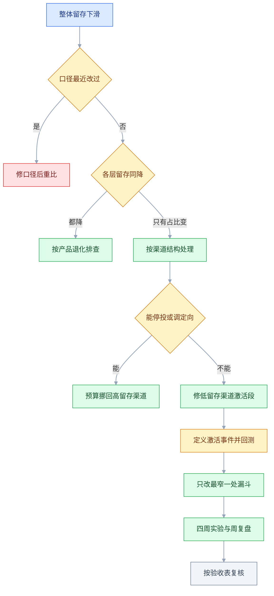
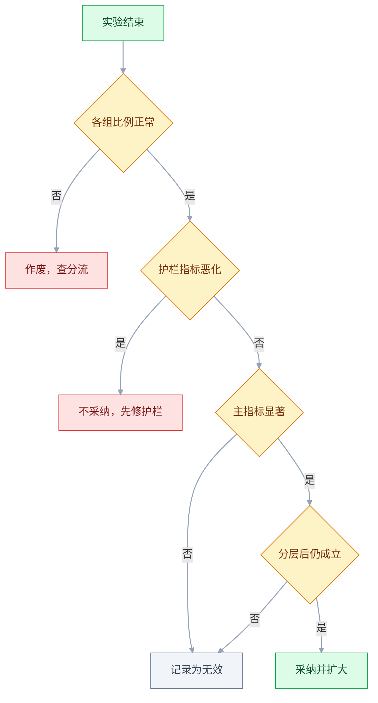

# 增长与运营

## 一、工程案例：一次留存下滑的结构诊断与 30 天动作

> 本文所有数字均为**示例**，仅用于说明口径与算法，**以实际数据为准**，不代表任何真实产品。

**场景**：一个协作笔记工具，月新增注册约 4 万（示例）。近 3 个月 7 日留存从 26.6% 掉到 19.4%，投放预算没变，但获客结构变了：信息流从 20% 升到 60%。管理层的要求是「下周就看到数字抬头」。

**约束**（决定了动作的优先级，不是背景）：

| 约束 | 来源 | 对动作的影响 |
|---|---|---|
| 投放合同到年底，不能停投 | 年框协议 | 只能调定向、出价、素材与回传目标 |
| 只有 1 名数据分析师 | 团队配置 | 拆解只能做一次，必须一次做对 |
| 研发只给 20% 排期 | 季度规划 | 只改漏斗最窄的一到两处，不铺开 |
| 老板要「下周见效」 | 管理层 | 短期靠召回与投放回传，产品改动放第二周 |

**整条诊断路径**（按顺序走，上一步没有结论就不进下一步）：先排除口径，再分结构，最后才改产品。

**每一步的产出物**（做完应有这些东西，不是只有结论）：

| 步骤 | 产出物 | 完成标志 |
|---|---|---|
| 1.1 结构拆解 | 渠道 × 时期的留存与占比表 | 固定权重折算后能解释跌幅 |
| 1.2 激活事件 | 候选动作与留存差的回测表 | 分渠道后方向一致且可干预 |
| 1.3 漏斗分层 | 分渠道漏斗表 | 最窄一段能归因到具体人群 |
| 1.4 同期群 | 至少 8 周的 cohort 曲线 | 新老 cohort 形状差异可解释 |
| 1.5 动作表 | 四周动作、假设、指标、止损 | 每个动作有负责人和周次 |
| 1.6 实验登记 | 实验登记表 + 周复盘记录 | 连续 4 周有「砍掉什么」 |
| 1.7 验收 | 验收表逐项打勾 | 11 项全部有证据 |

**第一步不是看产品，是先算结构。** 留存下滑通常有三种：同一批人的留存变差、来的人变了、口径变了。前两种分别是产品问题与渠道问题，动作完全相反；第三种是数据问题，必须先排除。

### 1.1 结构拆解：把「跌 7.2 个百分点」拆成两半

| 渠道 | 前：占比 | 前：7 日留存 | 后：占比 | 后：7 日留存 |
|---|---|---|---|---|
| 信息流 | 20% | 12% | 60% | 12% |
| 自然搜索 | 45% | 30% | 23% | 30% |
| 邀请 | 20% | 40% | 10% | 40% |
| 其他 | 15% | 18% | 7% | 18% |
| **加权合计** | 100% | **26.6%** | 100% | **19.4%** |

算一遍就清楚了：**在这个示例里，每个渠道的留存都没变**，整体却掉了 7.2 个百分点。原因是高留存的自然搜索从 45% 降到 23%，低留存的信息流从 20% 涨到 60%。

**这一步的结论不是「产品没问题是渠道问题」**，而是：

1. 产品本身没有明显退化，不需要紧急改核心功能。
2. 整体留存指标对渠道结构极度敏感，靠单一总体数字做决策会持续误判。
3. 合同不能停投，所以不能靠「把预算挪回搜索」解决，只能在信息流人群的激活上做。

**动作方向由此确定**：先修「信息流用户从注册到首次价值」这一段，再谈其他。

### 1.2 定义激活事件：不要拍脑袋

取 8 周前注册的用户，按「注册后 7 天内是否做过某动作」分组，比较 30 日留存（示例）：

| 候选动作 | 做过的人 30 日留存 | 没做的人 | 差值（百分点） | 可被产品干预 |
|---|---|---|---|---|
| 创建第 1 篇笔记 | 41% | 12% | +29 | 是 |
| 使用模板 | 46% | 15% | +31 | 是 |
| 邀请 1 位协作者 | 58% | 17% | +41 | 部分是 |
| 安装客户端 | 33% | 21% | +12 | 是 |
| 关注 1 个模板作者 | 29% | 20% | +9 | 是 |

**差值最大的不一定是激活事件。** 邀请协作者差值最高，但它是「已经感受到价值」的结果，不是原因——把它设成激活目标，只会让产品去逼新用户拉人。

选择「创建第 1 篇笔记」作为主激活事件，因为：时间上发生在留存之前、可被产品引导、在信息流人群里同样值得做（1.3 显示信息流的工作区 → 首篇只有 29%）。

**激活事件的定义要写成一句可计算的话**：「注册后 7 天内创建 1 篇笔记并保存成功，且正文不少于 20 字」。少了后半句，用户点一下「新建」就被算作激活，激活率会虚高。

### 1.3 漏斗与分层：找可干预的最窄一段

以信息流投放一个月、100 万次点击为口径（示例）：

| 步骤 | 人数（示例，万） | 本步转化 | 流失 |
|---|---|---|---|
| 广告点击 | 100 | — | — |
| 落地页 → 注册 | 2.2 | 2.2% | 97.8 |
| 注册 → 创建工作区 | 1.8 | 82% | 0.4 |
| 工作区 → 创建第 1 篇笔记 | 0.72 | 40% | 1.08 |
| 第 1 篇 → 7 日内第 2 篇 | 0.41 | 57% | 0.31 |
| 第 2 篇 → 邀请协作者 | 0.13 | 32% | 0.28 |

**注册 → 首篇整体约 33%，拆开看，最窄的可干预段是「工作区 → 创建第 1 篇笔记」，40%。** 再按来源分层：

| 来源 | 工作区 → 首篇 | 首篇 → 第 2 篇 |
|---|---|---|
| 自然搜索 | 58% | 61% |
| 邀请 | 62% | 64% |
| 信息流 | 29% | 48% |
| 其他 | 42% | 55% |

按各渠道注册占比近似加权：0.60×29% + 0.23×58% + 0.10×62% + 0.07×42% ≈ 40%，与漏斗里的 40% 基本对得上。

信息流人群的首篇率只有 29%，是自然搜索的一半。**这解释了信息流人群为什么留存低**：他们带着「看看这是什么」的动机进来，落地在一个空白编辑器前，不知道写什么。7.2 个百分点的跌幅来自占比变化，而首篇率低正是产品侧能修的那一段。

**判断依据不是「哪个数字最小」，而是「哪个差距能被产品改动影响」**。2.2% 的落地页转化数字更小，但它主要由素材与投放定向决定，研发改不动，只能提优化建议，不进研发排期。

### 1.4 同期群与留存曲线

| 注册周 | D1 | D7 | D30 | 曲线是否走平 |
|---|---|---|---|---|
| W-8 | 46% | 28% | 13% | 是，第 30 天后稳定在 12% |
| W-6 | 44% | 27% | 12% | 是 |
| W-4 | 41% | 23% | 9% | 否，仍在下降 |
| W-2 | 38% | 19% | 8% | 否 |

两个信号要分开读：

- **老 cohort 曲线走平**，说明产品仍有一批核心用户，不是整体失效。
- **新 cohort 的 D30 没走平且逐周下滑**，说明新进来的人里「会变成核心用户」的比例在减少——与渠道结构变化一致。

**曲线走平的判断通常需要至少 8 周观察**（经验值，以实际波动为准）。只看到第 14 天就宣布「走平」，通常只是下降变缓。

### 1.5 30 天动作表

四周，每周只推 2–3 个动作。每个动作必须有负责人、假设、验证指标、止损条件，缺一个就不进排期。

| 周 | 动作 | 负责人 | 假设 | 验证指标（示例） | 止损条件 |
|---|---|---|---|---|---|
| W1 | 信息流落地页与首启页换成「模板预览 + 一键创建」 | 设计 + 前端 | 空白页是首篇率低的主因 | 工作区 → 首篇 29% → 38% | 低于 33% 回退旧版 |
| W1 | 广告平台回传「创建首篇」作为转化目标 | 增长 | 出价对齐高质量人群 | 信息流首篇率、单次激活成本 | 成本涨超 30% 暂停 |
| W2 | 首启给 3 个模板，按来源行业推荐 | 产品 | 选择成本高于创作成本 | 模板使用率、首篇率 | 首篇率不涨则撤 |
| W2 | 第 2 天未创建笔记：站内信 + 一次推送 | 运营 | 补一次低成本提醒 | 次日回访 +3 个百分点 | 卸载率上涨即停 |
| W3 | 第 1 篇完成后引导「邀请 1 人协作」 | 产品 | 协作行为带来长期留存 | 邀请率 8% → 12% | 邀请后留存不涨则撤 |
| W4 | 7 日未登录邮件召回，带自己的笔记摘要 | 运营 | 内容召回优于优惠券 | 打开率、回访率 | 退订率 > 1% 停 |
| W4 | 复盘，只保留有效动作（不超过两个） | 增长负责人 | 动作堆积会稀释执行 | 7 日留存回到 23% | 未达标则重排优先级 |

表内目标与止损线均为示例，按实际基线与可获取样本调整。研发排期只覆盖 W1 落地页与 W2 首启模板两处；回传、推送、邮件与复盘由增长和运营执行，不占研发。

**优先级排序的依据**：影响面（覆盖多少新用户）× 可干预性（产品能改多少）× 成本（研发天数）。三项打分，不做「感觉重要」的排序。

**W1 的两个动作是一组**：落地页降低首篇门槛，回传让投放去买「更可能写第一篇」的人。只做前者，买来的还是同一批人；只做后者，落地页仍然接不住。

### 1.6 实验登记与周复盘

| 字段 | 说明 |
|---|---|
| 编号 | 周次 + 序号，便于回查 |
| 假设 | 「如果……那么……因为……」，一句话 |
| 人群与分流 | 按用户还是按设备，比例多少，是否排除老用户 |
| 主指标 / 护栏 | 一个主指标，一到两个不能被牺牲的指标 |
| 样本量与周期 | 预估每组样本，计划跑几天 |
| 结论 | 涨 / 平 / 跌，以及是否采纳 |

**没有登记表的实验等于没做**：两周后没人记得当时为什么改、结果是什么，同样的实验会被重复做三遍。

**周复盘只回答三个问题**：哪个动作有效、哪个无效、下周砍掉什么。不做汇报式复盘。

### 1.7 验收表

| # | 检查项 | 怎么验 | 通过标准（示例） |
|---|---|---|---|
| 1 | 口径对齐 | 增长报表与数据仓库同一天同一人群对比 | 差异 < 1% |
| 2 | 拆解可复现 | 另一人用同一份查询重跑 | 结果一致 |
| 3 | 分层覆盖 | 至少按渠道、设备、是否激活三层看 | 每层样本 ≥ 500 |
| 4 | 激活事件有预测力 | 用历史数据回测 | 激活组留存 ≥ 未激活组 2 倍 |
| 5 | 埋点完整 | 抽 100 个用户手工核对漏斗 | 每步都有数据，无重复计数 |
| 6 | 动作可执行 | 每个动作有负责人和周次 | 无「待定」 |
| 7 | 样本量已估 | 登记表里有 MDE 与所需样本 | 所需样本 ≤ 可获取量 |
| 8 | 护栏明确 | 每个实验至少 1 个护栏指标 | 写清不恶化的范围 |
| 9 | 归因可解释 | 渠道后台与产品后台差异逐项说明 | 差异 < 10% 且有原因 |
| 10 | 风控到位 | 邀请、优惠规则做批量注册压测 | 脚本刷取被拦截并有记录 |
| 11 | 周复盘留痕 | 连续 4 周有记录 | 每次都有「砍掉什么」 |

验收阈值是示例，按业务实际口径与波动调整；「无待定」与「有证据」两项不可放宽。

---

## 二、高频问答：会卡住你的地方，也是面试最常问的

下面按「现场 → 要点 → 追问」展开：现场是怎么判断、怎么落地，追问是面试官会顺着往下问的那一层。前 11 个是高频卡点；2.12 与 2.13 低频但代价大，不能放进冷门知识。

### 2.1 留存跌了，别急着归到「产品变差了」

**现场**

按渠道、设备、注册周分层重算留存，再做一次固定权重折算：把上期的占比固定住，只让各层的留存变，看总体会是多少。折算后回到 26.6%，跌的 7.2 个百分点就全是结构。

**要点**

- 先怀疑结构，不是产品：低留存渠道的占比上升时，每个渠道内部其实没变，加权合计也会掉。
- 把「总体指标」当成「同一批人的变化」，错在忽略了权重也在变。
- 固定权重折算是判定手段：折完还在跌，才是产品退化。

**追问**

- 什么时候可以直接判定是产品问题？→ 各层留存同降，并且排除了同期发布和数据口径变更。
- 结构问题该怎么处理？→ 先看能不能停投或调定向，不能就修低留存渠道的激活段。
- 折算用哪一期的占比？→ 用上期做基准，算出「结构不变时」的留存，与实际的差值就是结构效应。

### 2.2 总体转化涨了，每个渠道却都在跌

**现场**

画一张「渠道 × 时期」的四格表，每格同时列转化率与占比，再算两期合计，看是谁在动。

**要点**

- 辛普森悖论：预算从低转化渠道挪到高转化渠道，总体被拉高，两个渠道自身都在退化。
- 默认整体方向必然与每一层一致，错在忽略了加权平均里权重也在变。
- 拆法：把总体变化拆成「各层转化率」和「各层权重」两个因子，只动权重就是结构问题。

**追问**

- 怎么快速判断是辛普森？→ 分层后每层方向一致、却与总体相反，基本就是。
- 该看总体还是分层？→ 决策用分层，汇报两个都要给，否则会被当成互相矛盾的数据。
- 分层要多细？→ 每层至少几百个样本、层数不超过 6，再细全是噪声。

### 2.3 DAU 涨了，留存却没涨

**现场**

同一批新用户，分别算「登录率」和「核心动作完成率」，两者差距越大，说明活跃口径越虚。

**要点**

- 活跃口径把「启动即活跃」算进去了：推送、买量、渠道包带来的都是一次性启动，不是核心动作。
- 用「来了」代替「用了」，是这类误判的根源。
- 落地：把活跃定义换成「完成一次核心动作」，重算 DAU 与留存，再决定要不要继续加投放。

**追问**

- 北极星指标为什么不用 DAU？→ 它可以被推送注水，不反映用户获得的价值。
- 核心动作怎么定？→ 过激活事件那三道检验：时间顺序、分层后成立、可被干预。
- 口径改了历史数据怎么办？→ 用新口径重跑历史区间再比，不能新旧混着看。

### 2.4 激活率涨了，留存一动不动

**现场**

回测：把激活事件换成候选动作，看哪一项能把人群区分开；再看激活后第 7 天的二次行为。最干净的验证是只改引导、不动其他变量的实验。

**要点**

- 激活事件选错了：选了一个「顺手就能做」的动作（点开示例、逛一圈模板），它和留存只是相关，不是因果。
- 把「相关」当成「可干预的原因」，是这里的典型误判。
- 激活率涨而留存不动，说明这个动作只是「早到者的标记」，不是「通往价值的台阶」。

**追问**

- 一个动作要满足什么才能当激活事件？→ 发生在留存之前、每个渠道都成立、产品能引导。
- 邀请协作者差值最大，为什么不用它？→ 它是「已经感受到价值」的结果，设成目标只会逼用户拉人。
- 激活定义要写到多细？→ 一句可计算的话，含动作、时间窗、完成标准，例如正文不少于 20 字。

### 2.5 A/B 实验显著，全量后没效果

**现场**

先做 SRM 检查（各组人数是否符合预期比例），再查实验期是否覆盖完整业务周期、同期还有几个实验在跑。

**要点**

- 四种常见解释：样本量不足的假阳性、新奇效应、多重比较、分流比例失衡；实验期正好撞上活动也算。
- 把「p 值显著」当成「效应真实且可复现」，是误判的起点。
- 判读顺序：SRM → 效应量是否大于 MDE → 分层后是否只在某一小群人里有效。

**追问**

- SRM 是什么？→ 分流失衡，实际各组人数偏离设计比例，通常说明分流或埋点有问题，结论直接作废。
- 新奇效应怎么排除？→ 跑到 2 周以上再看，看效应是否随时间衰减。
- 显著但效应很小，要采纳吗？→ 不采纳，效应量小、实现成本高时，正确动作是记录后放弃。

### 2.6 推送一发 DAU 就涨，一周后卸载率也涨

**现场**

对比推送组与对照组的 14 日留存、卸载率、关闭通知比例，别只看当天 DAU。

**要点**

- 召回透支：被推回来的人没有新理由留下，只是把流失推迟了几天，代价是打扰成本累积。
- 只看当天 DAU、不看 14 天后的留存与卸载，就会把它读成「推送有效」。
- 给推送建一个「净留存」口径：推送带来的回访人数，减去此后 14 天内流失与卸载的人数。

**追问**

- 推送的护栏指标是什么？→ 卸载率、关闭通知比例、退订率，超过阈值就停。
- 召回文案怎么写才有效？→ 带用户自己的东西，笔记摘要、未完成任务，通用优惠券打开率更低。
- 什么时候该放弃召回？→ 60 天以上无核心动作的流失用户，只做低成本触达。

### 2.7 活动 GMV 涨了，毛利没涨

**现场**

用「贡献毛利」而不是 GMV 结算：拉一张活动损益表，增量收入减去补贴、履约、退货、客服成本；再对比活动期与前后各两周的退货率、客单价、新客占比。

**要点**

- GMV 不是利润：补贴计入成本、优惠叠加、退货与取消、老用户把原价单改到活动期下、刷单，都会让 GMV 涨而毛利不涨。
- 用规模指标替代利润指标，就会得出「活动成功」的错误结论。
- 关键追问是「增量里有多少是本来就会买的人」，那部分不叫增长。

**追问**

- 贡献毛利要扣哪些项？→ 收入减变动成本，包括支付通道费、履约、客服。
- 真实增量怎么算？→ 留出对照地区或人群，看没做活动时的基线。
- 老用户改单造成的虚增怎么识别？→ 看活动期的新客占比与客单价结构，老客订单集中在活动期就是信号。

### 2.8 LTV/CAC 看着健康，现金流却紧张

**现场**

用真实 cohort 的存活曲线重算 LTV，把毛利、回收期、现金余额放在一张表里。示例：CAC 300、月 ARPU 30、毛利率 70%，月毛利 21，回收期约 14.3 个月。

**要点**

- LTV 用了「假设留存 24 个月」的理想曲线，还用了收入而不是毛利，也没算回收期。
- 把 LTV 当成一个静态常数，模型就会一直「跑得通」。
- 客户平均只活 12 个月时这笔生意每单都亏：LTV = 21 × 12 = 252，小于 CAC 300。

**追问**

- LTV/CAC 大于 3 就安全吗？→ 不一定，它假设留存稳定；留存还在下滑时这个比值没有意义。
- 回收期怎么和现金余额对照？→ 回收期 14.3 个月，现金就要能撑过这段，否则增长越快越早断。
- 为什么必须用毛利？→ 收入里含通道费、履约、客服，不构成能回收的现金。

### 2.9 邀请奖励上线，被老用户刷走一批

**现场**

查同一设备号 / 支付账号 / IP 段下的账号聚集，再查奖励发放与「被邀请人 7 日留存」的相关性；最后跑一次批量注册压测，看能不能刷穿。

**要点**

- 规则不闭合：同一设备可注册多账号、邀请人与被邀请人可互刷、奖励即时到账且可提现、没有新客身份校验。
- 把风控问题当成激励力度问题，调高门槛只会伤到真实用户。
- 落地：奖励改成「被邀请人完成激活后发放」，加设备与支付账号去重。

**追问**

- 为什么奖励要延迟到激活后发？→ 刷单成本从「注册」提高到「做出真实行为」。
- 三重去重够吗？→ 设备 + 支付账号 + 手机号是底线，还要频次限制和行为验证。
- 病毒系数 K 越高越好吗？→ 不是，邀请来的用户质量通常低于自然获客，把 K 当唯一目标会催生骚扰式邀请。

### 2.10 渠道后台和产品后台的数据对不上

**现场**

拿同一天、同一渠道、同一转化事件做三方对账，把差异按「窗口 / 去重 / 时区 / 无效流量」四类归因。

**要点**

- 两套系统不是在数同一件事：归因窗口不同（7 天 vs 30 天）、去重口径不同（点击 vs 激活）、时区不同、渠道把「展示」算成「点击」。
- 假设两套系统在数同一件事，是第一层误判；先对定义再对数字。
- 差异在 10% 以内（示例阈值）且四类原因能解释，就算对齐。

**追问**

- 改归因窗口会有什么后果？→ 各渠道功劳立刻重排，所以它要当成一次口径变更来通知。
- 为什么渠道的数据总比产品后台高？→ 展示计点击、无效流量没剔除、去重窗口更宽，通常都是高的一方。
- 归因能算出渠道的真实增量吗？→ 不能，归因只是分配功劳，增量要靠留出对照的实验。

### 2.11 留存曲线「走平」是假的

**现场**

把观察期拉到 8 周以上，看每个 cohort 的人数，再核对口径变更记录。

**要点**

- 四个常见原因：观察期太短（只看到第 14 天）、样本太小、口径中途改过、把「卸载后重装」算成新用户。
- 把「下降变缓」当成「已经走平」，是这条曲线最常见的误读。
- 真走平是连续 3–4 周在同一水平波动，且新老 cohort 形状一致；只有老 cohort 走平、新 cohort 持续下滑，是结构问题。

**追问**

- 为什么至少要 8 周？→ 走平是渐近行为，14 天通常只是下降变缓。
- cohort 表最容易犯什么错？→ 观察期没对齐，拿只活了 14 天的 cohort 和 60 天的比 D30。
- 低频产品怎么看留存？→ 改用月留存或「下一个使用周期留存」，日留存会得出「全都不留存」的错误结论。

### 2.12 活动规则上线，补贴被叠加领穿

**现场**

用测试账号跑「领券—叠加—退款—再领」全链路，再查同设备、同支付账号下的账号聚集；上线前跑一次批量注册与并发领取压测。

**要点**

- 规则不闭合：资格、叠加、时间、退款、兜底、风控，漏一处就能被放大。
- 把规则当文案写、没当状态机设计，才会出现「写清楚了还是被领穿」。
- 每个奖励列出「发放条件、发放时点、回收条件、幂等键」四列，缺一列就是漏洞。

| 漏洞 | 典型形态 | 防法 |
|---|---|---|
| 资格 | 老用户注册小号算新客 | 设备 + 支付账号 + 手机号三重去重 |
| 叠加 | 优惠券与折扣、满减同时生效 | 明确「不可叠加」并做系统校验 |
| 时间 | 时区不一致导致提前或延后 | 统一用服务器时区，写清起止时刻 |
| 退款 | 退款后奖励未回收 | 奖励延迟发放或可追回 |
| 兜底 | 库存耗尽、奖励发完没有提示 | 设总量上限与友好提示 |
| 风控 | 批量注册、脚本领取 | 频次限制、行为验证、人工复核 |

**追问**

- 为什么退款规则最容易出漏洞？→ 钱退了奖励没回收，等于凭空发券。
- 幂等键防的是什么？→ 并发重复领取，同一次请求只能发一次奖励。
- 兜底为什么也算风险？→ 库存耗尽没有提示，用户会一直重试并把问题捅到客服。

### 2.13 指标突然变好，其实是口径被改宽了

**现场**

任何指标环比大幅改善，先做一次「口径 diff」：分子、分母、去重键、时间窗四项逐项对比上一版；再用旧口径重算一遍，抽查 100 个用户的原始事件。

**要点**

- 定义被悄悄放宽：登录算活跃、点击算使用、取消单算成交；也可能是样本被挑选、异常值被删掉。
- 只看结果、不看分子和分母有没有换，就会把口径变更当成增长。
- 四项都没变，再谈增长。

**追问**

- 环比大幅改善时第一件事做什么？→ 口径 diff，不是汇报。
- 怎么发现样本被挑选？→ 看总人数是否对得上，剔除异常值的规则有没有留记录。
- 口径修正后数字变差怎么办？→ 新旧两套口径各报一次并写清差异，不要悄悄覆盖历史。

---

## 三、核心知识：从零开始要建立的东西

### 3.1 增长漏斗的阶段定义

漏斗的每一段都必须有**可观测的行为**和**明确的时间窗**，否则算不出来。

| 阶段 | 定义 | 典型行为 | 口径陷阱 |
|---|---|---|---|
| 获取 | 第一次访问并留下可识别身份 | 点击、注册 | 把「展示」算成「获取」 |
| 激活 | 首次获得核心价值 | 完成一次核心动作 | 动作太轻，人人可完成 |
| 留存 | 在窗口内重复获得价值 | 第 N 天仍做核心动作 | 用登录代替核心动作 |
| 收入 | 为价值付费 | 首单、续费 | 把 GMV 当收入 |
| 推荐 | 主动带来新用户 | 邀请、分享 | 把「点了分享」算成邀请 |

**AARRR 与 RARRA 的差别只在顺序**：RARRA 把留存、激活、推荐、收入、获取重新排序，留存被放在获取之前，理由是留存不成立时，获客投入的边际回报为负。顺序不是教条，**资源分配的顺序**才是重点。

**最小示例**：激活 = 注册后 7 天内创建 1 篇笔记并保存成功，正文 ≥ 20 字。没有这句定义，后面所有比率都不可比。

**边界**：B 端的激活通常是「团队完成一次真实业务」，不是「个人注册成功」。照搬 C 端口径会把整个 B 端漏斗算错。

### 3.2 留存口径与曲线

留存 = 某天新增的用户中，在第 N 天（或第 N 天及以后）仍有核心行为的比例；具体用哪一种，取决于口径。三种常用口径：

| 口径 | 算法 | 适用 | 坑 |
|---|---|---|---|
| 日留存 | 第 N 日活跃 / 首日新增 | 高频产品 | 低频产品会得到一条贴地的线 |
| 周留存 | 第 N 周活跃 / 首周新增 | 中频、工具类 | 周内多次使用被压成一次 |
| 滚动留存 | 第 N 日及以后仍活跃 / 首日新增 | 看整体盘面 | 前期偏高，掩盖短期问题 |

**曲线的三种形状**：一路降到接近 0（没有稳定价值）、降到某点后走平（有一批核心用户）、先降后升（有网络效应或周期性需求）。

**最小示例**：1000 人注册，D1 400、D7 200、D30 100，之后稳定在 90。走平点在 9%，这 9% 就是核心盘。

**边界**：低频产品（招聘、月结工具、体检）用日留存会得出「全都不留存」的错误结论，应改用月留存或「下一个使用周期留存」。

### 3.3 激活事件的选择

「做过 A 的人留存高」不等于「让用户做 A 就能提高留存」。要过三道检验：

| 检验 | 问题 | 不通过的样子 |
|---|---|---|
| 时间顺序 | A 是否发生在留存之前 | 邀请好友发生在「已经爱上产品」之后 |
| 分层后成立 | 在每个渠道、每个设备上都成立 | 只在自然搜索人群里成立 |
| 可被干预 | 产品能否引导用户做 A | 「在公司有同事一起用」无法引导 |

**最小示例**：在 4 个渠道里分别算「做 A / 不做 A」的 30 日留存差，四个差值都显著，才把它定为激活事件。

**边界**：强相关但不可干预的动作，适合做「健康度指标」，不适合做「激活目标」。硬把它设成目标，会催生一批只做动作不留存的行为（例如把引导做成强弹窗，激活率涨了、留存反而跌）。

> **面试**：常问「做过某动作的人留存高，能不能说这个动作带来了留存？」答：不能，要过时间顺序、分层后成立、可被干预三道检验。

### 3.4 分群与辛普森悖论

总体和分层可以给出相反结论，原因是各层权重在变。下面用一组示例说明：

| 渠道 | 上期占比 | 上期转化 | 本期占比 | 本期转化 |
|---|---|---|---|---|
| A | 80% | 10% | 20% | 9% |
| B | 20% | 40% | 80% | 35% |
| 合计 | 100% | 16% | 100% | 29.8% |

总体从 16% 涨到 29.8%，两个渠道自身都在跌。**只看合计，会得出「全面变好」的错误结论。**

**防法**：任何总体指标变动，先做三层拆解——按来源、按新老、按设备。三层的方向一致，再谈总体。

**边界**：分层太细会让每层样本不足，反而全是噪声。经验值是每层至少几百个样本、层数不超过 6，具体以实际方差为准。

> **面试**：常问「总体在涨、每个渠道都在跌，怎么解释？」答：辛普森悖论，各层权重变了；决策看分层，汇报要把两层都给。

### 3.5 同期群分析

同期群（cohort）把「同一时间进入的用户」放在一起，纵向看他们后续的行为。它解决的是「不同批次的人混在一起，看不出变化」。

| 用途 | 怎么切 | 注意 |
|---|---|---|
| 看产品改动效果 | 按注册周 | 改动前后各留 2 周做对照 |
| 看渠道质量 | 按来源 + 注册周 | 同渠道跨周对比才有意义 |
| 看留存趋势 | 按注册月 | 观察期要一致，否则不可比 |

**最小示例**：W-8、W-6、W-4、W-2 四个 cohort，每个都看 D1/D7/D30/D60。只有观察到同一时点、同一批人，才能说「新用户变差了」。

**边界**：cohort 表要「对齐观察期」。拿只活了 14 天的 cohort 和活了 60 天的比 D30，是常见的错误。

### 3.6 单位经济与回收期

| 指标 | 公式 | 常见错法 |
|---|---|---|
| CAC | 获客花费 / 新增付费用户 | 把自然流量算进付费获客的分母 |
| LTV | 月 ARPU × 毛利率 × 平均生命周期（月） | 用收入而非毛利，用假设寿命而非实测 |
| 回收期 | CAC / 单客月毛利 | 只看 LTV/CAC，不看多久回本 |
| 贡献毛利 | 收入 − 变动成本 | 漏掉支付通道费、履约、客服 |

**最小示例**：CAC 300，月 ARPU 30，毛利率 70%，月毛利 21，回收期 14.3 个月。若客户平均生命周期 12 个月，LTV = 21 × 12 = 252，小于 CAC——每单亏 48。

**边界**：LTV/CAC 大于 3 是常见经验线，但它假设了「留存稳定」。留存还在下滑时，这个比值没有意义。

> **面试**：常问「LTV/CAC 大于 3 就说明生意健康吗？」答：不一定，要用毛利算 LTV 并看回收期，留存不稳时这个比值没有意义。

### 3.7 归因模型与归因窗口

| 模型 | 功劳给谁 | 偏向 |
|---|---|---|
| 首触 | 第一次接触 | 品牌广告、内容 |
| 末触 | 最后一次点击 | 搜索、再营销 |
| 线性 | 平均分配 | 中庸，难以指导预算 |
| 位置型 | 首末各 40%，中间 20% | 兼顾拉新与转化 |
| 数据驱动 | 按历史贡献分配 | 需要足够数据量 |

**窗口**：7 天适合决策周期短的商品，30 天适合 B 端与高客单。窗口一变，各渠道的功劳立刻重排。

**边界**：归因是「分配功劳」，不是「计算增量」。要判断某渠道是否真的带来了新增，需要增量实验（留出对照地区或人群）。

### 3.8 实验设计的四要素

| 要素 | 写错的样子 | 写对的样子 |
|---|---|---|
| 假设 | 「优化落地页」 | 「把空白编辑器换成模板选择，首篇率提升 5 个点，因为选择成本低于创作成本」 |
| 随机化单元 | 按请求分流 | 按用户或租户分流，避免同一人看到两个版本 |
| 样本量 | 「跑一周看看」 | 先算 MDE，再定样本与周期 |
| 判定 | 只看主指标 | 主指标 + 护栏指标 + 分层结果 |

**样本量粗算**（示例）：基线 20%，想检测到 22%，α=0.05、power=0.8，每组约 6500 人。样本不够就跑，等于用噪声做决策。

**边界**：分流单元与体验单元不一致会污染实验——按用户分流，但功能是团队共享的，同团队的两个人会互相影响。

### 3.9 实验结果判读与偏差

| 偏差 | 表现 | 处理 |
|---|---|---|
| 新奇效应 | 老用户短期试用，效果随时间衰减 | 跑到 2 周以上再看 |
| 季节性 | 月末、周末、大促带来的波动 | 与去年同期或对照地区比 |
| 溢出 | 对照组被间接影响 | 按地区或租户隔离 |
| 多重比较 | 看十个指标总有一个显著 | 事前定一个主指标 |
| 幸存者偏差 | 只统计「坚持用完」的用户 | 按最初分流的人群统计 |

**边界**：显著不等于值得做。效应量很小、实现成本很高时，正确动作是记录后放弃。

> **面试**：常问「实验显著、全量后没效果，问题出在哪？」答：先查 SRM，再看新奇效应与多重比较，最后看效应量是否值得做。

### 3.10 推荐机制与病毒系数

病毒系数 K = 每个用户发出的邀请数 × 邀请接受率；算「每个用户」时，分母要包含沉默用户。K 大于 1 才有自增长，小于 1 只能靠付费补足。

| 类型 | 机制 | 前提 |
|---|---|---|
| 协作邀请 | 用产品本身需要拉人 | 产品天然多人 |
| 成果分享 | 分享生成物带品牌 | 成果可外显且好看 |
| 双向奖励 | 双方都得利 | 有防刷能力 |
| 内容裂变 | 内容本身可传播 | 内容有独立价值 |

**最小示例**：1000 个用户平均每人发出 1.2 次邀请，接受率 30%，K = 0.36。每 100 个新用户能再带来 36 个，其余要靠付费。

**边界**：K 小于 1 时，每一轮邀请带来的新增会逐代衰减；K 越接近 1，衰减越慢，但不等于自增长。邀请来的用户质量通常低于自然获客，把 K 当唯一目标会催生骚扰式邀请。

### 3.11 定价与付费转化

| 模式 | 适用 | 风险 |
|---|---|---|
| 按人订阅 | 协作类 | 客户为省钱减少账号，反而降低渗透 |
| 按用量 | API、存储、算力 | 账单不可预测，客户不敢用 |
| 功能分层 | 工具类 | 免费版太好，付费理由不足 |
| 一次性买断 | 本地部署 | 收入不可持续 |
| 交易抽成 | 平台 | 绕过平台私下交易 |

**价值度量要和用户感知的价值对齐**：客户觉得「报表张数」值钱，就按张数；按坐席收费但价值来自自动化，会让客户觉得在交「人头税」。

**最小示例**：免费 100 次/月，超出 0.05 元/次，或 39 元/月不限量。如果转化集中在月用量 150 次以上的人，而 100–150 次的人大量流失，说明免费额度卡在习惯形成之前，定低了（示例，以实际分布为准）。

**边界**：降价拉转化会重置价格锚点，恢复原价时流失会集中爆发。老客户过渡期至少一个账期。

### 3.12 用户生命周期与召回

流失要先定义清楚，否则召回名单里全是「只是这周没登录」的人。

| 分群 | 定义（示例） | 动作 |
|---|---|---|
| 高价值活跃 | 30 天内 ≥ 8 次核心动作 | 不做打扰，给新功能 |
| 低价值活跃 | 30 天内 1–7 次 | 引导到第二个使用场景 |
| 沉睡 | 30–60 天无核心动作 | 内容召回，带自己的数据 |
| 流失 | 60 天以上无核心动作 | 低成本触达，或放弃 |
| 从未激活 | 注册 7 天内无核心动作 | 走激活流程，不是召回 |

**召回文案要含「用户自己的东西」**：他的笔记摘要、他的报表、他的未完成任务。通用优惠券的打开率通常低于「你的文档有 3 条新评论」（具体差距以实际分群测试为准）。

**边界**：召回成本低，但打扰有代价。退订率、关闭通知比例是护栏，超过 1%（示例阈值，以实际为准）就该停。

### 3.13 内容资产的复利结构

| 类型 | 生命周期 | 衡量 |
|---|---|---|
| 搜索型（教程、问答、对比） | 长，可持续积累 | 自然流量、注册转化 |
| 时效型（活动、新闻、榜单） | 短，峰值高 | 峰值流量、分享数 |
| 信任型（案例、评测、白皮书） | 中长 | 销售使用率、成单周期 |
| 社区型（问答、模板） | 长，取决于种子用户 | 月活贡献者、互助解决率 |

**复利来自「可被搜索 + 长期有效」**，不是来自更新频率。一百篇能回答具体问题的教程，通常胜过一千篇泛泛的行业观点。

**边界**：内容增长慢，经验值是 3–6 个月才见效果。用它去交「下周见效」的作业，一定失败。

### 3.14 增长伦理与合规边界

| 手段 | 问题 | 替代 |
|---|---|---|
| 诱导分享 | 体验差，平台处罚 | 让分享物本身有价值 |
| 默认勾选 | 合规风险，用户反感 | 显式选择，默认关闭 |
| 自动续费不提示 | 投诉与监管风险 | 到期前提醒，一键取消 |
| 频繁推送 | 卸载率上升 | 按活跃度分层，控频次 |
| 虚假稀缺 | 短期有效，长期失信 | 用真实库存与真实截止 |

**判断标准只有一句**：用户知道你在做什么之后，还会不会信任你。答案是否定的，就不要做。

**边界**：合规是下限，不是上限。合法但让人反感的增长手段，长期会把获客成本推得更高。

### 3.15 北极星指标与指标树

北极星指标要同时满足三条：代表用户获得的价值、可被团队影响、可拆成子指标。

| 候选 | 问题 |
|---|---|
| 注册数 | 只反映获客，不反映价值 |
| DAU | 可用推送注水 |
| GMV | 可用补贴堆出来，且不含履约成本 |
| 周活跃创作者 | 同时反映留存与价值行为，可拆 |

**指标树示例**：周活跃创作者 = 新增注册用户 × 首篇完成率 + 上周活跃创作者 × 周留存率 + 召回用户 × 召回后创作率。

**边界**：北极星通常不选收入。收入是滞后指标，且可被短期提价、压货、改账期操作，通常不适合单独指导日常决策。

---

## 四、冷门知识汇总

只收「低频 + 出错代价低 + 能现查」的项；会直接影响预算、活动或实验结论的，已经放进第二节。

| 知识点 | 为什么冷门 | 用到时的关键词 |
|---|---|---|
| UTM 参数大小写敏感 | `utm_source=WeChat` 与 `wechat` 在报表里算两个渠道，平时不会注意 | UTM 规范化、渠道映射表、大小写 |
| iOS 没有渠道包，二维码归因靠 Universal Link | 安卓能带参数，iOS 参数容易断，装完就找不到来源 | 渠道包、Universal Link、归因 |
| 推送「送达」与「打开」的分母不同 | 送达率的分母是发送量，打开率的分母是送达量，混用会高估 | 送达率、打开率、有效触达 |
| 应用商店下载量 ≠ 新增激活 | 预装、重复下载、渠道包都会让下载量虚高 | 下载、激活、首次启动 |
| 周口径从周一还是周日开始 | BI 工具默认不同，跨工具对比会差一天 | ISO 周、周起始日、自然周 |
| 短链点击去重窗口 | 同一设备在窗口内重复点击只算一次，和原始日志对不上 | 点击去重、24 小时窗口、UV |
| 优惠券核销率的分母 | 用「发放量」还是「领取量」做分母，结果会差很多 | 核销率、发放量、领取量 |
| NPS 量表混用 | 0–10 与 1–5 不能直接平均，历史对比会失真 | NPS、量表、推荐者比例 |
| CSV 导出手机号变科学计数法 | 导出后才发现的格式问题，改一次就好 | 文本格式、前导零、CSV |
| 分享预览图有缓存 | 换了图但社交平台还显示旧图，等缓存过期即可 | OG 图、缓存刷新、抓取 |
| 报表里的空值与 0 | 空值被当 0 参与平均，指标会莫名偏低 | null、零值、聚合 |
| 邮件退订列表与营销列表不是同一张 | 退订只写进营销列表，事务邮件仍会发，用户觉得没退成功 | 退订、事务邮件、发送域 |
