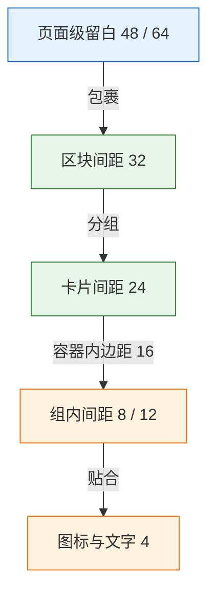
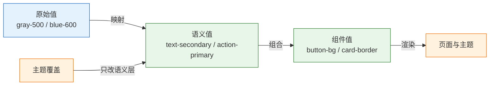

# 视觉基础

---

## 一、视觉基础是什么

### 1.1 核心概念

视觉基础（Visual Foundation）是界面中可量化、可复现的视觉决策集合，由尺度、色彩、表面、层级四组规则构成。它描述的不是某一屏的最终样子，而是元素之间为什么这样排列、为什么这样区分、为什么这样强调的稳定依据。

设计稿是这套规则在特定宽度、特定文案、特定数据下的一次渲染结果。同一套规则换到 1280 宽、英文文案、空数据或深色主题仍然成立；按像素抄下来的数值，换一屏就会失效。开发读稿的核心动作因此不是取色和量距，而是把图上的关系翻译成一组带语义的变量。

一次完整的还原经过四个层次：

| 层次 | 输入 | 输出 | 判断标准 |
|---|---|---|---|
| 关系 | 设计稿、原型 | 分组、层级、状态差异 | 遮住颜色仍能看出结构 |
| 数值 | 关系描述 | 间距、字号、色值、圆角 | 全部落在统一刻度上 |
| 变量 | 数值 | 语义 token | 名称描述角色而非外观 |
| 实现 | 变量 | CSS 与组件 | 换主题、换宽度不破 |

四个层次里，关系最容易跳过，也最贵。间距量错 2px 只影响一屏，分组读错会让整页信息结构失效，后面所有数值都失去意义。


> **注意**：设计稿通常给的是 1440 或 375 的固定宽度、理想文案和完整数据。按稿面像素写死宽度，在 1280 笔记本、200% 缩放和两倍长标题下会同时暴露问题。落地时必须以真实内容和弹性布局复验。

### 1.2 适用场景与边界

视觉基础适用于四类工作：设计稿还原、组件库与设计系统建设、多主题与多端适配、存量页面的视觉治理。它的共同点是需要把一次性的审美判断沉淀成可重复执行的规则。

它也有明确边界。品牌识别、插画风格、营销创意属于品牌设计范畴，靠视觉基础无法生成；复杂数据可视化需要专门的色彩与图表规范，不能直接套用界面语义色；信息架构、任务流程、文案说服力属于交互与内容范畴，视觉层只能承载，不能替代。

| 场景 | 视觉基础的作用 | 边界 |
|---|---|---|
| 设计还原 | 把稿面数值转为 token 与组件 | 不判断交互是否合理 |
| 设计系统 | 统一尺度、色彩、表面规则 | 不决定组件的行为与状态 |
| 多主题 | 用语义层隔离主题差异 | 不解决图片与插画的暗色适配 |
| 视觉评审 | 提供可测的对比与收敛标准 | 不替代用户测试 |
| 品牌设计 | 提供基础排版约束 | 不生成标志与品牌资产 |

> **注意**：对比度合格、间距整齐，只说明页面“看得清、读得懂”，不说明“用得顺”。交互流程有缺陷时，视觉打磨越精致，返工越晚被发现。

---

## 二、视觉判断依据

### 2.1 分组关系

分组的本质是回答“哪些元素属于同一件事”。人眼依据接近、相似、连续、闭合几条线索自动归类，其中距离最强，也最容易被开发者忽略。两个元素靠得近，用户默认它们相关；中间隔着一条分割线，用户默认它们无关。

可执行的判断只有一条：**组内间距必须明显小于组间间距**，常用比值是 1:2 到 1:3。组内 16、组间 24 看起来都在刻度上，关系却不成立；组内 8、组间 24 才能一眼分开。

| 手段 | 强度 | 适用 | 代价 |
|---|---|---|---|
| 间距 | 最强 | 默认手段，任何分组 | 占用空间，密度下降 |
| 对齐 | 强 | 列表、表单、卡片 | 列宽受最长内容限制 |
| 共同背景 | 中 | 间距不足时的次级分组 | 盒子增多，页面变碎 |
| 边框 | 中 | 需要明确边界或可点击区域 | 容易变成“满屏框” |
| 相似样式 | 弱 | 标记同类元素 | 易与状态色混淆 |

修复顺序固定为：先调间距，再调对齐，再用背景，最后才加边框。反过来做，会得到一堆框，而组内组外仍然一样远。

判断分组是否成立，不引用理论名称，直接做 5 秒测试：把截图给别人看 5 秒，问“哪几块是一组”。答案与预期不符就是分组问题；答案一致，说明此前的担心属于过度解读。

### 2.2 层级通道

层级回答“先看什么、后看什么”。它由四个通道共同决定，任何单一通道的强度都有限。

| 通道 | 实现手段 | 强度 | 常见误用 |
|---|---|---|---|
| 尺寸 | 字号、字重、控件高度 | 最强 | 标题放大，正文也放大，层级抵消 |
| 对比 | 文字色、填充与描边 | 强 | 满屏高对比，没有焦点 |
| 位置 | 首屏、左上、视觉中心 | 中 | 主操作落在右下角或滚动区外 |
| 留白 | margin、padding、分组间隔 | 中 | 用留白表达“重要”，结果显得孤立 |

两条规则可以直接执行。第一，**层级变化至少同时动两个通道**：页面标题与正文只差 2px 字号时，必须再用字重和颜色区分。第二，**一屏只保留一个主操作**，主操作使用实心品牌色，其余操作降为描边或文字按钮。主按钮有两个，等于没有主按钮。

字阶的跳档幅度按密度确定。高密度后台常用 1.2 倍左右的比值，内容型页面可以到 1.25 至 1.333。比值本身不是规范，关键是全站保持同一组档位，不出现 15px、17px、19px 这类临时值。

### 2.3 灰度与缩放验证

视觉判断不能只靠彩色截图。把页面转灰度、缩小、放大，能暴露三类被颜色掩盖的问题。

| 验证方法 | 暴露的问题 | 通过标准 |
|---|---|---|
| 缩到 25% | 分组不清、重心偏移 | 仍能看出区块数量与主次 |
| 转灰度 | 层级依赖色相、对比不足 | 标题、正文、辅助文字仍可区分 |
| 色觉模拟 | 状态只靠红绿区分 | 状态同时有文字或图标 |
| 放大 200% | 固定高度截断、横向滚动 | 内容重排，无丢失 |
| 缩到 375 宽 | 表格与工具栏溢出 | 主操作可见，无横向滚动 |

灰度验证尤其有效。彩色下靠蓝色标题和灰色正文拉开的层级，转灰后往往难以区分，说明真正起作用的是色相而不是明度。色相在色觉异常、打印、强光环境下都不可靠。

> **设计红线**：任何信息都不能只靠颜色传达。状态、必填、错误、选中必须有文字、图标或形状差异，满足 WCAG 2.2 的“不能仅用颜色”（1.4.1）。

---

## 三、尺度规则

### 3.1 间距刻度

间距使用 4 像素基准、8 像素优先的刻度。4 用于贴合，8 及以上用于分组，形成稳定的节奏。

| Token | 值 | 语义 | 典型位置 |
|---|---|---|---|
| `space-1` | 4 | 贴合 | 图标与文字、标签内边距 |
| `space-2` | 8 | 组内紧凑 | 标签与输入框、按钮图标间距 |
| `space-3` | 12 | 组内 | 紧凑表单控件之间 |
| `space-4` | 16 | 容器内 | 卡片内边距、段落之间 |
| `space-6` | 24 | 组间 | 卡片之间、区块内子模块 |
| `space-8` | 32 | 区块间 | 功能模块之间 |
| `space-12` | 48 | 页面级 | 页面留白、空态 |
| `space-16` | 64 | 页面级 | 登录页、封面区 |

三条硬规则：

1. 组内间距小于组间间距，比值不低于 1:2。
2. 相邻层级至少相差一档，不使用 2px、6px 这类中间值。
3. 例外必须登记。图标光学对齐、1px 边框补偿属于合理例外，但要写进组件说明，不能散落在页面样式里。

设计稿出现 10、14、18、22 时，先确认是否为刻度外的临时值。没有明确理由就归并到最近刻度，不为单个页面新增一档。刻度一旦膨胀，后续每个页面都会多出几个“只在这里用”的值。

> **注意**：同时引入 8 像素与 4 像素两套体系，却不定哪一层用哪套，会出现整体 2px 漂移。常见做法是布局与容器用 8 的倍数，图标与文字贴合用 4。

### 3.2 字号与行高

字号规则表按下表执行，字号与行高必须成对出现。

| 层级 | 字号/行高 | 字重 | 用途 |
|---|---|---|---|
| 展示 | 28/36 | 600 | 登录页、报表封面，一屏最多一处 |
| 页面标题 | 24/32 | 600 | 每页一个 |
| 区块标题 | 16/24 | 600 | 卡片标题、表单分组 |
| 正文 | 14/22 | 400 | 正文、表格、表单值 |
| 辅助 | 12/18 | 400 | 时间、说明、字段提示 |
| 微标 | 12/16 | 500 | 标签、角标，不承担长文本 |

行高按用途取值：中文正文 1.5 至 1.75，标题 1.2 至 1.35。14px 配 22px 约 1.57，适合中文正文；24px 标题配 32px 约 1.33，再松就会散。行高用无单位倍数或固定 token，不写死像素，避免字号调整后比例失真。

正文行长控制在 35 至 45 个汉字。14px 正文在 640px 宽度下约 45 字，超过这个宽度，眼睛回到行首的路径变长，阅读速度下降。宽屏下给内容区设 `max-width` 并居中，而不是让文字铺满 2K 屏。

数字列使用 `font-variant-numeric: tabular-nums`，让 `1` 与 `8` 等宽。否则数据刷新时整列宽度跳动，排序和对齐都会失效。

| 中文排版现象 | 原因 | 处理 |
|---|---|---|
| 加粗后笔画粘连 | 汉字笔画密度高，伪粗体在 600 以上易糊 | 字重只用 400/500/600，强调优先用颜色 |
| 中英混排过挤 | 西文字符缺少字面留白 | 使用系统字体默认间距，不手动加空格 |
| 斜体中文变形 | 汉字无斜体传统，浏览器强制倾斜 | 中文不用 italic，改用颜色或背景 |
| 字距拉开后散架 | 方块字靠字面成行 | 中文不加 `letter-spacing`，标题最多 0.5px |

字体栈优先系统字体，避免加载闪烁与授权风险：

```css
font-family: -apple-system, BlinkMacSystemFont, "Segoe UI", "PingFang SC",
             "Hiragino Sans GB", "Microsoft YaHei", "Helvetica Neue", Arial, sans-serif;
```

设计稿使用商用字体而项目没有授权时，落地只能替换。换字体后字宽、行高、换行位置都会变化，必须在真实文案下重新检查，不能只对比字体名称。

### 3.3 圆角、边框与阴影

三者都表达“表面关系”，但语义不同：圆角表达柔和程度与容器层级，边框表达边界，阴影表达浮起。混用会让层级含混。

| 圆角档位 | 值 | 用途 |
|---|---|---|
| `radius-sm` | 4 | 输入框、标签、小按钮 |
| `radius-md` | 8 | 卡片、弹窗、常规按钮 |
| `radius-lg` | 12 | 大面板、抽屉 |
| `radius-full` | 999 | 胶囊按钮、头像、开关 |

圆角遵循嵌套关系：内部元素圆角等于外部圆角减去内边距。外层 12、内边距 8 时，内层取 4 才视觉同心；内层仍取 8 会显得外凸。所有容器使用同一档圆角，也会让卡片、弹窗、按钮失去层级差异。

| 阴影档位 | 用途 | 说明 |
|---|---|---|
| `shadow-sm` | 卡片悬停、输入聚焦 | 位移 1–2px，模糊 4px 以内 |
| `shadow-md` | 下拉菜单、Popover | 位移 4px，模糊 12px 左右 |
| `shadow-lg` | 模态框、抽屉 | 位移 8px 以上，配合遮罩 |

三条规则：

- 同一层级只保留一种表面手段。平铺内容用边框或背景差，真正浮起的下拉、弹窗才用阴影。
- 阴影方向全站一致，默认光源在上，向下偏移，避免有的向上、有的向下。
- 边框与阴影不叠加表达同一层级，否则边缘出现双线，视觉发脏。

深色模式下阴影几乎不可见，层级改由表面亮度承担：页面最暗、卡片次之、浮层最亮，相邻两层要有可辨的明度差。



> **注意**：圆角与阴影是最容易过度使用的两组值。稿面看起来高级，往往不是圆角更大，而是圆角、阴影、边框三者只出现一个。三者同时加强，页面会显得廉价。

---

## 四、颜色角色与对比度

### 4.1 颜色分类

界面颜色按职责分为四类，数量差别很大。中性色承担结构，品牌色承担引导，语义色承担状态，数据色承担区分。

| 类别 | 职责 | 数量 | 判断 |
|---|---|---|---|
| 中性色 | 背景、文字、边框、分割 | 8–12 级 | 去掉它界面会散架 |
| 品牌色 | 主操作、选中、链接 | 1 个主值 + 色阶 | 单屏 ≤10%，高密度后台 ≤5% |
| 语义色 | 成功、警告、危险、信息 | 4 组，每组填充与文字 | 必须配文字或图标 |
| 数据色 | 图表分类、图例 | 4–8 个 | 相邻色在灰度下仍可辨 |

中性色阶按明度均匀分布，常用 50 到 950 的编号。品牌色只保留一个主值，其余为 hover、active、浅底、描边等派生值。语义色四组不参与品牌表达，不能拿危险红做主按钮，也不能用品牌蓝表示成功。

品牌色面积是最容易被突破的约束。主操作、选中态、链接之外，标题、图标、装饰、表头都染成品牌色，页面会失去焦点，主按钮也不再突出。

### 4.2 语义色与对比度

填充值与文字值必须分开。同一个语义色做背景时可以用亮值，做文字时必须足够深。

| 语义 | 填充 | 文字 | 白字对比度说明 |
|---|---|---|---|
| 成功 | `#16A34A` | `#15803D` | 填充配白字约 3.3:1，只够大字或图形 |
| 警告 | `#D97706` | `#B45309` | 填充配白字约 3.2:1，不能做小字 |
| 危险 | `#DC2626` | `#B91C1C` | 填充配白字约 4.8:1 |
| 信息 | `#2563EB` | `#1D4ED8` | 填充配白字约 5.2:1 |

对比度按 WCAG 2.2 AA 执行：正文 4.5:1；大字号（≥24px 常规或 ≥18.66px 粗体）与图形、控件边界 3:1；键盘焦点指示 3:1 且不被遮挡。

计算取最终渲染色。半透明颜色先与背景合成再计算，`rgba(0,0,0,.5)` 叠白底约等于 `#808080`，对比度只有 3.9:1，并不安全。图片上的文字必须先加遮罩或底色，不能假设图片某块区域足够暗。

对比度公式为 `(L1 + 0.05) / (L2 + 0.05)`，其中 L 是相对亮度。手工计算容易出错，交付前用浏览器开发者工具的取色器或对比度检查工具读取计算后的颜色值。

> **设计红线**：正文对比度低于 4.5:1、控件边界低于 3:1、焦点不可见，都属于阻断级缺陷。品牌色再准确，也不能作为降低对比度的理由。

### 4.3 深色模式表面层级

深色模式不是把浅色值取反。取反会让语义色过亮、阴影失效、图片刺眼，表面层级也会完全消失。

| 层级 | 浅色示例 | 深色示例 | 用途 |
|---|---|---|---|
| 页面底 | `#F9FAFB` | `#0F1115` | 最底层背景 |
| 卡片面 | `#FFFFFF` | `#16181D` | 内容容器 |
| 浮层面 | `#FFFFFF` | `#1E222A` | 下拉、弹窗、抽屉 |
| 分割线 | `#EAECF0` | `#2A2E37` | 边界与分隔 |

深色模式的三条规则：

- 不用纯黑 `#000000` 做页面底，也不用纯白做正文。纯黑配纯白会产生光晕，长时间阅读疲劳。
- 层级靠亮度递进，不靠阴影。阴影在深底上几乎不可见，只能用于模态遮罩的辅助。
- 品牌色与语义色重新取值，不直接复用浅色值。深底上的填充色需要降低饱和度、提高明度，否则刺眼且对比失衡。

图片、插画、图表、第三方嵌入内容要单独处理。透明 PNG 在黑底上可能出现白边，图表网格线需要换成低对比的浅灰，代码高亮主题也要跟随切换。

```css
:root {
  color-scheme: light;
}

[data-theme="dark"] {
  color-scheme: dark;
}
```

`color-scheme` 决定滚动条、原生下拉、输入光标和表单控件的默认配色。只切换自定义变量而不切换它，深色页面上会突然出现一块亮色原生控件。

---

## 五、Token 分层与代码映射

### 5.1 三层结构

Token 分三层：原始值、语义值、组件值。业务样式只允许引用语义层，主题切换只覆盖语义层。

| 层级 | 命名示例 | 示例值 | 引用规则 |
|---|---|---|---|
| 原始值 | `--gray-500`、`--blue-600` | `#667085` | 只被语义层引用 |
| 语义值 | `--text-secondary`、`--bg-surface` | `var(--gray-500)` | 业务与组件默认引用 |
| 组件值 | `--button-primary-bg` | `var(--action-primary)` | 仅组件内部使用 |

```css
:root {
  /* 原始值：只描述数值 */
  --gray-50: #F9FAFB;
  --gray-200: #EAECF0;
  --gray-500: #667085;
  --gray-900: #101828;
  --blue-600: #2563EB;
  --blue-700: #1D4ED8;
  --space-1: 4px;
  --space-3: 12px;
  --space-4: 16px;
  --radius-md: 8px;
  --font-title: 16px;
  --leading-title: 1.5;
  --font-body: 14px;
  --leading-body: 1.57;
  --font-meta: 12px;
  --leading-meta: 1.5;

  /* 语义层：业务样式只允许用这一层 */
  --bg-page: var(--gray-50);
  --bg-surface: #FFFFFF;
  --border-default: var(--gray-200);
  --text-primary: var(--gray-900);
  --text-tertiary: var(--gray-500);
  --action-primary: var(--blue-600);
  --action-primary-hover: var(--blue-700);
  --text-title-size: var(--font-title);
  --text-title-leading: var(--leading-title);
  --text-body-size: var(--font-body);
  --text-body-leading: var(--leading-body);
  --text-meta-size: var(--font-meta);
  --text-meta-leading: var(--leading-meta);
}

[data-theme="dark"] {
  --bg-page: #0F1115;
  --bg-surface: #16181D;
  --border-default: #2A2E37;
  --text-primary: #E6E8EC;
  --text-tertiary: #A7AEBB;
}
```

业务代码出现 `var(--gray-500)` 就是越层。它把“这段文字是次要的”退化成“这段文字是 500 号灰”，换品牌色或深色主题时无法跟随。

语义命名要描述角色，不描述外观。`--text-secondary` 在换色后仍然成立，`--gray-500` 在品牌换色后名不副实。同理，`--danger` 比 `--red` 稳定，`--space-section` 比 `--space-32` 更能表达用途。



### 5.2 主题切换与回退

| 机制 | 作用 | 易错点 |
|---|---|---|
| `[data-theme]` | 手动切换主题 | 首屏脚本执行前闪烁 |
| `prefers-color-scheme` | 跟随系统偏好 | 用户手动选择后被系统覆盖 |
| `color-scheme` | 原生控件与滚动条配色 | 忘记随主题切换 |
| `var(--x, fallback)` | 变量缺失时的兜底 | 回退值写死 hex，脱离 token |
| `forced-colors` | Windows 高对比模式 | 自定义背景与边框被强制覆盖 |

主题优先级固定为：用户显式选择 > 系统偏好 > 默认浅色。用户选过深色后，系统切回浅色不应改变页面；用户选“跟随系统”时才监听媒体查询。

首屏闪烁来自样式加载与脚本执行的时序。服务端渲染时把主题写在根元素的 `data-theme` 上，或在内联脚本中于首次绘制前读取存储值，不要等框架水合后再切换。

> **注意**：`var(--x, #fff)` 的回退值也要使用语义值。回退值写死白色，在深色主题下变量缺失时会闪出一块白底，比没有回退更难排查。

---

## 六、模板与示例

### 6.1 卡片规格模板

一张标准内容卡片的标注应包含尺寸、间距、文字、表面四组信息，全部对应 token。

| 属性 | 设计值 | Token | 说明 |
|---|---|---|---|
| 内边距 | 16 | `space-4` | 四边一致 |
| 卡片间距 | 24 | `space-6` | 列表纵向间隔 |
| 圆角 | 8 | `radius-md` | 与按钮 8 协调 |
| 边框 | 1px | `border-default` | 不使用阴影 |
| 标题字号 | 16/24/600 | `text-title` | 与正文拉开层级 |
| 正文 | 14/22/400 | `text-body` | 最多三行 |

```text
padding: 16 (space-4)
title → meta: 4 (space-1)
meta → body: 12 (space-3)
title: 16/24/600
body: 14/22/400, text-secondary
radius: 8 (radius-md)
border: 1px border-default
```

```css
.card {
  padding: var(--space-4);
  background: var(--bg-surface);
  border: 1px solid var(--border-default);
  border-radius: var(--radius-md);
}

.card__title {
  margin-bottom: var(--space-1);
  font-size: var(--text-title-size);
  line-height: var(--text-title-leading);
  font-weight: 600;
}

.card__meta {
  margin-bottom: var(--space-3);
  color: var(--text-tertiary);
  font-size: var(--text-meta-size);
  line-height: var(--text-meta-leading);
}

.card__body {
  font-size: var(--text-body-size);
  line-height: var(--text-body-leading);
}
```

卡片内部若再放按钮，按钮圆角取 4 或 8，不能超过卡片圆角；按钮与卡片边缘的距离不得小于内边距，否则视觉上会“贴边”。

### 6.2 页面落地流程

| 步骤 | 产出 | 通过标准 |
|---|---|---|
| 读稿标注 | 分组、层级、状态说明 | 能说出每块为什么在一起 |
| 建 token | 尺度、颜色、表面变量 | 无刻度外数值 |
| 组件实现 | 默认、悬停、聚焦、禁用 | 状态齐全，键盘可达 |
| 真实数据 | 长文案、空数据、超量数据 | 布局不破，按钮不被挤出 |
| 主题复验 | 浅色、深色、高对比 | 对比度与层级同时成立 |
| 截图基线 | 关键页面截图 | 后续改动可对比 |

一个完整例子：列表页卡片从稿面到实现。

1. 读稿：标题、状态标签、描述、底部操作构成一组，卡片之间为组间关系。
2. 取数：内边距 16、标题与描述 12、卡片间隔 24，全部落在 4 基准刻度。
3. 建变量：`--card-padding`、`--card-gap`、`--text-title`、`--border-default`。
4. 实现：卡片用边框不用阴影，状态标签用浅底深字，操作按钮用文字按钮。
5. 复验：标题换成两倍长，描述为空，标签换成四个，检查换行与高度。
6. 验收：灰度下标题、描述、操作仍可区分，深色下边框可见。

---

## 七、典型反例

| 反例 | 表现 | 根因 | 修正 |
|---|---|---|---|
| 全站圆角 16 | 卡片、按钮、输入框一样圆 | 把圆角当风格，不分层级 | 按容器层级取 4/8/12 |
| 卡片加边框又加阴影 | 边缘发灰、发脏 | 两种表面手段表达同一层级 | 平铺用边框，浮起用阴影 |
| 正文 12px 灰字 | 大屏阅读吃力 | 用字号换信息量 | 正文 14px，减列或缩文案 |
| 主色铺满页面 | 主按钮不突出 | 品牌色当装饰色 | 主色只留主操作、选中、链接 |
| 语义色直接做文字 | 浅色文字看不清 | 填充值与文字值混用 | 文字取深一档并测对比度 |
| 深色模式直接反色 | 图片刺眼、阴影消失 | 没有重设表面亮度 | 按页面/卡片/浮层排三级亮度 |
| 表格数字列跳动 | 刷新后列宽变化 | 使用比例字形 | `tabular-nums`，固定列宽 |

反例的共同点是“只改一个值”。圆角变大、颜色变深、阴影加重，都是局部动作，没有回答“这个元素在层级里处于什么位置”。视觉问题的修复顺序仍然是结构、分组、层级、细节，越过前三步直接调细节，通常会把问题放大。

---

## 八、常见失败模式与检查清单

### 8.1 常见失败模式

| 现象 | 最可能原因 | 处理 |
|---|---|---|
| 每页间距都差一点 | 没有统一刻度，按截图逐个量 | 建 4/8 刻度，归并历史值 |
| 标题大而无力 | 只放大字号，没动字重与颜色 | 四个通道一起调，或直接跳档 |
| 深色模式层级消失 | 直接反色，未重设表面亮度 | 按页面/卡片/浮层排三级 |
| 主按钮不突出 | 品牌色扩散到标题与图标 | 收敛主色面积到 10% 以内 |
| 语义文字看不清 | 拿填充色当文字色 | 文字单独取深一档 |
| 卡片边缘发脏 | 边框与阴影叠加 | 同一层级只留一种 |
| 2K 屏阅读疲劳 | 正文未限宽 | 正文 `max-width: 640px` |
| 主题切换闪烁 | 首屏脚本晚于首次绘制 | 根元素预置主题或内联脚本 |

### 8.2 检查清单

| # | 检查项 | 验证方法 | 通过标准 |
|---|---|---|---|
| 1 | 间距收敛 | 统计 margin/padding/gap | 全部在刻度上，组内小于组间 |
| 2 | 字号收敛 | 统计 `font-size` | 主阶梯不超过 6 种 |
| 3 | 行高配对 | 抽查正文与标题 | 正文 1.5–1.75，标题 1.2–1.35 |
| 4 | 正文对比度 | 取计算后的文字与背景色 | ≥ 4.5:1 |
| 5 | 大字与边界 | 大字号、边框、焦点环 | ≥ 3:1 |
| 6 | 灰度层级 | 截图转灰度 | 标题、正文、辅助仍可分 |
| 7 | 数字稳定 | 切换三组数据 | 列宽与数字位置不跳 |
| 8 | 200% 缩放 | 浏览器放大到 200% | 无横向滚动、无截断 |
| 9 | 长内容 | 标题两倍长、空数据、超量数据 | 布局不破，主操作可见 |
| 10 | Token 越层 | 搜索业务样式中的原始值 | 只引用语义层变量 |

前两项用脚本统计，不靠肉眼。人眼会漏掉一处 `#475467`，正则不会。

设计稿与实现不一致时，先确认三件事：是不是同一版稿、是不是同一套 token、量的是不是最终渲染色。三者任一不同，争论的都是假差异。确认之后再比数值，通常只剩个位数的真实偏差。

> **注意**：视觉验收不是一次性的截图比对。主题、数据、语言、缩放任一变化都会重新组合布局，验收用例必须覆盖这些维度，否则问题只会在上线后由用户发现。
