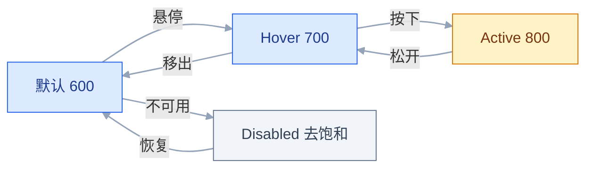
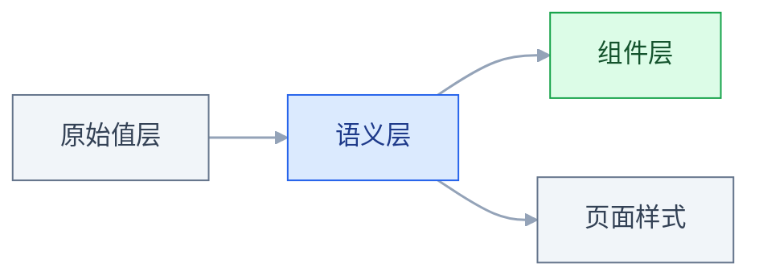

# 视觉基础

## 一、工程案例：给一套 B 端后台定间距、字号、颜色三套 token，并落到 CSS 变量

**场景**：一套跑了三年的工单系统，前端 4 人、后端 3 人，没有设计系统。37 个页面里数出 14 种字号、15 种间距、11 种灰色。设计师每开一张新稿都要重新决定「这里用几号字」，开发每接一个需求都要从截图里吸色。目标：两周内产出间距、字号、颜色三套 token，落成 CSS 变量，先覆盖工单列表、工单详情、新建工单、登录、报表 5 个页面。

**约束**：

- 业务不停，只能增量替换；旧页面允许暂时保留硬编码，新代码禁止写裸值
- 本期只做浅色模式；token 结构要给深色留位置，避免下一季度推倒重来
- 组件库自研，没有现成的 token 构建链路，只能靠 CSS 自定义属性
- 设计师 1 人，前端每周只能配合 2 天
- 验收按 WCAG 2.2 AA 执行（以官方当前版本为准）：正文 4.5:1，大字、控件边界 3:1

**为什么先做这三套**：颜色决定「能不能看清」，字号决定「能不能读到」，间距决定「能不能看出分组」。这三件事覆盖了日常返工的大头；圆角、阴影、动效可以后补，它们不影响信息是否可读。

**交付物（5 项，缺一项不算完成）**：

| # | 产出物 | 确认人 |
|---|---|---|
| 1 | 间距、字号、颜色三张刻度表，每档带语义名 | 前端负责人 |
| 2 | 三层 token 的 CSS 变量文件，含深色占位 | 前端负责人 |
| 3 | 标注模板：颜色、字号、间距、圆角、状态五项 | 设计互评 |
| 4 | 可执行的验收清单与截图基线 | 产品经理 |
| 5 | 新增、修改 token 的评审流程 | 设计负责人 |

### 1.1 盘点存量：先知道要收敛什么

不从「我希望它长什么样」开始，从「现在有什么」开始。把 5 个页面的截图拼到一张画布上，用吸管和标尺把字号、间距、灰色、圆角全部抄下来去重：

```text
字号  11 12 13 14 15 16 18 20 22 24 26 28 32 36   14 种
间距  2 4 5 6 8 10 12 14 15 16 18 20 24 30 32 40  15 种
灰色  #333 #444 #555 #666 #777 #888 #999 #aaa ...  11 种
圆角  2 3 4 5 6 8 10 12 16 50%                     10 种
```

盘点的产出不是一张「丑图」，是收敛依据。按出现频次分三档处理：

| 频次 | 说明 | 处理 |
|---|---|---|
| ≥ 10 次 | 事实上的标准 | 保留，纳入刻度 |
| 3–9 次 | 有真实场景 | 就近归并到刻度 |
| 1–2 次 | 随手写的 | 直接消灭 |

> 抄值的时候顺手记下「它用在哪」。同一个 14px，出现在正文和出现在表格里，归并时的优先级不一样：正文决定可读性，表格决定密度。

### 1.2 间距：从频次里长出来的刻度

以 4 为基准，取 8 档。步长小到够用、大到能肉眼区分；1440 设计稿能被 4 和 8 整除，移动端用 16px 边距配合弹性布局，刻度本身不会产生半像素。

| 档位 | 变量名 | 语义 | 典型位置 |
|---|---|---|---|
| 4 | `--space-1` | 贴合 | 图标与文字、标签内边距、角标偏移 |
| 8 | `--space-2` | 组内 | 标签与输入框、列表项内图文、按钮图标与文字 |
| 12 | `--space-3` | 组内偏松 | 紧凑表单控件之间、表格单元格内上下 |
| 16 | `--space-4` | 容器内 | 卡片内边距、段落之间（最常用） |
| 24 | `--space-6` | 组间 | 卡片之间、同一区块的子模块之间 |
| 32 | `--space-8` | 区块间 | 一个功能模块到下一个 |
| 48 | `--space-12` | 页面级 | 页面上下留白、大区块分隔 |
| 64 | `--space-16` | 页面级 | 空态、登录页、营销区 |

**间距只表达关系，不表达大小。** 两个元素靠得近，用户就认为它们一组；这跟元素本身多重要没有关系。所以「重要的东西间距大一点」是错的，重要的东西应该靠字号、颜色、位置来强调。

判断分组对不对，用眯眼法：眯到细节消失，剩下的团块就是用户实际感知到的结构。三组信息眯眼后连成一片，说明组间距不够；同一组内部散成几块，说明组内间距太大。

> ⚠️ 为了塞下更多内容把间距压到 4px 以下，是把「信息密度」和「拥挤」搞混了。真正密集的界面靠对齐和分割线维持秩序，不靠压缩边距。

### 1.3 字号：五档主阶梯

| 层级 | 变量名 | 字号 / 行高 | 字重 | 用途 |
|---|---|---|---|---|
| 展示 | `--text-display` | 28 / 36 | 600 | 登录页主标题、报表封面，一屏最多一处 |
| 页面标题 | `--text-h1` | 24 / 32 | 600 | 每个页面一个 |
| 区块标题 | `--text-h2` | 16 / 24 | 600 | 卡片标题、表单分组标题 |
| 正文 | `--text-body` | 14 / 22 | 400 | 正文、表格、表单值 |
| 辅助 | `--text-caption` | 12 / 18 | 400 | 时间、说明、脚注、字段提示 |

**行高必须和字号一起定义**，不能只给字号。14px 配 22px 行高是 1.57 倍；中文笔画密、视觉重量大，行高低于 1.5 倍，多行文字会糊成一片。24px 以上的标题取 1.25–1.35 倍即可，太松会散；16px 的区块标题常与正文混排，仍用 1.5 倍，靠字重和颜色拉开层级。

**字号档位之间的差距要肉眼可辨**。14 到 16 只差 2px，在 1080p 屏幕上单靠字号几乎看不出来，所以这两级必须同时用字重（600 对 400）和颜色区分；要只靠字号拉开层级，至少跳到 20 以上。这也是五档够用的原因：12 / 14 / 16 是同一区间的三档，靠字重和颜色分工；24 / 28 才是跨档的标题。

> 12px 是中文界面的下限。低于 12px，笔画开始粘连，缩放 125% 后还会出现亚像素模糊。表格里实在放不下，优先减列、缩短文案，不要减字号。

### 1.4 颜色：三层角色，填充值与文字值分开

**中性色**承担背景、边框、文字，是出现频率最高的一组。用一个带轻微冷调的灰阶，页面整体感会更好：

| 变量 | 值 | 用途 |
|---|---|---|
| `--gray-0` | `#FFFFFF` | 卡片、弹窗表面 |
| `--gray-50` | `#F9FAFB` | 页面底色 |
| `--gray-100` | `#F2F4F7` | 分区背景、表头、hover 底色 |
| `--gray-200` | `#EAECF0` | 分割线、卡片边框 |
| `--gray-300` | `#D0D5DD` | 输入框边框、强分割 |
| `--gray-400` | `#98A2B3` | 禁用文字、图标弱态（不承载必读信息） |
| `--gray-500` | `#667085` | 三级文字、占位符、辅助说明 |
| `--gray-600` | `#475467` | 二级文字、表格次要列 |
| `--gray-700` | `#344054` | 强调性正文 |
| `--gray-800` | `#1D2939` | 深色标题 |
| `--gray-900` | `#101828` | 主文字 |

**语义色要准备两套值**：填充色用于背景块，文字色用于文字和图标。这两者的亮度要求完全不同：直接拿填充色当文字色，对比度常常只有 3–5:1，且随色相波动，小字无法保证达标。

| 语义 | 填充（背景/色块） | 文字（文字/图标） | 说明 |
|---|---|---|---|
| 成功 | `#16A34A` | `#15803D` | 填充配白字约 3.3:1，只适合大字或图形 |
| 警告 | `#D97706` | `#B45309` | 填充配白字约 3.2:1，不能做小字 |
| 危险 | `#DC2626` | `#B91C1C` | 填充配白字约 4.8:1，勉强可用于正文 |
| 信息 | `#2563EB` | `#1D4ED8` | 主色兼信息色，配白字约 5.2:1 |

> 上表的对比度按公式核算过：成功、警告两档填充配白字只有 3.2–3.3:1，只够大字和图形；危险、信息两档在 4.8–5.2:1，才可放正文。文字列对白底全部 ≥ 4.5:1。语义色的完整阈值见 3.7，状态色的色阶生成见 3.8。

**品牌色只用于主操作、选中态、链接**。一旦它出现在标题、图标、装饰、图表里，主按钮就不再突出——满屏都是重点，等于没有重点。

> 语义色不能只靠颜色传达状态。红绿色觉异常的用户分辨不出「成功绿」和「危险红」，状态标签必须同时有文字或图标。这不是审美问题，是信息是否可达的问题。

### 1.5 落到 CSS 变量：三层，页面只用中间层

```css
:root {
  /* 第一层：原始值，只描述数值，不带语义 */
  --gray-0: #FFFFFF;
  --gray-50: #F9FAFB;
  --gray-100: #F2F4F7;
  --gray-200: #EAECF0;
  --gray-500: #667085;
  --gray-600: #475467;
  --gray-900: #101828;
  --brand-600: #2563EB;
  --brand-700: #1D4ED8;

  /* 第二层：语义层，业务样式只允许用这一层 */
  --bg-page: var(--gray-50);
  --bg-surface: var(--gray-0);
  --bg-subtle: var(--gray-100);
  --border-default: var(--gray-200);
  --text-primary: var(--gray-900);
  --text-secondary: var(--gray-600);
  --text-tertiary: var(--gray-500);
  --action-primary: var(--brand-600);
  --action-primary-hover: var(--brand-700);

  /* 第三层：组件层，只在组件内部使用 */
  --button-primary-bg: var(--action-primary);
  --button-primary-bg-hover: var(--action-primary-hover);
  --button-primary-text: var(--gray-0);
}

/* 深色换第二层指向；深色原始值同样应先在第一层定义，示例从简直接写值 */
[data-theme="dark"] {
  --bg-page: #0F1115;
  --bg-surface: #16181D;
  --bg-subtle: #1D2027;
  --border-default: #2A2E37;
  --text-primary: #E6E8EC;
  --text-secondary: #A7AEBB;
}
```

三层的作用是隔离变化：换品牌色只改第一层，换深色只改第二层，改按钮样式只改第三层。**业务代码里出现 `var(--gray-500)` 就是越层**，它把「这个文字是次要的」退化成了「这个文字是 500 号灰」，语义丢了。

### 1.6 标注规范：让开发不用吸色

| 标什么 | 怎么标 | 反例 |
|---|---|---|
| 颜色 | 标语义名 `text-secondary`，不标 hex | 标 `#475467`，开发不知道能不能换 |
| 字号 | 标层级名 + 数值 `body / 14 / 22` | 只标「正文」，开发按 13px 做 |
| 间距 | 标数值 + 归属 `card padding 16` | 只在图上画红线，不给数值 |
| 圆角 | 标档位 `radius-md` | 写「稍微圆一点」 |
| 状态 | 每个可交互元素列出全部状态 | 只画默认态 |

一个可用的标注块长这样：

```text
卡片 padding 16 (space-4) / radius 8 (radius-md) / border 1px border-default
title: text-h2 / 16 / 24 / 600 / text-primary
meta:  text-caption / 12 / 18 / 400 / text-tertiary
gap:   title→meta 4 (space-1), meta→body 12 (space-3)
```

### 1.7 迁移顺序：先颜色，再字号，最后间距

| 顺序 | 对象 | 风险 | 做法 |
|---|---|---|---|
| 1 | 颜色 | 低 | 全局替换 hex 为语义变量，视觉几乎不变 |
| 2 | 字号 | 中 | 按层级替换，先改标题，再改正文 |
| 3 | 间距 | 高 | 会改变布局高度，必须逐页核对 |
| 4 | 圆角、阴影 | 低 | 收敛到 3–4 档，顺手做 |

颜色先做，是因为它不改变盒模型，替换完页面不会错位，能快速建立信心。间距最后做，是因为它会影响每一处换行和折行，必须配合截图对比。

每改完一个页面，截三张图：默认态、灰度、200% 缩放。三张都过，再进下一个。

### 1.8 验收表

| # | 检查项 | 怎么验 | 通过标准 |
|---|---|---|---|
| 1 | 颜色 token 覆盖 | 在源码里搜 `#[0-9a-fA-F]{3,6}` | 5 个页面内业务样式 0 处裸 hex |
| 2 | 间距 token 覆盖 | 搜 `margin:\s*\d+px`、`padding:\s*\d+px` | 仅允许 0 和 1px 边框类写法 |
| 3 | 正文对比度 | 取 `color` 与最终 `background-color` 测对比度（禁用态不计） | ≥ 4.5:1 |
| 4 | 大字号对比度 | ≥ 24px 常规或 ≥ 18.66px 粗体 | ≥ 3:1 |
| 5 | 组件边界 | 输入框、按钮、选中态边框对背景 | ≥ 3:1 |
| 6 | 语义色文字 | 成功/警告/危险/信息文字色对白底 | ≥ 4.5:1 |
| 7 | 灰度层级 | 截图转灰度，遮住颜色只看明度 | 标题、正文、辅助三层仍可区分 |
| 8 | 字号种类 | 统计 5 个页面用到的 font-size | ≤ 6 种（5 档主阶梯 + 图表大数字 1 档） |
| 9 | 间距种类 | 统计 margin/padding/gap 的取值 | ≤ 8 种，且全部在刻度上 |
| 10 | 数字对齐 | 表格金额、数量列 | 右对齐且等宽，刷新数据不跳动 |
| 11 | 深色预留 | 临时把语义层指向深色值，查是否有组件绕过语义层写死颜色 | 绕过处为 0，主要表面可整体变色 |
| 12 | 缩放适配 | 浏览器缩放 200% | 无横向滚动、无文字截断 |

> 第 1、2 项要用命令验，不能靠眼看。人眼能漏掉一处 `#475467`，正则不会。

### 1.9 增量维护：新页面不再重新讨论

三套 token 交付后，真正决定它能不能活下来的是「新需求怎么用」：新页面只允许从语义层取值，缺语义先补语义，不许临时写 hex；新增刻度必须提 PR 说明现有刻度为什么不够；改 token 值要重跑对比度检查和 5 个基准页截图。**token 的价值不在「好看」，在「不用再讨论」**，同一个问题只决策一次，后面的页面自动继承。

---

## 二、高频问答：会卡住你的地方，也是面试最常问的

### 2.1 设计稿写 `#999`，开发照做，验收说「看不清」

**现场**

用对比度工具测这一对色；或在 DevTools 里看计算后的 `color` 和 `background-color`。取元素最终生效的颜色，不是设计稿标的；半透明文字要先和背景合成再算，直接拿 `rgba` 的 alpha 值算是错的。

**要点**

- `#999` 配白底约 2.8:1，正文要求 4.5:1，一比一还原也是错的。
- 还原度只保证「和稿子一样」，不保证「能看清」；稿子和实现都错时，越还原越糟。
- 判断以最终生效色为准，半透明必须先合成，否则算出来的比值不成立。

**追问**

- 半透明文字怎么算？→ 先与背景合成成实色，再算相对亮度比。
- 18px 粗体算大字号吗？→ 不算，大字号是 ≥ 24px 常规或 ≥ 18.66px 粗体，仍按 4.5:1 验收。
- 稿子本身不达标怎么办？→ 带着实测比值回到色板去改，而不是前端就地改一个更深的色。

### 2.2 间距全是 4 的倍数，页面还是乱

**现场**

把页面间距按「组内/组间/区块」标注一遍，看有没有组间小于组内；再眯眼截图，看三组信息是糊成一片还是散成几块。

**要点**

- 数字在刻度上不等于分组对：组内用了 24、组间用了 16，数字合规、关系反了。
- 组内必须明显小于组间，至少差 1.5 倍，常见 2–3 倍。
- 加更细的档位解决不了这个问题，问题在关系不在精度。

**追问**

- 组间和区块间怎么分？→ 回答不同问题用 24–32，可单独滚动或单独操作用 32–48。
- 为什么还要眯眼？→ 眯到细节消失，剩下的团块就是用户实际感知到的结构。
- 能不能靠压到 4px 以下塞更多内容？→ 那是把密度和拥挤搞混，密集靠对齐和分割线维持秩序。

### 2.3 字号阶梯定好了，页面标题还是不像标题

**现场**

截图转灰度，遮住位置信息，只看块面大小和深浅；再把标题和正文并排截一块，缩到 25% 看能否一眼分出主次。

**要点**

- 只加字号没用，层级由尺寸、对比、位置、留白四个通道共同决定，只动一个通道效果有限。
- 14 和 16 只差 2px，单靠字号看不出来，这两级必须同时用字重和颜色区分。
- 四个通道一起动，2px 的字号差也能被感知；分不出主次时，缺的是整体权重。

**追问**

- 只靠字号拉开层级要跳多少？→ 至少到 20 以上，中间几档靠字重和颜色分工。
- 为什么用灰度截图验？→ 它遮掉颜色，只剩结构和明度，靠颜色硬撑的层级会糊成一片。
- 标题行高该松还是紧？→ 24px 以上取 1.25–1.35 倍，太松会散。

### 2.4 主色只有一个值，hover 和按下态靠调透明度

**现场**

在浅底和深底上各截一张 hover 态，看颜色是否发灰、文字是否还清楚。再给品牌色生成 50–900 的色阶，固定 600 默认、700 hover、800 active，逐个测白字对比度。



**要点**

- 透明度会让按钮透出背景，深色底上变脏，白字也跟着变淡。
- 状态不是「淡一点」，是独立色值：hover 更深、active 更深、disabled 去饱和，每档都要单独测对比度。
- 默认 600 这一档也不能掉到 4.5:1 以下（大字可 3:1）；不满足条件必须真的禁用，而不是点下去才报错。

**追问**

- 键盘焦点为什么用外描边？→ 不占填充色，否则会和 hover、active 抢同一层信息。
- 色阶能用透明度生成吗？→ 不能，颜色随背景变，深色模式下全部失效。
- 禁用态也要测对比度吗？→ 无硬性要求，但仍要能看出「这里有东西，只是不可用」。

### 2.5 深色模式做成「颜色反转」

**现场**

切到深色，看卡片、页面、浮层三者能否区分；再看图片和图标是否有白底残留。取三层背景色算 CIE 明度 L*，相邻两层至少差 3。

**要点**

- 反转会毁掉层级：浅色靠阴影分层，深色靠表面亮度分层，反转后卡片和背景一样黑。
- 深色是另一套层级关系，不是一套配色：表面越靠前越亮，阴影基本失效，语义色要降饱和。
- 正文用近白不用纯白，`#FFFFFF` 在 OLED 上会晕。

**追问**

- 三层表面怎么定？→ 页面最暗、卡片次之、浮层最亮，本例分别是 5、8、14。
- 深色下阴影还有用吗？→ 基本无效，只能作辅助，不能作唯一的分层手段。
- 图片白底怎么发现？→ 切深色逐页看，白底残留最显眼。

### 2.6 边框和阴影一起用，卡片显得脏

**现场**

截图放大到 200%，看卡片边缘是否有一条深线加一圈灰晕；再做两组对比截图，一组只留边框，一组只留阴影。

**要点**

- 两种分层手段叠加，边缘出现「双线」，视觉上像糊了一层灰。
- 边框表达「硬边界」，阴影表达「浮起」，同一层级只能选一种。
- 两种都用等于同时说「贴着」和「浮着」，用户读到的是矛盾信号。

**追问**

- 什么时候用边框、什么时候用阴影？→ 平铺内容用边框或背景差，真正浮起的才用阴影。
- 拿不准选哪个怎么办？→ 让非设计同事盲选哪组更干净，多数人会选只用一种的。
- 深色模式下选哪个？→ 靠表面亮度分层，阴影在这时候几乎没有用。

### 2.7 表格数字列宽度一直跳

**现场**

DevTools 看 `font-variant-numeric` 是否为 `tabular-nums`；或连续切换两组数据看列宽。加上属性后再切 3 组数据，列宽和数字位置都不应移动。

**要点**

- 数字用了比例字形，`1` 比 `8` 窄，数据一刷新整列宽度就变。
- 固定列宽只能压住容器，数字本身仍然参差，右对齐后小数点也对不齐。
- 解法是等宽数字，不是布局约束。

**追问**

- `tabular-nums` 和等宽字体选哪个？→ 都能让数字等宽，用属性不必换字体。
- 表头要不要一起右对齐？→ 要，否则表头和数据列的边界对不上。
- 还有什么会让列宽跳？→ 最长内容拖列宽，要设最小/最大宽度。

### 2.8 2K 屏上内容铺满，读一行要转头

**现场**

在 2560 宽下量正文容器宽度，除以字号估算每行字符数；加限宽后再拉到 2560 截图，行长应保持不变。

**要点**

- 正文没有限宽，1440 以上全宽时单行超过 100 个字符，眼睛换行会丢行。
- 阅读舒适度由行长决定，不由屏幕宽度决定。
- 空出来的地方应该给留白或辅助信息，不是把正文拉长。

**追问**

- 限到多少？→ 正文 `max-width: 640px`（14px 约 45 个汉字），内容区 1200–1440 居中。
- 表格也限宽吗？→ 正文区限 640，后台表格列宽由内容决定。
- 内容短要不要拉满？→ 不要，行长是上限不是目标。

### 2.9 页面缩放到 200% 后布局崩

**现场**

浏览器缩放到 200%，看是否出现横向滚动、文字截断、按钮被挤出屏幕；再在这个比例下用键盘走一遍主流程。

**要点**

- 固定 px 宽度加固定高度容器，缩放后内容溢出被裁切。
- 200% 是 WCAG 文字缩放条款的要求（以官方当前版本为准），不是边缘场景。
- 布局用 flex、grid 的自动换行，flex 子项加 `min-width: 0`，否则长内容会把容器撑破。

**追问**

- 200% 和响应式是一回事吗？→ 不是，缩放不改视口宽度，只能靠限宽和可重排解决。
- 为什么加 `min-width: 0`？→ 默认 `min-width: auto` 会撑破容器，长内容直接溢出。
- 验收怎么算过？→ 200% 下走完主流程，所有文字可读、所有按钮可点。

---

## 三、核心知识：从零开始要建立的东西

### 3.1 视觉层级与注意力通道

人看界面不是逐字读，是先扫整体再定焦点。控制注意力有四个通道，强度从高到低：

| 通道 | 强度 | 典型做法 | 失效表现 |
|---|---|---|---|
| 尺寸 | 最强 | 标题与正文拉开字号或字重 | 标题大了，正文也大，层级抵消 |
| 对比 | 强 | 深色压浅色、实心压描边 | 满屏高对比，反而没有焦点 |
| 位置 | 中 | 左上、首屏、视觉中心优先 | 关键信息落在右下角 |
| 留白 | 弱，但决定结构 | 用间距把相关内容围成一组 | 分组靠线框，页面碎成格子 |

**尺寸**最强，大到一定程度可以盖过其他所有因素；**对比**次之，深色压浅色、实心压描边；**位置**再次，左上和视觉中心天然优先；**留白**最弱，但它决定分组，属于结构层。

四个通道要一起用。只放大字号，标题会「大而无力」；只加颜色，页面会「花而无形」。反过来，四个通道都克制但方向一致，页面会显得很稳。

> 一个可操作的检查：把页面截图转灰度。层级仍在，说明靠的是结构和明度；一片灰糊，说明在靠颜色硬撑，一旦打印或色觉异常就失效。

> **面试**：常问「怎么让标题看起来更像标题？」答：层级由尺寸、对比、位置、留白四个通道共同决定，只加字号往往无效。

### 3.2 间距刻度与关系表达

刻度是一组离散的、可复用的数值。它的作用不是「好看」，是把无限的选择压缩成有限的选择，让不同人做出的页面自动一致。

| 关系 | 间距量级 | 判断依据 |
|---|---|---|
| 同一控件的组成部分 | 4–8 | 拆开后语义不完整（图标+文字） |
| 同一组的并列项 | 8–12 | 可以独立存在，但属于同一件事 |
| 不同组 | 24–32 | 回答的是不同问题 |
| 不同区块 | 32–48 | 可以单独滚动或单独操作 |
| 页面边界 | 48–64 | 与浏览器边缘的距离 |

**边界与取舍**：刻度越少越统一，但越难覆盖极端场景。4 基准配 8 档是通用解；数据密集型后台可以加 2 和 6，但只用于表格内部，不进入页面级布局。刻度一旦定下，新增必须走评审，否则半年后又会长回十几种。

**最小示例**：卡片内 `padding: 16`，卡片标题与内容 `gap: 8`，卡片之间 `gap: 24`，区块之间 `margin-bottom: 32`。四个值全部来自同一序列，页面自然有节奏。

### 3.3 字号阶梯与行高配对

字号解决「这是第几层信息」，行高解决「这行字能不能顺畅读下去」。两者必须成对定义：

| 字号 | 行高 | 倍率 | 适用 |
|---|---|---|---|
| 12 | 18 | 1.5 | 辅助信息，单行居多 |
| 14 | 22 | 1.57 | 正文、表格 |
| 16 | 24 | 1.5 | 区块标题、稍大的正文 |
| 24 | 32 | 1.33 | 页面标题 |
| 28 | 36 | 1.29 | 展示型标题 |

**为什么正文行高比标题大**：正文是多行连续阅读，需要足够的行间空隙引导换行；标题通常一到两行，行高过大反而散。中文的行高下限比英文高，因为方块字的字面率高，行间视觉空隙更小。

**边界**：行高不要用无单位数值之外的方式写死到容器高度里。用 `line-height: 1.57` 会随字号缩放，用 `height: 22px` 不会，字号一变就裁切。

### 3.4 中文排版与字重渲染

中文字体和西文字体的渲染逻辑不同，直接套西文规则会出问题：

| 现象 | 原因 | 处理 |
|---|---|---|
| 中文加粗后糊成一团 | 汉字笔画密，伪粗体在 600 以上容易粘连 | 字重只用 400/500/600，强调优先用颜色 |
| 中英混排挤在一起 | 西文字符没有字面留白 | 用系统字体的自动间距，或手动加细空格 |
| 斜体中文很怪 | 汉字没有斜体传统，浏览器是强制倾斜 | 中文不用 italic，用颜色或背景强调 |
| 字距拉开后散架 | 方块字靠字面成行，不靠字母间距 | 中文不加 `letter-spacing`，标题最多 0.5px |

**字体栈**优先系统字体，避免加载闪烁和授权问题：

```css
font-family: -apple-system, BlinkMacSystemFont, "Segoe UI", "PingFang SC",
             "Hiragino Sans GB", "Microsoft YaHei", "Helvetica Neue", Arial, sans-serif;
```

数字单独处理：`font-variant-numeric: tabular-nums`，让 1 和 8 等宽，表格列不会随数据跳动。

### 3.5 行长与阅读节奏

行长指一行文字的物理宽度，通常用「每行多少个字符」衡量。行长过短，眼睛频繁换行，节奏碎；过长，换行时找不到下一行起点。

| 内容类型 | 建议行长 | 对应容器宽度（14px 中文） |
|---|---|---|
| 正文 | 35–45 字 | 约 490–630px |
| 辅助说明 | 20–30 字 | 约 280–420px |
| 表格单元格 | 10–20 字 | 按列宽，超出截断 |
| 标题 | 15–25 字 | 超出换行，不缩字号 |

**边界**：行长是上限不是目标。内容短的时候不要为了「填满」拉宽容器；内容长的时候优先改文案，其次才是限宽加滚动。

### 3.6 色彩的角色分层

界面颜色按职责分四类，每类的数量和用法都不同：

| 类别 | 职责 | 数量 | 判断标准 |
|---|---|---|---|
| 中性色 | 背景、文字、边框 | 8–12 级 | 去掉它界面会散架 |
| 品牌色 | 主操作、选中、链接 | 1 个主值 + 色阶 | 一屏出现的面积不超过 10% |
| 语义色 | 成功、警告、危险、信息 | 4 组，每组填充+文字 | 必须配文字或图标 |
| 数据色 | 图表分类、标签 | 4–8 个 | 相邻色要能区分，且不只靠色相 |

**中性色决定气质**，也决定可读性。带一点品牌色相的灰（品牌偏蓝就用冷灰）会让页面更整体，但色相偏移不要超过 10 度，否则灰会「发脏」。

**品牌色的用量是硬约束**。主按钮、当前导航项、链接、选中态，四处已经够用；再加就会稀释。判断方法：截图转灰度，主按钮如果还能被一眼找到，说明它靠的是明度对比而不是颜色，这是稳的。

### 3.7 对比度计算与阈值

对比度是前景色与背景色的相对亮度之比，范围 1:1 到 21:1。它不是 RGB 平均值，而是先把每个通道做伽马校正，再按 0.2126 / 0.7152 / 0.0722 加权。下面的阈值取自 WCAG 2.2 AA（以官方当前版本为准）。

| 对象 | 阈值 | 说明 |
|---|---|---|
| 正文（< 24px 常规，< 18.66px 粗体） | 4.5:1 | 合规底线 |
| 大字号（≥ 24px 常规或 ≥ 18.66px 粗体） | 3:1 | 字号够大时放宽 |
| 图标、输入框边界、选中态指示 | 3:1 | 非文本对比度要求 |
| 纯装饰、禁用态 | 无硬性要求 | 但禁用态仍要能看出「不可用」 |

> 18.66px 是 14pt 的换算值，不是为了设计稿好看定的字号；设计稿里用 18px 粗体不算大字号，仍按 4.5:1 验收。

**边界与取舍**：达到 4.5:1 不等于舒适。正文对比度在 7:1 以上时长时间阅读更轻松，尤其是低质量屏幕和强光环境。反过来，纯黑配纯白是 21:1，在 OLED 上会有光晕和拖影，正文用近黑 `#101828` 配白更稳。

> 半透明色必须先合成再算。`rgba(0,0,0,0.5)` 叠在白底上等于 `#808080`，对比度约 3.9:1，不是「50% 就够」。

> **面试**：常问「正文对比度要求多少？大字号怎么界定？」答：正文 4.5:1，≥24px 常规或 ≥18.66px 粗体按 3:1。

### 3.8 色阶生成与状态色

一个主色需要一整条色阶，而不是一个值。常用做法是固定一个基准色相，明度和饱和度同时调整：浅色端降饱和、提高明度，深色端降明度并轻微偏移色相。只调亮度会得到发灰、层次发闷的色阶。下表省略 200–400 等中间档：

| 档位 | 用途 | 示例（蓝） |
|---|---|---|
| 50 | 选中背景、浅色标签底 | `#EFF6FF` |
| 100 | hover 底色 | `#DBEAFE` |
| 500 | 图形、图表 | `#3B82F6` |
| 600 | 默认按钮、链接 | `#2563EB` |
| 700 | hover 态 | `#1D4ED8` |
| 800 | active 态 | `#1E40AF` |
| 900 | 深色标题、强调文字 | `#1E3A8A` |

**状态色的方向要固定**：hover 更深、active 更深、disabled 去饱和。不要一个组件 hover 变浅、另一个变深，用户会以为状态含义不同。

**边界**：色阶不要用「调透明度」生成，透明度会让颜色随背景变化，深色模式下全部失效。用实色，才能保证每个状态在任何背景上都有确定的对比度。

> **面试**：常问「hover 能不能直接把主色调成 80% 透明？」答：不能，颜色会随背景变，深色模式失效，要用独立色阶值。

### 3.9 圆角体系的收敛

圆角是风格信号，也是「同一套系统」的视觉证据。收敛到 3–4 档：

| 档位 | 值 | 用途 |
|---|---|---|
| `radius-sm` | 4 | 输入框、标签、小按钮 |
| `radius-md` | 8 | 卡片、弹窗、常规按钮 |
| `radius-lg` | 12 | 大面板、抽屉 |
| `radius-full` | 999 | 胶囊按钮、头像、徽标 |

**判断规则**：容器圆角 ≥ 内部元素圆角。卡片 12、内部按钮 8 是协调的；卡片 8、按钮 12 会显得按钮「顶出来」。

**边界**：圆角越大，越亲和，也越占空间。4px 圆角在 24px 高的按钮上几乎看不出，在 48px 高的按钮上才明显；定档位时要按最小使用尺寸验证，不能只在设计稿的大图上判断。

### 3.10 阴影与表面层级

阴影表达「这个元素浮在另一个元素之上」。层级越高，阴影越大越散：

| 层级 | 用途 | 参考值 |
|---|---|---|
| 0 | 平铺内容 | 无阴影，用边框或背景差 |
| 1 | 卡片、可悬浮块 | `0 1px 2px rgba(16,24,40,.05)` |
| 2 | 下拉、Popover | `0 4px 12px rgba(16,24,40,.08)` |
| 3 | 弹窗、抽屉 | `0 12px 32px rgba(16,24,40,.12)` |
| 4 | Toast、全局浮层 | `0 16px 40px rgba(16,24,40,.16)` |

**阴影要「淡而散」**。大范围低透明度比小范围高透明度更接近真实光照；`0 2px 4px rgba(0,0,0,.5)` 会像贴了一圈黑边。

**边界**：深色模式下阴影基本无效，因为黑底上的黑影看不见。深色靠表面亮度分层，阴影只作为辅助，不能作为唯一的分层手段。

### 3.11 栅格与内容限宽

栅格的作用是让不同页面的元素能对齐，不是把页面切成格子。

| 场景 | 栅格 | 内容最大宽 |
|---|---|---|
| 中后台（1440 设计稿） | 12 列，列间距 24，两侧 24 | 不限，但正文区限 640 |
| 官网 / 内容页 | 12 列，列间距 32 | 1200–1280 居中 |
| 移动端（375） | 4 列，列间距 16，两侧 16 | 全宽 |

**列数是手段，对齐才是目的**。所有区块共用同一组列边界，左边缘能连成直线，页面就有秩序；列数再多，边界对不齐也没用。

**边界**：后台表格页不适合严格栅格，列宽由内容决定更合理。栅格用在页面级布局（导航、内容区、侧栏），不要强行套到表格列上。

### 3.12 图标与图形规范

图标要成套，成套的标准有四条：

| 维度 | 要求 |
|---|---|
| 画布 | 统一 24×24，图形占 20×20，四周留 2px |
| 描边 | 同一尺寸档内统一 1.5px 或 2px，不混用 |
| 端点 | 统一圆头或平头 |
| 视觉重量 | 实心图标与线性图标不混排在同一层级 |

**图标不能作为唯一信息源**，除了极通用的符号（关闭、返回、搜索）。图标加文字的按钮，识别速度明显高于纯图标；纯图标按钮只在空间极度受限时使用，且必须有 tooltip。

**边界**：描边要随图标尺寸等比放大，视觉重量才一致。24px 用 1.5–2px，放大到 48px 时描边约为 3–4px；如果直接缩放 24px 图标导致描边过粗，就单独绘制大尺寸版本，而不是强行固定描边。

### 3.13 动效参数与感知

动效的时长由「变化的距离和面积」决定，不是由喜好决定：

| 场景 | 时长 | 缓动 |
|---|---|---|
| 按钮反馈、开关 | 100–150ms | ease-out |
| 弹窗、Toast 出现 | 200–300ms | ease-out |
| 弹窗、Toast 消失 | 150–200ms | ease-in |
| 页面转场 | 300–400ms | ease-in-out |
| 大面积布局变化 | 300–500ms | ease-in-out |

**出场慢、退场快**符合物理直觉：东西出现时需要被注意到，消失时不该拖泥带水。超过 500ms 的转场会明显迟滞；按钮、开关这类连续操作应压在 150ms 内，否则连点会显得拖沓。

**边界**：系统开启「减少动态效果」时，关掉位移和缩放，只保留透明度变化。位移动效会引发部分用户的前庭不适，这是无障碍要求，不是偏好。

### 3.14 深色模式的亮度分层

深色模式不是反色，是另一套表面层级。核心规则：**越靠前的表面越亮**。

| 层级 | 浅色 | 深色 |
|---|---|---|
| 页面底 | `#F9FAFB` | `#0F1115` |
| 卡片 | `#FFFFFF` | `#16181D` |
| 浮层 / 弹窗 | `#FFFFFF` + 阴影 | `#1F232B` |
| 分割线 | `#EAECF0` | `#2A2E37` |
| 主文字 | `#101828` | `#E6E8EC` |

**语义色要降饱和**。浅色模式下的 `#16A34A` 放在深底上会刺眼，深色版应该用更暗、更灰的绿，同时保证文字对比度。

**边界**：纯黑 `#000000` 在 OLED 上对比过强，长时间阅读会累；纯白 `#FFFFFF` 在深底上会晕。两头都退一步，用近黑和近白。

### 3.15 token 的三层结构



| 层 | 回答的问题 | 变更频率 | 允许谁用 |
|---|---|---|---|
| 原始值 | 这个值是多少 | 低 | 只被语义层引用 |
| 语义 | 这个颜色/间距是干什么的 | 中 | 业务样式唯一入口 |
| 组件 | 这个组件的某个部位用什么 | 高 | 只在组件内部 |

**三层是为了隔离变化**。没有语义层，换品牌色要改几百处；有了语义层，只改原始值到语义值的映射。没有组件层，业务侧会到处覆盖组件样式，组件升级就崩。

**边界**：小项目可以只做两层（原始 + 语义），三层是给有组件库、有多主题需求的团队准备的。层数越多，维护成本越高，不要为了「规范」上三层。

> **面试**：常问「token 为什么要分三层？」答：隔离变化，换品牌色只改第一层、换主题只改第二层，业务样式只用语义层。

### 3.16 视觉走查的量化方法

走查不是「看着不舒服就提」，是用可复现的方法找偏差：

| 方法 | 查什么 | 成本 |
|---|---|---|
| 灰度截图 | 层级是否靠明度成立 | 1 分钟 |
| 取值统计 | 字号、间距、颜色是否收敛 | 5 分钟，可脚本化 |
| 对比度批量测 | 文字与组件是否达标 | 10 分钟 |
| 200% 缩放 | 布局是否可重排 | 5 分钟 |
| 极端数据 | 超长、超多、缺失是否破版 | 15 分钟 |
| 五秒测试 | 用户能否说出页面是干什么的 | 每人 1 分钟 |

**先查结构，再查细节**。分组错了，圆角再准也没用；层级糊了，阴影再柔也救不回来。走查顺序应该是：灰度 → 分组 → 字号 → 对比度 → 圆角阴影 → 图标动效。

---

## 四、冷门知识汇总

| 知识点 | 为什么冷门 | 用到时的关键词 |
|---|---|---|
| 半透明色合成 | 多数人用在线工具直接取色值，没算过 alpha 叠底后的实际颜色 | 相对亮度、伽马校正、合成后再测 |
| 禁用态的对比度豁免 | 只在无障碍审计时查到这里，平时以为「灰一点没关系」 | WCAG 非文本对比度、disabled 例外 |
| 光学对齐 | 设计稿上几何居中永远「对」，只有成品并排才看出偏 | 视觉重心、字形墨迹、圆形补偿 |
| 视觉重量补偿 | 差异只有几个像素，不并排对比很难发现 | 放大 5–10%、图标视觉平衡 |
| 1px 物理像素 | 只在非整数缩放或极细线条上暴露 | `devicePixelRatio`、`scaleY(0.5)` |
| 色带与渐变 | 只在低色深屏和大面积渐变上出现 | 加噪点、限制渐变范围、dithering |
| 色彩空间差异 | 设计工具和浏览器默认解释不同，不出色差不会查 | sRGB、Display P3、色彩配置文件 |
| 字体子集化 | 只有中文字体和大流量站才需要，小项目感知不到 | `unicode-range`、`font-display: swap` |
| 强制颜色模式 | 只有开启系统高对比模式的用户会遇到 | `forced-colors`、`prefers-contrast` |
| 图标放大后描边变粗 | 只在把 24px 图标等比放大时暴露 | 单独绘制大尺寸、描边分档 |
| 深色模式图片 | 只在切深色时暴露，浅色模式下完全正常 | 暗色遮罩、`filter: brightness()` |
