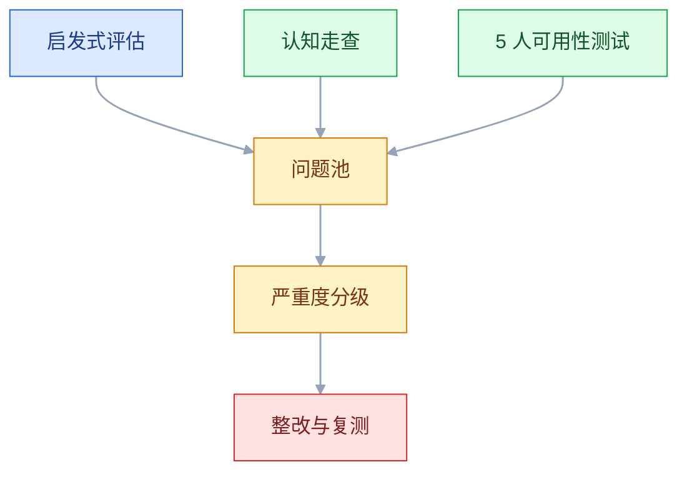
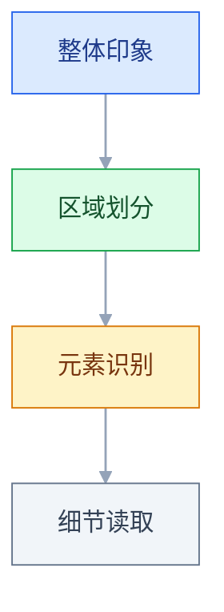
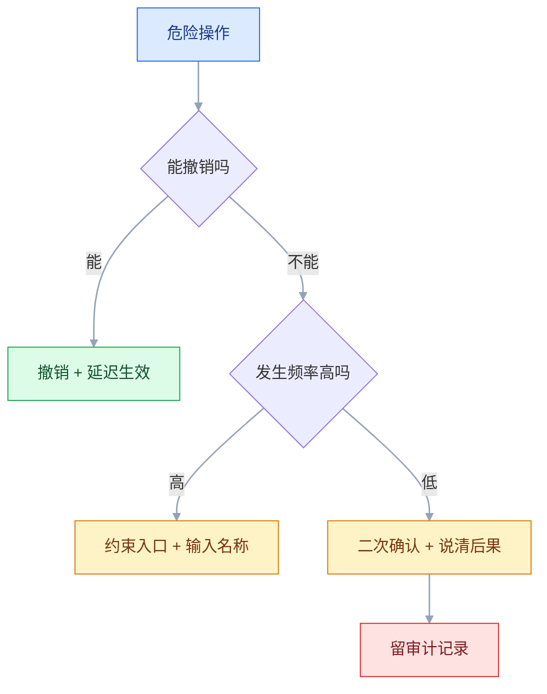

# 设计原则

## 一、工程案例：给一条核心流程做启发式走查，交付可复测的整改清单

**场景**：一套 B 端审批系统的「新建审批」流程，上线半年，客服每周收到 20 多条「填不明白」的反馈。流程本身不复杂：选类型、填金额与事由、传附件、选审批人、提交。但用户会在某个字段卡住，反复提交失败，最后打电话问客服。产品经理的诉求是「把体验优化一下」，没有具体方向。

**约束**：

- 后端不能改，本轮只动前端结构、校验与文案
- 两周内交付，设计师 1 人、产品 1 人、前端 1 人配合
- 不能做大规模埋点改造，只能用现有日志 + 小样本测试
- 整改必须能排优先级，不能给出一张 80 条、没人做得完的清单

**为什么用走查而不是直接改**：「体验不好」是结论，不是问题。走查的价值是把「用户填不明白」拆成「哪个页面、哪一步、什么现象、违反哪条规律、证据是什么」，拆到能排期、能验收的粒度。

### 1.1 第一步：锁定范围与任务

走查最怕范围失控。先把流程拆成三个用户任务，每个任务一条可判定的成功标准：

| 任务 | 起点 | 成功标准 |
|---|---|---|
| T1 首次提交报销 | 进入新建页 | 3 分钟内提交成功，无需求助 |
| T2 提交被驳回后修改 | 打开被驳回单据 | 改完重新提交，不重复填已通过字段 |
| T3 代他人提交 | 选择「代提交」 | 正确切换申请人，审批人自动跟随 |

范围外的页面（列表、报表、设置）本轮不看。**范围写进文档**，否则走查会变成「顺便看看别的页面」，两周做不完。

### 1.2 第二步：三条证据线并行



| 方法 | 谁做 | 产出 | 成本 |
|---|---|---|---|
| 启发式评估 | 2 名设计师独立走一遍，再对表 | 覆盖广的问题清单 | 各 2 小时 |
| 认知走查 | 设计师按步骤自问四个问题 | 每个步骤的理解断点 | 1 小时 |
| 可用性测试 | 5 名真实用户，出声思维 | 真实卡点与原话 | 每人 30 分钟 |

这轮 5 人测试同时是**基线**：整改前先跑，记下完成率、求助次数与卡顿时长；整改后用同一脚本再跑一遍，前后才有对照。

**认知走查的四个问题**（对流程的每一步都问）：

1. 用户知道这一步要做什么吗
2. 用户能看出自己做得对不对吗
3. 用户知道做完会发生什么吗
4. 出错后用户知道怎么改吗

四个问题里任何一个答「不知道」，就是一个候选问题。它比「我觉得这里不好」有用得多，因为它指向具体的理解断点。

### 1.3 第三步：问题记录格式

一条问题必须能被别人复现，否则它只是观点：

| 字段 | 要求 | 示例 |
|---|---|---|
| ID | 唯一，便于排期和复测 | `AP-014` |
| 位置 | 页面 + 具体元素 | 新建审批 / 金额输入框 |
| 现象 | 用户做了什么、看到什么 | 输入 5000 后失焦，提示「超出限额」，但页面没说要先选审批人 |
| 证据 | 录屏时间点、用户原话、截图 | 用户 3 原话「它到底让不让我填」 |
| 涉及原则 | 一条即可，不堆砌 | 系统状态可见 |
| 严重度 | 按统一标准判 | S2 |
| 建议 | 可执行，不写「优化一下」 | 金额下方常驻限额说明，超限时展开「加签」字段 |

**「涉及原则」只写一条**。一条问题往往同时违反三四条原则，全写上会让讨论失焦；写最直接的那条，其余的放备注。

### 1.4 第四步：严重度分级

没有分级，整改清单就是一团。用「能不能继续任务」和「有没有替代路径」两个维度判：

| 级别 | 判定 | 处理时限 | 例子 |
|---|---|---|---|
| S1 阻断 | 任务无法完成，无替代路径 | 本轮必修 | 提交按钮始终禁用，且不说明原因 |
| S2 严重 | 能完成但极易出错，或需外部求助 | 本轮必修 | 审批人默认值错误，用户不知道要改 |
| S3 一般 | 明显影响效率，有替代路径 | 本轮尽量 | 每次修改都要重新选类型 |
| S4 轻微 | 不影响力，只影响观感 | 排入常规迭代 | 错误提示的图标与文字间距不均 |

**分级的价值在于砍需求**。几十条问题里通常只有少数是 S1/S2，先把这些做完，体验就会有明显变化；S4 留着慢慢修，不要占用本轮工时。

### 1.5 第五步：典型问题与改法

走查发现的四类高频问题，改法都很具体：

**问题一：规则藏在提交之后**

```text
改前：填完 → 提交 → 红色提示「金额超过 5000，需总监审批」
改后：金额输入框下方常驻「单笔超过 5000 需总监审批」；超限时「审批人」字段自动展开并预填上级
```

对应「系统状态可见」与「错误预防」。规则本身没变，变的是用户知道规则的时机。

**问题二：错误提示只报结果**

```text
改前：提交失败，请稍后重试
改后：附件超过 10MB，当前 18.4MB。请压缩后重传，或删除附件后先提交
```

好错误提示三要素：发生了什么、为什么、怎么办。缺任何一条，用户都只能猜。

**问题三：审批人默认值不可见**

```text
改前：审批人字段预填「张伟」，用户以为已经选好，直接提交，走到错误的审批链
改后：字段显式显示「张伟（你的直属上级）」，并提供「更换」入口
```

对应「识别优于回忆」与「错误预防」。默认值必须让人看见它是什么、为什么是它。

**问题四：驳回后重填全部字段**

```text
改前：驳回 → 打开原单 → 所有字段可编辑，已通过的审批节点丢失
改后：驳回 → 顶部显示驳回原因与驳回人 → 只高亮需修改的字段 → 已通过节点保留并置灰
```

对应「用户可控与自由」与「帮助用户识别、诊断并从错误中恢复」。被驳回的用户最需要知道「改哪里」，而不是重新填一遍。

### 1.6 第六步：排优先级

用「影响面 × 修复成本」两维排，不按个人喜好：

| | 成本低 | 成本高 |
|---|---|---|
| 影响大 | 立刻做（文案、默认值、错误提示） | 本轮做一件（流程重构） |
| 影响小 | 顺手做（间距、图标） | 不做或延后 |

**优先做「文案与默认值」**：它们成本最低、见效最快，而且不需要改后端。流程级重构放到下一轮，避免本轮做不完。

### 1.7 验收表

| # | 检查项 | 怎么验 | 通过标准 |
|---|---|---|---|
| 1 | 问题可复现 | 按记录里的步骤重走一遍 | 3 人独立操作，均能复现同一现象 |
| 2 | 证据完整 | 查每条问题是否有录屏/截图/原话 | 无证据的条目为 0 |
| 3 | 分级有依据 | 抽查 S1/S2 条目 | 每条能说清「卡在哪一步、有无替代路径」 |
| 4 | 整改项可验收 | 看建议是否包含预期结果 | 每条都有「改完后用户能看到什么」 |
| 5 | 错误提示完整 | 逐条读错误文案 | 均包含现象、原因、动作 |
| 6 | 状态可见 | 断网、超时、重复点击各试一次 | 每种情况都有明确反馈，且不丢已填内容 |
| 7 | 键盘可完成 | 全程不用鼠标走一遍 | 能完成提交，焦点顺序符合视觉顺序 |
| 8 | 一致性抽查 | 对比同一操作在 3 个页面的表现 | 触发方式、确认方式一致 |
| 9 | 复测通过 | 5 名新用户做 T1，对照 1.2 的基线 | 完成率高于基线，求助次数下降，且无新增卡点 |
| 10 | 文档可交接 | 交给未参与的设计师 | 能独立按文档复现问题与验收 |

> 第 9 项是唯一能证明「改对了」的检查。前 8 项只证明「改完了」，不证明「用户会用」。

### 1.8 复测脚本

复测不能只问「现在好用吗」，要给任务、给起点、只观察：

```text
任务：你需要报销一笔 6800 元的差旅费，今天必须提交。
起点：工作台首页。
观察：是否找到入口、是否理解限额规则、是否注意到审批人、失败后是否知道怎么改。
记录：完成时间、求助次数、卡顿时长、原话。
禁止：中途提示、解释界面、询问喜好。
```

**通常 5 名左右就能暴露主要问题**。它的价值不在统计显著性，而在快速暴露「设计者以为清楚、用户其实不懂」的地方。发现的问题修完，再换 5 人复测；结论只作方向判断，不要当成比例或因果。

### 1.9 交付物清单

| 交付物 | 给谁 | 内容 |
|---|---|---|
| 走查范围与任务表 | 产品、设计 | 三个任务 + 成功标准 + 不看的页面 |
| 问题记录表 | 设计、开发 | ID、位置、现象、证据、原则、严重度、建议 |
| 严重度分级表 | 产品、开发 | S1–S4 定义与处理时限 |
| 整改清单 | 开发、测试 | 问题、改法、成本、优先级、预期结果 |
| 复测脚本 | 设计、测试 | 任务、起点、观察点、禁止行为 |
| 验收表 | 全员 | 十项可执行检查 |

**交付物的判断标准是「别人能不能接着做」**。文档写得再全，如果开发看完仍不知道改哪里、测试看完仍写不出用例，就还没交付完。

---

## 二、高频问答：会卡住你的地方，也是面试最常问的

### 2.1 评审时说「这违反格式塔」，对方不认

**现场**

让对方做 5 秒测试：看一眼页面，说出「哪几块是一组」。再把两种间距各截一张图，让 3 个没参与设计的人看，问「哪两个按钮是一组」。

**要点**

- 原则是发现问题的线索，不是判决依据；只说原则名，没指出「用户会怎么误解」，问题就没法讨论。
- 把原则当成话语权是最常见的错：说「违反接近原则」没人能反驳，也没人能执行。
- 换成「这两个按钮间距 4px，和其他组的 24px 不一致，用户会把它们当成同一组操作」，立刻可讨论、可执行。
- 答案与预期不符就是真问题；相符，就是你在过度解读。

**追问**

- 5 秒测试怎么问才不引导？→ 只问「哪几块是一组」，不先报自己的判断。
- 对方说「我觉得挺清楚」怎么办？→ 找 3 个没参与设计的人，看答案是否一致。
- 为什么不能只引用原则名？→ 原则描述的是倾向，不描述这一个页面上的具体误解。

### 2.2 加了边框和背景色，分组还是不清楚

**现场**

遮住所有边框和背景，只看元素位置，能否分出组。再只调间距：组内压到 8、组间拉到 24，截图对比。

**要点**

- 分组的第一手段是间距，不是边框；间距没拉开，加多少框都只是把混乱框起来。
- 边框和背景是「强制分组」，用多了页面变成一堆盒子，反而增加视觉噪音。
- 先调间距，分组清楚后再决定要不要保留边框；多数情况下不需要。

**追问**

- 间距调到多少才算拉开？→ 组内 8、组间 24 只是对比起点，以能不能分出组为准。
- 这里的 5 秒测试怎么用？→ 遮住边框和背景让人分组，能分出来说明结构成立。
- 为什么加框会让页面更乱？→ 每个框都是一条新边界，边界多了就分不出主次。

### 2.3 加了二次确认，误删并没有减少

**现场**

看操作日志里「确认弹窗出现后几乎立即点确定」的比例，以及撤销使用率。再把日常删除改成「删除 + 5 秒撤销」，只对不可逆的批量删除保留二次确认。

**要点**

- 每次删除都弹确认，用户点几次后就条件反射点「确定」，确认形同虚设，这叫确认疲劳。
- 有效的是让操作可撤销，或让危险操作难以误触（位置隔离、输入名称确认），不是反复问「你确定吗」。
- 验证看两周内的误删工单数，不要问用户「你觉得安全吗」。

**追问**

- 什么操作才配二次确认？→ 不可逆且影响大的，比如批量删除。
- 撤销窗口开多长？→ 3–5 秒，太短来不及反应，太长用户已经切换上下文。
- 为什么加红字、加倒计时没用？→ 用户不看内容，只是把挡路的按钮点掉。

### 2.4 每个字段都写了说明，表单完成率还是低

**现场**

数必填字段数量；看用户在哪些字段停留超过 10 秒；统计放弃发生在第几步。先删掉「不填也能活」的字段，再按用户思维排序，最后才补说明。

**要点**

- 负荷不在「看不懂」，在「要填的太多、要记的太多」；说明文字本身也在增加阅读负担。
- 多数表单的问题是信息过量、顺序不对、必填太多，不是说明太少。
- 改完测完成时间，不要只测满意度。

**追问**

- 怎么判断一个字段能不能删？→ 问「不填能不能完成任务」，能就删或交给系统带出。
- 为什么满意度不能当验收？→ 它和能不能完成任务是两件事，说满意的人也可能放弃。

### 2.5 菜单按「7±2」砍到 7 项

**现场**

看用户是否需要背下菜单；实际操作中是否频繁找错入口。用 5 人测试找入口，记录找错次数。

**要点**

- 7±2 说的是短期记忆容量，不是菜单项上限；菜单是「看着选」，不需要记住。
- 可见的选项不占工作记忆；真正该限制的是「用户必须同时记住几件事」。
- 菜单可以超过 7 项，但要分组、排序、提供搜索；判断标准是「能不能快速找到」，不是数量。

**追问**

- 那什么场景才适用 7±2？→ 需要用户记住的连续项，比如跨步骤填表时记住上一步的编号。
- 菜单项多了怎么处理？→ 分组、排序、加搜索，而不是硬砍到 7 项。
- 20 项菜单一定比 5 项难用吗？→ 不一定，分组良好的 20 项只需要记住「我要找的那一类」。

### 2.6 一致性做成了「全站长得一样」

**现场**

抽查「保存」「提交」「发布」三个按钮，看样式是否相同但行为不同。再列一张「操作 × 页面 × 触发方式 × 结果」的表。

**要点**

- 一致性是「相同的东西相同，不同的东西不同」；强行一样，会让不同语义的操作看起来同类。
- 真正伤用户的是「同一个词指两件事」「同一操作在不同页面触发方式不同」，不是按钮圆角差 2px。
- 同一操作在不同页面行为不同是 S2；纯样式差异最多 S4。

**追问**

- 视觉统一不重要吗？→ 重要，但它是四层一致里成本最低的一层，替代不了概念和交互一致。
- 「保存」和「提交」能长得一样吗？→ 行为不同就不能同款，否则用户以为结果相同。
- 一致性什么时候可以让步？→ 和当前任务效率冲突时，让此刻要完成的事优先。

### 2.7 桌面端 hover 才显示的操作，移动端永远看不见

**现场**

用触屏设备或 DevTools 的触摸模拟走一遍，看操作入口是否出现；再用键盘 Tab 走一遍同样的任务。

**要点**

- 触屏没有 hover 状态；依赖 hover 暴露的操作，在移动端等于不存在。
- hover 在桌面端减少视觉噪音，在移动端直接删掉了功能，不是免费的收纳手段。
- 所有 hover 才出现的操作必须有常驻替代入口：更多菜单、滑动操作 + 首次引导。

**追问**

- 长按能替代 hover 吗？→ 不能，长按是隐藏手势，用户不知道，也没有视觉提示。
- 怎么保证两端功能等价？→ 键盘 Tab 和触摸各走一遍同一条任务，操作不能缺项。

### 2.8 错误提示只写「操作失败，请重试」

**现场**

统计同一错误码背后有几种实际成因；看客服工单里用户是怎么描述的。再拿最常出现的 5 个错误，逐个写出三要素。

**要点**

- 缺的是原因和动作：用户不知道是网络、权限、格式还是系统故障，只能反复重试。
- 好的错误提示要简单到能懂，但必须包含「发生了什么、为什么、怎么办」。
- 写不出「为什么」，说明后端没给足够信息，要推动错误码细化，而不是在前端编一句通用文案。

**追问**

- 技术细节要不要给用户看？→ 堆栈和内部码不给，但可以留可复制的追踪 ID 方便客服定位。
- 前端兜一句通用文案行不行？→ 能显示，但用户仍然只能重试，问题没解决。

### 2.9 页面加载慢，就加一个转圈

**现场**

用网络限速到 Slow 3G，看首屏出现时间和布局跳动；再用 Performance 面板看首次内容绘制时间。

**要点**

- 整页转圈把「框架」和「数据」绑在一起等；数据没回来，用户连页面是什么都看不到。
- 转圈只证明系统没死，不提供任何结构信息；骨架屏同时告诉用户「正在加载」和「马上会出现什么」。
- 框架先渲染，数据分区加载，谁先回来谁先显示；加载完成后不能有明显位移。

**追问**

- 骨架屏的尺寸怎么定？→ 接近真实内容，否则加载完会把下面的内容顶走。
- 什么时候可以直接用转圈？→ 只有一个接口、一个区块、没有可预留结构时。
- 为什么说「有反馈」不等于「体验好」？→ 它只说明系统活着，没告诉用户等的是什么。

### 2.10 空状态只写「暂无数据」

**现场**

分别构造首次为空、筛选无结果、全部处理完三种情况，看文案和操作是否一样。

**要点**

- 空状态分三种：首次为空、筛选无结果、全部处理完，三者用户该做的事完全不同。
- 首次空态是新手引导最好的位置；无结果空态要教用户放宽条件；完成空态要给正向反馈。
- 判断依据是「当前有没有筛选条件」，不是数组长度：删掉筛选仍为空，才是真的没有。

**追问**

- 三种空态各要什么？→ 各一句文案 + 一个主操作。
- 有数据但筛选后为空怎么办？→ 必须提供「清空筛选」，不能复用首次空态的插图。
- 为什么完成空态不能整页空白？→ 用户会以为坏了，要给正向反馈和下一步。

### 2.11 用户测试时问「你喜欢这个设计吗」

**现场**

回看测试记录，看有多少结论来自「用户说喜欢」，而不是「用户做成了」。

**要点**

- 喜好受礼貌、审美偏见和提问方式影响，和能不能完成任务是两件事。
- 用户擅长暴露问题，不擅长给方案；问「喜欢吗」得到的答案无法指导修改。
- 只给任务、不给评价性问题，记录完成率、完成时间、求助次数、错误次数，以及卡住时的原话。

**追问**

- 喜好问题完全不能问吗？→ 可以问，放最后，且不作为决策依据。
- 为什么不直接问用户想要什么？→ 用户给的是症状和偏好，方案要设计者自己判断。

### 2.12 只用鼠标走查，交付后才发现键盘走不通

**现场**

全程只用 Tab / Shift+Tab / Enter / Esc 走完主任务：能否到达、焦点是否可见、弹层会不会困住焦点。

**要点**

- 焦点顺序、焦点环、弹层焦点锁定只有用键盘才暴露；受影响的用户没有替代路径，功能等于缺失。
- 键盘走不通不是体验差，是任务无法完成，按严重度属于 S1。
- 交付前固定跑一遍键盘路径，至少覆盖表单提交、弹窗关闭、菜单展开、删除确认；焦点顺序应与视觉顺序一致。

**追问**

- 为什么不能 `outline: none`？→ 焦点环被抹掉后，键盘用户不知道自己在哪。
- 用户都用鼠标，为什么还要管键盘？→ 它同时是表单的兜底路径，焦点错乱时鼠标用户也会找不到位置。

---

## 三、核心知识：从零开始要建立的东西

### 3.1 感知分层与结构优先

用户看界面分四层加工，前一层的判断会影响后一层：



第一层觉得「乱」，后面读每个细节都会带着怀疑；第一层觉得「清楚」，小瑕疵会被忽略。所以修复顺序永远是：结构 → 分组 → 层级 → 细节。

**边界**：结构问题没有量化指标，只能靠任务测试暴露。按钮描边差 1px 是细节，分组错了是结构；评审时间应该大部分花在结构上，而不是反过来。

### 3.2 格式塔五条与优先级

人会自动把「像的东西」归为一类，这是视觉系统的本能，不是选择：

| 原理 | 表现 | 设计含义 | 经验强度 |
|---|---|---|---|
| 接近 | 靠得近的被视为一组 | 间距是分组第一手段 | 最强 |
| 相似 | 颜色、形状、大小相同被视为同类 | 同类操作用同样样式 | 强 |
| 共同区域 | 被同一边界包住算一组 | 边框、背景块是强制分组 | 中 |
| 连续 | 沿直线排列的连成整体 | 对齐制造秩序 | 中 |
| 闭合 | 不完整图形会被补全 | 卡片不必画满边框 | 弱 |

**强弱是经验排序，不是固定数值**：元素的大小、对比度、颜色都会改变结果，拿不准就让几个人做 5 秒测试，看他们实际把哪些元素归成一组。

**优先级不能颠倒**：先调间距，间距不够再用边框，边框不够才用背景色。反过来做，会得到「一堆彩色盒子，但组内组外一样远」。

**冲突时的取舍**：接近与相似同时存在时，通常接近赢——两个按钮长得一样但隔得很远，用户不会认为它们是一组；长得不一样但挨在一起，用户仍会认为它们相关。共同区域的约束力同样很强，和接近打架时别背强弱表，用 5 秒测试看结果。

> **面试**：常问「接近和相似冲突时谁赢？」答：通常接近赢，拿不准就用 5 秒测试看用户实际怎么分组。

### 3.3 一致性的四个层次

| 层次 | 内容 | 违背后果 | 修复成本 |
|---|---|---|---|
| 概念 | 同一个词始终指同一件事 | 用户以为「项目」和「空间」是两个功能 | 高，牵涉文案与数据模型 |
| 交互 | 同样的操作用同样方式触发 | 这个页面点行选中，那个页面点行跳转 | 中 |
| 视觉 | 同样的元素同样样式 | 两个「保存」长得不一样，用户犹豫 | 低 |
| 平台 | 遵循平台惯例 | 用户找不到返回 | 中 |

**一致性的边界**：跨产品不必一致，跨模块必须一致，同一模块内严格一致。不同产品面向不同任务，强行统一反而增加认知负担；同一产品内不一致，用户每次都要重新学。

**取舍**：一致性 vs 就近原则冲突时，让「当前任务效率」赢。比如全局导航在顶部，但当前表单的「保存」应该放在表单底部，而不是为了「按钮都在右上角」让用户滚回顶部。

### 3.4 认知负荷的三类来源

| 类型 | 来源 | 例子 | 设计能做什么 |
|---|---|---|---|
| 内在 | 任务本身复杂 | 配置一条多条件审批流 | 只能拆解：分步、模板、预览 |
| 外在 | 设计造成的额外负担 | 字段用内部黑话、选项无规律、关联信息分散 | 可以消除 |
| 相关 | 把新信息组织进已有经验的努力 | 第一次配置审批流，要理解「条件」和「分支」的关系 | 不能代替，只能支持：结构、示例、即时预览 |

**先区分类型，再谈优化**。内在负荷消不掉，只能降低单步难度；外在负荷是设计的责任；相关负荷是用户建立图式必须付出的努力，设计不该消灭它，而要让它花得值。

> **面试**：常问「7±2 是菜单项上限吗？」答：不是，它说的是短期记忆容量，菜单是看着选，不占工作记忆。

**最小示例**：一个「折扣」字段旁边直接显示「折后价 = 原价 × 折扣」，用户不用来回对照，外在负荷归零；把折后价放到另一个标签页，用户就要自己算，还要记住原价。

### 3.5 工作记忆与组块

工作记忆是「当前正在处理的信息」的容量，通常以组块计。它不是固定数字，与材料的组织方式、用户熟悉程度都有关；常见的早期说法是 7±2 个组块，后来的研究普遍给出更小的容量，常以 4 个组块估算，实际能顶住多少以实测为准。关键不是数字，是「组块」：有意义的整体算一个。

| 场景 | 用户要记住什么 | 降低办法 |
|---|---|---|
| 多步表单 | 上一步填的编号、金额 | 显示进度、回看已填内容 |
| 跨页选择 | 已选中的 12 项 | 常驻「已选 N 项」+ 查看列表 |
| 对照填写 | 另一张表里的数据 | 并排展示、支持复制 |
| 复杂规则 | 三个条件与两个例外 | 规则常驻在字段旁，不放帮助中心 |

**边界**：组块数量不等于选项数量。一个分组良好的 20 项菜单，用户只需要记住「我要找的那一类」，负荷远低于 5 个无规律的输入框。

### 3.6 希克定律与选项结构

选项越多，做决定的时间越长，但增长是对数的，不是线性的。所以结论不是「越少越好」，而是「让用户不需要逐一比较」：

| 手段 | 做法 | 适用 |
|---|---|---|
| 排序 | 高频在前，低频在后 | 菜单、下拉、模板列表 |
| 推荐 | 给出默认项并说明理由 | 审批人、收货地址、常用配置 |
| 分组 | 按语义分块，块内再排序 | 十项以上的选项 |
| 分步 | 一次只问一类 | 配置流程、向导 |
| 搜索 | 选项多到一屏放不下、需要滚动查找时 | 国家、客户、商品 |

**边界**：选项少但都很陌生时，用户仍会犹豫。此时减少数量没用，要给说明和示例。希克定律管的是「比较成本」，不是「数量本身」。

### 3.7 菲茨定律与目标尺寸

点击时间随目标距离增加、随目标宽度减小而变长，两者是对数关系。推论不是「按钮越大越好」，而是「重要且高频的目标要大、要近；危险目标要小、要远」：

| 目标 | 大小 | 位置 |
|---|---|---|
| 主操作 | 大（高度 ≥ 36px 桌面，≥ 44px 移动） | 视线落点附近、表单底部右侧 |
| 次操作 | 中 | 主操作左侧 |
| 危险操作 | 小，或收进菜单 | 远离主操作 |
| 关闭 / 返回 | 中等 | 角落（屏幕边缘是「无限大」目标） |

**移动端热区下限**：44×44pt（iOS）/ 48×48dp（Android）。视觉可以小，热区不能小；图标 24px 时，外面要补到 44px 的可点区域。

**边界**：把危险按钮做小、做远，是为了提高误触成本，不是为了让用户找不到。它仍然要可发现，只是不放在主操作旁边。

### 3.8 反馈延迟阈值

| 响应时间 | 用户感受 | 必要反馈 |
|---|---|---|
| < 100ms | 立即 | 最多按钮按下态 |
| 100ms–1s | 略微延迟 | 按钮 loading |
| 1s–10s | 明显等待 | 进度条或骨架屏，可取消 |
| > 10s | 以为卡死 | 进度 + 预计时间 + 后台执行选项 |

**反馈要在点击瞬间出现**，不能等请求回来。按钮点下后立刻禁用 + loading，既告诉用户「收到了」，也防止重复提交。这一条的成本最低，收益最大。

**边界**：0.1–1 秒的等待不必立刻弹全局 loading，延迟约 200ms 再显示，避免转圈一闪而过；加载超过 10 秒的操作，最好允许转到后台并通知结果，而不是让用户盯着页面。阻塞越久，用户越可能直接关掉。

> **面试**：常问「整页转圈为什么不够？」答：它把框架和数据绑在一起等，骨架屏才能同时传达「正在加载」和「马上会出现什么」。

### 3.9 防错强度阶梯

| 强度 | 手段 | 例子 | 代价 |
|---|---|---|---|
| 最强 | 约束 | 日期选择器无法输入 13 月 | 灵活性下降 |
| 强 | 合理默认 | 审批人预填直属上级 | 默认错时不易发现 |
| 中 | 即时校验 | 输入时提示格式不符 | 可能打断输入 |
| 中 | 可撤销 | 删除后 5 秒内可恢复 | 需要状态管理 |
| 弱 | 二次确认 | 弹窗问「确定删除」 | 确认疲劳 |
| 最弱 | 事后报错 | 提交后统一提示 | 用户已白忙一场 |

**防错优于纠错**，但「最强」不等于「最合适」。表的前半是防错，后半是容错与补救，混排在一起，是因为它们共同决定「用户最终会不会受损」。约束会降低灵活性，默认值会掩盖错误，选择时要看错误的后果有多严重、发生频率有多高。

选哪一档，先看两件事：能不能撤销、发生频率有多高。可撤销的给撤销；不可撤销的，频率高的用约束，频率低的用二次确认，再按波及范围补审计记录。



**边界**：不可逆且影响大的操作（删除整个项目、批量停用账号）才用二次确认；可撤销的操作给「撤销」，比给「确认」体验好，因为它不打断操作流。

### 3.10 可逆性与撤销窗口

| 手段 | 强度 | 适用 | 实现要点 |
|---|---|---|---|
| 撤销 | 最强 | 删除、移动、批量修改 | Toast 内带按钮，3–5 秒 |
| 回收站 | 强 | 内容型对象 | 通常保留 7–30 天，可恢复 |
| 草稿 | 强 | 长表单 | 自动保存 + 恢复提示 |
| 二次确认 | 中 | 不可逆操作 | 说清后果，不只问「确定吗」 |

**撤销窗口 3–5 秒**是经验值：太短来不及反应，太长用户已经切换上下文，撤销反而造成困惑。批量操作可以延长到 10 秒，并在 Toast 里显示影响条数。

**边界**：涉及资金、权限、对外发布的操作，不要只靠撤销，要有明确的确认和审计记录。可逆性解决误操作，不解决越权。

### 3.11 渐进披露的判据

先给必要信息，复杂选项按需展开。三种形式：

| 形式 | 例子 | 适用判据 |
|---|---|---|
| 折叠 | 「高级设置」默认收起 | 少数用户会改，且不改也能完成任务 |
| 分步 | 三步向导 | 步骤之间有依赖，后一步需要前一步结果 |
| 渐进展开 | 列表行展开看详情 | 详情不常用，但需要就地查看 |

**判断标准是「多少比例的用户会改」**，不是「重不重要」。只有少数人会改的选项可以收起来，但必须让人找得到；藏起来的高频操作，会让老用户每次多点一次。比例以实际数据为准，没有数据就先问客服和一线支持。

**边界**：安全相关、合规相关的选项不能藏。用户可以不改，但必须知道它存在，比如「公开范围」「数据保留期限」。

### 3.12 心智模型与交互惯例

心智模型是用户以为系统怎么运作。它来自过往产品经验，不由你的产品决定。设计不符合心智模型，用户会持续困惑，而且很难通过文案纠正。

| 惯例 | 用户预期 | 违背的代价 |
|---|---|---|
| 购物车在右上 | 去右上角找 | 找不到，以为没有购物车 |
| 点头像有设置与退出 | 去头像菜单找 | 满页找「退出登录」 |
| 列表点标题进详情 | 标题可点 | 用户去点整行，或以为不能进 |
| 搜索框有放大镜 | 识别搜索入口 | 把搜索当成普通输入框 |

**创新要选对地方**：商业模式、核心能力可以创新，交互惯例不要。把「保存」做成必须双击，用户不会觉得聪明，只会觉得坏了。

**边界**：惯例也会变，但改变需要足够的收益和引导。单个产品无法教育用户，除非它足够高频、足够重要。

### 3.13 错误信息的结构

一条可用的错误信息包含三部分：

```text
发生了什么：附件超过 10MB
为什么：当前文件 18.4MB，单次上传上限 10MB
怎么办：压缩后重传，或删除附件后先提交
```

| 错误类型 | 写法 | 反例 |
|---|---|---|
| 格式错误 | 指出具体字段与规则 | 「输入有误」 |
| 权限不足 | 说明缺什么权限、找谁开 | 「无权限」 |
| 网络失败 | 说明是否已生效、能否重试 | 「操作失败」 |
| 业务冲突 | 说明冲突对象与解决路径 | 「状态不允许」 |

**错误提示放在出错的位置**，同时在顶部做汇总。只放顶部，用户要自己找字段；只放字段旁，提交后看不到全局有几处错。

**边界**：不要暴露堆栈、SQL、内部错误码给终端用户；但可以保留一个可复制的追踪 ID，方便客服定位。

### 3.14 启发式走查的操作方法

走查不是「凭经验看一遍」，要按固定流程，才能复用和交接：

| 步骤 | 动作 | 产出 |
|---|---|---|
| 1 | 定范围与任务 | 任务清单 + 成功标准 |
| 2 | 独立走查 | 每人一份原始问题清单，不互相影响 |
| 3 | 对表合并 | 去重、补证据、统一描述 |
| 4 | 分级 | 按阻断/严重/一般/轻微 |
| 5 | 出整改清单 | 问题 + 改法 + 成本 + 优先级 |
| 6 | 复测 | 新用户任务测试，验证是否真的改善 |

**独立走查再对表**是关键。先讨论会让一个人主导方向，漏掉其他人发现的问题。两个人各自走完再合并，覆盖度通常更高。

**边界**：启发式评估能发现「违反规律」的问题，发现不了「用户实际怎么想」。所以它必须和真实用户测试配合，不能替代。

### 3.15 可用性测试的最小样本

| 目的 | 样本 | 方法 |
|---|---|---|
| 发现主要可用性问题 | 5 人左右 | 任务测试 + 出声思维 |
| 验证分类是否合理 | 5–10 人 | 卡片分类 |
| 比较两个方案 | 每方案 5 人起 | 任务完成率与时间，差异明显才可采信 |
| 发现低频严重问题 | 需要更大样本 | 日志分析 + 客服工单 |

**5 人不是统计样本，是迭代工具**。它的作用是快速暴露「设计者以为清楚、用户其实不懂」的地方；修完再测，比一次性找 50 人更有用。

**边界**：5 人测不出低频问题，也测不出比例。要证明「改版后转化提升」，需要看线上数据和更大样本，不能拿 5 人测试的结论当因果。

### 3.16 原则冲突的裁决顺序

原则之间经常打架，提前定好顺序，评审才不会变成辩论：

| 冲突 | 通常谁赢 | 理由 |
|---|---|---|
| 一致性 vs 当前任务效率 | 当前任务效率 | 用户此刻要完成的事优先 |
| 简洁 vs 可发现性 | 可发现性 | 藏起来的功能等于不存在 |
| 美观 vs 可读性 | 可读性 | 看不清就没有体验 |
| 防错 vs 操作效率 | 看后果可逆性 | 可逆则效率优先，不可逆则防错优先 |
| 灵活 vs 易学 | 看用户分层 | 新手多则易学优先，专家多则灵活优先 |

**裁决依据是「用户代价」，不是「设计理念」**。哪个选择让用户付出的代价更小，就选哪个；代价包括时间、出错概率、学习成本、情绪成本。

**边界**：这套顺序是默认值，不是铁律。涉及资金、隐私、合规时，防错和可读性优先于效率，没有例外。

---

## 四、冷门知识汇总

| 知识点 | 为什么冷门 | 用到时的关键词 |
|---|---|---|
| 冯·雷斯托夫效应 | 只在需要制造记忆点时才用，日常界面越少越好 | 隔离效应、关键 CTA |
| 系列位置效应 | 长列表才明显，短列表无从观察 | 首因、近因、长列表排序 |
| 蔡格尼克效应 | 只在多步流程和中断恢复里有意义 | 未完成态、进度条、草稿 |
| 峰终定律 | 需要完整旅程才能验证，单页评审看不出来 | 结账最后一步、错误恢复 |
| 审美可用性效应 | 只在首次使用和信任判断时起作用，长期被效率覆盖 | 首次使用、信任建立 |
| 双重编码 | 图文都正常时不会想到，纯文字提示出错才回头查 | 重要提示配图标、状态标签 |
| 功能可见性 | 用组件库的按钮时默认就有，自绘图标按钮才暴露 | 扁平化、无边框按钮、hover |
| 卡片分类法 | 导航已定型时不会做，改版时才想起 | 开放式、封闭式分类 |
| 破坏性操作的颜色 | 只在语义色和品牌色打架时才需要区分 | 危险色、语义色边界 |
| 手势可发现性 | 只在移动端隐藏手势上出问题 | 首次引导、动效暗示 |
| 表单分组上限 | 字段少时用不上，长表单才暴露 | 分组、分步、字段计数 |
| 占位符不能当标签 | 用组件库的表单组件时已经处理好，自己拼输入框才踩 | 浮动标签、辅助说明 |
