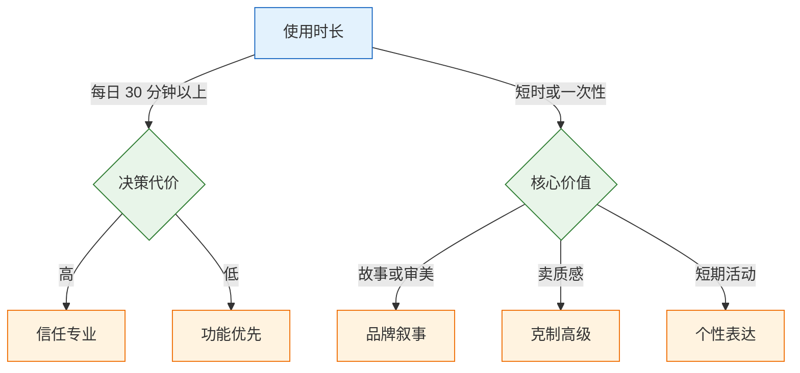

# 设计原则与风格

---

## 一、设计原则与风格是什么

### 1.1 核心概念

设计原则是对取舍的排序规则：当两个目标冲突时，先保哪一个。风格是原则在视觉上的稳定表达，最终落为密度、圆角、阴影、主色用量、字阶、动效时长等可测参数。

两者解决不同的问题。原则回答“为什么这样排优先级”，风格回答“同一类页面重复出现时用什么值”。只有原则没有风格，评审仍然停留在形容词；只有风格没有原则，规则遇到新场景就会失效。

| 概念 | 回答的问题 | 产出 | 失效表现 |
|---|---|---|---|
| 设计原则 | 冲突时先保什么 | 优先级与判断依据 | 评审依赖主观争论 |
| 风格 | 这类产品看起来多克制、多密 | 四组可测参数 | 每页像不同产品 |
| 规范 | 具体场景怎么用 | 组件规则与禁用清单 | 规则无法覆盖新页面 |
| 组件库 | 单个交互单元怎么实现 | 代码与状态 | 外观统一、行为各异 |

一条可用的原则必须同时满足三个条件：可验证，能指向具体元素与用户后果；可排序，与其他原则冲突时有明确先后；可执行，能转成规则或数值。“要简洁”不满足任何一条，“一屏只保留一个主操作”三条都满足。


顺序不能反。先挑一个风格名称再补规则，结果一定是拼装感：按钮走极简，卡片用重阴影，弹窗又是玻璃效果，每个部分都能自圆其说，合起来不是一套。

### 1.2 适用场景与边界

设计原则适用于设计评审、方案取舍、跨端一致性治理、设计系统规则制定。风格适用于新产品定调、存量产品改造、同一品牌多产品线的差异化管理。

两者都不适用于替代用户研究。原则可以解释“为什么这个方案更可能被理解”，不能证明“用户一定需要这个功能”。风格可以统一观感，不能弥补信息架构错误。

| 场景 | 原则的作用 | 风格的边界 |
|---|---|---|
| 方案评审 | 提供冲突排序与证据口径 | 不判断方案是否值得做 |
| 新产品定调 | 约束装饰与信息密度 | 不替代品牌定位 |
| 多产品线 | 统一骨架与优先级 | 允许密度与装饰不同 |
| 存量改造 | 决定先修结构还是先换皮 | 不能靠换色解决流程问题 |
| 设计系统 | 写入准入与禁用规则 | 不覆盖所有业务例外 |

> **注意**：原则不是评审时的判决书。引用“一致性原则”不能结束讨论，能结束讨论的是“这个页面的保存按钮在右上角，而另外六个页面在底部，用户会按错”。原则负责解释，现象负责说服。

---

## 二、原则的判断依据

### 2.1 可验证现象

模糊评审的典型句式是“这里不够清晰”“感觉有点乱”。这类表述无法执行，因为它没有指出谁在什么任务上会误判成什么。

把结论改写成现象，需要三个字段：触发条件、误判结果、证据。证据可以是可用性测试录像、客服工单、埋点数据，也可以是一次 5 秒测试的答案分布。

| 模糊表述 | 可验证改写 | 证据 |
|---|---|---|
| 这里不够清晰 | 新用户在列表页把“导出”当成“下载附件” | 5 秒测试中 4/6 人指错 |
| 层级不明显 | 首屏找不到主操作，平均停留 8 秒 | 眼动或点击热区 |
| 太花 | 品牌色覆盖表头、图标、标题，主按钮不突出 | 灰度截图与面积统计 |
| 操作太重 | 删除一条件要经过两次弹窗 | 任务点击步数 |
| 不够专业 | 同一页面出现三种圆角与两种字号 | 样式统计 |

评审时间应该按“结构、分组、层级、细节”的顺序分配。结构问题影响任务完成，细节问题只影响观感。把大部分时间花在 1px 描边上，通常意味着结构已经没问题，或者评审者不知道如何判断结构。

### 2.2 冲突排序

原则之间会冲突。一致性与当前任务冲突，密度与可读性冲突，品牌表达与克制冲突。排序规则需要提前写清楚，而不是每次临场讨论。

| 冲突场景 | 优先保谁 | 理由 |
|---|---|---|
| 全局导航一致 vs 长表单保存 | 当前任务 | 让用户滚回顶部违背任务路径 |
| 信息密度 vs 正文可读性 | 可读性 | 字号有生理下限，密度可以换布局 |
| 品牌表达 vs 状态可辨 | 状态可辨 | 状态误读会造成操作事故 |
| 视觉统一 vs 平台惯例 | 平台惯例 | 返回、滚动、手势的预期优先 |
| 新风格 vs 存量一致性 | 存量一致性 | 局部换新会制造两套认知 |

排序的底线是可访问性。对比度、焦点可见、键盘可达、触控目标尺寸属于阻断项，不参与风格权衡。任何“这样更好看”的理由都不能覆盖红线。

原则条目本身也要控制数量。超过十条，等于没有优先级：每条都能找到支持与反对的场景，评审仍要逐条争论。常见做法是保留 3 至 7 条，每条配一句适用条件和一个反例，让原则可以被反驳，也可以被验证。

> **设计红线**：不能为了视觉统一而移除焦点环、降低正文对比度、缩小触控目标，或让状态只靠颜色区分。这些不是风格选项，是可用性底线。

### 2.3 一致性的四个层次

一致性常被误解为“全站长得一样”。真正影响任务的是概念与行为的一致性，视觉一致性排在后面。

| 层次 | 内容 | 违背后果 | 修复成本 |
|---|---|---|---|
| 概念 | 同一个词始终指同一件事 | 用户以为“项目”和“空间”是两个功能 | 高 |
| 交互 | 同样的操作用同样方式触发 | 这个页面点行选中，那个页面点行跳转 | 中 |
| 视觉 | 同样的元素同样样式 | 两个“保存”长得不一样 | 低 |
| 平台 | 遵循系统与行业惯例 | 用户找不到返回或关闭 | 中 |

一致性也分内部与外部。内部一致性指产品自身统一，外部一致性指符合平台习惯与行业惯例。二者冲突时，平台惯例优先：自定义的返回手势再统一，用户仍然会按系统手势操作。

一致性服务效率，不服务整齐。长表单的保存按钮放在表单末尾，虽然破坏了“主操作都在右上角”的规则，但缩短了任务路径，这是合理的例外，需要写进规范而不是口头允许。

---

## 三、风格约束的评估

### 3.1 三类约束

风格不是审美偏好，而是约束条件的解。先给三个约束打分，再选风格族。

| 约束 | 判断问题 | 低分含义 | 高分含义 |
|---|---|---|---|
| 使用时长 | 用户每天使用多久 | 短时说服型，可外显装饰 | 长时工具型，必须低刺激 |
| 决策代价 | 出错是否造成资金、合规、安全损失 | 可活泼、可试错 | 必须稳定、克制、可回溯 |
| 维护成本 | 团队能否长期维护插画、动效、定制字体 | 必须砍装饰，靠排版 | 可投入品牌资产 |

三项之外还有两个辅助条件：用户规模决定可用性投入，品牌阶段决定视觉表达的野心。辅助条件不直接决定风格族，但会约束落地范围。

打分不需要精确。使用时长按“每天不足 5 分钟、5 至 30 分钟、30 分钟以上”三档；决策代价按“可撤销、需审核、不可逆”三档；维护成本按“无专职设计、有设计、有品牌团队”三档。三档足够区分大多数产品。

### 3.2 风格族选择

| 场景 | 主族 | 视觉特征 | 典型误用 |
|---|---|---|---|
| 每天使用超过 30 分钟的工具 | 功能优先 | 低装饰、中等密度、信息前置 | 把官网的大留白搬进来 |
| 出错代价高的业务系统 | 信任专业 | 稳定字阶、克制主色、清晰状态 | 用高饱和色做强调 |
| 高客单、卖质感 | 克制高级 | 大留白、少色、精细字距 | 圆角过大、阴影过重 |
| 核心价值是故事或审美 | 品牌叙事 | 强图像、强标题、动效编排 | 功能页照搬叙事结构 |
| 生命周期短的活动页 | 个性表达 | 高对比、实验布局 | 沉淀进设计系统 |

选择主族后，最多叠加一个辅助特征。功能优先可以叠加“轻快”的动效，不能再叠加“品牌叙事”的大图与强动效。叠加超过两个，参数会互相抵消：大留白降低密度，重阴影增加视觉重量，两者同时存在，页面既空又重。



> **注意**：同一产品可以有两种密度，但不能有两种风格骨架。控制台与官网共享主色、字体、图标语言与组件形状，差异只体现在密度和装饰；如果连圆角体系都不同，用户会认为是两家公司的产品。

### 3.3 风格叠加的边界

风格族给出方向，边界给出禁止项。没有禁止项的风格定义，会在第三个页面开始漂移。

| 边界类型 | 功能优先 | 品牌叙事 |
|---|---|---|
| 主色面积 | 单屏不超过 5% | 可达 10%，仅用于行动号召 |
| 圆角范围 | 4–12，不超过 3 档 | 可到 12，但全站统一 |
| 阴影 | 仅浮层使用 | 可用于产品截图与卡片 |
| 动效 | 120–180ms，功能性 | 可编排，但不阻塞操作 |
| 图像 | 无装饰插画 | 实拍或产品截图为主 |

禁止项要写成可检查的句子，例如“后台页面不出现全屏插画”“主按钮不同时使用渐变与阴影”“一个页面不超过两个字号层级用于强调”。写成“保持克制”无法检查。

---

## 四、风格参数的确定

### 4.1 四组核心参数

风格差异最终落在四组数上：密度、圆角、阴影、主色用量。只换配色不换这四组，等于换皮。密度不是单一数值，它由控件高度、表格行高、间距刻度与字阶共同决定。

| 参数 | 取值域 | 约束 |
|---|---|---|
| 字号阶梯 | 12 / 14 / 16 / 24 / 32 | 主阶梯不超过 6 档，不出现 15、18、20 |
| 间距刻度 | 4 / 8 / 12 / 16 / 24 / 32 | 组内小于组间，比值不低于 1:2 |
| 控件高度 | 28 / 32 / 36 / 40 | 同一密度内不超过两档 |
| 行高（表格） | 36 / 40 / 44 / 48 | 与控件高度对齐 |
| 圆角 | 0 / 4 / 8 / 12 | 卡片 ≥ 内部按钮，全站不超过 4 档 |
| 阴影 | 0–3 档 | 平铺内容不使用 |
| 主色面积 | 3%–10% | 按页面类型区分，不按心情 |
| 动效时长 | 120 / 180 / 240ms | 功能性动效不超过 240ms |

把形容词翻译成规则，是风格定义的核心工作。

| 形容词 | 可执行规则 |
|---|---|
| 克制 | 主色只出现在主操作、选中、链接；卡片无阴影；圆角不超过 3 档 |
| 专业 | 正文不小于 14px；表格行高 40–48；状态必须有文字 |
| 轻快 | 控件高度 32–36；圆角 8；动效 120–180ms |
| 高密度 | 行高 32–36；间距 4/8/12；字号不降级 |
| 亲和 | 圆角 10–12；圆润图标或插画；语义色浅底深字 |

写不出这张表，说明风格还停留在审美讨论，开发无法执行。表里的数值是示例区间，不是行业标准；关键是同一产品内取值固定，并有明确上限。

### 4.2 认知负荷的降低路径

认知负荷分三类：内在负荷来自任务本身复杂，只能拆解；外在负荷来自设计造成的额外负担，可以消除；相关负荷是建立理解必须付出的努力，应该支持。

| 类型 | 来源 | 可做的动作 |
|---|---|---|
| 内在 | 任务步骤多、规则复杂 | 分步、模板、即时预览 |
| 外在 | 黑话、无规律选项、信息分散 | 改文案、归组、就近说明 |
| 相关 | 需要理解新概念 | 示例、结构、渐进披露 |

多数“用户看不懂”不是说明太少，而是字段太多、顺序不对、需要记住的东西太多。加帮助文字本身也在增加阅读量。优先做的是删字段、调顺序、给默认值。

目标大小与距离遵循费茨定律：目标越大、越近，指向成本越低。选项数量影响选择时间，但分组、排序与默认值比单纯减少数量更有效；把二十个选项藏进二级菜单，只是把选择成本换成了寻找成本。

三个可落地的判断：

- **选项多**：先排序、分组、给默认值、加搜索，不要硬砍到 7 项。菜单是“看着选”，不占工作记忆；7±2 约束的是必须同时记住的内容，不是可见选项数量。
- **目标小**：高频主操作要大、要近；危险操作要小、要远，但仍可发现。移动端触控目标常用 44×44，WCAG 2.2 AA 的下限是 24×24，视觉可以小，点击区域不能小。
- **等待长**：点击瞬间必须有反馈，不能让界面静默。

### 4.3 反馈时长的分级

| 等待时长 | 反馈形式 | 说明 |
|---|---|---|
| 100ms 内 | 按下态、悬停态 | 用户感知为即时，不需要 loading |
| 100ms–1s | 按钮 loading、局部禁用 | 保持布局稳定，不整页遮罩 |
| 1–10s | 骨架屏或进度指示 | 让用户知道在等什么、出现什么 |
| 10s 以上 | 预计时间、后台执行、通知 | 允许离开，结果可回看 |


反馈的关键不是“有个转圈”，而是让用户知道在等什么、等到哪一步、能不能离开。整页转圈把框架和数据绑在一起等，骨架屏才能同时传达“正在加载”和“马上出现什么”。

> **注意**：加载超过 1s 仍只改变鼠标指针，用户会重复点击。按钮在点击瞬间就要进入禁用与 loading，不能等请求返回。

### 4.4 防错策略与后果分级

| 强度 | 手段 | 示例 | 代价 |
|---|---|---|---|
| 最强 | 约束 | 日期控件不能输入 13 月 | 灵活性下降 |
| 强 | 合理默认 | 审批人预填直属上级 | 默认错误不易发现 |
| 中 | 即时校验 | 失焦时提示格式不符 | 可能打断输入 |
| 中 | 可撤销 | 删除后 5 秒可恢复 | 需要状态管理 |
| 弱 | 二次确认 | 弹窗询问是否删除 | 确认疲劳 |
| 最弱 | 事后报错 | 提交后统一提示 | 用户已完成的工作作废 |

选择只看两件事：能不能撤销、发生频率多高。

| 频率 | 可撤销 | 不可撤销 |
|---|---|---|
| 高频 | 直接执行 + 撤销 | 约束或输入名称确认 |
| 低频 | 直接执行 + 撤销 | 二次确认 + 审计记录 |

每次删除都弹“确定吗”，用户点几次后就会条件反射点确定，确认形同虚设。有效的手段是让操作可逆，或让危险入口远离主操作。

---

## 五、模板与示例

### 5.1 风格规则表模板

一份可执行的风格定义至少包含参数、取值、禁用项、验收方式四列。

| 参数 | 取值 | 禁用项 | 验收方式 |
|---|---|---|---|
| 主色 | `#4F46E5`，面积 ≤ 5% | 用于表头、图标、装饰 | 截图统计面积 |
| 圆角 | 4 / 8 / 12 | 超过 12、胶囊用于卡片 | 样式统计 |
| 阴影 | 仅浮层，1 档 | 卡片默认阴影 | 逐页检查 |
| 密度 | 控件 32，表格行 44 | 控件低于 28 | 量取实际高度 |
| 字阶 | 12 / 14 / 16 / 24 | 出现 15、18、20 | 统计 `font-size` |
| 动效 | 150ms，ease-out | 超过 300ms 的装饰动效 | 录屏核对 |

规则表落到代码时，先转成语义 token，再由组件引用：

```css
:root {
  /* 密度：同一产品只选一组 */
  --control-height: 32px;
  --row-height: 44px;
  --space-inline: 8px;
  --space-group: 24px;

  /* 表面：平铺内容只用边框 */
  --radius-control: 8px;
  --radius-card: 12px;
  --shadow-overlay: 0 8px 24px rgb(16 24 40 / 12%);

  /* 主色：只服务主操作与选中 */
  --action-primary: #4F46E5;
  --action-primary-hover: #4338CA;
}
```

模板填完后做一次反向检查：任取两个页面，遮住内容只看骨架，应该能判断它们属于同一产品。判断不出来，说明参数还没有形成风格。

### 5.2 控制台与官网的双场景

一个开发者工具，品牌主色固定 `#4F46E5`。控制台每天使用 1 至 2 小时，官网负责获客。两者共享主色、字体、图标语言与组件骨架，差异只在密度与装饰。

| 项 | 控制台 | 官网 |
|---|---|---|
| 页面底 | `#F9FAFB` | `#FFFFFF` |
| 标题 | 24/32/600 | 40/48/600 |
| 正文 | 14/22 | 16/26，限宽 640 |
| 卡片 | 1px 边框，无阴影 | 1px 边框 + 产品截图 |
| 主色用量 | 单屏 ≤ 5%，只在主操作 | 可到 10%，用于行动号召 |
| 装饰 | 无插画 | 产品截图为主，不用 3D |
| 圆角 | 4/8/12 | 4/8/12 |

这不是两套风格，是同一骨架的两种密度。控制台追求扫读效率，官网追求说服；把官网的大标题和大留白搬进后台，单屏信息量会直接掉一半。

### 5.3 原则转检查项

原则只有转成检查项，才会在交付前被真正使用。

| 原则 | 违规现象 | 检查动作 |
|---|---|---|
| 主操作唯一 | 一屏两个实心主按钮 | 数主按钮数量 |
| 就近原则 | 说明文字离字段两屏远 | 看字段与提示的间距 |
| 可见状态 | 保存后只有自动消失的提示 | 刷新页面确认结果可回看 |
| 可撤销 | 删除无撤销、无确认 | 执行一次删除 |
| 一致性 | 同操作在不同页面行为不同 | 走两条入口对比 |
| 克制 | 品牌色覆盖超过 10% | 截图统计主色面积 |

---

## 六、典型反例

### 6.1 反例对照

| 反例 | 表现 | 根因 | 修正 |
|---|---|---|---|
| 把“高级”做成低对比 | 浅灰字配白底，正文 3:1 | 用对比度换质感 | 正文回到 4.5:1，用留白表达质感 |
| 把“专业”做成满屏蓝 | 表头、图标、标题全是品牌色 | 主色当装饰色 | 主色收敛到主操作与选中 |
| 把“简洁”做成没有分组 | 字段等距平铺，没有组标题 | 把删元素当成简洁 | 用间距与分组标题建立结构 |
| 把“一致”做成全站同密度 | 官网与后台共用大留白 | 混淆一致性与相同 | 共享骨架，分开密度 |
| 把“亲和”做成大圆角 | 卡片 24、按钮 16 | 圆角表达情绪过度 | 回到 4/8/12 三档 |
| 把“动效”做成装饰 | 每次滚动都触发动画 | 动效没有任务目的 | 只保留状态转换与空间关系 |

### 6.2 修正路径

反例的修正顺序与新建相反：先保任务，再保一致，最后调风格。页面已经上线时，先修影响任务的结构问题，再统一参数，最后才处理装饰。

一个常见误区是先换配色。配色变化最显眼，评审容易通过，但分组、层级、状态问题一个都没解决。两周后用户仍然找不到主操作，团队会认为“换肤没用”，进而放弃治理。

修正时先做三件事：统计页面里实际使用的字号、间距、圆角、颜色；找出偏离刻度最多的页面；确认这些偏离是业务例外还是历史遗留。历史遗留归并到刻度，业务例外登记并说明原因。

---

## 七、常见失败模式与检查清单

### 7.1 常见失败模式

| 现象 | 最可能原因 | 处理 |
|---|---|---|
| 评审变成审美争论 | 只给结论，没有现象与证据 | 改成“哪类用户在哪个任务上误判” |
| 风格落不了地 | 只定颜色，没定密度与圆角 | 补四组参数与禁用清单 |
| 后台像官网 | 直接复用营销页的留白与字阶 | 保留骨架，重设密度 |
| 组件越做越多 | 每个页面加一个专属变体 | 先归并语义，再决定是否新增 |
| 二次确认没人看 | 高频操作也弹确认 | 改成撤销，只对不可逆操作确认 |
| 换主题后层级消失 | 只换色，没重设表面亮度 | 按页面/卡片/浮层排三级 |
| 规范写了没人用 | 只有原则，没有检查项 | 每条原则配一个可执行检查 |
| 多产品线各做一套 | 没有共享骨架 | 固定主色、字体、图标语言、圆角 |

### 7.2 检查清单

| # | 检查项 | 验证方法 | 通过标准 |
|---|---|---|---|
| 1 | 分组成立 | 遮住边框与颜色做 5 秒测试 | 多数人分组一致 |
| 2 | 层级成立 | 截图转灰度 | 主次仍可分 |
| 3 | 风格可执行 | 对照四组参数 | 密度、圆角、阴影、主色均有明确值 |
| 4 | 组件状态齐 | 按钮、输入、卡片逐态检查 | 默认/悬停/聚焦/禁用/加载/错误齐全 |
| 5 | 危险操作有出口 | 删除与批量操作各执行一次 | 可撤销，或确认说清后果 |
| 6 | 键盘可完成 | 不用鼠标走主流程 | 能到达终点，焦点可见 |
| 7 | 375 宽可用 | 缩到 375 宽 | 无横向滚动，主操作可见 |
| 8 | 原则有证据 | 抽查三条评审结论 | 每条都能指向现象与影响 |

### 7.3 评审顺序

1. 确认场景：谁在什么频率下使用，出错代价是什么。
2. 判断结构：分组、层级、主操作位置是否成立。
3. 对照原则：冲突时保了什么，是否触碰可访问性底线。
4. 检查参数：密度、圆角、阴影、主色是否在取值域内。
5. 验证状态：加载、空、错误、无权限、超时是否都有出口。
6. 记录例外：合理例外写进规范，历史遗留排期归并。

> **注意**：评审结论必须落到“改哪个元素、改成什么值、用什么验证”。只写“建议优化视觉层级”，下一轮还会得到同样的结论。
