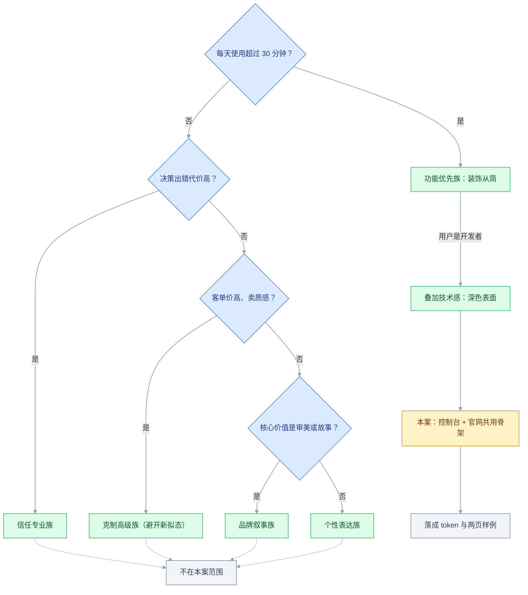
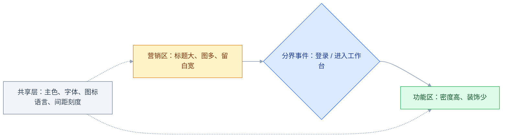

# 设计风格谱系

## 一、工程案例：给一条开发者工具产品定风格，交付 token 与两页样例

**场景**：一套 API 调试工具，用户是后端与前端开发者，控制台平均每天使用 1–2 小时；另有一个官网负责获客。早期版本照着某开源项目抄了一套深色界面，结果控制台「看着像半成品」，官网「看着像内部工具」。品牌主色已经定了（蓝紫 `#4F46E5`），不能改。

**约束**：

- 主色不动，只能调整明度、饱和度与用法
- 设计 1 人、前端 2 人，没有插画师，图片素材只有产品截图
- 必须支持浅色与深色两套，开发者会在夜间使用
- 官网与控制台共用一套骨架，避免两套维护
- 本轮不做品牌重塑，只定视觉语言与组件样例

**为什么先定风格再定组件**：组件的圆角、阴影、密度、字重全都由风格决定。先做组件再补风格，会出现「按钮是简约风、卡片是新粗野」的拼装感，返工成本更高。

### 1.1 第一步：三个约束打分

风格不是选美，是在约束里找可行解。三项各打 1–5 分：

| 约束 | 问题 | 本案评分 | 推论 |
|---|---|---|---|
| 场景 | 用户是办正事还是被说服 | 控制台 5（办正事），官网 3（被说服） | 控制台必须克制，官网可以外显 |
| 情绪 | 要冷静高效还是兴奋有趣 | 4（冷静、可信、专业） | 排除高饱和、强动效 |
| 成本 | 现有团队能不能维护一年 | 2（1 设计 + 2 前端） | 排除需要大量定制插画与复杂动效的风格 |

三项里成本最容易被低估。风格的维护成本不在第一版，在每次加新页面、新状态、新终端时的边际成本。

### 1.2 第二步：选族，而不是选名字



判断顺序按「使用时长 → 使用者 → 决策代价 → 客单价 → 内容形态 → 生命周期」。第一条决定主族，其余只决定能不能叠加：

| 步骤 | 问题 | 若「是」 | 本案 |
|---|---|---|---|
| 1 | 每天使用超过 30 分钟 | 功能优先族，装饰从简 | 是（主族） |
| 2 | 用户是开发者或数据从业者 | 叠加技术感族 | 是（叠加） |
| 3 | 法务/采购决策，出错代价高 | 信任专业族 | 否 |
| 4 | 客单价高、卖质感 | 克制高级族（避开新拟态） | 否 |
| 5 | 核心价值是审美或故事 | 品牌叙事族 | 否 |
| 6 | 生命周期短于 3 个月 | 个性表达族 | 否 |

**结论**：控制台 = 功能优先族为主 + 技术感族的深色表面；官网 = 同一骨架 + 更强的标题层级和产品截图。第 3–6 条全部不命中，本案只有 1 和 2 生效。

### 1.3 第三步：把参考拆成规则

「照着这个做」是没法执行的。把参考产品拆成可数的维度，才知道哪些能学、哪些学不了：

| 维度 | 参考产品 | 本案取值 | 能不能学 |
|---|---|---|---|
| 圆角 | 6px 控件 / 10px 容器 | 6 / 10 | 能 |
| 阴影 | 几乎不用，靠边框 | 仅浮层用 | 能 |
| 间距基准 | 4px，密 | 4px，中等偏密 | 能 |
| 字阶 | 12 / 13 / 15 / 20 | 12 / 14 / 16 / 24 | 能，按中文调整 |
| 主色用量 | 只用于主按钮与链接 | 同 | 能 |
| 图标 | 定制线性 1.5px | 采购同规格 | 能 |
| 插画 | 大量定制 3D | 无 | 不能，成本不够 |
| 动效 | 页面级过渡 | 只保留微交互 | 不能，工期不够 |

**能学的和不能学的要分开写**。学不来的部分（插画、动效）必须找替代方案，否则落地时一定缺一块。

### 1.4 第四步：风格落成 token

这是风格能被工程化的唯一方式。说「我们要克制」开发听不懂；说「圆角 6、阴影只给浮层、主色只出现在主按钮」立刻能写：

| 类别 | token | 值 | 风格含义 |
|---|---|---|---|
| 圆角 | `radius-sm` | 4px | 标签、小控件，硬朗 |
| 圆角 | `radius-md` | 6px | 按钮、输入框 |
| 圆角 | `radius-lg` | 10px | 卡片、弹窗 |
| 阴影 | `shadow-card` | 无，用 1px 边框 | 平面化，靠边界分层 |
| 阴影 | `shadow-popover` | `0 8px 24px rgba(16,24,40,.12)` | 只有真正浮起的元素才有 |
| 间距 | `space-1…8` | 4 / 8 / 12 / 16 / 24 / 32 / 48 / 64 | 中等偏密 |
| 字阶 | `text-caption` | 12 / 18 | 辅助信息 |
| 字阶 | `text-body` | 14 / 22 | 正文、代码注释 |
| 字阶 | `text-h2` | 16 / 24 / 600 | 区块标题 |
| 字阶 | `text-h1` | 24 / 32 / 600 | 页面标题 |
| 色彩 | `brand-600` | `#4F46E5` | 只用于主操作、选中、链接 |
| 色彩 | `bg-page` | 浅 `#F9FAFB` / 深 `#0F1115` | 表面层级起点 |
| 密度 | 行高（表格） | 40px | 中等密度，可扫读 |
| 动效 | 微交互 | 120ms ease-out | 快、稳，不弹 |

**风格差异最终体现在这四组数上**：圆角档位、阴影策略、密度、主色用量。换风格不改这四组，只换配色，等于换皮。

### 1.5 第五步：两页样例

token 是抽象的，必须用两个真实页面验证它是否成立：

**样例一：控制台的请求列表**

```text
页面底 #F9FAFB，内容卡片 #FFFFFF，1px 边框 #EAECF0，无阴影
标题 24/32/600，表格正文 14/22/400，辅助 12/18
行高 40px，单元格左右 padding 12，表头底色 #F2F4F7
主按钮 1 个（发送请求），实心 #4F46E5；其余为描边或文字按钮
数字列右对齐 + tabular-nums；状态列用「图标 + 文字 + 浅色底」
```

**样例二：官网首屏**

```text
标题 40/48/600，副标题 16/26/400，正文最大宽 640
产品截图占右侧 55%，带 1px 边框，不做 3D 倾斜
背景只用一层极浅的径向渐变，不用大面积渐变
主 CTA 与次 CTA 并排，间距 12；导航不超过 6 项
```

两页共用同一套间距、字阶、圆角、主色。区别只在标题尺寸、图片占比、留白量——这就是「同一骨架、两种密度」。

### 1.6 第六步：禁用清单

定风格最难的不是「加什么」，是「不许加什么」。写进文档，评审时直接引用：

| 禁止项 | 原因 | 替代 |
|---|---|---|
| 玻璃拟态卡片 | 背景变化导致对比不可控，低端机掉帧 | 实色表面 + 1px 边框 |
| 大面积渐变按钮 | 与「克制」冲突，且深色下显脏 | 实色 + hover 加深 |
| 卡片投影 | 与 1px 边框重复表达层级 | 只留边框 |
| 装饰性插画 | 团队无插画产能，风格会不统一 | 产品截图 + 图标 |
| 超过 4 档圆角 | 拼装感的主要来源 | 4 / 6 / 10 三档 + 胶囊，共 4 档 |
| 纯黑背景 `#000` | OLED 上对比过强、拖影 | `#0F1115` |
| 纯白正文 `#FFF` | 深色下光晕 | `#E6E8EC` |
| 高饱和语义色大面积铺底 | 刺眼，且色盲不可辨 | 浅色底 + 深色文字 + 图标 |

### 1.7 验收表

| # | 检查项 | 怎么验 | 通过标准 |
|---|---|---|---|
| 1 | 风格与场景匹配 | 对照 1.1 的三项评分 | 控制台装饰元素 ≤ 3 类，无营销组件 |
| 2 | token 覆盖 | 检查两页源码 | 无裸 hex、无孤立圆角、无随手间距 |
| 3 | 圆角收敛 | 统计两页用到的圆角 | ≤ 4 档，且各有明确用途 |
| 4 | 阴影策略 | 统计使用阴影的元素 | 仅浮层/弹窗，卡片 0 处 |
| 5 | 主色用量 | 截图取主色像素占比 | 单屏 ≤ 10%，且集中在主操作 |
| 6 | 深浅两套 | 切换主题逐页看 | 无白底残留，表面三层可区分 |
| 7 | 正文对比度 | 测两套主题的正文与辅助文字 | 正文 ≥ 4.5:1，大字 ≥ 3:1 |
| 8 | 组件态完整 | 按钮、输入、卡片各列状态 | 默认/hover/active/禁用/加载齐全 |
| 9 | 375 宽可用 | 官网缩到 375 宽 | 无横向滚动，标题不挤成三行 |
| 10 | 与参考的差异 | 并排看参考产品截图 | 能说出至少 3 处有意的不同 |

> 第 10 项防的是「抄一半」。抄了圆角没抄密度、抄了配色没抄留白，成品会比参考更差；差异必须是有理由的，不是执行不到位。

### 1.8 交付物清单

| 交付物 | 给谁 | 内容 |
|---|---|---|
| 约束评分表 | 产品、设计 | 场景、情绪、成本三项评分与推论 |
| 风格决策表 | 全员 | 选哪一族、为什么、放弃了什么 |
| 参考拆解表 | 设计、前端 | 八个维度中哪些能学、哪些不能 |
| token 表 | 前端 | 圆角、阴影、间距、字阶、色彩、密度 |
| 两页样例 | 设计、前端 | 控制台列表 + 官网首屏，覆盖核心组件 |
| 禁用清单 | 全员 | 不许用的效果与替代方案 |
| 验收表 | 全员 | 十项可执行检查 |

**风格交付的核心不是「一张好看的图」，是「一组别人能照着执行的数」**。样例页证明这套数在真实内容上成立，禁用清单防止执行时回潮。

---

## 二、高频问答：会卡住你的地方，也是面试最常问的

这一节按「发生频率 × 出错代价」收录：前十一条是每周都会遇到的卡点；末尾两条低频但一发生就要返工或上线出事，同样不能拖到查资料解决。

### 2.1 照着设计社区的高赞稿做，落地完全不像

**现场**

把参考稿拆成「结构 / 配色 / 素材 / 字体 / 动效」五项，看自己有几项。再用自己真实的文案和素材，按参考稿的布局做一页。

**要点**

- 高赞稿靠的是定制插画、特殊字体、精确的摄影和大量留白，这些都不在 token 里。
- 把「结果」当成「方法」是根因：只抄圆角和配色，剩下的空缺会立刻显形。
- 做出来不好看，说明差距在素材和内容，不在样式；这时要么补素材，要么换一个不依赖素材的风格。

**追问**

- 参考稿还能学什么？→ 能学的是结构、间距节奏、字阶层级；学不来的要单独写下来找替代。
- 为什么抄了配色还是不像？→ 识别特征是组合出来的，缺素材和字体，配色单独撑不住。

### 2.2 抄了竞品的风格，用户说「像山寨」

**现场**

把两家截图去色并排，让同事指认哪张是我们的。

**要点**

- 用户识别品牌靠几个高显著特征：圆角、配色、图标语言、留白节奏；改一个颜色，其余特征仍在指向竞品。
- 以为风格可以「借鉴 80%」是错的：保留得越多，越像复制品。
- 竞品的目标用户、品牌阶段、成本结构都不同，抄来也不合用。

**追问**

- 改掉几个特征才算拉开？→ 列出竞品的 5 个识别特征，至少改掉 3 个，且改动要有场景理由。
- 去色盲测过了就够吗？→ 它验证的是结构差异，还得确认每处改动不是执行不到位。

### 2.3 官网风格直接带进后台，效率崩了

**现场**

在后台量首屏能显示多少条数据；对比改版前后的单屏信息量。

**要点**

- 官网的目标是说服，后台的目标是效率；大标题、大留白、装饰图在后台全是干扰。
- 「品牌一致」不等于「视觉相同」：一致的是主色、字体、图标语言和组件骨架，不是密度和装饰程度。
- 同一产品允许两段式：营销区外显，功能区克制，共用主色、字阶和组件。

**追问**

- 两段式的分界放哪？→ 登录、进入工作台这类明确事件，分界模糊时用户会困惑自己在看介绍还是在用产品。
- 后台一点装饰都不能有吗？→ 装饰元素控制到少数几类，不能占信息的位置。

### 2.4 深色模式做成颜色反转

**现场**

切深色看卡片、页面、弹窗三者能否区分；看图片是否有白底残留。

**要点**

- 浅色靠阴影分层，深色靠表面亮度分层；反转后阴影消失，卡片和背景糊成一片。
- 深色不是一套配色方案，是另一套层级关系：表面越靠前越亮，语义色要降饱和，图片要处理。
- 定三层表面色，相邻层亮度差可辨；正文不用纯白，用近白。

**追问**

- 为什么深色下正文不用纯白？→ 纯白配深底在 OLED 上会光晕，用近白更舒服。
- 深色下阴影还能用吗？→ 几乎不可见，层级主要靠亮度差，边框也要相应提亮。

### 2.5 玻璃拟态放在纯色背景上，变成一块灰

**现场**

看元素背后是否有图片、渐变或内容；没有就是无效使用。

**要点**

- 毛玻璃需要背后有内容才有意义；纯色背景透出来还是纯色，只会得到一块低对比的灰。
- 玻璃拟态的本质是「透出背景」，背景没有信息量时，它只降低可读性。
- 要么在背后放真实内容，要么改用实色表面 + 边框；同时检查 `backdrop-filter` 不支持时的降级，文字必须叠在不透明层上。

**追问**

- 为什么中低端机上要慎用？→ `backdrop-filter` 会掉帧。
- 降级怎么写？→ 先给实色底，再在支持时叠加模糊，保证不支持时文字仍可读。

### 2.6 大圆角、大留白在 375 宽下崩了

**现场**

缩到 375 宽，看标题行数、卡片内边距占比、按钮是否换行。

**要点**

- 圆角和留白是绝对值，屏幕变窄后占比变大；标题字号不降，一行放不下。
- 把桌面稿当成唯一真相是根因，风格的「松」在窄屏上会被放大。
- 移动端要单独定档，不能靠缩放：容器圆角 10 降到 6，页面边距 24 降到 16，标题 40 降到 28。

**追问**

- 正文要不要跟着缩？→ 保持 14–16，缩了就看不清。
- 为什么不直接等比缩小？→ 字号会一起被缩掉，圆角和间距该占多少还得按窄屏单独定。

### 2.7 新粗野用在每天用 8 小时的界面上

**现场**

连续使用 30 分钟后问自己：还想不想看第二眼。

**要点**

- 硬边框、硬阴影、高饱和色块在长时间使用下显著增加视觉疲劳。
- 把「第一眼记忆点」当成「长期体验」是根因：活动页只需要被记住 10 秒，工具要被看 8 小时，视觉策略相反。
- 个性风格只放首屏、空态、营销区；进入功能区立刻切回克制风格，分段使用而不是全站统一。

**追问**

- 什么样的产品适合新粗野？→ 短周期活动页、面向特定人群的品牌站、需要被记住的产品。
- 分段使用的分界在哪？→ 进入功能区那一刻，比如登录后进入工作台。

### 2.8 品牌升级只换了 logo 和主色，看着还是旧

**现场**

新旧截图去色并排，看结构是否仍然一样。

**要点**

- 用户感知品牌靠整体骨架：字阶、间距、圆角、图标、密度；只换颜色，骨架还是旧的。
- 标志是识别符号，风格是持续体验；只换符号，体验没变，用户仍觉得「还是那个产品」。
- 至少同时改三项：字阶对比、圆角档位、密度，改完去色对比应有明显结构差异。

**追问**

- 主色到底重不重要？→ 重要，但它只是识别特征之一，单独换撑不起一次品牌升级。
- 怎么证明升级有效？→ 去色并排对比，看结构是否有差异，而不只是颜色不同。

### 2.9 多条产品线各做一套风格，维护不起

**现场**

数一下组件数 × 主题数，对比团队人数。

**要点**

- 每套风格意味着一套组件、一套文档、一套走查标准，维护成本按产品数翻倍。
- 产品差异应该体现在功能、文案、信息架构上；视觉层共用骨架，只在主色和图形语言上区分，成本最低。
- 共用间距、字阶、圆角、组件结构，只换主色和图形语言，用户仍能区分产品。

**追问**

- 品牌差异极大时还能共用吗？→ 至少共享工程实现（token 格式、组件 API），视觉层分开维护。
- 为什么不能每条线都自定义？→ 维护成本按产品数翻倍，最后没人维护得动。

### 2.10 风格评审靠感觉吵架

**现场**

拿 token 表评审：圆角几档、阴影用在哪、主色占比多少、密度多少；每个方案都给出这两组数。

**要点**

- 「这个更高级」无法验证，也无法排期，因为没有可比较的抓手。
- 风格可以争论，但必须落到具体数值和场景约束上，否则永远没有结论。
- 评审时能说清「改哪个 token、影响哪些页面」，选哪个就变成了可比较的决策。

**追问**

- 没有 token 表怎么评审？→ 先补四组数：圆角、阴影、主色占比、密度。
- 投票能解决问题吗？→ 不能，票数不说明哪个方案更符合场景约束。

### 2.11 图片素材不行，整站显得廉价

**现场**

把图片缩到 20% 看整体色调和构图是否统一。

**要点**

- 品牌叙事类风格的效果大部分来自摄影质量；素材不行，排版再准也撑不住。
- 加滤镜、加遮罩是用后期掩盖素材问题，会让不同来源的图片更不一致，画面发灰。
- 要么统一拍摄/采购（同色温、同构图、同留白），要么换风格：用产品截图、数据图、几何图形替代摄影。

**追问**

- 素材能力决定什么？→ 决定风格上限；素材不够就选一个不依赖素材的风格。
- 为什么滤镜救不了？→ 它只改色调，不解决构图和光线的不统一。

### 2.12 风格和行业气质错配，用户不敢把事交给你

**现场**

把首页给 5 个目标用户看 3 秒，问「这家公司做什么、敢不敢把合同交给它」。

**要点**

- 风格在用户眼里是行业信号：财税、医疗、法律产品用高饱和撞色和硬投影，传达的是「不严肃」，与设计好坏无关。
- 「年轻化」不等于「换一套潮流视觉」；年轻用户也要办事，判断可信度用的还是同一批线索。
- 这一条发生时改的不是配色，是整套视觉语言，基本等于重做，所以要在选型阶段先排除。

**追问**

- 怎么提前判断气质对不对？→ 先写下三个调性词（如稳重、亲和、锋利），看方案里每个特征能否对应上。
- 同行业的共同特征要不要跟？→ 要对照（主色明度、圆角大小、素材类型），差异必须能说出理由。

### 2.13 低对比「高级灰」，正文根本读不清

**现场**

用取色器算正文与背景的对比度，或在系统辅助功能里开高对比模式看一遍。

**要点**

- 稿子是在高亮屏、近距离、好光线下的判断；用户在地铁、外接显示器、暗环境里看，低对比正文直接糊掉。
- 这是可验收的硬指标，不是审美偏好：正文 ≥ 4.5:1，大字与组件 ≥ 3:1。
- 灰只留在分割线、禁用态和纯装饰上；改完在 375 宽与深色模式各看一遍，别只在设计稿里验收。

**追问**

- 深色下也要守 4.5:1 吗？→ 要，同一条线管两套主题。
- 为什么设计稿上看得很清楚？→ 屏幕亮度、观看距离、环境光都不同，稿子不代表真实观感。

---

## 三、核心知识：从零开始要建立的东西

### 3.1 风格的三个约束

风格选择不是喜好问题，是在三个约束里找可行解：

| 约束 | 具体问题 | 不可行的信号 |
|---|---|---|
| 场景 | 用户是办正事还是被说服 | 后台用了大留白营销布局 |
| 情绪 | 要冷静、可信，还是兴奋、有趣 | 财税产品用了高饱和撞色 |
| 成本 | 团队能不能维护一年 | 需要定制插画但没有插画师 |

**成本约束最先被忽略**。一个风格的第一版可以靠热情做出来，第二十个页面就要靠系统；没有 token、没有组件、没有素材来源的风格，会在扩张时崩掉。

**边界**：三个约束冲突时，场景优先于情绪，情绪优先于成本。用户来办正事，就不会因为「风格有趣」而留下；但成本撑不住时，再合适的风格也只能缩水执行。

### 3.2 六个家族与判断轴

按「想达成什么」分六族，比记二十个风格名高效：

| 家族 | 目标 | 典型特征 | 适用 |
|---|---|---|---|
| 功能优先 | 效率 | 留白、字阶清楚、极少装饰 | 后台、文档、开发者工具 |
| 信任专业 | 转化 | 产品截图、客户 logo、清晰定价 | B 端官网、企业采购页 |
| 品牌叙事 | 记忆 | 大图、大字、宽留白、少颜色 | 高客单、审美溢价产品 |
| 个性表达 | 出圈 | 高饱和、硬边框、几何图形 | 活动页、年轻品牌 |
| 技术感 | 专业认同 | 深色表面、等宽字体、单一亮色 | 开发者工具、AI 产品 |
| 克制高级 | 质感 | 低饱和、大留白、材质与摄影 | 家居、香氛、酒店 |

**家族之间可以叠加，但不能平均**。控制台可以「功能优先 + 技术感」，因为两者都指向效率；不能「功能优先 + 个性表达」，因为一个要静、一个要吵，平均后两边都不成立。

**家族是取向，不是成品规范**。Material Design、Fluent、Ant Design 这类是设计系统，提供组件、交互规则和 token 结构，本身不等于某一种风格——同一个系统换一套 token 就能做出信任专业或技术感。零基础时容易把「用哪套系统」当成「选哪种风格」，其实先定家族，再决定用现成系统还是自建。具体组件清单与版本以官方当前版本为准。

> **面试**：常问「六个家族能叠加吗？」答：能叠加但要同向，功能优先可以叠技术感，不能叠个性表达。

### 3.3 功能优先族的构成

| 维度 | 取值 |
|---|---|
| 视觉 | 大量留白、明确字阶、中性色 + 单一强调色 |
| 圆角 | 小，4–8px |
| 阴影 | 几乎没有，靠留白和分割线分层 |
| 字体 | 无衬线，字重 400/500/600 |
| 密度 | 中等，表格行高 40–48px |
| 动效 | 只保留微交互，100–150ms |

**适用**：SaaS 工具、后台、文档、开发者产品。

**翻车点**：

- 营销页照搬，页面太冷静，没有说服力
- 内容本身不够有力，简约会把空洞暴露得更彻底
- 执行不到位，简约对对齐、间距、字阶要求极高

> 简约是最难的风格。它去掉了所有装饰，只剩下结构；结构不好，一览无余。

### 3.4 信任专业族的构成

| 维度 | 取值 |
|---|---|
| 视觉 | 首屏大标题 + 产品截图 + 客户 logo + 定价表 |
| 圆角 | 中等，8–12px |
| 阴影 | 卡片轻阴影，制造浮起感 |
| 字体 | 无衬线，标题 600–700 |
| 色彩 | 蓝色系居多，语义色克制 |
| 内容 | 案例、数据、合规资质、合同条款 |

**适用**：企业采购决策、金融、B 端获客页。

**翻车点**：

- 内部工具用营销风，首页漂亮，进去全是装饰
- 客户 logo 造假或放竞品，信任瞬间归零
- 定价表信息不全，B 端用户最关心「超了怎么算、能不能退」

### 3.5 品牌叙事族的构成

| 维度 | 取值 |
|---|---|
| 视觉 | 大图、大字、极宽留白、少颜色 |
| 圆角 | 大圆角或无，按品类定 |
| 阴影 | 极少，靠图片撑场面 |
| 字体 | 常配衬线体或定制字体 |
| 素材 | 高质量摄影，统一色温与构图 |
| 信息 | 故事优先，规格参数可后置但必须可达 |

**适用**：卖调性、卖故事、卖审美溢价的产品；单 SKU 价值高、决策偏感性。

**翻车点**：

- 图片质量不够就是灾难，这套风格大部分效果来自摄影
- 首屏几 MB 大图，移动网络下等待明显
- 信息密度太低，用户想找规格参数找不到

**边界**：学它的排版而不学它的内容生产，只会得到一个空荡荡的页面。素材能力是这套风格的门槛。

### 3.6 个性表达族的构成

| 风格 | 识别特征 | 适用 |
|---|---|---|
| 新粗野 | 粗黑边框、硬投影、高饱和色块 | 年轻品牌、创意工具、活动页 |
| Bento | 大小不一的圆角格子拼在一起 | 功能罗列、产品特性展示 |
| 趣味插画 | 有角色、有表情、配色活泼 | C 端、亲子、教育 |
| Y2K | 铬色金属、半透明塑料、镭射渐变 | 潮流品牌、音乐 |
| 孟菲斯 | 几何图形、波浪线、波点、高饱和 | 复古活动页 |
| 包豪斯 | 严格几何构图，形状服从功能 | 展览、设计品牌 |
| Art Deco | 对称构图、几何纹样、金属色 | 奢华、酒店、高端餐饮 |

**适用**：短周期活动页、面向特定人群的品牌站、需要被记住的产品。

**后四种是历史流派或年代审美，不是现成的 UI 规范**。Y2K、孟菲斯、包豪斯、Art Deco 原本属于平面、产品与建筑，套到界面上要把特征转译成可用元素：边框粗细、色板、字体、图形母题。直接照搬海报会得到一张好看但点不动的页面。

**翻车点**：

- 用在需要长期使用的界面上，硬阴影和大边框会显著增加疲劳
- 个性盖过信息，用户记住了页面，没记住产品是干什么的
- 风格与品牌不符，做财税 SaaS 用 Y2K，用户会怀疑公司靠不靠谱

**边界**：个性风格只放首屏和营销区，进入功能界面切回克制风格。用户需要「进门被吸引，干活无干扰」。

> **面试**：常问「新粗野能用在后台吗？」答：不能，硬阴影和大边框在长时间使用下显著增加疲劳，只放首屏和营销区。

### 3.7 技术感族的构成

| 维度 | 取值 |
|---|---|
| 视觉 | 深色底 `#0A0A0C`–`#121212`，高对比文字 |
| 强调色 | 单一亮色或霓虹色，用量极少 |
| 圆角 | 小到中，6–10px，偏硬朗 |
| 阴影 | 靠更亮的表面分层，不靠阴影 |
| 字体 | 等宽用于代码与数值 |
| 状态 | 成功/错误色降饱和，避免刺眼 |

**适用**：开发者工具、AI 产品、数据看板、创意工具。

**翻车点**：

- 深色对比度容易失控，纯白字配纯黑底在 OLED 上会光晕
- 玻璃拟态对性能不友好，`backdrop-filter` 在中低端机上掉帧
- 长文阅读比浅色累，文档站通常仍用浅色

**边界**：深色不是「反色」，表面要按亮度分层；代码高亮色要单独调，不能直接复用浅色主题的色板。

### 3.8 克制高级族的构成

| 风格/效果 | 识别特征 | 现状与归属 |
|---|---|---|
| 侘寂 | 大地色、粗糙肌理、不对称、大量留白 | 本族的正例；小众品牌、茶/香/家居 |
| 拟物化 | 拟真材质（皮革、金属、纸张） | 不属于本族；靠材质细节，成本高，现多用于怀旧或特定场景 |
| 新拟态 | 同色系 + 双向阴影，像从背景凸出 | 不属于本族；常被误当成「高级」，不推荐用于生产界面 |

**拟物化和新拟态不是克制高级族的成员**，它们只是同样低饱和、同样强调质感，所以经常被挂在这一族名下。拟物化的问题在成本：每加一个控件都要画材质；新拟态的问题在可用性，见下。

**新拟态的三个硬问题**：

```text
1. 对比度必然不足：同色系凸起，边界靠极淡阴影，常低于 3:1
2. 状态无法区分：禁用、按下、聚焦只能靠阴影方向
3. 无法适配深色与高对比模式：阴影关系一换就失效
```

**结论**：只在概念稿、音乐播放器皮肤这类低交互密度场景尝试。生产界面不要用。

### 3.9 风格到 token 的映射

| 风格 | 圆角 | 阴影 | 间距基调 | 饱和度 | 字阶对比 |
|---|---|---|---|---|---|
| 功能优先 | 4–8 | 极轻或无 | 中等（4 基准） | 低 | 强 |
| 信任专业 | 8–12 | 卡片轻阴影 | 中等 | 中 | 中 |
| 品牌叙事 | 0 或大圆角 | 无 | 极宽松 | 低 | 极强 |
| 个性表达（新粗野） | 0–4 | 硬投影，偏移 4–8，无模糊 | 紧凑 | 高 | 强 |
| 技术感（深色） | 6–10 | 靠表面亮度 | 中等偏紧 | 中高 | 中强 |
| 克制高级（侘寂） | 0–2 | 无 | 极宽松 | 极低 | 弱 |

**这张表是设计系统与风格之间的接口**。说「我们要新粗野」或「要技术感」开发听不懂；说「圆角 0–4、阴影硬偏移 6px 无模糊、主色饱和度提高」，立刻能落地。

**边界**：表格给的是区间，不是精确值。同一风格在不同产品里要微调，比如中文界面的字阶对比通常比英文弱一档，因为汉字本身视觉重量大。

### 3.10 圆角与阴影的风格语义

| 参数 | 偏小 / 偏弱 | 偏大 / 偏强 |
|---|---|---|
| 圆角 | 硬朗、专业、精密 | 亲和、轻松、消费级 |
| 阴影 | 平面、克制、信息优先 | 立体、强调、空间层级 |
| 边框 | 有边框，边界清楚、工程感 | 无边框或极淡，更柔、更现代 |

**同一页面里圆角混用是廉价感的主要来源**。按钮 4、卡片 6、弹窗 8、头像 10，单看都合理，放在一起就是不讲究。收敛到 3–4 档，并规定「容器圆角 ≥ 内部元素圆角」；要做到视觉同心，内层圆角约等于外层圆角减内边距，内边距大于外层圆角时内层可以直接用 0。

**边界**：圆角不是越小越专业。4px 在 24px 高的按钮上几乎看不出，在 48px 高的按钮上才明显；定档位要按最小使用尺寸验证。

### 3.11 密度与信息率

密度是风格的一部分，不只是布局参数：

| 密度 | 表格行高 | 卡片内边距 | 适用 |
|---|---|---|---|
| 紧凑 | 32–36 | 12 | 数据后台、监控、金融终端 |
| 中等 | 40–44 | 16 | 通用 B 端 |
| 宽松 | 48–56 | 24 | 官网、消费级、内容产品 |

**密度由任务决定**：用户要在屏幕上比较很多行，就紧凑；用户要逐条阅读、做决策，就宽松。同一产品里，列表紧凑、详情宽松是合理的。

**边界**：紧凑不等于挤。行高 32 时，字号不能低于 12，左右 padding 不能低于 8；再压就会误点、误读。

### 3.12 双段式风格

同一个产品可以有两种密度，只要骨架相同：



| 区域 | 风格 | 目的 | 共用什么 |
|---|---|---|---|
| 首屏 / 营销区 | 外显，标题大、图多、留白宽 | 吸引、说服 | 主色、字体、图标语言 |
| 功能区 | 克制，信息密度高、装饰少 | 效率 | 间距刻度、组件、语义色 |

**关键是「连续」而不是「相同」**：主色一致、字体一致、图标语言一致，用户从首屏进编辑器不会觉得换了产品；但装饰和密度必须变，否则功能区效率低。

**边界**：两段式需要一条明确的分界（登录、进入工作台、点击「开始使用」）。分界模糊时，用户会困惑「现在是在看介绍还是在用产品」。

### 3.13 多品牌共享骨架

| 层 | 共享 | 可区分 |
|---|---|---|
| 间距刻度 | 是 | 否 |
| 字阶与行高 | 是 | 微调 |
| 组件结构 | 是 | 否 |
| 圆角档位 | 是 | 微调 |
| 主色 | 否 | 是 |
| 图形语言 / 图标风格 | 否 | 是 |
| 摄影 / 插画 | 否 | 是 |

**共享骨架、区分表皮**，是维护成本最低的多品牌策略。完全不同的风格会让用户觉得是两个公司的产品，也意味着两套组件、两套文档、两套走查标准。

**边界**：品牌差异极大时（一个面向儿童、一个面向金融），共享骨架可能不成立；这时至少共享工程实现（token 格式、组件 API），视觉层分开维护。

### 3.14 风格的折旧与版本化

风格有流行周期，也有技术折旧与法务风险：

| 折旧来源 | 表现 | 应对 |
|---|---|---|
| 审美疲劳 | 三年前很新的效果，现在显得过时 | 核心结构保持克制，装饰层可替换 |
| 技术过时 | 依赖的特性被弃用、性能不再可接受 | 避免把风格绑在单一 CSS 特性上 |
| 品牌变化 | 公司换了定位，旧风格不再匹配 | 按大版本升级，不悄悄改 |
| 团队变化 | 原设计师离职，风格无人能延续 | 落成 token 与文档，而不是留在稿子里 |
| 授权到期 | 字体、图标、图片的商用范围或期限不够，上线后被要求替换 | 采购时记录授权范围、使用渠道与到期日 |

**工具类产品应该选最不容易过时的**：干净、克制、结构清楚。这也是大量后台产品十年没怎么变风格的原因——不是没审美，是折旧成本太高。

**边界**：风格升级要按大版本发布，给用户和心理预期一个切换点；悄悄改会让用户觉得「页面坏了」，而不是「升级了」。

### 3.15 风格与无障碍的冲突

| 风格诉求 | 风险 | 处理 |
|---|---|---|
| 低对比「高级灰」 | 正文低于 4.5:1 | 正文提到 4.5:1，只在纯装饰上保留灰 |
| 浅灰占位符 | 占位符也是文字 | 提到 4.5:1，或改用常驻标签 |
| 玻璃拟态 | 背景变化导致对比不可控 | 文字叠在不透明底上，或加足够遮罩 |
| 深色界面 | 纯白光晕、语义色过亮 | 正文用近白，语义色降饱和 |
| 极细字重 | 小字号下笔画消失 | 正文不低于 400，细体只用于大标题 |
| 大面积动效 | 前庭不适 | 支持 `prefers-reduced-motion` |
| 颜色区分状态 | 色盲无法分辨 | 同时用图标或文字 |

**合规底线**：正文 4.5:1、大字与组件 3:1。这是可验收的硬指标，风格不能成为豁免理由。

> **面试**：常问「深色模式是把浅色反转吗？」答：不是，深色靠表面亮度分层，反转后阴影消失、卡片糊成一片。

**边界**：装饰性图形、禁用态可以放宽，但「放宽」不等于「看不见」。禁用态仍要能看出「这里有东西，但不可用」。

### 3.16 风格验收的量化

| 指标 | 怎么量 | 合格线 |
|---|---|---|
| 圆角档位 | 统计源码/设计稿 | ≤ 4 档 |
| 阴影档位 | 统计使用场景 | ≤ 3 档，且只用于浮层 |
| 主色占比 | 截图取色统计 | 单屏 ≤ 10% |
| 字号档位 | 统计 font-size | ≤ 6 种 |
| 间距档位 | 统计 margin/padding/gap | ≤ 8 种 |
| 装饰元素 | 数每屏的渐变/插画/阴影/边框种类 | ≤ 3 类 |
| 对比度 | 批量测正文、辅助、组件 | 4.5:1 / 3:1 |
| 主题一致性 | 深浅两套并排 | 层级关系一致，不是反色 |

**用 token 表评审，而不是用「感觉」争论**。数值能比较、能排期、能验收；感觉只能说服已经同意的人。

---

## 四、冷门知识汇总

这一节只收「低频 + 出错代价低 + 用时能查」的术语与渊源。会拖住交付的问题放第二节，选型与落地依据放第三节，不在这里重复。

| 知识点 | 为什么冷门 | 用到时的关键词 |
|---|---|---|
| 瑞士排版本源 | 现在只作为网格与左对齐的底层解释，日常不再单独提 | 国际主义排版、网格系统、非对称布局 |
| 包豪斯的核心 | 起源于德国的设计学校，主张形式服从功能；现在常被简化成几何装饰 | 几何构图、功能主义 |
| 孟菲斯与 Art Deco 的区别 | 都常被当成「复古」，一个是后现代的反功能主义，一个是装饰艺术 | 后现代、装饰艺术、对称、金属色 |
| Bento 的来源 | 借的是便当盒分区，多数人只抄格子形状，不抄权重逻辑 | Bento grid、权重分区 |
| Y2K 的构成 | 常与像素风、蒸汽波混为一谈，实际是千禧年的数字乐观主义 | 铬色金属、半透明塑料、镭射渐变 |
| 拟物化与新拟态的区别 | 名字像、都强调质感，机制相反：一个拟真材质，一个同色凸起 | 材质拟真、双向阴影 |
| 玻璃拟态的名字与降级 | 效果名字常被叫错，降级问题只在旧浏览器暴露 | 背景模糊、`backdrop-filter`、`@supports` |
| 渐变色带（banding） | 只在低色深屏、大面积渐变时看得见 | 色阶断裂、dithering、限制渐变范围 |
| 等宽数字与列对齐 | 只有数字列需要对齐时才被想起 | `tabular-nums`、`font-variant-numeric` |
| 汉字与字重的换算 | 同数值字重，汉字比拉丁字母更重；只有中英混排才暴露 | 字阶降一档、字重视觉补偿 |
| 同心圆角 | 只有卡片里再套按钮、图片时才明显 | 外圆角减内边距、嵌套圆角 |
