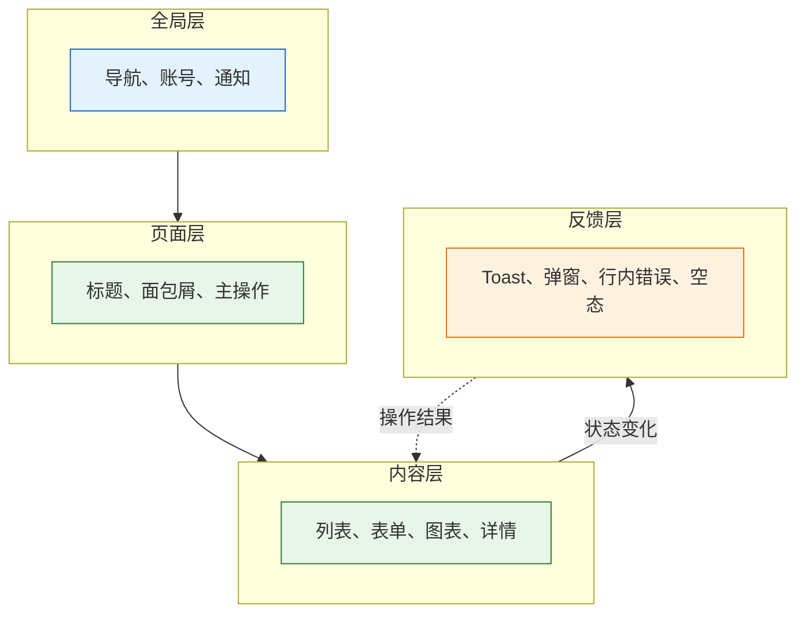
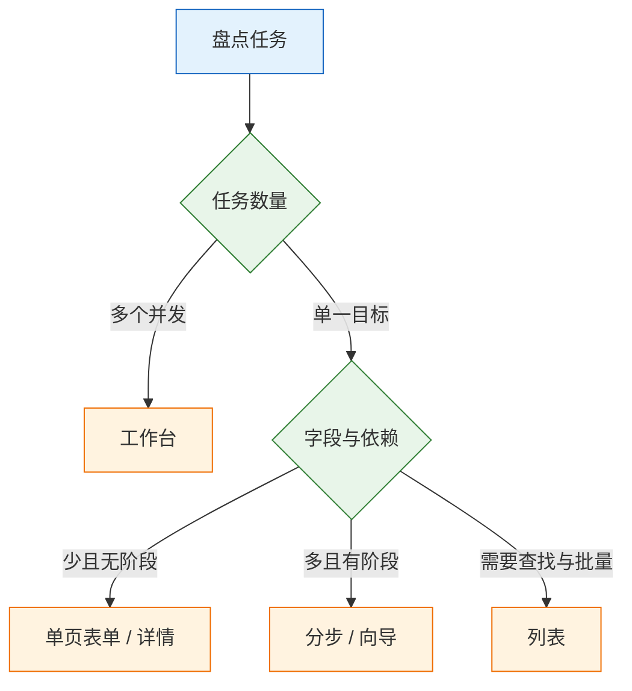
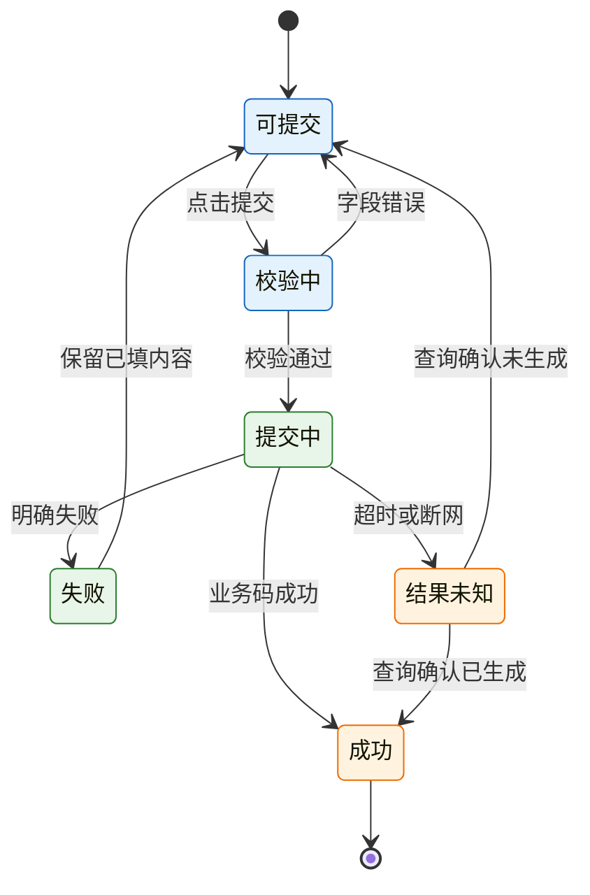

# 交互与页面结构

---

## 一、交互与页面结构是什么

### 1.1 核心概念

交互设计定义任务如何被完成：从哪里进入、经过哪些步骤、每一步有哪些状态、失败后如何恢复。页面结构定义信息如何分层：哪些内容全局稳定、哪些随任务变化、主操作放在哪里、页面之间如何跳转。

两者共同构成一份可执行的约定。设计稿回答“长什么样”，交互说明回答“什么条件下出现、点击后发生什么、失败停在哪”。缺少后半段，开发只能猜，测试无法写用例，问题会以线上投诉的形式回来。

一份完整的交互交付包含四个对象：

| 交付物 | 回答的问题 | 主要读者 | 缺失后果 |
|---|---|---|---|
| 任务模型 | 谁要完成什么、频率与后果 | 产品、设计 | 页面齐全但任务走不通 |
| 状态模型 | 正常、空、错、加载、无权限 | 前端、测试 | 只测主路径，异常靠猜 |
| 跳转规则 | 从哪来、到哪去、返回是否保留 | 前端 | 筛选丢失、重复提交 |
| 反馈规则 | 何时提示、提示什么、如何恢复 | 设计、前端、客服 | 用户不知道成没成 |

判断交互质量不看页面数量，看四个属性：任务可完成、失败可恢复、行为可预期、结果可测试。四个属性都能写成验收项，而“体验好”不能。



### 1.2 适用场景与边界

交互与页面结构适用于业务系统、表单与审批、列表与详情、多端适配、存量页面改造。凡是需要用户完成多步任务、需要处理异常与权限的产品，都绕不开这套约定。

它不适用于纯叙事页面、游戏手势、硬件交互与品牌短片。这些场景的核心是体验编排与物理反馈，页面结构只占很小一部分。

| 场景 | 主要产出 | 边界 |
|---|---|---|
| 业务后台 | 任务表、页面骨架、状态表 | 不替代权限模型与接口契约 |
| 表单审批 | 字段分级、校验时机、提交状态机 | 不替代后端幂等与流程引擎 |
| 列表详情 | 筛选入 URL、返回保留、批量操作 | 不替代查询性能设计 |
| 移动端 | 触控目标、底部操作、手势冲突 | 不替代原生能力适配 |
| 存量改造 | 任务缺口清单、状态补齐顺序 | 不能只靠换皮解决流程问题 |

> **注意**：前端禁用按钮只能减少误触，不能防止重复提交。网络重试、用户多标签页、接口超时都会绕过前端限制，幂等必须由后端键值或业务状态机保证。

---

## 二、交互设计的判断依据

### 2.1 任务盘点

页面规划不从“有几个页面”开始，而从“用户要完成什么”开始。每个任务写清触发条件、成功标准与高频异常，并单独注明完成后的去向。

| 任务 | 触发 | 成功标准 | 高频异常 |
|---|---|---|---|
| 新建申请 | 点击新建 | 提交成功并进入审批 | 明细为空、金额超限、附件过大 |
| 修改被驳回的申请 | 打开驳回单 | 改完重提，保留已通过内容 | 不知道改哪、重复填写 |
| 撤回申请 | 审批中的单据 | 状态回到草稿 | 审批人已处理 |
| 移动端审批 | 收到通知 | 通过或驳回并附意见 | 附件看不清、误触通过 |
| 查询历史 | 进入列表 | 按条件找到目标单据 | 筛选丢失、分页错乱 |

这张表的作用是把没画的任务找出来。上表后两行在原稿里常常完全缺失，而它们恰恰是投诉来源。任务盘点还要标注频率与后果：高频任务优先缩短路径，不可逆任务优先加约束。

主任务同时不超过三个。任务过多说明页面承担了多个角色，应该拆分，而不是继续往工作台堆卡片。

### 2.2 页面结构选型

任务确定后，再决定每个任务用哪种页面结构。结构选错，后面补多少交互说明都无法弥补。

| 结构 | 适合 | 关键点 | 常见错误 |
|---|---|---|---|
| 列表 | 找一条、批量处理 | 筛选可回填、分页可返回 | 返回后筛选丢失 |
| 详情 | 看全貌、做少量操作 | 主信息在上，操作固定 | 操作按钮跟着内容滚走 |
| 表单 | 创建、编辑 | 分组、校验、错误定位 | 一屏几十个字段 |
| 工作台 | 多任务聚合 | 按紧急度排序，给下一步 | 堆指标，不给行动 |
| 向导 | 步骤有依赖 | 进度可见、可回退 | 不能回到上一步修改 |

三条选型规则：

1. 一个页面只回答一个问题。列表页不要同时承担报表分析，详情页不要塞完整编辑表单。
2. 高频任务优先减少跳转。能在列表内完成的轻量操作，不要求进入详情。
3. 步骤之间有数据依赖时才用向导。没有依赖的分步只是把长表单切碎，用户仍要来回翻。

### 2.3 复杂度与步骤判断

| 条件 | 结构 | 理由 |
|---|---|---|
| 字段不超过 15 个，分组清晰 | 单页表单 | 减少切换成本 |
| 字段超过 15 个，或存在阶段依赖 | 分步表单 | 降低单屏认知负荷 |
| 后一步依赖前一步的校验结果 | 向导 | 避免无效填写 |
| 多角色、多任务并发 | 工作台 | 按紧急度聚合 |
| 仅查看与少量操作 | 详情页 | 信息完整优先 |

点击预算按频率分配：高频任务从入口到完成不超过 3 次点击；低频但高风险的任务可以增加确认步骤。减少点击不能以隐藏必要信息为代价，把三个字段塞进一个弹窗，只是把成本转移到理解上。



> **注意**：向导不是长表单的默认解。步骤过多会让用户看不到全貌，也无法判断还剩多少工作。超过五步时，优先检查字段能否删除或延后，而不是继续加步骤条。

---

## 三、页面骨架规则

### 3.1 四层结构

| 层 | 内容 | 变化频率 | 归属 |
|---|---|---|---|
| 全局层 | 导航、账号、通知、全局搜索 | 跨页面不变 | 布局框架 |
| 页面层 | 标题、面包屑、页面级操作 | 每页一次 | 页面容器 |
| 内容层 | 列表、表单、图表、详情 | 随任务与数据变化 | 业务组件 |
| 反馈层 | Toast、弹窗、行内错误、空态 | 随状态变化 | 全局服务 |

稳定的部分放全局层，变化的部分放内容层。常见错误是把页面标题和主操作塞进第一张卡片，卡片一多，用户就找不到“这一页是干什么的”，滚动后主操作也一起消失。

页面层还要回答“我在哪”。面包屑、返回入口、当前导航高亮三者至少有一个，深层页面建议同时保留面包屑与返回。

### 3.2 稳定区域与主操作

| 区域 | 位置 | 内容 | 禁忌 |
|---|---|---|---|
| 页面标题区 | 内容区顶部 | 标题、状态、面包屑 | 与卡片标题混用 |
| 主操作区 | 表单底部右侧、详情右上 | 一个实心主按钮 | 随内容滚走 |
| 次操作区 | 主操作左侧或工具栏 | 取消、重置、导出 | 与主操作同样醒目 |
| 危险操作区 | 远离主操作，需二次确认 | 删除、停用、撤回 | 紧邻保存按钮 |
| 移动端操作条 | 视口底部固定 | 主操作 + 次操作 | 遮挡内容且无留白 |

三条结构规则：

- **主操作位置固定**。同一产品内，表单保存固定在底部右侧，详情操作固定在右上，列表批量操作固定在工具栏。位置变化会让用户每次重新寻找。
- **主操作唯一**。一屏出现两个实心按钮，用户需要读文案才能判断，等于没有主操作。
- **危险操作隔离**。删除不与保存并排，批量删除不与批量导出并排，中间留出间距或分隔线。

移动端底部操作条要为内容预留安全区，避免最后一行被遮挡；键盘弹起时，操作条不能盖住正在输入的字段。

### 3.3 URL 与返回状态

可分享、可刷新、可返回的状态应该写进 URL。只存在组件内存里的状态，一次刷新或返回就会丢失。

| 状态 | 是否入 URL | 示例 |
|---|---|---|
| 筛选条件 | 是 | `?status=pending&owner=me` |
| 分页与每页条数 | 是 | `?page=2&size=20` |
| 排序字段与方向 | 是 | `?sort=created_at&order=desc` |
| Tab | 是 | `?tab=history` |
| 展开项 | 可选 | `?expand=items` |
| 详情对象 | 是 | `/orders/1024` |
| 草稿输入 | 否 | 存本地或服务端草稿 |
| 临时弹窗 | 部分 | 可分享的详情用路由，确认框不入 |

筛选变化用替换历史记录，避免用户点五次筛选后要按五次返回；进入详情用新增历史记录，保证返回能回到列表。返回列表时恢复筛选、分页与滚动位置，三者缺一，用户都要重新找一遍。

> **注意**：页面内“返回”按钮与浏览器后退必须走同一套状态恢复逻辑。两套实现会出现“点页面返回有筛选、按浏览器后退没有”的差异。

---

## 四、状态设计规则

### 4.1 三层状态

只画正常态，是交互缺陷的第一来源。状态按三层列，才不会漏。

| 层级 | 必须定义的状态 | 决定什么 |
|---|---|---|
| 页面 | 加载中、正常、空、出错、无权限、已归档、不存在 | 整页显示什么 |
| 区块 | 加载中、有数据、空、出错、无权限 | 局部显示什么 |
| 控件 | 默认、悬停、聚焦、按下、禁用、加载、错误 | 即时反馈 |

页面级状态决定用户是否还能继续操作。无权限不能只显示空白，要说明缺少什么权限、找谁申请；不存在要给出返回列表的出口，而不是停在错误页。

区块级状态允许局部失败。一个仪表盘里某张图加载失败，不应该让整页报错，其他区块仍应可用。

### 4.2 提交状态机

异步提交是最容易漏的分支。把一次提交画成状态机，比写十句“注意异常”有用。



关键点：

- 点击瞬间就禁用并进入加载，不等请求返回。否则连点会发多次。
- 按钮宽度不变。“提交”变“提交中”如果撑宽按钮，旁边元素会跳。
- 失败保留已填内容，滚动到第一个错误，不整页重置。
- 超时不是失败。要告诉用户“可能已提交”，并给“去列表查看”的出口；只写“请重试”会制造重复单。
- 成功要有持久结果。自动消失的 Toast 不足以证明结果，刷新后仍应能看到单据状态。

### 4.3 交互状态表

| 状态 | 触发 | 视觉反馈 | 行为约束 |
|---|---|---|---|
| 默认 | 无交互 | 常规描边与文字 | 可点击，可聚焦 |
| 悬停 | 指针进入 | 背景或描边加深 | 不改变布局尺寸 |
| 聚焦 | 键盘 Tab 到达 | 2px 焦点环，对比度 ≥ 3:1 | 不被吸顶栏遮挡 |
| 按下 | 指针按下 | 背景再深一档或轻微位移 | 释放前不触发第二次 |
| 禁用 | 条件不满足 | 降透明度并保留可读性 | 不响应点击，给出原因 |
| 加载 | 请求进行中 | 按钮内进度，宽度不变 | 阻止重复提交 |
| 错误 | 校验失败 | 红色边框 + 行内文案 | 保留原值，聚焦到错误项 |
| 选中 | 当前项被选择 | 背景 + 勾选或边框 | 与悬停态可区分 |

状态设计有三条底线。焦点必须可见，不能为了美观去掉 `outline` 而不给替代；禁用必须能解释原因，灰掉一个按钮却不说明为什么，用户只能猜；错误必须定位到字段，只在顶部提示“保存失败”会让用户逐项排查。

| 组件 | 必须覆盖的状态 | 验收点 |
|---|---|---|
| 按钮 | 默认、悬停、聚焦、按下、禁用、加载 | 宽度稳定，键盘可触发 |
| 输入框 | 默认、聚焦、填写、错误、禁用、只读 | 标签常驻，错误可读 |
| 下拉 | 关闭、打开、选中、禁用、空选项 | Esc 关闭，方向键可选 |
| 弹窗 | 打开、加载、错误、关闭 | 焦点陷阱，Esc 关闭，焦点归还 |
| 表格 | 加载、有数据、空、错误、选中 | 排序与分页状态可见 |

> **设计红线**：移除焦点环、把禁用态文字做成几乎不可读、用颜色单独表示错误，都会让键盘与低视力用户无法完成任务。焦点环属于功能元素，不属于装饰。

---

## 五、表单与反馈规则

### 5.1 字段精简

表单完成率低，多数时候不是说明不够，而是字段太多、顺序不对、必填太多。

| 问题 | 做法 |
|---|---|
| 字段可推导 | 系统带出，或从已有数据预填 |
| 字段可延后 | 先提交核心信息，其余进详情补 |
| 标签不清 | 用用户语言，不用内部术语 |
| 占位符当标签 | 标签常驻，占位符只放示例 |
| 必填过多 | 只保留业务真正需要的字段 |
| 长表单难维护 | 按语义分组，每组一个标题 |

字段顺序按填写逻辑排列，不按数据库字段顺序。相关字段放在一起，跨组依赖放在后面。超过 15 个字段考虑分步，但分步前先删一轮可推导与可延后的字段。

### 5.2 校验时机

| 时机 | 校验内容 | 提示方式 |
|---|---|---|
| 输入中 | 仅长度上限、字符类型 | 轻量计数，不弹错误 |
| 失焦 | 格式、范围、必填 | 字段下方行内提示 |
| 提交时 | 业务规则、跨字段约束 | 顶部汇总 + 字段定位 |
| 服务端返回 | 唯一性、权限、库存 | 映射到具体字段 |

不要每敲一个字就报错。用户输入邮箱到一半时提示“格式不正确”，只会制造干扰。格式校验放在失焦，业务校验放在提交，服务端错误映射回字段。

### 5.3 错误文案三要素

错误提示必须包含三件事：发生了什么、为什么、怎么办。

| 要素 | 回答的问题 | 示例 |
|---|---|---|
| 现象 | 当前发生了什么 | 附件 18.4MB，超过 10MB 上限 |
| 原因 | 为什么不允许 | 单张报销单的附件总大小限制为 10MB |
| 动作 | 下一步怎么做 | 压缩后重传，或删除附件后先提交 |

完整示例：“附件 18.4MB，超过 10MB 上限。请压缩后重传，或删除附件后先提交。”只写“操作失败，请重试”，用户只能反复试；只写“附件过大”，用户不知道上限是多少。

### 5.4 空态、加载与错误

| 类型 | 触发 | 该给什么 | 不该给什么 |
|---|---|---|---|
| 首次为空 | 没有任何数据 | 一句解释 + 一个主操作 + 简短引导 | “暂无数据”四个字 |
| 筛选无结果 | 有数据但条件太窄 | 说明当前条件 + 清空筛选 | 首次空态的插画 |
| 全部处理完 | 任务清空 | 正向反馈 + 下一步 | 一整页空白 |
| 加载中 | 请求未回 | 接近真实结构的骨架屏 | 整页转圈 |
| 出错 | 请求失败 | 原因 + 重试 + 替代路径 | 只报“系统繁忙” |

判断“真空”还是“筛空”，看当前有没有筛选条件，不看数组长度。删掉筛选仍为空，才是真的没有数据。

### 5.5 危险操作与可逆性

| 操作 | 推荐做法 | 理由 |
|---|---|---|
| 删除单条 | 直接删 + 3–5 秒撤销 | 不打断操作流 |
| 批量删除 | 确认框写清条数 + 输入名称 | 误触代价高 |
| 撤回审批 | 确认并说明对方会收到通知 | 影响他人，需预期 |
| 发布与停用 | 二次确认 + 审计记录 | 不可逆且对外可见 |
| 离开未保存表单 | 保存、放弃、继续编辑三选一 | 避免静默丢失 |

不可逆且影响大的操作才配二次确认。可撤销的操作给撤销，因为它不打断操作流。涉及资金、权限、对外发布，不能只靠撤销，要有确认和记录。

---

## 六、模板与示例

### 6.1 交互说明模板

每个可交互元素一行：触发条件、反应、异常与恢复。

| 元素 | 触发 | 反应 | 异常与恢复 |
|---|---|---|---|
| 类型下拉 | 切换类型 | 明细字段随类型变化，尽量保留已填内容 | 必填项变化后重新校验，标出新增必填 |
| 金额输入 | 失焦 | 校验格式与限额 | 格式错误保留原值，只标红 |
| 附件上传 | 选择文件 | 显示进度，可取消 | 超过上限拒绝并说明当前大小 |
| 审批人 | 选完类型 | 预填直属上级，标注来源 | 无上级时提示手动选择 |
| 提交按钮 | 点击 | 立即禁用并加载，校验通过才发请求 | 失败恢复可点，保留内容 |
| 撤回 | 点击 | 二次确认，说明会通知谁 | 已处理时置灰并说明原因 |

文字模板：

```text
元素：<名称>
触发：<何时可操作、前置条件>
反应：<立即发生什么、请求什么、界面如何变化>
异常：<失败、超时、无权限、并发冲突>
恢复：<停在哪、保留什么、下一步出口>
```

“点击后提交”不是说明；“点击后立即禁用，校验通过才发请求，返回前不可再次点击”才是。

### 6.2 审批流程完整示例

以报销单提交为例，从点击到结果确认走完整条链路。

| 场景 | 系统行为 | 用户可见 | 恢复方式 |
|---|---|---|---|
| 校验失败 | 不发请求 | 滚动到首个错误字段 | 修改后重新提交 |
| 提交中 | 按钮禁用，展示进度 | 按钮文案变为提交中 | 等待，不可重复点击 |
| 明确失败 | 恢复按钮，保留内容 | 行内或顶部错误说明 | 修正或重试 |
| 超时 | 进入结果未知 | 提示可能已提交 | 提供“查看我的申请” |
| 重复提交 | 后端幂等键命中 | 返回同一单据 | 跳转到已生成单据 |
| 无权限 | 拒绝请求 | 说明缺少的权限与申请入口 | 联系管理员 |

前端为每次提交生成幂等键，后端以“用户 + 幂等键”去重；用户重试时复用同一个键，不要每次点击生成新键。这样即使网络超时后用户再次提交，也只会生成一张单据。

### 6.3 页面结构检查表

| # | 检查项 | 验证方法 | 通过标准 |
|---|---|---|---|
| 1 | 页面职责单一 | 用一句话描述页面目的 | 一句话能说清，无“同时” |
| 2 | 标题与主操作可见 | 首屏截图 | 不滚动即可看到 |
| 3 | 主操作唯一 | 数实心按钮 | 不超过一个 |
| 4 | 返回路径明确 | 从详情返回列表 | 筛选、分页、滚动保留 |
| 5 | 状态齐全 | 逐页检查五态 | 加载/空/错/无权限/正常都有 |
| 6 | 危险操作隔离 | 查看操作区 | 不与主操作相邻 |
| 7 | URL 可分享 | 复制地址新开窗口 | 筛选与分页一致 |
| 8 | 移动端可用 | 缩到 375 宽 | 无横向滚动，操作条不遮挡 |
| 9 | 键盘可完成 | 不用鼠标走主流程 | 焦点顺序合理，可达终点 |
| 10 | 文案可执行 | 读错误与空态文案 | 含现象、原因、动作 |

---

## 七、典型反例

### 7.1 反例对照

| 反例 | 表现 | 根因 | 修正 |
|---|---|---|---|
| 只画正常态 | 上线后空数据是一整页空白 | 状态没有列全 | 按页面/区块/控件补三层状态 |
| 超时当失败 | 用户重复提交，生成两张单 | 未区分明确失败与结果未知 | 超时给查询出口，后端幂等 |
| 筛选存在组件里 | 返回列表条件丢失 | 状态未写入 URL | 筛选、分页、排序入 query |
| 主操作跟着滚动 | 长表单要滚到底才能保存 | 操作区未固定 | 底部固定操作条 |
| 错误只说“失败” | 用户反复重试同一操作 | 文案缺原因与动作 | 按三要素重写 |
| 弹窗无法关闭 | Esc 无效，焦点留在背后 | 未处理键盘与焦点 | 焦点陷阱、Esc、焦点归还 |

### 7.2 修正路径

存量页面的修正顺序：先补任务缺口，再补状态，再修跳转，最后调视觉。任务缺口指撤回、驳回、超时、重新编辑这类未设计的路径；它们不补，状态设计得再全也没有入口。

补状态时优先处理会造成数据错误的两种：重复提交与结果未知。它们直接产生脏数据，修复成本高于任何视觉问题。

跳转问题集中在返回与刷新。先把筛选、分页、Tab 写入 URL，再统一页面内返回与浏览器后退的逻辑，最后处理滚动恢复。

---

## 八、常见失败模式与检查清单

### 8.1 常见失败模式

| 现象 | 最可能原因 | 处理 |
|---|---|---|
| 重复提交 | 点击后未立即禁用，或超时当失败 | 前端锁 + 后端幂等键 |
| 提交后不知道成没成 | 成功只弹自动消失的 Toast | 持久结果页或明确下一步 |
| 返回后筛选丢失 | 状态只存在组件内 | 筛选与分页写入 URL |
| 弹窗关不掉 | 未处理 Esc 与焦点 | 补键盘、遮罩策略、焦点归还 |
| 表单越填越烦 | 字段未分级，必填太多 | 删除可推导字段，再分组 |
| 错误提示无用 | 只有结果，没有原因与动作 | 按三要素重写，推动错误码细化 |
| 移动端误触通过 | 主操作与次操作过近 | 拉开间距，危险操作需确认 |
| 无权限页面一片空白 | 只做了接口拦截 | 补页面级无权限说明与申请入口 |

### 8.2 交互状态检查表

| 状态 | 检查点 | 通过标准 |
|---|---|---|
| 加载 | 是否保留布局结构 | 骨架屏接近真实内容，不整页转圈 |
| 空 | 是否区分首次为空与筛选为空 | 两种情况文案与操作不同 |
| 错误 | 是否给原因、重试与替代路径 | 用户知道下一步做什么 |
| 无权限 | 是否说明缺少什么、找谁 | 有申请入口或联系方式 |
| 超时 | 是否提示可能已提交 | 有查询结果的入口 |
| 禁用 | 是否说明原因 | 悬停或旁边有解释 |
| 聚焦 | 是否可见且不被遮挡 | 对比度 ≥ 3:1，吸顶栏不覆盖 |
| 成功 | 是否有持久结果 | 刷新后仍能看到状态 |

### 8.3 验收顺序

1. 对照任务表走一遍，确认每个任务都有入口、步骤与终点。
2. 逐页检查页面级五态，再检查区块与控件状态。
3. 用慢网与断网各提交一次，确认不会重复生成单据。
4. 从列表进入详情再返回，确认筛选、分页与滚动位置保留。
5. 只用键盘走主流程，确认焦点顺序、弹窗关闭与焦点归还。
6. 缩到 375 宽与放大 200%，确认主操作可见、内容不被截断。
7. 执行删除、批量操作、离开未保存表单，确认有撤销或明确确认。
8. 把上述结果写成测试用例，随需求一起评审。

> **注意**：交互说明的验收标准是测试能直接转成用例。如果一条说明读完仍需追问“然后呢”，它就不是说明，只是标题。
