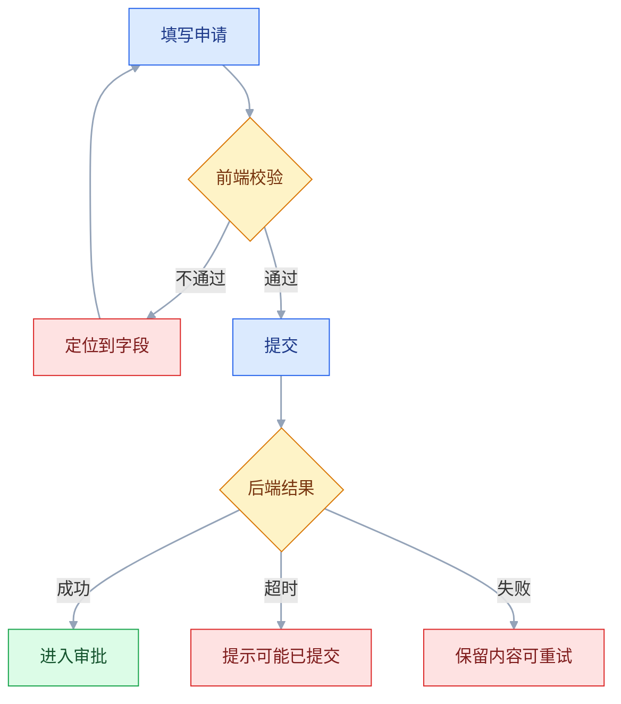
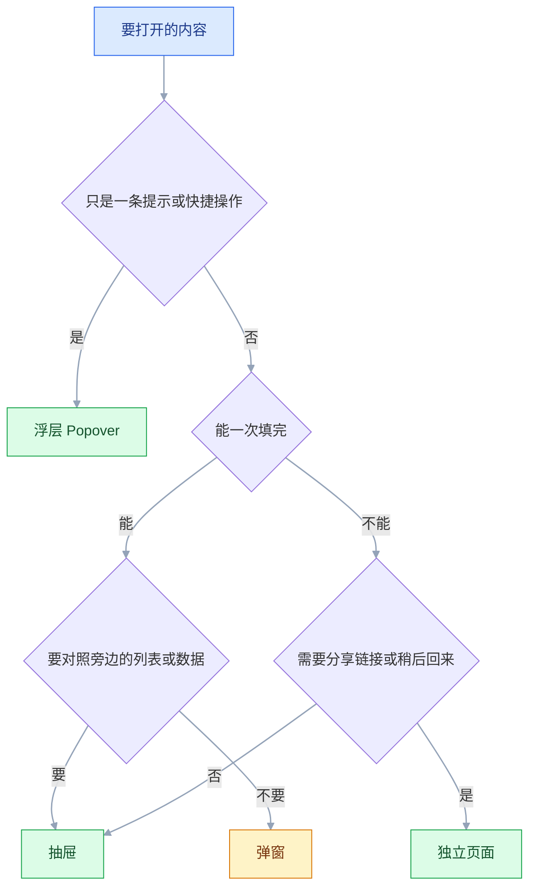

# 交互设计

## 一、工程案例：把一条采购申请流程的交互说明补全并交付

**场景**：一套内部采购系统，申请流程是「选类型 → 填明细 → 上传报价 → 选审批人 → 提交」。设计稿只有五张正常态页面，开发按图做完，上线后问题集中爆发：用户重复提交、审批人默认错、提交超时后不知道成没成、被驳回后要重填全部内容。产品要求「两周内把交互补全」，不改后端主流程。

**约束**：

- 后端暂时没有幂等键，重复提交只能靠前端拦截，并推动后端补
- 需要兼容仍在使用的旧版浏览器，不能用较新的 API
- 桌面端为主，但部门负责人会在手机上审批
- 交互说明要能直接给开发和测试用，不能写成设计理念

**为什么要补交互说明**：设计稿回答「长什么样」，不回答「什么条件下显示什么、点了发生什么、失败怎么办」。这些不写清楚，开发只能猜，测试也没法写用例，最后靠上线后收集投诉来补。

### 1.1 第一步：盘点任务与路径

先不画界面，列出用户真正要完成的事：

| 任务 | 触发 | 成功标准 | 高频异常 |
|---|---|---|---|
| T1 新建申请 | 点「新建」 | 提交成功并进入审批 | 明细为空、金额超限、附件过大 |
| T2 修改被驳回的申请 | 打开驳回单 | 改完重新提交，保留已通过内容 | 不知道改哪、重复填 |
| T3 撤回申请 | 审批中的单据 | 状态回到草稿 | 审批人已处理，无法撤回 |
| T4 移动端审批 | 收到通知 | 通过或驳回，附意见 | 附件看不清、误触通过 |

四个任务里，T2 和 T3 在原设计稿里完全没有。**任务盘点的作用就是先把「没画的任务」找出来**，否则后面的状态设计一定会漏。

### 1.2 第二步：把分支画出来



**每条异常分支都要有出口**。超时分支最容易被漏：用户不知道到底成没成，如果没有「去列表查看」的入口，他一定重复提交。

**分支的判定条件要写清楚**：什么叫「超时」（请求超过多少秒）、什么叫「失败」（HTTP 状态还是业务码）、重试是重发还是跳回。这些不写，开发和测试的理解不会一致。

### 1.3 第三步：定义状态

一个界面至少有三层状态：页面级、区块级、控件级。分开定义，才不会漏：

| 层级 | 状态 | 说明 |
|---|---|---|
| 页面 | 加载中 / 正常 / 无权限 / 已归档 | 决定整页显示什么 |
| 区块 | 加载中 / 有数据 / 空 / 出错 / 无权限 | 决定局部显示什么 |
| 控件 | 默认 / hover / 聚焦 / 按下 / 禁用 / 加载 | 决定反馈 |

**按钮状态表**（交付物核心）：

| 状态 | 触发条件 | 外观 | 可点击 |
|---|---|---|---|
| 默认 | 表单可提交 | 实心主色 | 是 |
| 禁用 | 必填未完成，或正在加载 | 去饱和，`cursor: not-allowed` | 否 |
| 加载 | 点击后到请求返回 | 文案换成「提交中」，宽度不变 | 否 |
| 成功 | 请求成功 | 短暂勾选，随后跳转 | 否 |
| 失败 | 请求失败 | 恢复默认，顶部显示错误 | 是 |

**「加载时宽度不变」是硬要求**。按钮文案从「提交」变成「提交中…」，如果宽度跟着变，旁边的元素会跳，用户会以为页面出问题。

### 1.4 第四步：写交互说明表

每个可交互元素一行，写清「什么条件、什么反应、失败怎么办」：

| 元素 | 触发 | 反应 | 异常 |
|---|---|---|---|
| 类型下拉 | 切换类型 | 明细区字段随类型变化，已填内容保留 | 切换后必填项变化，需重新校验 |
| 金额输入 | 失焦 | 校验格式与限额，超限展开「加签」 | 格式错时保留原值，只标红 |
| 附件上传 | 选择文件 | 显示进度，可取消 | 超过 10MB 拒绝并说明当前大小 |
| 审批人 | 选择类型后 | 预填直属上级，显示「可更换」 | 无上级时提示手动选择 |
| 提交按钮 | 点击 | 立即禁用 + loading，校验通过才发请求 | 失败保留内容，滚动到首个错误 |
| 撤回 | 点击 | 二次确认，说明「审批人将收到通知」 | 审批人已处理时置灰并说明原因 |

**说明表要写到测试能直接转用例**。「点击后提交」不够，「点击后立即禁用，校验通过才发请求，请求返回前不可再次点击」才是可执行的。

### 1.5 第五步：文案表

交互的一半是文案。把关键节点的文案单独列表，避免开发临时编：

| 场景 | 文案 | 要求 |
|---|---|---|
| 提交中 | 提交中… | 不用「请稍候」，说清在做什么 |
| 提交成功 | 已提交，等待张伟审批 | 说明下一步，不只说「成功」 |
| 超时 | 请求超时，申请可能已提交。去列表查看 | 给不确定性 + 出口 |
| 校验失败 | 还有 3 处需要修改 | 给出总数，不只标红 |
| 附件过大 | 附件 18.4MB，超过 10MB 上限 | 给当前值和上限 |
| 驳回 | 李静驳回了申请：发票金额与明细不符 | 谁、为什么、改哪里 |
| 撤回 | 撤回后审批人将收到通知，确定撤回？ | 说清后果 |

**文案里不出现内部术语**。「单据已进入 BPM 流程」不如「已提交给张伟审批」；用户不关心系统怎么实现，只关心下一步是谁、要等多久。

### 1.6 第六步：五条走查线

五条线互不替代，各自能挖出一类问题：

| 走查线 | 怎么做 | 找什么 |
|---|---|---|
| 键盘 | 全程不用鼠标 | 焦点丢失、无法触发、顺序错乱 |
| 网络 | 限速到 Slow 3G，再断网 | 无反馈、丢内容、重复提交 |
| 重复点击 | 快速点提交 5 次 | 是否发多个请求、是否有拦截 |
| 返回 | 填一半点浏览器返回，再前进 | 内容是否保留、是否重复提交 |
| 中断 | 填一半切到别的标签页，5 分钟后回来 | 登录态、草稿、超时提示 |

### 1.7 验收表

| # | 检查项 | 怎么验 | 通过标准 |
|---|---|---|---|
| 1 | 分支完整 | 对照流程图逐条走 | 每个判定都有「是/否」两条路径 |
| 2 | 状态完整 | 逐控件核对状态表 | 默认/禁用/加载/成功/失败五态齐全 |
| 3 | 重复提交 | 快速点击 5 次，看网络面板 | 只发 1 个请求，按钮期间不可点 |
| 4 | 超时处理 | 把接口延迟调到 30 秒 | 有超时提示 + 去列表查看入口 |
| 5 | 失败保留 | 断网后提交 | 表单内容不丢，错误可定位 |
| 6 | 键盘完成 | 全程 Tab + Enter | 能完成提交，焦点不跑到弹窗外 |
| 7 | 移动端审批 | 375 宽真机走一遍 | 附件可放大，通过/驳回不误触 |
| 8 | 返回恢复 | 填一半点返回再前进 | 内容保留或有草稿提示 |
| 9 | 文案可读 | 逐条读文案表 | 无内部术语，错误含原因与动作 |
| 10 | 测试可转用例 | 把说明表交给测试 | 每条能写出「操作 + 预期」 |

> 第 3 项必须用网络面板验，不能靠「我点得快也没事」。前端防抖只是减少概率，真正的保证是「请求期间按钮不可用」加后端幂等。

### 1.8 交付物清单

| 交付物 | 给谁 | 内容 |
|---|---|---|
| 任务与路径图 | 产品、开发 | 四个任务 + 全部分支 |
| 状态表 | 开发、测试 | 页面/区块/控件三层状态 |
| 交互说明表 | 开发、测试 | 元素、触发、反应、异常 |
| 文案表 | 开发、运营 | 关键节点全部文案 |
| 走查记录 | 设计、测试 | 五条线的问题与修复状态 |
| 验收表 | 全员 | 十项可执行检查 |

**没有交付物清单，交互设计就只是「画了图」**。图会过期，说明表不会；上线后改需求，也是先改说明表，再改实现。

---

## 二、高频问答：会卡住你的地方，也是面试最常问的

### 2.1 设计稿只画了正常路径，上线后全是异常

**现场**

数一下流程图里有几条异常分支；再看测试用例覆盖了几条。给每个异步操作列出四种结果：成功、失败、超时、无权限。

**要点**

- 异常路径决定产品是否可靠，而且实现成本远高于主路径；后补往往要改结构。
- 网络会断、权限会缺、数据会空、用户会连点，这些不是边缘情况，是每天都会发生的事。
- 四种结果都有界面，才算画完；缺一种，开发和测试就会各自猜。

**追问**

- 哪个分支最容易漏？→ 超时，它既不是成功也不是失败，用户最需要的是「去哪确认」。
- 异常分支怎么控制数量？→ 能用约束消除的（比如用选择器替代自由输入）先消掉，剩下的才画进流程。

### 2.2 点了提交没反应，用户重复提交

**现场**

用 Slow 3G 点一次，看 1 秒内按钮是否有变化；再连点 5 次，看网络面板发了几个请求。

**要点**

- 点击后没有任何即时反馈，用户以为没点上；请求期间按钮仍可点，就会重复提交。
- 反馈必须在点击瞬间出现，不能等接口返回；否则用户的行为已经发生了，优化接口也来不及。
- 点击后立即 `disabled` + loading，并保持按钮宽度；若用原生 `disabled`，键盘用户会丢焦点，可以改用 `aria-disabled="true"` 配合拦截点击。

**追问**

- 前端拦住就够了吗？→ 不够，刷新、多标签、网络重试都能绕过，后端要有幂等键。
- 为什么按钮宽度不能变？→ 文案从「提交」变「提交中…」时宽度一跳，旁边元素跟着动，用户以为页面出问题。
- 为什么不能用原生 `disabled`？→ 键盘用户会丢失焦点，回来时得从页面开头重新 Tab。

### 2.3 表单一次只报一个错，用户来回改五六次

**现场**

故意填错 3 个字段，数提交几次才能通过。

**要点**

- 一次只报一个，用户被迫经历「改一个 → 提交 → 又错 → 再改」的循环，每次都要重新等待。
- 表单提交是批量任务，用户需要一次看到全部问题；把「减少单次信息量」放在「减少总往返次数」之前是错的。
- 提交时全量校验，顶部汇总「还有 3 处需要修改」，每个字段旁标红并给具体原因，点击汇总项能跳到对应字段。

**追问**

- 实时校验能不能替代提交时的全量校验？→ 不能，实时只适合格式和强度这类越输越接近正确的场景。
- 顶部汇总和字段旁提示要都做吗？→ 要，只放顶部用户要自己找字段，只放字段旁看不到全局有几处错。

### 2.4 密码框和验证码框禁止粘贴

**现场**

在密码框按 Cmd/Ctrl+V，看是否被拦截；再用密码管理器试一次自动填充。

**要点**

- 禁粘贴挡住了密码管理器，也挡住了验证码自动填充，反而促使用户设弱密码。
- 粘贴不会降低安全性，弱密码和复用密码才会；禁粘贴是在惩罚使用安全工具的用户。
- 密码、验证码、银行卡号一律允许粘贴；验证码框加 `autocomplete="one-time-code"`，密码框加 `autocomplete="current-password"`。

**追问**

- 「强制手输更安全」错在哪？→ 它限制的是输入方式，不解决密码强度。
- 谁最受这个限制伤害？→ 用密码管理器的用户，本来是最安全的那一批。

### 2.5 失败提示用 Toast，3 秒就消失

**现场**

提交失败后切到别的标签页 5 秒再回来，看还能不能看到原因。

**要点**

- 失败信息需要用户处理，自动消失等于没提示；用户切个窗口就错过。
- 按「轻重」选反馈通道是错的，要按「用户要不要行动」选。
- 成功用 Toast；失败用内联提示 + 页面级 Banner，提供重试或修改入口。

**追问**

- Toast 适合承载什么？→ 只承载「已保存」这类无需行动的信息。
- 需要行动的信息为什么要常驻？→ 它要等用户处理完才算结束，自动消失会让用户以为问题没了。

### 2.6 弹窗里再开弹窗，用户彻底迷失

**现场**

打开两层弹窗后按 ESC，看关的是哪一层、焦点回到哪。

**要点**

- 每层弹窗都遮挡上下文，关闭时用户不知道回到哪；ESC 和遮罩点击的行为也会冲突。
- 用弹窗解决「不想离开当前页」的需求，忽略了层级成本；超过两层，用户的空间感就没了。
- 弹窗不超过两层，第二层改成抽屉、行内展开或独立页面；每层关闭后焦点必须回到触发元素，ESC 只关最上层。

**追问**

- 破坏性操作为什么不建议点遮罩关闭？→ 误关后用户不知道操作有没有生效。
- 第二层为什么优先抽屉？→ 抽屉只部分遮挡，能边看列表边编辑，上下文还在。

### 2.7 批量选择翻页后丢失

**现场**

选 3 条 → 翻页 → 再翻回来，看勾选是否还在、计数是否还对。

**要点**

- 选择状态绑在当前页的数据上，翻页重新渲染就清空；用户以为还选着，操作时才发现。
- 批量操作的对象是跨页的集合，必须有独立状态，不能用「当前页选中」代替「已选集合」。
- 用「已选 N 项」独立存储选中 ID，提供「查看已选」列表；全选只作用于当前页，并写明「全选本页」。

**追问**

- 跨页全选要不要单独提供？→ 要，并明确写「已选全部 1,204 条」，否则用户以为只选了当前页。
- 为什么「已选 N 项」必须常驻？→ 批量操作最大的风险就是不知道选了多少。

### 2.8 危险操作：该拦的没拦，拦多了又没人看

**现场**

看操作日志里「打开确认到点击确定」的间隔，过短说明没读；再找一遍没有确认也没有撤销的入口。

**要点**

- 确认太频繁，用户形成条件反射，不看内容直接点「确定」；反过来，真正不可逆的批量删除、覆盖发布却直接执行。
- 防错的重点是让危险操作难以误触（位置隔离、权限控制），以及误操作后可恢复（撤销、回收站），不是「拦一道」。
- 日常删除改成「删除 + 短暂撤销」，只对不可逆的批量操作保留确认；确认文案写清影响范围，不只问「确定吗」。

**追问**

- 两个方向都要查，是哪两个？→ 该拦的没拦，和不该拦的拦了。
- 发布、覆盖、转移所有权这类动作怎么处理？→ 至少「二次确认或输入名称」二选一，并且不响应遮罩点击和 ESC 误关。

### 2.9 桌面端 hover 才显示的操作，移动端没有

**现场**

用触摸模拟走一遍，看操作入口是否出现；再问 3 个人怎么找到它。

**要点**

- 触屏没有 hover；长按是隐藏手势，用户不知道，也没有视觉提示。
- hover 在桌面减少视觉噪音，在移动端直接删掉了功能，不是免费的收纳。
- 所有 hover 操作都要有常驻替代入口：更多菜单、滑动操作 + 首次引导，或直接在行内显示。

**追问**

- 键盘和触摸要等价到什么程度？→ 同一条任务两边都能完成，功能不缺项。
- 为什么长按不算替代？→ 没有视觉提示，用户不会去试。

### 2.10 输入时边打字边报红

**现场**

输入一个邮箱，看第一次报红发生在第几个字符。

**要点**

- 用户还没输完就报错，红色提示在输入过程中反复闪烁，制造焦虑且没有信息量。
- 校验时机要和输入节奏匹配：格式类在失焦时校验，规则类才实时更新。
- 密码强度、字数这类「越输越接近正确」的用中性色实时更新，不用红色。

**追问**

- 异步校验（用户名是否被占用）怎么处理？→ 防抖，并在结果返回前显示「检查中」，避免用户看到旧结论。
- 为什么格式类不能实时报红？→ 输入到一半必然不合法，报错没有信息量。

### 2.11 填一半点返回，内容全没了

**现场**

填 5 个字段后点返回，再前进，看还剩几个。

**要点**

- 页面没有草稿或状态保留，浏览器后退直接销毁表单；移动端返回手势更容易误触。
- 长表单的返回和关闭都是高风险动作，不是无风险导航。
- 内容变化后防抖写入本地草稿（停止输入约 1 秒），离开时再兜底存一次，重新进入提示恢复；有未保存内容时拦截返回并确认。

**追问**

- 移动端要不要拦系统手势？→ 不要，改用确认弹层，拦系统手势会和系统行为打架。
- 敏感信息也能存本地草稿吗？→ 不存敏感字段，或只存非敏感字段并设过期时间。

### 2.12 自绘控件 Tab 走不到，键盘用户卡在提交前

**现场**

拔掉鼠标，只用 Tab / Shift+Tab / Enter / 空格，从页面顶部走到提交，看能否走完。

**要点**

- 用 `div`/`span` 画按钮、自绘下拉和开关，没有 `tabindex` 与键盘响应；弹窗打开后焦点留在背景，Tab 越走越偏。
- 键盘支持不只是无障碍加分项，它同时是表单的兜底路径：焦点错乱时，鼠标用户一样找不到自己在哪。
- 优先用原生 `button`、`a`、`input`；自绘控件补 `tabindex="0"`、`role` 和 Enter/空格响应；弹窗打开后焦点移入并在内部循环，关闭后回到触发按钮。

**追问**

- `tabindex` 能用正数吗？→ 不能，正数会打乱整个页面的 Tab 顺序。
- 焦点环能不能为了好看去掉？→ 不能，`outline: none` 抹掉后键盘用户不知道自己在哪。
- 拖拽类操作怎么做键盘等价？→ 提供「上移/下移」这类按钮。

---

## 三、核心知识：从零开始要建立的东西

### 3.1 任务类型与交互策略

| 类型 | 用户状态 | 核心目标 | 交互策略 |
|---|---|---|---|
| 找东西 | 目标明确 | 缩短定位时间 | 搜索优先、筛选、记住上次条件 |
| 做事情 | 流程明确 | 不迷路、可恢复 | 分步、进度、草稿、校验 |
| 逛一逛 | 目标模糊 | 降低探索成本 | 推荐、无限浏览、内容质量优先 |

**先判断类型，再谈方案**。给「找东西」的界面加推荐流，用户会烦；给「逛一逛」的界面加强制搜索，用户会走。同一个组件在不同任务类型里的价值完全不同。

**边界**：一个产品通常同时有三种任务，但每个页面应该有主类型。列表页以「找」为主，详情页以「做」为主，首页可以「逛」。不要在一个页面里平均满足三种。

### 3.2 导航结构与位置感

导航要回答三个问题：我在哪、我能去哪、我怎么回去。

| 形式 | 适用 | 代价 |
|---|---|---|
| 顶部全局导航 | 模块少且平级 | 模块多了放不下 |
| 侧边栏 | 模块多、有层级 | 占横向空间 |
| 标签页 | 同一对象的不同视图 | 不适合跨对象 |
| 面包屑 | 层级深 | 只解决「我在哪」，不解决「去哪」 |
| 步骤条 | 线性流程 | 不适合可跳转的流程 |

**当前位置必须可辨识**：高亮、加粗、左侧色条，至少一种。用户迷失的第一反应不是找导航，是点浏览器返回。

**移动端的取舍**：侧边栏收成抽屉会降低功能发现率，核心的 3–5 个入口应该放底部 Tab，低频功能才进抽屉。汉堡菜单不是万能解。

### 3.3 用户流程的分支建模

流程图的完整度，决定上线后的可靠度。每个异步节点至少四个出口：

| 出口 | 界面要给什么 |
|---|---|
| 成功 | 结果 + 下一步 |
| 失败 | 原因 + 重试 + 内容保留 |
| 超时 | 可能已成功 + 查询入口 |
| 无权限 | 缺什么权限 + 申请入口 |

**超时是最容易漏的**。它既不是成功也不是失败，用户最需要的是「去哪确认」，而不是一句「请重试」。

**边界**：分支不是越多越好。把可以通过约束消除的分支去掉（比如用选择器替代自由输入），剩下的才画进流程。分支多到开发无法实现，说明前面该做约束。

### 3.4 表单字段顺序与分组

**顺序按用户的思维，不按数据库字段**：

```text
✘ 系统顺序：user_id / create_time / status / name / phone
✔ 用户顺序：姓名 → 手机 → 验证码
```

**分组按语义，不按数量**。字段一多就要分组，但分组的依据是「回答的是同一个问题」，不是「每 7 个切一刀」。组标题要有信息量：「收货信息」而不是「信息 1」。

下面的数量是经验起点，不是标准，按实际填写耗时和用户测试调整：

| 字段数 | 布局 |
|---|---|
| < 7 | 单列，标签在上方 |
| 7–15 | 分组，允许双列短字段 |
| > 15 | 分步或分区 |

**单列优于双列**：视线只上下移动，填写速度快；双列只适合成对的短字段（省/市、开始/结束时间）。长文本字段排双列会让人不知道先读哪。

### 3.5 标签位置与校验时机

| 标签位置 | 适用 | 缺点 |
|---|---|---|
| 上方（顶对齐） | 绝大多数场景 | 占竖向空间 |
| 左侧右对齐 | 桌面密集表单 | 标签长度不一时参差 |
| 左侧左对齐 | 不推荐 | 标签与输入框距离远 |
| 仅占位符 | 不推荐 | 输入后标签消失 |

**校验时机分三类**：

| 时机 | 用于 | 注意 |
|---|---|---|
| 失焦 | 格式类（邮箱、手机、日期） | 不要边输边报错 |
| 实时 | 强度、字数、规则清单 | 只用于越输越接近正确的场景 |
| 提交 | 整体校验 | 一次列出全部错误 |

**边界**：异步校验（用户名是否被占用）要防抖，并在结果返回前显示「检查中」，避免用户看到旧结论。

### 3.6 操作层级与按钮文案

| 层级 | 样式 | 数量 | 位置 |
|---|---|---|---|
| 主操作 | 实心、品牌色 | 1 | 表单底部右侧或右下 |
| 次操作 | 描边或浅底 | 1–2 | 主操作左侧 |
| 弱操作 | 文字链接 | 不限 | 就近 |
| 危险操作 | 红色或收进菜单 | 越少越好 | 远离主操作 |

**按钮文案用动词**：「保存」「发布」「提交审批」，不用「确定」「提交」——后者不说明提交什么。

**危险操作的隔离强度**：颜色区分最弱，用户会习惯；位置隔离（收进更多菜单）有效；二次确认或输入名称确认最强，只用于不可逆操作。

**边界**：一个界面只能有一个主操作。两个实心按钮并排，用户每次都要判断哪个是「继续」，效率反而低。

### 3.7 反馈通道的选择

| 通道 | 用途 | 持续 | 用户要做什么 |
|---|---|---|---|
| 内联 | 字段校验、局部状态 | 常驻 | 改当前字段 |
| Toast | 成功、轻提示 | 数秒 | 不需要行动 |
| Banner | 页面级状态 | 常驻至解决 | 知晓或处理 |
| Modal | 需要决策 | 阻塞 | 立刻选择 |
| 进度 | 耗时操作 | 操作期间 | 等待或取消 |
| 骨架 | 首屏加载 | 数据到达前 | 等待 |

**判断标准是「用户要不要行动」**，不是「信息重不重要」。需要行动的信息用常驻通道，不需要行动的才用自动消失的通道。

> **面试**：常问「失败提示能只用 Toast 吗？」答：不能，需要用户行动的信息必须常驻，Toast 只承载「已保存」这类无需行动的提示。

**边界**：同一时刻只保留一个 Modal。多个 Modal 叠加会让用户不知道当前在哪个决策里；Toast 也不要堆叠超过三条。

### 3.8 等待感知与骨架屏

| 真实耗时 | 必要反馈 |
|---|---|
| < 100ms | 不加提示；一出现就消失的 loading 只是闪烁 |
| 100ms–1s | 延迟约 300ms 再显示按钮 loading，提前返回就不显示 |
| 1s–10s | 骨架屏或进度条，说明正在加载什么 |
| > 10s | 进度 + 预计时间 + 可取消 |

**骨架屏优于转圈**：它同时传达「正在加载」和「马上会出现什么」，并预留布局空间，减少加载完成后的跳动。

**边界**：骨架块的尺寸要接近真实内容。骨架 200px 高、内容 400px 高，加载完会把下面的内容顶走，比白屏更难受。骨架也不该显示超过一屏，否则用户会以为内容就是这样。

### 3.9 容器选择：弹窗、抽屉、跳页与浮层



| 形式 | 上下文 | 适用 |
|---|---|---|
| Modal | 完全遮挡 | 短表单、确认、单一决策 |
| Drawer | 部分遮挡 | 中等表单、详情预览、边看列表边编辑 |
| 跳页 | 完全离开 | 复杂表单、独立功能、需要分享链接 |
| Popover | 不遮挡 | 轻量信息、快捷操作 |

**判断口诀**：内容少、能快速完成用弹窗；需要参考旁边信息用抽屉；内容多、可能花很久用跳页。

**边界**：弹窗不超过两层；破坏性操作不建议点遮罩关闭，避免误关后不知道操作是否生效。

### 3.10 批量操作与选择模型

| 能力 | 要求 |
|---|---|
| 全选 | 只作用于当前页，文案写明「全选本页」 |
| 跨页选择 | 独立状态保存 ID，翻页不清空 |
| 已选计数 | 常驻显示「已选 N 项」，可查看 |
| 批量操作栏 | 选中后出现，显示数量与可用操作 |
| 部分成功 | 逐条报告成功/失败原因，不整体回滚 |

**批量操作最大的风险是「不知道选了多少」**。计数必须实时、可见，且在翻页、筛选后仍然正确。

**边界**：跨页全选（选中所有符合筛选条件的记录）要单独提供，并明确写出「已选全部 1,204 条」，否则用户会以为只选了当前页。

### 3.11 移动端输入与热区

| 维度 | 桌面 | 移动 |
|---|---|---|
| 输入 | 键盘鼠标，精确 | 手指，粗粒度 |
| 触发 | hover 可用 | 无 hover |
| 空间 | 宽 | 窄，纵向为主 |
| 中断 | 少 | 频繁 |

**三条硬规则**：

1. 热区不小于 44×44pt（iOS）/ 48×48dp（Android），视觉可以小
2. 不能依赖 hover 暴露操作
3. 必须处理中断：切后台、来电、锁屏后状态可恢复

**输入类型要匹配**：数字用 `inputmode="numeric"`，不要用 `type="number"`（滚轮会误改值）；验证码加 `autocomplete="one-time-code"`；邮箱、电话用对应的 `autocomplete`。

### 3.12 键盘与焦点管理

| 场景 | 要求 |
|---|---|
| Tab 顺序 | 符合视觉顺序，从左到右、从上到下 |
| 焦点可见 | 有明显的焦点环，不能 `outline: none` 了事 |
| 弹窗 | 打开后焦点进入弹窗，Tab 不得到背景 |
| 关闭弹窗 | 焦点回到触发元素 |
| 跳过导航 | 提供「跳到主内容」链接 |

**焦点陷阱只用于弹窗**：弹窗打开时，Tab 应该在弹窗内循环；关闭后焦点必须回到触发它的按钮，否则用户会从页面开头重新 Tab。

**边界**：`tabindex` 只用 0 和 -1，不要用正数。正数会打乱整个页面的 Tab 顺序，后期几乎无法维护。

### 3.13 中断与状态恢复

用户会被电话、消息、切换应用打断，长表单必须能恢复：

| 手段 | 实现 | 提示 |
|---|---|---|
| 本地草稿 | 定时写 `localStorage` | 进入时问「恢复草稿？」 |
| 服务端草稿 | 每次变更同步 | 显示「已保存于 14:32」 |
| 登录态恢复 | 重新登录后回到原页 | 保留路径与筛选条件 |
| 滚动位置 | 返回列表时恢复 | 不要回到顶部 |

**自动保存必须可见**。用户看不到「已保存」，就不敢关页面；显示时间戳比显示「已自动保存」更可信。

**边界**：涉及敏感信息的表单（身份证、银行卡）不要长期存本地草稿，或者只存非敏感字段，并设置过期时间。

### 3.14 重复提交与幂等

| 层 | 手段 | 作用 |
|---|---|---|
| 交互层 | 点击后禁用 + loading | 阻止用户连点 |
| 前端层 | 请求去重、防抖 | 减少重复请求 |
| 后端层 | 幂等键 | 保证同一请求只生效一次 |
| 业务层 | 唯一约束、状态机 | 防止重复单据 |

**四层都要有，不能只靠前端**。前端禁用能被绕过（刷新、多标签、网络重试），只有后端幂等才能保证结果正确。

> **面试**：常问「前端禁用了提交按钮，为什么还会重复提交？」答：刷新、多标签、网络重试都能绕过，必须后端幂等键兜底。

**边界**：幂等键要由前端在进入表单时生成，整个提交流程复用同一个；每次点击都生成新键，等于没有幂等。

### 3.15 交互说明文档的结构

| 部分 | 内容 | 读者 |
|---|---|---|
| 任务与范围 | 用户要完成什么，不包含什么 | 产品、测试 |
| 流程图 | 主路径 + 异常分支 | 开发、测试 |
| 状态表 | 页面/区块/控件三层 | 开发 |
| 交互说明 | 元素、触发、反应、异常 | 开发、测试 |
| 文案表 | 关键节点文案 | 开发、运营 |
| 验收标准 | 可执行的检查项 | 全员 |

**说明文档要能脱离设计稿使用**。开发不看图也能知道「提交失败后停在哪、保留什么、提示什么」，才算写清楚。

### 3.16 可访问性底线

| 项 | 要求 |
|---|---|
| 键盘 | 所有交互可纯键盘完成 |
| 拖拽 | 提供「上移/下移」等键盘等价操作，不能只有鼠标拖 |
| 焦点 | 可见、顺序合理、弹窗内循环 |
| 对比度 | 正文 4.5:1，大字与组件 3:1 |
| 语义 | 按钮是 `button`，链接是 `a`，标题层级正确 |
| 错误播报 | 用 `aria-live` 让读屏用户知道出错 |
| 动效 | 支持 `prefers-reduced-motion` |
| 表单 | 每个输入都有可关联的 label |

**这些不是加分项，是底线**。它们同时也是最便宜的可用性改进：键盘能走通，说明焦点管理没问题；label 关联正确，点标签也能聚焦输入框。

> **面试**：常问「键盘支持是加分项吗？」答：不是，它同时是表单的兜底路径，焦点错乱时鼠标用户也会找不到位置。

### 3.17 空态不是一句「暂无数据」

同一个空列表对应五种不同处境，界面必须分开处理：

| 空态类型 | 用户处境 | 界面要给什么 |
|---|---|---|
| 首次无数据 | 还没开始用 | 说明这里会出现什么 + 一个主操作 |
| 筛选无结果 | 条件太窄 | 说明当前条件 + 清除筛选 |
| 无权限 | 看不到 | 缺什么权限 + 申请入口 |
| 出错 | 加载失败 | 原因 + 重试 |
| 全部处理完 | 待办清空 | 明确「没有待处理」，不要整页空白 |

**「暂无数据」是最差的空态**：它不区分上面五种，用户不知道该新建一条、该清筛选，还是该找管理员。空态文案要写出「为什么空」和「下一步能做什么」。

**空态与加载态不能混**：数据没回来时显示骨架，确认没有数据才显示空态。先闪一下空态再出内容，比多等半秒更让人怀疑系统坏了。筛选后的无结果，也不该复用首次使用的插图。

---

## 四、冷门知识汇总

| 知识点 | 为什么冷门 | 用到时的关键词 |
|---|---|---|
| 输入法组合期 | 只在中文、日文输入时触发，英文环境下测不出来 | `compositionstart`、`compositionend` |
| 乐观更新回滚 | 只在失败路径上出现，正常网络测不到 | 回滚、未生效提示 |
| 自动聚焦 | 桌面是优化，移动端弹键盘挡住内容才变成问题 | `autofocus`、移动端取舍 |
| 虚拟滚动 | 只有几百行以上才需要，小列表用不上 | 可视区域渲染、滚动锚定 |
| 表格固定列 | 只有列多到横向滚动时才有意义 | sticky column、首末列 |
| 命令面板 | 只有高频用户才用，普通用户不知道它存在 | ⌘K、快捷入口 |
| Enter 隐式提交 | 鼠标用户不关心，单输入框表单里才暴露 | 隐式提交、`keydown` |
| 滚动穿透 | 弹窗打开后背景还能滚，触屏和触摸板上才明显 | body 锁滚动、`overscroll-behavior` |
| 滚动条出现导致横跳 | 长短页面切换时才有，宽屏上不容易注意 | `scrollbar-gutter`、锁滚动补偿 |
| iOS 输入框自动放大 | 只在 iPhone 上点输入框时发生 | 字号小于 16px、`font-size: 16px` |
| 复制按钮失败 | 只在非 https 或非用户手势下失败，本地常测不出来 | Clipboard API、降级方案 |
| 日期差一天 | 只在跨时区或按 UTC 存储时出现 | 本地时区、`YYYY-MM-DD` |
| 千分位输入光标跳动 | 只在边输边格式化时出现，短数字看不出来 | 光标位置、非受控输入 |
