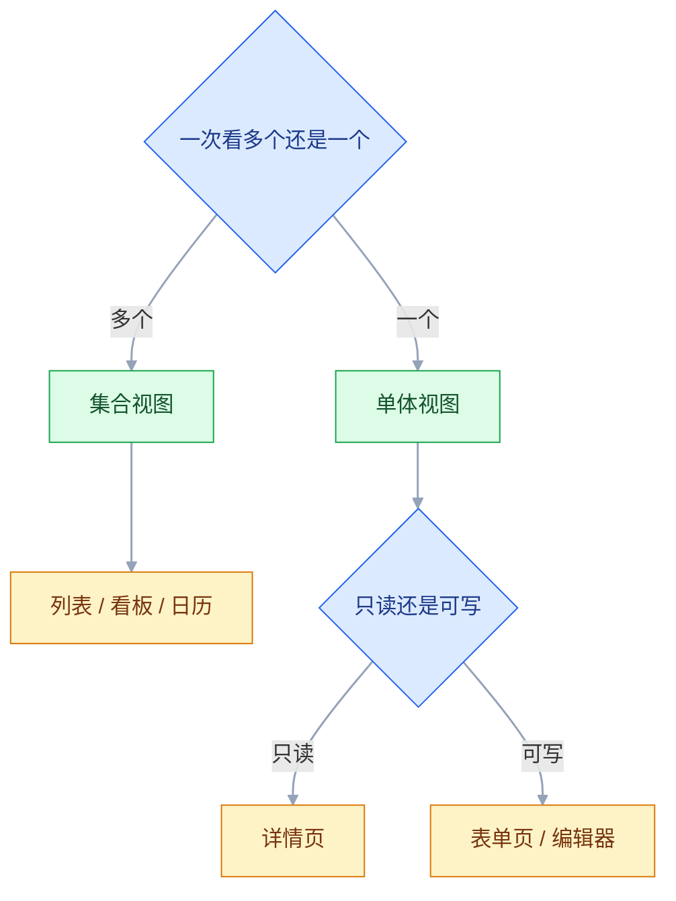
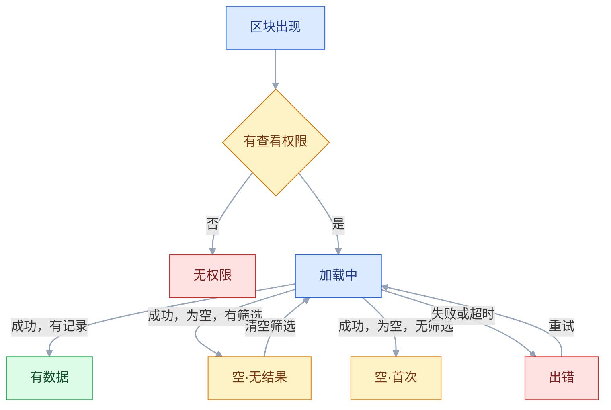

# 页面结构与状态

## 一、工程案例：把一个工单列表页的六种状态画全并交付

**场景**：一套客服工单系统，列表页是使用频率最高的界面。设计稿只有一张「有数据」的图，开发照着做完，上线后问题不断：新用户进来看到空白，以为系统坏了；搜索无结果也显示「暂无数据」，用户不知道该清筛选；接口报错时页面一片白，客服只能刷新；没权限的账号看到空列表，反复找主管确认。

**约束**：

- 表格组件是自研的，改结构成本高，本轮只补状态与文案
- 没有虚拟滚动，超过 500 行会卡，先用分页控制
- 移动端只做只读查看，不做编辑
- 设计 1 人、前端 1 人，两周交付
- 列表页与详情页必须共用同一套状态定义，文案和矩阵不能各写一套

**为什么状态要先画**：页面结构决定「信息放哪」，状态决定「没有信息时放什么」。只画有数据态，等于只设计了系统正常运行时的那一半。

### 1.1 第一步：判定页面类型



工单列表是「集合视图 + 可批量操作」，所以骨架按列表页来：筛选区、批量操作栏、表格、分页。**不要在这个页面里塞复杂表单**，那是详情页或独立表单页的职责。

### 1.2 第二步：搭骨架

```text
页面标题：工单列表                    [导出] [新建工单]
├── 搜索框（工单号 / 标题 / 客户）
├── 常用筛选：状态下拉 · 优先级 · 负责人 · 时间范围
├── 更多筛选（折叠）：来源 · 标签 · SLA 状态
├── 批量操作栏（选中后出现）：已选 3 项  [批量分配] [批量关闭]
├── 表格
│   ├── 表头：勾选 · 工单号 · 标题 · 状态 · 优先级 · 负责人 · 更新时间 · 操作
│   ├── 数据行：可选中、行内操作不超过 3 个
│   └── 分页：共 1,204 条 · 20/页 · 跳到第 N 页
└── 空态 / 加载态 / 错误态（占据表格区域）
```

**骨架里要预留状态的位置**。状态不是弹层，它占据表格区域，尺寸和表格一致，切换时页面不跳动。

### 1.3 第三步：枚举状态

六个基础状态，加三个叠加状态：

| # | 状态 | 触发条件 | 用户该看到什么 |
|---|---|---|---|
| 1 | 加载中 | 首次进入、切筛选、翻页 | 表头 + 骨架行，不整页转圈 |
| 2 | 有数据 | 请求成功且有记录 | 正常表格 + 分页 |
| 3 | 空·首次 | 请求成功，系统内没有记录 | 说明这是什么 + 新建入口 |
| 4 | 空·无结果 | 有筛选条件，结果为空 | 说明没匹配 + 清空筛选 |
| 5 | 出错 | 请求失败、超时 | 原因 + 重试，保留筛选条件 |
| 6 | 无权限 | 账号无查看权限 | 缺什么权限 + 申请入口 |
| 7 | 部分失败 | 批量操作部分成功 | 成功/失败条数 + 失败明细 |
| 8 | 已归档 | 查看已归档工单 | 顶部灰条，操作禁用 |
| 9 | 只读 | 移动端或权限不足 | 隐藏编辑入口，保留查看 |

**第 7 到 9 是叠加态**，挂在前六个之上。比如「有数据 + 已归档」，表格照常显示，但批量操作和行内编辑全部禁用；批量操作后则追加一条「3 成功 2 失败」的结果条。

### 1.4 第四步：状态矩阵

状态不是「整页一个」，而是每个区块各自有状态。用矩阵避免漏：

| 区块 | 加载中 | 空 | 出错 | 无权限 |
|---|---|---|---|---|
| 页面标题 | 直接显示 | 直接显示 | 直接显示 | 直接显示 |
| 筛选区 | 可用（选项有缓存或兜底） | 可用 | 可用，保留已选条件 | 隐藏或禁用 |
| 表格 | 骨架行 | 空态插画/说明 | 错误说明 + 重试 | 权限说明 |
| 分页 | 隐藏 | 隐藏 | 隐藏 | 隐藏 |
| 批量操作栏 | 隐藏 | 隐藏 | 隐藏 | 隐藏 |
| 统计汇总 | 数字骨架 | 显示 0 或隐藏 | 显示「—」 | 隐藏 |

**筛选区在出错时仍要可用**，否则用户连「换个条件试试」都做不到。表格挂了，筛选不应该跟着挂。

### 1.5 第五步：文案表

三种空态、错误、无权限、归档，文案必须分开写：

| 场景 | 标题 | 说明 | 主操作 |
|---|---|---|---|
| 首次为空 | 还没有工单 | 客户提交或手动创建后，工单会出现在这里 | 新建工单 |
| 筛选无结果 | 没有符合条件的工单 | 试试减少筛选条件，或换一个关键词 | 清空筛选 |
| 全部处理完 | 当前没有待处理工单 | 新工单会实时提醒你 | 查看已关闭 |
| 加载失败 | 工单列表加载失败 | 网络或服务异常，已选筛选条件已保留 | 重新加载 |
| 无权限 | 你没有查看工单的权限 | 需要「客服-工单-查看」权限，可向管理员申请 | 申请权限 |
| 已归档 | 该工单已归档 | 内容只读，如需修改请先恢复 | 恢复工单 |

**文案要回答「为什么空」和「接下来做什么」**。只写「暂无数据」等于把判断责任推给用户。

### 1.6 第六步：极端数据

真实数据不会像设计稿那么整齐。用六类测试数据验证：

| 类型 | 测试值 | 会怎么坏 | 处理 |
|---|---|---|---|
| 超长标题 | 80 个汉字 | 撑高行、挤走操作列 | 单行截断 + tooltip |
| 超多数据 | 1,204 条 | 渲染卡顿 | 分页，每页 20–50 |
| 超少数据 | 只有 1 条 | 表格塌陷，看起来像空态或加载失败 | 保留表头与分页位，汇总显示真实值 |
| 缺失字段 | 负责人为空 | 空白单元格，不知道是没填还是没加载 | 统一显示 `—`，数值 0 仍显示 0 |
| 特殊字符 | emoji、换行、RTL | 行高错乱、方向反转 | 转义 + 限制长度 |
| 极端数值 | 金额 9 位数 | 列宽跳动、右对齐失效 | 等宽数字 + 右对齐 + 最小列宽 |

**在设计阶段就用这些数据填一遍**，比上线后被客服截图打脸便宜得多。

### 1.7 第七步：加载顺序

```text
1. 页面框架（标题、筛选、表头）——立即，不依赖接口
2. 表格骨架——与真实行高一致
3. 数据行——接口返回后替换骨架
4. 统计汇总——独立接口，后到先显示
```

**不要整页一个 loading**。用户盯着白屏等 3 秒，会以为系统挂了；先出框架，至少让他知道「这是工单列表，正在加载」。

### 1.8 验收表

| # | 检查项 | 怎么验 | 通过标准 |
|---|---|---|---|
| 1 | 六态齐全 | 逐态构造并截图 | 加载/有数据/空/无结果/出错/无权限都有 |
| 2 | 空态可区分 | 对比首次为空与筛选无结果 | 文案、主操作不同 |
| 3 | 状态不跳动 | 从加载切到有数据 | 表格高度基本不变，无布局位移 |
| 4 | 错误可恢复 | 断网后进入列表 | 有原因 + 重试，筛选条件保留 |
| 5 | 无权限可行动 | 用无权限账号进入 | 说明缺什么权限 + 申请入口 |
| 6 | 批量部分失败 | 构造 3 成功 2 失败 | 分别报告，失败项可定位 |
| 7 | 极端数据 | 填入 1.6 的六类测试值 | 不破版、不遮挡、不横向溢出 |
| 8 | 列固定 | 横向滚动 | 首列（工单号）与末列（操作）固定 |
| 9 | 数字对齐 | 看金额/数量列 | 右对齐、等宽、刷新不跳动 |
| 10 | 移动端只读 | 375 宽打开 | 可查看，编辑入口隐藏，无横向滚动 |
| 11 | 加载分区 | 限速到 Slow 3G | 框架先出，表格与汇总各自加载 |
| 12 | 文档可交接 | 交给测试 | 能按状态矩阵写出全部用例 |

> 第 3 项要量，不要看。用 Performance 面板记录加载前后的布局位移；骨架行高与真实行高不一致，切换时就会跳，验收看位移是否接近 0。

### 1.9 交付物

| 交付物 | 内容 |
|---|---|
| 页面骨架图 | 区块顺序、层级、固定列 |
| 状态矩阵 | 六个区块 × 四种状态 |
| 状态文案表 | 标题、说明、主操作 |
| 骨架规格 | 行高、列宽、占位块尺寸 |
| 极端数据清单 | 六类测试值与预期表现 |
| 验收表 | 十二项可执行检查 |

**状态矩阵是核心交付物**。它让开发知道「哪个区块在什么情况下显示什么」，也让测试能按格子写用例，而不是凭经验点。

---

## 二、高频问答：会卡住你的地方，也是面试最常问的

### 2.1 设计稿只有「有数据」一种状态

**现场**

数一下设计稿里的状态数量；再看线上有几种状态被用户遇到。

**要点**

- 空、加载、出错、无权限的界面结构完全不同，开发临时发挥一定不统一。
- 状态不是「异常分支」：第一次进入就是空态，网络不好就是错误态，这些是日常。
- 给每个数据区块列四个格子：加载、有数据、空、出错；无权限和归档再各加一格。

**追问**

- 为什么说只画有数据态等于只设计了一半？→ 它只覆盖了系统正常运行时的那一半。
- 状态数量从哪来定？→ 从请求的几种结果来：成功有数据、成功为空、失败、无权限。

### 2.2 加载时先闪一下「暂无数据」，再出现列表

**现场**

限速到 Slow 3G，录屏逐帧看空态停留了多久。

**要点**

- 初始状态被设成「空」而不是「加载中」，接口没回来就渲染了空态。
- 加延时只是把错误藏起来，初始状态应该是「未知/加载中」，只有请求成功且结果为空才进空态。
- 状态机里区分 `idle / loading / success / empty / error`，`idle` 和 `loading` 都渲染骨架。

**追问**

- 为什么不能用 setTimeout 盖住？→ 请求慢过延时时还会闪，而且掩盖了真正的状态判断错误。
- 骨架和空态能混用吗？→ 不能，数据没回来显示骨架，确认没有数据才显示空态。

### 2.3 空态和「搜索无结果」用同一句文案

**现场**

分别构造两种情况，看主操作按钮是否相同。

**要点**

- 两者用户该做的事相反：一个该创建，一个该放宽条件；同一句文案会让用户做错动作。
- 空态的核心不是「没有数据」，是「接下来怎么办」，要按用户意图分类，不按界面长相分类。
- 没有筛选条件时给「新建」，有筛选条件且结果为空给「清空筛选」；判断依据是「当前是否有筛选条件」，不是数组长度。

**追问**

- 筛选后仍为空怎么办？→ 说明是真的没有匹配，仍然给清空筛选，不能复用首次空态的插图。
- 「全部处理完」算第几种？→ 单独一种，要给正向反馈和下一步。

### 2.4 无权限时显示空白页，用户以为系统坏了

**现场**

用无权限账号进入，看是否有文字说明和申请入口。

**要点**

- 空白无法区分「没权限」「没数据」「加载失败」，用户会反复刷新或找客服。
- 「不泄露信息」不等于「不解释」：可以不说数据内容，但必须说清没有权限以及怎么获得。
- 无权限页要有三样：缺什么权限、找谁申请、返回哪里；权限码可以给，但不要暴露内部角色结构。

**追问**

- 无权限和空态谁优先？→ 无权限优先，没权限时不能显示「暂无数据」。
- 为什么不能干脆什么都不显示？→ 用户会当成故障，反复刷新或找客服。

### 2.5 列太多，横向滚动后不知道在看哪条

**现场**

表格横向滚到最右，看工单号是否仍可见。

**要点**

- 横向滚动时标识列被滚走，用户失去行与数据的对应关系。
- 这不是布局问题，它破坏的是「这行是谁」的连续性，属于信息架构问题。
- 固定首列（标识）和末列（操作），中间列滚动；固定列不超过 2 个，否则内容区被挤压。

**追问**

- 移动端怎么处理？→ 改为卡片，不做横向滚动。
- 为什么固定列不能多？→ 超过两个，可滚动的中间区域被挤得没法看。

### 2.6 金额和数量左对齐，纵向没法比较

**现场**

把 8、120、3,400 放一列，看能否一眼判断大小。

**要点**

- 数字位数不同，左对齐后个位、小数点全部错开，无法目测大小。
- 文字靠左对齐便于阅读，数字靠右对齐便于比较，不能把文字排版规则套到数字上。
- 金额、数量、百分比一律右对齐，并用等宽数字 `tabular-nums`；表头也右对齐，与数据列对齐。

**追问**

- 右对齐了为什么数字还会跳？→ 字体不是等宽的，位数变化时列宽会动，要用 `tabular-nums`。
- 表头要不要跟着右对齐？→ 要，否则表头和数据列对不齐。

### 2.7 详情页把所有模块堆在一页，找不到重点

**现场**

首屏截图，问没看过的人「这个对象现在什么状态」。

**要点**

- 没有主次：首屏看不到「这是什么、现在什么状态」，用户必须滚动和扫读。
- 「完整」不等于「清楚」，详情页的第一职责是回答「是什么、怎么样」，其次才是展开细节。
- 首屏放标题 + 状态 + 3–4 个关键字段 + 主操作；其余按使用频率分 Tab，高频的放第一个。

**追问**

- 就地编辑适合什么？→ 单字段、校验简单、失败可回滚的场景，比如改状态、改标签。
- 整块信息编辑放哪？→ 跳独立页面，否则详情页会变成半成品表单。

### 2.8 表单 20 个字段平铺，用户填到一半放弃

**现场**

数首屏可见字段数；看用户在哪个字段放弃。

**要点**

- 一次性呈现全部字段，用户先看到「很长」，还没开始就累了；字段之间也没有分组。
- 「字段数量」不等于「信息完整度」，很多字段可以默认、可以后填、可以由系统带出。
- 先删「不填也能活」的字段，再按语义分组；超过 15 个考虑分步，每步控制在 7 个字段以内。

**追问**

- 分组按什么依据？→ 按「回答的是同一个问题」，不是每 7 个切一刀。
- 分步是不是越多越好？→ 不是，步数越少越好，每步只放一类问题。

### 2.9 分页和无限滚动选错场景

**现场**

让用户找第 3 页的第 8 条，看能否完成。

**要点**

- 有明确目标、需要定位到某条或回到原位置时，无限滚动会让用户失去方向。
- 按「流行」选交互是错的，要按任务：浏览型内容适合无限滚动，查找型内容适合分页。
- 有明确目标（订单、工单、客户）用分页；内容流（动态、推荐）用无限滚动 + 「加载更多」。

**追问**

- 两种都要满足什么？→ 都能回到顶部并恢复位置。
- 为什么无限滚动找东西会失效？→ 没有位置锚点，用户不知道刚看到的是第几条。

### 2.10 超长文本或超长数字把表格撑破

**现场**

填入 80 字标题和一个 9 位数金额，看行高和相邻列宽。

**要点**

- 换行会让行高不一致，几十行后表格像阶梯；列宽也被最长的内容拖走，9 位数金额会把整列拉宽。
- 表格的目标是扫读和比较，不是完整阅读，不能用「全部显示」解决内容过长。
- 单行截断 + 省略号 + tooltip 看全文；标题列设最小/最大宽度；数字列定宽、等宽字体。

**追问**

- 完整内容放哪？→ 详情页。
- 为什么数字列要定宽？→ 位数再多也不改列宽，否则相邻列跟着跳。

### 2.11 页面整块转圈，所有接口回来才显示

**现场**

看 Network 面板里各接口的返回顺序与整页渲染时间。

**要点**

- 最慢的接口决定整页出现时间，快的接口被浪费；用户长时间看不到任何结构。
- 把「一致性」放在「速度」之前是错的，分区块加载先出框架，用户能更早开始理解页面。
- 页面框架立即渲染，各区块独立 loading；某个区块失败不影响其他区块。

**追问**

- 什么时候才用整页 loading？→ 整页只有一个接口、一个区块时。
- 分块加载有什么代价？→ 请求数变多，接口过多反而慢，要按「用户先看什么」合并成 2–3 个请求。

### 2.12 从详情返回，筛选条件和页码全丢

**现场**

筛到第 3 页，点进详情再返回，看条件与页码是否还在。

**要点**

- 列表状态只存在页面内存里，路由一离开就销毁；用户得重筛一遍、再翻回第 3 页。
- 列表不是一次性视图，是用户正在操作的上下文；丢的不只是条件，还有用户已经建立的判断。
- 筛选、排序、页码写进 URL，返回时按 URL 复原。

**追问**

- 条件确实无法复原怎么办？→ 至少保留筛选并说明「已回到第一页」，不要静默重置。
- 为什么返回时重新请求一次不够？→ 重新请求只拿回数据，用户的选择和位置还是丢了。

---

## 三、核心知识：从零开始要建立的东西

### 3.1 页面类型的两个判断轴

| 轴 | 取值 | 决定 |
|---|---|---|
| 一次看多个 / 一个 | 集合 / 单体 | 列表、看板、日历 / 详情、表单 |
| 只读 / 可写 | 展示 / 编辑 | 信息如何组织、操作放哪 |

再加两个补充问题：是否多步（决定用向导还是单页）、是否需要对比（决定用表格还是卡片）。四问之后，绝大多数页面都能归类。

**边界**：一个页面可以同时是「单体 + 可写」，比如详情页里就地改状态。这时要明确「哪些字段就地改、哪些跳页改」，不能两种混着来。

### 3.2 列表页骨架

```text
标题 + 主操作
├── 搜索
├── 常用筛选（外露）
├── 更多筛选（折叠）
├── 批量操作栏（选中后出现）
├── 表格 / 卡片
│   ├── 表头（可排序）
│   ├── 数据行（可选中、行内操作）
│   └── 分页
└── 汇总（共 N 条 / 已选 N 条）
```

| 决策点 | 建议 |
|---|---|
| 表格 vs 卡片 | 字段多、要横向比对用表格；窄屏或偏浏览用卡片 |
| 分页 vs 加载更多 | 有明确目标用分页 |
| 行内操作数量 | 不超过 3 个，其余收进更多 |
| 默认排序 | 「最近更新」通常比「创建时间」有用 |
| 列配置 | 中后台建议提供，允许隐藏不关心的列 |

**列表页最容易漏的三件事**：横向滚动时的固定列、超长文本截断、数字右对齐。

### 3.3 详情页骨架

```text
面包屑 + 标题（含状态标签）
├── 主操作区（编辑 / 更多）
├── 摘要区（3–4 个关键字段 + 进度）
├── Tabs（明细 / 日志 / 附件 / 评论）
└── 侧栏（负责人、时间线、关联对象）
```

**首屏必须回答两个问题**：这是什么、现在什么状态。回答不了，说明摘要区没做好。

**就地编辑的边界**：只适合单字段、校验简单、失败可回滚的场景（改状态、改标签、改负责人）。整块信息编辑跳独立页面，避免详情页变成半成品表单。

### 3.4 表单页骨架

```text
标题 + 说明（这个表单用来做什么）
├── 分组字段（每组有标题）
│   ├── 标签
│   ├── 控件
│   ├── 常驻说明
│   └── 错误提示
├── 操作区（取消 / 保存）
└── 可选：右侧预览
```

| 字段数 | 布局 |
|---|---|
| < 7 | 单列，标签在上 |
| 7–15 | 分组，短字段可双列 |
| > 15 | 分步或分区 |

**说明要放在字段附近**，不要集中到页面顶部。用户读到说明时已经忘了它对应哪个字段。

### 3.5 看板与日历

**看板**适合状态驱动的流程（待办 / 进行中 / 已完成）：

- 列宽固定，横向滚动
- 每列显示数量
- 拖拽时显示落点预览
- 必须提供非拖拽替代（下拉改状态），否则键盘用户无法操作

**日历**适合时间驱动的内容（排班、预约、日程）：

- 月视图看全局，周/日视图看细节
- 事件块显示「标题 + 时间」，空间不够用色块 + tooltip
- 重叠事件并排或堆叠 + 「+2」

**边界**：看板列数超过 7 时，横向滚动会让人失去全局感，需要提供「按状态筛选」或缩略视图。

### 3.6 状态的六态模型

| 状态 | 判定 | 界面职责 |
|---|---|---|
| 加载中 | 请求未返回 | 保留结构，暗示内容形状 |
| 有数据 | 成功且非空 | 正常展示 |
| 空·首次 | 成功、为空、无筛选 | 解释 + 创建入口 |
| 空·无结果 | 成功、为空、有筛选 | 解释 + 放宽条件 |
| 出错 | 失败或超时 | 原因 + 重试 |
| 无权限 | 403 / 权限不足 | 缺什么 + 申请 |



**这六种是「区块级」状态**，不是整页。一个页面里，标题可能已经显示，表格在加载，侧栏报错——这是正常的。

> **面试**：常问「页面状态有几种？」答：加载、有数据、空·首次、空·无结果、出错、无权限六种，而且是区块级不是整页。

**边界**：六态之外还有「部分失败」「已归档」「只读」等叠加态。它们不替代六态，而是在其之上增加限制。

### 3.7 状态的互斥与叠加

| 关系 | 例子 | 处理 |
|---|---|---|
| 互斥 | 加载中 vs 有数据 | 同一时刻只渲染一个 |
| 叠加 | 有数据 + 已归档 | 数据照常显示，操作禁用 |
| 优先级 | 无权限 > 空 | 没权限时不显示「暂无数据」 |
| 局部 | 表格出错，筛选正常 | 只替换表格区域 |

**优先级要写死**：无权限 > 出错 > 空 > 有数据；加载只出现在请求未返回的窗口里，不参与排序。顺序错了会出现「明明没权限，却提示去新建」。

> **面试**：常问「状态优先级为什么必须写死？」答：顺序错了会给没权限的人提示去新建，优先级是无权限 > 出错 > 空 > 有数据。

### 3.8 极端数据六类

| 类型 | 测试值 | 设计对策 |
|---|---|---|
| 超长文本 | 80 字标题、50 字姓名 | 截断 + tooltip |
| 超多数据 | 1,000+ 条 | 分页或虚拟滚动 |
| 超少数据 | 1 条 | 表格不塌陷，空态不误判 |
| 缺失数据 | 空、null、0 | 统一占位符 `—`，区分「0」和「未填」 |
| 特殊字符 | emoji、换行、RTL | 转义、限长、`word-break` |
| 超长数值 | 9 位金额、12 位单号 | 等宽数字、右对齐、最小列宽 |

**「0」和「未填」必须区分**。库存 0 和库存未录入是两件事，都显示 `—` 会误导决策。

> **面试**：常问「空值统一显示 `—` 有什么坑？」答：库存 0 和未录入是两件事，混在一起会误导决策。

### 3.9 信息架构的三种结构

| 结构 | 适用 | 例子 |
|---|---|---|
| 层级式 | 内容有从属关系 | 后台菜单、电商分类 |
| 矩阵式 | 内容有两个维度 | 品类 × 价格、状态 × 负责人 |
| 线性 | 内容有顺序 | 引导流程、教程 |

**结构由内容关系决定，不由界面美观决定**。层级式适合「找一类东西」，矩阵式适合「按条件筛」，线性适合「一步步走」。

**边界**：层级超过 3 层，用户开始记不住路径；这时要么扁平化，要么提供搜索和面包屑。

### 3.10 导航命名规则

| 规则 | 反例 | 正例 |
|---|---|---|
| 用用户的词 | `bizOrder`、`凭证` | 订单、发票 |
| 同层级同词性 | 「订单」「去发货」「设置」 | 「订单」「发货」「配置」 |
| 名字能预测内容 | 「报表」 | 「销售报表」 |
| 避免一词多义 | 「项目」既指客户又指任务 | 客户、任务分开 |

**命名是信息架构的一半**。用户找不到功能，很多时候不是位置错了，是名字不对。

**边界**：内部术语在专业工具里可能是用户的词（比如「库存周转率」对仓管是日常用语）。判断标准是「目标用户是否用它」，不是「是否通俗」。

### 3.11 布局与内容区占比

| 区域 | 建议尺寸 | 说明 |
|---|---|---|
| 侧边栏 | 200–240px | 够放 4–6 个汉字 |
| 顶部栏 | 48–64px | 放 logo、全局功能、用户菜单 |
| 内容区 | 屏宽 70% 以上 | 后台的核心 |
| 正文最大宽 | 720px | 超过则阅读困难 |
| 页面整体最大宽 | 1200–1440px | 大屏居中，不铺满 |

**后台布局的核心不是「视觉动线」，是「位置稳定」**。用户形成肌肉记忆后，入口位置一变就要重新找；高频功能靠外、少点击，比任何动效都有效。

### 3.12 响应式断点策略

| 断点 | 宽度 | 布局 |
|---|---|---|
| 移动 | < 768 | 单列、底部 Tab、抽屉导航 |
| 平板 | 768–1023 | 双列、侧栏收成图标 |
| 桌面 | 1024–1439 | 标准三栏 |
| 大屏 | ≥ 1440 | 内容限宽居中 |

**先明确「这个页面要不要在手机上用」**。报表、复杂表格、批量操作通常不需要；盲目适配会增加大量成本，而且做出来也不好用。

**边界**：中后台的移动端优先做「查看 + 审批」这类轻操作，不做完整编辑。表格在窄屏改为卡片，不要横向滚动。

### 3.13 加载顺序与分块渲染

| 顺序 | 内容 | 依赖 |
|---|---|---|
| 1 | 页面框架 | 无 |
| 2 | 标题、状态、主操作 | 详情接口 |
| 3 | 主内容（列表、字段） | 主接口 |
| 4 | 次要内容（统计、关联） | 次要接口 |
| 5 | 推荐、帮助 | 可延后 |

**每个区块独立 loading**，谁先回来谁先显示。整页 loading 只在「单接口、单区块」时使用。

**边界**：分块加载会增加请求数，接口过多时反而慢。按「用户先看什么」合并成 2–3 个请求，不要按组件拆成十几个。

### 3.14 状态文案的写法

| 要素 | 作用 | 示例 |
|---|---|---|
| 标题 | 一句话说清状态 | 工单列表加载失败 |
| 原因 | 为什么变成这样 | 网络中断或服务暂时不可用 |
| 影响 | 哪些内容受影响 | 列表未加载，已选筛选条件仍保留 |
| 动作 | 用户能做什么 | 重新加载 / 清空筛选 |

**空态文案要具体到「这个产品」**。「暂无数据」可以出现在任何产品里，等于没说；「还没有工单，客户提交后会出现在这里」才提供了信息。

**边界**：不要用感叹号和拟人化掩盖问题。「哎呀，出错啦～」会削弱严重性，用户需要知道是否影响数据。

### 3.15 空态三分法

| 类型 | 用户心理 | 设计重点 |
|---|---|---|
| 首次为空 | 「这东西怎么用」 | 解释价值 + 创建入口 + 示例 |
| 筛选无结果 | 「是不是坏了」 | 说明没匹配 + 放宽条件 |
| 全部完成 | 「接下来干嘛」 | 正向反馈 + 下一步 |

**首次空态是最好的新手引导位置**。用户刚进来，注意力在页面上，此时解释「这是什么、能做什么」比任何教程都有效。

**边界**：空态插画不能替代文案。插画负责情绪，文案负责行动；只有插画没有说明，用户仍然不知道下一步。

### 3.16 页面结构验收方法

| 方法 | 查什么 | 成本 |
|---|---|---|
| 首屏测试 | 5 秒内能否说出页面用途 | 低 |
| 状态矩阵核对 | 六态是否齐全 | 低 |
| 极端数据填充 | 六类数据是否破版 | 中 |
| 键盘走查 | 焦点顺序与可达性 | 中 |
| 5 人任务测试 | 能否完成核心任务 | 高 |
| 埋点/日志 | 真实使用中的放弃点 | 高，需上线 |

**先做静态检查，再做用户测试**。状态缺失、极端数据破版这类问题，自己就能发现，不必浪费用户测试的名额。

---

## 四、冷门知识汇总

| 知识点 | 为什么冷门 | 用到时的关键词 |
|---|---|---|
| 主从视图 | 只在宽屏且列表与详情强关联的产品里用，普通后台用不上 | Master-Detail、三栏布局 |
| 表头吸顶 | 列表短时感知不到，滚过一屏才暴露 | sticky header、滚动容器 |
| 斑马纹 | 行高小且有分割线时它是噪音，所以多数场景不用 | 隔行变色、行高 |
| 面包屑末项 | 只有键盘和读屏用户会注意 | `aria-current="page"` |
| 页标题唯一性 | 视觉上看不出，影响读屏与浏览器标签，公开页面还影响 SEO | 标题层级、landmark |
| 锚点导航 | 只有长详情页需要，短页面是多余 | 目录、平滑滚动 |
| 首列固定 | 只有列多到横向滚动才需要，一旦漏掉破坏的是「这行是谁」 | sticky column、冻结列 |
| 骨架与 CLS | 只在慢网和弱设备上明显 | 占位尺寸、布局位移 |
| 虚拟滚动 | 只有数百行以上才需要 | 可视区域渲染、滚动锚定 |
| 排序默认值 | 用户不会主动改，错了也不知道 | 默认排序、业务语义 |
| 表格列宽算法 | 列少时自动分配够用，列多且内容长短悬殊才暴露 | `table-layout: fixed`、列宽分配 |
| 日历重叠事件 | 只有排期密集时出现 | 并排、堆叠、数量徽标 |
| 路由切换后的焦点 | 鼠标用户感知不到，读屏和键盘用户会丢失位置 | 焦点管理、`focus()` 到标题 |
| 相对时间与时区 | 单时区内部系统看不出来，跨区或跨年后才错 | UTC、相对时间、刷新间隔 |
| 错误页出口 | 只有真出错时才发现无路可走 | 恢复路径、兜底 |
| 打印样式 | 只有报表用户会打印 | `@media print`、黑白可读 |
