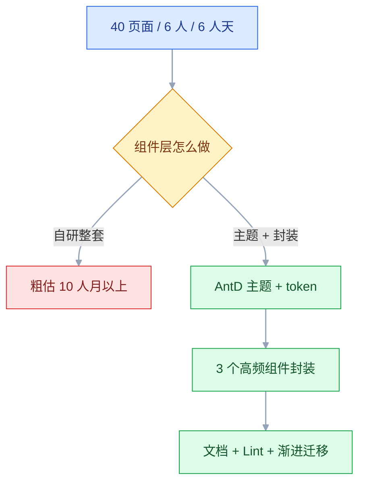
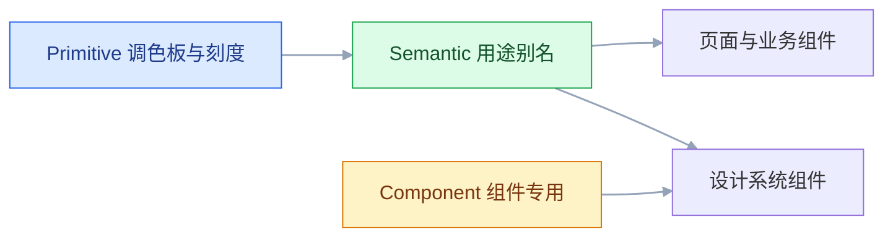

# 设计系统与组件

## 一、工程案例：给 40 个页面的后台建最小设计系统并迁移 3 个核心组件

**场景**：一个 6 人前端团队维护的后台产品，40 多个页面，技术栈是 React + TypeScript + Ant Design（版本以团队和官方当前版本为准），设计侧用 Figma。当前状态：按钮有 7 种样式（3 种圆角、4 种蓝），弹窗有 3 套实现，表格分页有 4 种写法，每开一个新页面都要重新讨论一次标题字号。

**约束**：

- 没有专职的设计系统团队，两个迭代（10 个工作日）里只能挤出约 6 人天
- 业务不能停，40 个页面不可能一次性重写
- 设计侧只有 1 名设计师，Figma 组件库已有，但命名和变体都没有收敛
- 不引入新的组件库，继续用 AntD，只在其上做一层收敛

**目标**：拿到三个可交付的结果——一套能落地的 token、3 个高频组件的统一 API、一条能拦住新增硬编码的 CI 规则。组件数量不是目标。

**交付物**：

1. `tokens/` 下三层 token（JSON 源文件 + 生成的 CSS 变量），每个变量有用途说明
2. 3 个组件的规格页：anatomy、尺寸、状态矩阵、变体表、API 表、do / don't
3. 旧 → 新映射表与例外清单，按批次标注负责人和完成标志
4. 一份验收清单，每条都能由设计或前端当场判定（见 1.7）

### 1.1 第一步：盘点（0.5 人天）

先量化「乱」在哪里，否则做完无法证明收益。

```bash
# 颜色硬编码分布
grep -rhoE '#[0-9a-fA-F]{3,8}' src --include='*.css' --include='*.scss' --include='*.tsx' \
  | tr 'A-F' 'a-f' | sort | uniq -c | sort -rn | head -30

# AntD 组件直接引用量
grep -rn "from 'antd'" src --include='*.tsx' | wc -l
grep -rn "<Button" src --include='*.tsx' | wc -l
grep -rn "<Modal" src --include='*.tsx' | wc -l

# 疑似重复封装
find src \( -iname "*button*" -o -iname "*modal*" -o -iname "*table*" \) -print
```

盘点的产出不是一份长报告，而是三张短表：

| 表 | 记录什么 | 用途 |
|---|---|---|
| 颜色表 | 每个 hex 的出现次数、出现在哪些目录 | 决定哪些值进入 primitive |
| 组件表 | 每个组件的实现文件、调用点数、变体数 | 决定先迁移谁 |
| 例外表 | 无法归并的写法及原因 | 避免「一刀切」改坏业务 |

**先做谁**：调用点最多、变体最乱、出错成本最高的三个。这个案例里是 Button（60 多个调用点）、Modal（12 处）、Table（8 处）。

### 1.2 第二步：定范围（0.5 人天）



**做**：

- token 三层，覆盖颜色、间距、圆角、字号、阴影
- Button、Modal、Table 三个封装组件
- 一份 Storybook 文档，每个变体一个 story
- stylelint 禁止新增 hex 和裸间距

**不做**：

- 不重写 Form、DatePicker、Upload，它们继续直接用 AntD，只把主题变量接过来
- 不做 Figma 组件库重构，只统一命名和变体枚举
- 不做多品牌，先把浅色一套做扎实

> **范围控制的判据**：一个组件如果调用点少于 5 个、且没有明显的样式分歧，就不值得封装。封装的价值来自「统一」，不来自「包一层」。

### 1.3 第三步：token 三层（1 人天）

| 层 | 数量（示例） | 示例 | 允许引用方 |
|---|---|---|---|
| Primitive | 48 | `blue-600`、`gray-100`、`space-4` | 仅 semantic 层 |
| Semantic | 26 | `color-action`、`color-text-secondary`、`surface-raised` | 页面与组件 |
| Component | 18 | `button-bg-primary`、`modal-footer-gap` | 仅对应组件内部 |

数量按项目实际增减，不用照搬。

**硬规则**：

1. 页面和业务组件只能引用 semantic token
2. 组件内部可以引用 semantic 或自己的 component token
3. primitive 不允许出现在业务文件里，`tokens/` 目录自身除外



引用方向只能从上往下：页面看不到 primitive，component token 只服务自己的组件。

最小 DTCG 写法（格式仍在演进，字段以官方当前版本为准）：

```json
{
  "primitive": {
    "$type": "color",
    "blue-600": { "$value": "#2563EB" },
    "gray-50": { "$value": "#F7F8FA" },
    "gray-900": { "$value": "#101828" }
  },
  "semantic": {
    "$type": "color",
    "action": { "$value": "{primitive.blue-600}" },
    "surface-page": { "$value": "{primitive.gray-50}" },
    "text-primary": { "$value": "{primitive.gray-900}" }
  }
}
```

```css
:root {
  --primitive-blue-600: #2563EB;
  --color-action: var(--primitive-blue-600);
  --surface-page: var(--primitive-gray-50);
  --text-primary: var(--primitive-gray-900);
}
```

JSON 按嵌套层级组织，不是字面量里的点号；生成 CSS 时把路径拼成 `--color-action` 这类短名，业务只认短名。

**为什么必须分三层**：换主题时只改语义层的指向，primitive 和组件代码都不动。只有一层 token 时，「蓝色」既是调色板又是用途，深色模式无法只改一部分。

### 1.4 第四步：组件 API（1.5 人天）

三个组件先写接口，再写实现。接口评审比实现评审便宜得多。

**AppButton**

| prop | 取值 | 默认 | 约束 |
|---|---|---|---|
| `variant` | `primary` `secondary` `ghost` `danger` | `secondary` | 不再增加第 5 种 |
| `size` | `sm` `md` `lg` | `md` | 高度 28 / 32 / 40 |
| `loading` | boolean | `false` | 为真时自动禁用点击 |
| `disabled` | boolean | `false` | 不改变布局与尺寸，不触发事件 |
| `block` | boolean | `false` | 宽度 100% |
| `icon` | ReactNode | — | 只有图标时必须同时给 `aria-label` |

**禁止出现在 API 里的东西**：

| 禁止项 | 原因 | 替代 |
|---|---|---|
| `color="#2563EB"` | 绕过 token，换主题失效 | `variant` |
| `hoverStyle` | 交互状态泄漏给调用方 | 组件内部 `:hover` |
| `type="blue"` | 外观命名，改主色后名字说谎 | 语义化 `variant` |
| `width={137}` | 魔法数字，破坏栅格 | `block` 或外层布局 |

**AppModal**

| prop | 取值 | 默认 | 约束 |
|---|---|---|---|
| `open` | boolean | `false` | 受控 |
| `size` | `sm` `md` `lg` | `md` | 宽 480 / 640 / 800 |
| `title` | ReactNode | — | 必填，不用空标题 |
| `footer` | ReactNode \| null | 取消 + 确认 | 自定义时不再叠加默认按钮 |
| `confirmLoading` | boolean | `false` | 确认按钮进入 loading |
| `onOk` | function | — | 封装层在返回 Promise 时置 loading，避免重复提交 |
| `maskClosable` | boolean | `false` | 表单弹窗禁止点遮罩关闭 |

**AppTable**

| prop | 取值 | 默认 | 约束 |
|---|---|---|---|
| `columns` | 列定义 | — | 列宽必须显式或按比例 |
| `dataSource` | 数组 | `[]` | 不在这里做请求 |
| `loading` | boolean | `false` | 用骨架而不是空白 |
| `pagination` | 对象 \| false | 内置 | 每页 20，超过 200 条必须分页 |
| `empty` | ReactNode | 统一空态 | 不传就用默认插画与文案 |
| `toolbar` | ReactNode | — | 搜索、筛选、批量操作 |

**组件 API 的验收标准**：调用方不看源码，只读 prop 表就能选对变体；任意两个 prop 的组合都有明确结果；没有任何 prop 的取值是颜色或像素。

### 1.5 第五步：迁移（1 人天）

一次性全局替换风险太高。按「先新后旧、先易后难」分四批：

| 批次 | 范围 | 动作 | 完成标志 |
|---|---|---|---|
| 0 | 全仓库 | 建 token、接主题、加 lint（warn） | 新代码可用 token |
| 1 | Button 60 处 | codemod 改 import 与 variant | 业务文件里 `<Button` 归零 |
| 2 | Modal 12 处 | 手工改，统一 footer 与宽度 | 业务文件里 `<Modal` 归零 |
| 3 | Table 8 处 | 手工改，补空态与分页 | 业务文件里 `<Table` 归零 |
| 4 | 全仓库 | lint 从 warn 改 error | 新增 hex 直接失败 |

codemod 只做机械替换，语义判断留给人和评审：

```bash
npx jscodeshift -t codemods/button-to-appbutton.ts src --extensions=tsx
```

**迁移期的三条约定**：

- 旧组件保留 `@deprecated` 注释，给出替换写法，不直接删
- 新页面一律用新组件，评审时作为红线
- 每个批次合并后跑一次视觉回归，差异超过阈值就停下来查

> **迁移的真实成本不在改代码，在确认「这个 variant 到底对应哪一个」**。7 种旧按钮映射到 4 种新变体，必然有 2 到 3 处需要产品确认。把这几个例外单独列出来，不要在现场猜。

### 1.6 第六步：治理（0.5 人天）

| 机制 | 具体做法 | 没有会怎样 |
|---|---|---|
| 唯一来源 | 组件只在 `src/components/ui` 维护，业务目录只读 | 出现第二份实现，各自演化 |
| 变更提案 | issue 模板：场景、现状、期望 API、影响面 | 谁声音大谁改，API 失控 |
| 版本语义 | 破坏性变更发 major，给 codemod | 升级时业务不敢动 |
| 废弃策略 | 标记 deprecated，保留 2 个迭代后删除 | 旧组件永久共存 |
| 使用监控 | 每月统计 import 数与 prop 使用率 | 没人用的组件继续维护 |
| 定期评审 | 每季度清理冗余变体与重复组件 | 半年后回到起点 |

**唯一来源是底线**。业务可以提需求、可以提 PR，但不能复制一份改。复制一次，设计系统就分裂成两个。

### 1.7 验收（0.5 人天）

| # | 检查项 | 类型 | 怎么验 | 通过标准 |
|---|---|---|---|---|
| 1 | token 唯一来源 | 工程 | `grep -rnE '#[0-9a-fA-F]{3,8}' src --include='*.tsx' \| grep -v 'src/tokens'` | 输出为 0 |
| 2 | token 命名与覆盖 | 设计 | 抽查 10 个 semantic token | 每个都能一句话说出用途，且没有同义重复 |
| 3 | 按钮收敛 | 工程 | `grep -rn '<Button' src --include='*.tsx' \| grep -v 'src/components/ui'` | 输出为 0 |
| 4 | 弹窗收敛 | 工程 | `grep -rn '<Modal' src --include='*.tsx' \| grep -v 'src/components/ui'` | 输出为 0 |
| 5 | 组件规格页 | 设计 | 对照模板逐项检查 | anatomy、尺寸、状态、变体、do / don't 齐全 |
| 6 | API 契约 | 工程 | `tsc --noEmit`，人工读 d.ts | 无 any，枚举闭合 |
| 7 | 状态覆盖 | 设计 | 打开 Storybook 逐个点 | 4 变体 × 3 尺寸 + loading / disabled |
| 8 | 键盘操作 | 共同 | Tab、Shift+Tab、Esc、Enter | 焦点可见，Esc 关闭，焦点回到触发元素 |
| 9 | 视觉回归 | 工程 | Playwright 截图对比 | 差异都是已声明的预期变更，无意外差异 |
| 10 | 主题切换 | 共同 | 切 `data-theme` 后逐页看 | 无残留硬编码，刷新不闪白 |
| 11 | 新增硬编码 | 工程 | 提一个含 hex 的 PR | CI 失败并给出 token 建议 |
| 12 | 回滚能力 | 工程 | 关闭 feature flag | 旧组件仍可用，页面不崩 |

> 键盘那一项要真的只用键盘走一遍。鼠标点得开、键盘 Tab 不到，是最常见的「看起来能用」。

---

## 二、高频问答：会卡住你的地方，也是面试最常问的

### 2.1 组件做完没人用

**现场**

先算采用率，再做一次找人实验：

```bash
grep -rn "components/ui" src --include='*.tsx' | wc -l
grep -rn "from 'antd'" src --include='*.tsx' | wc -l
```

再找 3 个没用新组件的开发，让他们现场找「危险按钮」该怎么写，记录耗时和卡点；最后看新页面的 PR 里有没有人 review 这件事。

**要点**

- 没人用是采用率问题，不是供给问题；组件越多，选择成本越高，采用率反而更低。
- 真实原因通常是迁移成本高于收益：旧代码没有强制、文档找不到、封装比直接用 AntD 多一层。
- 判断依据是 import 比值加 PR 抽查，不是「大家都说挺好用」。

**追问**

- 继续加组件为什么解决不了？→ 每加一个都多一次选择，采用率反而更低。
- 怎么区分是文档问题还是组件问题？→ 让没参与的人现场找一次，卡在搜索是文档，卡在变体是 API。
- 只在评审时口头要求够吗？→ 不够，口头要求没有拦截力，要写进 PR 检查项。

### 2.2 业务复制一份组件改改

**现场**

```bash
find src \( -iname "*button*" -o -iname "*modal*" \) -print
git log --follow --oneline <文件>
```

对每个文件看首次提交，再把复制出来的差异逐行对比，归类为「样式覆盖」「结构差异」「纯业务逻辑」。

**要点**

- 复制不是纪律问题：「特殊需求」通常是 API 缺一个合法扩展点，比如没有 `footer` 插槽、没有 `size`。
- 前两类差异应该回到组件，只有纯业务逻辑允许留在业务侧。
- 留在业务侧的每一份副本，都是一份会独立演化的第二实现。

**追问**

- 怎么判断是「特殊需求」还是「API 缺失」？→ 看差异是不是 footer 插槽、size 这类通用扩展点。
- 提 PR 太慢也算设计系统的问题吗？→ 算，流程成本会直接推高复制率。
- 已经复制出去的怎么收回？→ 先补扩展点，再标 deprecated，不直接删。

### 2.3 改一个 token，全站样式崩了

**现场**

```bash
git diff tokens/
grep -rn "primitive" src
```

再在 DevTools 里选中出问题的元素，看 computed 值最终来自哪个变量，按变量名反查引用链，跑视觉回归看影响面。

**要点**

- 崩的原因不是值写错，是只看到一个变量、没看到它背后的引用图。
- 常见结构：页面绕过语义层直接引用 primitive，或一个 primitive 被几十个语义别名引用。
- 影响面超过 5 个页面，按主题级变更走评审，不按修 bug 处理。

**追问**

- 为什么改语义层比改 primitive 安全？→ 语义层是用途别名，改指向不动调色板。
- 怎么快速估影响面？→ 反查引用链加视觉回归，两边对不上说明还有硬编码。
- 已经崩了先做什么？→ 回滚 token 提交，再按引用图分批重改。

### 2.4 组件 props 越加越多

**现场**

```bash
grep -c "?:" src/components/ui/AppButton.tsx
grep -rhoE 'variant="[a-z]+"' src | sort | uniq -c
```

数 `interface` 字段、统计每个 prop 的使用次数、枚举实际出现的组合。

**要点**

- prop 是公共接口，每加一个就多一种要长期维护的组合。
- 膨胀来自三处：业务语义塞进基础组件、用布尔开关代替变体、没有定期清理。
- 清理顺序：0 使用直接删，单页面用的移到业务组件，`isXxx` 与 `showXxx` 合并成枚举。

**追问**

- 为什么布尔开关比变体更糟？→ 布尔会两两组合爆炸，变体是闭合枚举。
- 一个 prop 只有一处用，该留吗？→ 移到业务组件，基础组件只留通用能力。
- 怎么防止再膨胀？→ 提案时写清影响面与替代方案，按季度统计使用率。

### 2.5 设计库和代码库版本对不上

**现场**

对比 Figma 库的 changelog 与 `package.json` 版本，导出两边组件清单做 diff；再随机抽 5 个页面，在设计稿里看组件实例名，在代码里搜对应组件，记录对不上的数量。

**要点**

- 对不上是流程问题，不是「开发没更新组件」。
- 根因是 Figma 组件库与 npm 包没有版本绑定，设计加变体、代码删变体，两边都不知道。
- 对不上超过 2 个，说明缺的是版本绑定，不是提醒。

**追问**

- 为什么不靠同步会议解决？→ 人的记忆不能当版本号，会议散了就回到原状。
- 版本绑定具体绑什么？→ 库版本对应组件包版本，changelog 里写清影响面。
- 设计侧删了变体、代码还在，算谁的？→ 算流程缺口，要留 deprecated 过渡而不是直接删。

### 2.6 改了一个默认值，线上视觉变了

**现场**

看 semver 与 changelog，搜索未显式传该 prop 的调用点，跑快照测试。

**要点**

- 默认值是公共接口：调用方不传参时，默认值一变，所有调用点一起变。
- 用「受影响调用点数」判断风险，不是用「代码改动量」。
- 默认值、DOM 结构、CSS 类名、可访问性属性，这四类改动都按破坏性变更处理。

**追问**

- 默认值变更该发什么版本？→ major；确实要渐进就先发 minor，并在 changelog 标注下个 major 切换。
- 为什么快照测试能兜住？→ 它比对渲染结果，默认值变了快照就红。
- 只改一行也算破坏性变更吗？→ 看影响面，不看行数。

### 2.7 新人不用组件，自己写 div

**现场**

让一个没做过该项目的开发在 3 分钟内找「带图标的危险按钮」，记录路径和耗时；再统计原生 `<button>`、`<table>` 的数量。

**要点**

- 这是发现成本问题，不是意愿问题；找不到，就会自己写。
- 三个卡点：组件难找、命名不直观、文档没有搜索入口。
- 新人拿不准该用哪个变体时，会退回最熟悉的原生标签。

**追问**

- 为什么培训解决不了？→ 培训解决「不知道有」，解决不了「三分钟找不到」。
- 组件名带业务词有什么问题？→ 复用范围被锁死在一个业务里，换个场景就搜不到。
- 文档首页该放什么？→ 「我要做 X」的入口，比按字母排的组件目录更好找。

### 2.8 设计稿里把组件「脱离」再改样式

**现场**

在 Figma 里看图层是否还有组件图标；抽查 5 个页面的主按钮，比对圆角、颜色、间距是否仍在 token 内；交付前跑一遍「脱离实例 / 覆盖样式」检查。

**要点**

- 实例上的一次覆盖，落到代码侧就是一处硬编码。
- 原因通常是变体不够用或命名难找，设计师也不知道改实例会切断与库的关联。
- 同名组件在 3 个以上页面出现不同外观，问题在变体覆盖，不在执行。

**追问**

- 覆盖和 detach 有什么区别？→ 覆盖只断一个属性，detach 整份断开、永久不跟随。
- 为什么覆盖会影响代码？→ 开发照着实例的视觉实现，值就只能写死。
- 怎么从源头减少覆盖？→ 把重复出现的覆盖变成变体或变量。

### 2.9 组件升级没有迁移期，业务页面悄悄崩

**现场**

看 `package.json` 版本跨度与 changelog，搜索被删或改名的 prop，跑业务侧类型检查与快照测试。

| 变更 | 版本 | 是否破坏性 |
|---|---|---|
| 新增可选 prop | minor | 否 |
| 修 bug，视觉不变 | patch | 否 |
| 修改默认值 | major | 是，所有未显式传参的调用点都变 |
| 重命名或删除 prop | major | 是，调用点直接编译失败 |
| 修改 DOM 结构 | major | 是，外部样式覆盖与测试选择器失效 |
| 修改 CSS 类名 | major | 是，测试选择器失效 |

**要点**

- 组件包要按公共依赖管理：semver、changelog、codemod 一个都不能少。
- 破坏性变更必须给迁移期：旧写法保留 1 到 2 个迭代，CI 对旧写法告警，到期再移除并发 major。
- 风险看受影响调用点数，不看改动行数；低频但代价高，不能只靠发版说明解决。

**追问**

- 不给迁移期会怎样？→ 业务要么锁死旧版本，要么直接升最新然后页面崩。
- 什么叫给够迁移期？→ 旧写法可用、有 codemod 或迁移文档、到期才发 major。
- 业务为什么宁愿锁版本？→ 升级没有可预期路径，锁死是止损。

### 2.10 键盘和读屏用户用不了

**现场**

只用键盘走完「打开弹窗、填表、提交、关闭」，用 axe DevTools 扫一遍，用读屏听一遍按钮名称。

**要点**

- ARIA 只补语义，不补行为。
- 缺的是焦点管理：弹窗没有焦点陷阱、关闭后焦点没回到触发按钮、自定义控件没有键盘事件。
- 三个动作：打开弹窗后按 Tab 看焦点是否跑到背后页面，按 Esc 看是否关闭，关闭后再按 Tab 看落点。

**追问**

- 为什么补 `aria-label` 不够？→ 名称有了，键盘还是操作不了。
- 焦点陷阱要自己写吗？→ 优先用组件库能力，自己写容易漏 Esc 和焦点归还。
- 焦点环能不能用 `outline: none` 去掉？→ 不能，要去就换成更明显的自定义环。

### 2.11 暗色模式上线后对比度不达标

**现场**

遍历 token 对计算对比度，用 axe 扫暗色页面，再 grep 残留 hex：

```bash
grep -rnE '#[0-9a-fA-F]{6}' src --include='*.css' | grep -v tokens
```

**要点**

- 暗色不是反色，是另一套表面层级加提亮后的强调色。
- 根因三处：语义 token 没有暗色映射、直接对颜色取反、组件硬编码了白底或深色文字。
- 正文至少 4.5:1，大字号至少 3:1；重点查次要文字、禁用态、边框、占位符。

**追问**

- 为什么整体提亮不行？→ 表面层级没重做，提亮只会一起糊。
- 暗色下阴影为什么没用了？→ 深底上几乎不可见，要靠表面亮度和边框分层。
- 禁用态可以不达标吗？→ 可以例外，但不能低到看不见。

### 2.12 组件文档和实现脱节

**现场**

对比 Storybook 的 argTypes 与 TS 类型，把文档里的示例原样粘进沙箱跑一次；看最近 3 次组件变更有没有同时改文档。

**要点**

- 手写文档必然滞后，除非它从代码生成。
- 两个信号：prop 数量与 `interface` 字段数不一致，示例跑不通。
- 文档失效不是写少了，是来源不对。

**追问**

- 怎么让文档不滞后？→ prop 表从类型生成，示例进可运行沙箱。
- 示例跑不通说明什么？→ 已经和当前版本脱节，比缺文档更危险。
- 文档要不要写「不要用」？→ 要，反例最能防止误用。

### 2.13 设计系统做了一版就停滞

**现场**

看仓库最近 3 个月的合并记录、issue 平均响应时间、有没有固定的评审节奏；再问三个问题：谁负责收需求、新需求排到哪个迭代、上一次清理废弃组件是什么时候。

**要点**

- 停滞是结构性的，不是团队执行力不够。
- 缺的是 owner、backlog 和预算：设计系统被当成一次性项目，而不是持续维护的产品。
- 三个问题都答不上来，就不用再往下找原因了。

**追问**

- 为什么做完一版就没动静？→ 没有固定的人接需求、也没有排期。
- 怎么证明它还在维护？→ 看合并记录和响应时间，不看文档写得多全。
- 小团队也必须设 owner 吗？→ 必须有人收需求，可以兼职，但不能没有。

---

## 三、核心知识：从零开始要建立的东西

### 3.1 设计系统的四层结构

| 层 | 产物 | 缺失后果 |
|---|---|---|
| 设计原则 | 几条能用来做取舍的句子 | 每个页面重新争论 |
| Token | 颜色、间距、字号、圆角、阴影的命名值 | 组件改不动，主题做不了 |
| 组件 | 有稳定 API 的复用单元 | 同一 UI 多套实现 |
| 模式与文档 | 组合规则、正反例、迁移说明 | 组件被乱用 |

四层是一种常见划分，不是唯一标准；关键是别跳过 token 直接做组件。四层也不是必须一样重。小团队可以只写三条原则，但不能没有 token；可以只有 10 个组件，但不能没有「什么时候不用」的说明。

> **面试**：常问「设计系统一般分哪几层？」答：设计原则、Token、组件、模式与文档四层，关键是别跳过 token 直接做组件。

### 3.2 组件粒度与复用边界

| 类型 | 复用范围 | 变化频率 | 例子 |
|---|---|---|---|
| 基础组件 | 全产品 | 极低 | Button、Input、Modal |
| 组合组件 | 全产品 | 低 | FormItem、SearchBar、PageHeader |
| 业务组件 | 单产品/单模块 | 中 | UserPicker、OrderStatusTag |
| 页面片段 | 单页面 | 高 | 不抽成组件 |

三个判断问题：

1. 它在两个以上地方出现过吗
2. 它将来会跟着同一批需求一起改吗
3. 它的接口能用一句话说清吗

三个都是「是」才抽。**长得像不等于该合并**：「提交订单」和「发送消息」都是主按钮，但语义不同，强行合并会得到一个带 `scene` 参数的怪物。

原子设计（atoms → molecules → organisms → templates → pages）是另一种切分粒度的心智模型，和上面的四类不是一一对应：它描述组件的组合层级，不负责 token、治理和文档。可以用它讨论「这个卡片该不该再拆」，不必强行把目录改成五层。

### 3.3 组件 API 的命名与收敛

API 是调用方唯一需要理解的部分。命名用语义，不用外观：

| 不推荐 | 推荐 | 原因 |
|---|---|---|
| `type="blue"` | `variant="primary"` | 改主色后名字仍然成立 |
| `type="big"` | `size="lg"` | 尺寸是相对刻度，不是形容词 |
| `isDanger` | `variant="danger"` | 布尔开关会组合爆炸 |
| `customStyle` | 受控的 `className` 或插槽 | 任意样式会绕过规范 |

变体数量要收敛。一个按钮 4 种 variant × 3 种 size 是 12 种，可以接受；再乘 5 种 state 就是 60 种，其中大部分永远不会出现。**状态由组件内部管理，不进入 API**。

```ts
// 变体是闭合枚举，不是字符串
type Variant = 'primary' | 'secondary' | 'ghost' | 'danger'
```

> **面试**：常问「组件的状态（如 hover、disabled）该放进 API 吗？」答：不进 API，状态由组件内部管理，只暴露调用方能决定的 variant、size、disabled 等。

### 3.4 组件状态矩阵

每个交互组件都要把状态画成矩阵，空格子就是将来出问题的地方。

| 状态 | 视觉 | 行为 |
|---|---|---|
| default | 正常 | 可点 |
| hover | 背景加深或变浅 | 可点 |
| active | 更深，可加 1px 位移 | 可点 |
| focus-visible | 焦点环，必须可见 | 显示焦点环，不改变布局 |
| disabled | 降对比，`not-allowed` | 不可点，不触发事件 |
| loading | spinner + 禁用 | 防重复提交 |

Input 还要多四个：filled、readonly、error、success。**error 与 success 不能只靠颜色**，要同时给图标或文案，否则色觉障碍用户无法区分。

```css
.app-button:focus-visible {
  outline: 2px solid var(--color-focus-ring);
  outline-offset: 2px;
}
```

不要用 `outline: none` 清掉焦点环。要改就换成更明显的自定义环。

### 3.5 变体与 props 的对应关系

设计侧的 Variant 属性与代码侧的 prop 要一一对应，但只对齐「调用方决定」的部分。

| 设计属性 | 代码 | 是否暴露 |
|---|---|---|
| Type: Primary / Secondary | `variant` | 是 |
| Size: Small / Medium / Large | `size` | 是 |
| State: Disabled | `disabled` | 是 |
| State: Hover / Focus / Active | 内部样式 | 否 |
| Icon: True / False | `icon` | 是 |

Hover、Focus、Active 不暴露。调用方传 `hoverStyle` 的那一刻，组件就失去了统一性。

### 3.6 组合与插槽边界

组件不可能预测所有内容，所以要留插槽；插槽留得太多，调用方就能绕过规范。

| 方式 | 适合 | 风险 |
|---|---|---|
| `children` | 文本、图标等内容 | 低 |
| 命名插槽（`footer`、`toolbar`） | 结构固定、局部可变 | 中 |
| `renderXxx` 函数 | 需要调用方控制渲染 | 中高 |
| 直接传 `className` + `style` | 极端例外 | 高，容易变成事实上的新组件 |

**判断标准**：插槽改变的是「内容」还是「结构」。改内容可以开放，改结构要慎重；开放结构等于把组件拆回散件。

表单类组件还要在受控与非受控之间选一种：受控由外部 `value + onChange` 驱动，适合联动和校验；非受控只给 `defaultValue`，适合一次性输入。两种都支持时，必须写清切换条件，否则行为会跳。

### 3.7 间距、圆角与阴影的刻度

设计系统里最容易被随手写的三个值。先定刻度，再允许例外。

| token | 值 | 典型用途 |
|---|---|---|
| `space-1` | 4 | 图标与文字、紧凑标签 |
| `space-2` | 8 | 控件内边距、按钮组 |
| `space-3` | 12 | 表单行内、卡片内容 |
| `space-4` | 16 | 卡片内边距、区块内 |
| `space-6` | 24 | 区块之间 |
| `space-8` | 32 | 页面大区块 |

- 以 4 或 8 为基数，所有间距从刻度里选；出现 10、14、18 这类值，先问是不是刻度不够，而不是直接加一个。
- 圆角控制在 3 到 4 档（如 2 / 4 / 8 / 12），同一类元素只用一个。
- 阴影分 3 档：卡片、浮层、弹窗。阴影只表达层级，不做装饰；暗色模式下阴影几乎不可见，要靠边框和表面色区分。

### 3.8 字体层级与排版刻度

| 层级 | 用途 | 字号 / 行高 | 字重 |
|---|---|---|---|
| H1 | 页面标题 | 24 / 32 | 600 |
| H2 | 区块标题 | 20 / 28 | 600 |
| H3 | 卡片标题 | 16 / 24 | 600 |
| Body | 正文 | 14 / 22 | 400 |
| Caption | 辅助说明 | 12 / 18 | 400 |

- 层级控制在 5 到 6 级。层级不只靠字号，字重和上下间距一起变。
- 后台正文常用 14，行高约为字号的 1.5 倍；正文不要小于 12。
- 交付给前端的是「字号 / 行高 / 字重」三件套，不是一句「大一点」。

### 3.9 色彩系统与语义映射

| 组 | 用途 | 最少档位 | 注意 |
|---|---|---|---|
| 中性 | 文字、表面、边框 | 50 / 100 / 300 / 500 / 700 / 900 | 文字与表面成对验证对比度 |
| 品牌 | 主操作、选中 | 50 / 100 / 500 / 600 / 700 | 600 作主色、700 作 hover 是常见起点 |
| 功能 | 成功、警告、危险、信息 | 各 3 档：浅底 / 主色 / 深字 | 不能只靠色相区分状态 |

- 命名按用途，不按颜色：`color-action` 而不是 `blue-600`；`color-text-secondary` 而不是 `gray-500`。
- 每个语义色都要有对应的表面色和文字色，否则暗色模式只能临时补。
- 对比度按 WCAG AA：正文 4.5:1，大字号 3:1；禁用态可以例外，但不能低到看不见。

> **面试**：常问「无障碍对比度要求是多少？」答：按 WCAG AA，正文至少 4.5:1，大字号至少 3:1，禁用态可例外但也不能低到看不见。

### 3.10 栅格、断点与响应式

| 断点 | 宽度 | 列数 | 间距 | 内容宽度 |
|---|---|---|---|---|
| sm | < 768 | 4 | 16 | 流式 |
| md | 768–1023 | 8 | 24 | 720 |
| lg | 1024–1439 | 12 | 24 | 960 |
| xl | ≥ 1440 | 12 | 24 | 1200 |

- 后台常用 12 列、24 间距；断点按内容开始拥挤的位置定，不按设备型号定。
- 先设计 1440 和 768 两个宽度，再看中间和更窄的情况；不要为每个尺寸单独画一套。
- 表格、筛选栏、弹窗是后台最容易在窄屏崩的三处，交付时单独说明折叠规则。

### 3.11 组件文档的最小结构

| 部分 | 内容 | 省略的后果 |
|---|---|---|
| 用途 | 一句话说明什么时候用 | 开发凭感觉选 |
| 不要用 | 明确反例 | 用弹窗做页面、用卡片做表格 |
| 变体 | 所有 variant 与 size 的视觉 | 不知道有哪种 |
| 状态 | hover、focus、disabled、loading、error | 上线才发现缺 |
| 代码 | 可直接复制的示例 | 复制到一半跑不通 |
| 无障碍 | 键盘、ARIA、对比度 | 上线被投诉 |
| 变更 | 版本、破坏性、迁移写法 | 升级时不敢动 |

「不要用」这一栏最容易被省，但最能防止误用。比如：Button 不用于页面跳转、不用于危险操作的唯一确认、不用于超过 6 个字的文案。

### 3.12 治理机制与唯一来源

| 机制 | 作用 |
|---|---|
| 唯一来源 | 组件只在一处维护，业务只读 |
| 提案模板 | 场景、现状、期望 API、影响面、替代方案 |
| 评审 | 设计 + 前端 + 无障碍，三方看不同维度 |
| 版本 | 语义化版本 + changelog |
| 废弃 | 标记、过渡、删除三步走 |
| 监控 | import 数、prop 使用率、复制文件数 |
| 节奏 | 每季度清理一次 |

**唯一来源不是「代码放在一个目录」**，而是「业务没有修改权，只有提案权」。业务能直接改，就会有第二份。

### 3.13 度量指标与计算口径

| 指标 | 计算方式 | 怎么用 |
|---|---|---|
| 组件覆盖率 | 使用设计系统组件的元素数 / 页面元素总数 | 与上季度基线比，不追绝对值 |
| 重复实现率 | 同一 UI 的实现文件数 | 大于 1 就进清理清单 |
| 新页面搭建时间 | 从拿到设计到可联调的工时 | 用同类页面前后对比 |
| 视觉缺陷数 | 走查中「与规范不符」的条数 | 按轮次统计，看趋势 |
| 采用率 | 使用组件库的团队数 / 总团队数 | 先看未采用原因，不设统一阈值 |

指标要能自动化采集，否则半年后就没人填。**最能说明收益的是同类标准列表页的交付时间对比**，用你们自己的前后数据，不要套行业数字。

### 3.14 适用门槛与现成库策略

| 情况 | 建议 |
|---|---|
| 1 个产品、1 名设计师 | 用 AntD 或 shadcn，只做主题定制 |
| 团队少于 5 人 | 同上，不要自研整套 |
| 产品还在探索期 | 先别做，做了就是负债 |
| 多产品、多团队、长期维护 | 必须做，但可以从 token 和 3 个组件起步 |

落地路径三选一：纯现成库加主题变量，适合快速起步；现成库外加封装层统一 API，适合大多数团队；token 到组件完全自建，只适合有明确差异化需求的团队。封装层的价值是换底层库时业务不动，代价是多一层维护，**没有明确收益时不要加**。具体库的版本与 API 以官方当前版本为准。

### 3.15 无障碍基线

| 项 | 要求 | 检查 |
|---|---|---|
| 键盘 | 所有交互都能 Tab 到并操作 | 只用键盘走一遍 |
| 焦点可见 | 不能 `outline: none` | 看焦点环 |
| 焦点管理 | 弹窗打开时锁焦点，关闭后归还 | Tab 循环、Esc 关闭 |
| 名称 | 图标按钮必须有可读名称 | 读屏听一遍 |
| 对比度 | 正文 4.5:1，大字 3:1 | axe 或对比度脚本 |
| 动效 | 尊重 `prefers-reduced-motion` | 系统开启减弱动效 |

无障碍是组件级责任，不是页面级。组件做对了，页面自然对；组件漏了，每个页面都要补一遍。

### 3.16 多主题与密度模式

主题切换靠语义 token 换指向，不靠 JS 改每个组件的样式：

```css
:root {
  --surface-page: var(--primitive-gray-50);
  --text-primary: var(--primitive-gray-900);
}

[data-theme="dark"] {
  --surface-page: var(--primitive-gray-950);
  --text-primary: var(--primitive-gray-100);
}
```

密度是另一个维度，用 `data-density` 控制间距和行高，不要和主题混在一个选择器里：

```css
[data-density="compact"] {
  --control-height-md: 28px;
  --button-padding-x: 12px;
}
```

两个维度分开，组合数是相乘而不是写死。再加品牌，就是三个正交维度；每加一个维度都写一套完整样式，维护量会指数增长。

> **面试**：常问「暗色模式怎么实现？」答：靠语义 token 换指向（如 data-theme 覆盖 --surface-page 等变量），不靠 JS 改每个组件的样式。

---

## 四、冷门知识汇总

| 知识点 | 为什么冷门 | 用到时的关键词 |
|---|---|---|
| 组件的「禁止事项」文档 | 大家默认写用法，反例被认为不重要 | 不要用、反模式、误用 |
| 默认宽度策略 | 文档很少写，调用方靠试 | `block`、`width: 100%` |
| 空态、无结果、无权限 | 常被做成同一个空页面 | empty state、no result、403 |
| 焦点陷阱 | 鼠标用户永远遇不到 | focus trap、Tab 循环 |
| 焦点归还 | 弹窗关掉后焦点丢失 | return focus、触发元素 |
| 焦点环被裁剪 | 容器 `overflow: hidden` 时才出现 | `overflow`、`outline-offset` |
| 滚动条占位 | 内容多少变化时布局跳动 | `scrollbar-gutter: stable` |
| 字体回退与字重缺失 | 只在没装指定字体时暴露 | `font-family`、`font-display`、fallback |
| 等宽数字 | 表格数字跳动时才发现 | `tabular-nums`、`font-variant-numeric` |
| 自动填充样式 | 浏览器把输入框染黄才看到 | `:-webkit-autofill`、`box-shadow` |
| 多行截断 | 单行省略够用时不会想到 | `line-clamp`、`-webkit-line-clamp` |
| 图标光学对齐 | 几何对齐看起来仍然偏 | optical alignment、视觉重心 |
| 切图倍率 | 只在导出时被追问 | 1x / 2x / 3x、`@2x`、SVG |
| 样式覆盖顺序 | 小项目用全局 CSS 也能跑 | `@layer`、specificity |
| 组件 i18n | 文案写死时没人觉得是问题 | 文案 props、格式化 |
| RTL 逻辑属性 | 只有出海项目会遇到 | `margin-inline-start` |
| 主题闪烁 | 本地开发快，生产才明显 | FOUC、阻塞脚本 |
| 组件坟场 | 没人统计就看不见 | 使用率、下线 |
| 骨架屏组件化 | 每个页面重写一遍 | skeleton、loading placeholder |
| 错误边界 | 单组件崩溃拖垮整页才发现 | Error Boundary |
