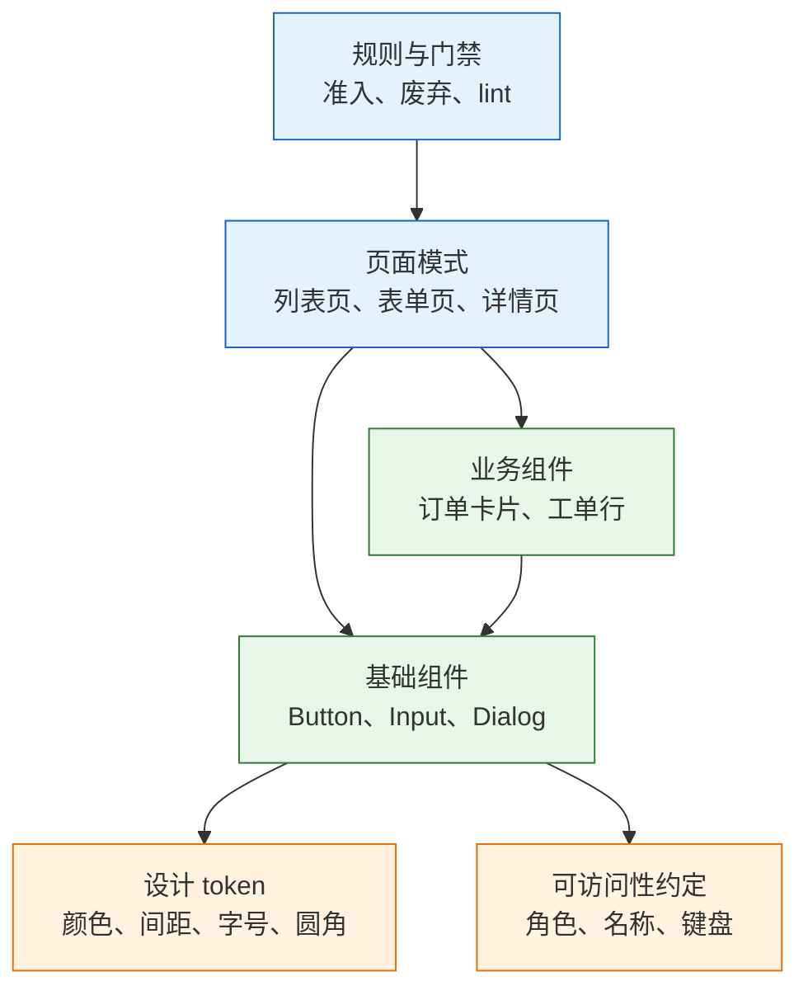
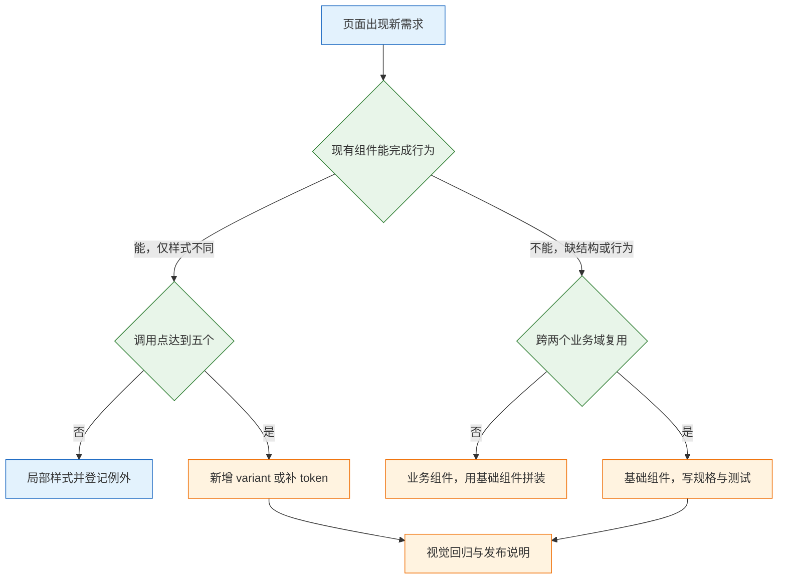
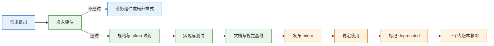

# 设计系统与组件

---

## 一、设计系统是什么

### 1.1 核心概念

设计系统（Design System）是组织在多个页面、多个终端、多个团队之间复用界面决策的机制。它由四类资产构成：决定取值的设计 token、封装单个交互单元的组件、描述一类页面骨架的组合模式、约束使用边界的规则。四类资产回答不同层级的问题，缺一层就会出现“组件很多、页面仍然各写一套”的局面。

设计系统的核心不是组件数量，而是决策收敛。同一个“主操作按钮用什么颜色、按下后什么反馈、加载时宽度是否变化”的问题，只允许被决策一次，之后由资产承载，页面只做选择。判断团队是否真的拥有设计系统，看的是新增页面时还需要重新讨论多少视觉与交互细节，而不是组件目录有多长。

设计系统与组件库、UI 框架、样式指南经常被混用，边界需要先划清。

| 概念 | 覆盖范围 | 是否包含规则 | 典型产物 |
|---|---|---|---|
| 组件库 | 单个交互单元的实现 | 部分 | Button、Input、Dialog |
| UI 框架 | 通用组件与主题能力 | 弱 | Ant Design、MUI |
| 样式指南 | 颜色、字体、间距约定 | 是 | 品牌手册、规范文档 |
| 设计系统 | 资产、规则与治理流程 | 是 | token、组件、模式、门禁 |

组件库是设计系统的实现部分，不是全部。引入成熟 UI 框架可以省掉基础组件的开发，但不会自动带来命名规则、变体准入、废弃机制和页面模式，这些仍要由团队建立。样式指南停留在文档层面，没有代码载体，也无法阻止页面绕过它。

设计系统的收益可以用三个可观测指标衡量：新页面新增的硬编码样式数量、同一交互的重复实现数量、组件升级引发的页面回归数量。三个指标都应随时间下降。如果组件数量上升而这三个指标不降，说明系统只在生产资产，没有生产约束。

### 1.2 适用场景与边界

设计系统适合具备持续迭代预期的产品：页面数量超过二十个、终端超过一种、前端人数超过三人、存在多品牌或多租户换肤需求。这些条件下，重复决策的成本开始高于资产维护的成本，系统才有正收益。

不适用或应暂缓的场景同样明确。一次性活动页、原型验证、页面总数个位数的内部工具，建立完整设计系统的投入收不回来，此时用成熟 UI 框架加一层薄 token 即可。团队没有稳定的组件维护者时，强行上三层 token 和组件门禁，结果是规范写完就过期。

| 场景 | 建议程度 | 理由 |
|---|---|---|
| 多页面后台，长期迭代 | 完整建设 | 复用频次高，收敛收益明确 |
| 多端产品（Web 与移动） | 完整建设 | token 需要跨端生成 |
| 多品牌或多租户 | 完整建设 | 主题维度必须正交 |
| 单页活动、临时原型 | 只用框架 | 维护成本高于收益 |
| 三人以下前端团队 | 简化两层 | 组件 API 尚不稳定 |
| 强定制视觉品牌 | 先 token 后组件 | 视觉差异集中在值层 |

边界有三条。第一，设计系统不替代产品设计，它约束表达方式，不决定信息架构和业务流程。第二，设计系统不替代业务组件，跨业务域复用的才进基础层，单一业务的组合应留在业务目录。第三，设计系统不承诺像素级一致，它承诺同一语义在同一主题下取同一个值、同一交互在同一组件下走同一套行为。

> **注意**：把设计系统当成“一次性组件库交付”是最常见的定位错误。交付完成即无人维护，半年后组件版本停在旧框架上，页面开始绕开组件直写样式，系统事实性死亡。

### 1.3 架构组成

设计系统按“值、单元、骨架、约束”四层组织。值层是 token，单元层是基础组件，骨架层是页面模式，约束层是规则与门禁。上层依赖下层，反向不成立。



| 层 | 主要内容 | 维护方 | 变更影响面 |
|---|---|---|---|
| 值层 | 颜色、间距、字号、圆角、时长 | 设计系统与前端 | 全局 |
| 单元层 | 基础组件的结构、状态、API | 组件库 | 多页面 |
| 骨架层 | 页面模式与区块编排 | 设计与前端 | 单类页面 |
| 约束层 | 命名、准入、门禁、废弃 | 全员遵守 | 全流程 |

四层之间存在明确的引用方向：页面模式引用基础组件，基础组件引用 token，规则约束前三层的使用方式。业务组件允许引用基础组件和 token，但不允许被基础组件反向引用，否则基础层会绑定具体业务，换一个业务域就失效。

架构落地需要三个物理载体：一份 token 源文件与生成产物、一个组件包与文档站点、一份规则清单与自动化检查配置。三者分别对应值、单元、约束。缺少任何一个，系统都只能停留在文档层面，无法在提交阶段拦住偏差。

---

## 二、设计系统的分层模型

### 2.1 资产分层与职责

四类资产各自有明确的产出物和消费方。分层的目的不是分类好看，而是让变更的影响面可预测：改一个 primitive 值影响所有主题，改一个组件内部间距只影响该组件，改一条页面模式只影响同类页面。

| 资产 | 回答的问题 | 产出物 | 主要消费方 |
|---|---|---|---|
| Token | 值是多少 | JSON 源文件与生成产物 | 组件、页面、多端 |
| 基础组件 | 单个交互单元如何表现 | 组件包与规格页 | 页面与业务组件 |
| 组合模式 | 一类页面如何搭建 | 骨架模板与示例 | 页面开发 |
| 规则 | 何时允许、何时禁止 | 检查配置与评审项 | 全体成员 |

资产分层与组织分工不必一一对应，但责任必须落到人。token 由设计系统负责人和前端负责人共同维护，基础组件由组件库维护者负责，组合模式由设计负责人与前端架构共同确认，规则由技术负责人签字后进入流水线。没有明确责任人的资产，会在第一次排期紧张时被绕过。

分层还决定了评审方式。token 变更评审看引用表和对比度，组件变更评审看 API 与状态矩阵，模式变更评审看信息层级与任务路径，规则变更评审看误报率和迁移窗口。用同一套评审标准对待四类资产，会导致该严的地方松、该快的地方慢。

### 2.2 组件与页面模式

组件解决单个交互单元，页面模式解决一类页面的骨架。只沉淀组件不做模式，每个新页面仍要重新决定标题放哪、主操作放哪、空态怎么给，一致性会在页面层重新流失。

| 模式 | 骨架 | 必须回答 | 常见错误 |
|---|---|---|---|
| 列表页 | 标题、筛选、工具栏、表格、分页 | 当前条件、选中数量、空态 | 筛选条件不写进 URL |
| 表单页 | 标题、分组字段、错误汇总、底部操作 | 必填项、失败位置、能否暂存 | 主操作跟随内容滚走 |
| 详情页 | 标题、状态、主信息、关联信息、操作 | 当前状态可做什么 | 字段平铺，没有层级 |
| 设置页 | 分组导航、表单、保存条 | 改动何时生效、如何恢复 | 自动保存没有反馈 |

模式的准入条件很明确：同一种骨架在三个以上页面重复出现，且差异只在内容。只有一页就抽象，通常会抽象错；差异很大还硬套，会把业务塞进模板。模式的数量应少于组件数量，一个产品通常五到八种页面模式足够覆盖绝大多数场景。

模式与组件的关系是编排关系，不是继承关系。列表页模式使用表格、筛选器、分页器和空态组件，但它不继承表格的能力；表格升级不会自动改变列表页的编排，列表页也不应把业务字段写进模式定义。

### 2.3 分层边界的判断

分层争议集中在“这个组件该放基础层还是业务层”。判断依据是复用范围和语义归属，不是代码行数。

| 判断项 | 归基础层 | 归业务层 |
|---|---|---|
| 复用范围 | 跨两个以上业务域 | 单一业务域 |
| 语义 | 通用交互，如选择、输入、确认 | 含业务字段，如订单号、工单状态 |
| 依赖 | 只依赖 token 与通用工具 | 依赖业务接口或领域模型 |
| 变更节奏 | 随设计系统版本发布 | 随业务需求迭代 |

一个组件只要出现业务名词，就应留在业务层。`<OrderStatusTag>` 属于业务组件，它内部可以使用基础层的 `<Tag>`；反过来把 `orderStatus` 做成 `<Tag>` 的 prop，基础层就被业务污染，下一个业务无法复用。

边界判断还要考虑变更节奏。基础组件的发布周期通常按周或按月，业务组件的发布跟随需求。如果把高频变动的业务组合放进基础层，基础层会被迫高频发版，版本语义随之失效。

---

## 三、命名与准入规则

### 3.1 组件命名规则

组件名是公共接口的一部分，命名混乱会让调用方无法预测行为。规则可以压缩为四条：用名词或名词短语、用领域通用词、不携带样式描述、不携带业务字段。

| 名称 | 评价 | 原因 |
|---|---|---|
| `Button` | 采用 | 通用交互单元，语义稳定 |
| `PrimaryButton` | 不采用 | 把变体写进组件名，变体扩张后失效 |
| `BlueButton` | 不采用 | 用视觉值命名，换主题即错 |
| `OrderSubmitButton` | 不采用 | 业务语义应留在页面 |
| `DataTable` | 采用 | 描述结构与用途，不绑定业务 |
| `Dialog` | 采用 | 通用浮层，行为边界清楚 |

变体命名同样需要规则。变体名描述语义强度或用途，不描述颜色和尺寸。`primary`、`secondary`、`ghost`、`danger` 表达的是操作层级，`blue`、`large` 表达的是外观，后者一旦换主题或改密度就会失真。

### 3.2 变体枚举规则

组件 API 最容易失控的地方是把状态、业务结果和视觉差异全部塞进 `variant`。正确做法是先区分四类属性，再决定哪些进 props。

| 类别 | 谁决定 | 示例 | 是否进 props |
|---|---|---|---|
| variant | 调用方按语义选择 | `primary`、`secondary`、`danger` | 是 |
| size | 调用方按密度选择 | `sm`、`md`、`lg` | 是 |
| state | 交互过程产生 | hover、focus、active、disabled | 多数内部处理 |
| status | 业务结果 | error、success、warning | 是，且必须带文案 |

规则有五条。第一，状态不要做成 variant，`ButtonHover` 这类组件一定会在升级时漏掉，hover 应由 CSS 状态驱动。第二，`disabled` 可以由调用方传入，但禁用原因要能显示，不能只把按钮灰掉。第三，`loading` 必须进 props，因为它改变可交互性，也可能改变布局宽度。第四，业务概念不进基础组件，`projectStatus` 这类属性属于业务层。第五，变体数量设上限，超过上限先合并语义，再考虑新增。

> **注意**：变体数量增长的根源通常不是需求多，而是缺少“就近表达”的手段。调用方想调整一处间距就要求新增 variant，正确出口是 token 覆盖或 slot，而不是继续扩张枚举。

### 3.3 封装准入的量化标准

不是所有重复都值得封装。封装前用三项硬指标过滤：调用点数量、行为复杂度、差异稳定性。三项至少满足两项才进入基础层，只满足一项的留在页面或业务层。

| 指标 | 阈值 | 不满足时的处理 |
|---|---|---|
| 调用点 | 五个以上且持续增加 | 局部样式加例外登记 |
| 行为复杂度 | 含键盘、焦点、异步或校验 | 用基础组件拼装 |
| 差异稳定性 | 差异可用有限枚举表达 | 保留独立实现，观察一季度 |
| 业务跨度 | 跨两个以上业务域 | 放业务目录 |



“先包一层以后好改”通常不成立。包一层但不定义 API，等于把混乱挪了个位置；调用方仍然要传样式覆盖，维护者仍然无法判断哪些用法该支持。封装的前提是能写出稳定的 props、状态和 slot，写不出来就说明还没到抽象时机。

---

## 四、组件 API 的实现

### 4.1 属性语义分层

组件 API 的设计目标是让调用方表达意图，而不是描述实现。调用方说“这是主操作”，组件决定主操作在当前主题下的颜色、圆角、内边距和焦点样式；调用方说“这里用 16 像素”，组件就被降级成样式容器。

| 层次 | 调用方表达 | 组件负责 | 反例 |
|---|---|---|---|
| 语义 | 主操作、次操作、危险操作 | 视觉映射与状态 | `color="#2563EB"` |
| 密度 | 紧凑、标准、宽松 | 高度、内边距、字号 | `height={32}` |
| 内容 | 文案、图标、加载文案 | 排布、截断、无障碍名称 | 直接传 HTML 结构 |
| 行为 | 点击、确认、取消 | 键盘、焦点、重复提交 | 页面自行绑定 Esc |

props 的命名也应遵循同一逻辑。`variant` 表达语义，`size` 表达密度，`disabled` 与 `loading` 表达状态，`onClick` 表达行为。出现 `style`、`className` 透传时要有明确边界：允许调整外边距等外部布局，不允许改内部颜色和字体，否则 token 与主题会被绕过。

### 4.2 Slot 组合与布尔属性

布尔属性是组件 API 膨胀的主要来源。每增加一个 `hasXxx`，组合状态就翻一倍，测试矩阵随之失控。

```tsx
// 不采用：每增加一种内容就增加一个布尔属性
<Card hasIcon hasFooter hasBadge hasAction />

// 采用：结构由调用方组合，组件只负责间距与边界
<Card>
  <Card.Header title="工单 #20481" status={<StatusTag status="processing" />} />
  <Card.Body>打印机离线，已派给客服一组。</Card.Body>
  <Card.Footer>
    <Button variant="secondary">查看详情</Button>
  </Card.Footer>
</Card>
```

布尔越多，组合越不可预测；slot 把“放什么”交给页面，把“怎么排”留在组件。使用 slot 时仍要固定结构语义：`Card.Header` 负责标题与状态的排布，`Card.Body` 负责内容区 padding，`Card.Footer` 负责操作对齐。调用方可以决定是否放某个 slot，但不能改变 slot 的职责。

> **注意**：slot 不是把内部结构全部暴露。子组件应只暴露必要的容器与语义节点，内部 DOM 顺序和 class 名不构成公开契约，否则升级时仍会破坏页面。

### 4.3 状态与可访问性

组件的状态矩阵必须在规格阶段列全，不能等页面用到才补。常见状态包括默认、hover、focus-visible、active、disabled、loading、error、read-only，不同组件取子集。

| 状态 | 触发条件 | 实现责任 | 常见遗漏 |
|---|---|---|---|
| hover | 指针悬停 | 组件样式 | 触屏上被当成第一次点击 |
| focus-visible | 键盘聚焦 | 组件样式 | 被容器 `overflow: hidden` 裁掉 |
| disabled | 调用方传入 | 组件属性 | 只灰化，无法说明原因 |
| loading | 异步进行中 | 组件属性 | 宽度塌陷，重复提交 |
| error | 校验失败 | 调用方与组件 | 只变红，没有文案 |
| read-only | 有值但不可改 | 组件属性 | 与 disabled 视觉混淆 |

可访问性不是附加项，而是组件行为的一部分。按钮必须渲染为 `button` 元素或具备等价角色，图标按钮必须有可访问名称，弹窗必须把焦点移入并在关闭后归还，下拉必须支持方向键与 Esc。把这些行为留给页面实现，等于每个页面都要重新做一遍，且大概率做漏。

> **设计红线**：焦点可见性、键盘可达性、错误文案关联三项不得由调用方自行补齐。组件不提供这些能力时，不允许进入基础层；已经进入的，按缺陷处理，而不是按需求排期。

---

## 五、组件规格模板与完整示例

### 5.1 规格模板

规格页是组件从设计走向代码的中间产物。它必须细到前端可以直接实现、测试可以直接写用例，而不是只放几张效果图。

| 项 | 内容 | 缺失后果 |
|---|---|---|
| 用途 | 何时使用、何时不使用 | 同类场景各选一个 |
| 结构 | 容器、图标、文字、间距、最小宽高 | 每个页面高度不同 |
| 变体 | 有限枚举与每个变体的语义 | 出现 `type1`、`type2` |
| 状态 | 默认、hover、focus、active、disabled、loading、error | 上线才发现缺态 |
| 内容边界 | 超长、空值、数字、国际化 | 长文案撑破按钮 |
| 可访问性 | 角色、名称、键盘行为、焦点顺序 | 键盘用户无法到达 |

模板可以固定为六段文字加一张 token 映射表。六段分别是用途、结构、变体、状态、内容边界、可访问性；token 映射表列出组件部位与语义 token 的对应关系，供实现和主题覆盖使用。

### 5.2 Button 完整规格

以下规格可以直接作为模板套用，数值按项目 token 调整，结构不变。

```text
用途：触发即时操作。主操作每屏最多一个；危险操作必须二次确认。
结构：容器 + 可选前置图标 + 文案 + 可选后置图标；图标 16，图标与文字间距 8。
高度：sm 28 / md 32 / lg 40；左右内边距 12 / 16 / 20。
圆角：radius-sm；字号 13 / 14 / 16，字重 500，行高 1.4。
变体：primary 实心主色；secondary 描边；ghost 无底；danger 实心危险色。
状态：默认、hover、focus-visible、active、disabled、loading。
禁用：去饱和且不可点，必须能说明原因；不要只降低透明度。
加载：保留原宽，文案换为处理中，禁用重复点击；超过 10 秒给可取消入口。
焦点：2px 外描边，offset 2px，不得被父容器裁切。
内容边界：单行不换行，超长省略并提供 title；纯图标必须有可访问名称。
可访问性：原生 button；Enter 与 Space 均触发；禁用时使用原生 disabled 属性，不用样式模拟。
```

对应的 token 映射如下。组件只引用语义 token，不直接引用原始色阶。

| 部位 | 语义 token | 说明 |
|---|---|---|
| 背景 | `semantic.color.action` | 随主题与品牌变化 |
| 文字 | `semantic.color.on-action` | 与背景成对定义 |
| 边框 | `semantic.color.border-strong` | 仅 secondary 使用 |
| 圆角 | `semantic.radius.control` | 与输入框统一 |
| 内边距 | `semantic.space.control-inline` | 随密度切换 |
| 焦点环 | `semantic.color.focus-ring` | 高对比模式下单独覆盖 |
| 危险背景 | `semantic.color.danger` | 不与主色共用 |

### 5.3 表格组件的封装边界

表格是设计系统里最容易封过头的组件。封得太浅，每个页面重写排序和空态；封得太深，业务请求和列渲染被绑死，第二个页面就绕开它。

| 需求 | 是否进表格组件 | 边界说明 |
|---|---|---|
| 表头、行高、分割线、空态 | 进 | 所有表格保持一致 |
| 排序、分页、加载 | 进 | 行为统一，状态由组件管理 |
| 列宽策略 | 部分进 | 提供默认值与覆盖口 |
| 业务列渲染 | 不进 | 页面通过 columns 配置 |
| 行内操作 | 不进 | 用 render 或 slot |
| 批量选择 | 部分进 | 提供选择状态，不绑定接口 |

可用边界是：表格负责“如何显示与交互”，页面负责“显示什么、点击后做什么”。把接口请求封进表格，第一次很快，第二个页面就会因为参数不同而绕开；把业务列写死，字段一变就要改组件版本。

### 5.4 规格落地为代码

规格进入代码后，组件内部只消费语义 token，主题切换由变量完成。

```tsx
type ButtonProps = {
  variant?: 'primary' | 'secondary' | 'ghost' | 'danger';
  size?: 'sm' | 'md' | 'lg';
  loading?: boolean;
  disabled?: boolean;
  icon?: React.ReactNode;
  children: React.ReactNode;
  onClick?: () => void;
};

export function Button({
  variant = 'primary',
  size = 'md',
  loading = false,
  disabled = false,
  icon,
  children,
  onClick,
}: ButtonProps) {
  const inert = disabled || loading;
  return (
    <button
      type="button"
      className={`btn btn--${variant} btn--${size}`}
      disabled={inert}
      aria-busy={loading || undefined}
      onClick={inert ? undefined : onClick}
    >
      {icon && <span className="btn__icon" aria-hidden="true">{icon}</span>}
      <span className="btn__label">
        <span className={loading ? 'btn__label-ghost' : undefined}>{children}</span>
        {loading && <span className="btn__label-loading">处理中</span>}
      </span>
    </button>
  );
}
```

```css
.btn {
  display: inline-flex;
  align-items: center;
  justify-content: center;
  gap: var(--space-2);
  min-width: var(--control-min-width);
  border-radius: var(--radius-control);
  font-weight: 500;
  line-height: 1.4;
  white-space: nowrap;
}
.btn__label {
  display: inline-grid;
}
.btn__label > * {
  grid-area: 1 / 1;
}
.btn__label-ghost {
  visibility: hidden;
}
.btn__label-loading {
  justify-self: center;
}
.btn--sm { height: var(--control-height-sm); padding: 0 var(--space-3); font-size: 13px; }
.btn--md { height: var(--control-height-md); padding: 0 var(--space-4); font-size: 14px; }
.btn--lg { height: var(--control-height-lg); padding: 0 var(--space-5); font-size: 16px; }
.btn--primary { background: var(--color-action); color: var(--color-on-action); }
.btn--danger { background: var(--color-danger); color: var(--color-on-danger); }
.btn:focus-visible { outline: 2px solid var(--color-focus-ring); outline-offset: 2px; }
.btn:disabled { cursor: not-allowed; opacity: 0.5; filter: saturate(0.4); }
```

示例中的类名与变量名只是命名示例，落地时以项目约定为准。关键是三点：尺寸与间距全部来自 token，状态由组件统一处理，业务文案由调用方传入。

> **设计红线**：组件与页面不得写死颜色、阴影和圆角值，也不得直接引用原始色阶。主题切换只允许通过语义 token 生效；在组件内部写死主题值，会让深色模式出现残留色块，且无法被对比度校验覆盖。

---

## 六、治理机制

### 6.1 落地阶段与门禁

设计系统落地按“盘点、收敛、建 API、迁移、门禁、退出”六步推进。顺序不能颠倒，尤其是门禁必须晚于迁移，否则存量代码会立刻大面积失败。

| 阶段 | 动作 | 完成标志 |
|---|---|---|
| 盘点 | 统计调用点、变体数、重复实现 | 得到“谁最多、谁最乱”的清单 |
| 收敛 | 合并近似变体，删除未使用变体 | 每个组件变体可枚举 |
| 建 API | 写 props、默认值、状态、slot | 规格页可直接实现 |
| 迁移 | 按调用点从多到少替换 | 旧实现调用点持续下降 |
| 门禁 | lint 禁止新增硬编码与旧组件 | 新代码无法回潮 |
| 退出 | 标记 deprecated，给替代与期限 | 旧组件有删除日期 |

迁移不要一次铺满。先做调用点最多、状态最乱的一个组件，用它验证 API；API 稳定后再批量替换。组件 API 没稳定就铺页面，返工量会翻倍。

门禁要能自动执行，且分目录设置强度：

```json
{
  "rules": {
    "color-no-hex": true,
    "selector-max-specificity": "0,3,0",
    "declaration-property-value-disallowed-list": {
      "/^(margin|padding|gap)$/": ["/^[0-9]+px$/"]
    }
  }
}
```

规则先从 `warn` 开始，给存量代码迁移窗口；新目录直接 `error`。一上来全量阻断，团队第一件事就是加禁用注释，门禁形同虚设。

### 6.2 版本与废弃

组件是公共接口，改名和删除 props 的破坏性与后端 API 相同。版本号要反映破坏性，发布说明要写清影响面。

| 变更 | 版本 | 必要动作 |
|---|---|---|
| 新增 variant，不改变默认 | minor | 补文档与视觉回归 |
| 修改默认值 | minor 或 major | 公告影响面，给迁移说明 |
| 重命名 props | major | 旧名保留一个版本并警告 |
| 删除组件 | major | 先 deprecated，再给替代与截止日期 |
| 只改内部实现 | patch | 跑视觉回归与键盘测试 |

废弃不是发一条公告。需要在文档标注替代方案、在代码里输出开发期警告、在 lint 中禁止新增引用，并设定删除版本。三项缺一项，旧组件就会长期存活。

### 6.3 文档与视觉回归

文档不是组件清单。每个组件至少给出默认、加载、错误、禁用四个可运行示例；只有默认态的文档，使用方会以为其余状态不用处理。

| 文档项 | 要求 | 验收方式 |
|---|---|---|
| 示例 | 四个状态以上，可交互 | 文档站点逐态点击 |
| 代码 | 可直接复制，含类型 | 复制到空页面可运行 |
| 边界 | 超长、空值、国际化 | 替换文案后布局不破 |
| 变更 | 版本、影响、迁移 | 发布说明可追溯 |
| 视觉 | 基线截图 | 视觉回归差异可审 |

示例里不要写业务数据，用“示例标题”这类中性文案，否则调用方会照抄字段。视觉回归要覆盖三种主题和两种密度，只测默认主题会漏掉深色下的边框与阴影问题。



治理节奏建议固定：每月看一次新增例外，每季度看一次引用统计与废弃进度，每个大版本前复核一次规格与实现是否偏离。没有节奏的治理，会在两次业务高峰之间被彻底遗忘。

---

## 七、常见失败模式与检查清单

### 7.1 失败模式对照

| 现象 | 最可能原因 | 处理 |
|---|---|---|
| 每个页面按钮都不一样 | 没有变体枚举，只有样式覆盖 | 收敛变体，禁止页面改内部样式 |
| 组件升级后页面崩溃 | 页面依赖内部 DOM 或私有 class | 只暴露公开 props，内部结构不承诺 |
| 弹窗行为各不相同 | 焦点、Esc、遮罩逻辑未封装 | 统一 Dialog 行为，页面只传内容 |
| 组件库无人使用 | API 难用、文档缺失、旧组件仍可用 | 先修最常用组件，再设门禁与废弃期 |
| 变体数量爆炸 | 把状态与业务组合当成 variant | 状态交 CSS，业务组合交 slot |
| 表格越封越死 | 请求与业务列被封进组件 | 组件管展示，页面管数据与动作 |
| 规格页无人阅读 | 只有效果图，没有 props 与状态 | 补六项模板与可运行示例 |
| 主题切换局部失效 | 组件内写死颜色或使用原始 token | 组件只消费语义 token |

### 7.2 验收检查清单

验收要抽查真实页面，不只看文档站点。组件在示例里全对，接到业务数据上仍可能被长文案、空值、权限态撑破。

| 检查项 | 验证方式 | 通过标准 |
|---|---|---|
| 变体可枚举 | 查看规格页 | 每个 variant 有语义与示例 |
| 状态齐全 | 逐态操作 | 默认、hover、focus、禁用、加载、错误齐全 |
| 内容边界 | 文案换成两倍长、空值、数字 | 不截断、不撑破 |
| 键盘可用 | 只用键盘走主流程 | 可达、焦点可见、弹层可关 |
| 业务无泄漏 | 搜索组件 props | 无具体业务字段 |
| 旧实现下降 | 统计调用点 | 每批次只降不升 |
| 门禁有效 | 提交含裸值的改动 | CI 失败并提示替代 |
| 主题跟随 | 切换明暗与品牌 | 无局部残留颜色 |

### 7.3 排查顺序

出现“组件不一致”时，按以下顺序定位，避免直接改页面样式：

1. 确认问题在值层还是单元层：同一语义是否取了不同 token，同一交互是否用了不同组件。
2. 查看组件版本：页面是否引用了旧版本，或直接复制了组件源码。
3. 查看调用方式：是否通过 `style`、`className` 绕过了内部约束。
4. 查看状态覆盖：页面是否自行实现了 hover、focus、loading。
5. 查看文档与门禁：该用法是否被规范允许，lint 是否覆盖该目录。
6. 修复后补一条检查规则，防止同类问题再次进入。

> **核心结论**：设计系统是决策机制，token 管值、组件管行为、模式管骨架、规则管边界；封装前先量化复用价值，API 稳定后再铺页面，门禁与废弃机制决定系统能否长期存活。
