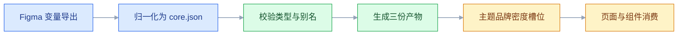

# Design Token

## 一、工程案例：把一套 Figma 变量映射成 CSS 变量并接入主题切换

**场景**：一个 B2B SaaS 产品，后台是 Vite + React + CSS Modules + Ant Design 5，官网是 Next.js。设计侧在 Figma 里维护变量，代码侧有 73 种十六进制颜色、19 种间距、6 种圆角。深色模式是两年前手写的一套 `.dark` 覆盖，刷新时先白一下，弹窗和下拉菜单经常不跟随。

**约束**：

- 7 周内完成，不能停业务，只能渐进迁移
- 设计侧只维护 Figma 变量，不接受再手工维护一份 CSS
- 需要浅色/深色 × 主品牌/白标品牌 × 舒适/紧凑两种密度
- 后台是 SPA，官网是 SSR，两边共用同一套 token
- 现有组件大量直接写 hex，不能一次性全改

**目标**：建立一份 DTCG JSON 作为唯一来源，自动生成 CSS 变量、TypeScript 常量和 Tailwind 主题；三层 token 边界清楚；主题切换不闪白；存量代码按模块迁移。

**交付物**：

1. `tokens/core.json`：唯一来源，含三层 token 与别名
2. 生成与校验脚本，接到 CI：构建、比对、失败即阻断
3. 三份产物：`tokens.css`、`tokens.ts`、`theme.css`
4. 主题切换约定：CSR 的内联脚本，SSR 的 cookie 读写
5. 迁移清单与 lint 规则：哪些模块已迁、哪些还在写 hex

### 1.1 第一步：盘点（0.5 周）

```bash
# 颜色硬编码分布
grep -rhoE '#[0-9a-fA-F]{3,8}' src --include='*.css' --include='*.tsx' \
  | tr 'A-F' 'a-f' | sort | uniq -c | sort -rn | head -40

# 现有暗色覆盖的规模
grep -rn "data-theme\|\.dark" src/styles --include='*.css' | wc -l

# 内联颜色
grep -rnE 'style=\{\{[^}]*color' src --include='*.tsx' | wc -l
```

盘点的结果要写成数字，不写感受：

| 项 | 盘点结果 | 结论 |
|---|---|---|
| 颜色 | 73 种 hex，其中 11 种是相近的蓝 | 前 12 个覆盖 82% 的使用 |
| 间距 | 19 种，含 10、14、18 等非刻度值 | 收敛到 6 档 |
| 圆角 | 6 种 | 保留 3 档 |
| 暗色覆盖 | 340 行手写 CSS | 全部由语义层替代 |
| Figma 变量 | 3 个集合、明暗 2 种模式、约 180 个变量 | 近一半重复命名；品牌与密度未进模式 |

### 1.2 第二步：命名归一（0.5 周）

Figma 里的名字先映射成一套规范名，再谈生成。否则代码只是把混乱原样搬过来。

| Figma 原名 | 规范名 | 层 | 处理 |
|---|---|---|---|
| `Primary/600` | `primitive.blue.600` | Primitive | 改名为色相 + 阶 |
| `color/primary` | `semantic.color.action` | Semantic | 表达用途 |
| `brand-blue` | `primitive.blue.600` | Primitive | 合并到同一色阶 |
| `Neutral/900` | `primitive.gray.900` | Primitive | 统一色相名 |
| `Spacing/4` | `primitive.space.4` | Primitive | 值与名字对齐 |
| `Radius/Card` | `semantic.radius.card` | Semantic | 用途命名 |
| `Button/BG/Primary` | `component.button.bg.primary` | Component | 组件内使用 |

**命名规则**：

- Primitive 描述「值是什么」：色相 + 阶、序号
- Semantic 描述「用在哪里」：action、surface、text、border
- Component 描述「哪个组件的哪个部位」：component.button.bg、component.modal.footer.gap
- 全小写，点分层级，不用斜杠和空格

### 1.3 第三步：三层拆分（1 周）

| 层 | 数量 | 示例 | 允许引用方 |
|---|---|---|---|
| Primitive | 64 | `primitive.blue.600`、`primitive.gray.50`、`primitive.space.4` | 仅 Semantic |
| Semantic | 34 | `semantic.color.action`、`semantic.surface.page`、`semantic.text.secondary` | 页面与组件 |
| Component | 22 | `component.button.bg.primary`、`component.input.border.error` | 仅对应组件 |

拆分时只做三件事：

1. 把重复的近似色合并成一个色阶
2. 给每个语义角色只留一个入口，比如 `semantic.color.action` 而不是 `semantic.color.primary` 和 `semantic.color.brand` 并存
3. 组件 token 只给确实需要独立调整的部位，不要给每个 CSS 属性都建一个

### 1.4 第四步：DTCG JSON 单一来源（1 周）

```json
{
  "primitive": {
    "$type": "color",
    "blue": {
      "400": { "$value": "#60A5FA" },
      "600": { "$value": "#2563EB" },
      "700": { "$value": "#1D4ED8" }
    },
    "gray": {
      "50": { "$value": "#F7F8FA" },
      "900": { "$value": "#101828" }
    }
  },
  "semantic": {
    "color": {
      "$type": "color",
      "action": { "$value": "{primitive.blue.600}" },
      "action-hover": { "$value": "{primitive.blue.700}" }
    },
    "surface": {
      "$type": "color",
      "page": { "$value": "{primitive.gray.50}" }
    },
    "text": {
      "$type": "color",
      "primary": { "$value": "{primitive.gray.900}" }
    }
  }
}
```

DTCG 规范由 W3C Design Tokens Community Group 维护，版本与字段以官方当前版本为准。实际使用只需要记住四件事：`$value` 是值，`$type` 是类型，`{}` 是别名，`$extensions` 放工具私有数据；字段细节见 3.4。Figma 侧的变量通过插件或官方导出能力产出 JSON，提交到 `tokens/figma-export.json`，再归一化成 `tokens/core.json`，具体导出方式以官方当前版本为准。两者的分工：导出文件只作为输入，`core.json` 是唯一来源，别反过来把导出文件当来源手改。

**单一来源的判断标准**：改一个值，只需要改一个文件；其他产物全部由脚本生成，不允许手改。

### 1.5 第五步：生成产物（1 周）

构建脚本读 JSON，依次做四件事：解析别名、检测循环引用、按主题与品牌展开、对输出排序。链路只有一条，不允许任何人工补值：



产物如下：

| 产物 | 消费者 | 是否提交仓库 |
|---|---|---|
| `tokens.css` | 后台、官网 | 是，便于 review diff |
| `tokens.ts` | TS 类型、图表配色 | 是 |
| `theme.css` | Tailwind v4 `@theme` | 是 |
| `tokens.flat.json` | 移动端、邮件模板 | 否，构建时生成 |

生成脚本必须做四件事：解析别名、检测循环引用、按维度展开、对输出排序。排序是为了让每次构建的 diff 稳定，否则 review 时全是噪音。

### 1.6 第六步：主题维度（0.5 周）

三个维度必须正交：主题、品牌、密度。不要写 `[data-theme="dark"][data-brand="b"]` 这种组合选择器，组合数会爆炸。

```css
/* 品牌只提供成对的槽位，不直接决定当前主题 */
:root,
[data-brand="a"] {
  --action-light: #2563EB;
  --action-dark: #60A5FA;
}

[data-brand="b"] {
  --action-light: #7C3AED;
  --action-dark: #A78BFA;
}

/* 主题只负责选槽位 */
:root {
  --color-action: var(--action-light);
  --surface-page: #F7F8FA;
}

[data-theme="dark"] {
  --color-action: var(--action-dark);
  --surface-page: #121212;
}

/* 密度是独立维度 */
[data-density="compact"] {
  --control-height-md: 28px;
  --space-control-inline: 12px;
}
```

**正交的收益**：加一个品牌只加一组槽位，加一个主题只加一组选择，不用为每个组合写一套完整样式。

### 1.7 第七步：无闪烁切换（0.5 周）

闪白的根因是「先渲染默认主题，等 JS 跑完再改」。脚本必须在首次绘制前执行，并且放在 `<head>` 里：

```html
<script>
  (function () {
    var saved = localStorage.getItem('theme')
    var prefersDark = matchMedia('(prefers-color-scheme: dark)').matches
    document.documentElement.dataset.theme = saved || (prefersDark ? 'dark' : 'light')
  })()
</script>
```

SSR 场景不能读 `localStorage`。做法是服务端读 cookie，把 `data-theme` 直接写进返回的 HTML；客户端脚本只处理用户手动切换。两边不一致会触发 hydration 警告，所以首屏以 cookie 为准。

### 1.8 第八步：渐进迁移（2 周）

| 阶段 | 动作 | 完成标志 |
|---|---|---|
| 0 | 建 JSON、生成 CSS、接入根节点 | 页面外观不变 |
| 1 | stylelint 禁止新增 hex（warn） | 新代码不再产生硬编码 |
| 2 | 按模块替换颜色与间距 | 6 个模块，每周 2 到 3 个 |
| 3 | 删除旧 `.dark` 覆盖 | 暗色只由 token 驱动 |
| 4 | lint 改 error，接入 CI | 硬编码直接失败 |

```json
{
  "rules": {
    "color-no-hex": true,
    "declaration-property-value-allowed-list": {
      "/^(margin|padding|gap)(-|$)/": ["/^var\\(--space-/", "0", "auto"]
    }
  }
}
```

**第 1 步不能省**。不禁止新增，迁移速度永远追不上新增速度。

### 1.9 验收

| # | 检查项 | 怎么验 | 通过标准 |
|---|---|---|---|
| 1 | 单一来源 | 改一个 primitive 后重新构建 | 只有 JSON 被改，产物由脚本生成 |
| 2 | 别名完整 | 构建脚本解析全部 `{}` | 无未解析别名，无循环 |
| 3 | 产物稳定 | 连续构建两次对比 hash | 完全一致 |
| 4 | 颜色收敛 | `grep -rnE '#[0-9a-fA-F]{3,8}' src` | token 目录外为 0 |
| 5 | 浅色对比度 | 遍历文字/背景 token 对 | 正文 4.5:1，大字 3:1 |
| 6 | 深色对比度 | 同上，切 `data-theme="dark"` | 同上，且无纯黑纯白刺眼组合 |
| 7 | 无闪白 | 网络限速到 Slow 3G，硬刷新 | 首屏直接是对应主题 |
| 8 | 品牌切换 | 切 `data-brand` | 强调色变化，布局不跳 |
| 9 | 密度切换 | 切 `data-density` | 控件高度与间距变化，文字不截断 |
| 10 | SSR 一致 | 查看页面源代码 | `html` 上已有正确 `data-theme` |
| 11 | 运行时开销 | 禁用 JS 后看默认主题 | 默认主题完整可用，切换功能可以失效 |
| 12 | 回滚 | 关闭主题开关 | 回到浅色，页面可用 |

> 第 7 项要用硬刷新加限速，普通刷新有缓存，看不出闪白。

---

## 二、高频问答：会卡住你的地方，也是面试最常问的

### 2.1 Figma 里改了变量，代码没变

**现场**

比 `tokens/figma-export.json` 的 hash 与 `core.json` 里记录的来源 hash；再看 Figma 最后一次改动是否晚于最近一次 token 提交；CI 是否有 `tokens:check` 任务。

**要点**

- 没有单向流水线，Figma 与代码各自维护；或者导出动作依赖某个人记得点。
- 这是流程问题，不是记忆力问题：连续两周记录「设计改了几次、代码跟了几次」，差值就是流水线缺口。
- 每次都靠人提醒时，先补自动导出和 diff，而不是补文档。

**追问**

- 怎么证明流水线是通的？→ CI 里有 `tokens:check`，hash 不一致就失败。
- 为什么不干脆两边各改一份？→ 手动同步必然失步，只是时间问题。

### 2.2 深色模式刷新时先白一下

**现场**

打开 DevTools 的 Performance 录制，看首帧时 `html` 上的 `data-theme` 是什么；查看 `index.html` 里脚本的位置。

**要点**

- 主题在 React 挂载后才设置，首帧已经用默认浅色画了一次。
- 闪白是时序问题，不是体积问题，优化样式文件没用。
- 脚本要内联到 `<head>` 并放在样式之前；验收要禁用缓存并限速，硬刷新观察。

**追问**

- 为什么普通刷新看不出？→ 有缓存，首帧可能直接用缓存里的结果。
- 首屏 HTML 的 `html` 标签没有主题属性说明什么？→ 脚本执行太晚。
- SSR 场景怎么处理？→ 服务端读 cookie，把 `data-theme` 直接写进返回的 HTML。

### 2.3 同名 token 在设计稿和代码里值不一样

**现场**

用脚本把 Figma 导出值和 `getComputedStyle` 读到的值生成对照表，逐行 diff。

**要点**

- 两边各自维护；Figma 的模式与 CSS 选择器没有一一映射；或者导出的变量被手工改过。
- 只看单点值不够，要看映射关系：重点检查 `light/dark` 两个模式下同一个语义 token 的指向。
- 名字先统一再比值：设计侧 `Primary/600` 和代码侧 `primitive.blue.600` 不同名时，diff 出来的是命名差异。

**追问**

- 为什么会出现同名不同值？→ 两边各改一份，没有单一来源。
- 怎么防止再发生？→ 设计侧导出、代码侧消费，导出文件只作为输入。

### 2.4 改一个 primitive，半个产品变了色

**现场**

在 token 目录里反查引用 `grep -rn "primitive.blue.600" tokens/`；再跑视觉回归看影响页面。

**要点**

- 这个 primitive 被大量语义 token 别名引用；或者业务代码绕过语义层直接用了它。
- 一个变量不等于一个使用点，改之前要看到它在语义层的扇出。
- 构建前生成反向引用表；影响超过 5 个语义角色时，按主题级变更走评审，而不是直接合并。

**追问**

- 业务代码为什么能直接用上它？→ 引用方向被破坏，Primitive 本该只被 Semantic 引用。
- 怎么从流程上限制？→ 守住单向引用，页面层只允许用 Semantic。

### 2.5 构建时报别名解析失败

**现场**

让构建脚本打印解析链，例如 `action -> blue.600 -> action`；对每个 `{}` 做存在性检查。

**要点**

- 别名拼错、指向不存在的 token、或者 A 指向 B 又指回 A 形成循环。
- CSS 变量循环不会报错，只会在计算时变成无效值，所以必须在构建期检测。
- 单独跑 token 构建任务看第一条失败链；再统计「被引用但未定义」和「定义但从未被引用」两组名单。

**追问**

- 为什么不能等浏览器报错？→ 成环不抛错，只是值失效，排查成本很高。
- 别名路径怎么写才稳？→ 写完整路径 `{primitive.blue.600}`，不写叶子名。

### 2.6 CSS 变量在组件里取不到值

**现场**

DevTools 选中元素，看 Computed 面板里的最终值；再执行 `getComputedStyle(el).getPropertyValue('--color-action')`。

**要点**

- 变量定义在局部选择器里；组件在 Shadow DOM 中；或者被同名的局部变量覆盖。
- 只查定义不够，要查作用域：从元素往上逐层看哪个祖先定义了同名变量。
- 组件库把弹窗挂到 `body` 时，要确认 `body` 所在的作用域能继承到主题变量。

**追问**

- 为什么局部定义会盖掉全局？→ 变量沿 DOM 树继承，离元素最近的声明赢。
- 弹窗为什么经常取不到？→ 被 portal 挂到了主题属性所在的子树之外。

### 2.7 Tailwind 里写 token 类名不生效

**现场**

在构建产物的 CSS 里搜这个类名；检查 `@source` 是否覆盖了所有模板文件。

**要点**

- `@theme` 的命名空间不对；类名是动态拼接的，构建时扫描不到；或者生成文件没有引入。
- Tailwind 的类是在构建时生成的，不是运行时拼出来的，所以拼接出来的类名必然失效。
- 把类名写成完整字符串再试：完整字符串生效、拼接不生效，就是扫描问题。

**追问**

- 为什么 `bg-${color}` 这种写法不行？→ 构建时扫描不到，这条规则根本不会生成。
- 命名空间错了会报错吗？→ 不会，类名直接不存在，只能到产物 CSS 里搜。

### 2.8 切了主题，弹窗和下拉菜单还是浅色

**现场**

检查弹窗 DOM 的父节点；在 DevTools 里看它的 computed 背景色来自哪个规则；`grep` 残留 hex。

**要点**

- 组件通过 portal 挂到了主题属性所在的子树之外；或者组件内部写死了背景色；或者第三方样式优先级更高。
- 只检查页面主体不够，要检查挂载点。
- 给 portal 容器也加上主题属性，或者把变量定义在 `:root` 并确保 portal 仍在 `html` 下。

**追问**

- 为什么把变量放 `:root` 能救？→ portal 挂在 `html` 下，能继承到根上的变量。
- 第三方组件怎么办？→ 看它的 CSS 是否用了固定颜色，必要时覆盖。

### 2.9 深色下对比度不达标

**现场**

遍历「文字 token × 表面 token」组合计算对比度；用 axe 扫暗色页面。

**要点**

- 语义 token 直接取反；表面层级没有重新设计；次要文字和边框沿用了浅色值。
- 暗色不是反色，而是另一套表面亮度和强调色。
- 正文至少 4.5:1，大字至少 3:1；重点查次要文字、占位符、禁用态、分割线这四处。

**追问**

- 整体提亮或压暗为什么不行？→ 它改的是全局亮度，不解决「哪一层该亮」的层级问题。
- 哪四处最容易低于阈值？→ 次要文字、占位符、禁用态、分割线。

### 2.10 SSR 页面主题闪烁或 hydration 报错

**现场**

查看页面源代码里 `html` 的属性；看控制台 hydration 警告；检查 cookie 是否随请求发送。

**要点**

- 服务端不知道用户主题，返回默认值；客户端脚本读到另一个值，首屏不一致。
- 这是两端状态不一致，不是渲染 bug。
- 服务端从 cookie 读取主题并写入 HTML，客户端首帧沿用同一个值；用户手动切换后再更新 cookie 和 DOM，顺序不能反。

**追问**

- 顺序反了会怎样？→ 下一次请求服务端还会返回旧主题，闪回一次。
- 客户端脚本还负责什么？→ 只处理用户手动切换。

### 2.11 token 越加越多，没人记得住

**现场**

统计每个 token 的引用次数；列出 0 引用的 token；看语义层是否超过 60 个。

**要点**

- 没有清理机制；每个页面都想加一个专属 token；组件 token 被当成页面 token 用。
- token 是公共接口，数量本身就是成本，不是「越多越灵活」。
- 每月跑一次使用率报告，半年未使用的标记 deprecated；同一用途出现两个名字时保留一个，另一个加别名过渡。

**追问**

- 判断标准是什么？→ 设计师能不能背出常用的一组，背不出来就是名字或数量有问题。
- 删之前要做什么？→ 给一个版本的别名过渡。

### 2.12 品牌和主题的组合写不完

**现场**

数一下 CSS 里 `[data-theme][data-brand]` 组合选择器的数量；列出实际需要的组合数。

**要点**

- 品牌和主题没有拆成两个维度，品牌值被直接写进了主题选择器。
- 用组合选择器解决维度问题，组合数会相乘。
- 让品牌只提供 `light/dark` 成对槽位，主题只负责选槽位；加品牌时只增加一组槽位，不增加组合选择器。

**追问**

- 加一个品牌要改多少？→ 只加一组槽位。
- 唯一的例外是什么？→ 高对比，它必须叠在明暗之上，只准写这一层。

### 2.13 页面直接引用了组件 token

**现场**

`grep -rn "component\." src/pages src/features`；看组件目录之外是否出现组件 token。

**要点**

- 组件 token 的归属是组件；页面引用后，组件改版、换主题、加密度时页面不跟随。
- 把组件的内部实现当成公共接口是根因。
- 页面只允许用 Semantic 层；确实需要差异时新增一个 Semantic token，而不是借组件 token。

**追问**

- 怎么从 CI 上拦住？→ 加一条规则：`component.*` 只允许出现在对应组件目录内，跨目录引用直接失败。
- 「值一样，先借来用」错在哪？→ 值会分叉，组件一改页面就不跟随。

---

## 三、核心知识：从零开始要建立的东西

### 3.1 Token 与 CSS 变量的概念边界

| 概念 | 存在形式 | 跨端 | 运行时可变 |
|---|---|---|---|
| Design Token | 设计决策的名字与值 | 是 | 概念上可以 |
| CSS 变量 | 浏览器里的自定义属性 | 仅 Web | 是 |
| Figma 变量 | 设计工具里的变量与模式 | 仅设计侧 | 是 |

Token 是概念，CSS 变量是 Web 的一种落地形式。同一份 token 可以生成 CSS 变量、iOS 颜色资产、Android 资源、Tailwind 主题。**把 token 等同于 CSS 变量，会限制多端能力**。

### 3.2 三层结构与引用方向


| 层 | 回答的问题 | 例子 | 引用方向 |
|---|---|---|---|
| Primitive | 值是多少 | `blue.600 = #2563EB` | 只被 Semantic 引用 |
| Semantic | 用在哪里 | `semantic.color.action = primitive.blue.600` | 可被页面与 Component 引用 |
| Component | 哪个组件的哪个部位 | `component.button.bg = semantic.color.action` | 只被对应组件引用 |

**引用只能单向向下**：Primitive 不知道 Semantic 的存在，Semantic 不知道 Component 的存在。反向引用会让换主题变成解方程。

> **面试**：常问「为什么要分三层 token？」答：Primitive 管值、Semantic 管用途、Component 管组件部位，引用只能单向向下。

### 3.3 命名空间与命名规则

| 类别 | 用途 | 示例 |
|---|---|---|
| 颜色 | 强调色与表面 | `semantic.color.action`、`semantic.surface.page` |
| 间距 | 内外边距与间隙 | `primitive.space.2`、`primitive.space.4` |
| 圆角 | 控件与容器 | `semantic.radius.sm`、`semantic.radius.card` |
| 字体 | 字号、行高、字重 | `semantic.font.size-body`、`semantic.font.line-tight` |
| 阴影 | 卡片与浮层 | `semantic.shadow.card`、`semantic.shadow.popover` |
| 层级 | 浮层层级 | `semantic.z.modal`、`semantic.z.toast` |
| 时长 | 动效时长 | `primitive.duration.fast`、`primitive.duration.base` |

**命名要避免**：

| 避免 | 原因 | 改用 |
|---|---|---|
| `color1`、`color2` | 没有语义，无法判断用途 | `semantic.color.action` |
| `primary2` | 数字后缀会随版本失控 | `semantic.color.action-hover` |
| `lightBlue` | 外观名在深色主题下说谎 | `semantic.color.info` |
| `gray-100` 当背景 | 基础层被业务直接引用 | `semantic.surface.page` |

### 3.4 DTCG 格式与字段

```json
{
  "semantic": {
    "color": {
      "$type": "color",
      "action": {
        "$value": "{primitive.blue.600}",
        "$description": "主操作色"
      }
    }
  },
  "primitive": {
    "space": {
      "$type": "dimension",
      "4": { "$value": { "value": 16, "unit": "px" } }
    }
  }
}
```

| 字段 | 作用 | 注意 |
|---|---|---|
| `$value` | 实际值 | 必填 |
| `$type` | 类型 | 可继承，父级写了子级可省 |
| `$description` | 说明 | 给人看，也常被文档生成器读取 |
| `$extensions` | 工具私有数据 | 不参与跨工具互操作，可省略 |
| `$deprecated` | 标记弃用 | 可选，布尔或一句说明；见 3.14 |

DTCG 是 Design Tokens Community Group 的规范，版本号与字段细节以官方当前版本为准，字段也可能随版本增删。它的价值是让 Figma、Style Dictionary、多端生成工具读同一份 JSON。实践里只用固定这几个字段，别自造。

别名要写完整路径，不能只写叶子名：`{primitive.blue.600}` 能解析，`{blue.600}` 在不同分支下含义不同，纯扁平路径最稳。

### 3.5 Token 类型系统

| 类型 | 例子 | 值的形式 |
|---|---|---|
| `color` | `#2563EB`、`oklch(0.55 0.2 260)` | 字符串或色彩对象 |
| `dimension` | `{ "value": 16, "unit": "px" }` | 对象，必须带单位 |
| `fontFamily` | `"PingFang SC", sans-serif` | 字符串或数组 |
| `fontWeight` | `400`、`600` | 数字或关键字 |
| `duration` | `{ "value": 200, "unit": "ms" }` | 对象，必须带单位 |
| `cubicBezier` | `[0.4, 0, 0.2, 1]` | 四个数字 |
| `number` | `1.5` | 纯数字，不带单位 |

带单位的类型在 DTCG 里是对象，不是 `"16px"` 字符串：单位与数值分开存，生成 CSS 时再由脚本拼成 `16px`。写成字符串在部分工具里能过，跨工具就失真。

复合类型（`shadow`、`typography`、`border`）最麻烦，因为要表达一组值。团队小的时候，只把颜色、间距、圆角、字号做成 token，阴影直接写 CSS，是合理的取舍。**不要为了完整性引入一堆没人维护的复合 token**。

### 3.6 别名与引用解析

别名让「改一处、全站变」成立。解析有两条路：

| 方式 | 做法 | 优点 | 缺点 |
|---|---|---|---|
| 构建时展开 | 生成 CSS 时把 `{a}` 替换成最终值 | 产物简单，兼容性最好 | 丢失运行时关系 |
| 运行时引用 | 生成 `var(--a)` | 可在浏览器里覆盖 | 调试时看到的是变量名 |

推荐混合：与主题无关的 Primitive 值可以在构建时展开成具体值；需要随主题、品牌、密度切换的 Semantic 层必须输出 `var()`，否则运行时无法覆盖，切换主题就会失效。Semantic 到 Component 一律保留 `var()`，组件才能在局部覆盖。

**循环检测**必须在构建期做：

```text
action -> blue.600 -> action   ✘ 检测到环，构建失败
action -> blue.600 -> #2563EB  ✔ 解析完成
```

CSS 变量成环不会抛错，只会让该值在计算时失效，排查成本很高。

> **面试**：常问「别名该构建时展开还是运行时用 var()？」答：Primitive 可以展开成具体值，要随主题切换的 Semantic 必须输出 `var()`。

### 3.7 主题模式与正交维度

主题不是一个开关，而是几个维度的组合：

| 维度 | 取值 | 载体 |
|---|---|---|
| 明暗 | light / dark | `data-theme` |
| 品牌 | brand-a / brand-b | `data-brand` |
| 密度 | comfortable / compact | `data-density` |
| 对比度 | normal / high | `data-contrast` |

```css
:root {
  --action-light: #2563EB;
  --action-dark: #60A5FA;
  --color-action: var(--action-light);
  --surface-page: #F7F8FA;
}

[data-theme="dark"] {
  --color-action: var(--action-dark);
  --surface-page: #121212;
}

[data-theme="dark"][data-contrast="high"] {
  --text-secondary: #F5F5F5;
}
```

高对比是轴外增强，不是第四套主题：只覆盖少数几处临界 token，主体仍继承 dark。若它开始要求一整套独立配色，说明 surface 层没设计好，先补层级，再加维度。

**维度要正交**：品牌提供槽位，主题选槽位，密度只改间距与控件高度。对比度是唯一允许写组合选择器的维度，因为它必须叠在明暗之上，但只准写这一层，别让品牌也进来。每加一个维度就复制一整套样式，维护量会指数增长。

> **面试**：常问「品牌和主题要写 `[data-theme][data-brand]` 组合选择器吗？」答：不要，让品牌提供 light/dark 成对槽位，主题只负责选槽位。

### 3.8 CSS 变量的落地方式

```css
:root {
  color-scheme: light;
  --space-4: 16px;
  --radius-md: 8px;
  --color-action: #2563EB;
}

[data-theme="dark"] {
  color-scheme: dark;
  --color-action: #60A5FA;
}

.button {
  padding: 0 var(--space-4);
  border-radius: var(--radius-md);
  background: var(--color-action);
}
```

| 特性 | 用途 | 注意 |
|---|---|---|
| 继承 | 变量沿 DOM 树向下继承 | 局部覆盖会影响整棵子树 |
| 回退 | `var(--x, #fff)` | 回退值也要是 token 或中性值 |
| `@property` | 声明类型、默认值、可过渡 | 浏览器支持以目标环境为准 |

**不要把变量定义在组件内部再期望全局可用**。组件内定义适合局部覆盖，全局语义 token 放在 `:root`。

### 3.9 构建流水线与多端产物

| 环节 | 责任 | 失败后果 |
|---|---|---|
| 设计导出 | 设计侧 | 代码拿到旧值 |
| JSON 校验 | CI | 拼写错误流入产物 |
| 生成 | 构建脚本 | 多端不一致 |
| 提交产物 | 前端 | review 看不到变化 |
| 消费 | 各端 | 绕过 token |

产物要提交仓库，这样每次 token 变化在 PR 里都有 diff。面向前端消费的产物（`tokens.css`、`tokens.ts`、`theme.css`）必须提交；只给移动端或邮件构建用的中间产物可以不提交，但要保证同一条命令能复现。全部只放在构建缓存里，评审时看不到影响面。

### 3.10 Figma 变量与代码的映射

| Figma | 代码 | 规则 |
|---|---|---|
| Collection `primitive` | `primitive.*` | 一对一 |
| Collection `semantic` | `semantic.*` | 一对一 |
| Mode `Light` | `:root` | 默认值 |
| Mode `Dark` | `[data-theme="dark"]` | 覆盖 |
| Mode `Brand A` | `[data-brand="a"]` | 只提供 light/dark 成对槽位 |
| Mode `Compact` | `[data-density="compact"]` | 只改间距与控件高度 |
| Component variable | `component.*` | 只给对应组件用 |

Figma 的变量、模式、导出能力随版本和套餐变化，具体以官方当前版本为准。工程上要守住一条：**设计侧导出，代码侧消费，不允许两边各改一份**。手动同步必然失步，只是时间问题。

### 3.11 暗色模式的表面层级

暗色不是把白变黑，而是用亮度阶梯表达层级：

| 层级 | 浅色 | 深色 | 用途 |
|---|---|---|---|
| 页面背景 | `#F7F8FA` | `#121212` | 最底层 |
| 卡片 | `#FFFFFF` | `#1E1E1E` | 内容容器 |
| 浮层 | `#FFFFFF` | `#2C2C2C` | 弹窗、下拉 |
| 悬浮态 | `#F0F2F5` | `#383838` | hover、选中 |

深色下阴影几乎不可见，层级主要靠表面亮度差。边框也要相应提亮，否则卡片和背景糊在一起。

### 3.12 对比度与色彩空间

| 检查 | 阈值 | 适用 |
|---|---|---|
| 正文文字 | 4.5:1 | 小于大字号阈值的文本 |
| 大字号 | 3:1 | 约 24px 常规或 18.66px 粗体 |
| 图标与边框 | 3:1 | 承载信息的非文本元素 |
| 禁用态 | 不强制 | 但也不能低到看不见 |

对比度按相对亮度计算，不是按眼睛感觉。深色背景上的纯白文字会产生光晕，正文用 `#E6E6E6` 这类近白更舒服。

`oklch()` 之类的新色彩空间便于做感知均匀的色阶，但要注意目标浏览器和广色域屏的支持情况；以官方当前版本和项目支持矩阵为准。

### 3.13 密度与排版 token

密度不是简单缩小字号，而是同时调整控件高度、内边距、行高和图标尺寸。

| token | 舒适 | 紧凑 |
|---|---|---|
| `semantic.control.height-md` | 32px | 28px |
| `semantic.space.control-inline` | 16px | 12px |
| `semantic.font.size-body` | 14px | 13px |
| `semantic.table.row-height` | 48px | 40px |

排版 token 建议拆成 `font.size`、`font.line`、`font.weight` 三组，再用 `typography.body` 这样的复合 token 组合。不要把一个 `font` 简写塞进 token，消费端很难只改其中一项。

### 3.14 规模控制与清理

| 类别 | 合理数量 | 备注 |
|---|---|---|
| 语义颜色 | 20 到 40 | 超过 60 要分类 |
| 间距 | 6 到 10 | 4 或 8 的倍数 |
| 圆角 | 3 到 5 | 含 full |
| 字号 | 6 到 10 | 配合行高 |
| 阴影 | 3 到 5 | 卡片、浮层、强调 |
| 基础色板 | 8 色 × 8 阶 | 业务不直接引用，只给 semantic 引用 |
| 组件 token | 每个组件 3 到 6 | 只给确实要独立调整的部位 |

**判断标准**：设计师能不能背出常用的一组。背不出来，说明名字或数量有问题。

清理动作：每季度统计引用次数，0 引用的标记 deprecated，连续两个季度仍为 0 就删除。删除前给一个版本的别名过渡。

### 3.15 版本管理与测试

Token 是公共接口，改名的破坏性和改组件 API 一样大。

| 变更 | 版本 | 风险 |
|---|---|---|
| 新增 token | minor | 低 |
| 修改值 | minor 或 major | 中到高，视影响面 |
| 重命名 | major | 高，所有引用失效 |
| 删除 | major | 高 |
| 修改类型 | major | 高，消费端解析失败 |

测试要覆盖四层：

1. **结构测试**：JSON 能解析，必填字段齐全
2. **引用测试**：无循环、无未定义别名
3. **产物测试**：CSS 与 TS 快照一致
4. **视觉测试**：浅色/深色关键页截图对比

```bash
npm run tokens:build
npm run tokens:test
git diff --exit-code src/styles/tokens.css
```

最后一条在 CI 里很有用：如果生成产物与提交的不一致，说明有人改了 JSON 没重新生成，直接失败。

---

## 四、冷门知识汇总

放在这里的门槛是三条同时成立：低频、出错代价低、能现查。会改崩全局样式的（改 primitive 波及一片、主题闪白、portal 丢主题）不在这里，看第二节。

| 知识点 | 为什么冷门 | 用到时的关键词 |
|---|---|---|
| `$extensions` | 只在跨工具同步时才需要 | 工具私有字段、Figma 元数据 |
| `$deprecated` | 只在长期维护、做迁移时才写 | 弃用标记、过渡期、别名 |
| `@property` | 要类型声明或变量过渡时才用 | syntax、inherits、initial-value |
| 逻辑属性 | 只有 RTL 或竖排项目会遇到 | `margin-inline-start`、`padding-block` |
| `color-scheme` | 只影响原生滚动条与表单控件外观 | 原生控件、滚动条配色 |
| CSS 变量名大小写 | 拼错时多半先怀疑没定义，很少怀疑大小写 | custom property、case-sensitive |
| SVG 里消费 token | 只在做图标、插图时遇到 | `currentColor`、`fill: var(--x)` |
| 邮件模板 token | 邮件客户端不支持 CSS 变量 | 内联样式、降级、构建期内联 |
| `prefers-reduced-motion` 与时长 token | 无障碍走查才会提 | 动效降级、duration |

**一个容易踩的边**：注册成 `@property` 的变量，非法值会回落到 `initial-value`，而不是 `var()` 里写的回退值；排查时先看声明，再看回退。这条查文档就有，不必提前背。
