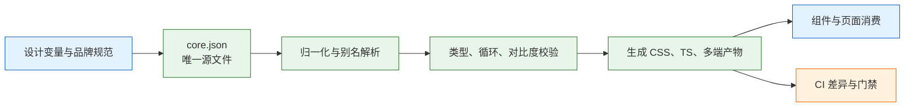
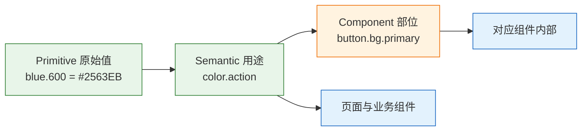
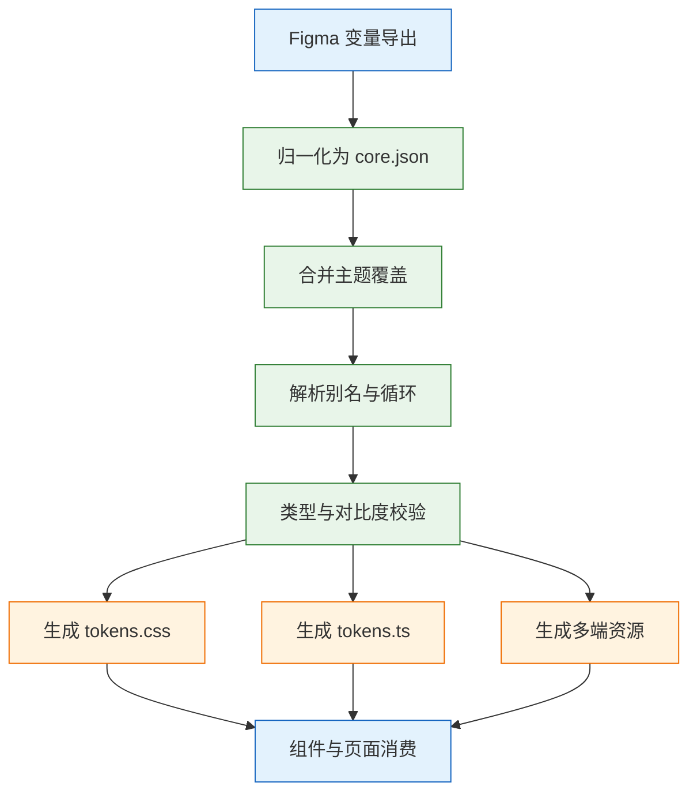

# Design Token 与代码映射

---

## 一、Design Token 是什么

### 1.1 核心概念

Design Token（设计令牌）是对一个设计决策的命名。它把“主操作按钮的背景色是 #2563EB”这类具体取值，抽象成“主操作使用 action 这个语义”，再让语义指向具体值。名字稳定，值可以随主题、品牌、密度变化。

Token 的最小结构包含三项：名字、类型、值。名字描述用途或色阶，类型说明它是颜色、尺寸、时长还是字体，值可以是字面量，也可以是指向另一个 token 的别名。三者缺一，token 就退化成一条注释。

Token 与 CSS 变量、设计工具变量不是同一层概念，混用会直接把多端能力砍掉。

| 概念 | 存在形式 | 跨端能力 | 运行时可变 |
|---|---|---|---|
| Design Token | 决策的名字、类型与值 | 是 | 概念上可以 |
| CSS 变量 | 浏览器自定义属性 | 仅 Web | 是 |
| 设计工具变量 | 设计文件中的变量与模式 | 仅设计侧 | 是 |
| 组件 props | 运行时的组件参数 | 仅当前框架 | 是 |

同一份 token 可以生成 CSS 变量、iOS 颜色资产、Android 资源、Tailwind 主题和图表配色常量。把 token 等同于 CSS 变量，等于把生成能力和跨端能力提前放弃；把 token 等同于设计工具变量，则会让代码侧永远依赖人工同步。

Token 要解决的核心问题是单一来源：同一个决策只在一个文件里定义，其余产物全部由脚本生成。设计改值，改源文件；代码消费，读生成产物；评审看差异，看生成产物的 diff。任何一环允许手改，单一来源就失效。

### 1.2 适用场景与边界

Token 适合存在以下任一条件的产品：需要明暗主题、需要多品牌或多租户换肤、需要 Web 与移动端保持一致、需要设计稿与代码长期同步、需要按密度切换控件尺寸。条件越多，token 的收益越明显。

不适用的情况也要说清。页面只有个位数、只做单一主题、设计与前端由同一人完成且不发版，直接写 CSS 变量或使用框架主题即可，不必引入三层结构和生成流水线。Token 的维护成本真实存在：源文件、校验、生成、版本、迁移，每一项都需要人。

| 场景 | 建议方案 | 原因 |
|---|---|---|
| 单页活动、固定视觉 | 直接写 CSS | 无复用与换肤需求 |
| 单一主题的中小后台 | 一层语义变量 | 成本低，够用 |
| 明暗主题 + 多品牌 | 三层 token + 生成 | 组合数需要正交拆分 |
| Web 与移动共用规范 | 三层 token + 多端产物 | 需要跨端一致 |
| 多租户 SaaS 换肤 | 品牌槽位 + 运行时注入 | 租户配置不可编译期固定 |
| 设计稿频繁变动 | token + CI 校验 | 人工同步必然失步 |

边界有三条。第一，token 管理值，不管理布局。栅格列数、断点、容器结构不属于颜色和尺寸 token 的范畴，硬塞进去会让 token 变成配置仓库。第二，token 不替代组件 API，组件仍然要决定状态、行为和可访问性。第三，token 不解决设计质量问题，它只保证同一个决策被执行一次，决策本身是否合理要靠评审和对比度校验。

> **注意**：把业务语义写进 token 名字，例如 `order-status-processing`，会让 token 层绑定具体业务。语义层应停留在交互与表面层级，业务状态的颜色映射由业务组件完成。

### 1.3 架构组成

Token 系统由源文件、归一化、校验、生成、消费五个环节组成。源文件是唯一可编辑入口，其余环节都是派生。



| 环节 | 责任方 | 输入 | 输出 |
|---|---|---|---|
| 源文件 | 设计系统维护者 | 设计决策 | `core.json` |
| 归一化 | 构建脚本 | 源文件与主题覆盖 | 扁平 token 表 |
| 校验 | 构建脚本与 CI | 扁平表 | 错误与警告 |
| 生成 | 构建脚本 | 扁平表 | CSS、TS、平台资源 |
| 消费 | 组件与页面 | 生成产物 | 界面 |

架构上要守住一条硬边界：设计工具导出的文件只是输入，`core.json` 才是唯一来源。允许反向手改导出文件，等于制造第二个来源，下一次导出就会覆盖人工修改，或者产生无法解释的差异。

物理目录可以按“源、主题、脚本、产物”四分：

```text
tokens/
  core.json          # 基础与语义 token，唯一可编辑源
  themes/
    dark.json        # 只覆盖需要变化的语义 token
    brand-b.json     # 品牌槽位覆盖
scripts/
  build-tokens.mjs   # 归一化、校验、生成
src/styles/
  tokens.css         # 生成产物，提交仓库
  tokens.ts          # 生成产物，提交仓库
```

---

## 二、Token 的分层模型

### 2.1 三层结构与单向引用

三层分别是 Primitive（原始值）、Semantic（用途）、Component（组件部位）。引用方向只能从下往上：Component 引用 Semantic，Semantic 引用 Primitive，Primitive 不引用任何层。



| 层 | 回答的问题 | 命名示例 | 允许被谁引用 |
|---|---|---|---|
| Primitive | 值是多少 | `primitive.blue.600` | 只被 Semantic 引用 |
| Semantic | 用在哪里 | `semantic.color.action` | 页面、业务组件、Component |
| Component | 哪个组件的哪个部位 | `component.button.bg.primary` | 只被对应组件 |

业务代码里出现 `primitive.blue.600` 就是越层。它把“这是主操作色”退化成“这是 600 号蓝”，换品牌或换主题时无法跟随。同样，页面直接引用 `component.button.bg.primary` 也是越层，页面应使用组件，而不是替组件决定内部颜色。

单向引用带来两个可验证的性质：改一个 primitive 值，所有引用它的 semantic 同步变化；改一个 semantic 值，所有消费它的页面与组件同步变化。反向引用会破坏这两个性质，让变更影响面无法计算。

### 2.2 分层职责与引用规则

三层的职责差异体现在变更频率和评审标准上。Primitive 随品牌视觉调整，变更频率低但影响面最大；Semantic 随主题和交互规范调整，是日常变更的主要入口；Component 随组件实现调整，影响面最小。

| 层 | 变更频率 | 影响面 | 评审重点 |
|---|---|---|---|
| Primitive | 低 | 全局 | 色阶完整性、命名一致性 |
| Semantic | 中 | 多页面 | 用途是否唯一、对比度 |
| Component | 高 | 单组件 | 是否真的需要独立 token |

Semantic 层需要覆盖五类用途：表面（surface）、文字（text）、边界（border）、操作（action）、状态（status）。五类之外新增用途要先论证，否则语义层会膨胀成另一种原始值表。

| 用途类 | 典型 token | 使用位置 |
|---|---|---|
| surface | `surface.page`、`surface.raised`、`surface-sunken` | 页面底色、卡片、嵌入区 |
| text | `text.primary`、`text.secondary`、`text.disabled` | 正文、辅助说明、禁用 |
| border | `border.subtle`、`border.strong`、`border.focus` | 分割线、输入框、焦点环 |
| action | `action`、`action-hover`、`on-action` | 主操作、悬停、反色文字 |
| status | `danger`、`success`、`warning`、`info` | 校验、提示、状态标签 |

Component 层只给确实需要独立调整的部位建 token。每个组件三到六个足够，超过这个数量通常说明组件承担了过多职责，应该拆分组件，而不是继续加 token。

### 2.3 层数取舍

小项目可以只做两层：原始值加语义。三层是给有组件库、多主题、多品牌需求的团队准备的。层数越多，维护成本和理解成本越高。

| 层数 | 适用条件 | 优点 | 代价 |
|---|---|---|---|
| 一层（仅语义） | 单主题、小团队 | 简单直接 | 换品牌需改语义值 |
| 两层（原始 + 语义） | 单组件库、明暗主题 | 平衡 | 组件内部微调缺少出口 |
| 三层（原始 + 语义 + 组件） | 多品牌、多组件库 | 影响面可控 | 需要治理组件 token |
| 四层以上 | 超大型组织 | 分工细 | 引用链长，排障困难 |

层数选择的判断标准是“是否需要在不影响其他组件的前提下调整某个组件”。需要，就加 Component 层；不需要，两层足够。为了看起来完整而加层，最后会得到一堆零引用的组件 token。

---

## 三、命名与映射规则

### 3.1 命名四原则

命名规则只有四条，但需要严格执行：

1. 全小写，用点分层级，不用斜杠、空格和大小写混排。
2. Primitive 描述值，用色相加阶、序号或比例，例如 `blue.600`、`space.4`。
3. Semantic 描述用途，用 surface、text、border、action、status 五类词根。
4. Component 描述部位，例如 `button.bg`、`modal.footer.gap`，不为每个 CSS 属性建 token。

命名还要避免三类词：颜色词（`blue`、`red`）不得出现在 Semantic 层；尺寸词（`large`、`small`）不得出现在 Semantic 层；业务词（`order`、`invoice`）不得出现在任何公共层。三类词都会让 token 在换主题或跨业务时失真。

### 3.2 设计名到代码名的映射

设计工具里的名字往往先于规范存在，直接导出只会把混乱原样搬进代码。映射需要在归一化阶段完成，且映射表要版本化。

| 设计原名 | 规范名 | 处理方式 |
|---|---|---|
| `Primary/600` | `primitive.blue.600` | 改成色相加阶 |
| `color/primary` | `semantic.color.action` | 改成用途 |
| `brand-blue` | `primitive.blue.600` | 合并进同一色阶 |
| `Spacing/4` | `primitive.space.4` | 值与名字对齐 |
| `Radius/Card` | `semantic.radius.card` | 按用途命名 |
| `Button/BG/Primary` | `component.button.bg.primary` | 组件部位专用 |
| `Text/Primary/Dark` | `semantic.text.primary` | 主题维度移出名字 |

最后一条最容易被忽略。主题不该写进 token 名字，`text-primary-dark` 这种命名会把主题维度烧进语义，导致每加一个主题就要加一批 token。正确做法是同一个 `text.primary` 在不同主题选择器下取不同值。

映射表本身也要入库。设计侧改名时，先改映射表，再重新生成；不允许在代码里手工补别名，否则映射关系会散落在多个文件。

### 3.3 类型、别名与单位规则

DTCG 用 `$type` 描述类型，常见类型包括 `color`、`dimension`、`fontFamily`、`fontWeight`、`duration`、`cubicBezier`、`number`。类型不是注释，生成脚本要按类型决定输出格式。

| 类型 | 值的形态 | CSS 输出 | 常见错误 |
|---|---|---|---|
| color | 十六进制、rgb、颜色别名 | 原样或转换 | 半透明未合成就测对比度 |
| dimension | `{ value, unit }` 对象 | `16px`、`1rem` | 写成字符串 `"16px"` |
| duration | `{ value, unit }` 对象 | `200ms` | 单位写成秒与毫秒混用 |
| fontWeight | 数字或关键字 | `500` | 用字符串导致计算失效 |
| fontFamily | 字符串或数组 | 逗号分隔 | 引号丢失导致字体名截断 |
| number | 纯数字 | 原样 | 与 dimension 混用 |

别名必须写完整路径。`{primitive.blue.600}` 能解析，`{blue.600}` 在不同分支下含义不同。别名解析要检测循环，并打印完整解析链，否则一个拼写错误会在生成阶段表现为“值变成了对象”。

> **注意**：`dimension` 和 `duration` 在 DTCG 中是带单位的对象，不是 `"16px"` 字符串。写成字符串在部分工具能通过，换一个生成器就失真，且无法做单位换算。

---

## 四、Token 格式与生成流水线

### 4.1 DTCG 字段结构

DTCG 是 W3C Design Tokens Community Group 维护的格式，版本与字段以官方当前版本为准。实际使用记住四件事：`$value` 是值，`$type` 是类型，`{}` 是别名，`$extensions` 放工具私有数据。

```json
{
  "primitive": {
    "blue": {
      "$type": "color",
      "600": { "$value": "#2563EB" },
      "700": { "$value": "#1D4ED8" }
    },
    "gray": {
      "$type": "color",
      "50": { "$value": "#F7F8FA" },
      "900": { "$value": "#111827" }
    },
    "space": {
      "$type": "dimension",
      "4": { "$value": { "value": 16, "unit": "px" } }
    }
  },
  "semantic": {
    "color": {
      "$type": "color",
      "action": { "$value": "{primitive.blue.600}" },
      "action-hover": { "$value": "{primitive.blue.700}" },
      "on-action": { "$value": "#FFFFFF" }
    },
    "surface": {
      "$type": "color",
      "page": { "$value": "{primitive.gray.50}" }
    },
    "text": {
      "$type": "color",
      "primary": { "$value": "{primitive.gray.900}" }
    },
    "space": {
      "$type": "dimension",
      "4": { "$value": "{primitive.space.4}" }
    },
    "radius": {
      "$type": "dimension",
      "sm": { "$value": { "value": 4, "unit": "px" } }
    }
  }
}
```

`$type` 可以写在分组上，子项继承；子项也可以覆盖。别名只写值，不写类型，类型由目标 token 决定。工具私有信息放 `$extensions`，不要塞进 `$value`，否则生成端会把它当值输出。

### 4.2 单一入口流水线

流水线只有一个入口和一个出口：入口是 `core.json` 加主题覆盖文件，出口是生成产物。中间任何一步都不允许人工修改。



| 环节 | 失败后果 | 防护手段 |
|---|---|---|
| 设计导出 | 代码拿到旧值 | 导出时间戳与 CI 比对 |
| 归一化 | 命名分裂 | 映射表入库，脚本执行 |
| 合并主题 | 主题缺 token | 校验语义层键集合一致 |
| 解析别名 | 值变成对象或空 | 循环检测与完整路径 |
| 校验 | 对比度不合格流入 | 构建失败，不生成产物 |
| 生成 | 多端不一致 | 同一扁平表驱动全部产物 |
| 提交产物 | 评审看不到变化 | 产物入库并检查 diff |

导出方式随工具版本和套餐变化，插件、接口、开发模式导出都可能存在，具体以官方当前版本为准。工程上只守一条：导出文件是输入，`core.json` 是唯一来源。

### 4.3 产物与数量控制

产物按消费方拆分，不按文件类型随意堆叠。Web 消费 CSS 与 TS，移动端消费扁平 JSON 或平台资源，邮件模板消费内联样式所需的最小集合。

| 产物 | 消费者 | 提交仓库 | 说明 |
|---|---|---|---|
| `tokens.css` | Web 后台、官网 | 是 | 语义变量与主题覆盖 |
| `tokens.ts` | TS 类型、图表配色 | 是 | 常量与类型，避免拼写错误 |
| `theme.css` | Tailwind `@theme` | 是 | 把 token 映射成工具类 |
| `tokens.flat.json` | 移动端、邮件模板 | 否 | 构建时生成，保证可复现 |
| 平台资源 | iOS、Android | 视情况 | 由同一扁平表生成 |

Token 数量本身就是成本。下面的范围是经验值，按项目规模增减，重点不是数字，而是每类都有明确上限和合并顺序。

| 类别 | 合理数量 | 超出时先做什么 |
|---|---|---|
| 语义颜色 | 20–40 | 按 surface、text、border、action 分类合并同义 |
| 间距 | 6–10 | 归并到 4 或 8 的刻度 |
| 圆角 | 3–5 | 合并近似档位 |
| 字号 | 6–10 | 每档配行高，删除未使用档 |
| 阴影 | 3–5 | 按层级保留，删除装饰性阴影 |
| 动效时长 | 2–4 | 统一为快、标准、慢 |
| 组件 token | 每组件 3–6 | 只给确实需要独立调整的部位 |

判断标准不是数字，而是设计师能否背出常用的一组。背不出来，说明命名或数量有问题。每季度统计引用次数，零引用的标 `deprecated`，连续两个季度仍为零再删除；删除前留一个版本的别名过渡。

---

## 五、主题实现

### 5.1 主题维度正交

主题不是一个开关，而是几个独立维度。维度正交的意思是：明暗、品牌、密度、对比度各自有取值，组合时不需要为每种组合写一套完整样式。

| 维度 | 取值 | 载体 | 影响范围 |
|---|---|---|---|
| 明暗 | light、dark | `data-theme` | 颜色类 token |
| 品牌 | brand-a、brand-b | `data-brand` | 操作色与强调色 |
| 密度 | comfortable、compact | `data-density` | 控件高度、间距 |
| 对比度 | normal、high | `data-contrast` | 文字与边界对比 |

品牌只提供成对的明暗槽位，主题只负责选槽位。这样新增一个品牌只加一组槽位，不用为“品牌乘主题”写四套完整样式。

高对比是唯一允许写组合选择器的维度，因为它必须叠在明暗之上：`[data-theme="dark"][data-contrast="high"]`。但它只覆盖少数临界 token，不是第四套主题。把高对比做成完整主题，会让维护组合数翻倍，且容易与品牌色冲突。

### 5.2 选择器与变量挂载

全局语义 token 放 `:root`；组件内部变量放组件根节点，只用于局部覆盖。变量沿 DOM 继承，离元素最近的声明生效。

```css
:root {
  color-scheme: light;
  --color-action: #2563EB;
  --color-on-action: #FFFFFF;
  --surface-page: #F7F8FA;
  --text-primary: #111827;
  --space-4: 16px;
  --radius-sm: 4px;
}

[data-theme="dark"] {
  color-scheme: dark;
  --color-action: #60A5FA;
  --color-on-action: #0B1220;
  --surface-page: #121212;
  --text-primary: #F3F4F6;
}

[data-brand="b"] {
  --color-action: #7C3AED;
}

[data-density="compact"] {
  --control-height-md: 28px;
  --space-control-inline: 12px;
}
```

`color-scheme` 要跟随主题声明，它决定浏览器原生控件、滚动条和表单的默认配色。只改自定义变量而不改 `color-scheme`，深色页面里的下拉框和滚动条仍然是浅色。

弹窗、下拉、提示如果通过 portal 挂到 `body`，要确认挂载点仍在带主题属性的子树下，否则取不到变量。两种处理方式：把变量放在 `:root` 并由 `html` 上的属性驱动，或者给 portal 容器补上同样的主题属性。前者更稳，后者更灵活但容易漏。

> **设计红线**：禁止在组件内部写死主题值来“修一下深色模式”。局部硬编码会让主题切换出现残留色块，且无法被对比度校验覆盖。组件只能消费语义变量。

### 5.3 首帧与 SSR

闪白的根因是“先按默认主题画一帧，等脚本跑完再改”。主题脚本必须内联在 `<head>`，在首次绘制前执行。

```html
<script>
  (function () {
    var saved = localStorage.getItem('theme');
    var prefersDark = matchMedia('(prefers-color-scheme: dark)').matches;
    document.documentElement.dataset.theme = saved || (prefersDark ? 'dark' : 'light');
  })();
</script>
```

服务端渲染不能读 `localStorage`。服务端读 cookie，把 `data-theme` 直接写进返回的 HTML；客户端只处理用户手动切换。两边不一致会触发 hydration 警告，首屏以 cookie 为准。

```tsx
// 服务端：从 cookie 得到主题，写入根元素
const theme = cookies().get('theme')?.value ?? 'light';
return <html lang="zh-CN" data-theme={theme}>...</html>;
```

客户端切换主题时同步写 cookie 与 `localStorage`：cookie 给服务端首屏用，`localStorage` 给静态托管场景兜底。只写其中一个，会在“刷新”和“新标签页打开”两种路径上表现不一致。

`var(--x, #fff)` 的回退只在变量未定义时生效。注册成 `@property` 的变量，非法值会回落到 `initial-value`，不是 `var()` 里的回退值。排查回退失效时，先看变量是否已注册，再看声明位置。

Shadow DOM 不会自动继承外部变量。要么在宿主元素上重新声明，要么通过 CSS 自定义属性显式透传，要么用 `::part` 暴露可主题化的部位。三条路各有代价，选择时以组件是否需要被外部换肤为准。

---

## 六、完整示例

### 6.1 源文件与主题覆盖

以下示例包含一个基础源文件和一个深色主题。主题文件只写需要变化的语义 token，未写的键继承基础值。

```json
{
  "semantic": {
    "color": {
      "action": { "$value": "#60A5FA" },
      "action-hover": { "$value": "#93C5FD" },
      "on-action": { "$value": "#0B1220" }
    },
    "surface": {
      "page": { "$value": "#121212" }
    },
    "text": {
      "primary": { "$value": "#F3F4F6" }
    }
  }
}
```

主题覆盖与基础值的对应关系如下。未列出的语义 token 在两个主题下取值相同，因此不需要在主题文件中重复声明。

| 语义 token | 浅色值 | 深色值 | 变化原因 |
|---|---|---|---|
| `color.action` | `#2563EB` | `#60A5FA` | 深色背景需要更高明度 |
| `color.action-hover` | `#1D4ED8` | `#93C5FD` | 悬停方向随底色反转 |
| `color.on-action` | `#FFFFFF` | `#0B1220` | 保证按钮文字对比度 |
| `surface.page` | `#F7F8FA` | `#121212` | 页面底色整体下沉 |
| `text.primary` | `#111827` | `#F3F4F6` | 正文反相但非纯白 |

深色模式不是反色。表面越靠前越亮，阴影基本失效，需要通过边界和表面层级区分层次。重点检查四处容易漏的地方：次要文字、占位符、禁用态、分割线。

### 6.2 生成脚本

脚本只依赖 Node 内置模块，完成合并、扁平化、别名解析、差异输出和两种产物生成。

```js
// scripts/build-tokens.mjs
import { readFile, readdir, writeFile, mkdir } from 'node:fs/promises';

const read = async (p) => JSON.parse(await readFile(p, 'utf8'));

// 深度合并：主题覆盖只替换同名键，未覆盖的继承基础值
const merge = (base, patch) => {
  const out = { ...base };
  for (const [key, value] of Object.entries(patch)) {
    const nested = value && typeof value === 'object' && !Array.isArray(value);
    out[key] = nested ? merge(base[key] ?? {}, value) : value;
  }
  return out;
};

// 扁平化：收集所有带 $value 的节点，路径用点连接
const flatten = (node, path = [], out = new Map()) => {
  for (const [key, value] of Object.entries(node)) {
    if (key.startsWith('$')) continue;
    if (value && typeof value === 'object' && '$value' in value) {
      out.set([...path, key].join('.'), value);
    } else if (value && typeof value === 'object') {
      flatten(value, [...path, key], out);
    }
  }
  return out;
};

// 解析别名：递归到字面量，检测循环
const resolve = (tokens, name, seen = []) => {
  if (seen.includes(name)) {
    throw new Error(`别名循环: ${[...seen, name].join(' -> ')}`);
  }
  const token = tokens.get(name);
  if (!token) throw new Error(`未定义 token: ${name}`);
  const value = token.$value;
  if (typeof value === 'string') {
    const alias = value.match(/^\{(.+)\}$/);
    if (alias) return resolve(tokens, alias[1], [...seen, name]);
  }
  return token;
};

const toCss = (tokens, name) => {
  const value = resolve(tokens, name).$value;
  if (value && typeof value === 'object' && 'value' in value) {
    return `${value.value}${value.unit}`;
  }
  return String(value);
};

// 只输出语义层；主题块只输出与基础值不同的项
const block = (selector, tokens, base) => {
  const lines = [`${selector} {`];
  for (const name of tokens.keys()) {
    if (!name.startsWith('semantic.')) continue;
    const value = toCss(tokens, name);
    if (selector !== ':root' && value === toCss(base, name)) continue;
    lines.push(`  --${name.slice('semantic.'.length).replace(/\./g, '-')}: ${value};`);
  }
  lines.push('}');
  return lines.join('\n');
};

const core = await read('tokens/core.json');
const base = flatten(core);
const parts = [block(':root', base, base)];

for (const file of (await readdir('tokens/themes')).sort()) {
  if (!file.endsWith('.json')) continue;
  const name = file.replace(/\.json$/, '');
  const merged = flatten(merge(core, await read('tokens/themes/' + file)));
  parts.push(block(`[data-theme="${name}"]`, merged, base));
}

const ts = ['export const tokens = {'];
for (const name of base.keys()) {
  if (!name.startsWith('semantic.')) continue;
  const key = name.slice('semantic.'.length).replace(/\./g, '_');
  ts.push(`  ${key}: '${toCss(base, name)}',`);
}
ts.push('} as const;');

await mkdir('src/styles', { recursive: true });
await writeFile('src/styles/tokens.css', parts.join('\n\n') + '\n');
await writeFile('src/styles/tokens.ts', ts.join('\n') + '\n');
```

脚本按文件名排序输出主题块，保证连续两次构建的产物字节一致。主题块跳过与基础值相同的 token，避免深色样式表重复声明几十个未变化的变量。

### 6.3 产物与消费

生成后的 CSS 结构如下，顺序固定，便于 diff：

```css
:root {
  --color-action: #2563EB;
  --color-on-action: #FFFFFF;
  --surface-page: #F7F8FA;
  --text-primary: #111827;
  --space-4: 16px;
  --radius-sm: 4px;
}

[data-theme="dark"] {
  --color-action: #60A5FA;
  --color-on-action: #0B1220;
  --surface-page: #121212;
  --text-primary: #F3F4F6;
}
```

组件只消费语义变量，不引用原始色阶：

```css
.button--primary {
  background: var(--color-action);
  color: var(--color-on-action);
  padding: 0 var(--space-4);
  border-radius: var(--radius-sm);
}
.button--primary:hover {
  background: var(--color-action-hover);
}
```

TypeScript 侧使用生成的常量，避免手写字符串拼错：

```ts
import { tokens } from '../styles/tokens';

const chartPalette = [
  tokens.color_action,
  tokens.surface_page,
  tokens.text_primary,
];
```

图表库通常只接受具体色值，不能直接读 CSS 变量。此时用生成的 TS 常量，并在主题切换时重新计算图表配色；不要从 `getComputedStyle` 逐项读取，读取成本高且时序难控。

### 6.4 构建与校验命令

```bash
# 1. 生成产物
node scripts/build-tokens.mjs

# 2. 校验结构与别名
npm run tokens:test

# 3. 产物与提交不一致就失败
git diff --exit-code src/styles/tokens.css src/styles/tokens.ts
```

三条命令分别覆盖生成、语义校验和可复现性。第三条尤其重要：如果本地构建与提交产物不一致，说明有人手改了产物，或者生成脚本依赖了环境差异。

---

## 七、治理机制

### 7.1 校验项与 CI

对比度不能靠设计稿目测，必须在生成阶段计算。正文低于 4.5:1、大字与边界低于 3:1 直接失败。

| 校验项 | 检查内容 | 失败处理 |
|---|---|---|
| 结构 | 每个 token 有 `$value`，分组类型可继承 | 构建失败 |
| 别名 | 路径存在、无循环、解析链完整 | 打印链路并失败 |
| 类型 | 值与 `$type` 匹配，单位合法 | 构建失败 |
| 对比度 | 文字与表面组合、边界与表面组合 | 列出组合与比值 |
| 主题完整 | 各主题语义键集合一致 | 缺键失败 |
| 引用方向 | 业务目录不出现 primitive | 统计并失败 |
| 产物稳定 | 连续构建 hash 一致 | 检查非确定性 |
| 产物同步 | 提交产物与重新生成一致 | CI diff 失败 |

对比度按最终渲染色计算，半透明先合成到背景。深色模式要单独跑一遍，不能复用浅色结果。边界对比度常被忽略，输入框边框、分割线、焦点环都属于非文本对比，阈值是 3:1。

> **设计红线**：正文对比度低于 4.5:1、非文本边界低于 3:1 的 token 组合不得发布；主题切换不得以降低对比度为代价，高对比模式必须覆盖次要文字、占位符、禁用态与焦点环。

### 7.2 渐进迁移

迁移按“先禁止新增、再替换存量、最后收紧门禁”推进。顺序反了，会得到大量禁用注释和一次失败的集中改造。

| 阶段 | 动作 | 完成标志 |
|---|---|---|
| 0 | 建源文件、生成 CSS、挂到根节点 | 页面外观不变 |
| 1 | lint 禁止新增十六进制颜色，级别 warn | 新代码不再产生硬编码 |
| 2 | 按模块替换颜色与间距 | 每周完成二到三个模块 |
| 3 | 删除旧的主题覆盖类 | 深色只由 token 驱动 |
| 4 | lint 改为 error，进入 CI | 硬编码直接失败 |
| 5 | 清理零引用 token | 引用表无孤儿项 |

第 1 步不能省。不禁止新增，迁移速度永远追不上新增速度。替换顺序先颜色，再字号，最后间距：颜色不改盒模型，风险最低；字号会影响换行；间距会影响高度和折行，放在最后。

### 7.3 版本与废弃

Token 是公共接口，改名的破坏性与改组件 API 相同。版本要反映影响面，废弃要有过渡期。

| 变更 | 版本 | 风险 | 必要动作 |
|---|---|---|---|
| 新增 token | minor | 低 | 补文档与示例 |
| 修改值，影响面小 | minor | 中 | 公告并抽查页面 |
| 修改值，影响全局 | major | 高 | 提供新旧对照与回滚方案 |
| 重命名 | major | 高 | 旧名保留一个版本并警告 |
| 删除 | major | 高 | 先 deprecated，再给截止日期 |

废弃流程分四步：文档标注替代项、构建时输出警告、lint 禁止新增引用、到达截止版本后删除。只做第一步，旧 token 会长期存活；只做最后一步，会在升级当天集中爆错。

每季度统计引用次数，零引用的标 `deprecated`，连续两个季度仍为零再删除。删除前保留一个版本的别名，让下游有时间迁移。别名本身也要有删除日期，否则会变成永久负担。

---

## 八、常见失败模式与检查清单

### 8.1 失败模式对照

| 现象 | 最可能原因 | 处理 |
|---|---|---|
| 设计改了代码没变 | 没有自动导出或 CI 检查 | 补导出与产物 diff |
| 刷新先白一下 | 主题脚本在挂载后才执行 | 内联到 `head`，SSR 读 cookie |
| 同名 token 值不同 | 设计与代码各改一份 | 设计导出、代码消费，单向流动 |
| 改一个原始值半个产品变色 | 别名扇出过大，或业务直接引用原始值 | 生成反向引用表，守住单向 |
| 别名解析失败 | 拼错、指向不存在、成环 | 构建期打印解析链 |
| CSS 变量取不到 | 局部覆盖、Shadow DOM、portal 挂错位置 | 从元素向上查作用域 |
| 深色弹窗仍是浅色 | portal 在主题子树外 | 变量放 `:root` 或补主题属性 |
| 主题切换后图表不变 | 图表读的是初始化时的常量 | 监听主题变化并重算配色 |
| 构建两次结果不同 | 遍历顺序不稳定或含时间戳 | 固定排序，去掉动态字段 |

### 8.2 验收检查清单

| 检查项 | 验证方式 | 通过标准 |
|---|---|---|
| 单一来源 | 改一个 primitive 后重新构建 | 只有源文件被改，产物由脚本生成 |
| 别名完整 | 构建解析全部别名 | 无未解析、无循环 |
| 产物稳定 | 连续构建两次比较 hash | 完全一致 |
| 业务无裸值 | 搜索十六进制与像素值 | token 目录外为零 |
| 双主题对比度 | 遍历文字与表面组合 | 正文 4.5:1，大字与边界 3:1 |
| 无闪白 | 限速并硬刷新 | 首帧即为正确主题 |
| 弹层跟随 | 打开弹窗、下拉、提示 | 背景与文字都随主题 |
| SSR 一致 | 查看页面源代码 | `html` 上已有正确 `data-theme` |
| 密度切换 | 切换紧凑与标准 | 控件高度与间距同步 |
| 主题完整性 | 比对各主题键集合 | 无语义 token 缺失 |

### 8.3 排查顺序

出现“主题不对”或“值不对”时，按以下顺序定位：

1. 看构建产物是否最新：比对 hash、CI 任务状态、产物提交时间。
2. 看 `html` 上的主题属性与 `color-scheme` 是否正确。
3. 看变量挂载点：目标元素到根节点之间是否有局部覆盖或 portal 断链。
4. 看别名解析链：目标 token 最终指向哪个原始值。
5. 看消费方式：组件是否绕过语义层直接使用原始值或硬编码。
6. 修复后补一条校验规则，防止同类问题再次进入。

> **核心结论**：Token 是决策而非色值表，Primitive 管值、Semantic 管用途、Component 管部位；设计导出、代码消费，保持单向流动；主题维度正交，构建期完成校验，闪白是时序问题而不是样式体积问题。
