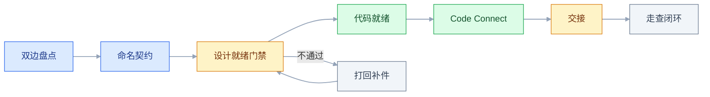
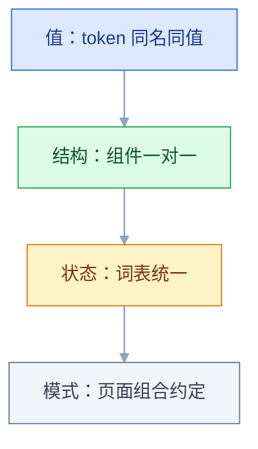

# 与代码的映射

## 一、工程案例：把 68 个 Figma 组件映射到 React 组件库并压住 40 页改版的走查偏差

**场景**：一个中后台产品改版，40 个页面，2 名设计师、5 名前端，周期 7 周。设计侧 Figma 组件库有 68 个组件，代码侧是 Ant Design 5 加 41 个自研封装。上一次改版上线后走查记录 187 条偏差，返工 2 周，主要问题是颜色、圆角、hover 态和空态。

**约束**：

- 本次只改 22 个页面，其余 18 个页面后续迭代，映射表要能延续
- 7 周内完成，设计和开发各占一半时间
- 设计团队在另一个时区，交接必须异步可查，不能靠口头
- 设计侧的变量体系刚建立，组件命名只统一了一半
- Code Connect 与 Dev Mode 的能力随套餐和版本变化，具体以官方当前版本为准
- 没有专门的像素比对平台，先用现有 CI 和截图工具

**目标**：在开发前建立一张可执行的映射表、一份缺项即打回的交接清单、一套三端共用的状态词表，把走查偏差压到 20 条以内。



前五步各占一周，交接与走查压在后两周；门禁不通过就退回补件，不进入开发队列。

### 1.1 第一步：双边盘点（1 周）

```bash
# 代码侧组件使用量
grep -rhoE "<App[A-Z][A-Za-z]+" src --include='*.tsx' | sort | uniq -c | sort -rn

# 代码侧组件文件
find src/components -name "*.tsx" | wc -l

# 原生标签与第三方组件的残留
grep -rn "<table\|<button" src --include='*.tsx' | wc -l
```

盘点的产出是一张差距表，不是组件清单：

| 项 | 数量 | 处理方式 |
|---|---|---|
| 设计组件 | 68 | 以设计库为准 |
| 代码组件 | 41 | 以实际使用为准 |
| 一对一 | 29 | 直接建立映射 |
| 仅设计有 | 18 | 本次做 6 个，其余用近似组件并标注 |
| 仅代码有 | 12 | 标记为内部组件，不进入设计库 |
| 同名不同物 | 7 | 重命名，禁止继续使用旧名 |
| 同物不同名 | 14 | 建别名，逐步迁移 |

后两行是命名问题，与前面的数量有交叉；不要把 29+18+12+7+14 当成 68。

**差距分类比数量更重要**。「仅设计有」的 18 个里，如果有一半是图标按钮、状态标签这类小件，就不值得单独封装；如果有一半是复杂业务组件，就要排期。

### 1.2 第二步：命名契约（1 周）

设计组件名与代码组件名要能互相搜索到。规则只有三条：

1. 组件名用 PascalCase，设计侧和代码侧完全一致
2. 变体值用小写英文，设计侧的 `Primary` 对应代码侧的 `primary`
3. 状态不进入代码组件名；设计侧只在需要展示时保留 `State` 变体

| 设计组件 | 代码 | 说明 |
|---|---|---|
| `Button/Primary/Large` | `<AppButton variant="primary" size="lg">` | 标准映射 |
| `Button/Danger` | `<AppButton variant="danger">` | 危险操作另配确认弹窗 |
| `Input/Text/Error` | `<AppInput status="error">` | 错误态由状态驱动 |
| `Table` | `<AppTable>` | 分页与空态内置 |
| `Modal` | `<AppModal>` | 不超过 8 个字段 |
| `Tag/Status` | `<AppStatusTag status="...">` | 状态值来自业务枚举 |
| `Empty` | `<AppEmpty>` | 统一插画与文案 |
| `PageHeader` | `<AppPageHeader>` | 标题、面包屑、操作区 |

**反例**：设计叫 `Card2`、代码叫 `Panel`，中间靠人记。这种映射一定会断。

### 1.3 第三步：设计侧就绪门禁（1 周）

| 检查项 | 不合格的表现 | 通过标准 |
|---|---|---|
| 组件实例 | 按钮是矩形加文字图层 | 选中后显示组件实例 |
| 变量绑定 | 颜色是手填的十六进制 | 填充来自变量，能看到变量名 |
| 自动布局 | 间距靠手输 | 用 Auto Layout 与 spacing 变量 |
| 状态完整 | 只有默认态 | 默认、hover、focus、disabled、loading、error |
| 边界内容 | 只有正常长度文案 | 超长、空、超多、无权限 |
| 断点 | 只有 1440 稿 | 至少给 1440、1280、768 的行为说明 |

**门禁的执行方式**：设计交付前由设计负责人自查，前端在评审时抽查 5 个页面。不通过不进开发队列。

### 1.4 第四步：代码侧就绪（1 周）

| 检查项 | 通过标准 |
|---|---|
| API 契约 | props 表与设计变体一一对应 |
| 默认值 | 每个 prop 有明确默认值 |
| 状态实现 | 设计列出的状态都有对应样式 |
| 文档 | 每个状态一个 story，示例可运行 |
| 可访问性 | 键盘可达，焦点可见，图标按钮有名称 |

代码侧只封装高频组件，不追求覆盖所有设计组件。**映射表允许「设计组件对应 AntD 原生组件」**，只要 props 写清楚，不必每个都包一层。

| 组件 | 设计属性 | 代码 props | 默认 | 约束 |
|---|---|---|---|---|
| AppButton | Type / Size | `variant` / `size` | secondary / md | 4 变体 3 尺寸 |
| AppInput | State / Size | `status` / `size` | default / md | 错误态必须有文案 |
| AppModal | Size / Footer | `size` / `footer` | md / 取消+确认 | 不超过 8 个字段 |
| AppTable | Density / Empty | `density` / `empty` | comfortable / 内置 | 超过 200 条必须分页 |
| AppStatusTag | Status | `status` | — | 状态值来自业务枚举 |

### 1.5 第五步：Code Connect 映射（1 周）

先做使用频率最高的 12 个组件，不要一次铺满。

```tsx
import figma from '@figma/code-connect'
import { AppButton } from './AppButton'

figma.connect(AppButton, '<Figma 组件链接>', {
  props: {
    variant: figma.enum('Type', {
      Primary: 'primary',
      Secondary: 'secondary',
      Danger: 'danger',
    }),
    size: figma.enum('Size', {
      Small: 'sm',
      Medium: 'md',
      Large: 'lg',
    }),
  },
  example: ({ variant, size }) => (
    <AppButton variant={variant} size={size}>按钮</AppButton>
  ),
})
```

**收益**：在 Dev Mode 的代码面板里，看到的是映射到的真实组件，而不是按图层拼出来的 `div` 和一堆样式。**前提**：设计组件的属性名与代码 props 对得上；对不上时，先改名字，不要先写映射。

并非所有属性类型都能直接映射：文本、布尔、实例替换、子节点各用对应的属性助手，嵌套实例和部分变体组合的支持范围随版本变化，以官方当前版本为准。映射文件要跟组件代码放在一起，组件删了映射也要删。

### 1.6 第六步：交接模板（0.5 周）

设计交付必须包含以下内容，缺一项就打回：

```text
□ 页面清单与优先级
□ 每个页面用到的组件与 variant
□ 每个组件的全部状态（含空、错、加载、无权限）
□ 变量绑定检查结果
□ 断点行为（1440 / 1280 / 768）
□ 超长文本、空数据、超多数据的样子
□ 图标（SVG）与图片（2x/3x）
□ 交互说明（点击、hover、动效时长与缓动）
```

模板放在 issue 模板里，不放在聊天记录里。**异步交接的前提是信息可查，不是消息发过**。

22 个页面按依赖关系分三批迁移，避免「组件还没稳就铺页面」：

| 批次 | 页面 | 前置条件 | 完成标志 |
|---|---|---|---|
| 1 | 登录、首页、列表模板共 5 页 | 核心 8 个组件映射完成 | 走查偏差少于 5 条 |
| 2 | 表单、详情、设置共 11 页 | 状态词表与表单组件稳定 | 映射表覆盖 100% |
| 3 | 报表、权限、异常共 6 页 | 表格与空态组件稳定 | 无横向溢出，空态齐全 |

### 1.7 第七步：走查闭环（1.5 周）

走查意见必须能定位到组件和值：

```text
✘ 这个按钮不太对
✔ [AppButton/Primary][订单列表] 圆角期望 --radius-sm(4px)，实际 6px
✔ [AppTable][用户管理] 1280 宽下横向溢出，期望列宽按比例收缩
```

| 环节 | 动作 | 产出 |
|---|---|---|
| 开发自测 | 对照交接清单逐项打勾 | 自测记录 |
| 设计走查 | 在实际页面量数值 | 偏差清单 |
| 提 issue | 组件名 + 页面 + 期望值 + 实际值 | 可修复的 issue |
| 修复回归 | 修完再看一次 | 关闭记录 |
| 复盘 | 归类高频偏差 | 下一版规范 |

### 1.8 验收

| # | 检查项 | 怎么验 | 通过标准 |
|---|---|---|---|
| 1 | 映射覆盖 | 抽查 22 个页面用到的组件 | 100% 在映射表里 |
| 2 | 命名一致 | 用设计组件名在代码库搜索 | 命中率 100%，无别名歧义 |
| 3 | 设计实例化 | 抽查 5 个页面 | 无游离图层，无 detached 实例 |
| 4 | 变量绑定 | 设计侧插件检查 | 未绑定变量的图层为 0 |
| 5 | 变体对齐 | 两边枚举做笛卡尔对照 | 无「设计有、代码无」的变体 |
| 6 | 状态覆盖 | 对照状态清单点 Storybook | 6 类状态齐全 |
| 7 | Dev Mode 映射 | 打开已建 Code Connect 映射的组件 | 代码面板显示真实组件，受套餐与版本限制 |
| 8 | 数值偏差 | 走查清单统计 | 不超过 20 条 |
| 9 | 断点 | 1440、1280、768 实测 | 无横向溢出，布局符合说明 |
| 10 | 资源 | 检查图标与图片 | SVG 不变形，位图有 2x |
| 11 | 主题 | 切深色模式逐页看 | 无残留浅色块 |
| 12 | 门禁 | 提一个含硬编码的 PR | CI 失败并提示 token |

> 第 8 项要按「数值差异条数」统计，不按「像不像」主观打分。「还原度」不是可验收的指标，能定位到 token 的偏差才算可修复；统计口径要在走查前定好，否则同一页两个人能数出两个数。

---

## 二、高频问答：会卡住你的地方，也是面试最常问的

### 2.1 照着 Dev Mode 抄代码，结构全是写死的

**现场**

看复制出来的片段是否只有固定 `width`/`height` 和 `top`/`left`，没有 `display: flex` 与 `gap`；对照项目里的布局方式。

**要点**

- Dev Mode 是测量仪，不是代码生成器；把查值工具当成生成器，抄出来的只会是固定宽高加 `absolute`。
- 它按选中图层给样式值，不推断布局结构；自由摆放或绝对定位的图层，给出来的就是写死的坐标。
- 没有布局语义就只取颜色、字号、圆角这些值，结构自己写；绝对定位只在自由画布上出现，不是每条都有。

**追问**

- 怎么判断一段 Dev Mode 代码能不能直接用？→ 看它有没有 `flex`/`gap`/`padding` 这类布局语义，只有固定坐标和尺寸的就别信。
- 绝对定位的图层怎么办？→ 只在自由画布上出现，不能照抄，要回到 Auto Layout 重写结构。
- Dev Mode 之外怎么拿到真实组件？→ 用 Code Connect 映射，面板里直接显示源组件而不是拼出来的 div。

### 2.2 设计稿是一堆散图层，映射无从下手

**现场**

在 Figma 里选中元素，看是组件实例还是普通图层；用插件统计游离图层与 detached 实例；随机展开一个页面的图层树，数「未使用组件的元素」占比，超过 20% 就说明设计侧还没准备好被工程化。

**要点**

- 结构不一致时，像素对得再准也会在下一次改版崩掉；散图层不是还原度问题，是工程化前提没满足。
- 设计稿没有组件化：按钮是矩形加文字，卡片复制了 5 次，间距手输，映射就没有锚点。
- 判断准备度的硬指标是游离图层占比；超过 20% 先推设计侧组件化，再谈映射。

**追问**

- 怎么快速判断一页设计能不能被工程化？→ 展开图层树数普通图层与组件实例的比例，普通图层越多越难。
- detached 实例算不算组件化？→ 不算，它是断开同步的副本，映射照样断。
- 设计侧不配合组件化怎么办？→ 至少把高频 6 个组件做成实例，散图层记缺口，别硬上映射工具。

### 2.3 设计组件名和代码组件名对不上

**现场**

拿设计组件名在代码库执行 `grep -rn "Card2" src`，看命中率；再反向搜代码组件名；随机抽 10 个设计组件，让没参与过该项目的开发在 1 分钟内找到对应代码，找不到超过 2 个就先统一命名。

**要点**

- 把可搜索性当成记忆力问题，是错把映射缺口当成人的疏忽；命名对不上根因是没有命名契约。
- 设计叫 `Card2`、代码叫 `Panel`，中间靠人记，这种映射一定会断。
- 统一命名优先于上映射工具；搜不到就是契约没建立，先改名再写映射。

**追问**

- 命名契约最少几条规则？→ 组件名 PascalCase 两边一致、变体值小写英文、状态不进组件名。
- 同名不同物怎么处理？→ 重命名禁止旧名，不让两套语义共用一个词。
- 映射工具能弥补命名混乱吗？→ 不能，名字对不上属性也对不上，先改名字再写映射。

### 2.4 设计有 5 种变体，代码只有 3 种

**现场**

把两边的变体枚举列出来做笛卡尔对照，标出「仅设计」「仅代码」「同名不同义」；对每个缺失变体问一句「它和现有变体的差异是否影响语义」，只影响外观的合并，影响语义的补进代码。

**要点**

- 默认两边应该一一对应却没确认哪边是准的，是错把数量差异当成开发漏做；变体收敛是代码侧主动行为。
- 代码侧收敛变体、设计侧没同步，或两种变体视觉几乎一样被合并，都是常见原因。
- 判断标准是语义：只影响外观的合并，影响语义的补进代码，别为「完整」铺满所有组合。

**追问**

- 变体数量要不要追求一一对应？→ 不用，一对多和多对一正常，关键是写清设计组件由哪几个代码东西组成。
- 怎么避免同名不同义？→ 变体值用闭合枚举，设计新增变体前先确认代码侧有对应语义。
- 缺的变体该补进代码还是改设计？→ 看差异是否影响语义，影响就补代码，不影响就合并。

### 2.5 默认态都对，hover、error、loading 全缺

**现场**

拿状态清单对照 Storybook 逐个点；看设计稿里是否有独立的状态画板；打开一个表单页把输入框分别置于 hover、focus、error、disabled，截图对比设计稿，缺哪个状态就在交接清单上记一条。

**要点**

- 状态不是锦上添花，是组件的一部分；交付物只有默认态，状态清单没进交接模板，上线就会缺。
- 设计稿通常只画默认态，代码却要实现全部状态，没有词表开发只能自己编。
- 验收要逐状态点 Storybook，独立状态画板缺失就是设计侧没准备好。

**追问**

- 哪些状态最常被漏？→ hover、focus、error、loading、disabled，B 端还要单独查无权限。
- 状态该进 props 还是内部样式？→ 交互状态不进 props，除 `disabled` 由调用方传，其余内部处理。
- 为什么状态要在词表里统一？→ 设计写「不可用」、代码写 `disabled`、文档写「禁用」，走查就各说各话。

### 2.6 间距总是差 2px

**现场**

在设计稿里选中容器，看间距是否来自 Auto Layout 与 spacing 变量；在页面上看 computed 的 `gap` 与 `padding`；统计一页里出现的所有间距值，如果有超过 3 个不是 4 或 8 的倍数，先收敛设计侧间距 token。

**要点**

- 2px 的根因通常在刻度体系不在执行；设计稿用了 10、14、18 这类非刻度值，或没用 Auto Layout 间距手输。
- 改代码前先确认设计侧有没有绑 spacing 变量；没绑就先修设计稿，不是开发不仔细。
- 全队用同一套 4pt 或 8pt 栅格，出现 10、14、18 通常不是精细而是没有刻度。

**追问**

- 怎么判断差是设计还是实现？→ 抽 10 个间距，记录设计值、代码值、是否绑变量；绑变量后仍有差才是实现问题。
- 8pt 栅格是硬性标准吗？→ 不是，4pt 也能用，关键是全队同一套。
- 手动拖的 13–15px 怎么根治？→ 间距绑到 `space/*`，禁止裸数值，用 stylelint 白名单拦。

### 2.7 字体和字重对不上

**现场**

在控制台执行 `document.fonts.check('14px "PingFang SC"')`；看 Network 面板里字体文件是否 200；对比 computed 的 `font-family` 与 `font-weight`；临时把字体族改成系统字体看差异是否消失。

**要点**

- 把加载问题当成渲染问题是错的；字体对不上多半是设计用的字体没加载、字重文件缺失或 fallback 抢先渲染。
- 浏览器不背锅，差异消失在换系统字体那一刻就说明是字体文件或授权问题。
- 字体必须先确认授权和加载方案，否则设计稿再准也落不了地。

**追问**

- 怎么区分字体没加载还是渲染差异？→ 临时改系统字体，差异消失就是加载问题不是渲染。
- `document.fonts.check` 什么时候会骗你？→ 本机装了字体就复现不了，要在干净环境验。
- 字重对不上常见原因？→ 字体文件缺 500、600，浏览器合成加粗，视觉重量和设计稿不同。

### 2.8 图标导出来变形或模糊

**现场**

打开 SVG 看 `viewBox`、`width`、`height`；在页面上看容器是否强制改了宽高比；把 SVG 放到原始尺寸和 2 倍尺寸各看一次，原始清晰放大模糊说明是位图，描边变粗说明需要转曲或统一描边规则。

**要点**

- 只换文件不检查使用方式是错的；变形根因是位图拉伸、SVG 的 viewBox 与容器尺寸不一致、描边没转曲。
- 描边宽度写死的 SVG 放大一定变粗，这是资源本身无法无损缩放，不是开发用错尺寸。
- 图标要先于组件统一风格，线性面性、线宽不统一，组件再规范页面也显杂。

**追问**

- 怎么判断导出的图是位图还是矢量？→ 放大到 2 倍，原始清晰放大模糊就是 PNG。
- 描边变粗怎么修？→ 统一线宽，必要时转曲，或固定粗细后单独微调半像素。
- 图标命名怎么规范？→ 语义名如 `icon-search`，别按外观命名，否则开发靠肉眼找。

### 2.9 1280 宽度下表格横向溢出

**现场**

在 1440、1280、1024、768 四个宽度实测；看设计稿是否有断点标注；找出溢出的具体列，确认它是固定宽、最小宽还是内容撑开，再对照设计说明决定缩列、隐藏次要列还是改卡片。

**要点**

- 把响应式当成「缩放」而不是「重新排布」是错的；1280 溢出根因是设计只给 1440 稿，没定义窄屏下列宽、隐藏列或换行规则。
- 加横向滚动条只是把问题推迟，用户在手机上极难操作且不知道右边还有内容。
- 断点不是缩放，要决定哪些列保留、哪些操作收进菜单、表格是否换形态。

**追问**

- 表格移动化有几种方案？→ 卡片化、列优先级隐藏、横向滚动、缩放适配，反例是缩小。
- 怎么选表格方案？→ 看主任务，逐条处理用卡片，批量对比用横滚加固定首列。
- 设计稿最少给几档断点？→ 至少 1440/1280/768 三档加行为说明，只交 1440 等于交给开发自由发挥。

### 2.10 深色模式下设计稿和页面对不上

**现场**

对比同一个 token 在 Figma Dark 模式下的值和页面 computed 值；检查 `data-theme` 是否生效；在页面上取页面背景、卡片、次要文字三个点分别对应设计稿三个 token，三个都偏移是模式没切，只错一个是局部硬编码。

**要点**

- 只比单个色值不比模式是错的；对不上根因是设计用变量 Dark 模式、代码没切换，或组件内部写死浅色值。
- 比十六进制没意义，要比 token；两边都是 `#2563EB` 但一个硬编码，早晚分叉。
- 局部硬编码和模式没切表现不同，三个点全偏移是模式问题，单点偏移是局部写死。

**追问**

- 怎么区分模式没切和局部硬编码？→ 取背景、卡片、次要文字三个 token，全偏是模式没切，单偏是硬编码。
- 设计变量和代码 token 怎么保持同步？→ 同构三层结构，语义层名值都对得上，随机抽 10 个验证。
- 组件内部写死浅色值怎么防？→ CI 拦裸色值，状态走变量，杜绝局部十六进制。

### 2.11 标注缺失、走查意见只写「这里不对」，开发只能返工

**现场**

随机抽 5 个交付页面，看标注是否给到 token 或数值；翻最近 20 条走查 issue 统计含「组件名 + 期望值 + 实际值」的比例；让没参与过该页面的开发只读稿子做一屏，记录问了几次，再拿一条模糊意见现场修记录追问几轮。

**要点**

- 把信息缺失当成沟通态度是错的；走查意见写不清根因是交接没标间距字号状态值，意见没写组件名期望值复现路径。
- 不可执行的意见无法被修复只能被猜，猜错一次双方更烦躁。
- 模板有问题就该改交接物和 issue 模板，而不是反复解释；追问超过一轮就说明结构缺项。

**追问**

- 走查意见的合格模板是什么？→ `[组件名][页面] 期望 <token 或值>，实际 <值>，复现步骤`。
- 怎么度量交付质量？→ 走查 P1 条数、返工天数、重复提问次数、交付后两周变更次数。
- 还原度 95% 为什么不可用？→ 没人知道剩下 5% 是哪 5%，用 P1 条数和是否闭环代替。

### 2.12 设计库升级后，原来的映射失效

**现场**

对比设计库 changelog 与 `package.json` 版本；检查映射文件的最后更新时间；随便挑 3 个映射看设计侧当前组件是否还存在、props 是否还匹配，有一个失效就说明缺版本同步机制。

**要点**

- 把映射当成一次性文档而不是随版本维护的代码是错的；失效根因是设计库和代码包没版本绑定，组件改名删变体后映射没同步。
- 映射文件不是文档是代码，要进版本控制和 CI，组件删了映射也要删。
- 缺版本同步机制的表现是挑 3 个映射就有失效，不是开发没跟上。

**追问**

- 映射失效怎么在 CI 拦？→ 校验映射文件引用的组件和 props 是否还在，删组件触发告警。
- 设计库和代码怎么绑定版本？→ 文件名和发布说明记版本号，破坏性变更加 `Deprecated/` 前缀给迁移期。
- 映射文件放哪？→ 与组件源码同目录，随组件一起维护，不单独丢文档库。

### 2.13 设计稿和页面对不上，改哪边说不清

**现场**

打开设计稿版本历史看改动时间是否晚于开发完成；对比映射表与 token 判断哪边偏离约定；对每处不一致问「改这处会影响其他页面吗」，只影响本页的按稿改，影响组件的先改 token 和映射表再统一回归。

**要点**

- 把「最新」当成「正确」是错的；对不上根因是稿子在开发完成后又改过没版本记录，或代码里的值才对但没人确认过。
- 改哪边取决于是否偏离约定，不是谁晚改谁赢；影响组件的要先改 token 和映射表。
- 以设计稿为准盲目让开发改，常常把代码侧已对齐的约定又打乱。

**追问**

- 怎么判断哪边是准的？→ 看版本历史时间 + 对照映射表和 token，谁偏离约定谁改。
- 影响组件的改动怎么处理？→ 先改 token 和映射表，再统一回归，不只在单页打补丁。
- 设计稿后改了怎么防？→ 设计侧改前标版本，开发侧值以约定 token 为准，偏离走变更单。

---

## 三、核心知识：从零开始要建立的东西

### 3.1 映射的四个层次



| 层 | 设计侧 | 代码侧 | 映射方式 |
|---|---|---|---|
| 值 | 颜色、间距、字号 | CSS 变量 | 同名同值 |
| 结构 | Button、Card | React 组件 | 一对一 |
| 状态 | hover、error、loading | props 与内部样式 | 词表统一 |
| 模式 | 页面如何组合 | 模板与布局组件 | 文档约定 |

四层是依赖关系，不是时间顺序：值不稳，结构就只能硬编码；状态没有词表，映射只能靠口头。

**最容易缺的是状态层**。设计稿通常只画默认态，代码却要实现全部状态；没有词表，开发只能自己编。

> **面试**：常问「设计与代码的映射分哪几个层次？缺了哪层最要命？」答：值、结构、状态、模式四层依赖，最易缺的是状态层。

### 3.2 设计组件与代码组件的对应关系

| 关系 | 例子 | 处理 |
|---|---|---|
| 一对一 | `Button` ↔ `AppButton` | 直接映射 |
| 一对多 | `Button/Danger` ↔ `AppButton` + `ConfirmModal` | 映射到组合，不硬塞进一个组件 |
| 多对一 | `Input/Text`、`Input/Search` ↔ `AppInput` | 用 variant 区分 |
| 仅设计有 | 复杂业务卡片 | 本次不做，或用近似组件并标注 |
| 仅代码有 | 内部布局容器 | 不进设计库，文档标注 |

**不要追求 100% 一一对应**。一对多和多对一是正常的，关键是写清楚「设计里的这个组件，代码里由哪几个东西组成」。

登记用的映射表至少要有五列：设计组件名、代码组件与路径、props 对照、最后校验日期、负责人。没有日期和负责人，表会在两个月内变成传说。

### 3.3 变体与 props 的契约

| 设计属性 | 代码 prop | 取值 | 谁决定 |
|---|---|---|---|
| Type | `variant` | primary / secondary / danger | 调用方 |
| Size | `size` | sm / md / lg | 调用方 |
| State | 内部样式 + `disabled` | default / hover / focus / disabled | 内部管理，`disabled` 由调用方传入 |
| Icon | `icon` | ReactNode | 调用方 |

```ts
type ButtonVariant = 'primary' | 'secondary' | 'danger'
type ButtonSize = 'sm' | 'md' | 'lg'
```

**三条约束**：

1. 变体值是闭合枚举，不用任意字符串
2. 交互状态不进入 props，除了 `disabled`
3. 设计侧新增变体前，先确认代码侧是否有对应语义

### 3.4 状态命名词汇表

三端用同一套词，映射才不会断：

| 状态 | 设计侧命名 | 代码 | 说明 |
|---|---|---|---|
| 默认 | Default | 默认 | 无额外 class |
| 悬停 | Hover | `:hover` | 移动端无此态 |
| 聚焦 | Focus | `:focus-visible` | 键盘可见 |
| 禁用 | Disabled | `disabled` | 不触发事件 |
| 加载 | Loading | `loading` | 防重复提交 |
| 错误 | Error | `status="error"` | 表单与输入 |
| 成功 | Success | `status="success"` | 校验通过 |
| 空 | Empty | `empty` 插槽 | 列表与表格 |
| 无权限 | NoAccess | `forbidden` | 页面级 |

**词表要写进交接模板和代码类型**。设计写「不可用」、代码写 `disabled`、文档写「禁用」，三处不一致，走查时就会各说各话。

### 3.5 Dev Mode 的定位与边界

| 能力 | 用途 | 边界 |
|---|---|---|
| 代码面板 | 查颜色、字号、间距的数值 | 面板里的代码不是生产代码 |
| 变量查看 | 确认元素是否绑定了 token | 未绑定就显示原始值 |
| Ready for dev | 标记设计完成 | 只是状态，不校验质量 |
| 与编辑器集成 | 在 IDE 里看设计 | 仍需人工判断结构 |
| Code Connect | 显示真实组件代码 | 依赖映射文件与套餐能力 |

`Ready for dev` 的具体名称和入口以官方当前版本为准；它只是状态标记，不代表变量、状态、断点已经齐全。

**正确用法**：把 Dev Mode 当测量仪，不当代码生成器。看到原始色值、没有变量标记，第一件事是让设计侧绑定变量，而不是把色值抄进代码。

> **面试**：常问「Dev Mode 给的代码能直接上线吗？」答：只是测量仪，按图层给样式值不推断结构，抄出来全是写死坐标。

除了在面板里看代码，Figma 还通过 MCP 服务把设计上下文提供给 AI 编码工具；它给的是变量、组件和布局信息，不是可验收的代码，能力与套餐同样以官方当前版本为准。

### 3.6 Code Connect 的映射文件

映射文件声明「这个 Figma 组件对应哪个代码组件、属性怎么转」：

```tsx
import figma from '@figma/code-connect'
import { AppButton } from './AppButton'

figma.connect(AppButton, '<Figma 组件链接>', {
  props: {
    variant: figma.enum('Type', {
      Primary: 'primary',
      Secondary: 'secondary',
    }),
  },
  example: ({ variant }) => <AppButton variant={variant}>按钮</AppButton>,
})
```

| 项 | 要求 |
|---|---|
| 位置 | 与组件源码同目录，随组件一起维护 |
| 覆盖范围 | 先做高频 10 到 15 个，不求全 |
| 属性映射 | 设计属性名与代码 prop 一一对应 |
| 示例 | 可运行，不含业务数据 |
| 失效处理 | 组件删除或改名时同步删除映射 |

Code Connect 的能力、支持的文件类型和套餐限制以官方当前版本为准。映射文件不是文档，是代码，要进版本控制和 CI。

### 3.7 设计侧的组件化前提

| 不合格 | 合格 | 影响 |
|---|---|---|
| 矩形加文字当按钮 | Button 组件实例 | 无法映射 props |
| 间距手输 | Auto Layout + spacing 变量 | 无法保证刻度 |
| 颜色手填 | 引用 color 变量 | 无法换主题 |
| 同一卡片画 5 次 | 一个 Card 加 5 个实例 | 改一次要改五处 |
| 状态只画默认 | 每个状态一个变体 | 开发自己编 |

**自查方法**：把页面图层全部展开，数「普通图层」与「组件实例」的比例。普通图层越多，越难工程化。

### 3.8 布局映射：Auto Layout 与 Flex

| 设计 | 代码 | 注意 |
|---|---|---|
| 横向 Auto Layout | `display: flex; flex-direction: row` | 对齐方式对应 `align-items` |
| 纵向 Auto Layout | `flex-direction: column` | 主副轴不要搞反 |
| Space between | `justify-content: space-between` | 少于两个子元素时行为不同 |
| Wrap | `flex-wrap: wrap` | 设计侧要标明换行规则 |
| Fill container | `flex: 1` 或 `width: 100%` | 注意最小宽度 |
| Hug contents | `width: fit-content` | 文本过长时会撑破 |

**结构一致优先于像素一致**。设计用 Auto Layout、代码用 Flex，结构才对得上；设计用绝对定位、代码用 Flex，像素永远差几像素，而且改一次就乱。

### 3.9 间距与栅格映射

| 设计值 | token | 用途 |
|---|---|---|
| 4px | `space.1` | 图标与文字 |
| 8px | `space.2` | 紧密元素 |
| 12px | `space.3` | 表单内部 |
| 16px | `space.4` | 卡片内边距 |
| 24px | `space.6` | 区块间距 |
| 32px | `space.8` | 页面分区 |

**8pt 栅格不是硬性标准**，4pt 也能用，关键是全队用同一套。设计稿里出现 10、14、18，通常不是精细，而是没有刻度。

栅格列数也要约定：12 列、24 列还是自适应。列数不同，`span` 的换算就不同，映射表里要写清楚。

### 3.10 排版映射

| 设计属性 | 代码 | 常见偏差 |
|---|---|---|
| 字号 | `font-size` | 设计稿用 13px，代码字阶里没有 |
| 行高 | `line-height` | 设计给绝对值，代码用倍数 |
| 字重 | `font-weight` | 字体文件缺 500、600 |
| 字间距 | `letter-spacing` | 中文标题常被忽略 |
| 字体族 | `font-family` | 设计字体未授权或未加载 |

排版 token 建议拆成三组：`font.size.*`、`font.line.*`、`font.weight.*`，再用 `typography.body` 这类复合 token 组合。**字体必须先确认授权和加载方案**，否则设计稿再准也落不了地。

### 3.11 颜色与主题映射

| 设计 | 代码 | 检查 |
|---|---|---|
| 颜色变量 Light 模式 | `:root` 下的语义变量 | 是否绑定变量 |
| 颜色变量 Dark 模式 | `[data-theme="dark"]` | 是否切换 |
| 品牌模式 | `[data-brand]` | 是否正交 |
| 透明度 | `rgb(... / alpha)` 或 `color-mix()` | 叠加背景后是否仍达标 |

**不要比十六进制，要比 token**。设计稿里显示 `#2563EB`、代码里显示 `var(--color-action)`，只要最终解析值一致就是对的；反过来，两边都是 `#2563EB` 但一个是硬编码，早晚会分叉。

> **面试**：常问「深色模式对不上，怎么区分是没切模式还是局部硬编码？」答：取背景、卡片、次要文字三个 token，全偏是模式没切，单偏是硬编码。

### 3.12 图标与资源映射

| 项 | 规范 | 检查 |
|---|---|---|
| 格式 | 优先 SVG，位图给 2x/3x | 放大是否模糊 |
| 画布 | 统一 24 × 24，保留 `viewBox` | 是否被拉伸 |
| 描边 | 统一线宽，必要时转曲 | 缩放后粗细是否变化 |
| 颜色 | 用 `currentColor` 或 token | 能否跟随主题 |
| 命名 | 语义名，如 `icon-search` | 是否按外观命名 |

图标要先于组件统一。图标风格（线性/面性、圆角/直角、线宽）不统一，组件做得再规范，页面看起来还是杂。

### 3.13 响应式与断点映射

| 断点 | 设计稿 | 代码行为 |
|---|---|---|
| 1440 | 完整布局 | 基准 |
| 1280 | 需要确认 | 侧栏收窄或隐藏次要列 |
| 1024 | 需要确认 | 表格改卡片或横向滚动 |
| 768 | 需要确认 | 单列，操作区换行 |
| 375 | 移动端范围 | 是否支持必须前置确认 |

**断点不是缩放**。1280 下不是把 1440 的稿子整体乘 0.89，而是决定哪些列保留、哪些操作收进菜单、表格是否换形态。设计稿至少要给关键断点的行为说明。

### 3.14 交接物清单

| 类别 | 必须包含 | 缺了会怎样 |
|---|---|---|
| 页面 | 清单、优先级、状态 | 不知道做哪些 |
| 组件 | 名称、variant、props | 开发自己猜 |
| 状态 | 默认之外的全部状态 | 上线才发现缺 |
| 变量 | 颜色、间距、圆角、字号 | 硬编码 |
| 断点 | 各宽度的布局变化 | 窄屏溢出 |
| 边界 | 超长、空、超多、无权限 | 真实数据下崩 |
| 资源 | SVG、2x/3x 图、字体授权 | 模糊或无法加载 |
| 交互 | 点击、hover、动效时长与缓动 | 手感不一致 |

**「够用」的标准**：开发不看聊天记录，只读交接物就能把页面做完。做不到，就是交接物缺项。

### 3.15 走查闭环与自动化门禁

走查意见的模板：

```text
[组件名][页面] 期望 <token 或值>，实际 <值>，复现步骤 <...>
```

| 门禁 | 工具 | 拦截什么 |
|---|---|---|
| 硬编码颜色 | stylelint `color-no-hex` | 新增 `#2563EB` |
| 裸间距 | stylelint 属性白名单 | `padding: 13px` |
| 组件外原生标签 | ESLint 自定义规则 | 绕过封装 |
| 视觉回归 | Storybook + 截图对比 | 非预期视觉变化 |
| 映射失效 | CI 校验映射文件 | 组件删了映射还在 |

```json
{
  "rules": {
    "color-no-hex": true,
    "declaration-property-value-allowed-list": {
      "margin|padding|gap": ["/^var\\(--space-/", "0", "auto"]
    }
  }
}
```

**制度比提醒有效**。评审时提醒十次，不如 CI 拦一次。规则名、插件和配置格式随 stylelint 版本变化，以官方当前版本为准；门禁先跑通一条，再逐条加。

---

## 四、冷门知识汇总

| 知识点 | 为什么冷门 | 用到时的关键词 |
|---|---|---|
| Code Connect 属性助手 | 简单组件只用到 enum | `figma.string`、`figma.boolean`、`figma.instance` |
| Code Connect CLI | 只有要把映射发布到 Figma 时才用 | `figma connect`、publish |
| 变体属性的支持边界 | 简单组件不会碰到 | 嵌套实例、变体属性 |
| 变量模式的继承 | 单主题项目遇不到 | modes、显式模式、集合 |
| 未绑定变量检测 | 需要插件与流程配合 | 原始值图层、变量绑定 |
| Figma MCP 服务 | 只有接 AI 编码工具时才开 | MCP、设计上下文 |
| 最小宽度 | 窄屏溢出时才查 | `min-width`、`min-content` |
| 字体加载检测 | 本机装了字体就复现不了 | `document.fonts.check` |
| 字体子集化 | 中文包体积大时才做 | subset、`unicode-range`、缺字 |
| SVG 的 viewBox | 不改尺寸时看不出问题 | `viewBox`、`preserveAspectRatio` |
| 描边转曲 | 只在缩放时暴露 | stroke、outline |
| 图片比例与裁切 | 固定尺寸图才暴露 | `aspect-ratio`、`object-fit` |
| 逻辑属性 | 只有 RTL 项目会遇到 | `margin-inline-start` |
| 内容断点与容器查询 | 组件级响应式才用 | `@container`、内容优先 |
| 减少动效偏好 | 普通验收不会开 | `prefers-reduced-motion` |
| 打印样式 | 报表类项目才需要 | `@media print` |
| 高对比度模式 | 普通验收不会开 | `forced-colors` |
