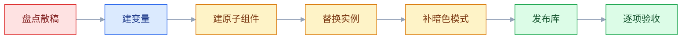
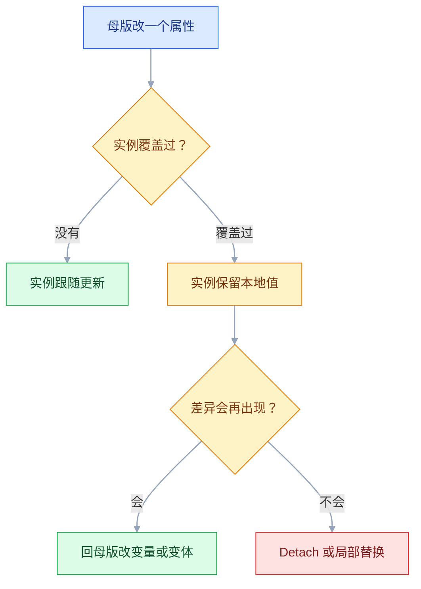
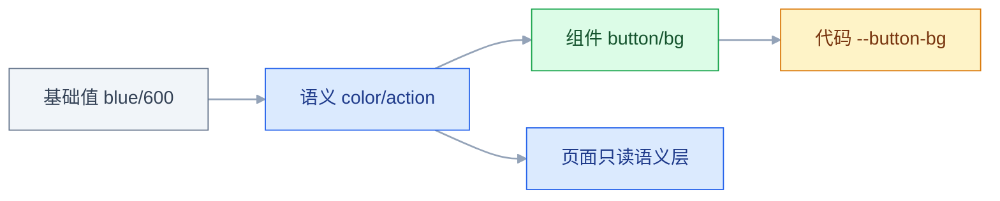

# Figma 核心

## 一、工程案例：把 12 页散稿改造成支持暗色的组件化文件

**场景**：一套已上线的运营后台，12 个页面，全部由矩形和文字拼成。颜色直接填十六进制，同一档灰色出现了 6 个值；间距靠手动拖，按钮有 7 种圆角；没有任何组件。产品要求三周内加暗色模式，并在同一套稿上继续加 20 个页面。团队 1 名设计、2 名前端。

**为什么必须做**：按现状加暗色，等于把 12 页重画一遍；下一轮改主色，还要再改 40 多处。更麻烦的是，设计稿和代码各有一份色值，谁也说不清哪个是准的。这次改造的目标不是「把稿子画漂亮」，而是把文件变成**改一处、全站生效**的结构，并且这套结构能被下一个项目直接复制。

**动手前确认**：先复制一份文件做改造，原文件保留只读。改造期间新需求继续在原文件上做，避免两边同时改同一页。

### 1.1 主线（按顺序执行，不要跳步）

**① 盘点现状（半天）**

不先数，就不知道要改多少。把五个数写进一张基线表，改造前后各记一次：

| 指标 | 改造前 | 目标 | 说明 |
|---|---|---|---|
| 唯一十六进制色值 | 63 | ≤ 40 | 超过 40 个基本无法维护（经验值） |
| 未绑定变量的填充图层 | 412 | 0 | 变量审计插件的统计口径 |
| 同一按钮的独立实现 | 9 | 1 | 收敛成一个组件 + 变体 |
| 唯一圆角值 | 7 | ≤ 4 | 0 / 4 / 8 / full |
| 最大单页图层数 | 2,600 | ≤ 3,000 | 超过三千会明显变卡（经验阈值） |

盘点用社区里的变量审计、样式统计类插件即可，具体可用性以官方当前版本为准；没有插件就逐页选中同类元素看右侧面板。**盘点的产出不是数字，是「哪些东西重复了」的清单。**

**② 建变量（半天）**

先建变量，再建组件。顺序反了，组件里的颜色还得回头改一遍。

| 变量 | Light | Dark | 用途 |
|---|---|---|---|
| `color/bg/page` | `#F7F8FA` | `#121212` | 页面底色 |
| `color/bg/card` | `#FFFFFF` | `#1E1E1E` | 卡片、弹层 |
| `color/text/1` | `#101828` | `#E6E6E6` | 主文字 |
| `color/text/2` | `#475467` | `#A0A0AB` | 次要文字 |
| `color/action` | `#2563EB` | `#60A5FA` | 主操作、链接 |
| `color/border` | `#E5E7EB` | `#2E2E33` | 分隔线、输入框边界 |
| `space/1..8` | 4 / 8 / 12 / 16 / 24 / 32 / 48 / 64 | 同左 | 间距 |
| `radius/sm` `radius/md` `radius/full` | 4 / 8 / 999 | 同左 | 圆角 |

变量名按「类别/用途/层级」写，不按颜色写。`color/action` 能换值，`color/blue` 换值就名不副实。

**③ 建原子组件（一天）**

只做高频的 5 个：Button、Input、Tag、Checkbox、Card。先原子后组合，从大组件开始做一定返工。

| 组件 | 变体维度 | 实际组合 | 说明 |
|---|---|---|---|
| Button | Type × Size × State | 4 × 3 × 4 = 48，只建 28 | 未使用的组合不建 |
| Input | State × Size | 4 × 2 = 8 | 错误态必须单独存在 |
| Tag | Tone × Size | 5 × 2 = 10 | 颜色走变量，不写死 |
| Checkbox | State | 4 | 含 indeterminate |
| Card | Type | 3 | 内容区放占位实例，不在实例里写死 |

**④ 替换实例（一天）**

先换高频按钮，再换输入框、标签和卡片；表格行差异大、改造成本高，本期只统一颜色与间距，不做组件化。批量替换类插件能加速，但换完必须抽查 override：如果大量实例都覆盖了圆角，说明组件的圆角该绑变量，而不是在每个实例上改。

**⑤ 加暗色模式（半天）**

变量在 ② 就建成了 Light / Dark 两个模式，这一步只做三件事：填 Dark 模式的值、给不走变量的部分（图片、插画、效果样式）补暗色版本、逐页切换检查。检查重点不是「好不好看」，是**有没有残留的浅色块**和**对比度是否还达标**。正文要求 4.5:1，大字号和图形边界要求 3:1。

**⑥ 发布库并写发布说明（半天）**

把变量、基础组件、图标分成三个库发布。Figma 不会强制库的版本号，版本信息写在文件名和发布说明里：改了什么、影响哪些组件、要不要迁移，不要只写「update」。订阅方接受更新后，抽查 3 个页面确认没有意外变化。

**⑦ 验收（半天）**

按 1.2 的表逐项过。验收不通过的点，回到对应步骤修，不要在主文件上直接打补丁。

**本案例的产出物**：

| 产出 | 内容 | 谁用 |
|---|---|---|
| 基线盘点表 | 唯一色值、未绑定填充、独立按钮数 | 设计自己 |
| token 表 | 变量名、Light/Dark 值、用途 | 设计与前端 |
| 组件清单 | 维度、组合数、状态、负责人 | 前端 |
| 替换记录 | 页面、旧元素、新组件、override 数 | 设计与走查 |
| 验收表 | 1.2 的 10 项 | 双方 |



### 1.2 验收（10 项全过才算完成）

| # | 检查项 | 怎么验 | 通过标准 |
|---|---|---|---|
| 1 | 颜色已绑定变量 | 随机抽 10 个填充图层看右侧 Fill | 10 个都显示变量名，不显示 hex |
| 2 | 改主色能全站生效 | 临时改 `color/action` 的值 | 12 页的主按钮、链接同时变化 |
| 3 | 按钮已组件化 | 搜索同类按钮实例 | 独立实现为 0，全部是同一组件实例 |
| 4 | 变体覆盖真实状态 | 抽查 5 个页面的按钮 | default / disabled / loading 都有；需要 hover 时也有 |
| 5 | 暗色无残留 | 切到 Dark 逐页滚动 | 没有白底卡片、浅灰分隔线 |
| 6 | 对比度达标 | 用对比度检查器取实际渲染色 | 正文 ≥ 4.5:1，大字与边界 ≥ 3:1 |
| 7 | 文本不溢出 | 把按钮和标题文案换成 2 倍长度 | 高度自动增长，不截断、不压字 |
| 8 | 图标可缩放 | 同一图标放 16 / 24 / 48 三档对比 | 三档视觉粗细一致，无拉伸变形 |
| 9 | 库可被订阅 | 新建空文件订阅该库 | 能插入组件，且显示来源库 |
| 10 | 文件性能可接受 | 打开常用页滚动、选中，看单页图层数 | 打开到可操作 ≤ 3 秒（经验值），单页图层数 ≤ 3,000 |

> 第 2 项要真的改变量再改回来，不要只看「看起来都绑了」。第 5 项要滚动整页，弹层和吸底栏最容易漏。

### 1.3 复制到下一个项目

能复制的是**结构和顺序**，不是色值：

| 可复制 | 不可复制 |
|---|---|
| 变量命名规则、三层 token 结构 | 品牌色、业务语义色 |
| 组件分层（原子 → 组合 → 业务） | 具体业务组件 |
| 验收表、改造顺序 | 页面数量和排期 |
| 库的拆分方式 | 团队权限配置 |

迁移旧文件前先做一次判断：**页面数 × 改动频率**。页面少、半年不动一次的，重画比改造便宜；页面多、每周都改的，才值得做变量和组件。并行期允许旧库和新库同时存在，但要在文件名上标清 `legacy`，并约定下线日期。

> 最容易犯的错是「一次全量重构」。正确做法是先改一个模块，跑通验收表，再复制到其余模块。改造期间不要同时调整视觉风格，否则出了问题分不清是结构还是样式引起的。

---

## 二、高频问答：会卡住你的地方，也是面试最常问的

### 2.1 改一次主色，改了四十多处

**现场**

选中图层看 Fill 右侧显示变量名还是色块；用变量审计列出未绑定图层；随机抽 10 个同类元素记录「是否绑定变量 + 变量名是否一致」；统计全文件唯一 hex 数量，改造前后各一次。

**要点**

- 把「值」当成「源」是错的；逐个改不仅慢，还会把同一种灰改出五个近似值，下一轮更乱。
- 根因是填充为原始十六进制没绑颜色变量，或绑了变量但实例上做了颜色 override。
- 判断标准是唯一 hex 数量：数字不降，说明还有散值，先别谈换肤。

**追问**

- 怎么确认还有没有散值？→ 统计全文件唯一 hex，改造前后对比，数字降了才算绑干净。
- 实例 override 为什么会让变量失效？→ override 是本地值，优先于母版绑定的变量。
- 为什么不直接逐个改？→ 会改出多个近似值，且下一次调整还得重来。

### 2.2 改了母版，页面纹丝不动

**现场**

选中看右侧有没有实例面板与母版名；Assets 里搜同名组件看有几个来源；图层面板搜组件名看命中数量与图标类型；对可疑图层右键看「Go to main component」能否跳转，跳不过去就是副本。

**要点**

- 刷新只能解决渲染延迟，解决不了「它本来就不是实例」；detach 是一次性动作，断开后没有任何同步关系。
- 根因是放了 detach 副本、改的是实例 override 不是母版，或存在两个同名组件改错了来源。
- 跳不过去的就是副本，这一条比看外观更可靠。

**追问**

- 怎么一眼看出是不是实例？→ 右侧有实例面板和母版名。
- detach 之后还能自动恢复吗？→ 不能，只能重新换成实例，之前的 override 也白做。
- 两个同名组件怎么排查？→ Assets 里看来源库，确认改的是哪个。

### 2.3 一开自动布局就破版

**现场**

逐层看 Resizing 与固定宽高；查绝对定位标记；把父级从 Fixed 改成 Hug 看哪一层先塌；再从最内层开始一层层改 Hug，找第一层溢出的位置。

**要点**

- 破版的不是自动布局，是原来手动摆放留下的固定尺寸；自动布局只是把这些矛盾暴露出来。
- 子元素绝对定位、固定宽高被压回内容尺寸、文本图片锁高，是三类典型原因。
- 溢出的那一层就是尺寸契约的断点，修完再往外一层。

**追问**

- 为什么一开自动布局就塌？→ 原来的固定宽高在 Hug 下被压回内容尺寸。
- 绝对定位和自动布局冲突吗？→ 绝对定位子元素不参与布局，要单独处理。
- Resizing 三种怎么选？→ Hug 跟内容、Fill 撑满父级、Fixed 固定数值。

### 2.4 按钮文字一长就溢出

**现场**

把文案换成 2 倍长度看按钮高度是否增长；选中文本看纵向 Resizing；准备最短、平均、最长三条测试文案逐条替换，三条都不溢出才算过。

**要点**

- 改文案只是把问题推迟到下一次运营改字；真实数据一定比设计稿长，尤其是姓名、机构名、多语言。
- 根因是文本层锁高只换行不增高、按钮宽度 Fixed 被压成两行或截断、文本 Auto width 把按钮撑出去。
- 用真实长度的三条样例验收，不用「差不多长」的占位。

**追问**

- 怎么防溢出？→ 准备最短、平均、最长三条真实文案，最长那条在 375 也不溢出。
- 文本层该锁高度吗？→ 按钮和列表里不要锁，用 Auto height。
- Fixed 宽度按钮什么时候能用？→ 图标加固定短文案，且允许换行。

### 2.5 变体面板里找不到想要的状态

**现场**

看组件集的属性列表与取值拼写；数一下组合数；抽查 3 个实例的属性值；把属性与取值抄成一张表，逐列检查大小写、空格、单复数。

**要点**

- 变体面板是**按属性值索引**的，拼写不一致就是两个值；面板不会猜「常规」等于 `Default`。
- 根因是属性值命名不统一、混入空格或全角字符、同一状态被拆进两个维度、组合太多。
- 规定只用小写英文，属性顺序固定为 Type → Size → State。

**追问**

- 为什么「常规」和 Default 认不到一起？→ 按值索引，字符不同就是两个值。
- 组合数怎么控制？→ 只建真实出现的组合，文本布尔实例交换能替代维度。
- 属性顺序为什么要固定？→ 代码侧才能一一映射，顺序乱了对不上。

### 2.6 切了暗色模式，有几块没变

**现场**

切模式后逐层看 Fill 是否显示变量名与 mixed 状态；展开 Effects 看阴影颜色；Dark 下逐页截图与 Light 做差集，再对每处差异看图层绑定状态。

**要点**

- 模式切换只改变量，不改 override；只要实例上手动点过一个颜色，那个属性就不再跟随主题。
- 根因是图层 override 了颜色，或阴影、图片、渐变里写死了浅色。
- 阴影颜色可以绑颜色变量，没绑的就不随模式变；图片本身不受变量控制，要单独换图或做暗色版本。

**追问**

- override 为什么压过变量？→ 实例本地值优先于母版变量。
- 图片怎么处理暗色？→ 做暗色版本或单独换图，变量管不到位图。
- 阴影能跟主题吗？→ 颜色可绑变量，模糊与偏移随效果样式走。

### 2.7 库更新了，订阅方没收到

**现场**

Assets 面板看目标库有没有更新提示，再对照发布说明；在对方文件里选中组件看来源库；让订阅方打开 Assets 看目标库是否显示「有更新」。

**要点**

- 发布是显式动作，保存文件不等于发布库；订阅方也要显式接受，不会自动替换正在用的组件。
- 根因是只改本地没发布、发布了订阅方没接受、对方用的是复制出来的本地组件。
- 没有更新提示就是没发布，有提示但组件没变就查本地副本。

**追问**

- 有更新提示但组件没变？→ 检查对方是不是用了本地副本。
- 为什么不会自动替换？→ 订阅方必须显式接受更新。
- 怎么让发布可控？→ 发布说明写清影响面，一次只改一类。

### 2.8 改了一个组件，别人的稿子一起变

**现场**

看组件名是否带库来源；看发布面板的变更清单、版本历史里的时间和作者；发布前把变更清单逐项看一遍。

**要点**

- 母版是共享的源，不属于某一个人；改动会沿库扩散到所有订阅文件，代价在别人的十几页，不在你这一页。
- 根因是改了已发布库的母版，或在实例上用「Push changes」把本地改动推回了母版。
- 已经发出去、对方也接受了更新，本地不会自动回滚，只能从版本历史恢复到改动前再重新发布。

**追问**

- 改之前怎么防？→ 先复制文件或开分支，验收后再合并发布。
- 已经扩散了怎么办？→ 版本历史恢复到改动前再发布，别在母版上试。
- Push changes 为什么危险？→ 把本地改动推回母版，影响所有订阅方。

### 2.9 文件越用越卡

**现场**

看文件大小与单页图层数；把可疑页面复制到新文件对比操作延迟；复制后不卡说明是原文件图层或图片问题，仍卡才怀疑网络或客户端。

**要点**

- 换机器只能提高一点上限，文件本身的结构问题还在，同一个文件在同事机器上也会卡。
- 根因是未压缩的大图、过深的图层嵌套、大量隐藏图层、订阅了体积很大的库。
- 用「复制到新文件」做对照实验，比反复换环境快。

**追问**

- 怎么定位卡的原因？→ 复制到新文件做对照实验。
- 单页图层数多少算多？→ 三千以内，嵌套尽量不超过 6 层。
- 隐藏图层也占性能吗？→ 占，要清理，别留着当备份。

### 2.10 图标放大后变粗、变糊

**现场**

看宽高比是否锁定，看 16 / 24 / 48 三档的实际粗细；用缩放工具（K）等比调整并锁定宽高比；导出前确认 viewBox 是方形、没有隐藏层。

**要点**

- SVG 的描边会随画布等比缩放，本身不会「越放越粗」；真正坏掉的是拉伸和位图，比例已经错的图标放哪个尺寸都不对。
- 根因是图标被非等比拉伸、改宽高时描边没跟着缩放、或导出的是 PNG。
- 小尺寸下 1px 描边容易落在半像素上发虚，需要固定粗细时再轮廓化后单独微调。

**追问**

- 为什么放大变粗？→ 拉伸破坏比例，或描边写成固定绝对值。
- 怎么修？→ 等比缩放并锁定宽高比，必要时轮廓化。
- 导出前该查什么？→ viewBox 方形、无隐藏层、尺寸取整数。

### 2.11 开发量出来的间距和设计稿差 1px

**现场**

看画框宽度是 1440 / 375 这类 1x 值还是 2880 / 750；看 X/Y/W/H 是否为整数；Dev Mode 里看显示变量名还是原始值；把画框改 1x、坐标取整、间距绑 `space/*` 再让开发重读。

**要点**

- 问题不在谁量得不准，而在稿子本身没有唯一答案；2x 尺寸、半像素、手拖的 14px，怎么量都对不上，越仔细差得越稳定。
- 根因是按 2x 画、元素落在半像素、间距手动拖 13–15px、用缩放工具整组缩放过。
- 三项修完（1x、取整、绑变量）还对不上，才去查描边对齐。

**追问**

- 为什么越仔细差得越稳定？→ 稿子本身没有唯一答案，量得再准也复现同一个错。
- 怎么根治？→ 画框改 1x、坐标取整、间距绑变量。
- 三项都对还差 1px？→ 再查描边是居中还是内/外对齐。

### 2.12 智能动画乱飞

**现场**

对照两层图层树看同名同层级是否一一对应；给对应元素改成完全相同的名字、放相同层级再预览；仍乱飞就减少同时动画的元素数量，只保留一个主体。

**要点**

- 智能动画靠名称和层级匹配，不靠视觉相似；名字对不上它就按位置猜，结果就是乱飞。
- 根因是两个画框里的图层不同名不同层级，匹配到错误元素，或元素数量不一致。
- 名字和层级对齐后仍乱飞，就减少同时动画的元素。

**追问**

- 为什么会乱飞？→ 按名称和层级匹配，对不上就按位置猜。
- 怎么修？→ 同名同层级，再减少同时动画的元素。
- 视觉相似能代替命名吗？→ 不能，机制根本不看相似度。

### 2.13 实例里改不了文字

**现场**

看右侧是否列出该文本属性；看图层面板有没有锁；看文字层是文本还是矢量路径；回到母版选中文本层，把内容暴露为文本属性。

**要点**

- 重建组件会丢掉所有已有实例的 override，代价远大于改一个属性开关；重建留到最后。
- 根因是文字在嵌套实例里只能改外层暴露的属性、文本属性被设为默认隐藏、实例或文本层被锁定、文字其实是图片或轮廓化路径。
- 嵌套实例里的文字只能通过外层组件的属性改，图片文字只能换图。

**追问**

- 为什么实例里改不了文字？→ 嵌套实例只透传外层暴露的属性，或文字是图片/轮廓。
- 怎么修？→ 母版里把文本层暴露为文本属性。
- 什么时候才重建？→ 其他手段都不行才重建，且会丢所有已有 override。

---

## 三、核心知识：从零开始要建立的东西

### 3.1 画框、编组与坐标系统

Figma 里所有元素都活在某个父级坐标系里。画框（Frame）是一个有独立坐标、可裁剪、可设约束的容器；编组（Group）只是把几个图层临时捆在一起，尺寸永远等于内容边界。

| | Frame | Group |
|---|---|---|
| 自身尺寸 | 可固定，也可由内容撑开 | 永远等于内容边界 |
| 裁剪 | 可开 Clip content | 不能 |
| 约束 | 子元素可设 Constraints | 不能 |
| 滚动溢出 | 可设 | 不能 |
| 适用 | 页面、组件、卡片、弹层 | 临时整理图层 |

约束（Constraints）决定父级尺寸变化时子元素怎么跟随：左、右、左右拉伸、居中、按比例缩放。它不是自动布局的替代品，而是**没有自动布局时的兜底**。一个卡片如果内部是绝对定位，靠约束也能在宽度变化时保持边距，但内容增多时不会自动撑高。

> 判断标准：需要「内容决定尺寸」就用自动布局；只需要「父级变化时保持位置」才用约束。两者混用时，先定外层约束，再在内层开自动布局。

### 3.2 自动布局的尺寸契约

自动布局的核心不是「排得整齐」，而是给每个元素规定三条尺寸规则：主轴怎么变、交叉轴怎么变、内容超出怎么办。

| Resizing | 含义 | 典型用途 |
|---|---|---|
| Hug | 尺寸等于内容 | 按钮、标签、徽标、工具栏 |
| Fill | 撑满父级剩余空间 | 输入框、内容区、侧栏旁的主区域 |
| Fixed | 固定数值 | 图标、头像、固定宽度菜单 |

一条最小可用的规则链：

```text
页面 Frame        Fixed 1440，纵向 Hug
  └ 内容区        Fill 横向，纵向 Hug
      └ 表单行    Fill 横向，纵向 Hug
          └ 输入框 Fill 横向，高度 Fixed 40
          └ 按钮   Hug 横向，Hug 纵向
```

常见冲突只有三类：父级 Hug 而子级设了 Fill（没有可分配空间）；父级 Fixed 且开了裁剪、子级 Hug 超出（被裁掉）；同一行里两个元素都 Fill（平分剩余空间，窄屏下一起被压扁）。遇到破版，先判断属于哪一类，再改对应的那一层。

> 最小/最大宽度是自动布局的安全阀。按钮设 `min-width`，可以避免短文案时按钮缩成一小块；内容区设 `max-width`，可以避免超宽屏上一行字拉到 2000px。

### 3.3 组件与实例的继承边界

组件是母版，实例是引用。override 是**按属性**生效的：改过的属性走本地值，没改过的继续跟随母版。



| 操作 | 影响范围 | 判断 |
|---|---|---|
| 改母版文字样式 | 所有未覆盖的实例 | 正常 |
| 实例改文字、换图片 | 仅该实例 | 正常，这是组件的用途 |
| 实例改颜色、圆角、内边距 | 仅该实例，且优先于变量 | 警告，说明组件缺变体或变量 |
| Detach | 变成普通图层，永久断开 | 高成本，尽量不做 |

**重复的 override 是组件设计不完善的证据**。如果 8 个实例都把圆角从 8 改成 12，不要继续逐个改，回到母版把圆角绑成变量或加一个变体。

> **面试**：常问「实例 override 代表什么？什么时候该回头改母版？」答：按属性生效，重复 override 说明组件缺变体或变量，该回母版加。

> Detach 之前先问一句：这个差异会不会在第三个页面再次出现？会，就加变体；不会，才考虑 detach 或局部替换。

### 3.4 变体的维度设计

变体把同一组件的多种形态收进一个组件集。维度不是越多越好，每增加一个维度，组合数按乘法增长。

| 维度 | 该不该做变体 | 原因 |
|---|---|---|
| Type（主/次/危险） | 该 | 结构与颜色都不同 |
| Size（小/中/大） | 该 | 高度、字号、内边距成套变化 |
| State（默认/禁用/加载） | 该 | 交互与视觉都要给开发看；悬停、按下只在需要评审视觉时做成变体，代码里多由 CSS 承担 |
| 图标有无 | 通常不该 | 用布尔属性或实例交换更轻 |
| 文案长短 | 不该 | 用文本属性 |
| 主题（亮/暗） | 不该 | 用变量模式，不是变体 |

组合数的算法是各维度取值数相乘。4 种类型 × 3 种尺寸 × 4 种状态 = 48，但真实页面可能只用 28 种。**只建真实出现的组合**，其余留空，不要为了「完整」把所有组合铺满。

命名必须稳定：`Type=Primary, Size=Large, State=Default`。属性值统一小写英文，属性顺序固定，代码侧才能一一映射。

变体不是唯一手段。文本、布尔、实例交换三类组件属性，能用属性解决的不要新增维度：

| 属性类型 | 替代的变体维度 | 注意 |
|---|---|---|
| 文本 | 文案长短 | 可设默认值，实例直接改字 |
| 布尔 | 有图标 / 无图标、加载层显隐 | 只控制显隐，不能替换内容 |
| 实例交换 | 图标替换 | 换入的实例要与插槽尺寸匹配 |

先用属性，再用变体。属性不会让组合数翻倍，变体会。

### 3.5 变量与模式

变量是可复用的值，支持颜色、数值、字符串、布尔四类。模式（Modes）让同一集合的变量在不同条件下取不同值，这是多主题的正确做法。

| 类型 | 典型用途 | 注意 |
|---|---|---|
| Color | 背景、文字、边框、状态色 | 必须按语义命名 |
| Number | 间距、圆角、字号、字重、透明度 | 单位统一，避免 0.5px |
| String | 文案内容 | 多语言场景慎用 |
| Boolean | 图层显隐 | 替代「有图标/无图标」两套变体 |

一个颜色集合可以有两套模式：Light / Dark；一个密度集合可以有 Comfortable / Compact。切换模式时，绑定了变量的图层一起变，没绑定的不动——这正是排查残留的入口。

变量的作用域（Scope）决定它出现在哪些属性的选择器里：把间距变量只勾给间距类属性，把颜色变量限定在需要的填充、描边类型上，能减少「在字号里翻到背景色」这类误用。

> 变量不是样式的新名字。样式表达一个固定值，变量表达「随条件变化的值」。需要换主题、换密度、换品牌时，只有变量能撑住。

> **面试**：常问「变量和样式有什么区别？什么场景必须用变量？」答：样式是固定值，变量随条件变化，换主题换密度换品牌只能用变量。

### 3.6 样式与变量的分工

| 能力 | 样式 | 变量 |
|---|---|---|
| 颜色 | 支持 | 支持，且可切模式 |
| 字体组合 | 支持（文字样式） | 不擅长 |
| 阴影、模糊 | 支持（效果样式） | 阴影颜色可绑颜色变量，模糊与偏移随样式走 |
| 间距、圆角 | 不支持 | 支持 |
| 多主题 | 不支持 | 支持 |

结论很稳定：**颜色用变量，文字用文字样式，阴影用效果样式，间距和圆角用数值变量。** 不要让同一类值同时存在两套来源，否则开发不知道该读哪个。

> **面试**：常问「颜色、间距、阴影分别该用变量还是样式？」答：颜色变量、文字样式、阴影效果样式、间距圆角数值变量，别让一类值有两套来源。

### 3.7 Token 的三层结构

变量多了以后，必须分层，否则「改一个品牌色」会变成「改 30 个语义变量」。

| 层 | 例子 | 谁改 | 谁用 |
|---|---|---|---|
| 基础层（primitive） | `blue/600 = #2563EB` | 品牌或设计系统维护者 | 只被语义层引用 |
| 语义层（semantic） | `color/action = blue/600` | 设计系统维护者 | 组件和页面 |
| 组件层（component） | `button/bg = color/action` | 组件维护者 | 只在该组件内 |



三层的好处是变更可控：换品牌只改基础层；换某个组件的强调方式只改组件层；页面永远只读语义层。跳过中间层，直接让页面引用基础值，第一次改主题就会失控。

### 3.8 命名与代码属性的映射

设计侧的属性名要能直接翻译成代码 props，否则交付时还要再做一次人工对照。

| 设计侧 | 代码侧 | 说明 |
|---|---|---|
| `Type=Primary` | `variant="primary"` | 值统一小写 |
| `Size=Large` | `size="large"` | 同上 |
| `State=Disabled` | `disabled` | 布尔属性，不必传字符串 |
| `Show icon=True` | `showIcon` | 布尔属性 |
| `Label=提交` | `children` 或 `label` | 文本属性 |
| 图标插槽 | `icon` prop | 用实例交换 |

命名里不要出现颜色（`BlueButton`）和具体页面（`OrderListButton`）。颜色会变，页面会下线，语义不会。

### 3.9 库的边界与版本

库的价值是「一处修改，多处生效」，代价是「一处出错，多处受影响」。所以拆分比合并重要。

| 库 | 内容 | 更新频率 | 订阅方 |
|---|---|---|---|
| 基础库 | 变量、颜色与文字样式、间距 | 低 | 所有文件 |
| 图标库 | 全部图标 | 高 | 所有文件 |
| 业务组件库 | 订单卡片、筛选器 | 中 | 相关业务文件 |

破坏性变更（改组件结构、删变体、改变量名）不要直接改旧组件，新建一个并给旧组件加 `Deprecated/` 前缀，约定下线日期。订阅方需要迁移时间，直接删会让他们的实例变成空框。

Figma 没有强制的语义版本号，版本靠文件名和发布说明记录（例如 `ds-core@2.3`）。发布说明的重点是「影响面」：哪些组件变了、哪些页面需要复查、有没有要手动改的 override。只写「优化了一些细节」等于没写。分支、合并、发布权限的具体形态随套餐和版本变化，以官方当前版本为准。

### 3.10 原型的最小可用集

原型用来验证流程，不用来做动效演示。最小可用集只有三件事：能点、能回、能看出状态变化。

| 需求 | 设置 |
|---|---|
| 页面跳转 | On click → Navigate to |
| 弹层 | On click → Open overlay，位置与关闭方式写清 |
| 返回 | On click → Back，或系统返回 |
| 状态切换 | 用 Change to 切换变体，不叠多个画框 |
| 过渡 | Smart Animate，仅用于同结构元素 |
| 时长 | 200–300ms，缓动以 ease-out 为主 |

智能动画的前提是两个画框里的对应元素同名、同层级。原型里不要做逐帧动效，开发不会照搬，成本还高。**流程用原型，参数用文字。**

### 3.11 文件的信息架构

文件不是画布，是一个小型代码库。推荐的分页结构：

```text
Cover          项目名、当前版本、更新时间、负责人
Foundations    变量、文字样式、效果样式、栅格
Components     基础组件，按类别分区
Patterns       组合模式（筛选栏、空态、表单区块）
Screens        实际页面，按模块分组
Flows          关键流程原型
Archive        废弃内容，保留可追溯
```

页面命名统一用「模块 / 页面 / 状态」，例如 `订单 / 列表 / 空态`。Frame 名不要出现「未命名」「Copy of」，这两个词会让搜索失效。

### 3.12 画布性能

Figma 的渲染压力主要来自图层数量、图片体积和嵌套深度，不是页面数量本身。

| 症状 | 常见原因 | 处理 |
|---|---|---|
| 滚动卡顿 | 单页图层过多、大图未压缩 | 拆页、压缩图片 |
| 选中延迟 | 嵌套过深、隐藏图层多 | 扁平化、清理隐藏层 |
| 属性面板卡 | 变体组合过多 | 拆组件、减少维度 |
| 打开慢 | 订阅了超大库 | 只订阅当前项目需要的库 |
| 协同冲突多 | 多人同页编辑 | 分页、分支、约定编辑区 |

经验阈值：单页图层数控制在三千以内，单张导入图片控制在 2MB 以内，嵌套层级控制在 6 层以内。超过不一定坏，但要有意识地拆。

### 3.13 资产导出规格

| 类型 | 格式 | 尺寸 | 注意 |
|---|---|---|---|
| 图标 | SVG | 24×24 画布 | 宽高比锁定；需固定描边粗细时再轮廓化 |
| 插画 | SVG 优先 | 按容器 | 复杂渐变可退 PNG 2x |
| 照片 | WebP / JPG | 显示尺寸 2x | 先压缩再导入 |
| 头像 | WebP / PNG | 显示尺寸 2x | 正方形容器，cover 裁切 |
| 背景大图 | WebP | 按断点三档 | 不要一张图拉满所有屏 |
| 字体 | 原文件 | — | 必须确认商用授权 |

导出前统一检查三件事：画框是否整数、背景是否透明、命名是否符合 `icon/arrow-left` 这类规范。命名不统一，开发只能靠肉眼找资源。

### 3.14 分支、权限与版本

分支适合大改版：主文件保持可交付，改动在分支上完成，评审后合并。合并时同一图层的改动两边都动过，就要逐项选保留哪边，所以分支期间要约定「谁改哪些页面」，否则冲突量会超过收益。

版本历史是最后一道保险。养成两个习惯：交付前命名一个版本（如 `v3.0 交付`），大改前手动存一版。版本名要能被搜索到，不要只依赖自动保存。

权限按角色分：设计系统维护者能发布库，业务设计只能使用；外部协作方给只读或评论权限，不给编辑。具体权限项和分支能力随套餐变化，以官方当前版本为准。

### 3.15 设计债务的度量

设计债务和代码债务一样，需要数字才能推动偿还。每次交付前记录五个指标：

| 指标 | 采样方式 | 健康区间（经验值） |
|---|---|---|
| 未绑定变量的填充数 | 审计插件或逐页抽查 | 0 |
| Detach 实例数 | 搜索普通图层中的组件副本 | 越低越好，新增为 0 |
| 重复 override 的类型数 | 抽查 20 个实例 | ≤ 2 类 |
| 唯一 hex 色值数 | 全文件统计 | ≤ 40 |
| 组件覆盖率 | 已组件化元素 / 全部同类元素 | ≥ 90% |

指标不用每天看，但每个迭代结束要看一次。连续两个迭代上升，说明流程有问题——通常不是设计不努力，而是没有在交付前设卡。

---

## 四、冷门知识汇总

| 知识点 | 为什么冷门 | 用到时的关键词 |
|---|---|---|
| 约束（Constraints） | 自动布局普及后很少单独用，但弹层、角标、背景装饰仍要靠它 | 左/右/居中/按比例；Stretch |
| 布局网格 | 多数团队用间距变量对齐，栅格只在做营销页时开 | Layout grid；8pt；Column |
| 智能选择 | 多选时才出现，很多人不知道它能直接调间距 | Smart selection；批量间距 |
| 批量重命名 | 整理历史文件时才用，平时改名直接双击 | `Cmd+R`；正则；序号 |
| 查找替换 | 改文案时才用，颜色和样式要靠「选择相同」或插件 | Find；Replace；Select same |
| 实例交换 | 换图标、换组件时比 detach 安全，但藏在下拉里 | Swap instance |
| 绝对定位子元素 | 角标、关闭按钮不参与自动布局的正确做法 | Absolute position |
| 文本自动高度 | 文本层可锁高度，列表和按钮里最容易漏查 | Auto height；Fixed height |
| 滚动溢出 | 画框可设横向/纵向滚动，做长列表原型用 | Overflow；Vertical scroll |
| Sections | 比 Frame 轻的分组，适合整理大画布 | Section；批量移动 |
| 分支与合并 | 大改版才用，小项目用版本历史就够 | Branch；Merge；冲突 |
| 库的废弃标记 | 删除组件会破坏订阅方，正确做法是标记 | `Deprecated/` 前缀；下线日期 |
| 字体缺失 | 打开外部文件时才遇到，批量替换有风险 | Manage fonts；缺失字体 |
| 图片填充模式 | 比贴一张图灵活，可做裁切与聚焦 | Fill / Fit / Crop / Tile |
| 可变字体 | 字重连续变化很诱人，但导出与落地要确认 | Variable font；字重轴 |
| 组件缩略图 | 发布库时容易忽略，缩略图过期会误导使用者 | Publish；Thumbnail |
| 文件复制与分支的区别 | 两者都能隔离改动，但同步关系完全不同 | Duplicate；Branch |
| 原型中的滚动锚点 | 做长页面跳转时才用，设置隐蔽 | Scroll to；固定位置 |
| 设计 token 的导出 | 变量能导出成代码格式，但需要命名规范配合 | Export variables；JSON |
| 2x 设计稿 | 移动端旧稿常按 2x 画，交接时才暴露，标注全部翻倍 | @2x；750；1125 |
| 描边对齐 | 默认居中，平时不动；一改就让实际占位差 1px | Stroke；Inside；Outside |
