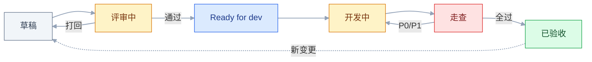
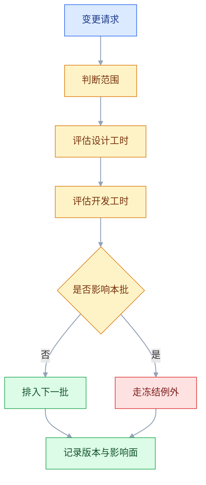

# Figma 协作与交付

## 一、工程案例：18 个页面的后台改版按模块交付，走查 P1 控制在 5 条内

**场景**：一套 B 端后台改版，5 个模块、18 个页面，1 名设计、2 名前端，周期 3 周。设计和开发在两个城市，只能异步沟通，每天最多一次 15 分钟站会。目标是上线前设计走查 P0 为 0、P1 不超过 5 条，且每条都能直接被开发修掉。

**为什么必须做**：上一版只往群里发了一个链接。开发做到一半来问「空态在哪」，走查时发现 3 个状态没做、12 处间距不是 token、2 个图标糊了，返工 4 天。问题不在设计画得不好，而在**交付物没有把该说的说完**。这次要把「开发来问」变成「开发查表」。

**动手前确认**：开发侧是否有 Dev Mode 席位和文件权限；组件库当前版本是否已发布；测试环境是否有真实数据；谁对「能不能上线」拍板。这四件事任何一件没确认，后面的节奏都会断。

### 1.1 主线（按顺序执行，不要跳步）

**① 启动对齐（第 1 天，90 分钟）**

不是听产品讲需求，是把下面六件事逐条确认并写下来：

| 项 | 要问出的结果 | 没确认的后果 |
|---|---|---|
| 技术栈与组件库 | 现有哪些组件、哪些要新建 | 设计了不存在的交互 |
| 断点范围 | 做 1440 / 768 / 375 中的哪几档 | 开发按 1440 写死，移动端重做 |
| 数据形态 | 最长、最短、空值、异常值的真实样例 | 长文案破版、空态没设计 |
| 状态清单 | 每个页面要哪几种状态 | 上线后补空态和错误态 |
| 性能约束 | 首屏预算、图片体积上限 | 大图直接拖慢加载 |
| 交付节奏 | 分几批、每批哪些页面 | 开发等全集，最后一起赶 |

产出是一张**范围表**：做什么、不做什么、谁负责、什么时候交。范围表里写「不做移动端」比写「响应式适配」有用得多。

**② 页面清单与编号（第 1 天）**

给每个页面一个稳定 ID，后续所有沟通都用 ID，不用「那个订单页」。

| ID | 页面 | 模块 | 状态 | 复用组件 | 批次 |
|---|---|---|---|---|---|
| `ORD-LIST-01` | 订单列表 | 订单 | 默认 / 空 / 加载 / 出错 | Table、Filter | 1 |
| `ORD-DETAIL-01` | 订单详情 | 订单 | 默认 / 无权限 | Card、Timeline | 1 |
| `CUS-LIST-01` | 客户列表 | 客户 | 默认 / 空 | Table | 2 |

状态要拆行，不要在一个格子里写「各状态」。拆行之后，清单本身就是验收表。

**③ 组件映射（第 2 天）**

| 设计组件 | 代码组件 | 差异 | 处理 |
|---|---|---|---|
| `Button / Primary` | `<Button variant="primary">` | 一致 | 直接用 |
| `Filter / Drawer` | 无 | 代码只有下拉筛选 | 新增组件，排期 2 天 |
| `Timeline` | `<Steps direction="vertical">` | 视觉不同 | 复用逻辑，改样式 |
| `Table / Editable` | `<Table editable>` | 缺列宽拖拽 | 本期不做，明确记录 |

映射不上的必须当场决定「改设计」还是「新增组件」。留给开发自己判断，结果一定是他按最省事的方式做一版。

**④ 写交互规格（第 3–10 天，与设计并行）**

每个交互按固定字段写，缺一项就算没写完：

```text
位置：ORD-LIST-01 / 批量操作栏 / 导出按钮
触发：点击；键盘 Enter 等效
前置：已选 ≥ 1 条，否则按钮禁用并提示「请先选择订单」
行为：请求导出接口，按钮进入 loading，禁止重复点击
成功：Toast「已开始导出，完成后站内通知」，2 秒消失
失败：保留选择，Toast 显示原因，提供「重试」
动效：loading 旋转 800ms 循环；Toast 淡入 150ms
边界：最多导出 5000 条，超出提示缩小筛选范围
埋点：export_click / export_success / export_fail
```

参数必须给值。「有个淡入」「稍微等一下」这类描述，开发只能取默认值。

**⑤ 按模块交付（第 8 / 12 / 15 天）**

每完成一个模块，标 `Ready for dev`，发一条固定结构的交付消息：

```text
模块：订单（第 1 批）
页面：ORD-LIST-01、ORD-DETAIL-01（含 6 个状态）
变更：新增 Filter/Drawer，其余复用现有组件
待确认：导出上限 5000 条是否准确（@产品）
资源：icon/export.svg、illus/empty-order.svg
库版本：ds-core 当前发布版（发布号以库文件为准）
```

一次全交会让开发前松后紧；每天零散改会让开发不知道哪版算完成。**按模块成批交，批次之间留 2 天缓冲。**

**⑥ 开发期的问答收敛（第 8–17 天）**

前 3 天问题最多，正常。关键是不要让同样的问题问第二遍：

| 动作 | 目的 |
|---|---|
| 建一个交付 FAQ，问题与答案都记 | 减少重复提问 |
| 每周一次 15 分钟同步，只过阻塞项 | 避免长会 |
| 变更走变更单，不直接在群里说 | 有记录、有版本 |
| 设计每天固定两个时段答疑 | 避免随时被打断 |

**⑦ 设计走查（第 18–19 天）**

在测试环境、用真实数据、按 1440 / 768 / 375 三档逐页看。每条问题按固定模板记：

```text
位置：ORD-LIST-01 / 表格 / 状态标签
现象：当前 padding 上下 10px，颜色 #16A34A
期望：padding var(--space-3)=12px，颜色 var(--color-success)
严重度：P2
证据：截图 + 浏览器 computed style
```

走查不是「看一眼像不像」，是**逐项对照规格**。能定位到 token 的意见才能被准确修复。

**⑧ 修复与回归（第 20–21 天）**

修复清单进 issue，不进聊天记录。每条有负责人、截止时间、验证方式。P0/P1 修完必须回看截图或录屏，不能只看开发说「改好了」。


### 1.2 验收（11 项全过才算交付完成）

| # | 检查项 | 怎么验 | 通过标准 |
|---|---|---|---|
| 1 | 页面清单可核对 | 清单 ID 与画框名逐一对照 | 18 个页面全部有 ID，无游离画框 |
| 2 | Ready 标记准确 | 对照交付消息里的批次清单，逐个看画框状态 | 只有完成模块被标记，半成品未标 |
| 3 | 状态齐全 | 按状态矩阵逐格点开 | 默认 / 空 / 加载 / 出错 / 无权限按需覆盖 |
| 4 | 变量已绑定 | Dev Mode 抽查 20 个元素 | 显示变量名，未绑定项为 0 |
| 5 | 组件有映射 | 对照映射表抽查 | 每个设计组件有代码对应或明确「新增」 |
| 6 | 交互参数完整 | 逐条读规格 | 触发、前置、行为、成功、失败、动效时长与缓动、边界都有值 |
| 7 | 资源规范 | 看导出目录，抽 10 个文件 | 前缀为 `icon/`、`illus/`、`img/`，SVG 为矢量且颜色不写死，单张图片 ≤ 2MB |
| 8 | 断点齐全 | 切三个画框宽度 | 1440 / 768 / 375 都不破版 |
| 9 | 长文案通过 | 替换最长真实样例 | 不截断、不重叠、不撑破容器 |
| 10 | 走查可执行 | 抽查 5 条意见 | 都有位置、当前值、期望值、严重度 |
| 11 | 回归闭环 | 看 issue 状态与复验截图 | P0/P1 全关，且有复验记录 |

> 第 1 项和第 3 项是最容易造假的：清单上有，画布里没有；状态矩阵打了勾，实际只有默认态。验收必须点开画布看，不能只看文档。

### 1.3 把节奏复制到下一个项目

可复制的是**批次结构和卡点**，不是具体日期：

| 卡点 | 时间点 | 规则 |
|---|---|---|
| 范围冻结 | 第 1 天结束 | 之后新增页面走变更，不插队 |
| 设计冻结 | 每批交付前 1 天 | 冻结后只接受 P0 级修改 |
| 开发提测 | 走查前 1 天 | 未提测不进入走查 |
| 走查窗口 | 2 天 | 只记问题，不现场改稿 |
| 修复回归 | 1–2 天 | P0/P1 必须复验 |

三个现实约束：设计冻结后产品仍会改需求，所以要留一个 **10% 的变更缓冲**（18 个页面约 2 页，用掉一页就在范围表里划掉额度）；开发并行需要模块之间低耦合，共享组件要先交付；走查时间不能被压缩——18 个页面按每天 9 页排 2 天，压到 1 天就只能看首页。

> 度量交付质量用四个数：走查 P1 条数、返工天数、开发重复提问次数、交付后 2 周内的设计变更次数。前两个看结果，后两个看过程。

---

## 二、高频问答：会卡住你的地方，也是面试最常问的

### 2.1 开发问「哪一版是最新的」

**现场**

在画框名和页面名里搜 `final`、`最终` 的数量；看页面清单的版本列；看画框是否标了 Ready for dev；让没参与项目的同事打开文件，30 秒内指出「订单列表最终稿」。

**要点**

- 设计知道哪版最新是因为参与了全过程；开发只看到一堆相似画框，没有任何信号告诉他哪一版算数。
- 根因是多份 `final`、`final-2` 稿、没有版本号、没有 Ready 标记、废弃稿留在主画布。
- 指不出来就是交付结构问题，不是开发粗心。

**追问**

- 怎么让开发一眼知道哪版算数？→ 命名版本号 + 标 Ready for dev + 页面清单写版本列。
- 废弃稿留在主画布有什么后果？→ 开发可能照着旧稿实现，验收才发现错了。
- 版本号怎么落地？→ 文件名和发布说明记，不靠人记。

### 2.2 开发做出来间距差 2px

**现场**

在 Dev Mode 看该元素显示的是变量名还是原始值；确认量的是标注值而不是缩小画布或截图上的像素；抽 10 个间距记录「设计值、代码值、是否绑定变量」。

**要点**

- 把「像素一致」当成目标是错的；真正要对齐的是 token，14px 和 16px 的差异往往来自设计稿本身没用变量。
- 根因是开发量的是截图像素而非 Dev Mode 标注值，或设计稿本来就是手动拖的 14px。
- 绑定变量后仍有偏差才是实现问题，没绑定先修设计稿。

**追问**

- 怎么判断差是设计还是实现？→ 抽 10 个间距看是否绑变量，绑了还差才是开发。
- 设计稿怎么避免 14px 这类值？→ 间距绑 `space/*`，禁止裸数值。
- Dev Mode 显示原始值说明什么？→ 设计侧没绑变量，开发根本看不到 token。

### 2.3 状态又漏了

**现场**

按状态矩阵逐格点开画布；搜「空态」「error」看有没有实际画框；把状态矩阵打印出来每格对应一个画框名；B 端单独查 403 / 无权限。

**要点**

- 文字描述不是设计稿；开发不会根据一句「空态显示插画和文案」去猜插画多大、文案多长、按钮在哪。
- 根因是设计只交默认态、空态错误态写在文档里没画、状态矩阵没进验收。
- 无权限是开发无法拿默认样式兜住的状态，漏了就是白屏或裸报错，必须单独查。

**追问**

- 怎么确保状态不漏？→ 状态矩阵每格对应一个画框，空格显式写「不做」。
- 哪些状态最常被漏？→ 空态、错误态、无权限，B 端无权限漏了最致命。
- 状态矩阵进验收了吗？→ 没进验收的矩阵等于没写，验收要点开画布。

### 2.4 悬停和焦点态没实现

**现场**

看交互规格里有没有 trigger / duration / easing；在测试环境用鼠标和 Tab 各走一遍；键盘 Tab 走完整流程记录焦点是否可见、顺序是否合理；鼠标逐个查交互元素是否有 hover 反馈。

**要点**

- hover 颜色、焦点环粗细、禁用态透明度都是设计决策，不是前端默认值；不写开发就用自己的默认值。
- 根因是原型演示了动效却没写触发方式和参数，开发看不到鼠标态和键盘态。
- 两遍（键盘 + 鼠标）都过才算实现了状态。

**追问**

- 怎么让前端实现状态？→ 交互规格写 trigger、duration、easing，不给「加个 hover」。
- 焦点态为什么常被漏？→ 鼠标验收发现不了，必须用 Tab 走。
- 悬停和焦点能合并吗？→ 能，但键盘态必须独立可触发。

### 2.5 图标糊了或粗细不对

**现场**

打开 SVG 看是 `<image>` 位图还是矢量路径、`stroke-width` 是否写死；看 viewBox 与画布尺寸是否一致；在 2x 屏看实际渲染；把同一图标放在 16 / 24 / 48px 三档截图对比。

**要点**

- 位图放大一定糊，描边宽度写死成绝对值的 SVG 放大一定变粗；这不是使用方式问题，是资源本身无法无损缩放。
- 根因是导出 PNG、SVG 描边写死、图标画在非整数或半像素位置。
- 三档视觉粗细一致才算合格。

**追问**

- 怎么判断糊是位图还是描边？→ 看 SVG 是 image 还是路径、stroke-width 是否写死。
- 半像素位置为什么坏事？→ 缩到 16px 对不齐像素网格发虚。
- 导出前查什么？→ viewBox 与画布一致、无隐藏层、尺寸整数。

### 2.6 长文案一上线就破版

**现场**

把文案替换成清单里的最长样例；看容器是否自动增高；准备最短、平均、最长三条数据过一遍，最长的那条要在 375 宽度下也不溢出。

**要点**

- 限制文案长度是把设计问题转嫁给运营；多语言、机构名、地址根本无法限制。
- 根因是设计用「张三」「测试数据」、没用最长真实样例、文本层设固定高度。
- 用真实长度三档验收，不用占位文字。

**追问**

- 怎么防长文案破版？→ 用最长真实样例验收，且 375 也不溢出。
- 文本层该锁高度吗？→ 不该，长文案要能撑高。
- 多语言文案怎么处理？→ 当作最长样例的极端情况，必测。

### 2.7 走查意见开发改不动

**现场**

看意见里是否有页面 ID、元素、当前值、期望 token；拿一条意见给没参与的人看，问他「你知道改哪个文件的哪个元素、改成什么吗」，答不出来意见就不合格。

**要点**

- 不可执行的意见无法被修复，只能被反复猜；猜错一次双方更烦躁。
- 根因是意见写成「这里感觉不对」「颜色有点怪」，没有位置、当前值、期望值。
- 合格意见要能定位到组件、值、复现步骤。

**追问**

- 走查意见模板是什么？→ 位置、现象、期望、严重度，缺一项算没写完。
- 怎么度量意见质量？→ 抽查是否能定位到 token，不能修的就是废意见。
- 为什么不能凭感觉？→ 还原度 95% 没人知道剩下 5% 是什么。

### 2.8 改稿没通知，开发做了旧版

**现场**

查变更日志与交付消息；对比开发实现的是哪一版；每次改稿后看页面清单版本号是否加一、变更日志是否有记录、开发和测试是否都确认。

**要点**

- 群消息不是交付物；它没有状态、没有版本、没法追溯，也不保证相关人都看到。
- 根因是消息被刷走、没有版本号、没有变更日志、开发和测试不是同一时间看到。
- 三者（版本号 + 日志 + 双方确认）缺一，就还有人说不上来。

**追问**

- 怎么保证相关人都看到？→ 改稿走变更单，不只在群里说。
- 变更日志记什么？→ 改了什么、影响哪些页面、新版本号。
- 群消息为什么不可靠？→ 无状态、无版本、不保证触达。

### 2.9 开发自己写了一套组件

**现场**

抽查实现页面的组件树；对照映射表看是否有「未映射」项；统计页面上「代码组件与设计组件一致」的比例，低于 80% 先修映射和组件差异。

**要点**

- 如果按设计稿实现要改 3 天、自己写只要半天，开发一定会自己写；这是成本问题不是态度问题。
- 根因是设计组件和代码组件差异太大、没有映射表、设计稿里的组件在代码里不存在。
- 比例低于 80% 先修映射和差异，不要先开会强调规范。

**追问**

- 怎么判断是成本还是态度？→ 统计一致比例，低于 80% 是映射和差异问题。
- 怎么防止开发重写？→ 建映射表、组件差异小、设计稿里有对应代码组件。
- 80% 阈值怎么来的？→ 经验值，差太多说明映射和组件本身要修。

### 2.10 交付后开发打不开文件

**现场**

用开发账号实际打开一次；看分享设置里的权限范围与到期时间；交付前让开发回一句「已打开，能看到第 1 批页面」。

**要点**

- 设计在自己账号里永远能打开，权限问题只有在对方账号上才暴露。
- 根因是只给了个人权限对方换账号、链接权限过期、或对方不在团队需单独邀请为 guest。
- 回不出来就不要进入开发排期。

**追问**

- 怎么保证能打开？→ 用开发账号实测，确认权限范围和到期时间。
- guest 权限够吗？→ 看套餐，至少能给只读 + Dev Mode。
- 为什么说回不出来就不排期？→ 打不开就全停，先解决再动排期。

### 2.11 暗色模式上线后颜色和设计不一致

**现场**

对照 token 映射表；在暗色下逐页截图比对；看元素是否绑定变量；随机抽 10 个语义色在设计变量表和代码 token 表里各查一次。

**要点**

- 设计和代码各有一套命名，靠人肉对照迟早会错；错一次后面每次都要重新对。
- 根因是变量名和 token 名不是一套、暗色只做了一部分页面、有的地方是 override。
- 名字与值都能对上，才算同步。

**追问**

- 怎么确认同步了？→ 随机抽 10 个语义色，两侧名字和值都对上。
- override 为什么会让暗色不一致？→ 本地值优先于变量，不跟主题。
- 设计和代码命名怎么统一？→ 同构三层 token，语义层名值对应。

### 2.12 外包交付后没人能维护

**现场**

拿源文件搜组件、变量、页面命名；让外包当场改一个主色；在源文件里做三个动作——改主色、加一个页面、找一个空态，三个都能 10 分钟内完成才算可维护。

**要点**

- 静态图不是设计源文件；没有结构的源文件，改一次的成本接近重画。
- 根因是只给静态图或 PDF、源文件图层命名混乱、没有变量和组件、没有库。
- 三个动作 10 分钟内完成，才算可接手。

**追问**

- 怎么判断外包交付可维护？→ 改主色、加页面、找空态三动作 10 分钟内。
- 静态图为什么不行？→ 无法改，只能重画。
- 验收要查什么？→ 变量、组件、命名规范、授权说明。

---

## 三、核心知识：从零开始要建立的东西

### 3.1 交付物的七件套

「交付」不是发链接，是交付一组能被独立阅读的材料。少一件，开发就会来问一次。

| 交付物 | 回答什么问题 | 形式 |
|---|---|---|
| 页面清单 | 做哪些、优先级、批次 | 表格，带稳定 ID |
| 状态矩阵 | 每个页面有哪几种状态 | 表格，每格对应画框 |
| 组件映射 | 用哪个代码组件 | 表格，含差异与处理 |
| 交互规格 | 点了以后发生什么 | 字段化文本 |
| 资源包 | 图标、图片、字体 | 目录，命名规范 |
| 断点说明 | 各宽度怎么变 | 画框 + 规则 |
| 变更日志 | 哪版是最新 | 版本号 + 日期 + 影响面 |

> 判断标准只有一句：**开发能不能不问你就做完**。能，就是交付；不能，就还是「给了个链接」。

### 3.2 页面清单与状态矩阵

页面清单解决「做哪些」，状态矩阵解决「做到什么程度」。两者要能互相索引。

状态不是越多越好，按页面类型选：

| 页面类型 | 必备状态 | 可选状态 |
|---|---|---|
| 列表 | 默认、空、加载、出错 | 无结果、无权限 |
| 详情 | 默认、加载、出错 | 无权限、已删除 |
| 表单 | 默认、校验错误、提交中 | 成功、部分失败 |
| 仪表盘 | 默认、加载、无数据 | 部分模块失败 |

矩阵的每一格都必须有画框。空格代表「本期不做」，要显式写「不做」，不能留白——留白会被理解成「还没画」。

### 3.3 组件映射表

映射表是设计与代码之间的字典。它不只列「用哪个」，还要列「差在哪」。

| 字段 | 作用 |
|---|---|
| 设计组件名 | 与库里的命名一致 |
| 代码组件名 | 与仓库里的导出名一致 |
| 属性对照 | variant / size / state 的取值对应 |
| 差异 | 视觉、交互、缺哪些能力 |
| 处理 | 直接用 / 改设计 / 新增 / 本期不做 |
| 负责人 | 谁推动这件事 |

差异栏最重要。写「基本一致」等于没写；写「代码缺 loading 态，需新增 `loading` prop，1 天」，才能排期。

### 3.4 Token 的三层与代码变量

设计变量和代码 token 必须同构，否则每次交付都要人工翻译。

三层里只有语义层会被页面直接使用：基础值是调色板，组件 token 在组件内部引用语义 token，页面里只出现语义变量。多主题不是做两套变量，而是给同一个语义变量配多组取值（亮/暗各一套）。

| 层 | 设计侧 | 代码侧 | 变更频率 |
|---|---|---|---|
| 基础 | `blue/600` | `--blue-600` | 极低 |
| 语义 | `color/action` | `--color-action` | 低 |
| 组件 | `button/bg` | `--button-bg` | 中 |

代码侧不要直接引用基础值。页面里出现 `--blue-600`，说明语义层被绕过了，换主题时这一处一定漏。

### 3.5 Dev Mode 的读取逻辑

Dev Mode 给开发看的不是「像素标注」，是「这段界面由什么构成」：尺寸、间距、变量名、组件名、导出资源。

| 开发看到的 | 应该读到 | 说明 |
|---|---|---|
| 填充 | `color/bg/card` | 不是 `#FFFFFF` |
| 间距 | `space/4` | 不是 `16` |
| 圆角 | `radius/md` | 不是 `8` |
| 文字 | 文字样式名 | 不是字号 + 行高 |
| 组件 | 组件名与属性 | 不是图层名 |

如果 Dev Mode 里显示的还是原始值，说明设计侧没绑定变量。这时候不要怪开发「没按 token 做」，他根本看不到 token。

> **面试**：常问「Dev Mode 里看到的是像素标注还是组件信息？」答：是「这段界面由什么构成」，尺寸间距变量组件名，显示原始值说明没绑变量。

> Dev Mode、Code Connect、分支等能力的可用范围随套餐和版本变化，以官方当前版本为准。交付前先确认对方席位能打开，不然所有规格都白写。

### 3.6 交互规格的字段化

交互规格要写成「状态机」，不是散文。最小字段集：

| 字段 | 必填内容 | 反例 |
|---|---|---|
| 触发 | 鼠标、键盘、手势、系统事件 | 「操作后」 |
| 前置条件 | 什么情况下可用 | 不写，导致空选也能点 |
| 行为 | 请求、跳转、展开、关闭 | 「处理一下」 |
| 成功反馈 | 文案、位置、持续时间 | 「给个提示」 |
| 失败反馈 | 原因、可恢复动作 | 「报错」 |
| 动效 | 时长、缓动、位移距离 | 「动画流畅」 |
| 边界 | 数量、长度、频率上限 | 不写，上线被打爆 |
| 埋点 | 事件名与关键参数 | 上线后没数据 |

一个合格的规格读起来像测试用例：给定什么条件，做什么，期望什么结果。

### 3.7 资源导出与命名

| 资源 | 格式 | 尺寸 | 命名 |
|---|---|---|---|
| 图标 | SVG | 24×24 画布 | `icon/arrow-left.svg` |
| 插画 | SVG | 按容器 | `illus/empty-order.svg` |
| 照片 | WebP | 显示尺寸的 2x（1440 宽导出 2880） | `img/hero@2x.webp` |
| 头像 | WebP | 显示尺寸的 2x | `avatar/default@2x.webp` |
| 字体 | 原文件 | — | 附授权说明 |

导出目录按「类型/用途」分，不按页面分。按页面分会导致同一个图标出现五份，改一处漏四处。

图标导出前检查四件事：颜色不写死（用 `currentColor`；描边图标若轮廓化，确认填充继承颜色，不要留下 `#333333`）；viewBox 与画布一致、内容贴合不留大片空白；没有多余的编组、裁剪框和隐藏层；尺寸取整数，别把 20px 的图形塞进 24px 画布再缩放，容易出现半像素。图片按显示尺寸的 2x 导出，导出前压缩，单张控制在 2MB 以内（经验值）；带文字的截图和 UI 图不要压成有损 WebP，边缘会发虚，改用 PNG。

### 3.8 断点与响应式交付

| 断点 | 典型宽度 | 交付重点 |
|---|---|---|
| 移动 | 375 | 单列、吸底操作、触控目标 ≥ 44px |
| 平板 | 768 | 两列、侧栏折叠、表格横向滚动 |
| 桌面 | 1440 | 多列、固定侧栏、内容最大宽度 |

只交 1440 一档，等于把响应式交给开发自由发挥。至少要给三档，并说明「哪些元素隐藏、哪些换行、哪些变成抽屉」。

断点稿不是把画框拉宽，要真的改布局：导航怎么收、表格怎么滚、按钮组怎么换行。拉宽后的稿子只能证明「不破」，证明不了「好用」。

### 3.9 走查的判定与分级

走查是拿实现对照规格，不是凭感觉打分。分级按「影响任务的程度」，不按「改了多久」。

| 级别 | 判定 | 例子 | 处理 |
|---|---|---|---|
| P0 | 功能不可用、数据错误、阻断操作 | 提交无反应、金额显示错 | 立即修，阻塞上线 |
| P1 | 主流程能走但会出错或卡住 | 状态缺失、必填校验失效 | 本迭代修 |
| P2 | 需要多试一次、明显不一致 | 间距差 8px、颜色不是 token | 排期修 |
| P3 | 细节偏差 | 圆角差 1px、动效快 50ms | 有空修 |

「还原度 95%」这种指标不可执行，因为没人知道剩下的 5% 是哪 5%。**用 P1 条数和是否闭环来代替。**

> **面试**：常问「为什么不能用还原度 95% 验收？」答：没人知道剩下 5% 是哪 5%，用 P1 条数和是否闭环代替。

### 3.10 变更管理与冻结窗口

变更一定会发生，关键是让它有入口、有记录、有影响面。先看清一个页面在批次里怎么走：



状态标记不是装饰：`草稿` 阶段的稿不该被开发引用；标了 `Ready for dev` 之后再改，必须走变更、把状态退回草稿并升版本。走查不通过就退回 `开发中`，不要另开一条流程。冻结窗口管的正是 `Ready for dev → 已验收` 这一段。

变更请求本身走另一条判定链，答案只有「进下一批」或「走冻结例外」，没有「先做了再说」：



冻结窗口的规则要提前说：冻结后只接受 P0 级变更；P1 排到下一批；P2/P3 进 backlog。没有例外规则，冻结就是一句空话。

每次变更更新三样东西：版本号、变更日志、页面清单状态。只改画布不更新记录，等于制造了下一轮「哪版是最新」的问题。

### 3.11 评审的有效性

评审的目标是收集**可执行的意见**，不是让大家看看。组织方式决定产出。

| 阶段 | 动作 | 产出 |
|---|---|---|
| 评审前 1 天 | 发链接、背景、约束、要拍板的问题 | 参与者带着判断来 |
| 评审中 | 先讲问题和取舍，再讲方案 | 决策依据 |
| 评审中 | 每条意见标注「必须改 / 可选 / 偏好」 | 可执行的清单 |
| 评审后 24h | 发纪要，决议写进画布 | 可追溯的结论 |

区分「必须改」和「个人偏好」是主持人的责任。风格偏好应该在设计系统里提前定，不在评审会上争。争论超过 10 分钟没有结论的，转为小范围验证或由拍板人决定。

### 3.12 权限、分支与合并

| 场景 | 做法 | 风险 |
|---|---|---|
| 日常小改 | 主文件直接改，命名版本 | 多人同时改会冲突 |
| 大改版 | 开分支，评审后合并 | 合并是整份文件覆盖主文件，没有逐图层取舍 |
| 外部协作 | 单独文件 + 只读/评论权限 | 源文件结构可能不合规 |
| 库维护 | 少数人有发布权 | 发布错误影响所有订阅方 |

分支不是免费的：分支是整份文件的副本，合并时用分支版本覆盖主文件，没有 git 那样逐图层的冲突解决。所以分支期间主文件不要再做大改，已经改了的要先同步进分支。约定「谁改哪个文件、哪些页面」，比事后补差异便宜。

> **面试**：常问「Figma 分支和 Git 分支有什么不同？」答：分支是整份文件副本，合并是覆盖主文件，没有逐图层冲突解决。

权限按最小必要给：开发只读 + Dev Mode；产品评论；外部方只读；库发布权只给设计系统维护者。分支、变量模式、Dev Mode 的可用范围随套餐和版本变化，具体权限项以官方当前版本为准。

### 3.13 异步协作的沟通结构

跨地域协作，沟通要**结构化**，不能靠即时消息。

| 消息类型 | 必须包含 | 不该包含 |
|---|---|---|
| 交付通知 | 模块、页面 ID、版本、待确认项 | 「大概都好了」 |
| 问题提问 | 页面 ID、元素、截图、期望 | 「这里不对」 |
| 变更通知 | 改了什么、影响哪些页面、新版本号 | 只发改后的截图 |
| 走查意见 | 位置、现象、期望、严重度 | 「感觉不对」 |

每天固定时段答疑，其余时间专注。即时消息适合确认「收到没有」，不适合传递规格。

### 3.14 交付质量的度量

| 指标 | 算法 | 用途 |
|---|---|---|
| 走查 P1 密度 | P1 条数 / 页面数 | 衡量交付完整度 |
| 返工天数 | 走查后修复占用的人天 | 衡量规格质量 |
| 重复提问次数 | 同一问题被问第二次的次数 | 衡量文档质量 |
| 组件一致率 | 代码组件与设计组件一致的页面比例 | 衡量映射质量 |
| 变更逃逸 | 上线后才发现的设计问题数 | 衡量走查覆盖 |

指标不用多，每个迭代看 2–3 个。连续两个迭代恶化，先查流程卡点，不要先查个人。

### 3.15 跨团队与外包交付

外部团队不会参与你的日常上下文，所以交付物要**自带解释**。

| 必须提供 | 原因 |
|---|---|
| 源文件，不只是图片 | 没有源文件无法维护 |
| 变量与组件结构 | 否则改一处要改全部 |
| 页面清单与状态矩阵 | 否则只做默认态 |
| 命名规范 | 否则搜索失效 |
| 验收表 | 否则「做完」没有标准 |
| 授权说明 | 字体、图片、插画的商用范围 |

验收时做三个动作：改主色、加一个页面、找一个空态。三个都能在 10 分钟内完成，才算可接手。只检查「看起来一样」，交付的是一张不能改的图。

---

## 四、冷门知识汇总

这里只放低频、出错代价小、现场能查到的操作细节。凡是漏了会返工的（图标导出、状态、标注、变更通知），前面两节已经按问题写过了。

| 知识点 | 为什么冷门 | 用到时的关键词 |
|---|---|---|
| 组件的描述与链接 | 描述字段不写，开发只能看图层名猜用途 | Description；文档链接；Dev Mode |
| 图层面板的批量重命名 | 手改几十个图层太慢，命名规范就落不下去 | 批量重命名；正则；命名规范 |
| 变量未绑定检查 | 入口在插件或 Dev Mode 里，不主动查就看不到 | Unbound；变量审计 |
| 变量的作用域（scope） | 不设 scope，一个颜色变量会出现在所有属性下拉里 | scope；变量；属性过滤 |
| Copy as SVG 与 Export SVG | 两种导出的属性写法不同，一个进剪贴板一个落盘 | Copy as SVG；Export；fill |
| 内联 SVG 的 id 冲突 | 多个图标内联到同一页，`clipPath` 的 id 重名会互相串 | id 前缀；`<use>`；symbol |
| 导出倍率与 `@2x` 命名 | 设计稿只看 1x，前端按 2x/3x 取图 | `@2x`；srcset；1x/2x/3x |
| 导出被父级裁剪 | 切片带着父级的 Clip content，导出会少一块 | Clip content；裁剪；导出范围 |
| 隐藏图层的导出 | 隐藏层默认不导出，但被引用时会露出来 | 可见性；导出范围；隐藏层 |
| 填充的裁剪与缩放 | 换图后构图被裁掉，只有打开 Fill 设置才看得到 | Fill；Crop；Fit |
| 缺失字体的静默替换 | 打开别人的文件时字体被替换，行高和宽度都变 | Missing fonts；替换；行高 |
| 字族里没有该字重 | 浏览器会合成加粗或变细，视觉重量和设计稿不同 | font-weight；合成；字族 |
| 文本自动高度 | 默认设置不一定对，多语言场景必查 | Auto height；截断 |
| 文本最大行数与省略 | 单行截断在多语言下会切掉关键信息 | max lines；ellipsis；truncate |
| 组件属性与变体 | 两者都能做开关，用错会让变体数量爆炸 | Component properties；Variants；布尔属性 |
| 实例分离后失去同步 | 改完看着对，库更新后这一处永远是旧样式 | Detach instance；覆盖；库更新 |
| 组件改了但没发布 | 本地保存不等于订阅方拿到，Assets 里还挂着待发布项 | Publish changes；待发布；订阅 |
| 库的破坏性变更 | 删除比新增省事，但会破坏订阅方 | `Deprecated/`；迁移期 |
| 图标独立成库 | 图标更新频繁，混在组件库里拖慢加载 | 独立库；批量更新 |
| token 版本同步 | 设计和代码各自发版，很容易错位 | token 版本；发布说明 |
| 字体商用授权 | 设计阶段不关心，上线前才被法务拦 | 授权范围；Web font；嵌入 |
| 交付物的可搜索性 | 命名随意，找东西只能靠翻页 | 统一前缀；搜索 |
| 遗留稿归档 | 直接删会丢历史，留着会误用 | Archive；只读 |
| 静态规范页 | 外部方没有源文件权限时的替代 | 规范页；只读；导出 PDF |
| 空态插画尺寸 | 文案好写，插画尺寸没人给 | 容器尺寸；安全区；2x |
