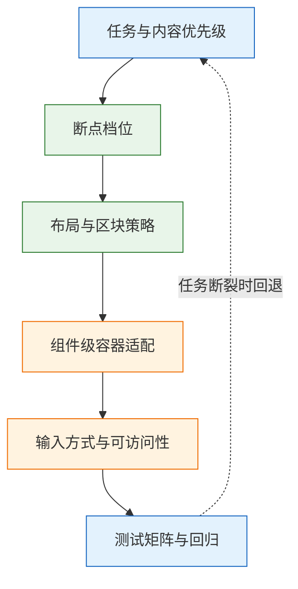
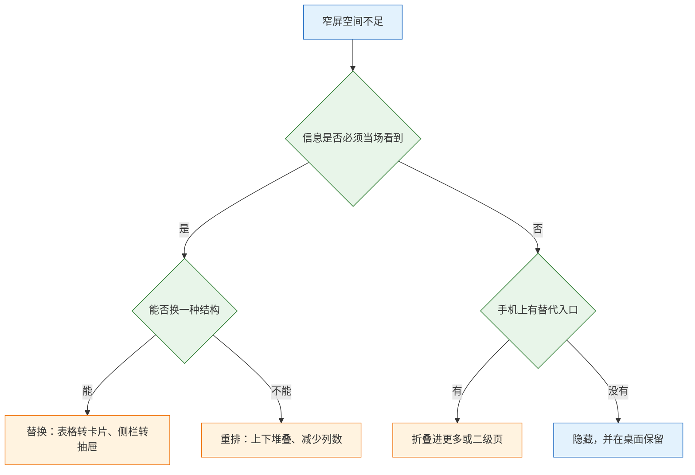

# 多端适配

---

## 一、多端适配是什么

### 1.1 核心概念

多端适配（Multi-device Adaptation）是在同一套信息架构和代码基础上，让界面在不同视口宽度、输入方式和设备能力下完成核心任务的方法。它包含四类决策：内容优先级、结构档位、区块策略、交互替代。四类决策按顺序确定，跳过任何一类都会得到“能显示、不能用”的页面。

多端适配不等于把桌面页缩小。桌面三栏压成两栏，但主操作仍依赖 hover，触屏用户依然无法完成任务；表格加了横向滚动，但关键列被挤到屏幕外，信息依然不可读。适配的起点是“这个终端上必须完成哪几件事”，终点才是布局。

几个相邻概念需要先区分，它们经常被当成同义词。

| 概念 | 变化方式 | 决策单位 | 适用场景 |
|---|---|---|---|
| 响应式 | 随视口连续流式变化 | 容器与栅格 | 内容站、营销页 |
| 自适应 | 在断点处切换固定布局 | 断点档位 | 后台、工具型产品 |
| 容器查询 | 随父容器宽度变化 | 组件 | 组件复用在不同栏位 |
| 独立端 | 多套代码分别实现 | 终端 | 交互差异极大的产品 |

实际产品通常是组合：页面骨架用自适应断点，组件内部用容器查询，内容区用流式栅格。把三者对立起来讨论“该用哪一种”，会忽略它们解决的是不同粒度的问题。

多端适配的产出不是一套 CSS，而是一张决策表：每个区块在每档宽度下采用什么策略，每个功能在哪个终端上保留、折叠还是移除。CSS 只是这张表的实现。

### 1.2 适用场景与边界

多端适配适合存在跨终端访问预期的产品：后台需要手机审批、内容需要移动阅读、电商需要移动下单、工具需要平板批注。判断依据是任务是否真的会在小屏发生，而不是“用户可能用手机打开”。

| 场景 | 建议程度 | 理由 |
|---|---|---|
| 后台的审批与查看 | 完整适配 | 高频、短时、强时效 |
| 后台的批量配置 | 桌面优先 | 操作复杂，小屏收益低 |
| 内容与文档 | 完整适配 | 阅读是天然的小屏任务 |
| 电商浏览与下单 | 完整适配 | 移动流量占比高 |
| 数据看板 | 分级适配 | 概览适配，钻取保留桌面 |
| 内部一次性工具 | 桌面即可 | 适配成本高于收益 |

边界有四条。第一，多端适配不替代原生应用，需要调用相机、蓝牙、后台定位等能力的场景，Web 适配只能覆盖一部分。第二，多端适配不做设备型号判断，按宽度和输入能力判断比按 User-Agent 判断稳定。第三，多端适配不承诺功能对等，手机可以没有导出、批量派单和列设置，只要核心任务完整。第四，多端适配不解决性能问题，图片体积、脚本执行和接口耗时需要单独治理。

> **注意**：把“手机上也要全部功能”当成需求，会让适配工作量失控。功能取舍必须由产品与业务共同确认，并写进决策表；只由前端在样式层隐藏，会在上线后变成“功能消失”的投诉。

### 1.3 架构组成

多端适配按“任务、档位、布局、组件、输入、验证”六层组织。上层决定下层，下层反馈上层：测试发现某档任务断裂时，要回到任务定义，而不是继续调样式。



| 层 | 主要决策 | 产出物 | 责任方 |
|---|---|---|---|
| 任务 | 每个终端必须完成什么 | 任务清单与优先级 | 产品与业务 |
| 档位 | 分几档、断点在哪 | 断点表 | 设计与前端 |
| 布局 | 区块如何重排、折叠、替换 | 区块策略表 | 设计与前端 |
| 组件 | 组件随容器如何变化 | 容器查询与变体 | 组件维护者 |
| 输入 | hover、触屏、键盘的等价路径 | 交互替代清单 | 前端 |
| 验证 | 测哪些宽度、输入与内容 | 测试矩阵 | 测试与前端 |

六层之中，任务层最容易被跳过，也最贵。任务没定清，后面每一层都在为“可能需要的功能”留位置，最终得到一个所有终端都臃肿、所有终端都不好用的界面。

---

## 二、断点分层

### 2.1 失效宽度测量

断点不应按设备型号设定，而应按内容开始失效的位置设定。操作方法很简单：把窗口从最宽往窄拖，以 40 像素为步长，遇到布局开始难看时精确到实际宽度，记录现象和根因。

| 宽度 | 现象 | 根因 |
|---|---|---|
| 1440 | 正常 | 三栏与八列表格均有空间 |
| 1320 | 表格出现横向滚动 | 八列最小宽约 780，两侧栏 520，加边距超出 |
| 1024 | 列宽被压到换行，行高翻倍 | 三栏仍按桌面写死 |
| 768 | 只剩四列可见 | 筛选栏没有收起 |
| 640 | 导航与主区互相挤压 | 导航仍占 240 |
| 375 | 无法完成任务 | 上述问题叠加 |

测量要记录“第一个开始难看的宽度”，而不是“最后一个还能看的宽度”。前者是断点候选，后者只是容忍上限。断点取失效宽度的整数值，取整到 8 的倍数，便于和栅格、间距对齐。

测量还要分页面类型。列表页、表单页、详情页的失效宽度不同，不能用一个断点表覆盖全部；实际做法是先按页面类型各测一遍，再取并集，收敛到少数几档。

### 2.2 结构档位

结构档位控制在三档以内。每多一档，回归组合数翻倍，而收益递减。

| 档位 | 范围 | 结构 | 栅格 |
|---|---|---|---|
| `sm` | 0–767 | 单列，导航进抽屉，表格转卡片 | 4 列，边距 16 |
| `md` | 768–1199 | 导航收成 64 图标条，筛选进抽屉 | 8 列，边距 24 |
| `lg` | 1200 及以上 | 三栏展开，表格八列 | 12 列，边距 24，内容限宽 1440 |

三档覆盖手机、平板、桌面已经够用，不要按 iPhone、iPad、MacBook 各写一套。设备型号数量远大于布局形态数量，按型号设断点会把维护成本乘上设备数。


断点值需要登记为构建期常量，供 Sass、Less 或 JavaScript 消费：

| Token | 值 | 消费方 | 说明 |
|---|---|---|---|
| `breakpoint.sm` | 768px | Sass、JS | 平板起点 |
| `breakpoint.md` | 1200px | Sass、JS | 桌面起点 |
| `layout.max-width` | 1440px | CSS | 内容区上限 |
| `layout.gutter` | 16 / 24px | CSS | 随档位变化 |

> **注意**：CSS 自定义属性不能用在媒体查询条件里。`@media (min-width: var(--bp-md))` 不会按预期生效，断点必须通过 Sass 变量、构建期替换或 JavaScript 常量共享，不要写成运行时 CSS 变量。

### 2.3 容器查询的补充

视口断点解决页面骨架，容器查询解决组件在不同栏位中的形态。同一个卡片放在侧栏和主区，宽度不同，布局应跟着容器变，而不是跟着视口变。

```css
.card-list {
  container-type: inline-size;
}

@container (min-width: 480px) {
  .card {
    display: grid;
    grid-template-columns: 1fr auto;
    align-items: start;
  }
}
```

| 方式 | 依据 | 适用粒度 | 局限 |
|---|---|---|---|
| 视口断点 | 窗口宽度 | 页面骨架 | 无法感知组件实际宽度 |
| 容器查询 | 父容器宽度 | 组件内部 | 需要声明容器，存在包含性影响 |
| 流式布局 | 可用空间 | 内容与栅格 | 无法切换结构 |

`container-type: inline-size` 会给元素建立行内尺寸包含，其宽度不再由内容决定。把它加在需要按内容撑宽的容器上，会出现宽度塌陷或换行异常；容器查询应加在明确的布局容器上，而不是随手加到卡片本身。

---

## 三、区块适配规则

### 3.1 五种策略

窄屏放不下时，可选策略只有五种：保留、重排、折叠、替换、隐藏。逐个区块过一遍，把决定写进表里，避免每个页面临时发挥。

| 策略 | 含义 | 示例 | 代价 |
|---|---|---|---|
| 保留 | 原样呈现 | 标题、状态、主操作 | 占用空间 |
| 重排 | 改变排列，不删内容 | 三栏变上下堆叠 | 页面变长 |
| 折叠 | 收进抽屉或更多菜单 | 筛选、导出、列设置 | 多一次点击 |
| 替换 | 换一种结构表达 | 表格转卡片、页码转加载更多 | 需要两套实现 |
| 隐藏 | 小屏不提供 | 批量派单、报表入口 | 功能缺失 |

隐藏是合法策略，但必须有产品判断。手机用户不需要导出，就可以没有导出；如果只是“放不下”而把主操作藏起来，任务就断了。判断标准是这项功能是否属于当前终端的核心任务，而不是它是否容易实现。

### 3.2 策略选择顺序

选择顺序固定为：先判断信息是否必须当场看到，再判断能否换结构，最后才考虑折叠或隐藏。顺序反过来，会习惯性地把问题推给“更多”菜单。



| 区块 | 桌面 | 平板 | 手机 | 策略 |
|---|---|---|---|---|
| 左侧导航 | 240 展开 | 64 图标加提示 | 抽屉，汉堡键唤出 | 折叠 |
| 筛选栏 | 常驻 280 | 顶部按钮加抽屉 | 全屏抽屉 | 折叠 |
| 工单表格 | 八列 | 五列，次要列隐藏 | 卡片列表 | 替换 |
| 批量选择 | 首列复选框 | 保留 | 去掉 | 隐藏 |
| 导出 | 工具栏 | 收进更多 | 去掉 | 折叠加隐藏 |
| 分页 | 页码条 | 页码条 | 加载更多 | 替换 |
| 详情入口 | 点击行 | 点击行 | 点击卡片 | 保留 |

同一区块在不同产品里可能得到不同结论。工单表格在客服系统里必须保留状态与时间，在报表系统里可能只需要汇总数字；策略表要按产品写，不能照抄。

### 3.3 功能取舍判定

功能取舍按任务链判断，不按功能清单判断。先写出每个终端的核心任务，再看完成这些任务需要哪些功能，其余功能可以延后或移除。

| 功能 | 手机 | 桌面 | 判定依据 |
|---|---|---|---|
| 查看分派给我的工单 | 必须 | 必须 | 核心任务起点 |
| 打开详情并改状态 | 必须 | 必须 | 核心任务终点 |
| 批量派单 | 不需要 | 需要 | 多选操作在小屏效率低 |
| 导出报表 | 可延后 | 需要 | 非即时任务 |
| 列设置 | 不需要 | 需要 | 手机已改为卡片 |
| 筛选与搜索 | 必须 | 必须 | 定位任务的必要手段 |
| 查看操作历史 | 可延后 | 需要 | 低频，可进二级页 |

判定要写成一句话：“手机端必须让客服在五分钟内完成接单与改状态，其余动作可延后。”这句话是后续所有取舍的依据，也是验收时的判断标准。写不出这句话，说明任务还没定清。

---

## 四、布局实现

### 4.1 移动优先的样式结构

移动优先指基础样式面向最窄屏，随宽度增加逐层叠加。只写 `min-width`，避免两条规则互相覆盖。

```css
/* 基础：320 起，单列 */
.list-page { padding: 16px; }
.list-page__aside { display: none; }
.list-page__filters { display: none; }

@media (min-width: 768px) {
  .list-page {
    padding: 24px;
    display: grid;
    grid-template-columns: 64px 1fr;
  }
  .list-page__aside { display: block; }
}

@media (min-width: 1200px) {
  .list-page {
    grid-template-columns: 240px 280px 1fr;
    max-width: 1440px;
    margin: 0 auto;
  }
  .list-page__filters { display: block; }
}
```

三条规则必须同时满足：

1. 只写 `min-width`，基础样式是手机，向上叠加，避免 `max-width` 与 `min-width` 交错导致的优先级混乱。
2. flex 或 grid 子项加 `min-width: 0`，否则长内容会把容器撑破，出现横向滚动。
3. 正文限宽。宽屏上正文 `max-width: 640px`，表格和看板按内容决定，不要把文字拉成一行一百五十字。

`min-width: 0` 的原理是 flex 与 grid 子项默认 `min-width: auto`，不允许收缩到内容最小宽度以下。表格、代码块、长链接都会因此把父容器顶宽。加上 `min-width: 0` 后，子项才能收缩并在内部滚动或截断。

### 4.2 输入方式与 hover 依赖

不同输入方式的能力差异，直接决定交互能否成立。

| 能力 | 桌面鼠标 | 触屏 | 键盘 |
|---|---|---|---|
| hover | 有 | 无 | 无 |
| 精确点击 | 有 | 手指，误差大 | 有 |
| 右键 | 有 | 长按，隐藏 | 菜单键 |
| 焦点 | 可见 | 通常不可见 | 必须可见 |
| 快捷键 | 有 | 外接键盘时可用 | 有 |

所有 hover 才出现的操作，在触屏上都等于不存在。必须给常驻替代入口：更多菜单、滑动操作加首次引导，或直接常驻。

```css
@media (hover: hover) and (pointer: fine) {
  .row:hover .row__actions { opacity: 1; }
}
```

这段必须包起来。不包的话，手机上第一次点击只会触发 hover，用户要点两次才生效。触屏浏览器为了兼容鼠标事件，会在点击后保留 hover 状态，表现为“第一次点没反应，第二次才触发”。

热区按可点区域计算，不按图标视觉尺寸计算。移动端至少 44×44，视觉图标可以 24，但要用 padding 或伪元素把可点区域补够。行内小按钮挤在一起时，宁可变少，不要变小；两个 24 像素的按钮并排，误触率远高于一个 44 像素的“更多”。

> **设计红线**：hover 只能作为增强，不能作为唯一入口；焦点样式不得被容器裁切；触控热区不得小于 44×44。三项任一不满足，键盘与触屏用户无法完成核心任务，按缺陷处理。

### 4.3 视口单位与安全区

移动端浏览器地址栏会收放，`100vh` 在部分浏览器里按最大视口计算，导致底部内容被裁。动态视口单位 `dvh` 随地址栏变化，小视口单位 `svh` 取最小高度，适合首屏。

| 细节 | 做法 | 不做的后果 |
|---|---|---|
| 全屏弹层高度 | `100dvh` | 地址栏展开时底部被裁 |
| 首屏主体高度 | `min-height: 100svh` | 加载时高度跳动 |
| 底部安全区 | `padding-bottom: calc(12px + env(safe-area-inset-bottom))` | 按钮被 Home 条压住 |
| 吸底操作栏 | 内容区留出同等底部内边距 | 最后一行被遮住 |
| 键盘弹起 | 输入框滚动进可视区 | 输入框被键盘挡住 |

```css
.sheet {
  height: 100dvh;
  padding-bottom: env(safe-area-inset-bottom);
  overflow: auto;
  overscroll-behavior: contain;
}
```

不要用 JavaScript 读取 `window.innerHeight` 再写死高度。旋转屏幕、键盘弹起、分屏都会让这个值失效，而且脚本执行时机通常晚于首次绘制。优先用 CSS 视口单位与 `env()`，脚本只处理确实无法用 CSS 表达的场景。

弹层打开时给 `body` 加 `overflow: hidden` 锁滚动，关闭时恢复；只给弹层自己 `overflow: auto`，背景仍会跟着滚。`overscroll-behavior: contain` 可以阻止滚动链穿透到背景，但不能替代锁滚动。

移动端还要处理返回。浏览器返回应回到上一页并保留列表状态，而不是把抽屉关掉却留在原页。筛选、分页、Tab 写进 URL，返回才有东西可恢复。

---

## 五、完整示例：列表页三档重排

### 5.1 结构定义

以一个工单列表页为例，三档布局的区块归属如下。表格同时是结构定义和验收依据。

| 区块 | `lg` 1200 及以上 | `md` 768–1199 | `sm` 0–767 |
|---|---|---|---|
| 导航 | 常驻 240 | 64 图标条 | 抽屉 |
| 筛选 | 常驻 280 | 顶部按钮加抽屉 | 全屏抽屉 |
| 主区 | 八列表格 | 五列表格 | 卡片列表 |
| 批量操作 | 顶部工具栏 | 顶部工具栏 | 移除 |
| 分页 | 页码条 | 页码条 | 加载更多 |
| 主操作 | 右上角按钮 | 右上角按钮 | 吸底按钮 |

结构定义先于样式。先确认每个区块在哪一档存在、以什么形态存在，再写 CSS；反过来会陷入“先写三栏，再一点点打补丁”的过程。

### 5.2 样式实现

```css
.list-page {
  padding: 16px;
  padding-bottom: calc(72px + env(safe-area-inset-bottom));
}
.list-page__nav { display: none; }
.list-page__filters { display: none; }
.list-page__bulk { display: none; }
.list-page__cards { display: grid; gap: 12px; }
.list-page__table { display: none; }
.list-page__pager { display: none; }
.list-page__more { display: block; }

@media (min-width: 768px) {
  .list-page {
    display: grid;
    grid-template-columns: 64px 1fr;
    gap: 24px;
    padding: 24px;
    padding-bottom: 24px;
  }
  .list-page__nav { display: block; }
  .list-page__table { display: block; }
  .list-page__cards { display: none; }
  .list-page__pager { display: block; }
  .list-page__more { display: none; }
  .list-page__main { min-width: 0; }
}

@media (min-width: 1200px) {
  .list-page {
    grid-template-columns: 240px 280px 1fr;
    max-width: 1440px;
    margin: 0 auto;
  }
  .list-page__filters { display: block; }
  .list-page__bulk { display: flex; }
}
```

三个要点。第一，手机基础样式里把桌面区块设为 `display: none`，而不是靠宽度挤压；隐藏的区块不参与布局，也不会撑破容器。第二，`md` 档的主区加 `min-width: 0`，否则五列表格会把 64 像素导航挤变形。第三，手机底部留出 72 像素加安全区，给吸底主操作让位。

### 5.3 表格转卡片

桌面一行有八列，手机一张卡放不下。规则是只留标题、状态、时间，其余进详情。

```text
桌面：#20481  打印机离线  王五  高  [处理中]  10-18 14:20  客服一组  --
手机：
┌──────────────────────────┐
│ #20481 打印机离线         │
│ [处理中]        10-18 14:20│
└──────────────────────────┘
```

- 卡片整块可点，不做“hover 才出现的操作”。
- 状态用文字加颜色，不只靠颜色；色盲用户需要文字判断。
- 长标题最多两行，超出省略；不要在一张卡里塞完整描述。
- 列表用“加载更多”而不是页码，减少点击目标。
- 卡片之间保留 12 像素间距，避免整块点按时误触相邻项。

表格与卡片不是两套数据源。两者消费同一个列表数据，只是渲染方式不同；为移动端单独请求一套“精简接口”，会在排序、筛选和分页上产生两套逻辑，后续难以对齐。

### 5.4 移动端表单适配

| 项 | 做法 | 原因 |
|---|---|---|
| 输入类型 | 手机号 `tel`、邮箱 `email`、数量 `inputmode="numeric"` | 让系统给出正确键盘 |
| 自动填充 | 姓名、电话、地址、验证码开 `autocomplete` | 减少输入成本 |
| 标签 | 常驻输入框上方 | placeholder 输入后消失 |
| 列数 | 一列到底 | 并排会让标签与错误无处安放 |
| 提交 | 可吸底，内容留同等内边距 | 避免遮住最后一项 |
| 校验 | 滚动到第一个错误，错误放字段下方 | 只弹提示会丢失位置 |

```html
<label class="field">
  <span class="field__label">联系电话</span>
  <input
    class="field__input"
    type="tel"
    name="phone"
    autocomplete="tel"
    inputmode="tel"
    aria-describedby="phone-error"
  />
  <span class="field__error" id="phone-error">请输入 11 位手机号</span>
</label>
```

标签常驻还有一个可访问性收益：屏幕阅读器会把标签与输入框关联，placeholder 不能替代标签。错误文案通过 `aria-describedby` 关联，焦点进入输入框时能被读出。

---

## 六、资源与测试

### 6.1 图片与图标资源

| 场景 | 做法 | 说明 |
|---|---|---|
| 内容图 | `srcset` 加 `sizes` | 按显示宽度给不同分辨率 |
| 图标 | SVG，`currentColor` | 跟随文字色与主题 |
| 装饰图 | 可隐藏 | 不能承载信息 |
| 头像 | 固定尺寸裁切 | 给占位与替代文本 |
| 图表 | 矢量或按容器重绘 | 不缩放位图 |
| 背景图 | 按断点换图或裁切 | 避免大图在小屏浪费带宽 |

```html

```

写死 `width` 与 `height`，或给 `aspect-ratio`，避免图片加载后把内容顶走。`sizes` 要真实反映布局宽度，写错会让浏览器下载过大或过小的图，前者浪费带宽，后者模糊。

### 6.2 测试矩阵

| 维度 | 必测 | 说明 |
|---|---|---|
| 宽度 | 375、768、1024、1440 | 覆盖三档断点的边界 |
| 浏览器 | Chrome 与 Safari（含 iOS） | 字体、滚动、视口单位差异 |
| 输入 | 鼠标、触屏、键盘 | hover、热区、焦点 |
| 缩放 | 200% | 文字不截断，布局可重排 |
| 内容 | 超长标题、空数据、超多数据 | 卡片与表格都不破 |
| 网络 | 慢网、断网 | 骨架屏、错误态、重试 |
| 方向 | 竖屏与横屏 | 高度受限时弹层仍可用 |

测试矩阵的每一行都对应一类真实失效。只测宽度不测输入，会漏掉 hover 依赖；只测 Chrome 不测 Safari，会漏掉视口单位与滚动惯性差异；只测正常数据不测空数据，会在上线后遇到空白页。

### 6.3 回归顺序

1. 先测最窄的 320 或 375，确认主任务完整、主操作可见。
2. 再测断点边界 767 与 768、1199 与 1200，这两处最容易出现“刚好卡在规则之间”的布局。
3. 然后测 1440 及更宽，确认内容没有无限拉伸、正文没有过长行宽。
4. 接着过输入方式：只用键盘走一遍，只用触屏走一遍。
5. 最后测异常内容与异常网络：超长文案、空列表、慢网与断网。

至少用一台真机过主流程。开发者工具能改宽度，改不了触摸精度、滚动惯性和字体渲染；模拟器能模拟安全区，模拟不了真实键盘弹起时的可视区变化。

---

## 七、治理机制

### 7.1 断点与规范登记

断点、栅格、间距、区块策略都要登记，否则每个页面会重新定义一套。登记表不追求完整，追求可查。

| 登记项 | 内容 | 维护方 | 更新时机 |
|---|---|---|---|
| 断点表 | 档位、范围、栅格、边距 | 设计与前端 | 新增档位时 |
| 区块策略 | 每个区块在三档下的形态 | 设计与前端 | 页面模式变更时 |
| 交互替代 | hover 操作的触屏等价入口 | 前端 | 新增交互时 |
| 例外清单 | 未按规范实现的页面与原因 | 前端负责人 | 每月复核 |
| 测试矩阵 | 宽度、浏览器、输入、内容 | 测试 | 季度调整 |

例外清单是治理的关键。没有例外清单，规范会变成“理想状态文档”，实际页面各写各的；有了清单，例外至少可追踪、可收敛、有截止时间。

### 7.2 责任分工与评审

| 角色 | 责任 | 评审关注点 |
|---|---|---|
| 产品 | 定义每个终端的核心任务 | 功能取舍是否成立 |
| 设计 | 断点、栅格、区块策略 | 三档结构是否完整 |
| 前端 | 布局实现、交互替代 | 无横向滚动、hover 有替代 |
| 组件维护者 | 容器查询与组件变体 | 组件在窄容器下不破 |
| 测试 | 测试矩阵与回归 | 边界宽度与真机验证 |

评审放在页面开发前，而不是上线前。上线前评审只能发现样式问题，发现不了“手机端任务不完整”；后者需要回到产品与设计，成本高得多。

---

## 八、常见失败模式与检查清单

### 8.1 失败模式对照

| 现象 | 最可能原因 | 处理 |
|---|---|---|
| 手机上点一次没反应 | hover 样式没包媒体查询 | 包 `@media (hover: hover)`，补常驻入口 |
| 底部按钮被挡 | 没用安全区，或吸底栏盖住内容 | 补 `env(safe-area-inset-bottom)` 与底部内边距 |
| 表格撑破页面 | 子项默认 `min-width: auto` | 加 `min-width: 0`，或改卡片 |
| 断点越加越多 | 按设备而不是按内容失效定断点 | 收敛到三档，局部用容器查询 |
| 宽屏一行读不到头 | 正文没限宽 | `max-width: 640px`，内容区居中 |
| 图片加载后页面跳 | 没写宽高或宽高比 | 给 `width`、`height` 或 `aspect-ratio` |
| 弹层底部被裁 | 用了 `100vh` | 改 `100dvh`，配合安全区 |
| 横屏无法操作 | 只按竖屏设计高度 | 高度受限时改为可滚动布局 |
| 平板浪费横向空间 | 把平板当大号手机 | 主从分栏，列表与详情同屏 |
| 返回后筛选丢失 | 状态只存在组件内 | 筛选、分页、Tab 写进 URL |

### 8.2 验收检查清单

| 检查项 | 验证方式 | 通过标准 |
|---|---|---|
| 断点来源 | 从宽到窄拖窗口 | 每个断点都有明确失效原因 |
| 手机任务完整 | 375 宽走主任务 | 能到终点，主操作可见 |
| 无横向滚动 | 320、375、768 各看一遍 | 只有纵向滚动 |
| hover 有替代 | 触屏模拟走一遍 | 所有操作都能触达 |
| 热区达标 | 量可点区域 | 不小于 44×44 |
| 安全区 | iPhone 模拟器看底部 | 按钮不被遮挡 |
| 返回保留状态 | 列表到详情再返回 | 筛选、分页、滚动保留 |
| 200% 缩放 | 放大后走主流程 | 无截断、无重叠 |
| 键盘可达 | 只用 Tab 与 Enter | 焦点可见，顺序合理 |
| 异常内容 | 超长、空、超多 | 布局不破，操作可达 |

### 8.3 排查顺序

出现“某个宽度下坏了”时，按以下顺序定位：

1. 确认坏在哪一档：量出实际宽度，判断落在哪个断点区间。
2. 确认是页面骨架还是组件内部：缩小父容器，看组件是否跟着变。
3. 查最小宽度：是否有子项把容器撑宽，是否缺少 `min-width: 0`。
4. 查输入方式：故障是否只在触屏或键盘下出现，是否依赖 hover。
5. 查视口与安全区：底部是否被裁，弹层高度是否用了 `vh`。
6. 修复后补一条测试项，并把该宽度加入回归矩阵。

> **核心结论**：多端适配先定每个终端的核心任务，再按内容失效位置划分三档结构；区块策略按保留、重排、折叠、替换、隐藏的顺序选择；hover 只是增强，触屏与键盘必须有等价路径；断点、策略与例外都要登记，否则规范会在下一次迭代中失效。
