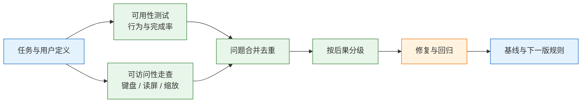
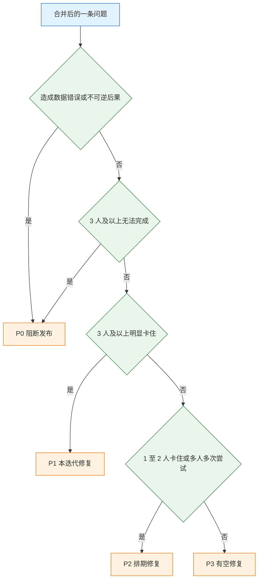

# 可用性与可访问性

---

## 一、可用性与可访问性是什么

### 1.1 核心概念

可用性（Usability）衡量特定用户、特定环境、特定任务下，界面被有效使用的程度。它拆成三个可测分量：有效性看任务能否完成、出错多少；效率看完成时间与操作步数；满意度看过程中的主观负担。三个分量必须同时记录，只报一项会掩盖问题——完成率高但耗时翻倍，说明界面在逼用户反复试错。

可访问性（Accessibility）衡量输入方式、感知方式或认知条件变化之后，任务是否仍能完成。范围包括键盘可达、屏幕阅读器语义、对比度、缩放回流、动效敏感度。它并非少数人的附加需求：临时受伤、强光环境、老旧设备、单手操作，都会让人短暂落入同样的约束。

两者的判断标准一致：**用户能否独立走到终点，卡在哪一步，代价是什么**。可用性测试回答“这一步顺不顺”，可访问性走查回答“换一种输入还通不通”。合并执行既能减少重复走查，也能避免“鼠标用户全通过、键盘用户全阻断”的验收漏洞。

| 概念 | 关注点 | 典型证据 | 不覆盖 |
|---|---|---|---|
| 可用性 | 任务是否顺畅 | 完成率、用时、错误、原话 | 换输入方式后的可达性 |
| 可访问性 | 换条件下是否可达 | 键盘路径、可访问树、对比度 | 任务设计本身是否合理 |
| 功能正确性 | 结果是否符合预期 | 用例、断言、接口返回 | 使用过程的负担 |
| 视觉还原 | 是否与设计一致 | 截图比对、数值偏差 | 任务能否完成 |

> **注意**：问卷满意度不能替代行为证据。满意度 4.5 分与“Tab 键没反应”可以同时成立，因为前者测喜好，后者测能力。

### 1.2 适用场景与边界

三类场合必须做：新流程首次上线前、改版前后需要证明效果时、设计系统或组件库验收时。三类做法容易走偏：把可用性测试当成功能测试，只找 bug 不看理解；把可访问性当成上线前的扫描，只看报告条数；把两者交给不同团队在不同时间做，问题无法合并排序。

| 场景 | 主要方法 | 产出 | 边界 |
|---|---|---|---|
| 新流程上线 | 5 人任务测试 + 键盘走查 | 问题清单与分级 | 不预测上线后的真实占比 |
| 改版效果验证 | 前后同一任务对比 | 四个基线指标 | 样本过小只写方向 |
| 组件库验收 | 逐组件键盘、读屏、状态检查 | 组件准入结论 | 不覆盖业务任务设计 |
| 合规审计 | WCAG 2.2 AA 逐条核对 | 符合性说明与证据 | 不保证任务高效 |
| 客诉集中排查 | 复现路径 + 录屏 | 根因与修复项 | 不能替代全量数据分析 |



> **设计红线**：只做鼠标走查就签字验收，等于把键盘与读屏用户排除在验收范围之外。主流程验收必须单独走通键盘路径。

---

## 二、评价维度与判断依据

### 2.1 可用性的五个维度

可用性不只看“能不能用”，而是五个互相牵制的维度。学习性决定新用户第一次能否上手；效率决定熟练用户能否快；记忆性决定隔一段时间回来是否还得重学；容错决定误操作能否挽回；满意度决定用户是否愿意继续用。五个维度常互相冲突：为提升容错加二次确认，会拖低效率；为提升效率减少说明，会拖低学习性。

| 维度 | 判断问题 | 可采集证据 |
|---|---|---|
| 学习性 | 首次使用是否需要外部指导 | 首次任务完成率、求助次数 |
| 效率 | 熟练后完成需要多少步 | 用时、点击数、页面跳转数 |
| 记忆性 | 隔周再用是否要重新摸索 | 回访任务用时差 |
| 容错 | 误操作能否发现并撤回 | 错误率、撤销使用率、不可逆操作数 |
| 满意度 | 过程是否可接受 | SEQ、SUS、原话 |

判断时先定权重。后台高频录入以效率优先，容错靠撤销而不是确认框；面向公众的一次性流程以学习性优先，说明要前置。权重不定，评审就会退化成个人偏好争论。

### 2.2 可访问性的四类障碍

可访问性按人的能力通道拆，比按技术点拆更容易覆盖完整。视觉障碍对应对比度、缩放、读屏；听觉障碍对应字幕与视觉替代；运动障碍对应键盘、热区、超时；认知障碍对应语言难度、一致性、错误提示。同一处缺陷往往同时影响几类人，例如只有颜色区分状态，既挡住色觉异常用户，也挡住强光下的普通用户。

| 障碍类型 | 典型表现 | 检查手段 |
|---|---|---|
| 视觉 | 低对比度、仅用颜色区分、无法缩放 | 取实际渲染色算对比度、200% 缩放、读屏 |
| 听觉 | 提示音无视觉替代、视频无字幕 | 静音走一遍流程 |
| 运动 | 只能拖拽、热区过小、无法用键盘 | 只用键盘、触屏单手、放大指针 |
| 认知 | 术语不一致、错误不说明原因、限时过短 | 首次使用者任务测试 |

### 2.3 严重度判定依据

严重度按后果判，不按人数判，也不按“频率 × 影响”算平均分。平均分会把“1 人下错单”和“3 人觉得慢”压成同一级。正确顺序是先看是否造成数据错误或不可逆后果，再看阻断人数，最后看卡住程度。



| 级别 | 判定依据 | 处理时限 | 典型例子 |
|---|---|---|---|
| P0 | 数据错误、资金错误、越权可见、无替代路径 | 阻断发布 | 提交后金额少一位 |
| P1 | 多人卡住，需协助才能完成 | 本迭代必修 | 审批人默认值错误且不可见 |
| P2 | 少数人卡住，有替代路径 | 排期修复 | 筛选条件返回后丢失 |
| P3 | 只影响观感或极端场景 | 常规迭代 | 图标与文字差 2px |

> **注意**：P0 不按人数打折。1 人付错款就是 P0，线上流量会放大后果，而且遇到问题的用户通常不会主动报告。

---

## 三、可用性测试的标准流程

### 3.1 任务定义

任务是目标，不是操作步骤。任务描述里出现“点击”“选择”“输入”，就变成了操作说明书，测到的是服从，不是理解。正确写法只给情境与目标，把路径留给用户。

| 错误写法 | 问题 | 改写 |
|---|---|---|
| 点击右上角头像，进入设置改密码 | 给出完整路径 | 怀疑账号被盗，需要改密码 |
| 在搜索框输入“发票”并回车 | 指定控件与按键 | 想找一张上个月的发票 |
| 选择“加急”后提交 | 指定选项 | 这单很急，今天必须送到 |
| 打开购物车，点结算 | 指定路径 | 想把购物车里的商品买下来 |

每个任务还要写清起点、终点、观察点。一次测试不超过 5 个任务，45 分钟内做不完，后半小时的数据会因疲劳失真。

| 任务 | 起点 | 终点 | 观察点 |
|---|---|---|---|
| 首次提交报销 | 工作台 | 提交成功 | 是否找到入口、是否理解限额 |
| 驳回后修改 | 被驳回单据 | 重新提交 | 是否知道改哪、是否重复填写 |
| 代他人提交 | 新建页 | 提交成功 | 是否正确切换申请人 |

### 3.2 实施与记录

记录表只写可复核的事实：时间码、任务编号、行为、原话、结果。“用户在地址页很困惑”是判断；“停留 22 秒、来回切换 4 次、说区选不了”才是记录。判断可以写进分析栏，但不能混进行为栏。

```text
场次：U03          设备：1366 笔记本      输入：鼠标 + 键盘
时间码   | 任务 | 行为                                   | 原话                     | 结果
00:04:12 | T1   | 在“详细地址”停留 22 秒，切换省/市 4 次 | “这个区怎么选不了？”     | 完成
00:09:40 | T1   | 第二次点“保存地址”                     | “刚才是不是没保存？”     | 完成
00:21:05 | T3   | 关闭优惠券弹层，直接支付               | “算了，不用了”           | 完成
```

主持人最容易犯的错是救场。重复一遍问题、把鼠标移过去、叹气、说“嗯……也可以”，都算提示。每场超过 3 次干预，主流程结果就要单独标注，不能与独立完成混算。

“5 人发现大部分问题”是经验结论，不是定理。它成立的前提是同一目标群体、问题类型集中、覆盖主流程。它回答“还有没有明显问题”，不回答“占多少比例”。多角色、多端、高风险流程，每类都要单独取样。

### 3.3 完成率与统计口径

同一个完成率，口径不同能差一大截。三种结果必须分开统计，并在报告里同时给出分子与分母。

| 结果 | 定义 | 是否计入成功 |
|---|---|---|
| 独立完成 | 无提示、无帮助，自行到达终点 | 是 |
| 协助后完成 | 主持人提示或代操作后到达终点 | 否，单列 |
| 失败 | 未到终点、放弃、超时 | 否 |

报告写“独立完成 3/5，协助后 1/5，失败 1/5”，比写“完成率 80%”有用。协助后完成的比例越高，说明界面自解释性越差，问题不在用户能力。

### 3.4 问题合并与排序

原始观察是现象，问题单是合并后的结论。合并规则：同一组件、同一根因跨页面出现算一条，注明影响页面数；同一现象在不同角色上表现不同，拆成两条，因为修复方式可能不同；主观偏好不进入问题清单，交给设计规范裁决。

| 合并情形 | 处理 | 理由 |
|---|---|---|
| 同一按钮在 6 个页面都缺焦点态 | 合并为一条，注明 6 处 | 根因在组件，不在页面 |
| 新用户找不到入口，老用户找不到导出 | 拆成两条 | 修复位置与优先级不同 |
| “颜色不好看”与“对比度不足” | 只保留后者 | 前者无判定标准 |
| 同一问题在 Web 与移动端表现不同 | 拆成两条 | 实现路径不同 |

---

## 四、可访问性的实现规则

### 4.1 键盘操作

拔掉鼠标，只用 Tab、Shift+Tab、Enter、Space、Esc 和方向键走完主流程。检查六件事：能否到达、焦点是否可见、顺序是否合理、是否被困、是否被遮挡、行为是否符合预期。

| 观察项 | 失败表现 | 修复方向 |
|---|---|---|
| 能否到达 | 自定义下拉完全跳过 | 换原生控件或补键盘处理 |
| 焦点可见 | 焦点在，但看不出在哪 | `:focus-visible` 加可见轮廓 |
| 顺序合理 | 从页尾跳回页首 | 按 DOM 顺序排版，去掉正数 `tabindex` |
| 是否被困 | Tab 在弹窗内循环且 Esc 无效 | 焦点陷阱 + Esc 关闭 |
| 是否被遮挡 | 焦点元素被吸顶栏盖住 | 滚动留白、`scroll-margin` |
| 行为符合预期 | 空格滚动页面而不是按下按钮 | 用原生 `button` |

> **注意**：正数 `tabindex` 会打乱自然顺序，不要使用。能换成 `button`、`a`、`input` 就换，不要给 `div` 加 `role="button"` 再手工补键盘逻辑。

### 4.2 焦点管理

弹窗是最容易出问题的地方。完整行为有四条：打开时焦点进入弹窗；Tab 在内部循环；Esc 关闭；关闭后焦点回到触发元素。只做其中两条，键盘用户仍会迷失。

```tsx
function Dialog({ open, onClose, title, children }) {
  const panelRef = useRef<HTMLDivElement>(null);
  const lastActive = useRef<HTMLElement | null>(null);

  useEffect(() => {
    if (!open) return;
    lastActive.current = document.activeElement as HTMLElement;
    const panel = panelRef.current;
    panel?.focus();

    const onKey = (e: KeyboardEvent) => {
      if (e.key === 'Escape') {
        e.stopPropagation();
        onClose();
        return;
      }
      if (e.key !== 'Tab' || !panel) return;
      const nodes = panel.querySelectorAll<HTMLElement>(
        'a[href], button:not([disabled]), input:not([disabled]), select, textarea, [tabindex]:not([tabindex="-1"])'
      );
      if (nodes.length === 0) return;
      const first = nodes[0];
      const last = nodes[nodes.length - 1];
      if (e.shiftKey && document.activeElement === first) {
        e.preventDefault();
        last.focus();
      } else if (!e.shiftKey && document.activeElement === last) {
        e.preventDefault();
        first.focus();
      }
    };

    document.addEventListener('keydown', onKey);
    return () => {
      document.removeEventListener('keydown', onKey);
      lastActive.current?.focus();
    };
  }, [open, onClose]);

  if (!open) return null;
  return (
    <div role="dialog" aria-modal="true" aria-labelledby="dlg-title" tabIndex={-1} ref={panelRef}>
      <h2 id="dlg-title">{title}</h2>
      {children}
    </div>
  );
}
```

这段代码覆盖 Esc、焦点进入、循环与归还，但没有处理背景滚动锁、背景 `inert` 和嵌套弹窗。生产环境优先使用组件库的 Dialog；自行实现时，这三项必须补齐，否则 Tab 仍会跑到背后的页面。

| 焦点场景 | 进入时 | 离开时 |
|---|---|---|
| 弹窗 | 焦点移到标题或首个子元素 | 回到触发按钮 |
| 抽屉 | 焦点移到抽屉标题 | 回到触发器 |
| 下拉菜单 | 焦点移到首项 | 回到触发器，或移到选中项 |
| 路由切换 | 焦点移到主标题 | 保留在页面主区域 |
| 错误提交 | 焦点移到错误摘要 | 用户逐项修正 |

> **设计红线**：全局 `outline: none` 会让键盘用户彻底失去位置感。需要自定义焦点样式时使用 `:focus-visible`，并保证在浅色、深色、图片背景上都清晰可辨；焦点环被 `overflow: hidden` 裁掉，等同于没有。

### 4.3 语义与读屏

规则顺序固定：能用原生元素就用原生元素，不够再补 ARIA，不要用 ARIA 修复错误的结构。`aria-label` 只改名称，不改角色；没有角色的 `div`，名字再好也可能被跳过。

| 元素 | 正确做法 | 常见错误 |
|---|---|---|
| 图标按钮 | 提供无障碍名称 | 只有 SVG，读出来是“按钮” |
| 输入框 | `label` 用 `for` 关联 | 拿 placeholder 当标签 |
| 错误提示 | `aria-describedby` 关联字段 | 红字在视觉上在，读屏读不到 |
| 表格 | `th` + `scope` | 一堆 `div` 拼格子 |
| 状态消息 | `role="status"` 或 `aria-live` | 保存成功只闪一下 |
| 装饰图标 | `aria-hidden="true"` | 每个图标都被念一遍 |
| 分组表单 | `fieldset` + `legend` | 只靠视觉分隔线分组 |

`aria-live` 的取值要区分场景：`polite` 适合保存成功、筛选结果更新，等当前朗读结束后播报；`assertive` 只用于错误与紧急中断，滥用会打断用户正在听的内容。区域必须先存在于 DOM 中再更新内容，动态插入整个节点通常不会被播报。

### 4.4 对比度、缩放与热区

| 检查项 | 标准 | 常见漏点 |
|---|---|---|
| 正文对比度 | ≥ 4.5:1（WCAG 1.4.3 AA） | 辅助说明、时间戳、表格次要列 |
| 大字号对比度 | ≥ 3:1 | 小标签被误当成大字 |
| 控件边界与图标 | ≥ 3:1（WCAG 1.4.11 AA） | 输入框边框、开关、图表线 |
| 200% 文本缩放 | 内容不丢、不重叠（WCAG 1.4.4 AA） | 固定高度容器裁切 |
| 320px 回流 | 只纵向滚动（WCAG 1.4.10 AA） | 宽表、长英文、固定宽弹窗 |
| 触控目标 | ≥ 24×24 CSS px（WCAG 2.5.8 AA），移动端建议 44 | 行内小图标挤在一起 |

对比度取实际渲染色。半透明、渐变、图片背景、阴影叠加都会改变最终颜色，直接拿设计稿的十六进制值计算不算数。

> **设计红线**：正文对比度低于 4.5:1、控件边界低于 3:1，属于可判定的不符合项，不是审美偏好。仅用颜色区分状态同样不可接受，必须同时提供文字、图标或形状。

---

## 五、工具操作与自动化边界

### 5.1 键盘与读屏走查

键盘走查不需要工具，关掉指针设备即可。读屏走查至少覆盖 macOS 的 VoiceOver 与 Windows 的 NVDA，因为两者的浏览模式与元素识别差异足以暴露不同问题。

| 操作 | VoiceOver（macOS） | NVDA（Windows） |
|---|---|---|
| 开关读屏 | Cmd + F5 | Ctrl + Alt + N |
| 下一个元素 | Control + Option + 右箭头 | 下箭头 |
| 激活元素 | Control + Option + 空格 | Enter 或 空格 |
| 转子 / 元素列表 | Control + Option + U | Insert + F7 |
| 停止朗读 | Control | Control |

走查重点不是“能不能读”，而是读出来的信息能否支撑决策。登录页要能听出用户名、密码与错误位置；列表页要能听出表头与单元格的对应；表单页要按合理顺序读出必填、说明与错误；弹窗要读出标题并在关闭后回到触发按钮；动态区域要主动播报成功或失败。

开始前先确认朗读顺序与视觉顺序一致。用读屏的元素列表或地标导航，检查页面是否有唯一的 `main`、导航与搜索是否可跳转。顺序错乱通常来自 CSS 视觉重排与 DOM 顺序不一致，这类问题在截图上完全看不出来。

| 走查层次 | 观察内容 | 失败信号 |
|---|---|---|
| 地标 | 页头、导航、主区、页脚是否可跳转 | 全部内容挤在一个区域 |
| 顺序 | 朗读顺序是否与视觉一致 | 先读到页脚再读正文 |
| 名称 | 控件名称是否具体 | 连续多个“按钮”“链接” |
| 状态 | 展开、选中、禁用是否读出 | 视觉有状态，朗读无变化 |
| 播报 | 异步结果是否主动告知 | 操作后长时间无反馈 |

### 5.2 自动化扫描的边界

| 能发现 | 不能发现 |
|---|---|
| 缺 `alt`、缺 `label` | `alt` 写得是否准确 |
| 对比度数值不达标 | 焦点顺序是否合理 |
| 重复 id、无效 ARIA | 读屏播报是否可理解 |
| 页面语言、标题缺失 | 键盘陷阱、弹窗焦点 |
| 部分结构与 landmark 问题 | 任务能否完成 |

常见估计是自动化覆盖三到四成。工具负责不漏明显项，人负责判断可用性。CI 接入 axe-core 是底线，不是验收的全部。

扫描结果按“页面 × 规则”去重：同一页面的重复元素合并为一条并注明数量，误报单独标记，不进入修复清单。只报“一共 63 条”没有意义，团队需要知道哪三类最集中、影响哪些页面。

---

## 六、模板与示例

### 6.1 筛选抽屉的完整改造

现象：鼠标用户正常，键盘用户打不开；打开后 Tab 跑到背后的列表；读屏只念“按钮”，不知道是筛选。改造分四步，每一步都能单独验收。

| 步骤 | 动作 | 验收点 |
|---|---|---|
| 1 | 触发器改为原生 `button`，加 `aria-expanded` 与 `aria-controls` | Tab 可到达，状态可读出 |
| 2 | 打开时焦点移到抽屉标题，关闭后回到触发器 | 开关两次焦点位置正确 |
| 3 | 抽屉内 Tab 循环，Esc 关闭，遮罩点击行为写进规格 | 无焦点逃逸，无键盘陷阱 |
| 4 | 标题用 `aria-labelledby`，筛选项用 `fieldset` + `legend`，结果用 `aria-live` 播报 | 读屏能听出分组与“已应用 3 个条件” |

这类问题的共同点是：视觉上完全正常，换一种输入方式就断了。只靠截图走查永远发现不了。

### 6.2 测试报告模板

```text
一、测试概况
    日期 / 版本 / 环境 / 设备 / 输入方式
    参与者：角色、相关经验、是否目标用户
二、任务与结果
    T1 任务描述 | 独立完成 | 协助后完成 | 失败 | 用时中位数
三、问题清单
    P0/P1 逐条：现象、证据（时间码/截图）、影响、建议
四、可访问性结论
    键盘：通过 / 阻断项
    读屏：通过 / 阻断项
    对比度与缩放：通过 / 不符合项
五、口径声明
    完成率定义、样本限制、未覆盖范围
```

报告必须写明未覆盖范围。只写“测试通过”会让读者误以为全部场景都验过。

---

## 七、常见失败模式与检查清单

### 7.1 失败模式

| 现象 | 最可能原因 | 处理 |
|---|---|---|
| 加了 `aria-label` 仍读不出 | 元素没有角色，或祖先 `aria-hidden` | 先查可访问树，再换原生元素 |
| Tab 跳不到某个操作 | 绑定在 `div` 上，或依赖 hover | 换 `button`，补常驻入口 |
| 焦点在但看不见 | 全局 `outline: none`，或被固定栏遮挡 | `:focus-visible` + 留滚动边距 |
| 弹窗关不掉 | 未处理 Esc，或焦点被困 | 统一 Dialog 行为 |
| 200% 缩放内容被裁 | 固定高度或宽度容器 | 改自适应高度，允许重排 |
| 表单错误读不到 | 只做红字，未关联字段 | `aria-describedby` + 错误摘要 |
| 扫描报告越修越多 | 口径变化或规则升级 | 固定规则集，变更单独注明 |
| 测试结论无法复现 | 无版本号、无设备、无时间码 | 按记录模板补齐证据 |

### 7.2 可访问性检查表

| # | 检查项 | 验证方式 | 通过标准 |
|---|---|---|---|
| 1 | 任务可完成 | 5 名目标用户走主任务 | 独立完成 ≥ 4/5，无数据错误 |
| 2 | 问题有证据 | 抽查问题清单 | 有行为、原话、时间码 |
| 3 | 键盘走通 | 不用鼠标走主流程 | 可达、焦点可见、无陷阱 |
| 4 | 焦点归还 | 开关弹窗与下拉 | 关闭后回到触发元素 |
| 5 | 读屏可理解 | VoiceOver 与 NVDA 各一遍 | 名称、角色、错误、状态可听到 |
| 6 | 对比度 | 取实际渲染色 | 正文 4.5:1，大字与边界 3:1 |
| 7 | 缩放回流 | 200% 缩放 + 320px 宽 | 不丢内容，无横向滚动 |
| 8 | 状态可感知 | 保存成功与失败 | 不依赖视觉也能知道结果 |
| 9 | 动效可关闭 | 开启减少动态效果 | 位移与缩放停止，信息完整 |
| 10 | 超时可延长 | 限时流程等待后操作 | 可延长或关闭限时 |

### 7.3 排查顺序

1. 先确认问题落在哪一层：任务设计、界面结构、输入方式，还是数据与权限。
2. 用键盘复现一次，判断是否为纯输入通道问题。
3. 打开可访问树，确认名称、角色、状态是否与视觉一致。
4. 取实际渲染色核对对比度，排除半透明与背景叠加的干扰。
5. 缩放到 200% 并收窄到 320px，检查裁切与横向滚动。
6. 最后才看自动化报告，按页面与规则归并，剔除误报。

> **核心结论**：问行为，不问喜好；完成率按独立完成、协助后完成、失败分开统计；P0 不按人数打折；键盘、读屏、缩放各走一遍，视觉正常不代表任务可完成。
