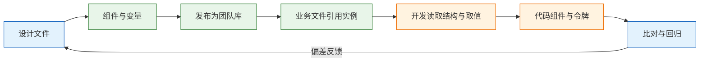
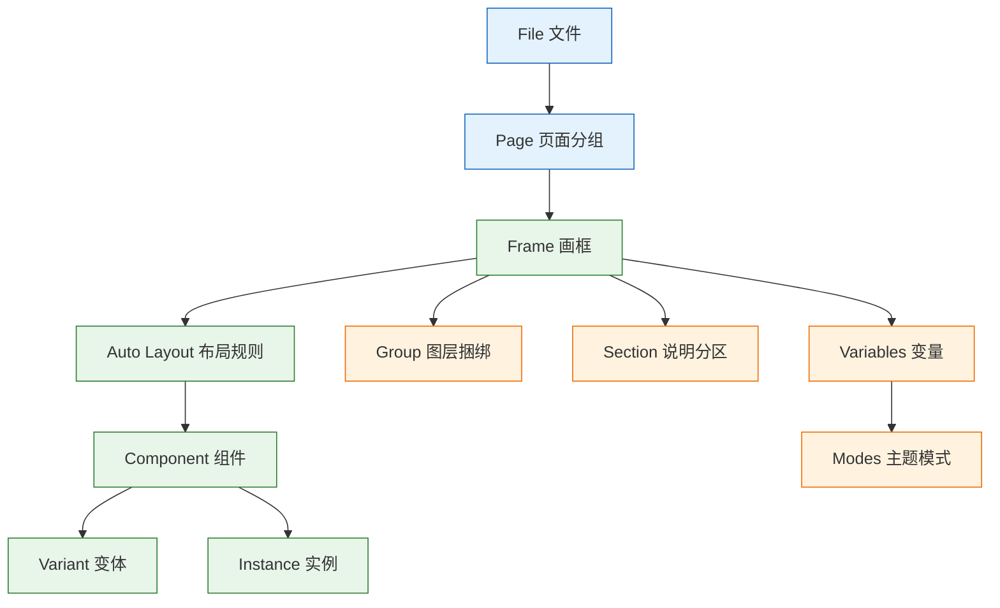
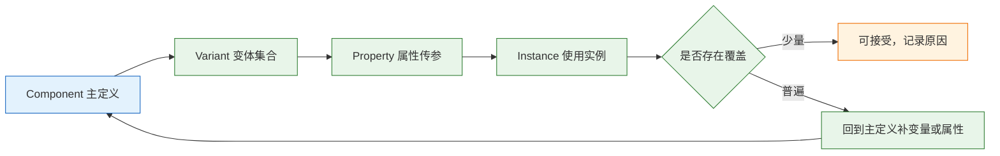

# Figma

---

## 一、Figma 是什么

### 1.1 核心概念

Figma 是浏览器优先的界面设计与协作工具，文件、组件库、变量、评论和权限都存放在云端。对工程侧而言，它的价值不是“看一张效果图”，而是**提供一份可解析的结构**：哪些是组件、哪些是实例、哪些尺寸由自动布局推导、哪些颜色来自变量。结构读对了，像素偏差可以修；结构读错了，下一次改版必然返工。

理解 Figma 需要抓住四个层次：文件层负责组织与权限，画框层负责布局语义，组件层负责复用与变体，变量层负责取值来源。四层分别对应代码里的仓库、容器、组件与令牌，映射关系越稳定，交接成本越低。

| 层次 | Figma 对象 | 工程含义 | 读取重点 |
|---|---|---|---|
| 文件层 | File、Page、Section | 仓库、模块、说明区 | 版本状态与分组方式 |
| 布局层 | Frame、Group、Auto Layout、Constraints | 容器、flex、定位 | 谁决定尺寸 |
| 组件层 | Component、Variant、Instance、Property | 组件、枚举、props | 复用边界与覆盖情况 |
| 取值层 | Variables、Modes、Styles | CSS 变量、主题、类 | 值是否有来源 |

> **注意**：Figma 的结构与代码结构不是一一对应。Group 只是把图层捆在一起，没有布局语义；Section 只是画布上的说明分区，不对应任何 DOM。把这两者当成容器，是误读的起点。

### 1.2 适用场景与边界

Figma 适合跨职能协作的设计生产：多人同时编辑、组件库集中维护、设计稿与需求文档互相引用、开发在设计稿上直接取值。它不适合承担运行时逻辑：交互原型只能表达状态流转，不能替代真实接口与边界数据验证；Dev Mode 输出的是参考片段，不是项目代码。

| 场景 | 适用程度 | 说明 |
|---|---|---|
| 多端界面设计与评审 | 高 | 同一文件按 Page 分端，评论可定位 |
| 设计系统维护 | 高 | 组件、变量、样式可发布为库 |
| 交付标注与取值 | 高 | Dev Mode 提供尺寸、颜色、间距 |
| 高保真交互验证 | 中 | 原型可验证流程，不验证性能与异常 |
| 直接生成生产代码 | 低 | 缺少项目约定、状态管理与可访问性 |
| 复杂动效调试 | 低 | 参数需在前端运行时验证 |



> **设计红线**：把设计文件当唯一规格来源、却不维护组件与变量，等于把一致性寄托在个人记忆上。文件里出现大量游离图层时，先补结构，再谈还原度。

---

## 二、文件结构判断与读取顺序

### 2.1 四层结构与代码映射

打开一个文件，读取顺序固定为：先看 Page 分组判断范围，再看 Frame 判断容器语义，再看 Auto Layout 与 Constraints 判断尺寸规则，最后看组件与变量判断复用与取值。顺序反过来，就会先记住具体像素，再被下一次改版推翻。

判断一份文件能否直接进入实现，看四个信号：页面是否有明确分组；主要区块是否使用 Frame 而非 Group；交互元素是否为组件实例；填充与文字是否绑定变量。四项齐备，交接以读结构为主；缺两项以上，先补设计侧结构，实现方只做探索性开发。

| Figma 对象 | 含义 | 代码对应 | 误读后果 |
|---|---|---|---|
| File | 一个产品或项目 | 仓库或包 | 找错版本 |
| Page | 文件内分组，常按端或流程 | 路由分组或模块 | 漏掉某端 |
| Frame | 有边界的容器，可设布局与裁剪 | `div` 或页面容器 | 当成固定画布 |
| Group | 图层捆绑，无布局语义 | 通常不对应 DOM | 抄出绝对定位 |
| Section | 画布说明分区 | 不对应代码 | 误认为页面 |
| Component | 可复用定义 | 组件 | 重复实现 |
| Instance | 组件的一次使用 | 组件调用 | 把覆盖当规范 |
| Variable | 可复用的值 | 设计令牌 | 硬编码颜色 |

Frame 与 Group 的区别最关键。Frame 能设 Auto Layout、约束、裁剪、背景和溢出行为；Group 只是选中方便。看到 Group 里包着一堆绝对定位图层，基本可以判断这块没有可复用的布局语义。



图中实线表示包含关系，从文件到变量共四层。工程侧只需记住两条：容器语义只来自 Frame 的布局设置，取值语义只来自变量与共享样式；Group 与 Section 不产生任何可映射语义。判断一个区块能否被稳定实现，先看它是否落在这两条线上。

### 2.2 文件组织约定

一个能被工程使用的文件，至少满足五条约定：封面页写清产品、版本、负责人、更新时间和状态；页面按流程或端分组，不按设计师个人分组；废弃稿移入 Archive 页；改动写进发布说明；大改版用分支或独立文件，合入前归档旧稿。

| 约定 | 不合格表现 | 通过标准 |
|---|---|---|
| 封面信息 | 只有一张封面图 | 产品、版本、负责人、状态、日期齐全 |
| 页面分组 | 以人名命名 | 以“订单 / 列表 / 设置”命名 |
| 废弃稿 | 与当前稿混排 | 独立 Archive 页，封面标注 |
| 变更记录 | 只在群聊里说 | 文件内发布说明可追溯 |
| 版本隔离 | 覆盖旧稿 | 分支或独立文件，合入前归档 |

### 2.3 版本状态判断

判断当前版本看三处：封面状态是否为“待开发”，页面更新时间是否晚于最近一次评审，引用的组件库是否为最新发布版本。三处不一致时，以组件库版本和发布说明为准，不以文件名里的“最终版”字样为准。

> **注意**：文件名带“最终版-2-真的最终”不代表可用。命名不能替代状态字段，状态字段不能替代发布记录。

---

## 三、Auto Layout 与响应式规则

### 3.1 Auto Layout 的 flex 映射

Auto Layout 是最值得优先读取的属性，因为它直接对应 flex 布局。方向、间距、内边距、对齐、子项伸缩方式，五项读完，一个区块的响应式行为基本确定。

| Figma 属性 | CSS 对应 | 注意 |
|---|---|---|
| Direction 水平或垂直 | `flex-direction` | 默认水平，对应 row |
| Gap | `gap` | 不是 margin，不要叠加外边距 |
| Padding | `padding` | 四边可分别设置 |
| Alignment | `align-items` 与 `justify-content` | 主轴与交叉轴别弄反 |
| Hug contents | `width: fit-content` | 容器随内容收缩 |
| Fill container | `flex: 1` 或 `width: 100%` | 撑满父级剩余空间 |
| Fixed | 固定宽高 | 只在确有需要时使用 |
| Wrap | `flex-wrap: wrap` | 注意换行后的对齐 |
| Absolute position | `position: absolute` | 仅用于角标与装饰 |

读法是固定的：先看最外层方向，再看 gap 与 padding，最后逐个确认子项是 hug、fill 还是 fixed。**子项的选择决定窄屏会不会破**，比记住具体数值重要。

```text
Frame (vertical, padding 16, gap 12, fill container)
├─ Header (horizontal, gap 8, hug height)
│  ├─ Title (fill container, text 16/24/600)
│  └─ Tag (hug)
├─ Body (fill container, text 14/22/400)
└─ Footer (horizontal, gap 8, align right)
```

对应实现：

```css
.card {
  display: flex;
  flex-direction: column;
  gap: var(--space-3);
  padding: var(--space-4);
}
.card__header {
  display: flex;
  align-items: center;
  gap: var(--space-2);
}
.card__title {
  flex: 1;
  min-width: 0; /* 关键：允许文本收缩，避免长标题撑破卡片 */
}
```

嵌套 Auto Layout 时还要看最小与最大宽度。外层 fill、内层 fill，中间没有 `min-width: 0`，文本会把整条链路撑开；设置了最小宽度，窄屏又会出现横向滚动。两端都要在设计文件里标明，不能留给实现阶段试出来。

### 3.2 约束与断点判断

没有 Auto Layout 的图层靠 Constraints 决定父容器变化时的行为。它只描述贴边与拉伸，不描述换行与重排，因此不能替代断点设计。

| 约束 | CSS 行为 | 适用元素 |
|---|---|---|
| Left + Top | 固定左、上边距 | 角标、关闭按钮 |
| Right + Top | 固定右、上边距 | 右上操作区 |
| Left + Right | 随容器拉伸 | 输入框、分割线 |
| Center | 水平居中 | 弹窗、空态插画 |
| Scale | 等比缩放 | 图片与装饰，不用于文字 |

设计稿画在 1440 的 Frame 里，不代表只能用于 1440。要确认 Frame 是 fill 还是 fixed、子项是 hug 还是 fill、有没有最小与最大宽度。**整页都是绝对定位时，这份稿子没有响应式意图**，此时不要自行猜断点，先让设计补 768 与 375 的行为说明。

断点说明不需要画出全部尺寸，但必须回答三个问题：容器在窄屏是换行、收缩还是隐藏；哪些内容是次要信息、可以降级；触控目标是否仍满足最小尺寸。三项没有答案时，实现者只能按桌面稿等比缩小，结果通常是文字过小、按钮挤在一起、表格横向溢出。

| 窄屏问题 | 设计侧应给出 | 实现侧常见错误 |
|---|---|---|
| 多列布局 | 折行顺序与优先级 | 直接按百分比压缩 |
| 宽表格 | 隐藏列、横向滚动或卡片化 | 整表等比缩小 |
| 长导航 | 折叠为菜单或底部栏 | 允许横向溢出 |
| 大标题 | 字号档位与换行规则 | 沿用桌面字号导致换行过多 |

---

## 四、组件、变体与属性

### 4.1 组件模型

组件解决复用，变体解决枚举，属性解决传参。三者混用会增加组合数量：把颜色、尺寸、状态、图标位置全部做成变体，会出现几十个近乎重复的版本，维护成本高于收益。

| 概念 | 含义 | 常见误读 |
|---|---|---|
| Component | 主定义 | 以为改实例等于改全部 |
| Variant | 同一组件的有限枚举 | 把任意状态都做成变体 |
| Property | 变体维度或开关 | 与代码 props 对不上 |
| Instance | 一次使用 | 覆盖后当成新规范 |
| Override | 实例上的局部修改 | 大量覆盖仍视为正常 |
| Detach | 断开与主组件联系 | 后续更新全部丢失 |

开发需要确认三件事。第一，这个元素是实例还是散图层；散图层意味着没有统一入口，代码里也不该为它单独建组件。第二，变体维度是否与 props 对得上；设计有类型、尺寸、状态三维，代码只有 `variant` 一维，状态交给 CSS，这是合理的；反过来设计五个变体、代码三个，要确认差异是否影响语义。第三，实例覆盖是否普遍；十个实例都改了圆角，说明圆角该绑变量，而不是逐个修改。



覆盖分两种：内容覆盖与样式覆盖。改文案、换图标属于内容覆盖，通常正常；改颜色、圆角、间距、字体属于样式覆盖，重复出现就是主定义缺项。评审组件库时统计样式覆盖的实例比例，比统计组件数量更能说明健康度。

### 4.2 组件属性的四种类型

| 设计属性 | 含义 | 代码对应 | 注意 |
|---|---|---|---|
| Variant | 有限枚举 | `variant`、`size` | 值必须是闭合集合 |
| Text | 可改文案 | `children` 或 `label` | 超长与换行要在设计里验证 |
| Boolean | 显示或隐藏某部分 | `showIcon` 等布尔值 | 布尔过多会组合爆炸，优先用插槽 |
| Instance swap | 替换子组件 | `icon`、`footer` 等节点 | 替换后尺寸与对齐需重新确认 |

属性名最好与代码 props 同名。设计叫 `Type`、代码叫 `variant`，还能靠文档对上；设计叫“样式2”，代码里只能猜。命名契约应在交接前定好，并写进组件库说明。

属性数量要控制。三个布尔属性就能产生八种组合，其中多数没有真实使用场景；两个变体维度各三档会得到九个版本，维护和测试成本随之上升。合并同义项、删除从未使用的组合，比继续增加变体更有效。

---

## 五、变量、样式与设计令牌

### 5.1 变量与模式

Figma 的变量保存可复用的值，模式（Modes）保存同一变量在不同情境下的取值。颜色、间距、圆角、字号都可以变量化；明暗主题、品牌主题、密度档位适合做成模式。

| 机制 | 用途 | 代码对应 | 检查方式 |
|---|---|---|---|
| Variables | 颜色、数值、字符串、布尔 | CSS 变量或令牌 | 面板显示变量名 |
| Modes | 同一变量的多套取值 | `[data-theme]` 等选择器 | 切换模式看是否成套变化 |
| Styles | 文本、颜色、效果样式 | 类或令牌 | 确认是否来自共享库 |
| Local styles | 仅当前文件可用 | 不应直接进代码 | 查是否已发布 |

检查一个填充色时，看右侧面板显示变量名还是十六进制值。显示 `color/text/secondary` 说明可映射到语义令牌；显示 `#475467` 说明没有绑定变量，深色模式大概率漏改；显示本地样式，需要确认它是否已进入共享库。

模式检查要成套进行：切到深色后，逐页看背景、文字、边框、图标、状态色是否都跟随变化。只改背景不改文字，会出现浅底浅字；只改主色不改悬停与聚焦，会在交互时突然跳回浅色值。成套检查比抽查单个元素更容易发现漏绑。

### 5.2 与代码令牌的映射

映射要满足三条：同名、同义、同层级。设计叫 `Primary/600`、代码叫 `brand-blue`，中间靠人记忆，映射一定会断。层级也要一致：设计分为基础色与语义色两层，代码却只有一层语义变量，切换主题时就没有回退空间。

| 映射问题 | 表现 | 修正 |
|---|---|---|
| 命名不一致 | 设计用序号，代码用语义 | 建立对照表并同步改名 |
| 层级缺失 | 只有语义色，没有基础色 | 补基础层，语义层引用基础层 |
| 模式不全 | 只做浅色 | 补齐深色与高对比模式 |
| 值硬编码 | 面板显示十六进制 | 绑定变量后再交付 |

> **注意**：变量绑定不等于主题可用。变量名对、层级对、模式齐，三者缺一，切换主题仍会出现局部不变化。

---

## 六、Dev Mode 与资源交付

### 6.1 Dev Mode 的定位与边界

Dev Mode 的面板提供尺寸、间距、颜色、字体和代码片段。它的价值是**查值**，不是**生成结构**。判断一段面板代码能否参考，看三点：是否包含 `display: flex`、`gap`、`padding` 这类布局语义；是否只由 `position: absolute`、`left`、`top` 和固定宽高组成；是否引用了真实的代码组件映射。

| 面板输出 | 可信度 | 处理方式 |
|---|---|---|
| 含 flex、gap、padding | 较高 | 参考布局，按项目约定重写 |
| 只有绝对定位与固定尺寸 | 低 | 回到 Auto Layout 重新推导 |
| 通过组件映射指向项目组件 | 高 | 核对 props 后使用 |
| 大量 `div` 加内联样式 | 低 | 只取颜色、字号、圆角 |

Code Connect 一类能力可以把设计组件映射到代码组件，但支持范围、套餐与版本会变化，以官方当前版本为准。没有映射时，不要假设面板里的代码就是项目代码。

使用顺序建议固定：先选中容器确认布局，再选中子项确认伸缩，再查变量名确认取值，最后复制尺寸与间距。四步都在同一个面板完成，但顺序不能颠倒。先复制数值再读结构，最容易把固定宽高带进代码。

| 操作 | 读取目标 | 输出 |
|---|---|---|
| 选中容器 | 方向、gap、padding | 布局骨架 |
| 选中子项 | hug、fill、fixed | 伸缩规则 |
| 查看填充与描边 | 变量名或十六进制 | 令牌映射 |
| 查看文本样式 | 字号、行高、字重 | 排版档位 |

### 6.2 资源导出

| 资源 | 格式 | 要求 |
|---|---|---|
| 图标 | SVG | 统一 `viewBox`，`fill="currentColor"`，清理元数据 |
| 照片与截图 | PNG 或 JPG 导出，构建期转 WebP、AVIF | 按显示宽度给 1x、2x，控制体积 |
| 插画 | SVG 优先 | 复杂渐变可转位图 |
| 头像 | 固定比例裁切 | 提供占位与替代文本 |
| 图表 | 矢量或代码重绘 | 不导出整张位图再缩放 |

导出前确认四件事：图标在 16、24、48 三档是否清楚，描边是否随尺寸变粗；图片是否带透明通道、是否有白底残留；文件名是否可读，例如 `icon-filter.svg` 而不是 `Frame 427.svg`；是否误把整页截图当成资源。

SVG 导出后还要做一遍清理：删除编辑器写入的注释与 `id`，合并无意义的嵌套组，统一保留 `viewBox`，颜色改为 `currentColor`。清理能去掉三到五成体积，也能避免同一图标在不同页面出现 `id` 冲突导致的样式串扰。

---

## 七、模板与示例

### 7.1 订单卡片的稿件解读

```text
OrderCard (vertical, padding 16, gap 12, fill)
├─ TopRow (horizontal, space-between)
│  ├─ OrderNo (text 14/22/500, fill)
│  └─ StatusTag (instance, hug)
├─ Amount (text 24/32/600)
└─ Actions (horizontal, gap 8, hug, align right)
   ├─ Button/Secondary (instance)
   └─ Button/Primary (instance)
```

读出的结论：卡片宽度跟随父级而不是固定 360；订单号可压缩，实现时需要 `min-width: 0`；金额不换行，需要 `white-space: nowrap`；状态标签是实例，颜色来自语义变量；两个按钮是实例，主次分明并右对齐；卡片只有 1px 边框、没有阴影，层级靠边框而不是浮起。

这些结论比记住“padding 16”更重要。换页面、换语言、换数据量，结构判断仍然成立，具体数值则可能变化。

### 7.2 Figma 交付清单

| # | 检查项 | 不合格表现 | 通过标准 |
|---|---|---|---|
| 1 | 组件实例化 | 按钮是矩形加文字 | 选中显示组件实例 |
| 2 | 变量绑定 | 填充为手填十六进制 | 面板显示变量名 |
| 3 | Auto Layout | 间距手输、图层绝对定位 | 有方向、gap、padding |
| 4 | 状态完整 | 只有默认态 | 默认、悬停、聚焦、禁用、加载、错误 |
| 5 | 边界内容 | 只有正常文案 | 超长、空、超多、无权限 |
| 6 | 断点说明 | 只有 1440 | 标明 768 与 375 的行为 |
| 7 | 资源规格 | 图标为位图、命名混乱 | SVG、可读命名、有 2x |
| 8 | 交互说明 | 只有静态画面 | 点击、跳转、动效、异常均有说明 |
| 9 | 版本状态 | 文件名写“最终版” | 封面状态与发布说明可查 |
| 10 | 可访问性 | 只有视觉状态 | 焦点态、对比度、名称已确认 |

抽查 5 个页面就能判断设计侧是否具备工程化条件。游离图层占比超过两成，先推组件化，不要急着上映射工具。

---

## 八、常见失败模式与检查清单

### 8.1 失败模式

| 现象 | 最可能原因 | 处理 |
|---|---|---|
| 间距总差 2px | 设计用了 10、14、18 非刻度值 | 先收敛间距变量，再改代码 |
| 窄屏卡片撑破 | 子项为 fixed，代码照抄固定宽 | 改 fill 并补 `min-width: 0` |
| 弹窗与设计不一致 | 只看默认态，未看状态画板 | 按状态清单逐项对照 |
| 图标模糊 | 导出位图或尺寸不匹配 | 改用 SVG，按 `viewBox` 使用 |
| 深色模式出现白块 | 填充未绑变量，图片带白底 | 检查变量与透明通道 |
| 组件升级后页面变化 | 页面覆盖了实例内部样式 | 只通过 props 与变体使用组件 |
| 找不到当前版本 | 无封面状态、无发布记录 | 补状态字段与 Archive 页 |
| 面板代码无法使用 | 结构为绝对定位 | 只取值，结构按项目重写 |

### 8.2 比对与排查顺序

比对偏差前先统一条件：同一构建版本、同一浏览器缩放（100%）、同一主题、同一份数据。条件不统一时，量出来的差异大多由环境造成。

1. 确认版本：构建号、设计文件状态、组件库版本三者一致。
2. 确认环境：浏览器、缩放、主题、字体加载状态一致。
3. 先比结构：容器宽度、排列方向、换行行为是否一致。
4. 再比状态：默认、悬停、聚焦、禁用、加载、错误逐态对照。
5. 再比边界：超长文本、空数据、超多数据、无权限。
6. 最后比数值：间距、字号、圆角、颜色，按令牌而非像素修。
7. 回归时抽查组件而非页面，避免同一根因在多页重复出现。

> **核心结论**：先读结构，再读数值；Auto Layout 读成 flex，重点看 hug、fill、fixed；Dev Mode 是测量仪，不是代码生成器；交付清单决定交接质量，不决定设计水平。
