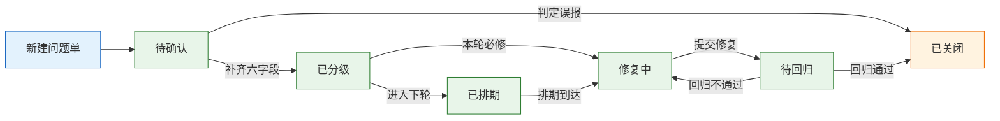
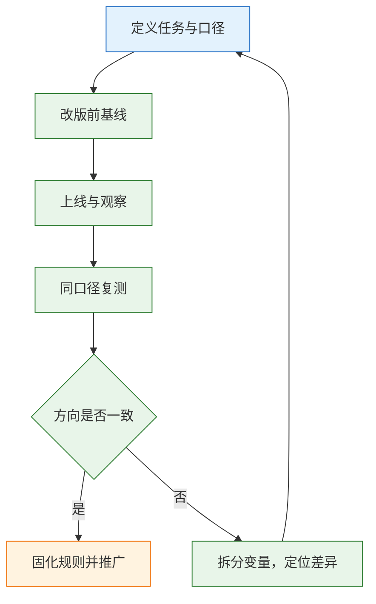

# 设计协作与度量

---

## 一、设计协作与度量是什么

### 1.1 核心概念

设计协作是把设计决策转成可执行、可验收的条目，让信息在角色之间传递时不被稀释。度量是把协作结果转成可比对的数字，用来判断哪一段流程在漏，而不是给团队打分。两者是一件事的两端：没有条目的协作只能靠口头记忆，没有度量的协作无法知道改进是否有效。

协作的对象有三类。**决策**指为什么这样做、放弃了哪些备选，需要留下理由与拍板人。**条目**指一条可修复的问题或一条可验收的规格，需要位置、期望、证据。**变更**指设计或实现的改动，需要版本、影响范围与回归结论。三类信息中任何一类只存在于聊天记录里，都会在交接时丢失。

| 对象 | 内容 | 载体 | 丢失后果 |
|---|---|---|---|
| 决策 | 方案取舍、约束、拍板人 | 评审记录、设计说明 | 下一轮重复争论 |
| 条目 | 问题、规格、状态、验收标准 | 问题单、交付清单 | 修复无法定位 |
| 变更 | 版本、影响范围、回归结果 | 发布说明、变更记录 | 修了旧包或漏回归 |
| 指标 | 完成率、用时、偏差数、满意度 | 报表、复盘文档 | 改进无法证明 |

> **注意**：协作的产物不是“稿子”，而是“能被独立执行的条目”。稿子只是条目的证据之一，不能替代条目本身。

### 1.2 适用场景与边界

适合的场景：多角色参与的改版、设计系统落地、跨端一致性维护、上线前的验收、客诉与数据的归因。不适合的场景：探索期的概念验证（此时标准尚未稳定）、纯视觉风格试验（无共同判定标准）、紧急故障处置（先恢复再复盘）。

| 场景 | 协作重点 | 度量重点 | 不适用原因 |
|---|---|---|---|
| 版本改版 | 准入、范围、分级 | 偏差数与回归率 | 无 |
| 设计系统落地 | 组件 API、令牌、迁移 | 复用率与覆盖率 | 不直接反映任务效果 |
| 跨端一致性 | 状态与断点对齐 | 各端偏差分布 | 端能力差异需单列 |
| 上线验收 | 清单逐项判定 | S1、S2 关闭率 | 不覆盖长期体验 |
| 概念验证 | 只记录决策 | 不做量化结论 | 标准尚未稳定 |


> **设计红线**：没有准入标准就开始走查，会把半成品的问题当成设计问题，重复提出、重复修复。走查的对象必须是可运行、可登录、有数据的构建。

---

## 二、评审位置与准入判断

### 2.1 评审在流程中的位置

走查不是越早越好，也不是越晚越好。合适的位置是“开发自测通过、提测冒烟通过”之后、“上线”之前。太早，页面主流程未通，看到的是半成品；太晚，改动成本高，团队倾向把问题记入下个版本。

| 阶段 | 走查能发现 | 走查发现不了 |
|---|---|---|
| 设计稿评审 | 结构、状态缺失、规格矛盾 | 实现偏差、真实数据表现 |
| 开发自测后 | 布局、样式、交互状态 | 跨端与性能问题 |
| 提测冒烟后 | 真实数据、权限、异常态 | 上线后的流量差异 |
| 上线后 | 真实行为与客诉 | 已造成的返工成本 |

把走查放在提测后，还有一个隐性收益：此时页面已有真实数据，空态、超长文本、权限差异都能被看到。设计稿阶段这些问题只能靠想象，容易漏掉。

### 2.2 准入条件

准入四条，不满足就退回，不做“边看边补”。退回不是刁难，而是避免同一批问题在两周内被提三次。

| # | 条件 | 原因 |
|---|---|---|
| 1 | 主流程能走通 | 走不通时看到的是半成品，问题会重复 |
| 2 | 测试环境可登录、有权限 | 缺权限看不到部分角色与状态 |
| 3 | 有真实或仿真数据 | 空数据看不出布局与截断问题 |
| 4 | 构建版本号已确认 | 避免“修了但看的是旧包” |

### 2.3 范围边界

范围要提前写死，并写进提测单。查视觉还原、交互状态、边界内容、文案一致性；不查功能逻辑（归测试）、性能与安全（归专项）、代码质量（归代码评审）。范围不清，走查会变成“大家一起找 bug”，最后谁都不负责。

| 检查对象 | 归属 | 判定依据 |
|---|---|---|
| 视觉还原 | 设计走查 | 令牌、间距、字号、圆角 |
| 交互状态 | 设计走查 | 状态清单与行为说明 |
| 边界内容 | 设计走查 | 超长、空、超多、无权限 |
| 功能逻辑 | 功能测试 | 用例与接口契约 |
| 性能与安全 | 专项 | 指标阈值与扫描报告 |
| 代码质量 | 代码评审 | 规范与可维护性 |

---

## 三、问题单规范与分级

### 3.1 问题单的六个字段

一条可修复的问题至少包含六个字段。缺任何一个，接收方都要回来问一次，协作成本翻倍。

| 字段 | 要求 | 示例 |
|---|---|---|
| 位置 | 组件 + 页面 + 元素 | `[AppButton/Primary][订单列表]` |
| 现象 | 实际看到什么 | 圆角 6px |
| 期望 | 应该是什么，带令牌 | `--radius-sm`，4px |
| 证据 | 截图、录屏、设备、缩放 | 1440 宽，Chrome 128 |
| 影响 | 用户或维护会怎样 | 与设计系统不一致，换主题会漏 |
| 严重度 | 按统一规则判定 | S3 |

```text
✘ 这个按钮不太对
✔ [AppButton/Primary][订单列表] 圆角期望 --radius-sm（4px），实际 6px；1440 / Chrome 128
✔ [AppTable][用户管理] 1280 宽下横向溢出，期望次要列隐藏，实际 8 列全显示
```

**能定位到组件或令牌的偏差才算可修复**。“还原度 90%”不是可执行指标，也无法回归。

### 3.2 分级规则

分级用规则表，不用“频率 × 影响”算平均分。平均分会把“1 人数据错误”和“3 人觉得慢”压成同一级，也会让评分者通过调权重影响结论。

| 级别 | 判定 | 处理时限 | 例子 |
|---|---|---|---|
| S1 阻断 | 任务无法完成，无替代路径 | 本轮必修 | 提交按钮一直禁用且不说明原因 |
| S2 严重 | 能完成但极易出错，或需他人协助 | 本轮必修 | 审批人默认值错误且不可见 |
| S3 一般 | 影响效率，有替代路径 | 本轮尽量 | 筛选条件返回后丢失 |
| S4 轻微 | 只影响观感 | 常规迭代 | 图标与文字间距差 2px |

### 3.3 评审会组织

评审不是展示，也不是投票。30 到 45 分钟，围绕任务走，不逐页看图。

| 时间 | 做什么 | 产出 |
|---|---|---|
| 5 分钟 | 确认范围、版本、已知问题 | 不重复提已知项 |
| 20 分钟 | 按主任务实际点一遍 | 卡点与状态缺失 |
| 10 分钟 | 对 S1、S2 定改法与负责人 | 可排期的决定 |
| 5 分钟 | 记录未决项与截止时间 | 不留在口头 |

三条纪律：只讨论可复现的现象；不在会上重画；每个结论有负责人和日期。审美分歧由设计负责人按规范拍板，不占用任务评审时间。

会议时间要硬性切分。前 25 分钟只做复现与记录，不做方案讨论；后 10 分钟只对 S1、S2 定改法与负责人。把“怎么改”提前，会让会议在第一个问题上耗尽时间，后面的页面只能草草看过。

| 会议失控表现 | 根因 | 处理 |
|---|---|---|
| 反复讨论配色 | 无判定标准 | 交设计负责人按规范裁决 |
| 现场打开编辑器改稿 | 目标错位 | 只记录，会后出稿 |
| 结论无负责人 | 缺记录字段 | 每条结论必填负责人与日期 |
| 后半程无人发言 | 时长过长或议题发散 | 限时 45 分钟，按任务走 |



> **注意**：状态字段比评论更重要。“已修复但未回归”与“已关闭”必须分开，否则上线前无法判断哪些结论只是口头承诺。

---

## 四、交接清单与双向就绪

### 4.1 设计侧交付物

交付物放进问题单或需求单的模板里，不放在聊天记录。异步交接的前提是信息可查，不是消息发过。

| 交付项 | 内容 | 缺失后果 |
|---|---|---|
| 页面清单 | 页面、优先级、所属流程 | 遗漏页面或重复实现 |
| 组件与变体 | 使用的组件、变体名、属性 | 自行拼装，状态不一致 |
| 状态清单 | 默认、悬停、聚焦、禁用、加载、错误 | 只实现默认态 |
| 边界内容 | 空、超长、超多、无权限 | 真实数据下布局破坏 |
| 令牌绑定 | 变量名与映射表 | 硬编码颜色，主题失效 |
| 断点说明 | 1440、768、375 的行为 | 窄屏靠猜 |
| 资源 | SVG 图标、2x 图片 | 模糊或体积过大 |
| 交互说明 | 点击、跳转、动效、异常 | 行为靠口头约定 |

### 4.2 开发侧就绪标准

| 检查项 | 通过标准 |
|---|---|
| API 契约 | props 与设计变体一一对应 |
| 默认值 | 每个 prop 有明确默认值 |
| 状态实现 | 设计列出的状态都有样式 |
| 文档 | 每个状态有可运行示例 |
| 可访问性 | 键盘可达、焦点可见、图标按钮有名称 |

两边都就绪再进开发队列。设计没绑变量、代码没定 API，先补件，不要边做边猜。双向就绪的意义在于把不确定性前移：在写第一行代码前暴露规格冲突，比在提测后修十页便宜得多。

就绪判断不靠“感觉差不多了”，靠可勾选的字段。设计侧看变量绑定率、状态覆盖数、边界样例数；开发侧看 props 定义、默认值、示例页。任一项为零，说明这一轮只能做探索性实现，不能承诺还原度。

---

## 五、走查顺序与偏差管理

### 5.1 七层走查顺序

| 顺序 | 看什么 | 手段 |
|---|---|---|
| 1 | 主任务能否完成 | 实际点一遍 |
| 2 | 分组与层级 | 灰度截图、眯眼、5 秒测试 |
| 3 | 状态覆盖 | 加载、空、错、无权限逐态看 |
| 4 | 数值偏差 | 量间距、字号、颜色、圆角 |
| 5 | 边界内容 | 超长、空、超多、特殊字符 |
| 6 | 多端 | 375、768、1440，触屏与键盘 |
| 7 | 资源 | 图标清晰度、比例、白底残留 |

顺序反了，会在一个马上要重做的区块上纠 1px。前两层决定“是否值得修细节”，后五层决定“细节修得对不对”。

证据要能定位到具体元素。截图标注宽高与位置，录屏保留操作路径，偏差写清测量方式：量的是外边距还是内边距、取的是实际渲染色还是设计值。测量方式不写，两个人会得出两个数。

### 5.2 分批推进

一次改版十几页时，按依赖关系分批，不按页码顺序。先做组件映射稳定的页面，后做依赖复杂表格与权限的页面。

| 批次 | 页面 | 前置条件 | 完成标志 |
|---|---|---|---|
| 1 | 登录、首页、列表模板 | 核心组件映射完成 | 偏差少于 5 条 |
| 2 | 表单、详情、设置 | 状态词表与表单组件稳定 | 映射覆盖 100% |
| 3 | 报表、权限、异常 | 表格与空态稳定 | 无横向溢出，空态齐全 |

每批结束统计四个数：S1 与 S2 数量、偏差总数、独立完成率、平均修复时长。四个数一起看，才能区分“实现变准了”和“标准变松了”。

分批还要固定比较基准。每批开始前记录一次当前偏差数，结束后用同一工具、同一环境复测；中途更换浏览器或缩放比例，前后数字就不可比。批次之间的差异写进复盘，不要用一句“这轮质量更好”概括。

---

## 六、度量体系与基线

### 6.1 四类指标

| 类型 | 指标 | 能回答 | 不能回答 |
|---|---|---|---|
| 产出 | 偏差数、令牌覆盖率、组件复用率 | 做得规不规范 | 用户有没有变好 |
| 结果 | 任务完成率、用时、错误率、放弃率 | 任务有没有变顺 | 为什么变 |
| 体验 | SEQ、SUS、客服工单 | 感受如何 | 因果 |
| 业务 | 转化、留存、处理时长 | 有没有价值 | 哪一处导致 |

产出指标是先行指标，结果与业务指标是滞后指标。改版刚上线时，只能先看产出是否达标；要判断有没有用，必须等结果指标积累到可比样本。把两类指标混在同一张图上比较，会得出“组件覆盖率高所以体验好”这类无效结论。

### 6.2 指标配对

单个指标容易被解释成任何结论，必须成对读取。配对的原则是“一个说明做没做，一个说明有没有用”：产出指标与结果指标配对，结果指标与体验指标配对，任何一组单独出现都不足以支撑结论。

| 组合 | 可能解释 | 下一步 |
|---|---|---|
| 完成率高 + 求助多 | 用户被帮助后完成，自解释性差 | 看协助后完成比例 |
| 满意度高 + 完成率低 | 感受好不代表任务简单 | 复核任务与样本 |
| 复用率高 + 偏差多 | 组件 API 不对，页面在覆盖内部样式 | 查样式覆盖比例 |
| 偏差数下降 + 用时上升 | 为还原牺牲效率 | 对比改版前任务用时 |
| 工单下降 + 完成率不变 | 问题被转移到其他渠道 | 查帮助入口与自助文档 |

### 6.3 基线与对比

没有基线的指标只能描述当下，不能证明改版有效。改版前先跑一次同任务、同口径的测试，记下四个数：独立完成率、平均用时、求助次数、P0 与 P1 数量。改完用同一套任务与判定标准再跑一次，并换新用户，避免学习效应。

比较时注意三点：样本量小时只看方向，不写百分比结论；任务文本、环境、判定标准任何一项变化，都不能直接对比；指标变好但客服工单没降，说明测到的可能不是真实场景，需要回看样本与任务。



> **注意**：不要用页面数、组件数、走查条数证明设计系统成功。它们只证明工作量，不证明效果。

---

## 七、模板与示例

### 7.1 完整走查案例

某后台改版共 12 页，提测后只剩 3 天，首轮走查提出 187 条，修复两周后仍有大量返工。复盘发现四个问题：没有准入，主流程未通就开始看细节；意见写成“这个按钮不太对”，无法定位；视觉、交互、功能混在一起，责任不清；没有统计口径，两个人对同一页数出两个偏差数。

改造后的执行顺序：

| 步骤 | 动作 | 结果 |
|---|---|---|
| 1 | 提测单加四条准入 | 首轮退回 4 次，问题总量降到 96 条 |
| 2 | 问题单统一六字段 | 需回问的比例从三成降到不足一成 |
| 3 | 按 S1 到 S4 分级 | 本轮必修收敛到 14 条 |
| 4 | 分三批走查 | 每批结束统计四个数 |
| 5 | 上线后同口径复测 | 独立完成率与用时可比 |

问题总量下降不等于质量提升，可能只是标准收紧或提报意愿下降。因此必须同时看 S1、S2 数量与独立完成率：前者说明严重问题是否被掩盖，后者说明用户是否真的变顺。

### 7.2 问题单模板

```text
标题：[组件/页面] 现象一句话
位置：组件名 + 页面 + 元素
环境：构建号 / 浏览器 / 缩放 / 主题 / 数据
现象：实际看到什么，可量化
期望：应为什么，引用令牌或规则
证据：截图或录屏，标注时间码
影响：用户后果与维护后果
严重度：S1 / S2 / S3 / S4，附判定依据
负责人：修复人 + 回归人
状态：待确认 / 已分级 / 修复中 / 待回归 / 已关闭
```

模板的价值在于强制补齐证据。字段不全的条目允许创建，但不能进入本轮排期。

### 7.3 验收记录模板

| 项 | 记录内容 |
|---|---|
| 版本 | 构建号与设计文件版本 |
| 判定人 | 两人独立判定，记录分歧 |
| 结果 | 通过项、不通过项、未覆盖项 |
| 回归 | S1、S2 关闭情况与新增问题 |
| 口径 | 统计规则是否变更 |

两人分别判定同一份清单，分歧条目说明标准本身还需写细。清单不更新，验收就会退回主观判断，也无法交接。

---

## 八、常见失败模式与检查清单

### 8.1 失败模式

| 现象 | 最可能原因 | 处理 |
|---|---|---|
| 走查变成争吵 | 只有结论，没有现象与证据 | 按六字段重写，只讨论可复现部分 |
| 修了但没解决 | 只改页面，没改组件或令牌 | 同一问题跨 3 页就改组件 |
| 偏差数越修越多 | 统计口径变了，或标准提高 | 固定口径，变更单独注明 |
| 设计系统没人用 | 只有组件，没有迁移与门禁 | 先修高频组件，再补检查与废弃期 |
| 指标好看但体验差 | 只统计产出，不看任务结果 | 增加独立完成率与求助次数 |
| 交接靠口头 | 模板不在需求单里 | 把清单做成必填模板 |
| 上线后才发现问题 | 走查晚于提测，或范围过窄 | 前移走查，明确七层范围 |
| 同一问题反复提 | 无状态字段，无回归人 | 加状态机与回归责任人 |

### 8.2 检查清单

| # | 检查项 | 验证方式 | 通过标准 |
|---|---|---|---|
| 1 | 准入门禁 | 提测单逐条核对 | 四条全过才开始走查 |
| 2 | 范围明确 | 提测单含范围段 | 查什么、不查什么都有 |
| 3 | 问题可定位 | 抽查 10 条 | 六字段齐全，含证据 |
| 4 | 分级一致 | 两人独立分级 | S1、S2 判定一致 |
| 5 | 交接完整 | 对照交付清单 | 无缺项，状态齐全 |
| 6 | 修复回归 | 修完复看 | S1、S2 全部关闭，无新增 |
| 7 | 指标成对 | 查看报表 | 产出、结果、体验各至少一项 |
| 8 | 口径稳定 | 两轮对比 | 规则未变，或变更已注明 |
| 9 | 基线可查 | 查改版前记录 | 四个基线数完整 |
| 10 | 结论有归属 | 抽查会议记录 | 每条结论有负责人与日期 |

### 8.3 排查顺序

1. 先确认版本与环境是否一致，排除“看的是旧包”。
2. 再确认问题属于范围之内，范围外的转给对应责任人。
3. 检查问题单是否可定位，字段不全的先补证据。
4. 复核分级是否按规则表判定，排除按人数或情绪定级。
5. 检查修复是否落在组件或令牌层，避免逐页打补丁。
6. 最后核对度量口径与基线，确认结论可以被复现。

> **核心结论**：协作的产物是可验收的条目，位置、期望、证据、严重度缺一不可；评审先看任务与结构，再看数值；度量必须成对读取，产出说明做没做，结果说明有没有用。
