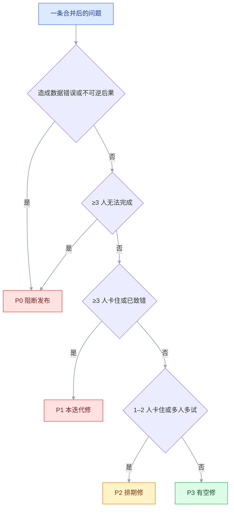

# 可用性测试

## 一、工程案例：5 人完成一次下单流程测试，并产出可执行的问题分级

**场景**：一个电商站点，数据看板显示「进入结算 → 支付成功」的转化在收货地址这一步掉了 30%，但不知道原因。产品和设计各有一套猜测：有人说是地址表单字段太多，有人说是优惠券入口太显眼。决定用 5 名真实用户做一次形成性测试：准备 2 天、执行 2 天，最后一场结束后 48 小时内出报告。

**为什么必须做**：埋点只能告诉你「在哪一步掉」，不能告诉你「用户当时在想什么」。猜测驱动的改版很容易改错地方——把表单从 8 个字段减到 6 个，结果用户仍然卡在「区/县」的联动上。

**约束**：没有实验室，全部远程主持；用户分散在三个城市；不能装插件，只能用浏览器和系统录屏；每人 45 分钟；预算只够 5 人。**约束越多，越要把任务和记录做扎实，而不是靠人数补。**

**动手前确认**：录屏与录音的知情同意话术；测试账号能走通支付沙箱；每个用户一份独立优惠券；备用会议链接；一名记录员（主持人不兼记录）。

### 1.1 主线（按顺序执行，不要跳步）

**① 把模糊疑问改成可回答的研究问题（1 小时）**

| 模糊疑问 | 改成研究问题 | 靠什么回答 |
|---|---|---|
| 地址表单是不是太长 | 用户在地址步骤的哪个字段停留最久、为什么 | 录像 + 出声思维 |
| 优惠券入口是不是太显眼 | 用户是否注意到优惠券，是否误以为必须使用 | 首次点击 + 出声思维 |
| 优惠券不可用会不会阻断下单 | 用户能否放下优惠券、独立完成支付 | 任务 3 的完成判定 + 求助次数 |

研究问题要能被一次 45 分钟的测试回答。回答不了的，拆小或换方法。

**② 设计 3 个任务（1 小时）**

任务是**目标**，不是操作步骤。每个任务包含场景、起点、终点、观察点：

| # | 任务（对用户说） | 起点 | 终点 | 主要观察 |
|---|---|---|---|---|
| 1 | 你刚搬了家，想买一箱矿泉水送到新地址，请完成下单 | 首页 | 支付成功页 | 地址录入、运费理解、支付方式选择 |
| 2 | 下单到一半发现地址写错了，请改成公司地址再继续 | 结算页 | 支付成功页 | 是否知道返回、已填内容是否保留 |
| 3 | 你领了一张优惠券，想在这单用掉，请完成下单 | 结算页 | 支付成功页 | 是否被优惠券卡住、能否放弃使用 |

三个任务覆盖「正常路径、纠错路径、干扰路径」。**不要超过 5 个任务**，45 分钟内做不完，用户后半小时的表现会失真。

任务 3 的「券不能用」由测试环境制造（过期券或不满门槛），不要写进任务描述——写进去等于提前告诉用户答案，测到的是服从，不是理解。

**③ 写主持脚本（1 小时）**

脚本的作用是保证 5 场测试的口径一致：

```text
【开场 3 分钟】
「今天想请你帮忙试用一个购物流程。我们测的是产品，不是你，
 所以你卡住、点错、说『这是什么』，对我们都是最有用的信息。」
「过程中请尽量把想法说出来，想到什么说什么，不用组织语言。」
「可以随时说『我不想继续了』，没有关系。」
「全程会录屏和录音，只用于内部改进，不会公开，也不会带你的真实信息。
 你同意吗？」

【背景 5 分钟】
「你最近一次网上买东西是什么时候？买的什么？」
「平时用什么设备下单？手机还是电脑？」
「有没有遇到过下单到一半放弃的情况？当时发生了什么？」

【任务 30 分钟】
「下面我会给你三个小任务，每个任务开始前我会把情景读给你。
 你可以用任何方式完成，遇到问题就说出来。
 我不会告诉你点哪里，这不是不帮你，是为了看产品本身够不够清楚。」

【收尾 5 分钟】
「整体用下来，最让你犹豫的是哪一步？」
「如果只能改一个地方，你会改哪里？」
「还有什么我没问到、但你觉得重要的？」
```

**④ 招募 5 名目标用户（半天）**

| 条件 | 要求 | 原因 |
|---|---|---|
| 近 3 个月有网购经历 | 必须 | 不熟悉电商的人会卡在常识，不是卡在界面 |
| 未参与过本项目 | 必须 | 内部人知道太多，测不出真实理解 |
| 设备与网络 | 自备电脑或手机，网络稳定 | 远程测试的最低条件 |
| 年龄段 | 至少覆盖两档 | 地址录入、支付习惯差异大 |
| 时间 | 45 分钟完整可用 | 中途打断的场次作废 |

不要用同事凑数。同事能发现「这个按钮不明显」，发现不了「用户会把优惠券当成必选项」。

**⑤ 试测 1 人（半天）**

试测的人不算样本，作用是把脚本里的问题提前暴露：

```text
□ 任务描述里有没有「点击」「选择」「进入」这类操作词
□ 45 分钟够不够，哪个任务超时
□ 录屏能不能录到浏览器内容和鼠标位置
□ 测试账号能不能走通支付沙箱
□ 用户是否理解「出声思维」的要求
□ 记录表字段是否够用
```

试测后修改任务措辞，修改过的地方要在报告里说明，因为不同版本的完成率不可直接比较。

**⑥ 执行 5 场（2 天）**

每场的节奏固定，主持人和记录员分工：

| 时间 | 动作 | 谁做 | 产出 |
|---|---|---|---|
| 前 5 分钟 | 设备检查、同意书、开场 | 主持 | 录制开始 |
| 5 分钟 | 背景问题 | 主持 | 用户画像 |
| 30 分钟 | 3 个任务，逐个读题 | 主持 | 行为路径 |
| 5 分钟 | 收尾访谈、SEQ | 主持 | 主观评分 |
| 结束后 10 分钟 | 保存录像、补记录 | 记录 | 场次档案 |

**⑦ 记录（每场同步）**

记录表只记**行为和原话**，不写评价：

```text
场次：U03
时间码 | 任务 | 行为 | 原话 | 首次点击 | 结果 | 备注
00:04:12 | T1 | 在「详细地址」停留 22 秒，来回切换省/市 | 「这个区怎么选不了？」 | 省下拉 | 完成 | 手动输入了区
00:09:40 | T1 | 第二次点「保存地址」 | 「刚才是不是没保存？」 | — | 完成 | 无成功反馈
00:21:05 | T3 | 关闭优惠券弹层，直接支付 | 「算了，不用了」 | 支付按钮 | 完成 | 未受阻
```

时间码很关键。报告里引用原话时，能定位到录像的具体位置，比截图更有说服力。

**⑧ 合并与分级（1 天）**

先把 5 场的行为按「同一处界面 + 同一类误解」合并，再计数，最后分级。不要按用户逐场罗列，那样会得到 30 条重复问题。

分级用三个维度，不用拍脑袋：

| 维度 | 取值 | 说明 |
|---|---|---|
| 频率 | 5/5、3–4/5、1–2/5 | 遇到该问题的用户数 |
| 影响 | 阻断、产生错误、明显低效、轻微 | 对任务结果的作用 |
| 持久性 | 每次必现、首次出现、偶发 | 学会后是否还卡 |

判定规则：

```text
P0 阻断：≥ 3 人无法完成，或 ≥ 1 人产生数据错误（下错单、付错款、隐私泄露）
P1 严重：≥ 3 人明显卡住但能完成；或 1–2 人产生可自行纠正的错误
P2 中等：1–2 人卡住；或 ≥ 3 人需要多试一次
P3 轻微：只影响感受，不影响完成
```

数据错误不按人数稀释：1 人下错单就是 P0，因为线上会按流量放大，而且用户不会主动报告。

**⑨ 出报告（24–48 小时内）**

报告先给结论，再给证据，最后给建议：

```text
1. 结论：3 条最重要的发现，每条一句话
2. 方法：5 人、3 任务、远程主持、45 分钟、测试环境
3. 问题清单：按 P0 → P3 排，每条含
   - 现象（行为 + 原话 + 时间码）
   - 影响（n/5，造成什么后果）
   - 原因判断（界面、文案、状态、流程）
   - 建议（改成什么，不写「优化一下」）
4. 正面发现：哪些设计奏效
5. 边界：样本不代表谁，哪些结论不能外推
```

**⑩ 修复与复测（下一迭代）**

修复清单进 issue，每条有负责人、优先级、验收方式。P0/P1 修完必须复测，复测用新用户，不用原班人马——他们已经被上一版教育过。


### 1.2 验收（12 项全过，测试才算有效）

| # | 检查项 | 怎么验 | 通过标准 |
|---|---|---|---|
| 1 | 研究问题可回答 | 逐条对照任务 | 每个问题都有对应任务与观察点 |
| 2 | 任务不含操作词 | 搜任务文本里的「点击/选择/进入」 | 0 处路径暗示 |
| 3 | 样本符合条件 | 查筛选问卷 | 5 人全部近 3 个月下过单，无同事 |
| 4 | 知情同意 | 查录像开头 | 有同意录音，说明用途与退出权 |
| 5 | 录制完整 | 抽查每场关键段 | 画面、声音、鼠标位置都可见 |
| 6 | 记录有原话 | 抽查 10 条记录 | 行为 + 原话 + 时间码齐全 |
| 7 | 完成率口径统一 | 对照判定表 | 独立完成、协助后完成、失败分开统计 |
| 8 | 分级有依据 | 抽查 5 条问题 | 都有 n/5、影响、持久性 |
| 9 | 报告按时 | 看发出时间 | 最后一场结束后 48 小时内 |
| 10 | 建议可执行 | 抽查 5 条建议 | 说明改成什么，不是「优化」 |
| 11 | 修复有归属 | 看 issue | 每条有负责人与截止时间 |
| 12 | 复测闭环 | 看复测记录 | P0/P1 都有新用户复测结果 |

> 第 2 项和第 7 项最容易出问题。任务里出现「点击右上角」就变成了操作说明书；把「主持人提示后完成」算成成功，完成率会明显虚高。

### 1.3 从一次测试到持续测试

一次性测试只能证明「这一版有这些问题」，不能证明「下一版没问题」。可持续的做法是**小步多轮**：

| 方式 | 规模 | 频率 | 适用 |
|---|---|---|---|
| 轻量测试 | 3 人、2 个任务、30 分钟 | 每两周 | 迭代中的方案验证 |
| 标准测试 | 5 人、3–5 个任务 | 每个大版本 | 主流程改版 |
| 无主持测试 | 10–20 人 | 上线后 | 流程明确、可独立完成 |
| 专家走查 | 3 名评审者 | 设计早期 | 清掉明显问题 |

常被引用的经验是「5 名用户能发现大部分可用性问题」，但它的前提是**用户属于同一目标群体、问题类型相对集中**，而且「大部分」指的是主流程上较明显的问题，不是全部问题。它也不能换算成通过率或用户占比。如果产品有多类角色（买家、卖家、客服），每类都要单独测，不能拿 5 个买家代表所有人。

> 招募要建池子，不要每次临时找人。池子里记录：设备、角色、使用频率、是否参加过、上次参加时间。重复用同一批人，后面几轮得到的新问题会明显变少。

---

## 二、高频问答：会卡住你的地方，也是面试最常问的

### 2.1 用户说「挺好的」，上线后还是不会用

**现场**

```text
回放录像，数一数主持人自己提示了几次
看任务是独立完成，还是被引导完成
挑一场「全程顺利」的录像，逐秒看主持人的发言
```

**要点**

- 用户说好是评价，不是证据；他卡住的那 3 分钟不会出现在这句话里。
- 你问的是偏好而不是行为，主持过程中又提示过，用户还出于礼貌不愿否定。
- 录像里出现「你试试左边」「这里可以点」这类句子，这场的结果就不可信。

**追问**

- 怎么让用户说真话？→ 问行为不问评价，问「最近一次」而不是「你觉得」。
- 礼貌性评价怎么识别？→ 对照录像里的求助次数和完成方式，高分加多次求助就是社交期许偏差。
- 那访谈还有用吗？→ 用来提假设，验证仍然要靠行为测试。

### 2.2 5 个人测出 30 条问题，根本改不完

**现场**

```text
按「同一处界面 + 同一类误解」聚类
看每条是否有行为证据和人数
把每条写成「界面位置 + 用户以为什么 + 实际发生了什么」
```

**要点**

- 30 条里往往只有几个独立问题，其余是同一问题在不同用户身上的重复表现。
- 没有合并同类项、把个人偏好当问题、没有严重度分级，是改不完的三个原因。
- 写不出「用户以为什么」的，多半是评审者的偏好，不是可用性问题。

**追问**

- 怎么区分偏好和问题？→ 有没有行为证据和人数，缺一个就先挂在旁边。
- 合并之后还剩多少？→ 通常 5–8 条独立问题，其余进 P2/P3。
- 一个人提的算不算？→ 算线索；但只要涉及数据错误，1 人也升 P0。

### 2.3 任务完成率 100%，但转化率没涨

**现场**

```text
搜任务文本有没有「点击/选择/进入」
查样本来源是不是熟人
对比测试账号与真实账号的数据量
对比测试环境与线上的差异
```

**要点**

- 完成率只说明「在你的任务里能做完」，不说明真实动机和真实干扰下会做完。
- 任务太简单、样本是熟人、任务描述给了路径、假数据让用户没有真实决策，都会把完成率抬高。
- 测试任务里没有价格、时间压力和账号问题。

**追问**

- 怎么判断任务给了路径？→ 找个没参与设计的人读一遍，问他「这句话是不是在告诉我先点哪里」。
- 完成率该和什么一起看？→ 独立完成率、求助次数、用时。
- 测试环境要和线上一致到什么程度？→ 数据量、价格、错误状态都得有。

### 2.4 用户做到一半直接放弃

**现场**

```text
看放弃点在哪一步、放弃前说了什么
回放放弃前 60 秒，记录最后一次成功操作和第一句负面表达
统计弃用率
```

**要点**

- 放弃本身就是数据，真实用户也会放弃，而且不会告诉你原因。
- 常见原因是任务超出能力、远程环境有干扰、无主持测试没人鼓励继续、激励不足。
- 3 个人都在同一步放弃，那就是产品问题，不是用户问题。

**追问**

- 无主持测试的弃用率能直接比吗？→ 不能，它高于主持测试，因为没人鼓励。
- 放弃和失败怎么分？→ 放弃是主动退出，失败是到不了终点或超时。
- 一个人放弃要改吗？→ 看放弃点是否在 P0 路径上。

### 2.5 测试结果说服不了产品经理

**现场**

```text
看问题卡是否有时间码原话
看是否写明样本边界
看建议是否给了工作量
把一条问题只给现象和原话，问没参加测试的同事「你觉得用户为什么这样」
```

**要点**

- 说服力来自可验证的证据，不来自「5 个用户都这么说」；对方完全可以说 5 个人不代表我们的用户。
- 报告只有结论、没有原话和录像、样本被质疑、建议没有成本估算，都会让结论被推翻。
- 同事只凭现象能得出相同判断，这条证据才算站得住。

**追问**

- 5 人样本怎么回应质疑？→ 承认边界，说清它回答的是「有没有明显问题」，不是用户占比。
- 要不要做总结性测试？→ 要下通过率或比较两版时才需要，找问题不需要。
- 建议写到什么程度？→ 说明改成什么，附大概工作量。

### 2.6 主持人不知不觉就教了用户

**现场**

```text
录像里数提示次数
记录每次提示后用户是否立刻完成任务
记录员专门记「主持人干预」：说了什么、在第几分钟、干预后路径是否改变
```

**要点**

- 提示不一定非要说「点这里」，重复一遍问题、把鼠标移过去、叹气、说「嗯……也可以」都算。
- 沉默让人焦虑、看到用户走错路的救场本能、把回答提问当成礼貌，是三个来源。
- 每场超过 3 次干预，这场的主流程结果就要打折扣。

**追问**

- 用户直接问「这个在哪」怎么答？→ 反问「你会先在哪儿找」，把问题还回去。
- 干预后完成算成功吗？→ 算协助后完成，单列，不计入独立完成。
- 怎么减少干预？→ 主持人不兼记录，让记录员盯着干预。

### 2.7 录屏缺了最关键的一段

**现场**

```text
试测时完整回放一遍
检查共享范围是「整个屏幕」还是「单个窗口」
开场前让用户做一次「打开新标签页再切回来」的动作
```

**要点**

- 录制是测试的基础设施，不是测试开始后才检查的事。
- 系统权限没给、共享的是单个窗口、网络中断、存储空间不足，是四个常见原因。
- 缺了关键段，这场只能靠记忆，证据等级立刻下降。

**追问**

- 用户切走窗口就录不到，怎么办？→ 共享整个屏幕，不要共享单个窗口。
- 已经缺了怎么办？→ 标为证据不足，不进问题台账的主证据。
- 录屏和录音哪个优先？→ 录屏带鼠标位置和原话，信息量最大。

### 2.8 同事测完说「都挺好」

**现场**

```text
查样本来源
问同事「你之前见过这个页面吗」
把同事反馈单独归为专家走查
```

**要点**

- 内部人的「好用」是知识带来的，不是界面带来的。
- 同事知道业务规则、知道按钮在哪、知道下一步是什么，无法模拟第一次使用。
- 他们能发现「文案看不懂」，发现不了「心智模型不匹配」。

**追问**

- 同事的意见完全没用吗？→ 可以当启发式评估，但不能计入用户样本。
- 报告里怎么写？→ 分「用户发现」和「内部走查发现」两栏。
- 内部人什么时候合适？→ 设计早期，用来清掉明显问题。

### 2.9 远程测试总被环境打断

**现场**

```text
看录像中的中断次数，记录每场有效时长
开场前 5 分钟做检查：共享屏幕、关闭通知、确认麦克风、测试账号登录
```

**要点**

- 线下也会被打断，只是你看不见；远程的关键是把环境检查做成流程，而不是放弃远程。
- 中断来源是通知没关、家里有人说话、网络波动、一边测试一边处理工作。
- 中断超过 2 次的场次，任务数据要标注「受干扰」。

**追问**

- 受干扰的场次还能用吗？→ 行为数据可参考，完成率不计入。
- 远程和线下的结果能放一起比吗？→ 口径不同，不要混在一张表里。
- 怎么减少中断？→ 开场检查清单，加上预约一整块时间。

### 2.10 改完不知道有没有真的解决

**现场**

```text
看复测记录：新用户、同任务、同判定标准
只测 P0/P1 对应的任务，记录独立完成率、求助次数、原话
```

**要点**

- 「改了」和「问题消失」是两件事，改错地方、改出新问题都很常见。
- 没有复测、复测用了原班用户、任务和口径变了，是三个失效原因。
- 三项指标都改善才算解决，只改善一项就继续查。

**追问**

- 为什么不能找原班用户？→ 他们已经被上一版教育过，有学习效应。
- 复测要全测一遍吗？→ 不用，P0/P1 任务加一个相邻任务，防回归。
- 通过标准什么时候定？→ 提前写，事后定容易把「好了一点」说成「解决了」。

### 2.11 同一个问题在多个页面反复出现

**现场**

```text
统计同类问题跨页面出现的次数
看是否用了同一个组件
把问题按组件归类
```

**要点**

- 逐页修会让同一个问题以不同形式再出现。
- 问题出在组件或规范，不在单个页面，修的是表象。
- 同一个组件在 3 个页面都出问题就改组件，只在一个页面出问题才改页面。

**追问**

- 什么算「同一个问题」？→ 同一处界面加同一类误解。
- 改组件风险大吗？→ 大，所有使用它的页面都要一起回归。
- 规范类问题怎么防复发？→ 写进设计系统的准入条件。

### 2.12 满意度分数很高，但行为很差

**现场**

```text
对照 SEQ 与独立完成率、求助次数
看打分前主持人说了什么
把每场的 SEQ 和「是否独立完成」放在一张表里
```

**要点**

- 单题分数是主观感受，会被最近的体验和主持人的态度影响，不能单独作为判断依据。
- 高分加多次求助，说明用户把「被帮助后完成」误记成了「容易」。
- 用户在刚被帮助后打分、题目带引导、礼貌性评分，都会抬高分数。

**追问**

- SEQ 该怎么问？→ 固定问法，「刚才这个任务容易还是困难，1 到 7」。
- SUS 能单独下结论吗？→ 不能，5 人样本波动大，只当参考。
- 分数涨了完成率没涨，说明什么？→ 感受变好了，任务没变简单。

### 2.13 定稿靠「我觉得」，不靠测试结果

**现场**

```text
把分歧拆成两类：影响任务完成的，和不影响完成的
把每条分歧写成一句可验证的话，例如「用户能否在 10 秒内找到保存入口」
能在测试里回答的排进下一轮任务；不能回答的交给设计负责人按规范拍板
```

**要点**

- 测试回答的是「能不能用」，审美与品牌判断不在它的证据范围内。
- 拿「3 人卡在地址页」去反驳「这个按钮不够高级」，两边说的不是一件事，最后谁职级高谁赢。
- 真正要防的是把偏好包装成用户结论，而不是禁止偏好存在。

**追问**

- 配色和圆角这类分歧怎么定？→ 由设计负责人按规范拍板，并记录理由。
- 为什么一次这样的定稿很致命？→ 团队后面都不再相信测试。
- 测试到底能回答什么？→ 能不能完成、卡在哪、要多久。

---

## 三、核心知识：从零开始要建立的东西

### 3.1 三种测试类型

| 类型 | 时机 | 回答什么 | 样本 | 成本 |
|---|---|---|---|---|
| 形成性 | 设计中、原型或测试环境 | 哪里有问题、为什么 | 5 人左右 | 低 |
| 总结性 | 上线前或上线后 | 是否达到目标（完成率、用时） | 较大样本 | 高 |
| 基准 | 固定周期 | 和上一版比有没有变好 | 固定任务与口径 | 中 |

大多数团队只需要形成性测试。总结性测试需要控制变量和足够样本，做不好反而会得出错误结论。**先解决「能不能用」，再谈「好不好用」。**

### 3.2 研究问题与任务的对应

研究问题决定任务，任务决定观察点。三者对不上，测试就会变成「随便点点」。

| 研究问题 | 任务设计 | 观察点 |
|---|---|---|
| 用户能否独立找到退款入口 | 「你买的东西不合适，想退掉」 | 首次点击、是否求助、路径 |
| 用户是否理解运费规则 | 「比较两种配送方式的成本」 | 是否看到运费、是否误解包邮 |
| 错误提示是否可恢复 | 「用一张余额不足的卡支付」 | 是否知道换卡、是否重复提交 |

一个任务只回答一个主要问题。想让一个任务同时验证五件事，最后一件都验证不深。

### 3.3 任务措辞的中立性

任务描述里出现路径词，测试就失效了。判断标准很简单：**这句话是不是在告诉用户先点哪里。**

| 错误写法 | 问题 | 改写 |
|---|---|---|
| 点击右上角头像，进入设置修改密码 | 完整操作说明书 | 你怀疑账号被盗，想改密码 |
| 在搜索框输入「发票」并回车 | 指定了控件和操作 | 你想找一张上个月的发票 |
| 选择「加急」后提交 | 指定了选项 | 这单很急，今天必须送到 |
| 打开购物车，点击结算 | 指定了路径 | 你想把购物车里的东西买下来 |

好任务有三个特征：有真实动机、有明确终点、不暗示路径。难度要适中——太难会让用户挫败，太简单测不出问题。

多任务测试还要防顺序效应：前面的任务会教会界面，后面的任务看起来更顺。怀疑有影响时，换一组用户倒序执行，或用拉丁方轮换任务顺序。

### 3.4 样本与 5 人原则的边界

「5 人发现大部分问题」是一个常被引用的经验结论，不是数学定理。它的成立条件是：用户属于同一目标群体，问题类型相对集中，任务覆盖主流程。它回答的是「还有没有明显问题」，不回答「问题占多少比例」；原始结论来自问题发现概率的模型估算，换个产品、换类用户就不成立，所以不要引用成精确百分比。

| 情况 | 5 人够不够 |
|---|---|
| 单一角色、单一主流程 | 通常够，适合快速迭代 |
| 多角色（买家/卖家/管理员） | 不够，每类角色分别测 |
| 多端（Web/App/小程序） | 不够，交互差异大 |
| 高风险流程（支付、医疗、政务） | 不够，需要更大样本和总结性测试 |
| 探索性研究（用户怎么理解新概念） | 不适合，改做访谈 |

判断标准只有一条：这一轮是「找问题」还是「下结论」。找问题，5 人一轮、多轮迭代最划算；要比较两版谁更好、要给出通过率或显著性，5 人不够，必须扩大样本并固定任务与口径。

样本要**目标用户**，不是「方便找到的人」。每个样本记录：角色、使用频率、设备、是否用过竞品、是否参加过测试。

> **面试**：常问「5 个用户够吗？」答：找问题够、下结论不够，前提是同一目标群体且问题类型集中。

### 3.5 主持的中立性

主持人的任务是让用户多说，不是让流程顺利。两者冲突时，选前者。

| 该做 | 不该做 |
|---|---|
| 「你现在在找什么？」 | 「点左边那个」 |
| 「你期望发生什么？」 | 「这里应该这样用」 |
| 「刚才为什么犹豫？」 | 「没事，这是我们的 bug」 |
| 沉默 5 秒，等用户自己继续 | 立刻救场 |
| 「如果没找到，你会怎么做？」 | 把鼠标移到正确位置 |

中立不等于冷漠。可以说「嗯」「我听到了」，不要评价「对」「不对」「这个很简单」。评价会让用户调整行为去迎合你。

### 3.6 出声思维与回顾访谈

出声思维让用户边做边说，能暴露理解过程；代价是操作变慢，且部分用户不擅长边做边说。

| 方法 | 时机 | 优点 | 局限 |
|---|---|---|---|
| 同步出声思维 | 操作同时 | 认知过程最新鲜 | 增加认知负荷，可能改变行为 |
| 回顾访谈 | 看完录像后 | 不干扰操作，能追问 | 依赖记忆，可能事后合理化 |

实操组合：主流程用同步出声，关键节点记时间码；结束后回放 2–3 个片段问「当时你在想什么」。不要问「你为什么没看到」，改成「当时你的注意力在哪」。

### 3.7 观察与记录粒度

记录的对象是**可复核的事实**，不是印象。

| 记什么 | 怎么记 | 用途 |
|---|---|---|
| 首次点击 | 点了哪个元素 | 判断入口是否被看见 |
| 停留时长 | 秒数 + 页面 | 找犹豫点 |
| 回退与重复 | 次数 + 位置 | 判断预期不符 |
| 求助 | 原话 + 时间码 | 判断是否独立完成 |
| 表情与叹气 | 简短描述 | 佐证挫败感 |
| 原话 | 逐字，不润色 | 报告里最有说服力的证据 |

反例：「用户在地址页很困惑」不是记录，是判断。正例：「用户在区县下拉停留 22 秒，切换省市 4 次，说『这个区怎么选不了』」。

### 3.8 严重度模型

分级的目的不是学术，是让团队知道先修哪个。描述一个问题用三个维度：频率、影响、持久性；判定级别看频率和后果，持久性用来排修复顺序——每次必现的排在偶发的前面。



| 级别 | 判定线 | 典型例子 | 处理 |
|---|---|---|---|
| P0 | ≥ 3 人无法完成，或 ≥ 1 人产生数据错误或不可逆损失 | 下错地址、重复支付、隐私泄露 | 立即修，阻塞发布 |
| P1 | ≥ 3 人明显卡住但能完成，或 1–2 人产生可自行纠正的错误 | 找不到保存、优惠券卡住流程 | 本迭代修 |
| P2 | 1–2 人卡住，或 ≥ 3 人多试一次 | 字段含义不清、提示太弱 | 排期修 |
| P3 | 只影响感受 | 动效快、文案啰嗦 | 有空修 |

**P0 不按人数打折。** 1 人下错单、付错款、看到别人的信息，就是 P0；这类问题线上会被流量放大，而且用户通常不会主动报告。

**不要用平均分代替规则。** 「频率 3 分 × 影响 2 分 = 6 分」看起来很科学，但会把「1 人数据错误」和「3 人觉得慢」算成同一级。规则表更容易对齐，也更难被操纵。

> **面试**：常问「问题严重度怎么分级？」答：维度是频率、影响、持久性，判定看频率和后果，P0 不按人数打折。

### 3.9 完成率的口径

同一个完成率，口径不同能差出一大截。必须三种结果分开统计：

| 结果 | 定义 | 是否计入成功 |
|---|---|---|
| 独立完成 | 无提示、无帮助，自己到达终点 | 是 |
| 协助后完成 | 主持人提示或代操作后完成 | 否，单独列 |
| 失败 | 未到达终点、放弃、超时 | 否 |

报告里写「独立完成 3/5，协助后完成 1/5，失败 1/5」，比写「完成率 80%」有用得多。协助后完成的比例越高，说明界面的自解释性越差。

> 时间指标同样要小心。快不一定好，可能是用户乱点碰对了；慢也不一定差，可能是用户在认真比较。时间要和完成质量一起看。

> **面试**：常问「完成率怎么写才不算虚高？」答：独立完成、协助后完成、失败三种分开统计，协助后完成的比例越高说明自解释性越差。

### 3.10 时间与求助指标

| 指标 | 算法 | 解读 |
|---|---|---|
| 任务用时 | 从读完题到到达终点 | 与基线比，不与别的产品比 |
| 首次点击时间 | 读完题到第一次点击 | 超过 5 秒，或明显长于同组其他任务，就要回看入口是否被看见 |
| 求助次数 | 每任务的主持人干预次数 | 越少越好，0 次为独立完成 |
| 回退次数 | 返回上一页或关闭弹层的次数 | 说明预期不符或信息不足 |
| 放弃率 | 未完成且主动放弃的比例 | 无主持测试里尤其重要 |

指标要和录像一起看。单看「用时 3 分 20 秒」没有意义，要看这 3 分钟里用户在做什么。

### 3.11 SEQ 与 SUS

| 问卷 | 题量 | 分值 | 何时用 | 注意 |
|---|---|---|---|---|
| SEQ | 1 题 | 1–7 | 每个任务后立刻问 | 只反映当下感受 |
| SUS | 10 题 | 0–100 | 整体体验，跨版本比较 | 需要足够样本才有稳定性 |

SEQ 的问法要固定：「刚才这个任务，你觉得容易还是困难？1 非常困难，7 非常容易。」不要改成「你觉得好用吗」，那是另一个维度。

SUS 的分数不要单独解读。它适合在同一产品不同版本之间比较，不适合和别家产品硬比。样本只有 5 人时，分数波动很大，只当参考，不写进结论。分数上升但完成率没变，说明用户感觉变好了，不代表任务变简单了。

### 3.12 启发式评估

没有条件找用户时，用专家走查做第一轮过滤。做法是 3 名评审者各自按同一套原则独立走界面，记录问题，再合并去重。

| 原则 | 检查什么 |
|---|---|
| 系统状态可见 | 加载、成功、失败有没有反馈 |
| 贴近真实世界 | 用词是不是用户的语言 |
| 用户可控 | 能不能撤销、返回、取消 |
| 一致性 | 同一个动作在不同页面是否一致 |
| 预防错误 | 危险操作有没有确认 |
| 识别优于回忆 | 选项是否可见，还是要记住 |
| 灵活高效 | 有没有快捷路径 |
| 美学与极简 | 有没有干扰信息 |
| 帮助用户恢复 | 错误提示是否说清怎么改 |
| 帮助与文档 | 复杂功能有没有就地说明 |

优点是不用招募、当天能出结果；缺点是发现不了真实心智模型差异，也容易把「不符合原则」当成「用户一定有问题」。**先用它清掉明显问题，再用用户测试验证剩下的。**

### 3.13 认知走查

针对单个任务，在设计稿上逐步问四个问题：

```text
1. 用户知道下一步要做什么吗？
2. 用户能看见「可以做这个动作」的控件吗？
3. 用户能理解操作后的反馈吗？
4. 用户知道任务已经完成了吗？
```

四个问题对应四类断点：目标不清、入口不可见、反馈不可理解、完成不可确认。它不需要用户参与，适合设计早期，每改一版都能快速过一遍。

局限是评审者已经知道答案，容易高估用户的理解。用它找「明显的断点」，不要用它替代用户测试。

### 3.14 无主持测试

无主持测试把任务和问卷放到线上，用户自己完成，系统录屏并统计。

| 适用 | 不适用 |
|---|---|
| 流程明确（注册、下单、搜索） | 探索性概念（用户怎么理解新功能） |
| 需要较大样本 | 需要追问「为什么」 |
| 上线后持续监测 | 高风险、需要即时救助的流程 |

无主持的弃用率本身是重要信号：用户在第一步就退出，说明入口或说明有问题。缺点是遇到困难没人鼓励，弃用率会高于主持测试，不能直接和主持测试的完成率对比。

### 3.15 报告与决策

报告的对象是决策者，不是同行。结构按「结论 → 证据 → 建议」组织。

| 部分 | 写什么 | 不写什么 |
|---|---|---|
| 结论 | 3 条最重要的发现 | 测试过程流水账 |
| 证据 | n/5、原话、时间码、截图 | 「用户普遍认为」 |
| 影响 | 对任务、对业务后果 | 主观评价 |
| 建议 | 改成什么、成本大概多少 | 「优化体验」 |
| 边界 | 样本是谁、不能外推什么 | 过度概括 |

最有说服力的句子是「4/5 的用户在优惠券弹层关闭后直接支付，其中 2 人说『算了，不用了』」，不是「优惠券体验有待提升」。

引用原话前先脱敏：姓名、电话、地址、订单号、公司名都要处理，录屏里出现个人信息的地方打码。测试记录属于用户数据，写明保存期限和谁能看。

### 3.16 复测与回归

复测不是再测一遍全部，而是验证修复是否有效、是否引入新问题。

| 动作 | 做法 |
|---|---|
| 选样本 | 新用户，避免学习效应 |
| 选任务 | P0/P1 对应任务 + 1 个相邻任务 |
| 固定口径 | 同任务文本、同判定标准、同环境 |
| 对比 | 独立完成率、求助次数、问题原话 |
| 回归 | 检查修复是否让原路径变复杂 |

复测通过的标准要提前写：例如「独立完成 ≥ 4/5，且无人产生数据错误」。事后定标准，容易把「好了一点」说成「解决了」。

### 3.17 无障碍视角的最小检查

只招鼠标用户，键盘和读屏的问题一条都测不出来。零基础也能做的最小检查：

| 检查 | 怎么做 | 典型问题 |
|---|---|---|
| 键盘走一遍 | 拔掉鼠标，只用 Tab、Enter、Esc 完成任务 | 焦点顺序乱、焦点丢失、弹层关不掉 |
| 读屏听一遍 | 开系统读屏（VoiceOver 或 NVDA），闭眼听主流程 | 图片没替代文本、按钮只有图标、报错不被朗读 |
| 放大到 200% | 浏览器缩放 200%，再走主流程 | 内容被截断、必须横向滚动、按钮跑出视口 |
| 对比度 | 用取色工具量正文与背景 | 浅灰正文、彩色按钮上的白字看不清 |
| 减少动态效果 | 打开系统的「减少动态效果」再走一遍 | 动画关不掉、自动轮播停不下 |

至少招 1 名键盘或读屏用户，给他和普通用户同样的任务、同样的判定口径。无障碍问题经常直接阻断任务，按 P0/P1 处理，不要排进「以后优化」。

---

## 四、冷门知识汇总

| 知识点 | 为什么冷门 | 用到时的关键词 |
|---|---|---|
| 首次点击测试 | 只测第一下点哪，成本极低，很少有人单独做 | First click；入口判断 |
| 5 秒测试 | 只给 5 秒看首屏，问用户记住了什么 | Five-second test；首屏印象 |
| 树测试 | 只给导航结构不给界面，验证信息架构 | Tree testing；任务成功率 |
| 卡片分类 | 让用户自己分组，验证命名而非布局 | Card sorting；开放式/封闭式 |
| 走廊测试 | 在办公室拉人试 5 分钟，只能发现明显问题 | Hallway testing；便利样本 |
| RITE | 每场后立刻改，下一场验证，轮次密集 | Rapid Iterative；逐场修改 |
| 双任务干扰 | 边做边说会改变操作，出声思维本身有代价 | Dual-task；认知负荷 |
| 任务顺序效应 | 前面的任务会让用户学会界面，影响后面的结果 | 顺序偏差；拉丁方 |
| 霍桑效应 | 被观察时表现会改变 | 自然场景；长期观察 |
| 社交期许偏差 | 用户会说你想听的话 | 行为优先；匿名 |
| 幸存者偏差 | 只测完成的人，忽略放弃的人 | 放弃点；弃用率 |
| 峰尾定律 | 用户凭最强和最后的感受打分，中间过程被忽略 | 峰值时刻；结尾设计 |
| 5 人原则的出处 | 常被当定理，实际是特定假设下的估算 | Virzi 1992；问题发现概率 |
