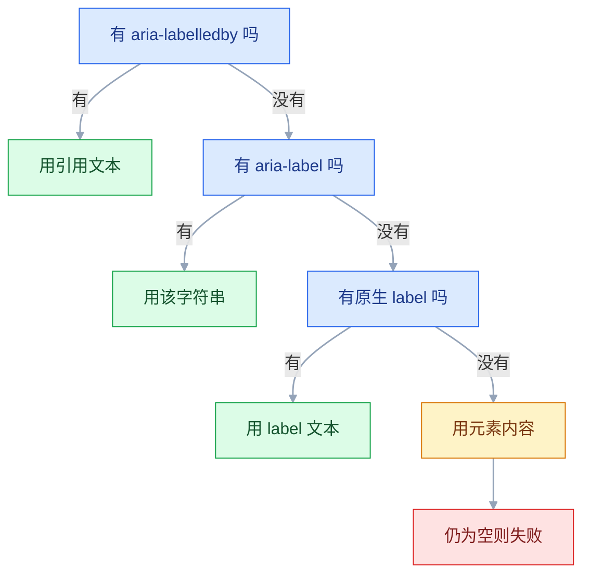
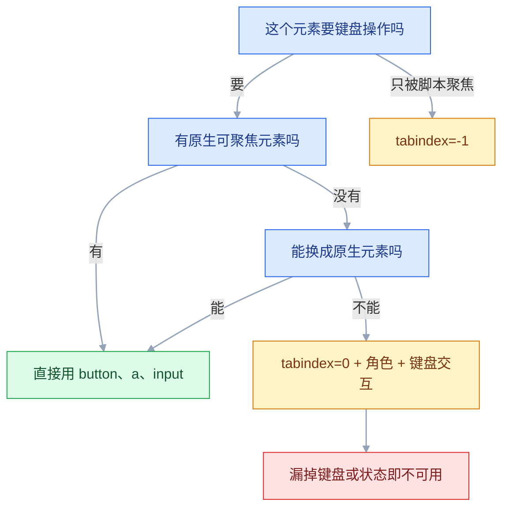

# 可访问性

## 一、工程案例：对 8 个核心页面做 WCAG 2.2 AA 走查，先修前三类问题

**场景**：一套 B 端后台，采购合同要求「符合 WCAG 2.2 AA」。8 个核心页面要在两周内完成走查和第一轮修复，没有专职无障碍工程师：1 名设计师和 1 名前端各投入一半时间，QA 配合复测，合计约 11 人天。第一次自动化扫描报了 63 条，逐条修不现实。

**为什么必须做**：合同只是表面原因。客服近三个月反复收到「Tab 键没反应」「弹窗关不掉」的工单，说明键盘用户已经在流失。63 条里大量重复，真正影响任务的是少数几类。**先按类修，再按条清**，两周内才能看到可验证的改善。

**约束**：不改整体视觉风格；不引入新框架；测试数据要覆盖空值、超长、无权限；读屏只有 macOS 的 VoiceOver 和 Windows 的 NVDA 可用。

**动手前确认**：浏览器矩阵；两个读屏工具能启动；测试账号覆盖管理员与只读角色；能造出空数据和错误状态；修复分支与发布窗口。

### 1.1 主线（按顺序执行，不要跳步）

**① 定范围与抽样（半天）**

8 个页面要覆盖八类结构，不能只挑登录页：

| 类型 | 页面 | 为什么必须包含 |
|---|---|---|
| 入口 | 登录 | 键盘与错误提示的第一道关 |
| 列表 | 订单列表 | 表格、分页、批量操作 |
| 详情 | 订单详情 | 信息层级、状态标签 |
| 表单 | 新建工单 | 标签、必填、校验、错误汇总 |
| 浮层 | 筛选抽屉 / 确认弹窗 | 焦点管理与 Esc |
| 设置 | 通知设置 | 开关、分组、说明文字 |
| 异常 | 403 / 404 | 可恢复路径 |
| 数据展示 | 报表 | 图表替代、表格表头 |

抽样要写进报告。只测登录页就宣布「通过 AA」，是自欺欺人。

**② 自动化扫描拿基线（半天）**

用浏览器内置的 Lighthouse、axe DevTools 或 axe-core 跑一遍，按「页面 × 规则」去重。同一页面的重复元素合并成一条并注明数量，误报单独标记，不进修复清单。

| 规则类 | 条数 | 页面 | 备注 |
|---|---|---|---|
| 颜色对比度 | 24 | 6 | 集中在辅助文字与占位符 |
| 缺少可访问名称 | 11 | 4 | 图标按钮、搜索框 |
| 表单缺 label | 9 | 3 | 新建工单最集中 |
| 标题层级 | 6 | 5 | h1 缺失、h2 跳 h4 |
| 图片缺 alt | 5 | 3 | 含装饰图标 |
| 其他 | 8 | — | 含 3 条误报 |

自动化结果只是线索。它查不出焦点顺序、键盘陷阱、读屏播报是否合理，也判断不了 alt 写得对不对。

**③ 键盘走查（1 天）**

把鼠标放到一边，只用 Tab、Shift+Tab、Enter、Space、Esc、方向键走完主流程：

| 观察项 | 记录方式 | 失败示例 |
|---|---|---|
| 能否到达 | 每个交互元素是否进入 Tab 序列 | 自定义下拉完全跳不过去 |
| 焦点是否可见 | 截图焦点环 | 焦点在但看不出在哪 |
| 顺序是否合理 | 记录 Tab 经过的顺序 | 从页尾跳回页首 |
| 是否被困 | 能否用键盘离开弹窗 | Tab 在弹窗内循环，Esc 无效 |
| 是否被遮挡 | 焦点元素是否被吸顶栏盖住 | 表头固定，第一行输入框看不见 |
| 快捷键是否符合预期 | Enter 提交、Esc 关闭 | 空格触发滚动而不是按钮 |

**④ 读屏走查（1 天）**

用 VoiceOver 和 NVDA 各走一遍关键流程。重点不是「能不能读」，是「读出来的东西能不能支撑决策」：

```text
登录页：能否听出用户名、密码、错误在哪
列表页：能否听出表头与单元格的对应关系
表单页：必填、说明、错误是否被朗读，顺序是否合理
弹窗：焦点是否进入，标题是否被朗读，关闭后是否回到触发按钮
动态区域：保存成功、加载失败是否被主动播报
```

**⑤ 对比度与视觉条件（半天）**

用取色器取**实际渲染后的像素**。半透明、渐变、图片背景、阴影叠加都会改变最终颜色。

| 内容 | AA 要求 | 常见漏点 |
|---|---|---|
| 正文（< 18pt 常规 / < 14pt 粗体） | ≥ 4.5:1 | 辅助说明、时间戳、表格次要列 |
| 大字号（≥ 18pt 或 ≥ 14pt 粗体） | ≥ 3:1 | 大标题达标，小标签不达标 |
| UI 组件边界、图标、图形 | ≥ 3:1 | 输入框边框、开关、图表线条 |

**⑥ 缩放与回流（半天）**

| 测试 | 操作 | 通过标准 |
|---|---|---|
| 文字缩放 200% | 浏览器缩放或改默认字号 | 内容不丢失、不重叠、不截断 |
| 回流 320px | 视口调到 320 CSS px | 只纵向滚动，无横向滚动 |
| 文本间距 | 增大行高、字距、段距 | 内容仍完整可读 |
| 触控目标 | 量可点击区域 | 至少 24×24 CSS px，移动端建议 44 |

**⑦ 建问题台账（半天）**

每条问题一行，字段固定。没有证据的不进台账。

| 字段 | 内容 |
|---|---|
| 页面 / 元素 | `ORD-LIST-01` / 表格状态标签 |
| 对应条款 | 1.4.3 对比度（最小） |
| 现象 | 灰字 `#9CA3AF` 配白底，实测 2.5:1 |
| 证据 | 截图 + 取色值 + 对比度结果 |
| 影响 | 低视力用户在强光下无法辨认状态 |
| 严重度 | 严重（核心信息不可读） |
| 修复 | 改为 `--color-text-2`，实测 4.8:1 |
| 负责人 | 前端 / 设计系统 |

严重度按三级：核心流程无法完成是阻断，核心信息不可读是严重，其余是一般。分级看影响面，不看修复工时。

**⑧ 先修前三类（5 天）**

按「影响面 × 修复成本」排序：对比度、键盘与焦点、表单名称与错误。三类覆盖了大部分阻断问题，改动也最集中。

| 类别 | 典型改动 | 工作量 |
|---|---|---|
| 对比度 | 调整语义 token，不逐个改页面 | 1 天 |
| 键盘与焦点 | 原生元素替换、`:focus-visible`、焦点管理 | 2 天 |
| 表单 | `label`、`aria-describedby`、错误汇总 | 2 天 |

修复清单沿用台账字段，额外补「改法、验证方式、复验结果」；改法要落到 token 或组件，不写「优化样式」。

**⑨ 回归并进 CI（1 天）**

用同一套键盘脚本和读屏脚本复测，不只看代码。加 `tabindex` 可能打乱顺序，加 `aria-label` 可能盖掉可见文字，弹窗焦点可能回到错误位置。复测通过后，CI 接入 axe-core，新增页面先过自动化；设计系统把对比度写进 token 准入。剩余问题按页面排期，不隐藏。

**产出物（交给采购方和下一轮迭代）**：带抽样说明的走查报告、问题台账、落到 token 与组件的修复清单、可复跑的键盘与读屏脚本、CI 规则与 token 准入条款。验收看的是这五样能否复现，不是「一共修了多少条」。


### 1.2 验收（12 项全过，才能说「达到 AA 的第一轮」）

| # | 检查项 | 怎么验 | 通过标准 |
|---|---|---|---|
| 1 | 键盘可完成主流程 | 不用鼠标走 8 个页面 | 每个流程都能到达终点 |
| 2 | 焦点始终可见 | Tab 时截图每个焦点 | 焦点环清晰，不被裁剪 |
| 3 | 焦点不被遮挡 | 滚到吸顶栏下方再聚焦 | 聚焦元素完整可见 |
| 4 | 焦点顺序合理 | 记录 Tab 序列 | 与视觉顺序一致，无回跳 |
| 5 | 无键盘陷阱 | 弹窗内 Tab 与 Esc | 能关闭，关闭后焦点回触发元素 |
| 6 | 对比度达标 | 取实际渲染色 | 正文 ≥ 4.5:1，大字与图形 ≥ 3:1 |
| 7 | 名称与角色正确 | 看可访问树 | 图标按钮有名称，控件有角色 |
| 8 | 表单可理解 | 读屏提交空表单 | 标签、必填、错误原因、建议都能听到 |
| 9 | 动态消息可感知 | 触发保存成功/失败 | 读屏主动播报，不依赖视觉 |
| 10 | 200% 缩放不丢失 | 浏览器放大到 200% | 内容完整，无重叠截断 |
| 11 | 320px 无横向滚动 | 视口调到 320 | 只纵向滚动 |
| 12 | 目标尺寸达标 | 量可点击区域 | ≥ 24×24 CSS px，或符合豁免 |

> 第 3 项是 WCAG 2.2 新增的 2.4.11（焦点不被遮挡，AA），旧项目普遍会漏。吸顶导航、固定表头、悬浮球都可能盖住焦点。
>
> 第 12 项是 2.5.8（目标尺寸最小，AA），行内链接、足够间距等情况有豁免，不要把所有小图标都判失败。

### 1.3 把走查变成长期机制

一次整改会反弹，因为新页面还在用旧模式。把五件事固定下来：

| 机制 | 做法 | 卡在哪 |
|---|---|---|
| token 准入 | 新色值达到对应对比度才能进变量表 | 设计系统发布前 |
| 组件内置 | Button、Input、Dialog 自带语义、焦点与键盘行为 | 组件库 |
| CI 扫描 | 新增页面跑 axe-core，阻断严重项 | 合并请求 |
| 人工抽检 | 每迭代抽 2 个页面做键盘 + 读屏 | 验收 |
| 问题台账 | 发现即记录，按页面排期 | 迭代规划 |

> 自动化只能覆盖一部分问题（常见估计三到四成），擅长查缺 alt、缺 label、对比度，不擅长查顺序对不对、读出来能不能懂。工具负责不漏明显项，人负责判断可用性。对外声明要谨慎：技术符合 AA 不等于法律合规，声明页、VPAT 等材料需要法务和业务一起确认。

---

## 二、高频问答：会卡住你的地方，也是面试最常问的

### 2.1 加了 `aria-label`，读屏还是读不出来

**现场**

```text
在 DevTools 的 Accessibility 面板看节点是否存在、role 是什么、name 从哪来
用读屏聚焦实际听一遍
节点不在树里，先查 aria-hidden 和 display:none
```

**要点**

- `aria-label` 只改名称，不改角色；没有角色的 `div`，读屏可能直接跳过，名字再好也没用。
- 元素没有角色、有 `aria-hidden` 祖先、`aria-labelledby` 指向空元素，是三个常见原因。
- 名字为空时先确认节点在不在可访问树里，再谈名字对不对。

**追问**

- `div` 加了 `role="button"` 就够吗？→ 不够，还要可聚焦并自己实现键盘交互。
- 为什么 `aria-label` 会盖掉可见文字？→ 名称计算里它的优先级高于元素内容。
- 图标按钮怎么写？→ 有可见文字就不加 `aria-label`，纯图标才需要。

### 2.2 Tab 键跳不到某个操作

**现场**

```text
键盘走一遍，看该元素是否获得焦点
看 tabindex 与计算样式，检查是否依赖 hover
在控制台给元素加 tabindex="0" 再试
```

**要点**

- 可点击不等于可聚焦；鼠标事件绑在 `div` 上，键盘用户根本到不了。
- 表格行内操作只在 hover 时出现，触屏用户也永远看不到。
- 能聚焦说明问题在语义，仍不能就查祖先是否 `inert`、`hidden` 或 `display:none`。

**追问**

- 正数 `tabindex` 能用吗？→ 不要，会打乱自然顺序。
- `tabindex="-1"` 是干什么的？→ 可脚本聚焦但不进 Tab 序列，给弹窗标题和错误汇总用。
- 自己实现还是换原生元素？→ 能换成 button、a、input 就换。

### 2.3 焦点在，但看不见在哪

**现场**

```text
Tab 时截图，看 :focus-visible 的计算样式
看元素是否被固定栏遮挡
在浅色、深色、图片背景三种区域各截一张焦点图
```

**要点**

- 随便加 1px 灰线可能仍然看不见，焦点指示本身需要对比度，还要考虑背景和遮挡。
- 全局 `outline: none`、焦点环被 `overflow:hidden` 裁掉、颜色对比不足、被固定栏遮挡，是四个原因。
- 三种背景都能一眼看到才算合格。

**追问**

- 为什么用 `:focus-visible` 而不是 `:focus`？→ 只在键盘操作时显示，鼠标点击不出现。
- 焦点环被裁剪怎么办？→ 给容器留内边距，或改用内描边。
- 吸顶栏遮住焦点怎么办？→ 用 `scroll-margin-top`，或改成非遮挡布局。

### 2.4 工具说对比度通过，用户还是看不清

**现场**

```text
用取色器取最终渲染像素
检查 opacity、混合模式、背景图
背景是图片时，取文字位置最亮和最暗两点，按最差情况判断
```

**要点**

- 对比度是最终前景色与最终背景色的比值，不是两个十六进制值的关系。
- 半透明黑叠在灰底上，结果和纯黑完全不同。
- 工具也可能取的是父级背景，字号或字重判错也会放过。

**追问**

- 渐变背景怎么算？→ 文字覆盖范围内最亮和最暗处分别算。
- 禁用态要达标吗？→ 1.4.3 豁免，但仍建议可读。
- 大字的界线在哪？→ 18pt 常规或 14pt 粗体以上按 3:1。

### 2.5 读屏不读弹窗内容

**现场**

```text
打开弹窗听读屏，看当前焦点在哪个元素
看可访问树里的 dialog 节点
打开后按 Tab，看焦点是否在弹窗内循环；用 rotor 找 dialog
```

**要点**

- 视觉上在最上层不等于可访问树里在最上层；读屏按 DOM 顺序走，焦点没移，它就读背景。
- 没有 `role="dialog"` 和可访问名称、焦点没移进去、背景没有 `inert`、标题没关联，是四个原因。
- Tab 不能在弹窗内循环、rotor 找不到 dialog，就是焦点管理没做。

**追问**

- `inert` 和 `aria-hidden` 有什么区别？→ `inert` 更彻底，还能拦住聚焦，但浏览器支持较晚。
- 关闭弹窗后焦点该去哪？→ 回到触发按钮，不能丢到 body。
- 原生 `<dialog>` 能用吗？→ 自带模态行为和 Esc，能用就用。

### 2.6 表单报错了，读屏读不到

**现场**

```text
提交空表单，只听不看
检查 aria-invalid 与 aria-describedby
戴耳机提交一次，记录听到的内容
```

**要点**

- 读屏不会主动巡视页面变化；视觉用户能看到红框，读屏用户只能听到被主动播报的内容。
- 错误只有红框、错误文本提交后才创建且没有 live region、输入框没有 `aria-describedby`，都会导致读不到。
- 听不到「哪个字段、为什么错、怎么改」，就是不合格。

**追问**

- live region 为什么有时不播报？→ 容器必须在内容变化之前就存在于 DOM。
- `role="alert"` 和 `aria-live="assertive"` 有什么区别？→ 前者带警报语义，两者都会立即打断。
- 错误汇总放哪？→ 表单顶部，`tabindex="-1"`，提交后把焦点移过去。

### 2.7 200% 缩放后布局崩了

**现场**

```text
浏览器缩放到 200%，视口调到 320px，看是否出现横向滚动
放大后逐页截图，重点看按钮文字、表格、弹窗、吸底栏
```

**要点**

- 放大是低视力用户的主要手段，也是 WCAG 1.4.4 的要求；布局应适应内容，而不是要求用户适应布局。
- 固定高度容器、绝对定位、`overflow:hidden`、用视口单位锁死尺寸，是四个原因。
- 出现截断、重叠、横向滚动，都是失败。

**追问**

- 200% 缩放和 320px 回流是一回事吗？→ 不是，前者是 1.4.4，后者是 1.4.10。
- 为什么正文要用 `rem`？→ 用户改浏览器默认字号时它跟着变，`px` 不变。
- 固定高度该怎么改？→ 用 `min-height`，让内容决定高度。

### 2.8 自定义下拉键盘完全用不了

**现场**

```text
只用键盘打开、选择、关闭
看读屏是否播报「已展开」「第几项，共几项」
按 APG 组合框模式逐项对照：Tab 进入、Enter/Space 展开、方向键移动、Esc 关闭、选择后焦点回触发按钮
```

**要点**

- 能聚焦只是第一步，下拉需要整套键盘交互和状态播报，自己实现很容易漏。
- 只实现鼠标点击、没有 combobox 角色与状态、方向键和 Esc 未处理、选项不在可访问树里，是最常见的漏法。
- APG 清单缺一项就是不可用。

**追问**

- 为什么不用原生 `<select>`？→ 样式受限，但原生自带全部键盘行为，能用就别自造。
- combobox 要播报什么？→ 展开状态、当前项、总项数。
- 只补 `tabindex` 行不行？→ 不行，方向键和状态播报都还缺着。

### 2.9 键盘用户要按二十次 Tab 才能到主内容

**现场**

```text
打开页面按第一次 Tab，看是否出现「跳到主内容」
用读屏地标列表看结构
Enter 后看焦点是否落到主内容
```

**要点**

- 对键盘和读屏用户，每页多按二十次是持续成本；WCAG 2.4.1 要求提供绕过重复内容的方式。
- 没有跳转链接、没有 `main` 地标、导航项太多、重复工具栏每页都有，是四个原因。
- 没有就补一个视觉隐藏、聚焦时出现的 skip link。

**追问**

- skip link 怎么实现？→ 绝对定位移出视口，`:focus` 时回到可视区。
- 常用地标有哪些？→ `main`、`nav`、`complementary`、`search`。
- 除了 skip link 还有什么办法？→ 标题层级和地标，让读屏用户直接跳。

---

## 三、核心知识：从零开始要建立的东西

### 3.1 WCAG 的结构与等级

WCAG 由四条原则（POUR）组成，下面分层级、准则、成功标准。成功标准分 A、AA、AAA 三级。

| 原则 | 含义 | 典型条款 |
|---|---|---|
| 可感知 | 信息能被看到或听到 | 1.1.1 非文本内容、1.4.3 对比度 |
| 可操作 | 界面能被键盘等各种方式操作 | 2.1.1 键盘、2.4.7 焦点可见 |
| 可理解 | 内容和操作可预测、可纠正 | 3.3.1 错误识别、3.3.3 错误建议 |
| 健壮 | 能被辅助技术正确解析 | 4.1.2 名称角色值 |

项目验收写「WCAG 2.2 AA」，意思是满足所有 A 和 AA 成功标准。AAA 不是默认目标，全部满足往往不现实。WCAG 2.2 在 2.1 基础上新增的条款里，日常最相关的是（条款号与等级以官方当前版本为准）：

| 条款 | 等级 | 要求 |
|---|---|---|
| 2.4.11 焦点不被遮挡（最小） | AA | 键盘焦点不能被作者内容完全遮住 |
| 2.5.7 拖拽操作 | AA | 拖拽功能要有单指针替代方式 |
| 2.5.8 目标尺寸（最小） | AA | 指针目标至少 24×24 CSS px，部分情况豁免 |
| 3.3.8 可访问的身份验证 | AA | 不依赖记忆或认知测试，允许粘贴和密码管理器 |

> WCAG 3.0 尚未成为正式标准，当前状态以 W3C 官方发布为准，不能作为合同验收依据。对外文件写「符合 WCAG 2.2 AA」即可。

> **面试**：常问「项目说符合 WCAG 2.2 AA，是什么意思？」答：满足全部 A 和 AA 成功标准，AAA 不是默认目标。

### 3.2 对比度的计算与例外

对比度是前景色与背景色的相对亮度比值，范围 1:1 到 21:1。计算用相对亮度公式，不做 RGB 平均。

| 内容 | AA | AAA |
|---|---|---|
| 正文（< 18pt 常规 / < 14pt 粗体） | 4.5:1 | 7:1 |
| 大字号（≥ 18pt 或 ≥ 14pt 粗体） | 3:1 | 4.5:1 |
| UI 组件与图形边界 | 3:1 | — |
| 装饰、禁用态、纯 logo | 无要求 | — |

容易判错的边界：

| 情况 | 判断 |
|---|---|
| 半透明文字 | 先与背景合成，再算最终颜色 |
| 文字在图片上 | 取文字所在区域最不利的背景点 |
| 渐变背景 | 取文字覆盖范围内最亮和最暗处分别算 |
| 图标按钮 | 图标本身是图形，需要 3:1；按钮边界不一定 |
| 占位符 | 是文字，按正文要求 4.5:1 |
| 禁用控件 | 1.4.3 豁免，但仍建议可读 |

不要手算。用 DevTools 的对比度检查器或成熟工具，输入实际渲染值。手算最容易错在伽马校正和透明度合成。

> **面试**：常问「4.5:1 这个比值是怎么算出来的？」答：最终前景色与背景色的相对亮度之比，半透明和图片背景要先合成再算。

### 3.3 可访问名称与角色

辅助技术靠「角色 + 名称 + 状态 + 值」理解控件。名称的计算有固定优先级：



| 控件 | 角色 | 名称来源 |
|---|---|---|
| `<button>` | button | 内容文本或 `aria-label` |
| `<a href>` | link | 链接文本 |
| `<input type="text">` | textbox | `<label for>` 或 `aria-label` |
| `<input type="checkbox">` | checkbox | 关联 label |
| `<select>` | combobox / listbox | 关联 label |
| `<div role="button">` | button | 必须显式给名称，并自己实现键盘 |

名称要描述目的，不是描述外形。「搜索」比「放大镜图标」好，「关闭对话框」比「叉号」好。

### 3.4 语义化 HTML 与 ARIA 第一原则

原生元素自带角色、键盘行为、状态管理和辅助技术支持。用 `div` 模拟，等于把这些工作全部重做，而且很难做全。

| 错误 | 正确 | 额外收益 |
|---|---|---|
| `<div onclick>` | `<button>` | 可聚焦、Enter/Space、禁用态 |
| `<span>` 当链接 | `<a href>` | 可聚焦、右键、新标签打开 |
| `<div>` 当标题 | `<h1>`–`<h6>` | 读屏可按标题跳转 |
| `<div>` 当列表 | `<ul><li>` | 播报项目数与层级 |
| 图片无 alt | `alt="描述"` 或 `alt=""` | 读屏可跳过装饰 |

ARIA 第一原则：**能用原生 HTML 就不用 ARIA**。需要时只补原生做不到的部分：

| 属性 | 用途 | 注意 |
|---|---|---|
| `aria-label` | 无可见文字的控件命名 | 会覆盖可见文本，慎用 |
| `aria-describedby` | 关联说明或错误 | 可指向多个 id |
| `aria-expanded` | 展开/收起状态 | 值必须是 true/false |
| `aria-current` | 当前导航项 | 常用 `page` |
| `aria-live` | 动态内容播报 | 对应 3.7 |
| `aria-hidden` | 对辅助技术隐藏 | 不要用在可聚焦元素上 |

错误的 ARIA 比没有更糟：它会让读屏播报错误角色或状态，用户按错误的心智模型操作。

### 3.5 键盘模型与焦点顺序

键盘可访问的基础是「每个可操作元素都能获得焦点，且顺序可预测」。元素该不该进 Tab 序列、怎么进，按下面的顺序判断：



| 概念 | 规则 |
|---|---|
| Tab 顺序 | 默认跟随 DOM 顺序，不要用正数 `tabindex` 打乱 |
| `tabindex="0"` | 把非原生元素加入自然顺序，仅在无法用原生元素时使用 |
| `tabindex="-1"` | 可脚本聚焦，不进入 Tab 序列，适合弹窗标题和错误汇总 |
| 键盘激活 | 按钮用 Enter/Space；链接用 Enter |
| 方向键 | 用于组合框、菜单、单选组等复合控件 |
| 焦点陷阱 | 只允许在模态弹窗内，且必须能关闭 |

复合控件（菜单、标签页、树、表格）需要 roving tabindex：整组只有一个 Tab 停靠点，组内用方向键移动。自己实现时逐项对照 APG 模式。

Tab 顺序有问题时，按「能否到达 → 能否看见 → 顺序对不对」三步定位：分别查 2.2、2.3，再看本节表格。

### 3.6 焦点可见与管理

焦点指示是键盘用户唯一的「鼠标位置」。删掉它，等于让键盘用户闭眼操作。

```css
/* 错误：全局删除 */
*:focus { outline: none; }

/* 正确：只在键盘操作时显示，且足够明显 */
:focus-visible {
  outline: 2px solid var(--color-focus);
  outline-offset: 2px;
}
```

| 问题 | 处理 |
|---|---|
| 焦点环被 `overflow:hidden` 裁剪 | 给容器留内边距，或改用内描边 |
| 焦点环与背景对比不足 | 用双色环，适应深浅背景 |
| 吸顶栏遮住焦点 | 用 `scroll-margin-top`，或改为非遮挡布局 |
| 焦点在卡片上但看起来没变 | 给整卡加可见边框，不要只改阴影 |

WCAG 2.2 的 2.4.11 要求焦点至少有一部分始终可见。固定表头、悬浮工具条、Cookie 横幅都是常见遮挡源。

单页应用里，页面切换不会自动重置焦点，弹窗也不会自动把焦点移进去。这些要显式做：

| 场景 | 动作 | 失败表现 |
|---|---|---|
| 打开模态弹窗 | 焦点移到第一个可聚焦元素或标题 | 读屏仍在读背景 |
| 关闭弹窗 | 焦点回到触发按钮 | 焦点丢到 body，Tab 从头开始 |
| 路由切换 | 焦点移到新页面主标题 | 读屏不知道页面变了 |
| 错误提交 | 焦点移到错误汇总或第一个错误字段 | 用户不知道哪里错了 |

实现要点：模态弹窗用 `role="dialog"`、`aria-modal="true"`、`aria-labelledby` 指向标题；背景用 `inert` 使其不可聚焦；关闭时恢复焦点。`inert` 比 `aria-hidden` 更彻底，但要注意浏览器版本支持。

### 3.7 表单与动态播报

表单是无障碍问题最集中的地方，因为同时涉及名称、状态、错误和动态播报。

| 要求 | 做法 | 反例 |
|---|---|---|
| 每个输入有标签 | `<label for>` 关联，或 `aria-label` | 只用 placeholder |
| 必填有语义 | `required` + 可见说明 | 只用一个红色星号 |
| 说明可关联 | `aria-describedby` 指向提示文本 | 提示放在很远的地方 |
| 错误可识别 | `aria-invalid="true"` | 只把边框变红 |
| 错误可播报 | `role="alert"` 或 live region | 错误文本静默出现 |
| 错误有建议 | 说清怎么改 | 只写「格式错误」 |

```html
<label for="email">邮箱</label>
<input id="email" type="email" autocomplete="email"
       required aria-invalid="true" aria-describedby="email-error" />
<p id="email-error" role="alert">邮箱格式不正确，应包含 @ 和域名</p>
```

错误提示三要素：哪里错、为什么错、怎么改。三者缺一，用户就只能猜。读屏不会主动巡视变化，保存成功、加载失败、结果数量变化都要主动播报：

| 属性 | 行为 | 适用 |
|---|---|---|
| `aria-live="polite"` | 等当前朗读结束再播 | 结果数量、保存成功 |
| `aria-live="assertive"` | 立即打断 | 严重错误、会话即将过期 |
| `role="status"` | 等价于 polite + 状态语义 | 轻量状态更新 |
| `role="alert"` | 等价于 assertive + 警报语义 | 表单错误、失败提示 |

两个常见坑：live region 必须在内容变化之前就存在于 DOM 中，后插入的容器往往不会被播报；一次更新整块内容会读很长，只播报关键差异。不要滥用 assertive，频繁打断会让读屏用户无法完成当前操作。

### 3.8 图片、图标与媒体替代

| 类型 | 写法 | 判断 |
|---|---|---|
| 信息性图片 | `alt` 描述传达的信息 | 不看图会缺什么信息 |
| 功能性图片 | `alt` 或 `aria-label` 描述功能 | 点了会发生什么 |
| 装饰性图片 | `alt=""` | 不承载信息 |
| 图文链接 | 描述链接去向 | 不要写「点击这里」 |
| 复杂图表 | 简短 alt + 数据表或文字摘要 | 趋势和关键数值能否获取 |
| 图标字体 | 改用 SVG + `aria-hidden` | 私用区字符会被念出来 |

```text
错误：alt="图片"、alt="chart.png"、alt="点击这里"
正确：alt="2026 年第三季度营收 1.2 亿，环比增长 18%"
正确：alt=""（纯装饰）
```

视频的预录内容在 AA 下需要字幕；纯音频需要文字稿。自动播放超过 5 秒的内容必须能暂停、停止或隐藏。

### 3.9 颜色以外的编码

颜色不能是传达信息、指示操作、区分数据的唯一手段。

| 场景 | 只靠颜色 | 增加编码 |
|---|---|---|
| 状态标签 | 红/绿 | 图标 + 文字「失败」「成功」 |
| 表单错误 | 红框 | 错误文案 + 图标 + `aria-invalid` |
| 图表系列 | 六种颜色 | 线型、标记形状、直接标注 |
| 必填项 | 红色星号 | 星号 + 「必填」文字说明 |

自检方法：灰度截图后重新看一遍。信息仍然完整，才算合格。

### 3.10 缩放、回流与目标尺寸

| 要求 | 标准 | 测试 |
|---|---|---|
| 文字缩放 | 200% 不丢失内容 | 浏览器缩放，逐页看 |
| 回流 | 320 CSS px 宽只纵向滚动 | 视口调窄，看横向滚动条 |
| 文本间距 | 增大行高、字距、段距后不截断 | 注入样式覆盖测试 |
| 容器高度 | 由内容决定 | 不用固定 height 装文字 |

用 `rem` 而不是 `px` 的意义在这里：用户改浏览器默认字号时，`rem` 跟着变，`px` 不变。正文、间距、容器最小高度都应对字号变化留余量。

WCAG 2.2 的 2.5.8 要求指针目标至少 24×24 CSS px，但行内链接、由用户代理控制的控件、必要的小尺寸、以及周围有足够间距的情况可以豁免。

| 控件 | 建议 | 说明 |
|---|---|---|
| 移动端主按钮 | ≥ 44×44 | 触控精度更低 |
| 桌面图标按钮 | ≥ 24×24 | 低于此值需要间距补偿 |
| 表格行内操作 | 用间距或扩大点击区 | 不要只让图标本身可点 |

拖拽操作（排序、滑块、画布）必须提供单指针替代：上移/下移按钮、输入数值、点击增减。只支持拖拽，键盘和运动障碍用户都无法完成。

### 3.11 读屏的工作模型

读屏按可访问树朗读，不按视觉布局。理解这一点，很多「为什么读不出来」就有答案。

| 行为 | 含义 |
|---|---|
| 按 DOM 顺序遍历 | DOM 顺序必须等于视觉顺序 |
| 朗读角色与名称 | 「搜索，按钮」 |
| 跳过 `aria-hidden` | 装饰内容不读 |
| 表单朗读标签与状态 | 标签关联必须正确 |
| 地标与标题可跳转 | 结构清晰才跳得准 |
| 动态内容需 live region | 不主动巡视变化 |

常见误区：

```text
以为 div 有语义 —— div 没有角色，读屏可能直接跳过
以为 placeholder 是 label —— 输入后消失，且不保证被朗读
以为 aria-label 万能 —— 它只改名称，不改角色和行为
以为视觉顺序对就行 —— 读屏跟 DOM，flex order 改了视觉不改朗读
```

测试工具：macOS 用 VoiceOver（`Cmd+F5`），Windows 用 NVDA（免费），DevTools 的 Accessibility 面板可看可访问树。至少用一种真实读屏走完主流程，不能只看树。

### 3.12 检查手段的边界与验收组织

自动化的价值是「不漏明显项」，不是「证明合格」。工具报 0 错误只能说明没有它认识的问题，不能说明用户能用。

| 手段 | 能发现 | 发现不了 |
|---|---|---|
| 自动化扫描 | 缺 alt、缺 label、对比度、重复 id、部分 ARIA 误用 | 焦点顺序、键盘陷阱、播报质量、语义合理性 |
| 键盘走查 | 不可达、顺序错、焦点不可见、陷阱 | 读屏播报内容 |
| 读屏走查 | 名称、角色、状态、动态播报 | 视觉对比度、触控尺寸 |
| 缩放与回流 | 布局断裂、横向滚动 | 语义问题 |
| 用户测试 | 真实任务中的障碍 | 全覆盖的条款符合性 |

验收组织按「能不能完成任务」比按条款编号更容易执行，两套清单都要留：条款清单查漏，任务清单验收（任务清单见 1.2）。任何一套都不能替代另一种手段，也不能替代真实用户试用。

---

## 四、冷门知识汇总

| 知识点 | 为什么冷门 | 用到时的关键词 |
|---|---|---|
| `inert` 属性 | 比 `aria-hidden` 更彻底，但支持较晚 | 背景禁用；焦点隔离 |
| 跳转链接 | 多数项目没做，实现只要几行 CSS | Skip link；2.4.1 |
| 地标角色 | 读屏用户靠它跳转，视觉用户看不到 | `main` / `nav` / `complementary` |
| roving tabindex | 复合控件只保留一个 Tab 停靠点 | 菜单；标签页；方向键 |
| 焦点陷阱的边界 | 模态内循环，非模态绝不能用 | 弹窗；Esc；恢复焦点 |
| 原生 `dialog` 元素 | 自带模态行为、Esc 与背景隔离 | `<dialog>`；`showModal()`；`::backdrop` |
| 目标尺寸豁免 | 24×24 不是所有元素都要满足 | 行内链接；足够间距；2.5.8 |
| 拖拽的替代方式 | 只在排序、画布类功能里出现 | 2.5.7；上移/下移 |
| 可访问的身份验证 | 禁止要求记忆或拼图式验证 | 3.3.8；粘贴；密码管理器 |
| 文本间距覆盖测试 | 很少人主动测，但很容易崩 | 1.4.12；行高 1.5；字距 0.12em |
| 320px 回流 | 不是「手机适配」，是桌面缩窄 | 1.4.10；横向滚动 |
| 禁用态的对比度豁免 | 1.4.3 有例外，但仍应可读 | inactive；disabled |
| 图表的数据表替代 | 只给一张图，读屏用户拿不到数据 | 数据表；文字摘要 |
| 表格的 `scope` | 表头关联靠它，读屏才能读对 | `scope="col"` / `"row"` |
| `lang` 的局部标记 | 中英混排发音错误 | `lang="en"`；读屏语音 |
| 自动播放的 5 秒线 | 轮播图最容易违反 | 2.2.2；暂停按钮 |
| 声明的边界 | 技术符合不等于法律合规 | 无障碍声明；VPAT；法务确认 |
