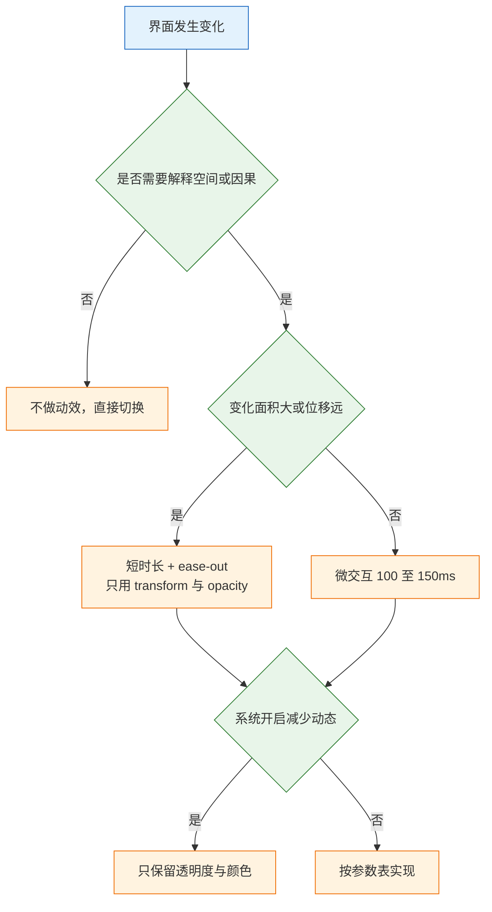
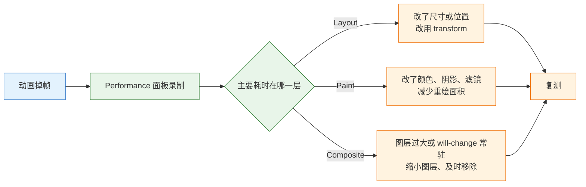

# 动效与资产

---

## 一、动效与资产是什么

### 1.1 核心概念

动效（Motion）是界面状态变化的时间维度表达。它承担三件事：说明新元素从哪来、确认操作已生效、提示层级与方向。动效不是装饰层，它和排版、色彩一样属于信息设计；一段没有解释力的动画，与一张无关的插图等价，只会增加等待与绘制。

资产（Asset）是界面消费的静态资源：图标、插画、照片、字体。资产的格式、尺寸、命名与降级策略，决定它在真实网络、低端设备、深色模式下能否正常显示。设计稿里清晰锐利的图标，导出成位图后可能发虚；本地加载正常的字体，慢网下可能长时间空白。

两者放在一篇，是因为它们共享同一条判断标准：**是否降低了用户的认知成本，同时没有增加系统的运行成本**。动效降低理解成本，但可能增加渲染成本；高分辨率资产提升观感，但增加传输成本。所有取舍都围绕这条线。

| 对象 | 解决的问题 | 关键约束 | 失败代价 |
|---|---|---|---|
| 动效 | 空间关系、因果、状态变化 | 时长、缓动、可关闭 | 眩晕、等待、掉帧 |
| 图标 | 快速识别动作与状态 | 网格、描边、语义 | 误认、模糊 |
| 图片 | 内容呈现与氛围 | 格式、尺寸、比例 | 跳版、流量浪费 |
| 字体 | 可读性与品牌表达 | 子集、字重、回退 | 首屏空白、闪烁 |

> **注意**：动效的“好看”不是验收标准。“去掉之后是否丢失信息”才是可讨论的判断依据。

### 1.2 适用场景与边界

适合做动效的场景：层级切换（抽屉、弹窗）、状态确认（按钮进入加载、保存成功）、空间连续（列表项展开、卡片进入详情）、引导注意（一次性提示）。不适合的场景：页面加载时逐元素飞入、卡片悬停整体放大、背景持续缓慢移动、滚动视差贯穿全页。

| 场景 | 是否值得 | 理由 |
|---|---|---|
| 抽屉从侧边进入 | 是 | 说明层级来源与方向 |
| 删除后列表收拢 | 是 | 说明哪一项消失、其余如何补位 |
| 按钮进入加载态 | 是 | 确认点击已被接收 |
| 首屏逐元素飞入 | 否 | 延迟内容出现，不解释关系 |
| 卡片悬停放大 | 否 | 干扰阅读，触屏无对应 |
| 全页视差滚动 | 否 | 眩晕风险高，性能开销大 |
| 自动轮播 | 有条件 | 必须可暂停，且不自动播放过长 |



> **设计红线**：前庭功能障碍用户对大幅位移、缩放、旋转特别敏感，可能引发眩晕与恶心。这是健康问题，不是偏好问题；减少动态效果的适配属于必做项。

---

## 二、动效的语义判断

### 2.1 三类值得做的动效

**空间关系**：新界面从哪个方向来，回到哪里去。右侧抽屉从右进入、关闭时向右退出，用户能建立“它一直在右边”的心理模型。弹窗从触发按钮附近出现，比从屏幕中央淡入更能说明来源。

**因果关系**：操作与结果之间的连接。点击后按钮立即进入加载态，说明点击被接收；列表项删除后其余项收拢，说明数据真的少了；表单校验失败时错误摘要滚动到视野内，说明提交被拒绝。

**状态变化**：同一对象在两种状态间的过渡。开关滑块移动、折叠面板展开、提示条出现与消失，都属于状态变化。这类动效的重点是让用户跟得上，而不是炫技。

| 类型 | 判断问题 | 典型实现 |
|---|---|---|
| 空间关系 | 元素从哪来、回哪去 | 位移 + 淡入，方向一致 |
| 因果关系 | 操作是否被接收、结果落在哪 | 加载态、收拢、滚动定位 |
| 状态变化 | 前后状态是否清晰 | 位移、透明度、颜色过渡 |

### 2.2 不值得做的动效

四类常见无效动效：入场编排（每个元素依次延迟出现）、装饰性悬停（放大、倾斜、发光）、持续背景运动（渐变流动、粒子漂浮）、无意义的数字滚动。它们的共同点是去掉之后信息完全不变，只留下等待时间与绘制开销。

判断方法很简单：遮住动画，只看首尾两帧，问信息是否缺失。缺失则保留，且只保留能补足信息的那部分；不缺失则删除。这个测试比讨论“是否高级”有效。

### 2.3 编排与层次

同一时间只允许一个主动效。列表滚动时不要同时做入场动画；弹窗打开时不要同时让背景卡片浮动。多个动效并发会分散注意，也会叠加渲染压力。

- 遮罩与面板同时开始、同时结束，遮罩先消失会让面板“悬空”。
- 面板内容可延迟 40 至 60ms 跟进，但不要逐项递增延迟，那会变成等待。
- 关闭时不做“内容先退、面板后走”，用户只想它尽快消失。
- 同一元素的进入与退出使用相反方向，不要进入从左、退出向上。

| 编排错误 | 表现 | 修正 |
|---|---|---|
| 逐项延迟 | 最后一个元素出现时用户已移开注意 | 只给首项 40 至 60ms 延迟 |
| 遮罩先结束 | 面板像浮在页面上 | 两者同时结束 |
| 退出更慢 | 关闭像卡顿 | 退场短于进场 |
| 多动效并发 | 画面杂乱、掉帧 | 同屏只保留一个主运动 |

---

## 三、动效参数体系

### 3.1 时长与缓动

时长由距离、面积、层级共同决定。位移越远、面积越大，需要的时长越长；但高频操作中的进入动画超过 300ms 就会被感知为慢。缓动决定速度曲线：ease-out 前快后慢，适合进入；ease-in 前慢后快，适合退出；ease-in-out 两端慢，适合转场与大面积布局变化。

“进场慢、退场快”符合直觉：出现时需要被注意到，消失时不该拖泥带水。这条规则适用于弹层、提示、抽屉；不适用于页面级转场，后者需要两端都可读。

时长还与位移距离相关。小范围位移按比例缩短，超过半屏的位移不宜拉长到 400ms 以上，否则用户会感觉界面在拖。面积大的变化用 ease-in-out 让两端更柔和，小范围的反馈用 ease-out 让响应显得干脆。

```css
:root {
  --ease-out: cubic-bezier(0, 0, 0.2, 1);
  --ease-in: cubic-bezier(0.4, 0, 1, 1);
  --ease-in-out: cubic-bezier(0.4, 0, 0.2, 1);
  --dur-fast: 100ms;
  --dur-base: 180ms;
  --dur-enter: 240ms;
  --dur-exit: 160ms;
}
```

这些曲线是常用取值，不是强制标准。照抄之后仍要在真机与低端设备上看一遍，尤其是位移较大的场景。

### 3.2 动效参数表

| 场景 | 时长 | 缓动 | 属性 |
|---|---|---|---|
| 按钮反馈、开关切换 | 100 至 150ms | ease-out | transform、background-color |
| 悬停与聚焦反馈 | 80 至 120ms | ease-out | background-color、box-shadow |
| 下拉、气泡、Toast 进入 | 150 至 240ms | ease-out | opacity、transform |
| 弹窗、抽屉进入 | 200 至 300ms | ease-out | transform、opacity |
| 弹窗、抽屉退出 | 150 至 200ms | ease-in | transform、opacity |
| 页面转场 | 300 至 400ms | ease-in-out | opacity、transform |
| 大面积布局变化 | 300 至 500ms | ease-in-out | transform、opacity |
| 列表项增删 | 180 至 240ms | ease-out | transform、opacity |
| 错误抖动 | 200 至 300ms | ease-in-out | transform，仅一次 |

以右侧抽屉为例，一个动作可拆成六个独立对象：

| 对象 | 作用 | 时长 | 缓动 |
|---|---|---|---|
| 抽屉面板 | 从右进入，承载内容 | 240ms | ease-out |
| 遮罩 | 压暗背景，表达层级 | 200ms | linear 或 ease-out |
| 抽屉关闭 | 反向离开 | 180ms | ease-in |
| 遮罩关闭 | 与面板同时结束 | 180ms | ease-in |
| 面板首项 | 轻微跟进，位移 8px 并淡入 | 180ms，延迟 40ms | ease-out |
| 按钮按下 | 缩放至 0.98 | 100ms | ease-out |

> **注意**：参数表是起点，不是结论。同一组参数在 60Hz 屏幕与低端安卓机上观感不同，验收必须在目标设备上完成，不能只在设计用机上确认。

### 3.3 参数进入令牌

把时长与缓动写成变量，而不是散落在各处。三类收益：同类交互保持一致；改版时一处调整全局生效；减少动态效果时可以用同一组变量整体降级。

| 令牌 | 值 | 使用范围 |
|---|---|---|
| `--dur-fast` | 100ms | 按下、悬停、开关 |
| `--dur-base` | 180ms | 折叠、列表、退出 |
| `--dur-enter` | 240ms | 弹层进入 |
| `--ease-out` | 三次贝塞尔 | 进入与反馈 |
| `--ease-in` | 三次贝塞尔 | 退出 |

---

## 四、渲染性能约束

### 4.1 只动合成属性

`transform` 与 `opacity` 通常只触发合成，不触发布局与重绘；`width`、`height`、`top`、`left`、`margin` 会触发布局，`background-color`、`box-shadow`、`filter` 会触发重绘。能用前者就不用后者。

```css
.drawer {
  transform: translateX(100%);
  transition: transform var(--dur-enter) var(--ease-out);
}
.drawer[data-open="true"] {
  transform: translateX(0);
}
.drawer__overlay {
  opacity: 0;
  transition: opacity var(--dur-enter) linear;
}
.drawer[data-open="true"] .drawer__overlay {
  opacity: 1;
}
```

- 不要写 `transition: all`，它会把不相关属性一起过渡，出问题时难以定位。
- `will-change` 只在动画开始前添加，结束后移除；长期挂着会占用显存。
- 动画期间不要读取 `offsetHeight` 一类布局属性，否则强制同步布局，直接掉帧。
- 位移使用百分比或 `translate`，不要用 `left`；缩放使用 `transform: scale()`，不要改宽高。

### 4.2 展开折叠与列表变化

高度从 `0` 到 `auto` 不能直接过渡，浏览器不知道 `auto` 的确定值。两种常用做法：用 grid 行高从 `0fr` 到 `1fr`，或用已知最大高度过渡 `max-height`。

```css
/* 方案一：grid 行高，内容自然撑开，适合高度不可预测 */
.collapse {
  display: grid;
  grid-template-rows: 0fr;
  transition: grid-template-rows var(--dur-base) var(--ease-out);
}
.collapse[data-open="true"] { grid-template-rows: 1fr; }
.collapse__inner { overflow: hidden; min-height: 0; }

/* 方案二：已知最大高度，实现简单但有截断风险 */
.panel {
  max-height: 0;
  overflow: hidden;
  transition: max-height var(--dur-base) var(--ease-out);
}
.panel[data-open="true"] { max-height: 320px; }
```

`max-height` 要大于真实内容高度，否则内容被截；设得过高，动画前段会出现明显停顿。内容高度不可预测时用 grid 方案。

grid 行高过渡会触发布局，是“只动合成属性”的必要例外：它只影响单个容器内部，代价可控。不要在高频滚动区域或一次展开几十个节点时使用，否则布局计算会拖慢整页。

列表增删与排序用 FLIP：先记录每个元素变化前后的位置，再用 `transform` 补齐差值，最后移除变换。不要为了动画去改 `top` 或 `margin`，那会触发整页布局。批量操作后若变化超过一屏，直接切换，不做逐项飞入。

**动效不能阻塞操作**。动画期间用户仍应能点击关闭、按 Esc、切换标签；把交互锁到动画结束，会让快速操作变得难受。

### 4.3 掉帧排查



排查顺序固定：先看是 Layout、Paint 还是 Composite 占大头；Layout 多说明动了尺寸或位置，Paint 多说明改了颜色、阴影或滤镜；Composite 仍卡，通常是图层过大或 `will-change` 挂太久。先改属性，再谈换设备。

| 现象 | 最可能原因 | 处理 |
|---|---|---|
| 动画期间页面抖动 | 动了 width、height、top | 改 transform |
| 阴影动画卡顿 | box-shadow 触发重绘 | 用伪元素透明度过渡 |
| 首帧卡一下 | 首次合成未预热 | 提前一帧设置终态或使用 `will-change` |
| 滚动时掉帧 | 滚动监听中读写布局 | 用 `IntersectionObserver` 替代 |
| 移动端发热 | 大面积滤镜与模糊 | 降低模糊半径或改用静态背景 |

---

## 五、减少动态效果适配

### 5.1 系统偏好与判定

`prefers-reduced-motion` 反映操作系统的“减少动态效果”设置。它不是“关掉所有动画”，而是“减少可能引起不适的运动”。透明度与颜色渐变通常可以保留，位移、缩放、旋转、视差应当移除。

WCAG 2.3.3 要求由交互触发的运动动画可以被关闭（AAA）；WCAG 2.2.2 要求自动播放且超过 5 秒的运动内容提供暂停、停止或隐藏（A）。合规之外，这也是产品可用性的一部分。

### 5.2 降级策略

```css
/* 兜底：全局压缩时长，适合作为最后一道保险 */
@media (prefers-reduced-motion: reduce) {
  *,
  *::before,
  *::after {
    animation-duration: 0.01ms !important;
    animation-iteration-count: 1 !important;
    transition-duration: 0.01ms !important;
    scroll-behavior: auto !important;
  }
}

/* 精细降级：去掉位移，保留淡入 */
@media (prefers-reduced-motion: reduce) {
  .drawer {
    transform: none;
    transition: opacity var(--dur-fast) linear !important;
  }
}
```

只写 CSS 兜底不够。JavaScript 驱动的动画、自动轮播、视差滚动、`scroll-behavior: smooth` 都要单独处理：用 `matchMedia('(prefers-reduced-motion: reduce)')` 读取偏好，停止位移与自动播放，并在偏好变化时重新绑定。

验证降级是否正确，不能只看 CSS 是否命中。开启系统开关后，逐项检查：抽屉是否还有滑动、轮播是否停止、平滑滚动是否变为直接跳转、加载动画是否仍在旋转。四项中有一项仍在运动，说明降级只覆盖了样式层。

| 动效类型 | 默认行为 | 减少动态时 |
|---|---|---|
| 位移进入 | 从侧边滑入 | 直接显示或仅淡入 |
| 缩放反馈 | 0.96 至 1.0 | 改为颜色或透明度变化 |
| 视差滚动 | 背景位移 | 固定背景 |
| 自动轮播 | 定时切换 | 停止自动切换，保留手动 |
| 平滑滚动 | `smooth` | 改为 `auto` |
| 加载动画 | 旋转或脉冲 | 静态进度或文字提示 |

---

## 六、图标资产规范

### 6.1 网格、描边与命名

| 项 | 要求 |
|---|---|
| 画布 | 统一 24×24，图形占 20×20，四周留 2px |
| 描边 | 同尺寸档统一 1.5 或 2px，不混用 |
| 端点 | 统一圆头或平头 |
| 填充 | `fill="currentColor"`，跟随文字色 |
| 命名 | `icon-filter.svg`，不用 `Frame 427.svg` |
| 可访问性 | 装饰图标 `aria-hidden`，独立按钮提供名称 |

图标不能作为唯一信息源，关闭、返回、搜索这类极通用符号除外。纯图标按钮必须有可见提示或无障碍名称；同一组图标里线性与实心不要混用，重量差异会让人误以为层级不同。

导出前还要统一坐标系。`viewBox` 从 `0 0 24 24` 开始，图形不越界，绘制时对齐到 0.5 或 1 的网格。坐标系不统一，同一套图标放进按钮后会出现大小不一、基线错位，靠 CSS 缩放无法修正。

### 6.2 视觉对齐与尺寸档

几何居中与视觉居中不是一回事。圆形、三角形、尖角图形需要在画布内做少量补偿，否则并排时看起来偏下或偏小。圆形比方形多出约 2% 至 3% 的视觉重量，画布上可略微放大；播放、箭头这类重心偏一侧的图形，按视觉重心对齐；同一排图标要对齐到整像素网格，避免半像素发虚。

放大图标时描边会等比变粗。24px 的 1.5px 描边放到 48px 会显得笨重，大尺寸应单独绘制或按档位调整描边，不要直接缩放。

| 档位 | 用途 | 描边建议 |
|---|---|---|
| 16px | 行内、密集表格 | 1 至 1.25px，必要时单独绘制 |
| 24px | 常规按钮与导航 | 1.5 至 2px，主档位 |
| 48px | 空态、引导 | 2 至 2.5px，减少细节 |

验收方式不是看单张图，而是把整组图标并排放在 16、24、48 三档，按 100% 查看哪个“跳出来”。单个看都对的图标，并排时才暴露重量不一致。

---

## 七、图片与字体资产

### 7.1 格式与响应式图片

| 类型 | 格式 | 注意 |
|---|---|---|
| 照片 | WebP 或 AVIF，回退 JPEG | 按显示宽度给 1x、2x |
| 截图 | WebP 或 PNG | 注意文字边缘与缩放模糊 |
| 插画 | SVG 优先 | 复杂渐变可转位图 |
| 图标 | SVG | 不使用图标字体 |
| 头像 | 固定比例裁切 | 提供占位与替代文本 |

```html

```

必须写 `width` 与 `height` 或 `aspect-ratio`，否则图片加载后页面跳动。首屏以下的图片用 `loading="lazy"`，首屏主图不要懒加载；`decoding="async"` 可以让解码不阻塞渲染，但不要给需要立即显示的标志加。

图片要有降级：加载失败时显示占位与替代文字，不要留破图图标；深色模式下带白底的截图要加暗色边框或遮罩。

### 7.2 字体子集与回退

- 中文全量字体动辄数 MB，按 `unicode-range` 子集化，或只对标题使用自定义字体。
- `font-display: swap` 避免首屏空白，但要接受回退字体的短暂差异。
- 字重只加载实际使用的档位，400、500、600 三档通常够用。
- 先确认授权，再谈加载方案；子集化不改变授权范围。

| 问题 | 表现 | 处理 |
|---|---|---|
| 首屏文字长时间空白 | 未配 `font-display` | 使用 `swap` 并子集化 |
| 字体闪烁明显 | 回退字体度量差异大 | 调整 `size-adjust` 或选度量接近的回退字体 |
| 中文体积过大 | 加载全量字体 | 按字符集拆分并按需加载 |
| 字重不一致 | 浏览器合成的伪粗体 | 加载真实字重，避免合成 |

### 7.3 资产导出流程

1. 按用途分组：图标、插画、照片、截图分开存放。
2. 按显示尺寸导出：先量页面实际显示宽高，再决定 1x、2x，不一律导出 3x。
3. 压缩后再提交：WebP 质量 75 至 85 通常够用，SVG 清理编辑器元数据。
4. 命名可读：`icon-filter.svg`、`cover-pricing-800.webp`。
5. 在页面里验证：1x 与 2x 屏各看一次，检查清晰度、比例、透明通道、白底残留。

SVG 还要检查 `viewBox`、是否写死 `width` 与 `height`、`fill` 是否使用固定色。图标用 `currentColor`，才能在深色模式与不同按钮变体里跟随文字色。

---

## 八、模板与示例

### 8.1 抽屉动效的完整实现

```html
<div class="drawer" data-open="false">
  <div class="drawer__overlay" data-close></div>
  <aside class="drawer__panel" role="dialog" aria-modal="true" aria-labelledby="drawer-title">
    <h2 id="drawer-title">筛选条件</h2>
    <!-- 内容 -->
  </aside>
</div>
```

```css
.drawer__panel {
  position: fixed;
  inset: 0 0 0 auto;
  width: min(360px, 100vw);
  transform: translateX(100%);
  transition: transform var(--dur-enter) var(--ease-out);
}
.drawer[data-open="true"] .drawer__panel {
  transform: translateX(0);
}
.drawer__panel:focus-visible {
  outline: 2px solid var(--color-focus);
  outline-offset: -2px;
}

@media (prefers-reduced-motion: reduce) {
  .drawer__panel {
    transform: none;
    transition: opacity var(--dur-fast) linear;
  }
}
```

配合脚本完成开关、焦点进入与归还、Esc 关闭。动画只改 `transform` 与 `opacity`，宽度使用 `min()` 保证窄屏不溢出，焦点样式随面板一起移动。

### 8.2 动效参数表模板

| 字段 | 填写要求 | 示例 |
|---|---|---|
| 触发 | 什么操作引发 | 点击筛选按钮 |
| 对象 | 哪些元素参与 | 面板、遮罩、首项 |
| 属性 | 只写合成属性 | transform、opacity |
| 时长 | 按场景区间取值 | 240ms |
| 缓动 | 进入或退出 | ease-out |
| 延迟 | 仅首项允许 | 40ms |
| 降级 | 减少动态时行为 | 仅淡入 |
| 阻塞 | 是否锁交互 | 否 |

参数表要随设备与场景更新。改版时一起复核，避免新组件沿用旧参数却无人核对。

---

## 九、常见失败模式与检查清单

### 9.1 失败模式

| 现象 | 最可能原因 | 处理 |
|---|---|---|
| 动画卡顿 | 动了 width、height、top，或使用 `transition: all` | 改 transform 与 opacity，限定属性 |
| 弹层关闭像卡一下 | 退场比进场慢，或遮罩先结束 | 退场 150 至 200ms，同时结束 |
| 手机上点一次没反应 | 悬停动效未包 `@media (hover: hover)` | 包起来，触屏用常驻状态 |
| 减少动态开了还在动 | 只写 CSS 兜底，脚本动画未停 | 读 `matchMedia`，停位移与自动播放 |
| 图标发虚 | 位图放大或 `viewBox` 不对 | 用 SVG，按原尺寸使用 |
| 图片加载后页面跳 | 未写宽高或宽高比 | 补 `width`、`height` 或 `aspect-ratio` |
| 首屏字体空白 | 未配 `font-display` | 使用 `swap` 并子集化 |
| 深色模式图标发黑 | `fill` 写死颜色 | 改 `currentColor` |

### 9.2 检查清单

| # | 检查项 | 验证方式 | 通过标准 |
|---|---|---|---|
| 1 | 动效有目的 | 逐条问去掉会丢失什么 | 答不出的删除 |
| 2 | 参数一致 | 对比同类弹层 | 时长、缓动来自同一组令牌 |
| 3 | 低端机流畅 | 6 倍 CPU 降速 | 无明显掉帧，无布局跳动 |
| 4 | 减少动态 | 开启系统开关 | 位移与缩放停止，内容完整 |
| 5 | 不阻塞 | 动画中快速点击、按 Esc | 可立即关闭或切换 |
| 6 | 可暂停 | 自动播放内容停留 5 秒以上 | 提供暂停或停止 |
| 7 | 图标成套 | 16、24、48 三档并排 | 描边与视觉重量一致 |
| 8 | 图片清晰 | 1x 与 2x 屏各看 | 不模糊、不变形、不跳版 |
| 9 | 字体可读 | 慢网首次加载 | 无长时间空白，回退可读 |
| 10 | 资产可维护 | 抽查文件名与目录 | 命名可读，按用途分组 |

### 9.3 排查顺序

1. 先确认问题属于动效、图标、图片还是字体，避免跨层猜测。
2. 动效卡顿先看 Performance 面板，判断是 Layout、Paint 还是 Composite。
3. 检查是否动了非合成属性，是否使用 `transition: all`，`will-change` 是否常驻。
4. 在低端设备与 6 倍 CPU 降速下复现，排除设计用机的性能偏差。
5. 开启减少动态效果，确认 CSS 与脚本动画都停止。
6. 资产问题按格式、尺寸、命名、降级四项逐一核对。

> **核心结论**：动效先回答解释什么，答不出就不做；进场慢、退场快，只动 transform 与 opacity，参数进令牌，减少动态必须有降级；资产按真实网络验收，格式、尺寸、命名与降级缺一不可。
