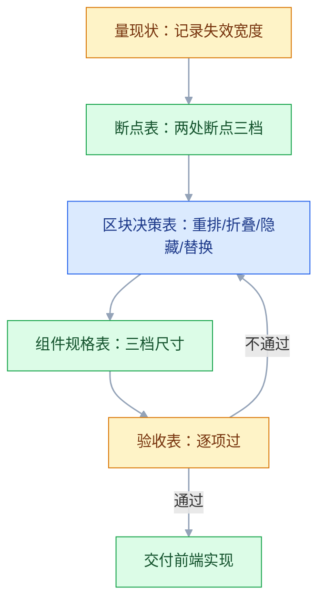
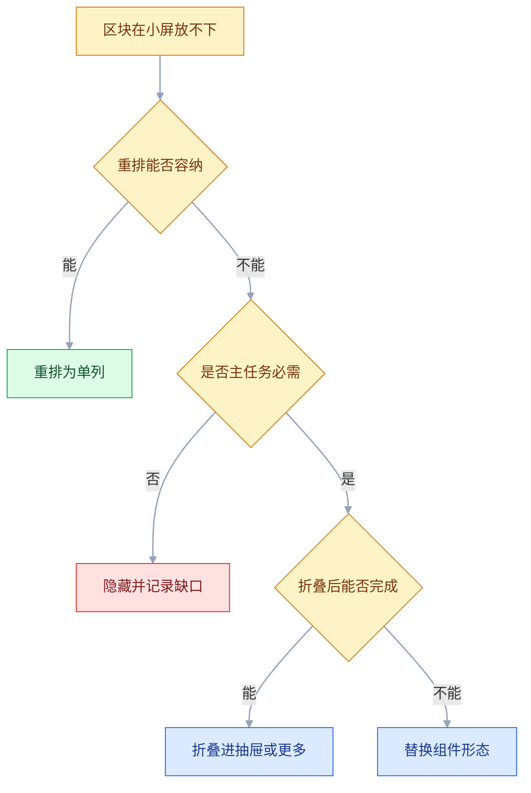

# 响应式与多端

## 一、工程案例：把一个后台列表页从 1440 适配到 768 与 375 三档

**场景**：工单系统后台的「工单列表」页。桌面 1440 宽下是「左侧导航 240 + 筛选栏 280 + 表格 8 列」。业务要求同一套前端代码覆盖三类终端：桌面 1440（客服坐席）、平板 768（主管在会议室看进度）、手机 375（一线客服在外面处理紧急工单）。

**约束**：

| 约束 | 具体内容 | 影响 |
|---|---|---|
| 只有一套代码 | 不做独立 App，不做 m. 域名 | 布局必须靠 CSS 断点与结构替换 |
| 老组件库 | 表格组件不支持列隐藏配置 | 只能在页面层包一层 |
| 375 上的真实任务 | 只看「我的待办」并处理 | 批量操作、导出、报表一律不做 |
| 排期 | 设计 3 人天，前端 5 人天 | 不允许重做一套移动端页面 |

**动手前先定一件事**：375 上到底要完成什么。答案只有两个动作——「找到分给我的工单」和「打开详情改状态」。其余 6 个动作（批量派单、导出、列设置、看报表、改优先级、加备注）在手机上直接不给入口。这个决定砍掉了约 70% 的适配工作量，也让手机上的界面只剩一条主路径。

### 1.1 第一步：量出现状，而不是先画断点

在浏览器里把窗口从 1440 往 320 拖，以 40px 为步长，遇到失效点再精确到实际宽度，记录「第一个开始难看的宽度」和「难看的具体表现」：

| 宽度 | 现象 | 根因 |
|---|---|---|
| 1440 | 正常 | — |
| 1320 | 表格出现横向滚动 | 8 列最小内容宽合计约 780，两侧栏固定 520，再加页边距即超出 |
| 1024 | 表格列宽被压到换行，行高翻倍 | 三栏仍按桌面宽度写死，没有中间档 |
| 768 | 表格只剩 4 列可见 | 未收起筛选栏，横向滚动继续 |
| 640 | 导航与主区互相挤压 | 导航列仍按桌面 240 布局，主区不足以放下表格 |
| 375 | 完全不可用 | 上述问题叠加 |

这张表比任何设备清单都有用：**断点由「布局失效的位置」决定，不由设备型号决定**。

### 1.2 第二步：定断点表

最终只留两处断点、三档布局，且全部用 `min-width` 向上覆盖：

| 名称 | 范围 | 目标终端 | 结构 | 栅格 |
|---|---|---|---|---|
| `sm` | 0–767 | 手机竖屏 375 / 横屏 667 | 单列，导航进抽屉，表格改卡片 | 4 列，边距 16 |
| `md` | 768–1199 | 平板 768 / 小笔记本 1024 | 导航收为 64 图标条，筛选进抽屉，表格保留 5 列 | 8 列，边距 24 |
| `lg` | 1200+ | 桌面 1440 / 1920 | 三栏全展开，表格 8 列 | 12 列，边距 24，内容限宽 1440 |

三条硬规则：

1. **断点值是「内容开始失效的宽度」，取整到 8 的倍数**，方便和栅格对齐。
2. **结构档位 ≤ 3（即两处断点）**。每多一档，回归测试的组合数翻倍。
3. **不写 `max-width` 断点**。基础样式是手机，向上叠加，避免两条规则互相覆盖。

```css
/* 基础：320 起，单列 */
.list-page { padding: 16px; }
.list-page__aside { display: none; }

@media (min-width: 768px) {
  .list-page { padding: 24px; display: grid; grid-template-columns: 64px 1fr; }
  .list-page__aside { display: block; }
}

@media (min-width: 1200px) {
  .list-page { grid-template-columns: 240px 280px 1fr; max-width: 1440px; margin: 0 auto; }
}
```

### 1.3 第三步：逐个区块决定「重排 / 隐藏 / 折叠 / 替换」

不是所有区块都用同一种手法。逐个过一遍，把决定写进表里，前端照着做：

| 区块 | 1440 | 768 | 375 | 手法 |
|---|---|---|---|---|
| 左侧导航 | 240 展开 | 64 图标 + tooltip | 抽屉，汉堡键唤出 | 折叠 |
| 筛选栏 | 常驻 280 | 顶部「筛选」按钮 + 抽屉 | 同左，全屏抽屉 | 折叠 |
| 工单表格 | 8 列 | 5 列，次要列隐藏 | 卡片列表 | 替换 |
| 批量选择 | 首列复选框 | 保留 | 去掉 | 隐藏 |
| 导出按钮 | 工具栏 | 收进「更多」 | 去掉 | 折叠 + 隐藏 |
| 分页 | 页码条 | 页码条 | 「加载更多」 | 替换 |
| 详情入口 | 点行 | 点行 | 点卡片 | 保留 |
| 状态标签 | 文字 + 色块 | 同左 | 文字 + 色块 | 保留 |

**表格改卡片**是这次改动最大的部分。规则：卡片只放三块信息——标题（工单号 + 一句话描述）、状态、时间；其余字段进详情。卡片整块可点，不做「hover 才出现的操作」。

```text
桌面一行：
[ ] #20481  打印机离线      王五  高  [处理中]  10-18 14:20  客服一组  --

手机一张卡：
┌──────────────────────────┐
│ #20481 打印机离线          │
│ [处理中]        10-18 14:20│
└──────────────────────────┘
```

### 1.4 第四步：处理四个跨端细节

| 细节 | 做法 | 不做的后果 |
|---|---|---|
| 底部操作栏 | `padding-bottom: calc(12px + env(safe-area-inset-bottom))` | iPhone 上按钮被 Home 条压住 |
| 视口高度 | 用 `100dvh`，不用 `100vh` | 地址栏展开时底部被裁 |
| 触摸热区 | 行内图标按钮加 `padding`，热区 ≥ 44×44 | 点三次中一次 |
| 触摸设备上的 hover | 用 `@media (hover: hover)` 包住所有 hover 样式 | 手机上第一次点击只触发 hover，要点击两次 |

```css
@media (hover: hover) and (pointer: fine) {
  .row:hover .row__actions { opacity: 1; }
}
```

### 1.5 关键产出物

四张表不是并列的，验收不通过要回到区块决策重做：



**① 断点表**（1.2 节）：宽度范围、目标终端、结构、栅格、边距。

**② 区块决策表**（1.3 节）：每个区块在三档下的形态与手法。

**③ 组件规格表**（交付给前端）：

| 组件 | 375 | 768 | 1200+ |
|---|---|---|---|
| 页头高度 | 56 | 56 | 64 |
| 列表行高 | 卡片 88 | 行 56 | 行 48 |
| 正文字号 | 15 | 14 | 14 |
| 页面边距 | 16 | 24 | 24 |
| 筛选栏 / 抽屉宽 | 100% | 360 | 280（常驻） |
| 卡片圆角 | 12 | 8 | 8 |

**④ 验收表**：

| # | 检查项 | 怎么验 | 通过标准 |
|---|---|---|---|
| 1 | 无横向滚动 | 375 / 414 / 768 / 1024 / 1320 / 1440 逐档看 | `document.documentElement.scrollWidth <= clientWidth` |
| 2 | 断点切换不错位 | 拖动窗口跨过 767 / 1199 | 布局切换瞬间无重叠、无空白 |
| 3 | 表格列不丢数据 | 768 下 5 列，375 卡片 3 块信息，详情补齐 | 任一字段都能在两级内找到 |
| 4 | 触摸热区 | 真机点行内图标 10 次 | 10 次全中，热区 ≥ 44×44 |
| 5 | 无 hover 依赖 | 真机（无鼠标）走完整流程 | 所有操作在无 hover 下可达 |
| 6 | 安全区 | iPhone 带 Home 条机型看底部栏 | 按钮完整可见，不被遮挡 |
| 7 | 键盘不遮输入 | 手机点搜索框 | 输入框滚动到键盘上方 |
| 8 | 系统字号放大 | iOS/Android 字号调最大 | 无截断、无重叠，按钮文字不溢出 |
| 9 | 横竖屏 | 375 竖屏转 667 横屏 | 布局不崩，弹层仍可关闭 |
| 10 | 大屏不铺满 | 1920 / 2560 看内容区 | 内容限宽 ≤ 1440 且居中 |
| 11 | 图片不跳版 | 弱网刷新列表 | 占位高度稳定，CLS < 0.1 |
| 12 | 隐藏内容不下载 | Network 面板看 375 首屏 | 桌面专属大图/图表未发起请求 |

> 第 12 项最容易被忽略：`display: none` 只隐藏渲染，`` 仍会下载。大屏才用的图表库、桌面专属 banner，要按需加载而不是隐藏。

---

## 二、高频问答：会卡住你的地方，也是面试最常问的

### 2.1 小屏出现横向滚动条，怎么都找不到是谁撑宽了

**现场**

DevTools 里逐个给元素加 `outline: 1px solid red`，或用 JS 找出宽度超过视口的元素；先看 `scrollWidth` 与 `clientWidth` 的差值，再从最外层往里二分定位。

```js
[...document.querySelectorAll('*')]
  .filter(el => el.getBoundingClientRect().right > document.documentElement.clientWidth + 1)
  .forEach(el => console.log(el, el.getBoundingClientRect().width));
```

**要点**

- 给 `body` 加 `overflow-x: hidden` 是错的；裁掉溢出等于把右侧内容删了，用户看不到也点不到，还会连带破坏 `position: sticky`。
- 根因是某个子元素有固定宽度或不可断行的长内容，把父级撑开。
- 先看 `scrollWidth` 与 `clientWidth` 的差值，再从最外层往里二分定位。

**追问**

- 怎么快速找出撑宽元素？→ 遍历所有元素，看 `getBoundingClientRect().right` 是否超过视口。
- `overflow-x: hidden` 有什么副作用？→ 内容点不到，还会让 `sticky` 失效。
- 怎么二分定位？→ 从外层切一半看差值落在哪边，逐层收窄。

### 2.2 每个新机型都要单独调断点

**现场**

列出所有断点，看是否有两个断点相差不到 40px；把窗口从 320 连续拖到 1920，记录布局真正出问题的宽度，通常不超过 4 个。

**要点**

- 断点按设备型号定是错的；机型数量无限，布局失效点只有几个。
- 断点越补越多，规则互相覆盖，最后没人说得清某个宽度用哪套样式。
- 应按布局失效点定断点，而不是按设备型号。

**追问**

- 断点该怎么定？→ 连续拖窗口记录布局失效的宽度，取整到 8 的倍数。
- 为什么不能按机型？→ 机型无限、失效点有限，两条断点差不到 40px 就是在追设备。
- 断点越多越稳吗？→ 不是，回归组合数翻倍，结构档位控制在 3 档。

### 2.3 手机上「删除」按钮永远不出现

**现场**

真机（不是模拟器）点一次，看按钮是否只闪一下；DevTools 切到触摸模拟再看；全局搜 `:hover`，逐条确认是否承载了「唯一入口」。

**要点**

- 桌面验收通过不等于移动可用。
- 根因是操作按钮靠 `:hover` 显示，触摸设备没有 hover，部分浏览器第一次点击只触发 hover。
- 承载唯一入口的 hover 要改成常驻或点击展开。

**追问**

- 为什么手机上点不出按钮？→ 没有 hover 状态，第一次点击只触发 hover。
- 怎么修？→ 承载入口的改成常驻或点击展开。
- 模拟器能测出来吗？→ 不能，必须真机点。

### 2.4 表格硬压到手机，字挤成一列一个

**现场**

真机看首屏能读到几条完整记录；问自己「不横滑能不能完成主任务」；统计主任务实际需要的字段数，通常 3–4 个，其余进详情。

**要点**

- 把桌面信息密度原样搬到 375，等于逼用户做精细操作。
- 根因是表格是「多列对比」的容器，手机宽度不足以同时呈现多列；横向滚动在手机上极难操作，且用户不知道右边还有内容。
- 主任务通常只需要 3–4 个字段，其余进详情。

**追问**

- 表格移动化选哪种方案？→ 逐条处理用卡片，批量对比用横滚加固定首列。
- 为什么不缩小字号？→ 字太小点不准也读不清。
- 字段怎么砍？→ 统计主任务实际需要的，其余进详情。

### 2.5 弹层底部按钮被 iPhone 的横条挡住

**现场**

在带 Home 条的机型上看，或 DevTools 选带刘海的设备并开启「显示安全区」；再横屏看左右两侧；看 `env(safe-area-inset-bottom)` 在真机上的计算值是否为 0，为 0 多半是没开 `viewport-fit=cover`。

```html
<meta name="viewport" content="width=device-width, initial-scale=1, viewport-fit=cover" />
```

```css
.sheet__footer { padding-bottom: calc(12px + env(safe-area-inset-bottom)); }
.sheet__body { padding-inline: env(safe-area-inset-left) env(safe-area-inset-right); }
```

**要点**

- `z-index` 解决的是层叠顺序，安全区是系统占位，两者无关。
- 根因是页面没启用 `viewport-fit=cover`，或底部固定栏没加 `env(safe-area-inset-bottom)`。
- 横屏时左右刘海同样会压住固定按钮和侧边内容，只补底部仍会有一侧点不到。

**追问**

- 为什么 `z-index` 没用？→ 安全区是系统占位，不是层叠问题。
- `env()` 算出来是 0 说明什么？→ 多半没开 `viewport-fit=cover`。
- 横屏还要补哪？→ 补左右 `safe-area-inset-left/right`。

### 2.6 移动端浏览器里 `100vh` 总是高出一点

**现场**

手机打开页面，看底部是否被裁；对比 `100vh` 与 `100dvh` 的渲染高度。

```css
.page { min-height: 100dvh; }        /* 动态视口，随地址栏变化 */
.hero { min-height: 100svh; }        /* 最小视口，适合首屏不跳动 */
```

**要点**

- `vh` 按「地址栏收起时的最大视口」计算，地址栏展开时页面比可视区高。
- 用 JS 监听 `resize` 算高度要处理旋转、键盘、地址栏三种变化，容易漏。
- 现代浏览器优先 `dvh`；需要首屏稳定不跳动时用 `svh`。

**追问**

- `vh` 为什么不准？→ 按最大视口算，地址栏展开时偏高。
- `dvh` 和 `svh` 怎么选？→ 动态随地址栏用 `dvh`，首屏不跳动用 `svh`。
- 还需要 JS 补吗？→ 一般不用，CSS 单位够用。

### 2.7 列表图片加载时页面「跳一下」

**现场**

DevTools Performance 面板看 Layout Shift 记录，或 Lighthouse 看 CLS 分数；断网刷新，看骨架是否与真实内容同高。

```html

<!-- 或用容器锁比例 -->
<div style="aspect-ratio:16/9"></div>
```

**要点**

- 懒加载只决定「何时下载」，不决定「占多大地方」。
- 根因是图片没有预留尺寸，加载完成前高度为 0，加载后撑开布局。
- 用 `width`/`height` 或 `aspect-ratio` 预留空间，CLS 才不会跳。

**追问**

- `loading="lazy"` 能防跳动吗？→ 不能，它只管何时下载。
- 怎么预留空间？→ 写 `width`/`height` 或用 `aspect-ratio` 锁比例。
- CLS 目标多少？→ 小于 0.1。

### 2.8 系统字号调大后，按钮文字溢出、卡片重叠

**现场**

iOS 设置里把字体调到最大，Android 调「字体大小」到最大，再打开页面；正文用 `rem`，容器用 `min-height` 而非 `height`，按钮允许换行或自适应宽。

**要点**

- 禁止缩放是可达性事故；iOS Safari 已忽略 `user-scalable=no`，Android 也普遍不保证。
- 根因是字号全用 `px` 且容器高度写死，字体放大后内容撑破固定高度。
- 用 `rem` 做字号、`min-height` 做容器、按钮允许换行。

**追问**

- 能禁止用户缩放吗？→ 不能，是可达性事故且多数浏览器已忽略。
- 怎么适配大字号？→ 字号用 `rem`，容器用 `min-height`，按钮允许换行。
- 为什么 `px` 写死高度会破？→ 字体放大后内容撑破固定高度。

### 2.9 只在 DevTools 里验过，上线后真机一堆问题

**现场**

至少一台 iOS 真机 + 一台 Android 真机，走完主流程；把「真机走查」写进验收表，且用真实账号、真实数据。

**要点**

- 模拟器不模拟真实触摸、字体渲染、安全区、键盘行为、低端机性能。
- 设备模拟只解决「宽度对不对」，解决不了「能不能点、会不会被遮」。
- 真机走查要进验收表。

**追问**

- 模拟器缺什么？→ 真实触摸、字体渲染、安全区、键盘行为、低端机性能。
- 为什么必须真机？→ 「能不能点、会不会被遮」模拟器测不出。
- 怎么落地？→ 把真机走查写进验收表，用真实账号数据。

### 2.10 2560 大屏上内容拉成一条长线

**现场**

在 2560 下量正文单行字符数，超过 100 就偏长；大屏下正文限宽，表格可单独放宽，不要一刀切。

```css
.container { max-width: 1440px; margin-inline: auto; }
.prose { max-width: 72ch; }
```

**要点**

- 铺满只解决了「没有空白」，没有解决「好不好读」。
- 根因是文本行宽超过约 75 个字符后，阅读时眼睛回扫容易丢行；表格行长过大也难以横向对照。
- 正文限宽，表格单独放宽，不一刀切。

**追问**

- 正文该限多宽？→ 约 72ch，超过 100 字符算偏长。
- 表格也要限宽吗？→ 单独放宽，别和正文共用一条规则。
- 为什么不能铺满？→ 只解决空白，不解决可读性。

### 2.11 桌面专属的大图在手机上照样下载

**现场**

375 宽度下打开 Network，按 Img 过滤，看是否有桌面专用资源；用 `<picture>` + `media`，或 JS 判断断点后再挂载。

**要点**

- `display: none` 只影响渲染，`` 仍会请求；`background-image` 因浏览器而异，不能当作按需加载。
- 隐藏 ≠ 不加载，流量和首屏时间都白花了。
- 用 `<picture>` + `media` 或 JS 判断断点后再挂载。

**追问**

- `display: none` 会阻止下载吗？→ 不会，`` 仍会请求。
- 怎么按需加载？→ `<picture>` + `media`，或 JS 判断断点后挂载。
- `background-image` 可靠吗？→ 因浏览器而异，不能当按需加载。

### 2.12 中文正常，一遇到长英文或 URL 就撑破卡片

**现场**

在标题里粘一段 60 字符的连续英文，看卡片是否变宽；对用户可输入的所有文本容器统一加换行规则，而不是逐个救火。

```css
.title { overflow-wrap: anywhere; word-break: break-word; }
```

**要点**

- 加 `overflow: hidden` 裁掉是错的；会让用户看不到完整信息，比如订单号、邮箱。
- 根因是连续无空格的字符串不会自动换行，浏览器按「最小内容宽度」撑开容器。
- 对用户可输入的所有文本容器统一加换行规则。

**追问**

- 为什么会被撑开？→ 无空格字符串不换行，按最小内容宽度撑。
- 加 `overflow: hidden` 行不行？→ 不行，裁掉会丢关键信息。
- 怎么根治？→ 所有可输入文本容器统一加 `overflow-wrap`/`word-break`。

### 2.13 某一档宽度下功能入口直接消失，主流程走不完

**现场**

在 375 / 768 / 1024 各走一遍主流程，记录每一步是否有入口；拖动窗口跨过断点，看区块是否整块消失；对着区块决策表逐行问「这一档用户怎么完成同样的任务」。

**要点**

- 隐藏是信息取舍，不是功能删除；一线用户往往只有手机。
- 根因是断点遗漏或规则冲突：某档没有对应样式，或两条规则同时把区块隐藏；更常见的是隐藏后没有替代入口。
- 导航收起后必须有汉堡键，列隐藏后详情里必须有该字段，答不上来就补入口或改回折叠。

**追问**

- 隐藏和删除的区别？→ 隐藏是信息取舍，功能不能消失。
- 入口消失怎么补？→ 折叠或替换形态，别让主流程断。
- 怎么验收？→ 各档走一遍主流程，记录每步是否有入口。

---

## 三、核心知识：从零开始要建立的东西

### 3.1 视口与 CSS 像素

浏览器里说的「375 宽」，指的是 **CSS 像素**，不是物理像素。例如一块 1170×2532 的屏幕，按 3 倍密度折算就是 390×844 的 CSS 像素。设计稿按 375 或 390 画，前端按 CSS 像素实现，中间靠 `devicePixelRatio` 换算。

| 概念 | 含义 | 影响 |
|---|---|---|
| 布局视口 | 页面布局可用的宽度 | 断点判断依据 |
| 视觉视口 | 当前可见区域 | 键盘弹起、缩放时变化 |
| 理想视口 | `width=device-width` 后的视口 | 不加 meta 时默认 980，页面被整体缩小 |
| DPR | 物理像素 / CSS 像素 | 1px 边框、图片清晰度 |

**没有 viewport meta 的页面，手机会按 980 宽渲染再缩小**，于是所有断点都失效，文字小到看不清。这是「手机上看着像缩小版桌面」的最常见原因。

### 3.2 断点的确定方法

断点不是设备清单，是「布局失效的临界宽度」。做法只有一条：**连续改变宽度，记录失效点**。

| 判断依据 | 说明 | 例子 |
|---|---|---|
| 内容挤压 | 文字换行到不可读 | 导航 4 字变 2 行 |
| 出现滚动 | 出现非预期的横向滚动 | 表格 8 列放不下 |
| 对照失效 | 需要并排比较的内容被拆开 | 表格只剩 2 列 |
| 操作变形 | 按钮小到点不准 | 工具栏图标挤在一起 |

**取整到 8 的倍数**，并与栅格对齐。两处断点、三档覆盖手机 / 平板 / 桌面，是大多数产品的合理规模。

> **面试**：常问「响应式断点应该按什么定？」答：按布局失效的临界宽度定，不按设备型号，取整到 8 的倍数。

### 3.3 移动优先与层叠顺序

在 CSS 里，移动优先不是「先画手机稿」，而是**基础样式写最小屏，断点内只写增量**。

```css
/* 基础：所有屏幕 */
.card { padding: 16px; }

/* 只写变化 */
@media (min-width: 768px) { .card { padding: 24px; } }
@media (min-width: 1200px) { .card { padding: 32px; } }
```

| 策略 | 断点方向 | 优点 | 风险 |
|---|---|---|---|
| 移动优先 | `min-width` | 增量叠加，逻辑单向 | 需要先想清最小集 |
| 桌面优先 | `max-width` | 存量页面改动小 | 规则互相覆盖，越写越乱 |

**同一份样式里不要混用两种方向**。混用后，某个宽度区间会同时命中两组规则，结果取决于书写顺序，极难排查。

### 3.4 布局原语：Flex 与 Grid 的分工

| 场景 | 选择 | 理由 |
|---|---|---|
| 一行内的对齐、间距 | Flex | 一维，按主轴排列 |
| 整页骨架、卡片网格 | Grid | 二维，行列同时约束 |
| 侧栏 + 主内容 | Grid `grid-template-columns` | 列宽可固定可弹性 |
| 数量不定的卡片 | Grid `repeat(auto-fill, minmax(280px, 1fr))` | 自动换行，无需断点 |
| 内容长短不一的列表 | Flex column | 高度自适应 |

```css
.cards {
  display: grid;
  gap: 16px;
  grid-template-columns: repeat(auto-fill, minmax(280px, 1fr));
}
```

`auto-fill` 与 `auto-fit` 的差别：容器宽时 `auto-fill` 保留空轨道，`auto-fit` 把空轨道折叠、卡片拉满。卡片少又想撑满时用 `auto-fit`。

**弹性布局不能解决所有问题**：当内容本身需要换一种结构（表格变卡片），再多的 `flex` 也没用，必须换组件。

> **面试**：常问「Flex 和 Grid 怎么选？」答：一维排列用 Flex，二维骨架和卡片网格用 Grid。

### 3.5 流式尺寸：clamp / min / max

```css
.title { font-size: clamp(20px, 2.4vw + 12px, 28px); }
.section { padding: clamp(16px, 4vw, 48px); }
```

| 函数 | 作用 | 适用 |
|---|---|---|
| `clamp(min, 理想, max)` | 三段约束 | 字号、间距、容器宽 |
| `min(a, b)` | 取小 | 宽度不超过某值 |
| `max(a, b)` | 取大 | 保证最小可读尺寸 |

**流式只适合连续变化的量**（字号、间距），不适合结构性变化（三栏变一栏）。字号用 `clamp` 后，仍要检查两端极值是否可读。

### 3.6 四种响应式手法与选择依据

| 手法 | 含义 | 适用 | 代价 |
|---|---|---|---|
| 重排 | 改变排列顺序与列数 | 三栏变单列、左右变上下 | 需要重新设计阅读顺序 |
| 隐藏 | 小屏不显示 | 装饰图、次要说明 | 信息缺失，需确认非关键 |
| 折叠 | 收进抽屉/更多/手风琴 | 筛选、次要操作 | 多一次点击 |
| 替换 | 换一种组件形态 | 表格变卡片、分页变加载更多 | 开发成本最高 |

选择顺序：**能重排就重排；不能重排时，非主任务隐藏，主任务先折叠，折叠后仍完不成再替换形态**。



### 3.7 表格移动化的三种方案与一个反例

| 方案 | 做法 | 适用 | 缺点 |
|---|---|---|---|
| 卡片化 | 每行变一张卡，只留 3–4 字段 | 主任务是「逐条处理」 | 失去横向对比 |
| 列优先级 | 隐藏次要列，详情补齐 | 主任务是「扫读少量列」 | 需要定义列优先级 |
| 横向滚动 | 保留表格，允许横滑 | 财务、报表等强对比场景 | 手机上操作困难，需固定首列 |
| 缩放适配 | 整体缩小 | 不推荐 | 字太小，点不准 |

**判断依据是主任务**：逐条处理用卡片，批量对比用横向滚动 + 固定首列。不要为了「保留全部信息」而选横向滚动，用户很少会滑。

### 3.8 导航形态的选择

| 形态 | 适用 | 层级容量 | 备注 |
|---|---|---|---|
| 底部 Tab | 3–5 个平级核心模块（数量以官方当前版本为准） | 一层 | 拇指易达，不随滚动隐藏 |
| 抽屉 | 次级导航、低频入口 | 两层 | 需要汉堡键，可发现性一般 |
| 侧栏 | 桌面多模块 | 两到三层 | 768–1199 收图标条，767 以下改抽屉 |
| 顶部 Tab | 同层级视图切换 | 一层 | 可横向滑动，需指示器 |

**导航形态与屏幕宽度绑定，不与应用类型绑定**。同一个后台，桌面用侧栏、平板用图标条、手机用抽屉，是同一套信息架构的三种呈现。

### 3.9 指针精度与触摸热区

| 维度 | 鼠标 | 手指 |
|---|---|---|
| 触点尺寸 | 光标约 1px | 指腹约 40–50px |
| 悬停 | 有 | 无 |
| 右键 | 有 | 长按 |
| 多指 | 无 | 双指缩放 |
| 遮挡 | 无 | 手指遮住目标 |

热区下限：iOS 44×44pt、Android 48×48dp（以官方当前版本为准），Web 端统一按 44×44 CSS 像素兜底。**视觉尺寸可以小，热区必须够**：24px 图标加 10px padding 即可。

```css
.icon-btn { width: 24px; height: 24px; padding: 10px; box-sizing: content-box; }
```

媒体查询 `(hover: hover) and (pointer: fine)` 用来区分「有精确指针」的设备，所有 hover 效果都应包在里面。

> **面试**：常问「为什么 hover 效果要包在 `(hover: hover)` 里？」答：触摸设备没有 hover，不包会第一次点击只触发 hover，要点两次。

### 3.10 安全区与视口单位

| 单位/函数 | 含义 | 适用 |
|---|---|---|
| `vw` / `vh` | 视口宽/高，`vh` 按最大视口算 | 桌面；移动端慎用 `vh` |
| `dvh` | 动态视口，随地址栏变化 | 全屏页面、底部固定栏 |
| `svh` | 最小视口，地址栏展开时的高度 | 首屏不希望跳动 |
| `lvh` | 最大视口 | 全屏沉浸场景 |
| `env(safe-area-inset-*)` | 系统安全区插入值 | 刘海、Home 条、圆角 |

安全区要生效，必须两件事同时成立：`viewport-fit=cover` 的 meta，以及容器上使用 `env()`。缺一个，插入值就是 0。

> **面试**：常问「`env(safe-area-inset-*)` 为什么算出来是 0？」答：缺 `viewport-fit=cover` 或容器没用 `env()`，两件事缺一不可。

### 3.11 容器查询

媒体查询看「视口宽度」，容器查询看「组件所在容器的宽度」。同一个卡片组件放进 280 的侧栏和 800 的主区，行为可以不同，而不用管视口多宽。

```css
.card-wrap { container-type: inline-size; }

@container (min-width: 480px) {
  .card { display: grid; grid-template-columns: 120px 1fr; }
}
```

| 场景 | 用媒体查询 | 用容器查询 |
|---|---|---|
| 页面整体骨架 | ✅ | ❌ |
| 可复用的卡片/列表项 | ❌ | ✅ |
| 同一页面里宽度差异大的区域 | 难 | ✅ |
| 兼容老浏览器 | ✅ | 需确认目标浏览器 |

容器查询解决的是「组件级响应式」，页面级布局仍归媒体查询管。

### 3.12 响应式图片与媒体

| 手段 | 作用 |
|---|---|
| `srcset` + `sizes` | 按宽度/密度选择图片源 |
| `<picture>` + `media` | 按条件换图，可做构图裁剪 |
| `loading="lazy"` | 视口外延迟加载 |
| `fetchpriority="high"` | 首屏主图提权 |
| `aspect-ratio` | 锁定比例，防布局跳动 |
| `object-fit` | 固定容器内裁切或留白 |

```html
<picture>
  <source media="(min-width: 768px)" srcset="hero-wide.webp" />
  
</picture>
```

**首屏主图不要懒加载**，否则白屏时间变长；列表图则应该懒加载，并预留固定比例占位。两张图比例不同时，`width` / `height` 属性只能锁一种比例；用 `aspect-ratio` 在断点里分别声明，避免宽图加载前按竖图占位。

### 3.13 像素密度与 1px 边框

高密度屏上，CSS 的 1px 会渲染成 2–3 个物理像素，看起来偏粗；某些设计又要求「真正的细线」。

| 方案 | 写法 | 适用 |
|---|---|---|
| 直接 1px | `border: 1px solid` | 大多数场景，清晰即可 |
| 0.5px | `border-width: 0.5px` | 部分 iOS 生效，Android 不一定 |
| 缩放伪元素 | `transform: scaleY(0.5)` | 需要精确细线时 |
| 阴影模拟 | `box-shadow: inset 0 -1px` | 列表分割线 |

不要为了「绝对 1 物理像素」过度设计，优先保证分割线在不同设备上「看得见且不抢眼」。

### 3.14 性能预算与按需加载

| 指标 | 移动端目标 | 说明 |
|---|---|---|
| 首屏内容可见（LCP） | < 2.5s（4G 中等机型） | 以真实设备为准 |
| 交互响应（INP） | < 200ms | 主线程别做重活 |
| 累计布局偏移（CLS） | < 0.1 | 图片、字体、广告位预留空间 |
| 首屏 JS | < 200KB（gzip） | 路由级拆分 |
| 单张列表图 | < 50KB | WebP/AVIF |
| 单张首屏大图 | < 200KB | 按断点给不同尺寸 |

响应式对性能的影响主要在「下载了不用的东西」：桌面专属图表库、隐藏的大图、全量图标字体。**按断点动态 `import()`，比隐藏更省。**

### 3.15 测试矩阵

| 维度 | 取值 | 目的 |
|---|---|---|
| 宽度 | 320 / 360 / 375 / 414 / 768 / 1024 / 1440 / 1920 | 覆盖断点两端 |
| 设备 | iPhone 一台、Android 一台、iPad 一台 | 真实触摸与渲染 |
| 方向 | 竖屏 + 横屏 | 布局是否崩 |
| 字号 | 系统默认 + 最大 | 溢出检查 |
| 网络 | 4G + 弱网限速 | 加载态、重试 |
| 输入 | 无 hover（触摸）+ 键盘 | 操作可达性 |
| 数据 | 空 / 1 条 / 超长文本 / 1000 条 | 空态、边界、性能 |

**必测两个极端**：320（最窄兼容目标）与 1920 以上（内容是否被拉长）。中间宽度靠连续拖动覆盖，不需要逐机型枚举。

### 3.16 多端差异不只是宽度

| 维度 | 桌面 Web | 移动 Web | 小程序 | 原生 App |
|---|---|---|---|---|
| 返回 | 浏览器后退 | 系统手势 | 页面栈 | 系统手势 |
| 弹层 | 居中 Modal | 底部弹层 | 底部弹层 | 平台各自规范 |
| 分享 | 复制链接 | 系统分享 | 卡片转发 | 系统分享 |
| 登录 | 账号 / SSO | 验证码 | 平台授权 | 账号 + 生物识别 |
| 外链 | 任意 | 任意 | 受白名单限制 | 受审核与配置限制 |
| 包体积 | 不敏感 | 较敏感 | 主包与分包有上限（以官方当前版本为准） | 有下载成本 |

**同一套设计稿套到所有端必然出问题**：小程序不能随意跳外链、移动端没有 hover、原生有系统级手势。多端适配的第一步是确认「每个端各自能做什么」，再决定哪些交互可以复用。小程序的包体积上限、授权方式与外链规则随平台版本调整，交付前查官方文档当前版本。

---

## 四、冷门知识汇总

这里只放低频、出错代价低、遇到能现查的点；会挡住主流程的（安全区遮挡、断点遗漏）已在第二节处理。

| 知识点 | 为什么冷门 | 用到时的关键词 |
|---|---|---|
| 容器查询单位 `cqw` / `cqi` | 容器查询本身用得少，单位更少 | `container-type: inline-size`、`cqw` |
| `pointer: coarse` | 与 hover 常一起用，但含义不同（指针精度 vs 悬停能力） | 触摸精度、热区、粗指针 |
| `min-content` / `max-content` | 弹性布局的隐形撑宽源 | 长单词、表格、`min-width: 0` |
| Grid 的 `minmax(0, 1fr)` | 默认 `1fr` 的最小值是 `auto`，会被内容撑开 | 表格溢出、`minmax(0,1fr)` |
| 表格 `table-layout: fixed` | 默认自动布局会被长内容撑开 | 列宽、截断、省略号 |
| 粘性定位与 `overflow` | 祖先一旦有 `overflow: hidden/auto`，`sticky` 失效 | 表头吸顶、滚动容器 |
| `overscroll-behavior` | 移动端滚动穿透与下拉刷新冲突时才用 | 弹层滚动、滚动链 |
| 滚动穿透 | 弹层打开后背景仍能滚，移动端尤其明显 | `position: fixed`、`touch-action` |
| `touch-action` | 手势库与浏览器默认手势打架时才调 | 左滑、拖拽、双指缩放 |
| 被动事件监听 | 现代框架多已默认，手写事件时才会遇到 | `{ passive: true }`、滚动性能 |
| 折叠屏与分屏 | 同一设备在不同时刻宽度不同，按设备写断点会漏 | 分屏、折叠、容器查询、屏幕姿态 |
| 打印样式 | 报表类产品才需要单独设计 | `@media print`、分页、黑白 |
| 邮件 HTML 的响应式 | 邮件客户端不支持现代 CSS，只能表格布局 | 邮件模板、内联样式 |
| iOS 输入框自动放大 | 只在 Safari 且字号 < 16px 时触发 | `font-size: 16px`、聚焦缩放 |
| 微信内置浏览器 | 分享、支付、字体缩放行为与系统浏览器不同 | JS-SDK、`WeixinJSBridge` |
| 桌面端触屏笔记本 | 同时有鼠标和触摸，媒体查询会同时命中 | `any-hover`、`any-pointer` |
| `srcset` 的 `sizes` 写错 | 不报错，只是加载了过大的图 | `sizes`、`100vw`、DPR |
| 图片 `decoding="async"` | 与 `loading` 容易混淆 | 解码、主线程、异步 |
| 响应式与 SEO | 同一 URL 由爬虫按移动版内容建索引 | 移动优先索引、同一 URL、内容对等 |
