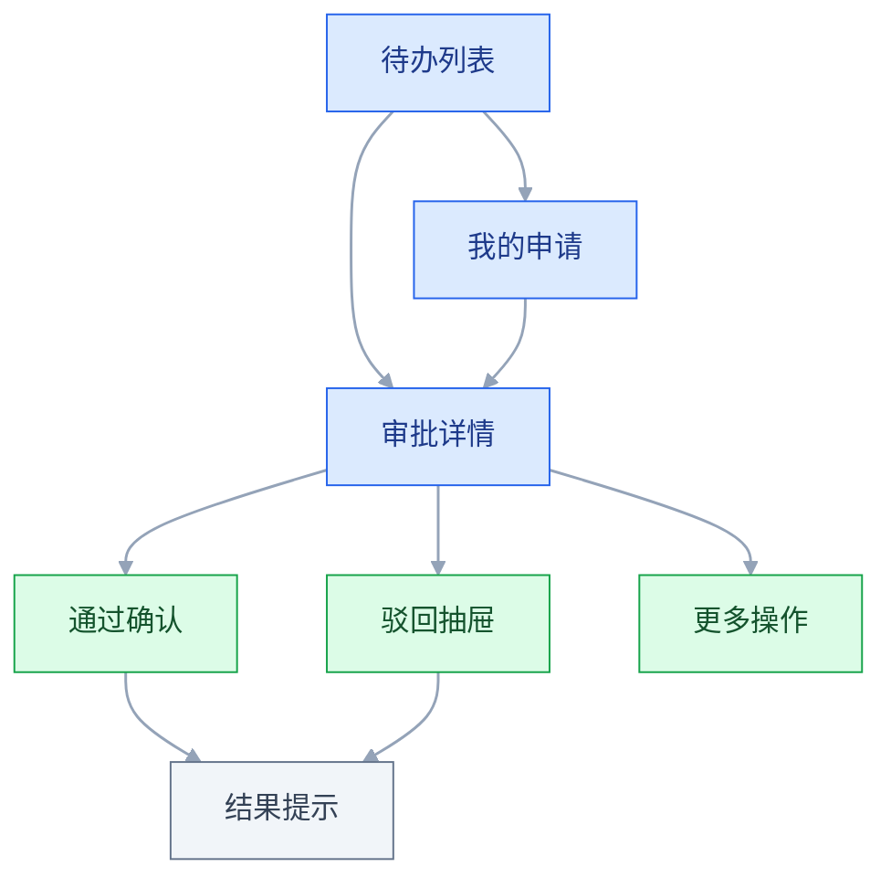
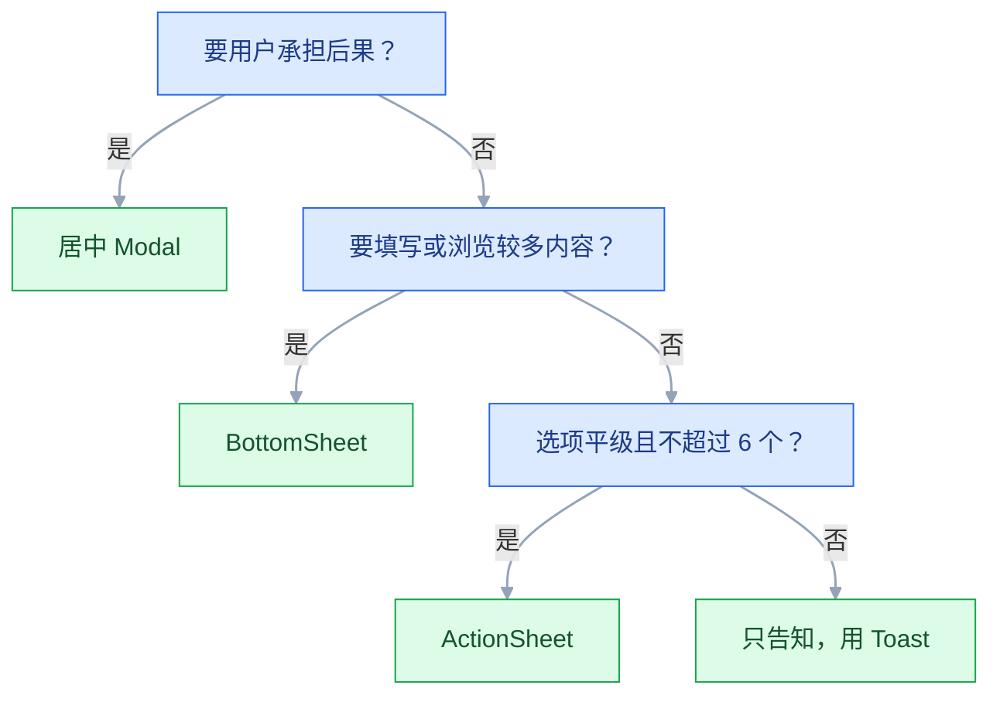

# 移动端设计

## 一、工程案例：把一条审批流做成能交付的移动端 H5

**场景**：一套已上线两年的审批系统，桌面端是 1440 的三栏布局。业务要求「手机上能审批」，不做 App，只做 H5，嵌在企业微信工作台里。范围是 3 个页面 + 3 个浮层：待办列表、我的申请、审批详情，以及通过确认、驳回抽屉、更多操作。

**约束**：

| 约束 | 具体内容 | 设计上的后果 |
|---|---|---|
| 容器是企业微信 | 顶部有平台导航条，底部可能有平台工具栏 | 自己的导航只能从第二层开始 |
| 设备跨度 | 企业微信里 iOS 与 Android 都有，宽度从 320 到 430 | 按 375 出图，用 320 / 360 / 430 三档做极值检查 |
| 用户场景 | 会议间隙、通勤路上、被消息打断 | 必须支持中断恢复、单手操作 |
| 数据 | 单条审批最多 40 个字段，事由可能 500 字 | 详情必须分组折叠 |
| 交付 | 设计 4 人天，前端 6 人天 | 不引入新手势，不做自定义动画 |

**开工前先确认的三件事**：真实用户在哪几个场景下审批（答案：收到提醒后处理待办、查自己提交的进度）；单手还是双手（7 成单手）；有没有必须横屏看的表格（没有）。这三问决定了后面所有取舍。

### 1.1 第一步：裁剪任务，而不是迁移页面

把桌面端的 12 个动作列出来，逐个问「手机上会不会发生」：

| 桌面动作 | 手机上会发生 | 处理 |
|---|---|---|
| 查看待办 | 高频 | 保留，做首页 |
| 查看详情 | 高频 | 保留，单列分组 |
| 通过 / 驳回 | 高频 | 保留，固定底部 |
| 填写驳回理由 | 高频 | 底部抽屉 + 常用理由 |
| 查看自己提交的 | 中频 | 保留，顶部 Tab 切换 |
| 撤回申请 | 低频 | 保留在详情「更多」 |
| 批量审批 | 极低 | 不做 |
| 转交他人 | 低 | 保留在详情「更多」 |
| 导出记录 | 无 | 不做 |
| 配置审批流 | 无 | 不做，提示去桌面 |
| 查看统计报表 | 无 | 不做，提示去桌面 |
| 加签 | 低 | 保留在详情「更多」 |

**结果**：3 个页面 + 3 个浮层承载 8 个动作，其余 4 个动作在小屏显示「该功能请在电脑端使用」，并给一个复制链接按钮。这条决定省下的不是设计时间，而是**手机上每条路径的分支数量**。

### 1.2 第二步：定页面结构与导航



| 页面 | 层级 | 导航 | 主操作位置 |
|---|---|---|---|
| 待办列表 | 一级 | 顶部标题 + 状态 Tab | 无全局主操作，逐条进详情 |
| 我的申请 | 一级 | 与待办同级的顶部 Tab | 无 |
| 审批详情 | 二级 | 左上返回 + 标题 | 底部固定双按钮 |
| 通过确认 | 浮层 | 居中 Modal（需明确确认） | 底部按钮 |
| 驳回抽屉 | 浮层 | 底部 BottomSheet | 抽屉底部按钮 |
| 更多操作 | 浮层 | 底部 ActionSheet | 列表项 |

**为什么不做底部 Tab**：只有两个一级页面，底部 Tab 至少要 3 项才有意义；两个用顶部 Tab 更省垂直空间。**导航形态由一级页面数量决定，不由「别人都这么做」决定。**

### 1.3 第三步：逐页定结构

**待办列表**

```text
┌─ 平台导航（企业微信提供）──┐
│ 待办          我的申请      │  ← 顶部 Tab，下划线指示
├────────────────────────────┤
│ 张三 · 请假申请             │
│ 10-18 至 10-20 · 2 小时前   │
│ [待审批]                    │
├────────────────────────────┤
│ 李四 · 报销申请             │
│ 金额 1,280 元 · 昨天        │
│ [待审批]                    │
└────────────────────────────┘
```

一条待办一行卡片，88 高，只放「谁 + 什么类型」「时间」「状态」三类信息。整卡可点，卡内不放任何按钮——**列表里出现操作按钮，会逼用户做精细点击，也会让「点卡片」和「点按钮」互相误触**。

**审批详情**

```text
┌─ ← 请假申请 ────────────┐
│ 申请人   张三             │
│ 部门     客服一组         │
│ 类型     年假             │
│ 时间     10-18 至 10-20   │
│ 事由     家中有事，需…     │
│ [展开全部]                │
│ ── 审批记录 ──            │
│ 王五 已同意  10-18 09:12  │
├──────────────────────────┤
│ [驳回]        [通过]      │  ← 固定，含安全区
└──────────────────────────┘
```

字段超过 6 个时分组：基本信息、申请内容、审批记录。默认展开前两组，审批记录折叠。**折叠的判定不是「字段多」，而是「用户在第一屏需不需要它」。**

**驳回抽屉**

```text
┌──────────────────────────┐
│ 驳回原因            ✕     │
│ [材料不全] [金额不符]      │  ← 常用理由，点选即填入
│ ┌──────────────────────┐ │
│ │ 请补充…              │ │  ← 自动聚焦，字号 16
│ └──────────────────────┘ │
│              [确认驳回]   │  ← 跟随键盘上移
└──────────────────────────┘
```

### 1.4 第四步：写状态矩阵

移动端出问题，多半不是「主路径没画」，而是「状态没画」。每个页面把五种状态补齐，写进交付文档：

| 页面 | 加载 | 空 | 错误 | 无权限 | 禁用 |
|---|---|---|---|---|---|
| 待办列表 | 3 条骨架卡 | 插画 + 「暂无待办」 | 文案 + 重试 | 「无审批权限，请联系管理员」 | — |
| 我的申请 | 骨架卡 | 「还没有提交过申请」 | 文案 + 重试 | 同上 | — |
| 审批详情 | 骨架屏（字段行） | — | 整页错误 + 返回 | 只读展示 + 提示 | 已处理：按钮变「已通过/已驳回」 |
| 通过确认 | 按钮 loading | — | Toast + 留在弹层 | — | 提交中禁用按钮 |
| 驳回抽屉 | — | 常用理由为空时只留输入框 | Toast | — | 理由为空时确认按钮禁用 |

**「已处理」是最容易漏的状态**：同一条审批可能被别人处理掉，用户点进去时按钮必须变成只读，而不是再点一次报错。

### 1.5 关键产出物

**① 交互规格表**（开发直接照做）：

| 元素 | 规格 | 备注 |
|---|---|---|
| 页面左右边距 | 16 | 320 宽时保持 16 |
| 卡片圆角 | 12 | — |
| 卡片内边距 | 16 | — |
| 主按钮高度 | 48 | 宽度撑满可用区 |
| 次按钮高度 | 48 | 描边，与主按钮等宽 |
| 底部操作栏 | 高 64 + 安全区 | 上边框 1px |
| 正文 | 15 / 行高 1.5 | 用 rem |
| 辅助文字 | 13 / 次要色 | — |
| 触达热区 | ≥ 44×44 | 图标按钮用 padding 撑开 |
| 抽屉圆角 | 顶部 16 | 最大高度 80dvh |
| 列表行高 | 88 | 标题 / 时间 / 状态三行；单行列表 56 |

**② 动效参数**（只保留必要项）：

| 场景 | 属性 | 时长 | 缓动 |
|---|---|---|---|
| 抽屉进入 | translateY 100% → 0 | 240ms | ease-out |
| 抽屉退出 | translateY 0 → 100% | 180ms | ease-in |
| 遮罩 | opacity 0 → 0.4 | 200ms | linear |
| 按钮按下 | scale 1 → 0.98 | 100ms | ease-out |
| Tab 切换 | 指示器 translateX | 200ms | ease-in-out |

**③ 验收表**：

| # | 检查项 | 怎么验 | 通过标准 |
|---|---|---|---|
| 1 | 单手可达主操作 | 右手单手持机，手腕不动只动拇指 | 通过/驳回在拇指自然活动范围内，不用换手 |
| 2 | 触达热区 | 真机连点行内图标 10 次 | 10 次全中，热区 ≥ 44×44 |
| 3 | 键盘不遮挡 | 点驳回理由输入框 | 输入框与确认按钮均在键盘上方 |
| 4 | 输入不缩放 | iOS Safari 聚焦输入框 | 页面不放大，字号 ≥ 16 |
| 5 | 安全区 | 带 Home 条机型看底部栏 | 按钮完整可见 |
| 6 | 返回一致 | 二级页左滑 / 点左上返回 | 都回到列表，且列表滚动位置保留 |
| 7 | 中断恢复 | 填一半理由切后台 30 秒再回 | 内容还在，弹层未关闭 |
| 8 | 状态齐全 | 逐个触发加载/空/错误/已处理 | 1.4 表里该页有值的格子都有对应界面，标「—」的不算缺失 |
| 9 | 手势有替代 | 不看引导，找撤回入口 | 「更多」里能找到 |
| 10 | 重复提交 | 弱网下连点确认 5 次 | 只产生一条审批记录 |
| 11 | 系统字号 | 系统字号调到最大 | 无截断、按钮文字不溢出 |
| 12 | 横屏 | 竖屏转横屏再转回 | 弹层状态不丢，布局不崩 |

> 第 10 项要用弱网（DevTools 限速或真机飞行模式切换）验，正常网络下接口太快，看不出问题。

**④ 页面清单与状态矩阵**：1.3 的三张线框 + 1.4 的表原样进需求文档——前端按页对照实现，测试按 1.4 逐格验收。交付物不写全，验收就只能靠口头。

---

## 二、高频问答：会卡住你的地方，也是面试最常问的

### 2.1 用户反馈「找不到通过按钮」

**现场**

单手右手持机，手腕不动，看拇指能否覆盖按钮；再滚到页面底部看按钮是否还在。

**要点**

- 找不到按钮多半是可达性问题，不是视觉权重问题。
- 按钮在页面顶部或随内容滚走，单手拇指够不到；也可能被键盘或安全区遮住。
- 把「够不到」当成「不够醒目」去加大加粗，只会越改越花。

**追问**

- 主操作该放哪？→ 底部拇指自然活动区，这是人体工学，不是审美。
- 系统返回在左上角够不到，能挪吗？→ 不能，系统级约定有肌肉记忆。
- 怎么确认不是视觉问题？→ 录一段自己单手操作的屏幕视频，回放看拇指轨迹。

### 2.2 底部弹层的确认按钮被系统横条压住

**现场**

带 Home 条的 iPhone 真机看；DevTools 设备模式开启安全区叠加。

```css
.sheet__footer { padding-bottom: calc(12px + env(safe-area-inset-bottom)); }
```

**要点**

- 不是弹层高度不够，是没处理安全区。
- 加高只是把内容整体上移，换个机型又不对。
- 要先确认 viewport meta 带 `viewport-fit=cover`，`env()` 才会取到非 0 值。
- 安全区不止底部：横屏左右也有 inset，全屏内容、横滑卡片、悬浮按钮都要补 `safe-area-inset-left/right`。

**追问**

- 为什么 `env()` 一直是 0？→ 没写 `viewport-fit=cover`。
- 只写 bottom 会怎样？→ 横屏时被刘海切掉一角。
- 除了底部栏还有谁要补？→ BottomSheet、Toast、全屏内容。

### 2.3 输入驳回理由时，键盘把输入框顶出屏幕

**现场**

真机点输入框，看输入框和确认按钮是否还在可视区。

```js
const vv = window.visualViewport;
vv.addEventListener('resize', () => {
  const hidden = window.innerHeight - vv.height;
  document.documentElement.style.setProperty('--kb', `${hidden}px`);
});
```

**要点**

- 键盘弹起改变的是视觉视口，不是布局视口。
- 固定定位元素不会自动避让，写死 `padding-bottom: 300px` 在不同键盘高度、不同机型上都会错。
- 用 `visualViewport` 监听实际被遮挡的高度；输入框聚焦时 `scrollIntoView({ block: 'center' })` 兜底。

**追问**

- iOS 和 Android 行为一样吗？→ iOS 布局视口基本不变，Android 取决于 `windowSoftInputMode`（如 `adjustResize`）。
- 为什么写死 300px 不行？→ 键盘高度随机型、输入法变化。
- 关闭键盘后留白怎么办？→ resize 时按 `visualViewport.height` 重算，不沿用旧值。

### 2.4 iOS 上点输入框，整个页面被放大

**现场**

iOS Safari 真机点输入框，看页面是否放大且回不去。

**要点**

- Safari 在输入框字号小于 16px 时会自动放大页面。
- 加 `user-scalable=no` 禁止缩放违反可达性，且部分系统版本不生效。
- 唯一稳的做法是把所有输入类元素字号设为 16px 及以上。

**追问**

- 为什么不能直接禁缩放？→ 违反无障碍，且不一定生效。
- 字号 16 是硬要求吗？→ 针对输入类元素，正文可以更小（正文 ≥ 15）。
- 还有别的触发点吗？→ 所有可聚焦的输入类元素都要满足。

### 2.5 左滑删除没人发现，用户以为功能不存在

**现场**

找 3 个没用过产品的人，让他们删除一条记录，观察是否左滑。

**要点**

- 手势本身不可见，引导只解决第一次，解决不了「想起来」。
- 左滑还与系统返回手势冲突，从屏幕左缘起手会变成返回。
- 任何手势都必须有可见替代入口，手势只是加速通道。

**追问**

- 自定义左滑要避开多少？→ 屏幕左缘约 20px，以真机实测为准。
- 新手引导有用吗？→ 只在第一次有效，不能当可发现性方案。
- 替代入口放哪？→ 详情页的删除按钮、长按菜单。

### 2.6 Android 上返回键和页面左上返回打架

**现场**

在 Android 上：打开详情 → 打开抽屉 → 按系统返回，看关的是抽屉还是页面。

**要点**

- 两套返回逻辑各自维护历史栈，必然不同步。
- 典型表现是「返回两次才退出」或「弹层关了页面也退了」。
- 返回是系统级约定，要统一到一个栈里。

**追问**

- 弹层打开时系统返回该做什么？→ 拦截并优先关闭弹层。
- 返回优先级怎么定？→ 弹层 > 页面栈 > 退出应用。
- 为什么不能两个都保留？→ 重复实现历史栈会不同步。

### 2.7 图标按钮总是点不中

**现场**

真机连点 10 次，记录失败次数；DevTools 检查元素盒模型。

```css
.icon-btn { padding: 10px; box-sizing: content-box; } /* 24 + 20 = 44 */
```

**要点**

- 视觉尺寸 24px，热区也是 24px；手指精度约 40–50px。
- 放大图标会破坏视觉平衡，正确做法是只放大热区。
- 看元素实际可点击区域，不看图标视觉大小。

**追问**

- 热区最小多少？→ 44×44，主操作和底部栏按 48 做。
- 相邻热区能挨着吗？→ 不能，至少留 8px，否则点 A 中 B。
- 行内按钮怎么处理？→ 整行可点时按钮要单独抬高一层。

### 2.8 点「通过」没反应，用户连点后出现两条审批

**现场**

弱网下录屏，看点击后 300ms 内按钮是否有任何变化。

**要点**

- 按钮没有按下反馈、没有 loading、没有禁用，用户不知道点到了。
- 后端幂等是兜底，前端不给反馈才是根因。
- 点击后立即禁用 + loading，成功/失败都给明确结果。

**追问**

- 后端加了幂等就够了吗？→ 不够，用户仍会重复点，体验也差。
- 按下反馈要等接口吗？→ 不等，按下态立即变化。
- 弱网下怎么验？→ DevTools 限速或真机切飞行模式。

### 2.9 首屏白屏两秒，用户以为打不开

**现场**

弱网限速打开页面，看前 2 秒屏幕内容。

**要点**

- 没有骨架屏，也没有区分「加载中」与「加载失败」。
- 全屏转圈只说明「在转」，不说明「在加载什么」，也无法区分卡死。
- 首屏用与真实结构一致的骨架；超过 10 秒给「仍在加载 / 重试」。

**追问**

- 骨架和转圈的区别？→ 骨架暗示内容结构，减少跳变。
- 超过多久要提示？→ 10 秒给「仍在加载 / 重试」。
- 加载失败怎么区分？→ 明确原因 + 重试，不混在加载态里。

### 2.10 一进 App 就请求推送权限，通过率很低

**现场**

看权限请求的展示时机与通过率，按「首次启动」和「完成核心操作后」分组对比。

**要点**

- 用户此时还不知道产品能给他什么，拒绝成本极低。
- 系统权限一旦拒绝很难二次弹窗，时机比文案重要。
- 在用户完成一次核心操作后再请求，并保证消息可分类关闭。

**追问**

- 永久拒绝后还能弹吗？→ 不能，只能引导去系统设置并给出路径。
- 分类开关怎么做？→ 消息、待办、营销至少三组，别做成全开全关。
- 为什么文案优化没用？→ 问题在时机，不在措辞。

### 2.11 金额输入框滚动页面时数字自己变了

**现场**

真机在输入框上滑动页面，看数值是否变化。

```html
<input type="text" inputmode="decimal" />
```

**要点**

- `type="number"` 在移动端带上下调节箭头，滚动时容易误触。
- 语义没错，但移动端交互不适合金额。
- 金额、数量统一用 `text` + `inputmode`，并在提交时做格式校验。

**追问**

- 为什么不用 `type="number"`？→ 滚动误触，还能输入 `e`、负号等非法字符。
- 用什么替代？→ `type="text" inputmode="decimal"`。
- 校验放哪？→ 提交时统一校验。

### 2.12 系统字号调到最大后，卡片文字互相重叠

**现场**

iOS 辅助功能里调大字体，Android 调字体大小，逐页看。

**要点**

- 容器高度写死、文字用 `px`、单行不换行，放大后必然重叠。
- 限制最大字号等于拒绝无障碍需求，不是解法。
- 行高用相对值、容器用 `min-height`、标题允许两行，按钮宽度自适应。

**追问**

- 设计时留多少余量？→ 文字留 1.3 倍余量。
- 哪些元素最容易坏？→ 固定高度按钮、单行标题、绝对定位角标。
- 怎么验？→ 系统字号调到最大逐页看。

---

## 三、核心知识：从零开始要建立的东西

### 3.1 移动端的约束模型

移动端设计的所有差异，都能归到六个约束上：

| 约束 | 具体表现 | 设计对策 |
|---|---|---|
| 屏幕小 | 去掉系统栏、导航与安全区后，常见机型可用高度不足 600 CSS px | 一屏一任务，次要内容下沉 |
| 手指粗 | 触达精度 40–50px | 热区 ≥ 44，间距 ≥ 8 |
| 无 hover | 悬停态不存在 | 操作常驻或点击展开 |
| 随时中断 | 来电、消息、切后台 | 保存草稿、恢复现场 |
| 网络不稳 | 弱网、断网、切换网络 | 骨架、重试、离线提示 |
| 电量与流量 | 长时间使用成本高 | 控制图片、动画、轮询 |

这六条不是「注意事项」，是**判断依据**：任何一个方案拿不准时，回到这六条里找对应的那条。

### 3.2 触达热区

触达热区是「手指能点中的区域」，与图标的视觉尺寸无关。

| 平台 | 最小热区 | 说明 |
|---|---|---|
| iOS | 44×44pt | 以官方当前版本为准 |
| Android | 48×48dp | 以官方当前版本为准 |
| Web/H5 | 44×44 CSS px 起 | 主操作、底部栏按 48 做，向 Android 看齐 |

```css
.icon-btn {
  display: inline-flex;
  align-items: center;
  justify-content: center;
  width: 44px;
  height: 44px;
}
.icon-btn svg { width: 24px; height: 24px; }
```

**热区可以重叠吗**：不可以。相邻两个 44 热区之间至少留 8px，否则会出现「点 A 中 B」。列表行整行可点时，行内的独立按钮要单独抬高一层，避免与整行点击冲突。

> **面试**：常问「44×44 说的是视觉尺寸还是热区？」答：是热区，和图标视觉大小无关，热区不够就会出现点不中。

### 3.3 拇指活动区

单手竖持时，拇指的自然活动范围是一个以握持侧下方为圆心的扇形。

| 区域 | 可达性 | 适合放 |
|---|---|---|
| 底部中间与右下 | 最易 | 主按钮、底部导航、确认操作 |
| 中部 | 易 | 内容、列表、表单 |
| 顶部中间 | 中 | 标题、搜索 |
| 顶部两角 | 难 | 低频入口、返回 |
| 左下角（右手持机） | 较难 | 不放主操作，最多放次级操作 |

**设计含义**：主操作放底部，不是审美选择，是人体工学。**例外是系统级约定**：iOS 的返回在左上角，即使难达也不能改，用户有肌肉记忆。

**左手用户**：底部主按钮靠右时，左手拇指需要跨过屏幕。若产品有大量左手用户（如某些地区、某些职业），主操作居中或给左右手模式。

### 3.4 信息架构与导航

| 一级页面数 | 推荐导航 | 理由 |
|---|---|---|
| 1–2 | 顶部 Tab 或直接单页 | 底部 Tab 至少 3 项才有存在感 |
| 3–5 | 底部 Tab | 平级切换最快，拇指易达 |
| 6+ | 底部 Tab 4 项 + 「更多」 | 超过 5 项图标过密 |
| 层级很深 | 栈式 + 抽屉 | 低频入口收进抽屉 |

**底部 Tab 的硬规则**：

| 规则 | 说明 |
|---|---|
| 数量 3–5 | 少于 3 用顶部 Tab，多于 5 放「更多」 |
| 图标 + 文字 | 只有图标会被猜错，只有文字辨识慢 |
| 选中态明显 | 颜色 + 填充 + 文字加粗，至少两项同时变化 |
| 不随滚动隐藏 | 隐藏后用户要找，且返回时位置跳变 |
| 核心功能不进「更多」 | 进去等于藏起来 |

### 3.5 页面层级与返回

移动端的「层级」是用户的空间地图。层级混乱表现为：返回键回到意料之外的页面、弹层关闭后页面也退了、横屏后状态丢失。

| 层级类型 | 例子 | 返回行为 |
|---|---|---|
| 页面栈 | 列表 → 详情 → 子详情 | 逐层出栈 |
| 弹层 | 抽屉、ActionSheet、Modal | 只关弹层，不动页面栈 |
| 视图切换 | 顶部 Tab | 不产生历史，或替换当前栈顶 |
| 全屏流程 | 引导、支付 | 完成后清栈，不能返回中间步 |

**返回的优先级**：弹层 > 页面栈 > 退出应用。任何时刻按返回，先关最上层的东西，这是用户的默认预期。

**状态保留**：从详情返回列表时，滚动位置、筛选条件、Tab 选中项都应保留。做法是把列表状态存在路由或全局 store 里，而不是每次进页面重新拉取。

> **面试**：常问「按返回键时先关什么？」答：弹层 > 页面栈 > 退出应用，先关最上层的东西。

### 3.6 移动端表单

表单是移动端最容易掉链子的地方：打字慢、易出错、键盘占半屏。

| 手段 | 做法 | 效果 |
|---|---|---|
| 默认值 | 预填当前日期、上次地址、常用理由 | 减少输入项 |
| 选择代替输入 | 日期选择器、分段控件、级联选择 | 避免格式错误 |
| 扫码/拍照 | 身份证、银行卡、快递单 | 把输入变成确认 |
| 自动填充 | `autocomplete="tel"` / `"email"` / `"one-time-code"` | 借助系统记忆 |
| 键盘类型 | `inputmode` 指定数字、邮箱、电话 | 减少切换 |
| 分步 | 每步 3–5 个字段 | 降低单屏压力 |
| 失焦校验 | 离开字段时校验，不打断输入 | 早发现错误，又不在输入中途报错 |

```html
<input type="tel" inputmode="numeric" autocomplete="tel" />
<input type="email" autocomplete="email" />
<input type="text" inputmode="decimal" />   <!-- 金额 -->
<input type="text" autocomplete="one-time-code" /> <!-- 验证码 -->
```

**校验时机**：不要在每次输入时校验（用户还没输完就报错），用失焦校验；提交时统一校验并滚动到第一个错误项。

### 3.7 键盘与视口

键盘弹起压缩的是**视觉视口**：iOS 上布局视口基本不变，Android 取决于 `windowSoftInputMode`（`adjustResize` 会改布局高度）。所以「固定定位会自动避让」这个假设，两边都不成立：

| 现象 | 原因 | 对策 |
|---|---|---|
| 固定底栏被键盘顶起或遮住 | 固定定位相对布局视口 | 监听 `visualViewport` 调整 |
| 输入框在键盘下方 | 浏览器未自动滚动 | 聚焦时 `scrollIntoView` |
| 页面整体被压缩变形 | 用了 `100vh` 且内容 `flex: 1` | 内容区允许滚动 |
| 关闭键盘后留白 | 高度变量未复位 | resize 时按 `visualViewport.height` 重算，不要沿用旧值 |

```css
.sheet { max-height: 80dvh; overflow-y: auto; }
.sheet__body { padding-bottom: 24px; }
```

**输入框位置**：让输入框位于屏幕上半部，键盘弹起后仍在可视区。表单里最靠下的字段最容易出问题，设计时就要把它放在前面，或改成抽屉内的独立输入区。

**安全区是另一套边界**：刘海、Home 指示条、横屏时的左右缺口都由系统保留，页面必须自己让出来。

| inset | 什么时候非 0 | 谁必须用它 |
|---|---|---|
| `safe-area-inset-top` | 全屏展示、隐藏浏览器工具栏 | 自定义顶栏、返回按钮 |
| `safe-area-inset-bottom` | 手势条机型、横屏 | 底部操作栏、BottomSheet、Toast |
| `safe-area-inset-left/right` | 横屏刘海、部分折叠屏 | 全屏内容、横滑卡片 |

前提是 viewport meta 写了 `viewport-fit=cover`，否则 `env()` 恒为 0；写完之后页面才真正铺满屏幕，所有贴边元素都要自己补 inset——这也是「测试机看着没问题、换一台就被切」的常见来源。

> **面试**：常问「键盘弹起压缩的是哪个视口？」答：视觉视口，布局视口基本不变，所以固定定位元素不会自动避让。

### 3.8 列表结构

列表是移动端使用频率最高的容器。

| 要素 | 建议 | 说明 |
|---|---|---|
| 行高 | 单行 48–56，双行 64–88 | 低于 44 会点不准 |
| 主文字 | 15–17 | 一行，超出省略 |
| 副文字 | 13–14，次要色 | 最多一行 |
| 头像/图标 | 40 | 与文字块垂直居中 |
| 分割线 | 从文字起点开始 | 通栏分割线显脏 |
| 点击反馈 | 按下背景变深 | 必须有 |
| 右侧 | 箭头 / 状态 / 时间，只放一个 | 放多了拥挤 |

**三种常见结构**：

```text
导航型：标题 + 副标题 + 右箭头      → 进详情
信息型：头像 + 标题/副标题 + 右侧信息 → 看状态
卡片型：整卡可点，内部多字段         → 承载复杂条目
```

**下拉刷新与上拉加载**是移动列表的默认预期。上拉到底必须给「没有更多了」，否则用户会一直拉。

### 3.9 浮层谱系

| 类型 | 用途 | 出现方式 | 关闭方式 |
|---|---|---|---|
| ActionSheet | 多个平级操作 | 底部滑出 | 取消、点遮罩 |
| BottomSheet | 内容较多的面板 | 底部滑出，可拖拽 | 下拉、关闭键、点遮罩 |
| 居中 Modal | 必须确认的关键操作 | 淡入 + 轻微缩放 | 明确按钮（不做点遮罩关闭） |
| Toast | 轻提示，无需操作 | 底部或顶部浮出 | 自动消失 |
| Snackbar | 带一个操作的提示 | 底部滑出 | 自动消失或点操作 |
| Popover | 局部说明 | 锚点附近 | 点外部 |

**选择依据**（按「用户要干什么」走一遍）：



选项超过 6 个就别硬塞 ActionSheet，改成整页列表，可滚动、可搜索，还能承载分组。

**关闭方式至少两种**，且要明显。只能下滑关闭的弹层，对不熟悉手势的用户等于关不掉。

### 3.10 手势系统

| 手势 | 典型用途 | 可发现性 | 必备替代入口 |
|---|---|---|---|
| 点击 | 主操作 | 高 | 不需要 |
| 长按 | 多选、上下文菜单 | 低 | 需要（编辑模式） |
| 左滑 | 删除、置顶 | 低 | 需要（详情页按钮） |
| 右滑 | 返回、标记已读 | 低 | 需要（返回键） |
| 下拉 | 刷新 | 中 | 需要（重试按钮） |
| 双指缩放 | 图片查看 | 中 | 需要（点击放大） |
| 摇一摇 | 反馈、调试 | 极低 | 不能作为唯一入口 |

**冲突处理**：

| 冲突 | 表现 | 处理 |
|---|---|---|
| 左滑删除 vs 系统返回 | 从屏幕左缘滑动时系统接管 | 左滑操作只在列表项内部生效，避开左缘 20px |
| 下拉刷新 vs 页面滚动 | 在滚动容器顶部下拉误触发刷新 | 只在 `scrollTop === 0` 时启用 |
| 横向滑动 vs 纵向滚动 | 手指斜着划，方向判断错 | 按主轴位移阈值判定方向 |
| 长按 vs 滚动 | 按住想滚动却弹菜单 | 长按 500ms 且位移小于阈值才触发 |

### 3.11 加载态与空态

| 场景 | 方案 | 说明 |
|---|---|---|
| 首屏加载 | 骨架屏 | 结构与真实内容一致，减少跳变 |
| 分页加载 | 底部 loading + 结束提示 | 加载中不遮挡已有内容 |
| 下拉刷新 | 顶部指示器 + 回弹 | 完成后短暂停留再收起 |
| 提交操作 | 按钮 loading + 禁用 | 防重复提交 |
| 空数据 | 插画 + 一句说明 + 行动按钮 | 说明「这里本来会有什么」 |
| 搜索无结果 | 说明 + 修改建议 | 不要只写「暂无数据」 |
| 网络错误 | 原因 + 重试 | 区分「没网」与「服务出错」 |
| 无权限 | 说明 + 申请入口 | 不要显示空白页 |

**空态的三段式**：一句说明现状（还没有待办）、一句说明价值（有新任务会出现在这里）、一个下一步动作（刷新 / 去创建）。缺任何一段，用户都会停在原地。

### 3.12 通知与权限

| 类型 | 用途 | 注意 |
|---|---|---|
| 系统推送 | 需要立刻行动的事 | 可控、可分类关闭 |
| 应用内消息 | 次要提醒 | 不打断当前操作 |
| 红点/角标 | 未读提示 | 用滥了等于没有 |
| 站内横幅 | 运营、公告 | 可关闭，不要每次启动都弹 |

**权限请求时机**：在用户完成一次核心操作、理解了产品价值之后再请求。首次启动就弹窗，用户没有理由同意；而系统权限一旦被拒，再弹原生窗的机会就没了。

**权限的三种状态**决定你还能做什么，设计稿上要分清：

| 状态 | 能做什么 | 界面怎么写 |
|---|---|---|
| 未请求 | 可以弹系统窗 | 先说明用途，再触发系统窗 |
| 已拒绝（可再问） | 仍可再弹系统窗 | 讲清能解决什么问题再请求 |
| 永久拒绝 | 系统不再弹窗 | 只能引导去系统设置，给出设置路径 |

**分类开关**：消息、待办、营销至少分三组，让用户能只关营销。全开或全关的二选一，结果通常是全关。

### 3.13 平台规范差异

| 维度 | iOS | Android |
|---|---|---|
| 返回 | 页面左上返回 + 边缘手势 | 系统返回键/手势为主 |
| 主弹层 | ActionSheet、居中 Modal | BottomSheet 更常见 |
| 导航 | 底部 TabBar | 底部导航栏 |
| 日期选择 | 常见滚轮样式，也有内联日历 | 常见日历弹窗 |
| 触觉反馈 | 系统触感引擎 | 振动 API，强度因厂商而异 |
| 字体 | 系统字体 | 系统字体，厂商可能替换 |

**跨平台策略**：核心结构保持一致（导航层级、页面布局、操作位置），平台习惯处做适配（返回方式、弹层形态、日期选择）。**不要两边各做一套完全不同的交互**，维护成本翻倍，用户换机也要重新学。

> 具体控件规格以 Apple HIG 与 Material Design 的当前版本为准，版本间差异较大，不要照抄旧数值。

> **面试**：常问「iOS 和 Android 的返回逻辑有什么不同？」答：iOS 以左上返回加边缘手势为主，Android 以系统返回键/手势为主。

### 3.14 性能体感

用户感知的「快」由三件事决定：**有没有反馈、内容有没有逐步出现、操作有没有被阻塞**。

| 问题 | 表现 | 对策 |
|---|---|---|
| 首屏白屏 | 打开后 2 秒无内容 | 骨架屏、SSR、减少首屏 JS |
| 列表滚动卡 | 滑动掉帧 | 虚拟列表、减少 DOM、图片降采样 |
| 动画卡 | 弹层一卡一卡 | 只动 `transform` / `opacity` |
| 点击无响应 | 点了半秒才有变化 | 按下态立即变化，不等接口 |
| 输入延迟 | 打字跟不上 | 输入不触发重渲染，防抖校验 |
| 图片撑开 | 加载后页面跳 | 固定比例占位 |

**乐观更新**：点赞、已读、开关这类操作，先改 UI 再发请求，失败时回滚。用户感知的是即时响应，而不是网络往返。

### 3.15 无障碍与字号

| 项 | 要求 | 验证 |
|---|---|---|
| 字号 | 正文 ≥ 15，输入 ≥ 16 | 系统字号最大时仍可读 |
| 对比度 | 正文 ≥ 4.5:1，大字 ≥ 3:1 | 对比度工具 |
| 触达 | ≥ 44×44 | 真机点击 |
| 焦点 | 键盘/读屏可遍历 | VoiceOver / TalkBack |
| 语义 | 图标按钮有可读名称 | 读屏听一遍 |
| 动效 | 尊重「减少动态效果」 | 系统开关打开后检查 |
| 颜色 | 不只靠颜色传达状态 | 灰度截图检查 |

**字号放大的连锁反应**：文字变大后，固定高度的按钮、单行不换行的标题、绝对定位的角标都会出问题。设计时给文字留出 1.3 倍的余量，比事后修更省。

---

## 四、冷门知识汇总

只收录「低频 + 出错代价低 + 用到时能现查」的条目。会挡住交付的坑（键盘遮挡、安全区、手势冲突）都在第二节。

| 知识点 | 为什么冷门 | 用到时的关键词 |
|---|---|---|
| `dvh` 与软键盘 | 键盘弹起时 `dvh` 是否变化因浏览器而异 | 弹层最大高度、`80dvh` |
| 滚动穿透 | 弹层打开后背景仍滚动，多在真机复现 | `overscroll-behavior`、`touch-action` |
| 300ms 点击延迟 | 现代浏览器已消除，老项目仍有历史包袱 | viewport meta、`touch-action` |
| 输入法组合事件 | 中文输入时 `input` 事件触发时机不同 | `compositionstart`、`compositionend` |
| 自动填充的坑 | 密码管理器会覆盖预填值 | `autocomplete="off"`、`new-password` |
| 短信验证码自动填充 | 需要正确的 `autocomplete` 值 | `one-time-code` |
| 触觉反馈 | Web 端能力有限，原生才有细腻触感 | `navigator.vibrate`、Haptic |
| 下拉刷新的实现 | 浏览器原生刷新与自定义刷新会冲突 | `overscroll-behavior-y`、`pull-to-refresh` |
| 横屏锁定 | 多数 App 锁竖屏，H5 无法直接锁 | manifest、`screen.orientation` |
| 分屏与折叠屏 | 宽度连续变化，断点法失效 | 容器查询、`span` |
| 后台恢复 | 切后台久了会被系统回收 | `visibilitychange`、状态持久化 |
| 微信内置浏览器 | 字体缩放、分享、支付行为与系统浏览器不同 | JS-SDK、`WeixinJSBridge` |
| 小程序的主包上限 | 不做小程序不会关注 | 分包、预下载、主包体积 |
| 深色模式跟随 | 系统切换与产品内开关并存时优先级 | `prefers-color-scheme`、主题覆盖 |
| 系统字体缩放 | Web 端常被忽略 | `rem`、`text-size-adjust` |
| 通知的折叠 | 同一会话多条推送会被折叠 | 会话 ID、`thread-id` |
| 移动端 1px 边框 | 高密度屏上 1px 偏粗 | `transform: scaleY(0.5)` |
| `enterkeyhint` | 键盘回车键文案默认「换行」，很少人配 | `enterkeyhint="search"`、`"send"`、`"next"` |
| iOS 的 `:active` | 不加监听时按下态不出现，容易误判为样式没写 | `touchstart`、空监听、按下反馈 |
| `scroll-margin-top` | 锚点滚到固定标题下面被遮住才想起 | `scrollIntoView`、固定头、错位 |
| 点击高亮色块 | 安卓与微信里点一下冒灰块 | `-webkit-tap-highlight-color`、`transparent` |
