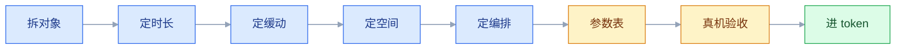
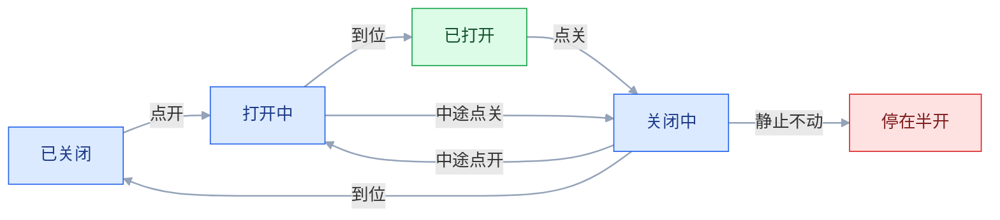
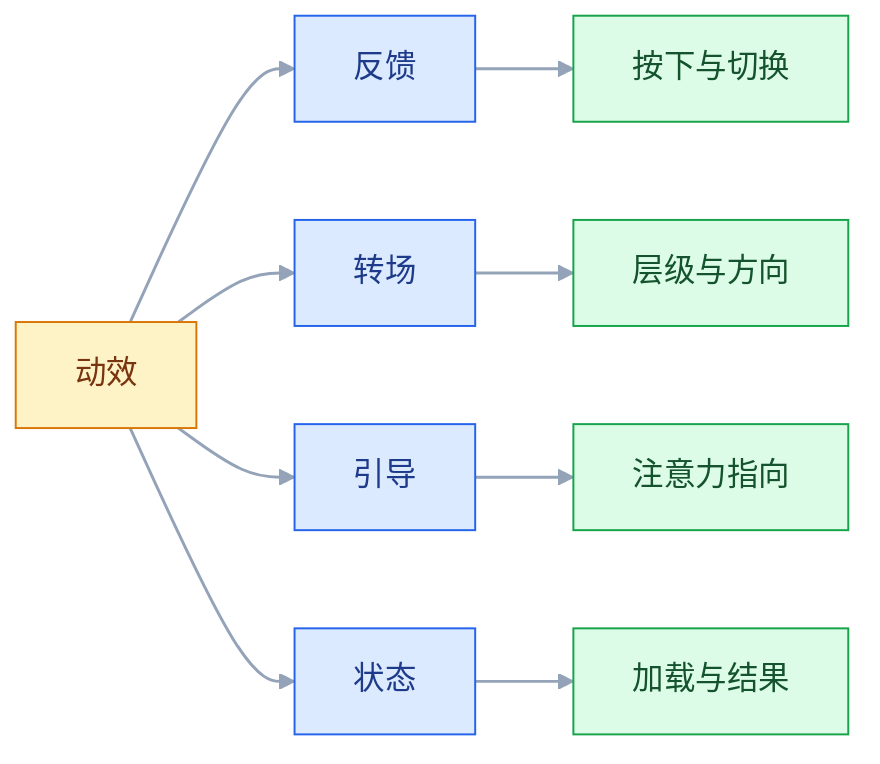

# 动效设计

## 一、工程案例：给一个筛选抽屉定动效参数并交付给前端

**场景**：后台改版，工单列表的筛选从「常驻侧栏」改成「右侧抽屉」。第一版由前端随手实现：`transition: all 0.3s linear`，遮罩与抽屉同时开始、同时结束。上线后反馈集中在三点——「弹出来很生硬」「关的时候像卡了一下」「低端笔记本上会抖」。

**约束**：

| 约束 | 具体内容 | 影响 |
|---|---|---|
| 一套 token | 全站动效统一从变量取 | 不能给单个弹层写死数值 |
| 设备跨度 | 客服笔记本（集显）+ 设计部 MacBook | 必须按低端设备验收 |
| 同一组件复用 | 抽屉还用于「工单详情」「批量派单」 | 参数要覆盖三种内容量 |
| 可关闭 | 无障碍要求支持「减少动态效果」 | 必须有降级方案 |
| 排期 | 半天定参数，半天联调 | 不做复杂编排 |

交付路径是固定的八步，先看全貌再看每一步：



**开工前先回答一个问题**：这个动效要传达什么。答案是两件事——「抽屉从右边来」（空间关系）和「遮罩后面的内容暂时不可操作」（层级关系）。凡是不能服务这两个目的的动画，一律不做。

### 1.1 第一步：拆解动效对象

一个「抽屉打开」在实现上是四个独立对象，各有各的参数：

| 对象 | 作用 | 是否必须动 |
|---|---|---|
| 抽屉面板 | 承载内容，从右侧进入 | 是 |
| 遮罩 | 表达层级，压暗背景 | 是（只动透明度） |
| 抽屉内内容 | 首屏内容，可轻微延迟跟进 | 可选 |
| 页面主体 | 背景，不参与动画 | 否 |

**关键判断**：页面主体绝不做缩放或位移。早期做法是「弹层出现时背景整体缩小」，在内容多的后台上会触发大面积重绘，且让用户失去方向感。

### 1.2 第二步：定时长

时长按「移动距离」和「元素大小」定，不按「重要性」定：

| 对象 | 距离/尺寸 | 时长 | 依据 |
|---|---|---|---|
| 抽屉面板 | 宽 360，横向移动 | 240ms | 中等距离，进入 |
| 遮罩 | 全屏，只变透明度 | 200ms | 透明度变化不需要太久 |
| 遮罩关闭 | 全屏，只变透明度 | 180ms | 与抽屉同时结束，避免「抽屉还在、遮罩先没」 |
| 抽屉关闭 | 同距离，反向 | 180ms | 离开比进入快约 25% |
| 抽屉内首项 | 8px 上移 + 淡入 | 180ms，延迟 40ms | 轻微跟进，不喧宾夺主 |
| 按钮按下 | 无位移，缩放 0.98 | 100ms | 微交互，要即时 |

**为什么不是 300ms**：300ms 是「不犯错」的中间值，但对 360px 的横向位移偏慢；用户点开筛选是想马上看到选项，240ms 已经是可感知的上限（经验值，不是规范）。**经验上，高频操作里的进入动画超过 300ms 就会被感知为「慢」**，而 360px 的面板放在 240ms 附近，收尾时还能看出减速。

### 1.3 第三步：定缓动

| 对象 | 缓动 | 曲线 | 理由 |
|---|---|---|---|
| 抽屉进入 | ease-out | `cubic-bezier(0.0, 0.0, 0.2, 1)` | 先快后慢，像被推到位 |
| 抽屉关闭 | ease-in | `cubic-bezier(0.4, 0.0, 1, 1)` | 先慢后快，像被抽走 |
| 遮罩 | linear | `linear` | 纯透明度，匀速最自然 |
| 内容跟进 | ease-out | 同上 | 与面板同族曲线 |
| 按钮按下 | ease-out | 同上 | 100ms 内曲线差异不明显 |

**进场用 ease-out、退场用 ease-in** 是最稳的默认组合。两者都符合「物体受外力后减速/加速」的直觉，且方向相反，用户能感知到「来了」和「走了」。

两条边界：**遮罩这种纯透明度变化用 `linear` 是可接受的简化**，换成 ease-out 也不会错，别为它单独引一条曲线；**这四个 `cubic-bezier` 是常用取值，不是标准**，它们近似各设计体系里的 decelerate / accelerate / standard 三档，照抄后仍要在真机上看一遍。

```css
:root {
  --ease-out: cubic-bezier(0, 0, 0.2, 1);
  --ease-in: cubic-bezier(0.4, 0, 1, 1);
  --ease-in-out: cubic-bezier(0.4, 0, 0.2, 1);
  --dur-fast: 100ms;
  --dur-base: 180ms;
  --dur-enter: 240ms;
}
```

### 1.4 第四步：定空间关系

空间关系回答「这个东西从哪来」。抽屉从右侧来，就必须从右侧走；遮罩从 0 到 0.4，关闭时回到 0。

| 元素 | 起点 | 终点 | 属性 |
|---|---|---|---|
| 抽屉面板 | `translateX(100%)` | `translateX(0)` | transform |
| 遮罩 | `opacity: 0` | `opacity: 0.4` | opacity |
| 内容首项 | `translateY(8px)` + `opacity: 0` | `0` + `1` | transform + opacity |

**不要用 `right: -360px` 到 `right: 0`**。`right` 属于布局属性，每帧都会触发重排；`transform` 只走合成，低端机差异明显。

```css
.drawer {
  transform: translateX(100%);
  transition: transform var(--dur-enter) var(--ease-out);
}
.drawer.is-open { transform: translateX(0); }
.drawer.is-closing { transition-duration: var(--dur-base); transition-timing-function: var(--ease-in); }
```

### 1.5 第五步：定编排与降级

**编排**只做一层：抽屉开始移动后 40ms，内容首项跟进淡入，到 220ms 结束，仍在面板到位之前。**不做逐项 stagger**——筛选面板有 20 多个选项，逐项入场总时长会接近 800ms，用户会觉得「卡」。

| 方案 | 总时长 | 体感 | 采用 |
|---|---|---|---|
| 全部同时 | 240ms | 略生硬 | 否 |
| 面板 + 首项延迟 40ms | 240ms | 有层次但不拖 | ✅ |
| 20 项逐项 stagger 30ms | 约 790ms | 明显慢 | 否 |

首项 40ms 开始、220ms 结束，仍在面板到位（240ms）之前，所以「面板 + 首项延迟」这一档的总时长仍是 240ms，不是把两个数相加。**算 stagger 的总时长要用「首项起始 + 间隔 × (项数 - 1) + 单项时长」**，20 项 × 30ms 的间隔本身就贡献 570ms。

**降级方案**：

```css
@media (prefers-reduced-motion: reduce) {
  .drawer, .drawer__mask, .drawer__item {
    transition-duration: 1ms !important;
  }
}
```

降级不是「全部删掉」：遮罩仍要出现（否则用户不知道背景不可点），只是不做位移；抽屉直接出现，不做滑入。

**中断**：动画途中再次触发（打开中点关闭、关闭中点开）时，只允许从当前值反向，不回到起点重来。正常状态只有四个，图里多出来的那个是要避免的中间态：



落到实现上只有一句：中断时读 `getComputedStyle` 的当前矩阵作为起点，再挂新的 `transition`；直接改 `is-open` 类名会让元素从 100% 重新起步，看起来就是「跳一下」。

### 1.6 关键产出物

**① 动效参数表**（交付核心，开发照着写）：

| # | 触发 | 对象 | 属性 | 起始值 | 结束值 | 时长 | 缓动 | 延迟 |
|---|---|---|---|---|---|---|---|---|
| 1 | 点「筛选」 | 遮罩 | opacity | 0 | 0.4 | 200ms | linear | 0 |
| 2 | 点「筛选」 | 抽屉 | transform | translateX(100%) | translateX(0) | 240ms | ease-out | 0 |
| 3 | 点「筛选」 | 首项内容 | opacity + transform | 0 / translateY(8px) | 1 / 0 | 180ms | ease-out | 40ms |
| 4 | 点关闭/遮罩 | 抽屉 | transform | translateX(0) | translateX(100%) | 180ms | ease-in | 0 |
| 5 | 点关闭/遮罩 | 遮罩 | opacity | 0.4 | 0 | 180ms | linear | 0 |
| 6 | 按下按钮 | 按钮 | transform | scale(1) | scale(0.98) | 100ms | ease-out | 0 |
| 7 | 系统减少动效 | 全部 | — | — | — | 1ms | — | 0 |

**② 动效 token 表**（进设计系统，不只服务这一个组件）：

| token | 值 | 用途 |
|---|---|---|
| `--dur-fast` | 100ms | 按下、hover、勾选 |
| `--dur-base` | 180ms | 关闭、内容跟进 |
| `--dur-enter` | 240ms | 抽屉、弹窗进入 |
| `--dur-page` | 300ms | 页面级转场 |
| `--ease-out` | `cubic-bezier(0,0,0.2,1)` | 进入 |
| `--ease-in` | `cubic-bezier(0.4,0,1,1)` | 离开 |
| `--ease-in-out` | `cubic-bezier(0.4,0,0.2,1)` | 位置移动 |

**③ 验收表**：

| # | 检查项 | 怎么验 | 通过标准 |
|---|---|---|---|
| 1 | 进入时长 | DevTools Performance 录一次打开 | 240ms ± 20ms |
| 2 | 关闭更快 | 同上，录关闭 | 180ms 左右，明显快于进入 |
| 3 | 帧率 | Performance 面板看 Frames | 无长时间掉到 30fps 以下 |
| 4 | 只动合成属性 | 勾 Rendering → Paint flashing | 动画期间无大面积重绘 |
| 5 | 遮罩同步 | 慢放录屏（0.25x） | 遮罩不晚于抽屉出现，不早于抽屉消失 |
| 6 | 方向对称 | 连续开关 5 次 | 进从右来，出向右走，无反向跳变 |
| 7 | 重复触发 | 快速连点「筛选」10 次 | 不叠加、不闪烁、状态正确 |
| 8 | 动画中操作 | 打开过程中点关闭 | 能立即反向，不卡在中间态 |
| 9 | 减少动效 | 系统开启后重开页面 | 无位移，遮罩仍在，功能可用 |
| 10 | 低端设备 | 集显笔记本 / 降频模式 | 无明显抖动、无撕裂 |
| 11 | 中断恢复 | 动画中切标签页再回来 | 停在正确终态，不半开 |
| 12 | 内容溢出 | 抽屉内容超长滚动 | 滚动不触发面板位移 |

> 第 5 项必须慢放。正常速度下遮罩与抽屉的 20–40ms 偏差看不出来，但慢放后能明显看到「先黑一下再出来」或「抽屉走了遮罩还在」。

**谁来验、什么时候算交付完成**：设计和前端在客服笔记本上一起过一遍这 12 项，全过才算完成；不通过只改参数，不改验收标准——「差不多能看」会把 20ms 的偏差一路带到线上。

**④ 交付包**（让前端不必回头问的三样）：

| 交付物 | 本次内容 | 用途 |
|---|---|---|
| 慢放录屏 | 0.25x，开、关各一遍，外加一次连点中断 | 对齐体感，暴露遮罩不同步 |
| 标注稿 | 起点在屏外 100%，遮罩 0.4，内容 8px 上移 | 对齐空间关系与层级 |
| 降级说明 | 减少动效时四项分别怎么表现 | 避免开发自行发挥 |

三样都齐了，参数表才有人照着写；只给参数表，开发仍会猜「遮罩要不要一起动」。

---

## 二、高频问答：会卡住你的地方，也是面试最常问的

### 2.1 所有动画都是 300ms，整体感觉「黏」

**现场**

先别改值：逐个交互录屏，量实际时长，再和对象类型对照。按下态、弹层进入、页面转场三类各量一遍，列出「现在多少 / 该多少」。

**要点**

- 时长没有按对象分类：按下反馈、弹层进入、页面转场的合理区间本来就不同。
- 统一改一个值只会让微交互变迟钝、转场变仓促，越调越黏。
- 分别定值：按下态 100ms 左右、弹层 200–300ms、页面转场 300ms 左右。

**追问**

- 为什么不能统一给 300ms？→ 微交互超过 150ms 就觉得迟钝，弹层给 300ms 又偏慢，两头都不对。
- 时长到底按什么定？→ 按移动距离和元素大小定，不按重要性定；距离翻倍时长只增加 30–50%。
- 宽屏和窄屏能共用一个值吗？→ 实际距离变了，差 40ms 很正常，要按距离微调而不是照抄。

### 2.2 弹层动画在低端机上明显卡顿

**现场**

DevTools Rendering 勾 Paint flashing 与 Layout Shift，看动画期间是否大面积闪绿；同时对照 CSS，确认动的是哪个属性。

```css
/* ✘ 触发布局 */
.panel { left: -360px; transition: left 240ms; }

/* ✔ 只走合成 */
.panel { transform: translateX(-100%); transition: transform 240ms; }
```

**要点**

- 动画用了 `left` / `width` / `box-shadow`，每帧触发布局或重绘，低端机上直接掉帧。
- `will-change` 只是提前提升图层，不解决布局属性本身的代价，加了也白加。
- 只对 `transform` 和 `opacity` 做动画；需要改尺寸时用 `scale`，但要接受内容被拉伸。
- 毛玻璃（`backdrop-filter`）和大面积阴影同样是低端机的掉帧常客，动效里换成半透明底色或静态阴影。

**追问**

- `transform` 就一定不卡吗？→ 不一定，图层太多占显存，动画结束要撤掉 `will-change`。
- 为什么 `left` 比 `transform` 贵？→ `left` 每帧重排再重绘，`transform` 走合成，跳过前两步。
- 检测工具只能看颜色吗？→ Paint flashing 看重绘范围，Frames 轨道看有没有掉到 30fps 以下。

### 2.3 关闭动画和打开一样长，感觉「关不掉」

**现场**

分别录打开和关闭，比较总时长；再对一遍两者的 `transition-duration` 与曲线是不是同一组值。若两组值完全一致，而主观上只觉得「关不掉」，那就是进入和离开共用了一套参数，而不是关闭本身缺了什么。

**要点**

- 进入和离开共用了同一组时长与缓动，所以关起来和开起来一样慢。
- 离开是「用户已经决定不要了」，越快越好；进入需要建立空间感，可以稍慢。
- 关闭时长取进入的 70–80%，缓动换成 `ease-in`。

**追问**

- 给关闭加延迟能解决问题吗？→ 只会更慢，问题出在时长和曲线，不是先后。
- 关闭时能不能把距离也缩短？→ 不能，退场要走完同样距离，否则看起来半路消失。
- 遮罩和抽屉谁先结束？→ 同一时刻结束，遮罩先没会出现「抽屉还在、背景已亮」。

### 2.4 弹窗从屏幕中心放大，但触发按钮在右下角

**现场**

慢放录屏，看动画起点是否与点击位置一致；不一致就是空间关系错了，不是缩放幅度问题。

**要点**

- 动效起点与触发源无关，用户无法建立「这个弹窗是从那个按钮来的」。
- 加大缩放比例解决不了空间错位，反而更晕。
- 要么从触发元素位置展开（先算按钮中心相对弹窗的偏移，再设 `transform-origin`），要么老实做淡入 + 轻微上移；后者在后台类产品里更稳。

**追问**

- 共享元素转场值得做吗？→ 需要两侧元素对应、处理图片加载与滚动位置，多数后台不值得。
- 为什么后台更推荐淡入 + 上移？→ 不依赖精确算原点，出错也不会让用户失去方向。
- 缩放和位移同时用行不行？→ 两个都在动，起点又不对时眩晕感会叠加。

### 2.5 用户连点「提交」，产生了两条记录

**现场**

弱网下连点 5 次，看 Network 里有几个请求；再点一次，确认按下瞬间按钮是否已经不可点。

**要点**

- 点击后没有立即禁用，动画/请求期间按钮仍然可点。
- 幂等是后端兜底，前端第一道防线是「点击即锁定 + loading」。
- 点击瞬间设 `disabled` 或 `pointer-events: none`，同时保留视觉上的 loading 反馈。

**追问**

- 只加 `disabled` 够不够？→ 不够，没有 loading 用户以为没点上，会去点别处或刷新。
- 有了后端幂等还要前端锁吗？→ 要，重复请求已经打到后端，浪费而且可能触发别的副作用。
- 为什么动画期间更容易连点？→ 反馈还没到，用户以为第一次没生效。

### 2.6 加载动画只闪了一下就没了

**现场**

快速网络下录屏，看 loading 的存在时间是否小于 100ms；再看请求耗时分布。

**要点**

- 请求在 100ms 内返回，loading 出现又消失，形成闪烁。
- 加进度条只会让闪烁更明显，问题在显示时机不在样式。
- 延迟 100–200ms 再显示 loading，期间完成就完全不显示；一旦显示，最短停留 300ms 左右。

**追问**

- 这两个数是规范吗？→ 都是经验值，按接口实际耗时分布调。
- 骨架屏会不会也闪？→ 会，同样要延迟显示 + 最短展示时长。
- 超过 1 秒该显示什么？→ 骨架屏或进度条，按钮上的小 spinner 已经不够。

### 2.7 进度条走到 70% 停住，用户以为死机

**现场**

对照真实任务阶段与进度条位置，看是否对得上；对不上就是假进度。

**要点**

- 进度是假的，按时间估算而不是真实任务进度。
- 假进度比没有进度更糟，因为它给出了错误预期，停下时用户以为死机。
- 不知道总量时用不确定态（循环动画），知道阶段时用分步进度。

**追问**

- 不确定态为什么比假进度好？→ 它只承诺「在干活」，不承诺走到哪。
- 多阶段任务怎么报？→ 按阶段推进（上传 → 处理 → 完成），每段完成再进位。
- 假进度什么时候可以接受？→ 只在确实无法拿到进度、且不会长时间停住时，作为安慰性反馈。

### 2.8 有用户反馈「看久了头晕」

**现场**

让用户系统开启「减少动态效果」后重看，问题是否消失；再问是否只在特定页面出现，定位是哪一类动效。

**要点**

- 大幅位移、视差、缩放会触发前庭不适，跟时长基本无关。
- 缩短时长不减少位移距离，不适感仍然在。
- 支持 `prefers-reduced-motion`，用透明度替代位移，去掉视差与大幅缩放。

**追问**

- 降级就是把动画全删吗？→ 不是，遮罩仍要出现，只是不做位移，否则用户不知道背景不可点。
- 压到 1ms 会不会丢终态？→ 不会，1ms 让终态仍生效；依赖 `fill-mode: forwards` 的组件要单独写静态样式。
- 还有哪些硬线？→ 任意 1 秒闪烁不超过 3 次，自动播放超 5 秒要可暂停。

### 2.9 列表逐项入场，看起来很高级但整体很慢

**现场**

录屏量「第一项出现」到「最后一项到位」的总时长，再和项数、间隔对一遍。

**要点**

- 总时长 = 首项延迟 + 单项时长 + 间隔 × (项数 - 1)，20 项按 30ms 间隔就多出 570ms。
- 只调间隔会让节奏变急促，编排感消失。
- 列表只对首屏可见的 5–8 项做 stagger，其余直接显示，总时长控制在 400ms 内。

**追问**

- 为什么 20 项一定慢？→ 间隔乘项数，20 项 × 30ms 的间隔本身就贡献 570ms。
- 滚动进来的项要不要再入场？→ 不做，用户是滚过去的，动画只会拖慢阅读。
- 想保留层次又不想慢怎么办？→ 分组交错，每 3–5 项一组，代价是实现复杂。

### 2.10 位置移动用了 linear，看起来像机器人

**现场**

慢放对比 `linear` 与 `ease-out` 的同一段位移，看加减速差别。

**要点**

- `linear` 没有加减速，不符合物体运动的直觉。
- `linear` 只适合进度条、旋转 loading 这类匀速循环。
- 位移用 `ease-out`（进入）或 `ease-in-out`（位置切换），透明度可以用 `linear`。

**追问**

- 为什么进入用 `ease-out`？→ 物体受推力后先快后慢（摩擦减速），符合日常观察。
- 反过来用 `ease-in` 做进入会怎样？→ 有「被拽出来」的突兀感。
- 弹簧曲线能用在页面转场吗？→ 不适合，参数调不好会抖，只适合拖拽、开关这类跟手操作。

### 2.11 手指拖拽抽屉，松手后动画「跳」一下

**现场**

拖到一半松手，录屏看是否有位置突跳；再对照代码，看动画起点是不是从 0 开始的。

**要点**

- 拖拽位置与动画起始值不连续，动画从 0 开始而不是从当前位移开始。
- 手势驱动的动效必须以「当前值」为起点。
- 松手时读取当前位移，按速度决定吸附方向，从当前值补完剩余距离。

**追问**

- 吸附方向怎么判？→ 速度或位移比例任一过阈值就按那个方向，速度优先。
- 补完的时长怎么算？→ 总时长 × 剩余比例，不是每次都播完整时长。
- 拖拽要加阻尼吗？→ 可用 0.8–1.0 的轻微阻尼，手感更稳，但别让元素明显落后于手指。

### 2.12 高频操作每次都有 300ms 动画，用久了嫌慢

**现场**

统计单日操作次数，把超过几十次的操作单独列出来看，再看它们的动画时长。

**要点**

- 高频操作的动效价值随次数递减，第 100 次只剩等待。
- 全关会让首次使用失去空间感，所以不能一刀切。
- 高频操作（展开菜单、切换 Tab）压到 100–150ms 或 0ms，首次引导另做。

**追问**

- 怎么区分高频和低频？→ 按单日操作次数统计，不是凭感觉判断。
- 首屏引导为什么可以慢？→ 一次性、只出现一次，建立认知的价值大于等待成本。
- 压到 0ms 会不会显得廉价？→ 高频场景用户要的是结果，反馈可以交给 100ms 内的颜色或位移微交互。

---

## 三、核心知识：从零开始要建立的东西

### 3.1 动效的信息职能

动效不是装饰，是在时间维度上补充信息。它只回答四个问题：

| 问题 | 动效回答方式 | 例子 |
|---|---|---|
| 发生了什么 | 状态变化的可见过程 | 按钮变深、开关滑动 |
| 从哪来、到哪去 | 位移方向与起点 | 抽屉从右侧来 |
| 系统还在工作吗 | 持续的循环反馈 | 骨架屏、进度条 |
| 该先看哪里 | 注意力指向与节奏 | 新功能高亮、引导遮罩 |



**判断一个动效该不该做**：去掉它，用户是否还能理解发生了什么。能理解，它就是装饰；不能理解，它才是信息。装饰可以删，信息必须留。

### 3.2 时长

时长是动效里最硬的参数，给错会立刻被感知。

| 场景 | 常用区间 | 说明 |
|---|---|---|
| 按下、hover、勾选 | 80–150ms | 超过 150ms 会觉得迟钝 |
| Tooltip、Toast | 150–200ms | 小元素，距离短 |
| 抽屉、弹窗 | 200–300ms | 中等距离 |
| 页面转场 | 250–350ms | 全屏切换 |
| 大范围布局变化 | 300–500ms | 元素多、距离远 |
| 引导动画 | 400–600ms | 一次性，可稍长 |

**表里全是经验区间，不是规范**：同一类交互在窄屏和宽屏上差 40ms 很正常，按实际距离微调，别把某个毫秒数写进规范文档当硬性要求。

三条经验：

1. **越小越快**：小元素移动距离短，时长应短。
2. **越远越慢，但不是线性**：距离翻倍，时长增加约 30–50%（经验比例，不是物理定律）。
3. **离开比进入快**：取进入的 70–80%。

> **面试**：常问「弹层动画给 300ms 合适吗？」答：按对象分类，按下 80–150ms、弹层 200–300ms、页面转场 250–350ms，离开取进入的 70–80%。

### 3.3 缓动曲线

缓动决定速度如何变化，比时长更影响体感。

| 曲线 | 速度特征 | 适用 |
|---|---|---|
| ease-out | 先快后慢 | 进入、展开、出现 |
| ease-in | 先慢后快 | 离开、收起、消失 |
| ease-in-out | 两端慢中间快 | 位置切换、同层移动 |
| linear | 匀速 | 进度、旋转、透明度 |
| spring | 有回弹 | 拖拽释放、开关 |

```css
--ease-out: cubic-bezier(0, 0, 0.2, 1);
--ease-in: cubic-bezier(0.4, 0, 1, 1);
--ease-in-out: cubic-bezier(0.4, 0, 0.2, 1);
--ease-standard: cubic-bezier(0.2, 0, 0, 1);
```

**为什么默认 ease-out**：物体受推力后通常先快后慢（摩擦减速），符合日常观察。反过来用 ease-in 做进入，会有「被拽出来」的突兀感。

**弹簧的边界**：适合跟手操作（拖拽、开关、下拉回弹），不适合页面转场。弹簧参数调不好会「抖」，参数需要实机调，不能照搬。

> **面试**：常问「为什么进入用 ease-out、离开用 ease-in？」答：进入要建立空间感、先快后慢；离开时用户已决定不要，越快越好，方向相反才符合直觉。

### 3.4 空间连续性

用户靠动效建立「界面是一张地图」的认知。空间连续性一旦断裂，用户就要重新定位。

| 关系 | 动效表达 |
|---|---|
| 弹层来自触发按钮 | 从按钮位置展开，或从同侧滑入 |
| 详情来自列表项 | 列表项放大为详情（共享元素） |
| 返回列表 | 详情缩回原列表项 |
| 删除一条 | 高度收拢，后续项上移 |
| 切换到同级 Tab | 内容横向位移，指示器跟随 |

**共享元素转场**是最强的空间暗示，但实现成本高：需要两侧元素对应、处理图片加载、处理滚动位置。**多数后台不值得做**，用「同侧滑入 + 反向滑出」已经足够。

**方向必须对称**：从右进就从右出，从上进就从上出。方向反了，用户会以为自己回到了上一页。

### 3.5 进入与离开的非对称

| 维度 | 进入 | 离开 |
|---|---|---|
| 时长 | 基准 | 基准 × 0.7–0.8 |
| 缓动 | ease-out | ease-in |
| 位移距离 | 完整距离 | 完整距离，方向相反 |
| 内容跟进 | 可延迟 30–50ms | 不延迟，一起走 |

**为什么离开要快**：用户已经做出「关闭」的决定，此时任何等待都是阻力。进入则需要一点时间建立「它从哪来」。

**距离不缩短**：退场走完同样的距离只是更快，这样「从哪来回哪去」才成立；把退场距离砍短会和方向对称打架，用户看到的是元素半路消失。只有 Toast、通知这类没有空间来源的元素，才允许进出距离不等。

### 3.6 微交互

微交互是操作后 100ms 内必须开始的回应——超过这个量级，用户就会觉得「点了没反应」（100ms 是经验阈值，不是规范值）。它决定界面的「手感」。

| 交互 | 反馈方式 | 时长 |
|---|---|---|
| 按钮按下 | 背景变深 / scale 0.98 | 80–100ms |
| 开关切换 | 滑块位移 + 轨道变色 | 150–200ms |
| 复选框 | 对勾描边绘制 | 150ms |
| 输入框聚焦 | 边框变色 + 轻微外发光 | 120ms |
| 复制成功 | 图标切换 + Toast | 150ms |
| 下拉刷新 | 指示器旋转 + 回弹 | 跟手 |
| 点赞 | 轻微放大回弹 | 150ms |

三条原则：**快、不改变布局、可感知但不打扰**。缩放幅度控制在 0.96–0.98，位移不超过 4px，颜色变化不超过两个色阶。

**没有反馈的按钮，用户会重复点击**。这是「卡顿感」最常见的来源，成本却最低。

### 3.7 编排与交错

编排（choreography）是多个元素之间的时间关系。

| 方式 | 做法 | 适用 | 风险 |
|---|---|---|---|
| 同时 | 所有元素一起动 | 简单弹层 | 略生硬 |
| 主次延迟 | 主体先动，内容延迟 30–50ms | 抽屉、卡片展开 | 延迟过大显得拖 |
| 逐项交错 | 每项间隔 20–40ms | 首屏少量卡片 | 项数多则总时长爆炸 |
| 分组交错 | 每 3–5 项一组 | 列表 | 实现复杂 |

**总时长公式**：`首项延迟 + 单项时长 + 间隔 × (项数 - 1)`。20 项 × 30ms 间隔 = 570ms 的额外等待，已经超过可接受范围。

**做法**：只对首屏可见的元素做交错，最多 8 项；滚动出去的元素不做入场动画。

### 3.8 手势驱动动效

跟手动效的原则是「手指到哪，元素到哪」，不能有延迟或跳变。

| 阶段 | 行为 |
|---|---|
| 拖拽中 | 位移严格跟随手指，可用阻尼（0.8–1.0，经验值） |
| 松手 | 读取当前位置与速度，决定吸附到开或关 |
| 补完 | 从当前位置动画到目标位置，时长按剩余距离算 |
| 取消 | 反向回到起始位置，速度与手势方向一致 |

```js
// 松手：按速度与位移比例决定吸附方向
const shouldOpen = velocity > 0.3 || progress > 0.5;
```

**常见错误**：松手后从 0 重新播放完整动画，位置突跳。正确做法是从当前值继续，剩余时长 = 总时长 × 剩余比例。

### 3.9 加载与进度

| 等待时长 | 反馈方式 | 说明 |
|---|---|---|
| < 100ms | 不显示 | 避免闪一下 |
| 100ms–1s | 按钮 loading / 局部 spinner | 只影响当前操作 |
| 1–10s | 骨架屏 / 进度条 | 展示结构或进展 |
| > 10s | 进度 + 可取消 + 预计时间 | 给用户控制感 |

延迟窗口取 100–200ms，显示后最短停留 300ms 左右；两个数都是经验值，按接口实际耗时分布调，别当规范抄。

**骨架屏优于转圈**：骨架同时传达「在加载」和「马上出现什么」，还能减少布局跳变。

| 进度类型 | 何时用 |
|---|---|
| 确定性 | 知道总量（上传、导出） |
| 不确定 | 不知道总量（请求、生成） |
| 分步 | 多阶段任务（上传 → 处理 → 完成） |

### 3.10 性能与合成

浏览器渲染分三步：布局（layout）→ 绘制（paint）→ 合成（composite）。`transform` 和 `opacity` 在被提升为合成层后可以跳过前两步；`filter`、`backdrop-filter` 只跳过布局，绘制仍要做，而且更贵。所以「只动 transform / opacity」是一条经验默认值，不是绝对规则。

| 属性 | 代价 | 说明 |
|---|---|---|
| `transform` | 低 | 只合成 |
| `opacity` | 低 | 只合成 |
| `width` / `height` | 高 | 布局 + 绘制 |
| `top` / `left` / `right` | 高 | 布局 |
| `box-shadow` | 中高 | 大范围阴影绘制昂贵 |
| `filter` / `backdrop-filter` | 高 | 低端机掉帧严重 |
| `background-color` | 中 | 只绘制，可接受 |

```css
/* ✘ */
.toast { top: 20px; transition: top 200ms; }

/* ✔ */
.toast { transform: translateY(-20px); transition: transform 200ms, opacity 200ms; }
```

**`will-change` 的使用**：只在动画开始前加，结束后移除；长期挂着会占用显存，元素多时反而更慢。

> **面试**：常问「为什么动画只动 transform 和 opacity？」答：它们被提升为合成层后可跳过布局与绘制，width、left、box-shadow 每帧都要重排或重绘。

### 3.11 减少动效与眩晕

前庭功能障碍、偏头痛、晕动症用户会因大幅位移、视差、缩放产生不适。系统提供了偏好开关，必须支持。

```css
@media (prefers-reduced-motion: reduce) {
  *, *::before, *::after {
    animation-duration: 1ms !important;
    animation-iteration-count: 1 !important;
    transition-duration: 1ms !important;
    scroll-behavior: auto !important;
  }
}
```

**降级不是全删**：

| 保留 | 去掉 |
|---|---|
| 遮罩出现 | 位移动画 |
| 颜色/透明度变化 | 视差滚动 |
| loading 的静态指示 | 大幅缩放 |
| 焦点可见性 | 自动播放的循环动画 |

压到 1ms 而不是 `animation: none`，是为了让动画的终态仍然生效；但若某个动画依赖 `animation-fill-mode: forwards` 落到一个「半做完」的中间态，就要给这个组件单独写静态替代样式。

**其他硬约束**：

| 要求 | 说明 |
|---|---|
| 任意 1 秒内闪烁不超过 3 次 | WCAG 2.3.1 的硬线，可能诱发光敏性癫痫 |
| 自动播放超过 5 秒须可暂停 | WCAG 2.2.2：轮播、背景视频 |
| 动画不阻塞操作 | 期间仍可点击、可关闭 |
| 不自动滚动页面 | 除非用户触发 |

### 3.12 动效 token 与命名

动效要能复用，必须变成 token，而不是散落在组件里的魔法数字。

| 类别 | 命名 | 示例 |
|---|---|---|
| 时长 | `--dur-{场景}` | `--dur-fast` / `--dur-enter` |
| 缓动 | `--ease-{方向}` | `--ease-out` / `--ease-in` |
| 组合 | `--motion-{组件}-{状态}` | `--motion-drawer-enter` |

```css
:root {
  --dur-fast: 100ms;
  --dur-base: 180ms;
  --dur-enter: 240ms;
  --ease-out: cubic-bezier(0, 0, 0.2, 1);
  --ease-in: cubic-bezier(0.4, 0, 1, 1);
  --motion-drawer-enter: var(--dur-enter) var(--ease-out);
}
```

### 3.13 交付形式

「淡入淡出」这种描述无法还原。一次合格的动效交付必须包含四样东西：

| 交付物 | 内容 | 作用 |
|---|---|---|
| 参数表 | 触发、属性、起止值、时长、缓动、延迟 | 开发直接照抄 |
| 录屏/原型 | 真实速度 + 慢放 | 对齐体感 |
| 标注稿 | 起点、终点、方向、层级 | 对齐空间关系 |
| 降级说明 | 减少动效时的表现 | 避免开发自行发挥 |

**参数表的最小字段**：`触发 | 对象 | 属性 | 起始值 | 结束值 | 时长 | 缓动 | 延迟`。少任何一个，开发都要猜。

**慢放录屏**：正常速度的录屏看不出 20ms 的偏差，交付时附一段 0.25x 的慢放，能提前发现遮罩不同步、方向不对称。

### 3.14 品牌语气

动效是品牌语言的一部分，但必须与整体视觉一致。

| 风格 | 动效特征 | 适用 |
|---|---|---|
| 克制专业 | 短、快、只用透明度 + 微位移 | 后台、金融、工具 |
| 活泼亲和 | 轻微回弹、元素依次入场 | 消费、社交、教育 |
| 科技感 | 数字滚动、扫描、粒子 | 数据产品、发布会 |
| 高级质感 | 慢、缓、大范围淡入 | 品牌站、影像 |

**一致性优先于个性**：一个极简后台配弹跳动画，会被认为「不专业」；一个儿童产品用 100ms 硬切，会被认为「冷冰冰」。

**语气要落成数字**，否则只是形容词。做两套档位就够：克制专业 = 100 / 180 / 240ms 三档、不用回弹、位移不超过 8px；活泼亲和 = 150 / 260 / 360ms、允许 1.03–1.05 的轻微回弹。换了品牌只换数值，交付流程和参数表结构不变。

### 3.15 动效的测试与回归

动效是「最难测」的部分，因为它没有静态基准。

| 测试项 | 方法 | 通过标准 |
|---|---|---|
| 时长 | Performance 录屏 | 与参数表偏差 ≤ 20ms |
| 帧率 | Frames 轨道 | 目标设备无持续掉帧 |
| 属性 | Paint flashing | 动画期间无大面积重绘 |
| 方向 | 连续开关 | 进入/离开方向对称 |
| 中断 | 动画中触发反向 | 从当前值平滑反向 |
| 降级 | 系统减少动效 | 功能完整，无位移 |
| 重复 | 快速连点 | 不叠加、不卡死 |
| 回归 | 固定设备录屏，逐帧对比同一交互 | 关键帧位置一致，偏差可解释 |

**回归的重点**：动效改动往往「看起来没变」，但会影响可点击区域、层级、滚动。每次改完至少回归一次「打开 → 操作 → 关闭」的完整链路。

**回归用什么**：静态截图对比只能发现终态变化，抓不到时长和中间帧；用固定设备、固定窗口尺寸录同一段交互，再逐帧看起始帧、中间帧、结束帧。若前后时长差超过 20ms 或方向变了，就要问是不是 token 被改了。

---

## 四、冷门知识汇总

这里只放「低频 + 出错代价低 + 能现查」的条目：不知道它不会让交付翻车，知道了能省半小时。眩晕、掉帧这类低频但致命的，已在第二节处理。

| 知识点 | 为什么冷门 | 用到时的关键词 |
|---|---|---|
| 合成层爆炸 | 只听说 transform 性能好，不知道层太多也会卡 | 图层、显存、`will-change` |
| `will-change` 的移除时机 | 加的时候记得，删的时候忘 | 动画结束、`transitionend` |
| `transitionend` 不触发 | 动画被中断或元素隐藏时根本不会派发 | `transitioncancel`、`propertyName` |
| `display: none` 起步不播 | 从隐藏变可见时，同一帧改两个值不会过渡 | `@starting-style`、`requestAnimationFrame` |
| FLIP 技术 | 布局动画的标准解法，但实现绕 | First-Last-Invert-Play、`getBoundingClientRect` |
| Web Animations API | 需要精确控制时才用，多数项目用 CSS | `element.animate()`、`cancel()` |
| 动画中断的终态 | 快速反向时元素可能停在中间值 | `getComputedStyle`、强制回流 |
| `transform-origin` | 缩放方向不对，多半是原点错了 | 从按钮展开、原点、`center` |
| 百分比平移的基准 | `translateX(100%)` 相对元素自身宽，不是容器宽 | 自身尺寸、`100%`、面板宽度 |
| iOS 上的固定背景 | 视差滚动的老写法在 iOS Safari 直接失效 | `background-attachment: fixed`、`transform` 替代 |
| Lottie 的体积 | JSON 里带大量关键帧，复杂动画并不小 | 矢量动画、`lottie-web`、降采样 |
| 骨架屏的闪烁 | 加载太快时骨架一闪而过 | 延迟显示、最短展示时长 |
| 加载态的最短展示 | 太短会闪，太长会拖 | 300–500ms 下限（经验值） |
| 帧率与刷新率 | JS 动画按 16.7ms 步进，高刷屏上会顿 | `requestAnimationFrame` 时间戳、刷新率 |
| 「没有动画」先查偏好 | 用户开了减少动效或省电模式，动画被全局压成 1ms | `prefers-reduced-motion`、省电模式 |
| `transform` 改变 `fixed` 的基准 | 抽屉一加 `transform`，内部 fixed 浮层就跟着面板跑 | 包含块、`position: fixed`、Portal |
