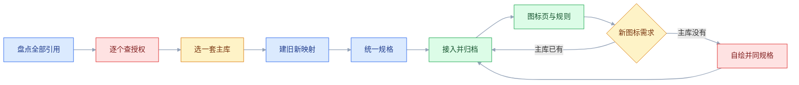
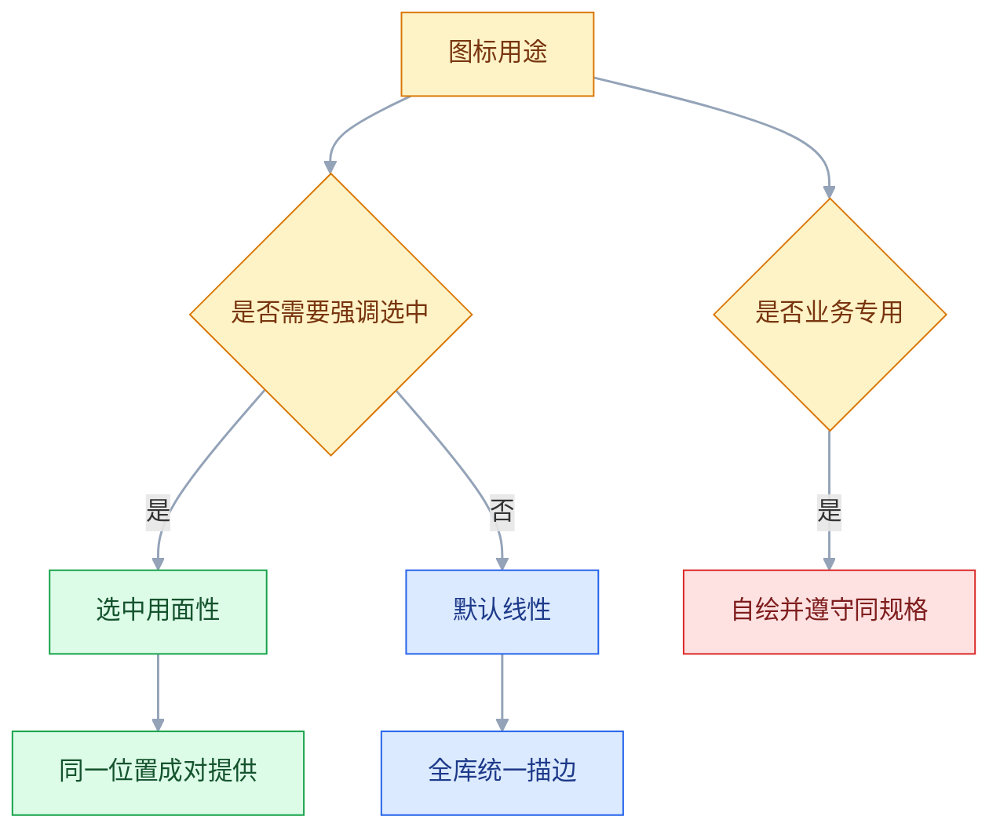

# 图标与插画

## 一、工程案例：把 180 个来源混乱的图标收成一套可交付资产

**场景**：一个运营了两年的 SaaS 后台，图标来自三个时期：早期从素材站下载的线性图标、一次改版引入的面性图标、开发临时用 emoji 顶替的状态图标。同一个页面里出现 4 种描边粗细、3 种风格、2 种尺寸，法务在版权审查时还发现部分素材授权不明。

**约束**：

| 约束 | 具体内容 | 影响 |
|---|---|---|
| 时间 | 两周内完成替换 | 不能逐个重画，只能选现成库 |
| 授权 | 必须可商用、可修改、允许闭源分发 | 排除仅限个人使用、要求界面署名的素材 |
| 技术栈 | React + SVG Sprite | 图标必须能被 `currentColor` 着色 |
| 覆盖面 | 现有 180 个图标，含 12 个业务专用图形 | 通用图标换库，专用图形自绘 |
| 兼容 | 需要支持深色模式 | 不允许导出多套配色 |

**开工前先明确一件事**：这次治理的目标不是「好看」，而是「可控」——可维护、可授权、可无障碍、可随主题变色。目标不同，取舍就不同：为了可控，可以接受个别图标造型略有变化；为了好看，就会陷入无穷的微调。

七步依次往下，不要跳步：授权没查清就选库，等于把风险带进规格；规格没定就接入，等于把返工留到上线前。



### 1.1 第一步：盘点，而不是先选库

把代码里所有图标用法扫出来，形成清单。清单至少包含五个字段：

| 字段 | 示例 | 用途 |
|---|---|---|
| 名称 | `arrow-left` | 去重、映射 |
| 使用位置 | 详情页返回、弹层关闭 | 判断语义是否一致 |
| 当前来源 | 素材站 / 面性库 / emoji | 授权风险 |
| 尺寸 | 16 / 20 / 24 | 规格收敛 |
| 是否可点 | 是（按钮）/ 否（装饰） | 无障碍处理 |

扫描范围以代码为准，不能只数设计稿：让开发按「图标组件名、内联 `<svg>`、图片路径、邮件模板」四条线索各检索一次，把命中位置贴回表格。只对着设计稿数，一定会漏掉藏在弹窗、空态和邮件里的图标。

盘点结果：180 个引用，去重后 142 个图形，其中 23 个是同一语义的重复（返回键有 4 个版本，关闭有 3 个版本），12 个是业务专用（如「工单池」「排班表」），其余 107 个是通用图标。

**这一步的产出比选库更重要**：不盘点就换库，会漏掉藏在弹窗、空态、邮件模板里的图标。

### 1.2 第二步：授权审查

| 来源 | 风险 | 处理 |
|---|---|---|
| 素材站免费下载 | 多数仅限个人使用，或要求署名 | 全部替换 |
| 某次改版引入的面性库 | 需确认具体许可证 | 查仓库 LICENSE 与引入记录 |
| emoji | 字形由平台字体渲染，不能当资产分发 | 替换为 SVG |
| 合作方提供的 logo | 商标授权与图标库无关，范围常被忽略 | 单独记录渠道、时长、地区 |
| 自绘图形 | 归属清晰 | 保留，统一规格 |

**判定标准**：可商用、可修改、允许闭源分发；署名要求要分两种——「必须在界面上署名」不接受，「在分发物里保留许可声明」（MIT、ISC 一类）照做即可。缺一条就不能进产品。**许可证要跟着资产一起存档**，不要只记在某个人的聊天记录里；具体条款以官方许可为准。

### 1.3 第三步：选一套库，而不是拼一套

| 候选 | 风格 | 覆盖 | 许可 | 结论 |
|---|---|---|---|---|
| Lucide | 线性，24 画布，1.5–2 描边 | 通用覆盖好 | ISC | ✅ 主库 |
| Heroicons | 线性 + 面性成对 | 通用 | MIT | 备选 |
| Tabler | 线性，数量多 | 通用 | MIT | 备选 |
| Material Symbols | 可变字重 | 通用 | Apache 2.0 | 与现有视觉不符 |
| 品牌自绘 | 任意 | 仅业务图形 | 自有 | 补充 12 个专用图形 |

选择依据排序：**风格统一 > 授权清晰 > 覆盖够全 > 持续维护**。数量多不是优势，混两套库等于回到起点。表里的许可是常见情况，落库前仍要打开官方 LICENSE 核对一遍，以官方许可为准。

### 1.4 第四步：建立映射表

142 个图形逐个映射，映射表是这次交付的核心文档：

| 旧名称 | 新名称 | 处理 | 备注 |
|---|---|---|---|
| `back` | `arrow-left` | 替换 | 4 个版本统一 |
| `close` | `x` | 替换 | 3 个版本统一 |
| `del` | `trash-2` | 替换 | 语义更准确 |
| `success` | `circle-check` | 替换 | 原为 emoji |
| `workorder-pool` | `workorder-pool` | 自绘 | 业务专用 |
| `schedule` | `calendar-days` | 替换 | 通用语义 |
| `loading` | `loader-circle` | 替换 | 配合旋转动画 |

**语义优先于造型**：旧图标叫 `del`，新库里对应的可能是 `trash-2` 而不是 `x`。按「这个图标要表达什么」映射，不按「长得像什么」。

### 1.5 第五步：统一规格

| 维度 | 规定 | 说明 |
|---|---|---|
| 画布 | 24×24 | 全库统一，viewBox 固定 |
| 图形占位 | 20×20，四周留 2 | 保证不同形状视觉等大 |
| 描边 | 1.5（24 画布） | 线性图标统一 |
| 端点 | round | 圆角端点 |
| 拐角 | round | 圆角连接 |
| 尺寸档位 | 16 / 20 / 24 | 只允许三档 |
| 颜色 | `currentColor` | 跟随文字，天然适配深色 |
| 导出 | SVG，保留 stroke 属性 | 轮廓化后无法再调粗细与颜色 |

```html
<svg viewBox="0 0 24 24" fill="none" stroke="currentColor"
     stroke-width="1.5" stroke-linecap="round" stroke-linejoin="round"
     aria-hidden="true">
  <path d="M..."/>
</svg>
```

**为什么只用三档尺寸**：16 用于紧凑表格与标签，20 用于按钮与输入框，24 用于导航与独立操作。档位越多，视觉越乱，维护成本越高。

**不要顺手轮廓化**：把描边转成填充只适合印刷或用在不接受 stroke 的第三方场景。图标一旦轮廓化，`stroke-width` 和 `currentColor` 的描边颜色都失效，等于退回「每个颜色单独导一套」。

### 1.6 第六步：接入与资产组织

```text
assets/
├── icons/
│   ├── navigation/arrow-left.svg
│   ├── action/trash-2.svg
│   ├── status/circle-check.svg
│   └── business/workorder-pool.svg
├── illustrations/
│   ├── empty/empty-workorder.svg
│   ├── error/error-network.svg
│   └── guide/guide-approval.svg
└── logos/
    └── logo-horizontal.svg
```

| 接入方式 | 优点 | 缺点 | 采用 |
|---|---|---|---|
| 内联 SVG | 可用 `currentColor`，无额外请求 | HTML 体积增大 | ✅ 单图标 |
| SVG Sprite | 一次加载，复用 | 需要构建配置 | ✅ 高频图标 |
| `` | 简单、可缓存 | 不能用 CSS 改色 | 仅插画 |
| 图标字体 | CSS 可控 | 无障碍差、渲染不一致 | ❌ |

**命名规则**：`语义-变体`，小写 + 连字符。`arrow-left`、`circle-check`、`trash-2`。**禁止** `icon1`、`未命名-2`、`组 12`。

### 1.7 第七步：建图标页与使用规则

做一个内部页面，把全部图标按类别铺开，每个图标可复制名称、可切尺寸与颜色。作用有三个：设计查重、开发取用、评审对照。

规则写进团队文档，只留五条：

```text
1. 新增图标必须来自主库，缺失的先提需求再自绘
2. 尺寸只用 16 / 20 / 24，不写任意值
3. 颜色一律 currentColor，不写死 hex
4. 图标按钮必须有可读名称，装饰图标对读屏隐藏
5. 自绘图形需与主库同画布、同描边、同端点
```

### 1.8 关键产出物

**① 规格表**：画布、占位、描边、端点、尺寸档位、颜色策略。

**② 映射表**：142 条旧→新对照，含处理方式与备注。

**③ 资产目录**：`icons / illustrations / logos` 三层，命名规则固定。

**④ 验收表**：

| # | 检查项 | 怎么验 | 通过标准 |
|---|---|---|---|
| 1 | 来源唯一 | 搜代码里的 svg 引用与 import | 全部指向主库或自绘目录 |
| 2 | 授权可查 | LICENSE 与资产同目录 | 每个来源都有许可证记录 |
| 3 | 规格统一 | 抽查 20 个 SVG 的 viewBox 与 stroke-width | 全部 24 画布、1.5 描边 |
| 4 | 视觉等大 | 把抽查的 20 个图标叠在 20×20 活动区网格上 | 均未超出活动区：圆形直径 20、方形 18，并排无单个突兀 |
| 5 | 小尺寸可辨 | 缩到 16px 看 | 关键特征仍可识别 |
| 6 | 颜色跟随 | 切换深色模式 | 图标自动变浅，无残留黑块 |
| 7 | 无硬编码颜色 | 搜 `fill="#` / `stroke="#` | 结果为 0 |
| 8 | 可点区域 | 真机点图标按钮 10 次 | 10 次全中，热区 ≥ 44 |
| 9 | 无障碍 | 读屏遍历页面 | 按钮读出名称，装饰图标不读 |
| 10 | 体积 | 构建产物里统计单图标与整包 | 单图标 ≤ 2KB，首屏图标包 ≤ 30KB |
| 11 | 无 emoji 图标 | 搜 emoji 字符与图片引用 | 界面内无 emoji 充当图标 |
| 12 | 业务图形一致 | 12 个自绘图形并排看 | 与主库同风格，不突兀 |

> 第 7 项最容易被忽略：设计工具导出时经常带 `fill="#000"`，深色模式下图标直接消失。交付前必须统一替换为 `currentColor`。

---

## 二、高频问答：会卡住你的地方，也是面试最常问的

### 2.1 同一个页面里图标粗细、风格都不一样

**现场**

把图标并排放在 24px 网格上，量 viewBox 与 stroke-width。

**要点**

- 图标来自多套库，画布、描边、端点、视角本就不同，局部调整无法统一。
- 调一个像了，换一个又不像，最后每改版一次重来一次。
- 只保留一套主库，缺失的自绘并遵守同一规格。

**追问**

- 为什么逐个调描边不行？→ 底层画布和视角不同，调不出统一。
- 主库怎么选？→ 风格统一 > 授权清晰 > 覆盖够全 > 持续维护。
- 自绘图要注意什么？→ 同画布、同描边、同端点。

### 2.2 用 emoji 当图标，不同手机上长得完全不一样

**现场**

同一页面在 iOS、Android、Windows 各截一张图对比。

**要点**

- emoji 由系统字体渲染，造型随平台不同，且无法控制颜色与描边。
- 把「跨平台不一致」当成「风格活泼」，是把问题看反了。
- 界面图标改为 SVG；emoji 只能出现在用户输入的文本内容里。

**追问**

- 为什么 emoji 不能当资产分发？→ 字形由平台字体渲染，不是你的资产。
- 能统一 emoji 外观吗？→ 不能，各平台字体不同。
- 那 emoji 还能用在哪？→ 用户输入内容里。

### 2.3 图标放大后描边变得很粗

**现场**

把同一图标分别渲染到 16 / 24 / 48，量实际描边像素。

**要点**

- SVG 等比缩放时描边一起放大，24px 的 1.5 描边到 48px 就变成 3。
- 大尺寸再画一套细描边，维护两套会不同步。
- 大尺寸展示改用插画；必须放大时用 `vector-effect="non-scaling-stroke"` 或重绘。

**追问**

- 缩到 16 为什么还清晰？→ 24 画布 1.5 描边缩到 16 实际约 1px。
- 缩到 12 以下呢？→ 会糊，应改用更简化的图形。
- 非等比缩放呢？→ 描边也会变形，不建议。

### 2.4 图标单独出现，用户看不懂是什么

**现场**

遮住文字，找 5 个没参与设计的用户猜每个图标的意思，记录猜错的比例。

**要点**

- 图标擅长表达「物体」，很难表达「动作」与「范围」，同一个图形在不同产品里含义不同。
- 把「自己看熟了」当成「用户认识」是常见误判。
- 主操作和导航配文字标签；纯图标只留给约定俗成的少数动作。

**追问**

- 哪些图标可以不配文字？→ 关闭、搜索、返回这类约定俗成的。
- 约定俗成的边界是什么？→ 跨产品、跨平台都基本一致。
- 纯图标还要补什么？→ 可访问名称。

### 2.5 图标按钮点了没反应，其实是没点中

**现场**

真机连点 10 次，记录失败次数；看元素盒模型尺寸。

```css
.icon-btn { display: inline-flex; padding: 10px; }
.icon-btn svg { width: 24px; height: 24px; }
```

**要点**

- 图标 24px，热区也是 24px，手指精度不够。
- 把图标画大解决不了点击问题，还会破坏视觉节奏。
- 热区单独撑开，视觉尺寸不变。

**追问**

- 热区多大合适？→ ≥ 44×44。
- 先怀疑事件绑定吗？→ 先排热区，再怀疑绑定。
- 撑开热区用 padding 还是 margin？→ padding，margin 不进可点区域。

### 2.6 导出的 SVG 一个好几 KB，整包很大

**现场**

打开 SVG 看源码，是否有 `<metadata>`、`id="图层_2"`、十几位小数。

**要点**

- 体积大通常不是图标多，是导出带了编辑器元数据、图层名、隐藏元素和高精度路径。
- 删图标是砍功能，不是优化。
- 用 SVGO 压缩，通常能减 30–60%；路径精度保留 2 位足够。

**追问**

- 压缩会坏图形吗？→ 不要手工改路径，用工具处理。
- 路径精度留几位？→ 2 位。
- 还有什么占体积？→ 隐藏图层、图层名、metadata。

### 2.7 用 `` 引入 SVG，深色模式下图标是黑的

**现场**

切深色模式，看图标是否保持黑色。

**要点**

- `` 是独立文档上下文，外部 CSS 无法影响内部 `fill`。
- 再做一套白色图标会不同步，还增加体积。
- 需要变色的图标用内联 SVG 或 Sprite，颜色写 `currentColor`。

**追问**

- `` 适合放什么？→ 插画、logo 这类不需要变色的。
- Sprite 怎么变色？→ 同样用 `currentColor` 继承父级颜色。
- 图标字体行不行？→ 无障碍差、渲染不一致，不推荐。

### 2.8 一组图标里总有一两个看起来特别大或特别小

**现场**

并排放在同一画布，眯眼看哪个「更重」。

**要点**

- 视觉面积与包围盒不等价：圆形显得小、方形显得大，细长形更显瘦。
- 按包围盒对齐只解决了几何尺寸，没解决视觉重量。
- 圆形略放大、方形略缩小，做视觉补偿。

**追问**

- 具体怎么补？→ 方形画到约 18×18，圆形约 20×20。
- 靠数值还是靠眼睛？→ 眼睛优先，眯眼能过滤细节。
- 还有哪种形状难处理？→ 三角形、细长形、不对称形按视觉重心。

### 2.9 空状态插画占了大半屏，用户找不到按钮

**现场**

手机上看首屏，主按钮是否在折叠线以上。

**要点**

- 插画尺寸过大，抢了主操作的位置与注意力。
- 空态的核心是「说明 + 下一步」，插画只是辅助。
- 插画宽度控制在 120–200px，主按钮紧随其后。

**追问**

- 空态三段式是什么？→ 说明现状 + 说明价值 + 下一步动作。
- 空态用哪类插画？→ 功能型，不用叙事型。
- 手机上空态整体要求？→ 首屏内可见。

### 2.10 产品里三张插画明显不是同一个人画的

**现场**

把插画并排，比较主色数量、是否有描边、透视方式。

**要点**

- 插画没有统一的色板、线条、透视与人物风格，来源不同。
- 单张替换只会引入第四种风格。
- 先定插画模板（色板 + 线条 + 透视），再按模板重做或统一改色。

**追问**

- 模板要固定哪些维度？→ 线条、色板、人物、透视、质感、圆角。
- 色板几种？→ 3–5 色，与品牌一致。
- 没有母版会怎样？→ 每找一次素材就多一种风格。

### 2.11 图标按钮读屏只念「按钮」

**现场**

用读屏遍历，听按钮名称。

```html
<button aria-label="搜索"><svg aria-hidden="true">...</svg></button>
```

**要点**

- `title` 不是可靠的无障碍名称来源，部分读屏不读。
- 它更多是鼠标悬停提示，不能替代可访问名称。
- 用 `aria-label`，装饰性 SVG 加 `aria-hidden="true"`。

**追问**

- 图标 + 文字呢？→ 图标隐藏，文字提供语义，避免重复朗读。
- 焦点会停在 SVG 上吗？→ 旧浏览器会，加 `focusable="false"`。
- 装饰图标怎么处理？→ `aria-hidden="true"`。

### 2.12 16px 下图标糊成一团，认不出是什么

**现场**

缩到 16px 截图，让没看过的人猜含义。

**要点**

- 图标细节过多，缩小后笔画粘连；描边加粗只会更糊。
- 加粗牺牲了负空间，不是解法。
- 小尺寸用简化版图标，减少内部细节；或改用「图标 + 文字」。

**追问**

- 尺寸变化能直接缩放同一个 SVG 吗？→ 不能，小尺寸用简化版，大尺寸可加细节。
- 缩到多少会糊？→ 12 以下，16 时要看细节量。
- 尺寸有哪几档？→ 16 / 20 / 24 三档。

### 2.13 上线前才发现有图标来路不明

**现场**

逐个资产问「从哪来、许可是什么、谁引入的」，答不上来的就是风险。

**要点**

- 素材站的免费下载常只授权个人使用或要求署名，来源没记录事后无法追溯。
- 把「能下载」当成「能商用」是最大的授权误区。
- 来源不明的全部替换；新资产入库时同时提交来源链接与许可文件。

**追问**

- 授权检查哪四项？→ 可商用、可修改、允许闭源分发、署名形式。
- 界面署名能接受吗？→ 不接受；要求在分发物里保留许可声明的可以。
- 商标跟着图标库授权吗？→ 不，第三方 logo 要单独记录渠道、时长、地区。

---

## 三、核心知识：从零开始要建立的东西

### 3.1 图标的符号属性

图标是「用最少笔画指代一个概念」的符号。它的有效性取决于三件事：**可辨识、可区分、可学习**。

| 属性 | 含义 | 失败表现 |
|---|---|---|
| 可辨识 | 缩小后仍能认出 | 16px 糊成一团 |
| 可区分 | 同类图标之间不混淆 | 两个图标看起来一样 |
| 可学习 | 用户见过一次能记住 | 每次都要看文字 |

**抽象概念最难表达**：设置、更多、分析、集成这类词没有具体形象，只能靠约定俗成（齿轮、三点、柱状图、拼图）。**约定优先于创意**，自创符号的学习成本很高。

约定还分平台：竖三点在 Android 是「更多」，在 iOS 更接近「菜单」；横三点多表示「更多操作」。同一产品里混着用，用户会以为它们不是一个功能。

### 3.2 线性与面性

| 类型 | 特征 | 适用 | 视觉重量 |
|---|---|---|---|
| 线性 | 描边，内部留白 | 导航、工具栏、次级操作 | 轻 |
| 面性 | 填充实心 | 选中态、强调、小尺寸 | 重 |
| 双色 | 两色描边或填充 | 功能区分、品牌表达 | 中 |
| 彩色 | 多色 | 特定业务、插图式图标 | 重 |



**最稳的组合**：默认线性，选中切面性。选中态需要更强的视觉重量，面性天然满足；两套图形必须成对设计，不能拿线性图标直接填色。

> **面试**：常问「图标默认用线性还是面性？」答：默认线性，选中切面性，两套要成对设计而不是直接填色。

### 3.3 画布、网格与安全区

| 概念 | 规格 | 作用 |
|---|---|---|
| 画布 | 24×24 | 所有图标统一尺寸 |
| 活动区 | 20×20 | 图形实际占位 |
| 安全边距 | 2 | 防止描边贴边被裁 |
| 网格 | 1px 或 2px | 对齐关键点 |
| 关键线 | 中心线、对角线 | 保证对称与比例 |

```text
┌─ 24 ──────────────┐
│  ┌─ 20 ────────┐  │
│  │             │  │  2px 安全边距
│  │   图形区    │  │
│  │             │  │
│  └─────────────┘  │
└───────────────────┘
```

**为什么留边距**：不同形状的视觉边界不同，圆形和尖角如果画到画布边缘，会显得比方形大，且在不同容器里被裁切。

### 3.4 视觉补偿

几何尺寸相同，视觉重量不同。

| 形状 | 处理 | 原因 |
|---|---|---|
| 方形 | 画到 18×18 左右 | 视觉面积最大 |
| 圆形 | 画到 20×20 左右 | 圆比同宽方形显小 |
| 三角形 | 略放大，重心下移 | 尖角显轻，底部显重 |
| 细长形 | 保持高度，适当加宽 | 避免显瘦 |
| 不对称形 | 按视觉重心居中，不按包围盒 | 包围盒居中会偏 |

**验证方法**：并排看 + 眯眼 + 缩到 16px。眯眼能过滤细节，只留下视觉重量。**不要靠数值对齐**，眼睛的判断优先。

> **面试**：常问「几何尺寸一样，为什么两个图标看起来不一样大？」答：视觉面积和包围盒不等价，要按视觉重量做补偿。

### 3.5 描边、端点与拐角

| 属性 | 常用值 | 影响 |
|---|---|---|
| `stroke-width` | 1.5 / 2（24 画布） | 整体重量 |
| `stroke-linecap` | round / butt | 线端圆润或平齐 |
| `stroke-linejoin` | round / miter | 拐角圆润或尖锐 |
| 描边对齐 | 居中（SVG 没有内外对齐属性） | 内外对齐需用双路径或 mask 模拟 |

**一致性检查**：随机抽 10 个图标，看端点是否都是圆的、拐角是否都圆、描边宽度是否一致。混用端点会让整组图标显得「毛躁」。

**内外描边是工具行为**：Illustrator、Figma 里的内描边/外描边导出成 SVG 后会回到居中，视觉位置会变。需要固定外观时，把描边转成路径，或叠两层路径模拟。

**描边与尺寸的关系**：24 画布用 1.5，缩到 16 时实际描边约 1px，仍然清晰；缩到 12 以下就会糊，这时应改用更简化的图形，而不是继续缩。

### 3.6 尺寸档位

| 档位 | 用途 | 热区 |
|---|---|---|
| 16 | 表格、标签、紧凑列表 | ≥ 44 |
| 20 | 按钮、输入框前缀、菜单 | ≥ 44 |
| 24 | 导航、独立操作、工具栏 | ≥ 44 |
| 32+ | 空态、功能入口（偏插画） | 按容器 |

**档位越少越统一**。允许任意尺寸，就会出现 18、22、26 混用，视觉上无法对齐。**尺寸变化时不要缩放同一个 SVG**：小尺寸用简化版，大尺寸可增加细节。

### 3.7 图标库与授权

| 库 | 风格 | 许可 | 备注 |
|---|---|---|---|
| Lucide | 线性，统一 | ISC | 可商用、可修改 |
| Heroicons | 线性 + 面性成对 | MIT | 与 Tailwind 配套 |
| Tabler | 线性，数量多 | MIT | 覆盖广 |
| Phosphor | 多字重 | MIT | 适合需要粗细变化 |
| Material Symbols | 可变字重 | Apache 2.0 | 与 Material 体系一致 |
| Iconify | 聚合多库 | 各自许可 | 便于跨库检索，仍需逐个确认 |

**授权检查四项**：可商用、可修改、允许闭源分发，第四项看署名要求的形式——要求界面署名的不接受，要求在分发物里保留许可声明的（MIT、ISC 一类）照做即可。具体条款以官方许可为准。**「免费」不等于「可商用」**，素材站的免费下载经常只授权个人使用。

**商标不随图标库授权**：库的许可只覆盖图形本身，不覆盖第三方品牌 logo。合作方 logo 的使用渠道、时长、地区要单独记录，否则换一套图标库也解决不了。

**引入方式**：锁版本、随仓库提交 SVG、记录来源与许可证。不要依赖 CDN 的「最新版」，图标改名或删除会直接让界面空白。

### 3.8 SVG 的四种接入方式

| 方式 | 改色 | 缓存 | 体积 | 适用 |
|---|---|---|---|---|
| 内联 `<svg>` | ✅ `currentColor` | 随 HTML | HTML 变大 | 单次使用、需变色 |
| SVG Sprite | ✅ | ✅ | 一次加载 | 高频复用 |
| `` | ❌ | ✅ | 独立请求 | 插画、logo |
| CSS `background` | ❌（可用 mask） | ✅ | 独立请求 | 装饰背景 |
| 图标字体 | ✅（颜色） | ✅ | 字体文件 | 不推荐 |

```html
<!-- Sprite 用法 -->
<svg aria-hidden="true"><use href="/sprite.svg#arrow-left" /></svg>
```

**Sprite 的坑**：`<use>` 引用的样式作用域、`currentColor` 继承、跨域加载限制，都需要在构建层处理。团队规模小的时候，内联 + 构建时按需引入更省心。

> **面试**：常问「SVG 有哪几种接入方式，什么时候用哪种？」答：内联和 Sprite 能用 `currentColor` 变色，`` 和背景适合插画、logo。

### 3.9 `currentColor` 与主题

```css
.icon { color: var(--color-text-secondary); }
.icon--active { color: var(--color-primary); }
```

图标不写 `fill` / `stroke` 的具体颜色，统一用 `currentColor`，颜色由父级文字色决定。

| 场景 | 做法 |
|---|---|
| 深色模式 | 文字色变，图标自动跟随 |
| 状态色 | 父级设 `color`，图标继承 |
| 禁用态 | 父级降透明度或换次要色 |
| 多色图标 | 不能用 `currentColor`，需单独管理 |

**多色图标要单独处理**：品牌 logo、彩色业务图标不适合 `currentColor`，应作为独立资产，不参与主题变色。

### 3.10 图标的可访问性

| 场景 | 做法 | 原因 |
|---|---|---|
| 纯装饰 | `aria-hidden="true"` | 避免读屏念出无意义内容 |
| 图标按钮 | `aria-label="搜索"` | 提供可访问名称 |
| 图标 + 文字 | 图标隐藏，文字提供语义 | 避免重复朗读 |
| 状态图标 | 必须有文字或形状差异 | 不能只靠颜色 |
| 可点图标 | 热区 ≥ 44×44 | 触摸精度 |

```html
<button type="button" aria-label="关闭">
  <svg aria-hidden="true" focusable="false">...</svg>
</button>
```

**`focusable="false"`**：IE/旧版 Edge 会把 SVG 放进 Tab 序列，加上可以避免焦点停在图标上。现代浏览器影响很小，但成本为零。

> **面试**：常问「图标按钮怎么让读屏读出名称？」答：按钮加 `aria-label`，里面的装饰 SVG 加 `aria-hidden="true"`。

### 3.11 插画的三种类型

| 类型 | 特征 | 适用 | 尺寸 |
|---|---|---|---|
| 功能型 | 几何、简洁、低饱和 | 空态、错误页、引导 | 120–200 |
| 叙事型 | 有角色、有场景 | 落地页、功能介绍 | 300–600 |
| 装饰型 | 抽象图形、纹理 | 背景、分隔、页头 | 视容器 |

**空态用功能型**：空态要传达「这里现在没有内容，但可以有」，不需要讲故事。叙事型插画放在空态里，会显得喧宾夺主。

### 3.12 空状态插画

| 空态类型 | 插画内容 | 文案 | 主操作 |
|---|---|---|---|
| 首次使用 | 与功能相关的物件 | 「还没有工单」 | 「创建第一个」 |
| 搜索无结果 | 放大镜、空盒子 | 「没有找到相关结果」 | 「清除筛选」 |
| 全部完成 | 完成标记 | 「都处理完了」 | 「返回列表」 |
| 加载失败 | 断线、感叹号 | 「加载失败」 | 「重试」 |
| 无权限 | 锁、门 | 「没有访问权限」 | 「申请权限」 |

**三段式**：说明现状 + 说明价值 + 下一步动作。缺一段，用户就会停在空页面上。

**尺寸与位置**：插画在上，文案在中，按钮在下；插画宽度不超过容器的一半，手机上空态整体应在首屏内可见。

**替代文本**：装饰性插画给 `alt=""`（或对容器 `aria-hidden`），信息性插画用 `alt` 概括它传达的内容；不要把插画里的文字再念一遍。

**深色模式**：浅色插画在深色底上会发亮刺眼，交付时一并给深色版，或统一降亮度并保留透明背景。

### 3.13 插画的风格系统

| 维度 | 需要统一 | 常见问题 |
|---|---|---|
| 线条 | 有无描边、粗细 | 一张有描边一张没有 |
| 色板 | 3–5 色，与品牌一致 | 每张都是不同色系 |
| 人物 | 有无人物、比例、肤色处理 | 一张扁平一张立体 |
| 透视 | 正面 / 等距 / 自由 | 同一页面两种透视 |
| 质感 | 扁平 / 渐变 / 噪点 | 混用导致廉价感 |
| 圆角 | 统一圆角半径 | 有的尖锐有的圆润 |

**做法**：先做一个「母版」——固定画布、色板、线条、人物比例，新插画在母版上改内容。**没有母版，每找一次素材就多一种风格。**

### 3.14 格式与体积

| 格式 | 适用 | 体积 | 注意 |
|---|---|---|---|
| SVG | 几何插画、图标 | 小，可压缩 | 复杂路径会变大 |
| WebP | 复杂插画、带纹理 | 中 | 兼容性好 |
| AVIF | 高压缩 | 最小 | 需确认目标浏览器 |
| PNG | 需要透明且兼容老环境 | 大 | 提供 2x |
| Lottie | 动效插画 | 小–中 | 复杂动画仍需优化 |

**体积预算**：单图标 ≤ 2KB，空态插画 ≤ 50KB，首屏插画 ≤ 100KB。超过就说明有冗余路径或位图尺寸过大。

**SVG 优化**：去掉元数据、合并路径、降低小数精度、删除隐藏图层。**不要手工改路径**，用工具处理，避免破坏图形。

### 3.15 资产组织与命名

```text
icons/
├── navigation/arrow-left.svg
├── action/trash-2.svg
├── status/circle-check.svg
└── business/workorder-pool.svg

illustrations/
├── empty/empty-workorder.svg
├── error/error-network.svg
└── guide/guide-approval.svg
```

| 规则 | 示例 | 反例 |
|---|---|---|
| 小写 + 连字符 | `arrow-left` | `ArrowLeft`、`arrow_left` |
| 语义优先 | `circle-check` | `green-tick-2` |
| 不带尺寸与颜色 | `search` | `search-24-black` |
| 业务图标单独目录 | `business/` | 混在通用目录里 |
| 变体用后缀 | `trash-2`、`user-round` | `trash-new-final` |

**目录即分类**：导航、操作、状态、业务四类足够。分类过细会让「这个图标该放哪」变成每次都要讨论的问题。

**logo 不是图标**：不可改色、不可拉伸、不可裁切，四周留白区按品牌规范；单独目录、单独授权记录。混进图标目录，迟早会被某个「统一改色」的脚本改掉。

### 3.16 图标与文字并排

| 问题 | 做法 | 原因 |
|---|---|---|
| 高低不齐 | flex 居中，不靠 `vertical-align` | 文字有行高与基线，图标是盒模型 |
| 间距过紧 | 间距随字号走，正文常用 6–8px | 固定 8px 在 12px 字号下会显得空 |
| 光学偏移 | 按视觉重心对齐，不按包围盒 | 尖角与不对称图形的几何中心偏 |
| 状态缺失 | 默认 / hover / active / disabled 四态都有 | 只有 hover，触摸端等于没有反馈 |

**`vertical-align: middle` 不可靠**：它按基线加半个 x-height 计算，字号一变偏移量就变。图标与文字同排时用 flex，别在行内对齐上反复试数值。

### 3.17 图标评审

| 检查项 | 方法 | 通过标准 |
|---|---|---|
| 一致性 | 全部铺开并排 | 描边、端点、视角统一 |
| 辨识度 | 缩到 16px | 关键特征仍可辨认 |
| 区分度 | 同类图标两两对比 | 不混淆 |
| 视觉重量 | 眯眼看 | 无明显偏重/偏轻 |
| 语义准确 | 遮住文字猜含义 | 多数人能猜对 |
| 主题适配 | 切深色模式 | 无黑块、无消失 |
| 无障碍 | 读屏遍历 | 名称正确、装饰不读 |
| 体积 | 构建产物统计 | 在预算内 |

**评审用真实界面，不用图标墙**。图标墙上看都挺整齐，放回 16px 的表格里才发现糊。**最终判断永远在真实上下文里。**

---

## 四、冷门知识汇总

| 知识点 | 为什么冷门 | 用到时的关键词 |
|---|---|---|
| 图标在 flex 里被压扁 | 空间不够时才显形，平时看不出 | `flex-shrink: 0`、宽高比 |
| `vector-effect` | 只有放大图标时才需要保持描边 | `non-scaling-stroke`、缩放 |
| 轮廓化描边 | 导出前的一步，平时不关注 | Outline Stroke、路径化 |
| `focusable="false"` | 旧浏览器遗留问题，现代项目很少提 | SVG 焦点、Tab 序列 |
| SVG Sprite 的跨域 | 本地开发正常，部署后 `<use>` 失效 | CORS、`use href`、同源 |
| `currentColor` 的继承链 | 颜色不对时才发现它继承的是父级 | 继承、`color`、伪元素 |
| `fill-rule` | 挖空图形（如圆环）渲染反了才查 | `evenodd`、`nonzero`、镂空 |
| 路径精度 | 小数位过多导致体积翻倍 | SVGO、`precision`、路径 |
| `viewBox` 与 `width` | 只改 width 不改 viewBox 会裁切 | 缩放、裁切、比例 |
| 图标字体的私用区 | 读屏乱码时才追到 | PUA、`aria-hidden`、字体 |
| 多色图标与主题 | 少数业务图标不能跟随变色 | 品牌色、独立资产、深色 |
| 半像素对齐 | 1.5 描边落在半像素上会发虚 | `shape-rendering`、对齐 |
| `shape-rendering` | 图标发虚时才查 | `crispEdges`、`geometricPrecision` |
| 插画的母版 | 没有母版就会不断引入新风格 | 色板、线条、人物比例 |
| Lottie 的 JSON 体积 | 以为矢量一定小 | 关键帧、`lottie-web`、降采样 |
| 位图图标的 2x/3x | SVG 普及后很少遇到 | DPR、`srcset`、模糊 |
| 字体的图标替代 | 有时用字符（×、←）更轻 | Unicode、字体差异、基线 |
| 加载图标的旋转 | 不同实现的转速与方向不一致 | `animate-spin`、1s、linear |
| 插画的本地化 | 人物、手势、服饰有文化差异 | 地域、审校、通用符号 |
| 图标的版本升级 | 库升级后图形悄悄变化 | 锁版本、视觉回归、变更记录 |
