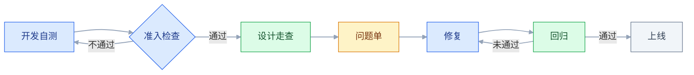
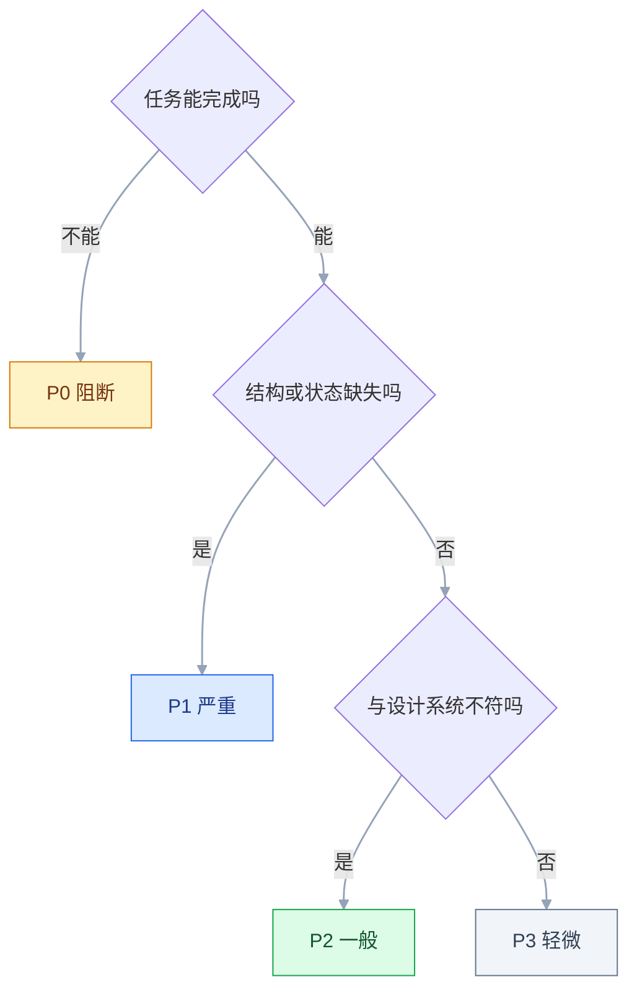

# 设计评审与走查

## 一、工程案例：组织一次上线前的设计走查并推动修复

**场景**：订单中心改版，涉及 12 个页面（订单列表、订单详情、退款申请、退款审核、发货、物流、发票、售后记录等），前端已提测，计划 5 天后上线。设计只有 1 人，前端 3 人，测试 2 人。上次改版上线后视觉与交互问题集中爆发，这次要求「上线前一次走完，问题闭环」。

**约束**：

| 约束 | 具体内容 | 影响 |
|---|---|---|
| 时间 | 提测后、上线前，只有 3 个工作日 | 不能全量细查，必须分批 |
| 人力 | 设计 1 人、前端 3 人、测试 2 人 | 走查不能只靠设计 |
| 环境 | 测试环境数据是脱敏的旧数据 | 需要提前造边界数据 |
| 范围 | 12 个页面，含 4 个弹层流程 | 弹层必须单独看 |
| 标准 | 已有设计系统，但组件版本落后一版 | 部分偏差是系统问题，不是实现问题 |

**走查前必须确认的一件事**：这次走查「查什么、不查什么」。查：视觉还原、交互状态、边界与异常、文案。不查：功能逻辑正确性（归测试）、性能（归专项）、代码质量。范围不清，走查会变成「大家一起找 bug」，最后谁都不负责。

### 1.1 第一步：定走查时机与准入条件

走查不是越早越好，也不是越晚越好。正确的位置是「开发自测通过、提测冒烟通过」之后、「上线」之前——本案例里前端已提测，正好落在这个窗口。



**准入四条**（不满足就退回，不开始走查）：

| # | 条件 | 原因 |
|---|---|---|
| 1 | 主流程能走通 | 走不通时看的是半成品，问题会重复提 |
| 2 | 测试环境可登录、有权限 | 缺权限看不到部分状态 |
| 3 | 有真实或仿真数据 | 空数据看不出布局问题 |
| 4 | 构建版本号已确认 | 避免「修了但你看的是旧包」 |

### 1.2 第二步：分工与排期

12 个页面 / 3 天，不能一人全包。按「页面 + 关注点」切分：

| 批次 | 页面 | 主查人 | 关注点 | 时长 |
|---|---|---|---|---|
| D1 上午 | 列表、详情、筛选 | 设计 | 结构、间距、状态 | 3h |
| D1 下午 | 退款申请、退款审核 | 设计 + 前端 | 表单、弹层、校验 | 3h |
| D2 上午 | 发货、物流、发票 | 设计 | 信息层级、长文本 | 3h |
| D2 下午 | 售后记录、售后详情、空态、错误页 | 设计 + 测试 | 状态覆盖、异常 | 3h |
| D3 | 全量回归 | 设计 | 修复验证 | 4h |

上表 12 个页面按批次排完。**4 个弹层流程不单独占批次**，跟所属页面一起走，每个另加 15 分钟：弹层的打开方式、遮罩层、关闭与返回、键盘焦点，都要在弹层里单独看。

**每个页面 15–30 分钟**，复杂表单与弹层单独加时。**一次不超过 10 个页面**，超过后人会疲劳，后半天的问题数量与质量都会下降。

### 1.3 第三步：准备环境与数据

| 准备项 | 具体做法 | 不做的后果 |
|---|---|---|
| 真实数据 | 复制一批生产结构的数据，脱敏 | 空列表看不出间距与截断 |
| 边界数据 | 超长标题、0 条、1 条、1000 条、特殊字符 | 边界破版漏检 |
| 多角色账号 | 管理员、普通客服、只读、无权限 | 权限态缺失 |
| 多端环境 | 1440 桌面、768 平板、375 手机 | 只测一个宽度 |
| 浏览器 | Chrome + Safari（含 iOS） | 字体与滚动差异漏检 |
| 录屏工具 | 系统录屏或 DevTools 录制 | 问题无法复现 |

**边界数据清单**（造数时逐条勾）：

```text
□ 标题 60 个字符（中英混排）
□ 金额 0 / 0.01 / 9999999.99
□ 时间跨年、跨时区
□ 空列表、单条、1000 条
□ 图片加载失败
□ 超长备注 1000 字 + 换行
□ 特殊字符与 emoji
□ 已删除/已关闭等终态数据
```

### 1.4 第四步：按固定顺序走查

顺序错了，会在一堆像素问题里漏掉结构问题。

| 顺序 | 查什么 | 判断标准 |
|---|---|---|
| 1 结构 | 区块数量、相对位置、栅格对齐 | 与设计稿的信息层级一致 |
| 2 状态 | 加载、空、错误、无权限、禁用、已处理 | 每种状态都有界面 |
| 3 交互 | 点击、悬停、键盘、表单校验、返回 | 主路径与异常路径都能走通 |
| 4 数值 | 间距、字号、颜色、圆角、阴影 | 用的是 token，不是近似值 |
| 5 边界 | 超长文本、空数据、超多数据 | 不破版、不遮挡、不丢信息 |
| 6 响应式 | 1440 / 768 / 375 | 无横向滚动、无重叠 |
| 7 文案 | 与稿一致、无错别字、语气统一 | 术语前后一致 |

**先结构后数值的原因**：结构错了，间距调得再准也要重做。**先状态后交互的原因**：状态缺失是「没做」，交互不顺是「做得不好」，前者优先级更高。

### 1.5 第五步：写问题单

一条合格的问题单必须能被别人独立复现。复现所需的最小字段是八个（负责人、期限、状态在流转时补上，见 3.11）：

| 字段 | 示例 | 作用 |
|---|---|---|
| 编号 | `QA-017` | 追踪 |
| 位置 | 订单列表 / 表头 / 金额列 | 定位 |
| 现象 | 列宽 96，金额换行成两行 | 描述事实 |
| 期望 | 列宽 120，金额单行右对齐 | 给出标准 |
| 依据 | 设计稿 v3 / `--space-4` / 组件 `Table` | 可判定 |
| 级别 | P1 | 排期 |
| 环境 | Chrome 120 / 1440 / 测试环境 | 复现 |
| 证据 | 截图 + 录屏链接 | 佐证 |

**写法对比**：

```text
✘ 「这里间距不对」
✔ 「订单列表 / 表头单元格：当前 padding 12px，设计为 16px（--space-4）」

✘ 「颜色有点偏」
✔ 「状态标签 / 已完成：当前 #22C55E，应为 #16A34A（--color-success）」

✘ 「这个交互怪」
✔ 「点『驳回』应弹出底部抽屉（含常用理由），当前为居中弹窗（设计稿 v3 P12）」
```

**一条意见只写一个问题**。把「间距不对、颜色也偏、文案还错了」写进一条，修复时必然漏。

### 1.6 第六步：分级与定级会

| 级别 | 定义 | 例子 | 时限 |
|---|---|---|---|
| P0 阻断 | 核心任务无法完成、数据错误 | 提交按钮点不动、金额显示错 | 立即 |
| P1 严重 | 结构错误、状态缺失、明显可用性问题 | 空态没有、错误提示缺失 | 上线前 |
| P2 一般 | 间距、字号、颜色偏差 | padding 差 4px | 本迭代 |
| P3 轻微 | 1px 偏差、动效差 50ms | 圆角 8 vs 9 | 有空修 |

**定级会 30 分钟**，设计、产品、前端各一人。规则：

1. 设计先讲 P0/P1，P2/P3 只报数量。
2. 前端对每条给「修复成本」，成本高的换等效方案，不是直接删。
3. 争议条目由产品拍板，拍板依据是「是否影响用户完成任务」。
4. **不允许全部定 P0**，否则等于没有分级。

### 1.7 第七步：推动修复与回归

问题单进 issue 系统，不进聊天记录。每条有负责人、期限、状态。

| 状态 | 含义 | 谁改 |
|---|---|---|
| Open | 已确认，待修 | 前端 |
| In Progress | 修复中 | 前端 |
| Fixed | 已修，待回归 | 前端 |
| Verified | 回归通过 | 设计 |
| Won't Fix | 确认不改，需写明理由 | 产品 |

**回归只认「提出者确认」**。前端说「修好了」不算，设计在同一个环境、同一份数据下复看一遍才算。**回归要看待修列表，不要凭记忆**。

### 1.8 关键产出物

**① 走查问题单**（前 10 条示例）：

| 编号 | 位置 | 现象 | 期望 | 依据 | 级别 | 状态 |
|---|---|---|---|---|---|---|
| QA-001 | 列表 / 表头 | 金额列换行 | 单行右对齐，列宽 120 | 设计稿 v3 | P1 | Verified |
| QA-002 | 列表 / 空态 | 无空态，显示空白 | 插画 + 文案 + 创建按钮 | 设计稿 P8 | P1 | Verified |
| QA-003 | 详情 / 底部栏 | 按钮被浏览器底边裁 8px | 底部留 24 安全距离 | `--space-6` | P1 | Verified |
| QA-004 | 退款 / 弹层 | 居中弹窗，应为底部抽屉 | 改 BottomSheet | 设计稿 P12 | P1 | Verified |
| QA-005 | 表单 / 校验 | 失焦不校验，提交才报错 | 失焦即时校验 | 交互说明 | P2 | Verified |
| QA-006 | 列表 / 标签 | 成功色偏亮 | 改为 `--color-success` | token | P2 | Verified |
| QA-007 | 详情 / 长文本 | 1000 字备注撑破容器 | 限高 + 展开 | 边界规范 | P1 | Verified |
| QA-008 | 全局 / 字体 | Safari 下字重偏细 | 指定字重与字体栈 | 设计规范 | P2 | Won't Fix |
| QA-009 | 列表 / 排序 | 排序图标方向反了 | 升序向上 | 组件文档 | P1 | Verified |
| QA-010 | 移动端 / 筛选 | 抽屉关闭后列表回到顶部 | 保留滚动位置 | 交互说明 | P2 | Fixed |

**② 分级汇总表**：

| 级别 | 提出 | 修复 | 遗留 | 遗留原因 |
|---|---|---|---|---|
| P0 | 0 | 0 | 0 | — |
| P1 | 14 | 14 | 0 | — |
| P2 | 23 | 18 | 5 | 排期到下个迭代 |
| P3 | 10 | 4 | 6 | 不影响使用 |

**③ 验收表**：

| # | 检查项 | 怎么验 | 通过标准 |
|---|---|---|---|
| 1 | P0 清零 | 看待修列表 | 0 条 |
| 2 | P1 清零 | 看待修列表 | 0 条，或全部有书面豁免 |
| 3 | 每条可复现 | 按问题单的位置与环境重走 | 现象与描述一致 |
| 4 | 结构一致 | 对照设计稿看区块 | 数量、顺序、层级一致 |
| 5 | 状态齐全 | 逐个触发六种状态 | 都有界面，无白屏 |
| 6 | 边界不破版 | 用边界数据重走 | 无溢出、无重叠、无丢字 |
| 7 | 三档宽度 | 1440 / 768 / 375 | 无横向滚动 |
| 8 | 键盘可达 | 只用 Tab 走主流程 | 焦点可见、顺序合理 |
| 9 | 文案一致 | 对照术语表 | 无错别字、无同义词混用 |
| 10 | 同类问题收敛 | 搜同组件其他页面 | 没有同类遗漏 |
| 11 | 修复未引入新问题 | 回归时看相邻区域 | 无新增偏差 |
| 12 | 问题单归档 | 看 issue 状态 | 全部为 Verified / Won't Fix |

> 第 10 项是走查能否「一次做完」的关键：发现一个表格列宽问题，就要检查所有表格；发现一个弹层缺失，就要检查所有弹层。**按组件维度补一遍，比按页面再走一遍更快。**

---

## 二、高频问答：会卡住你的地方，也是面试最常问的

### 2.1 评审开了两小时，最后没有结论

**现场**

翻会议记录，看是否有「做/不做/谁做/何时」四要素。

**要点**

- 不是讨论发散，是会前没材料、没列「要拍板的问题」、没有记录决议的机制。
- 把「收敛机制缺失」当成「话太多」，只会反复开会。
- 会前发一页材料写清 1–3 个待定问题；每个议题结束前必须落四要素。

**追问**

- 四要素是什么？→ 做/不做/谁做/何时。
- 议题没有结论怎么办？→ 不允许「回头再看」，超范围进 backlog。
- 材料什么时候发？→ 至少提前 1 天。

### 2.2 评审时大家都在看静态图，上线后流程走不通

**现场**

让评审者不看稿，实际点一遍主流程 + 三个异常（失败、超时、无权限）。

**要点**

- 只评了「页面长什么样」，没评「流程怎么走」，异常路径完全没覆盖。
- 静态稿天然隐藏流程问题，越精美的稿越容易让人忽略逻辑。
- 评审必须包含一次可点击的原型或走查演练。

**追问**

- 要覆盖哪些异常？→ 失败、超时、无权限。
- 为什么精美稿更危险？→ 视觉吸引力会掩盖逻辑缺口。
- 低保真评审有什么好处？→ 越精美越难改，线框更适合评逻辑。

### 2.3 走查提了一堆，开发只挑好改的几条

**现场**

看问题是否有编号、级别、负责人、状态。

**要点**

- 问题没分级、没负责人、没期限，全堆在群聊里，等于没有优先级。
- 把「管理问题」当成「态度问题」，解决不了。
- 进 issue 系统，P0/P1 单独拉群，每天同步待修数。

**追问**

- 为什么开发会挑好改的？→ 没有优先级时只能按成本排。
- 状态机怎么收敛？→ Fixed 不算完，Verified 才是。
- Won't Fix 要写什么？→ 必须写理由，否则下次还会被提起。

### 2.4 走查时开发说「这是旧包」

**现场**

页面角落或控制台看版本号与 commit，和提测单核对。

**要点**

- 走查前没确认构建版本，环境、分支、缓存三者不一致。
- 没有版本锚点，讨论的可能是两个不同的东西。
- 准入条件里加「版本号已确认」，并在问题单里记录环境。

**追问**

- 版本锚点记在哪？→ 问题单的环境字段，或构建号。
- 为什么要记录环境？→ 复现和回归都要同环境、同数据。
- 缓存不一致怎么查？→ 比对构建号与 commit。

### 2.5 用测试环境的空数据走查，上线后布局全乱

**现场**

用超长标题、1000 条、0 条分别看一次。

**要点**

- 空数据不触发换行、截断、滚动，边界问题全部隐藏。
- 空数据是「最干净」的状态，也是最不容易暴露问题的状态。
- 走查前造好边界数据，逐条勾清单。

**追问**

- 边界数据要造哪些？→ 超长标题、0/1/1000 条、特殊字符、跨时区。
- 造数为什么比走查还花时间？→ 线上问题多半来自异常情况。
- 空数据能看出什么？→ 空态本身是否缺失。

### 2.6 提了「间距不对」，开发改完还是不对

**现场**

打开 DevTools 量当前 padding，与设计稿标注对比。

**要点**

- 意见只说了「不对」，没说当前值、期望值、依据 token，无法执行。
- 不可判定的描述，开发只能猜。
- 每条意见写「位置 + 现象 + 期望 + 依据」，最好附截图与数值。

**追问**

- 四要素里哪个最重要？→ 依据，能指到 token 或组件才能准确修。
- 反例长什么样？→ 「这里间距不对」「颜色有点偏」。
- 一条意见能写几个问题？→ 一个，混在一起修必漏。

### 2.7 所有问题都标成「紧急」

**现场**

看级别分布：P0 应明显少于 P1，P1 应少于 P2。

**要点**

- 没有分级标准，或用「设计完美度」而不是「任务影响」定级。
- 全是 P0 等于没有 P0，开发会按「哪个好改」排。
- 按「是否阻断核心任务」定 P0，其余按影响面定 P1/P2。

**追问**

- 定级依据是什么？→ 影响，不是工作量。
- P1 怎么判？→ 结构错误、状态缺失、明显不可用。
- 争议谁来拍板？→ 产品，依据是是否影响用户完成任务。

### 2.8 走查发现的问题，第二次走查又出现

**现场**

统计重复出现的问题，看是否集中在同一组件。

**要点**

- 同类问题没有沉淀到组件或规范，每次靠人记。
- 重复问题说明「系统缺失」，不是「个人失误」。
- 把高频问题写进组件默认样式或检查表，从源头消除。

**追问**

- 出现几次算系统问题？→ 3 次以上。
- 沉淀到哪？→ 组件库、页面模板、检查表、术语表。
- 写进文档没人看怎么办？→ 落到组件默认值和模板槽位里。

### 2.9 一次走查 40 个页面，后 20 个基本没看

**现场**

对比上午与下午提出的问题数量与级别分布。

**要点**

- 注意力衰减，连续看同类界面几个小时，后面提的问题又少又浅。
- 把「生理极限」当成「态度问题」是误判。
- 按模块分批，每批 ≤ 10 页，每批之间换人复看。

**追问**

- 每页看多久？→ 15–30 分钟，复杂表单和弹层另加。
- 为什么要换人复看？→ 一个人疲劳后判断力下降。
- 一批多少页合适？→ 不超过 10 页。

### 2.10 走查时和开发争论「1px 算不算问题」

**现场**

看这个值是否来自设计系统；同类组件其他页面是否一致。

**要点**

- 没有共同的判定标准：争的是「像素差」还是「没用 token」。
- 争的是立场，不是标准，永远争不出结果。
- 1px 本身可放，但如果是硬编码导致的系统性偏差，就要修。

**追问**

- 什么情况必须修？→ 硬编码导致的系统性偏差。
- 什么情况可以放？→ 肉眼难辨、不影响任务、无系统性。
- 谁来定这个标准？→ 设计系统的 token。

### 2.11 修完之后没人回归，上线又出问题

**现场**

看待修列表里有多少条卡在 Fixed。

**要点**

- 缺「提出者确认」这一步，状态停在 Fixed 而不是 Verified。
- 修复与验证是两件事，改代码可能引入新偏差。
- 回归由提出者做，同环境同数据，逐条对照。

**追问**

- 为什么不能信「修好了」？→ 修复和验证是两件事。
- 回归怎么走？→ 按问题单逐条复看，不凭记忆。
- 回归只看旧问题吗？→ 还要检查修复是否引入新偏差。

### 2.12 评审时没人提意见，会后一堆私聊

**现场**

观察发言顺序：是否总是职位最高的人先说话。

**要点**

- 会上有领导先定调，或没有安全的表达机制，异议只能私下说。
- 沉默不等于同意。
- 先让执行者讲，负责人最后说；指定一人专门提反方意见。

**追问**

- 指定反方有什么用？→ 破解「沉默通过」。
- 谁适合当反方？→ 设计负责人或测试。
- 异步评审怎么防拖？→ 设评论截止时间，用录屏讲解。

### 2.13 走查全部通过，上线后用户还是完不成任务

**现场**

挑一条核心任务链，从入口走到终态，中途不跳页、不假设。

**要点**

- 按页面查视觉、按单步查交互，没有按「用户完成一件事」端到端走一遍。
- 阻断任务的条目（按钮被遮挡、必填提示缺失、确认文案歧义）散在各页面的 P2 里，被排到最后。
- 页面级全绿不等于任务级可用。

**追问**

- 怎么补？→ 最后留 30 分钟做「任务链演练」。
- 哪些条目要拎出来？→ 凡是「这一步走不下去」的，按 P0/P1 处理。
- 为什么要零容忍？→ 这类漏检没有补救窗口，不能等上线后靠客服发现。

---

## 三、核心知识：从零开始要建立的东西

### 3.1 评审与走查的分工

| | 设计评审 | 设计走查 |
|---|---|---|
| 时机 | 设计稿阶段 | 提测冒烟通过后、上线前 |
| 对象 | 方案、结构、流程 | 实际页面 |
| 目的 | 决定做不做、怎么做 | 检查做得对不对 |
| 产出 | 决议与修改意见 | 缺陷清单 |
| 参与者 | 产品、设计、开发、业务 | 设计、前端、测试 |
| 失败成本 | 重画几张图 | 返工或带病上线 |

**混在一起的后果**：评审时争论像素，走查时才发现结构错了——该早发现的问题晚发现，返工成本翻倍。

**一句话分工**：评审决定「做什么、为什么这么做」，走查确认「做出来的是不是那样」。按钮圆角是 6 还是 8，属于设计系统，不属于评审议题。

### 3.2 评审的三个层次


| 层次 | 参与人 | 关键问题 | 产出 |
|---|---|---|---|
| 方向 | 产品、业务、设计负责人 | 需求真实吗？优先级对吗？ | 做/不做 |
| 方案 | 产品、设计、前端 | 流程合理吗？技术代价多大？ | 方案选定 |
| 细节 | 设计、前端 | 状态全吗？边界处理了吗？ | 修改清单 |

**越早的评审越便宜**。方向错了在评审时拦下，成本是重画几张图；上线后才发现，成本是重做。

> **面试**：常问「评审分几个层次，为什么越早越便宜？」答：分方向、方案、细节三层，越往后改动越贵。

### 3.3 会前材料

评审开成背景介绍会，通常是材料没提前发。

| 材料项 | 要求 |
|---|---|
| 问题定义 | 要解决什么问题，不是要做什么功能 |
| 目标用户 | 谁、在什么场景、什么设备 |
| 方案 | 1–3 个，每个写清取舍 |
| 关键流程 | 主路径 + 至少三个异常路径 |
| 待定问题 | 1–3 个，明确需要谁拍板 |
| 排除项 | 明确本次不做什么 |
| 技术约束 | 前端提前标注可行性风险 |

**提前至少 1 天发**。当天发的材料，等于会上第一次看。

**「排除项」是控制范围的唯一手段**。不写清楚，评审就会不断加需求，最后范围失控。

### 3.4 议程与收敛

| 阶段 | 时长 | 内容 |
|---|---|---|
| 复述问题 | 5 min | 只讲问题与约束，不重复背景 |
| 技术可行性 | 5 min | 前端先说代价与风险 |
| 讨论待定问题 | 15 min | 每个问题必须收敛 |
| 过必改清单 | 10 min | 逐条确认 |
| 确认决议 | 5 min | 做/不做/谁做/何时 |

**三条硬规则**：

1. 没有会前材料，会议取消。
2. 每个议题必须有结论，不允许「回头再看」。
3. 超范围需求一律进 backlog，不在会上扩容。

**指定反方**：安排一个人专门挑问题，能有效破解「沉默通过」。这个人可以是设计负责人，也可以是测试。

> **面试**：常问「评审怎么保证有结论？」答：会前发材料、每个议题落四要素、超范围进 backlog。

### 3.5 意见过滤

| 类型 | 特征 | 处理 |
|---|---|---|
| 影响可用性 | 找不到、会误操作 | 必须改 |
| 影响一致性 | 与设计系统不符 | 必须改 |
| 技术不可行 | 实现代价过高 | 换等效方案 |
| 个人偏好 | 换个产品也成立 | 记录，不作决议 |
| 超范围 | 顺便加个功能 | 进 backlog |

**偏好的识别**：「按钮再大点」「颜色再亮些」这类换任何产品都成立的意见，多半是偏好；「这个列表要快速扫描，所以数字右对齐」绑定具体场景，才是有效意见。

### 3.6 走查的时机与准入

| 时机 | 问题 |
|---|---|
| 开发还没自测 | 看到半成品，问题大量重复 |
| 提测当天、冒烟未过 | 主流程不稳，走查结论不可信 |
| 上线前一天 | 发现问题也来不及修 |
| 上线后 | 只能热修，成本最高 |

**正确位置**：开发自测通过 → 提测冒烟通过 → 设计走查 → 修复 → 回归 → 上线。**留出至少 2 个工作日做修复与回归**，P1 多时把走查整体前移一天。

### 3.7 环境与数据准备

| 项 | 要求 | 原因 |
|---|---|---|
| 真实数据 | 结构真实、已脱敏 | 假数据看不出布局 |
| 边界数据 | 空、单条、超多、超长 | 边界最容易破版 |
| 多角色 | 管理员、普通、只读、无权限 | 权限态容易漏 |
| 多端 | 桌面、平板、手机 | 断点问题 |
| 多浏览器 | Chrome + Safari | 字体、滚动差异 |
| 版本锚点 | 构建号或 commit | 避免看错包 |

**造数比走查更花时间**，但没有边界数据，走查只能覆盖「正常情况」，而线上问题多半来自异常情况。

### 3.8 检查顺序

| 顺序 | 维度 | 为什么在这个位置 |
|---|---|---|
| 1 | 结构 | 结构错了，后面全白查 |
| 2 | 状态 | 缺失状态属于「没做」 |
| 3 | 交互 | 走不通属于「做得不对」 |
| 4 | 数值 | 偏差属于「做得不精」 |
| 5 | 边界 | 需要专门数据才能触发 |
| 6 | 响应式 | 需要切换环境 |
| 7 | 文案 | 最后统一校对 |

**从重到轻**：先保证「有」，再保证「对」，最后保证「精」。反过来做，会在调间距时忽略整个空态没做。

### 3.9 缺陷描述的四要素

| 要素 | 作用 | 反例 |
|---|---|---|
| 位置 | 让人找到 | 「那个页面」 |
| 现象 | 描述事实 | 「不好看」 |
| 期望 | 给出标准 | 「改一下」 |
| 依据 | 可判定 | 「我觉得」 |

```text
位置：订单详情 / 底部操作栏
现象：按钮下边缘距视口底部 8px，被浏览器工具栏遮挡
期望：底部留 24px，并加 safe-area
依据：设计稿 v3 P12；--space-6
```

**依据最重要**：能指到 token、组件或设计稿，开发就能准确修；只说「不对」，开发只能猜。

### 3.10 缺陷分级

| 级别 | 判定 | 典型情形 | 时限 |
|---|---|---|---|
| P0 | 核心任务不可完成、数据错误 | 提交按钮点不动、金额算错 | 立即 |
| P1 | 结构错误、状态缺失、明显不可用 | 空态没画、错误提示缺失 | 上线前 |
| P2 | 与设计系统不符的间距、字号、颜色 | padding 差 4px、成功色用了近似值 | 本迭代 |
| P3 | 并排比才看得出的差异 | 圆角 8 vs 9、动效差 50ms | 有空修 |

定级不靠感觉，按下面的顺序问，命中哪一档就是哪一档：



**定级依据是影响，不是工作量**。改起来麻烦不等于级别高；看起来刺眼也不等于级别高。

**定级要多方校准**：设计容易夸大，开发容易忽略体验，产品从任务完成角度拍板。

> **面试**：常问「一个问题该定 P0 还是 P1？」答：看是否阻断核心任务，不看工作量。

### 3.11 问题单的字段与状态

| 字段 | 必填 | 说明 |
|---|---|---|
| 编号 | ✅ | 唯一，便于引用 |
| 位置 | ✅ | 页面 / 区块 / 元素 |
| 现象 | ✅ | 客观描述，不带评价 |
| 期望 | ✅ | 可判定的标准 |
| 依据 | ✅ | 稿、token、组件、规范 |
| 级别 | ✅ | P0–P3 |
| 环境 | ✅ | 浏览器、宽度、版本 |
| 证据 | 建议 | 截图、录屏 |
| 负责人 | ✅ | 具体到人 |
| 期限 | ✅ | 日期 |
| 状态 | ✅ | Open / In Progress / Fixed / Verified / Won't Fix |

**状态机要收敛**：Fixed 不等于完成，Verified 才是。Won't Fix 必须写理由，否则下次还会被提起。

### 3.12 回归与闭环

| 步骤 | 做法 |
|---|---|
| 1 | 按问题单逐条复看，不凭记忆 |
| 2 | 同环境、同数据、同宽度 |
| 3 | 检查修复是否引入新偏差 |
| 4 | 通过后改 Verified，未通过退回 Open |
| 5 | 统计本期 P0/P1 数量，作为质量指标 |

**回归要看待修列表**，不要「再走一遍页面」。后者会漏掉已经修好但位置变化的条目，也会重复提已解决的问题。

> **面试**：常问「为什么 Fixed 不算完成？」答：修复和验证是两件事，提出者确认后到 Verified 才算闭环。

### 3.13 规范沉淀

同类问题出现 3 次以上，说明不是执行问题，是系统问题。

| 重复问题 | 根因 | 沉淀方式 |
|---|---|---|
| 按钮圆角不对 | 组件默认值错 | 改组件库默认值 |
| 空态缺失 | 模板没要求 | 页面模板加空态槽位 |
| 表格列宽不一 | 没有列宽规范 | 补充表格规范 |
| 弹层样式混用 | 没有组件约束 | 只允许用两种弹层 |
| 文案同义词混用 | 没有术语表 | 建术语表并加入检查项 |

**沉淀的载体**：组件库、页面模板、检查表、术语表。写进文档但没人看，等于没沉淀。

### 3.14 度量

| 指标 | 含义 | 用途 |
|---|---|---|
| P0/P1 条数 | 严重问题规模 | 版本质量对比 |
| 问题密度 | 每页问题数 | 判断哪个模块薄弱 |
| 一次通过率 | 首次走查无 P1 的页面占比 | 上游设计质量 |
| 回归返工率 | 修复后未通过的比例 | 实现质量 |
| 重复问题占比 | 同类问题重复出现 | 系统建设效果 |
| 走查时长/页 | 效率 | 排期参考 |

**不要只用「问题总数」**：问题多可能是查得细，问题少可能是没查。**配合「一次通过率」看更准**。

### 3.15 工具与自动化

| 工具 | 用途 | 局限 |
|---|---|---|
| 视觉回归（截图对比） | 发现非预期变化 | 需要稳定数据与基线 |
| 对比度检查 | 快速扫色值 | 不判断语义 |
| DOM 检查脚本 | 批量查字号、间距、颜色 | 需要维护规则 |
| 录屏 | 复现交互问题 | 体积大，需剪辑 |
| issue 系统 | 追踪与统计 | 依赖填写质量 |

**自动化只覆盖「可量化」的部分**：颜色、字号、间距、对比度。结构、状态、流程仍然要靠人。

---

## 四、冷门知识汇总

| 知识点 | 为什么冷门 | 用到时的关键词 |
|---|---|---|
| 对比度阈值 | 只记「要够对比」，不记 4.5:1 与大字 3:1 的分界 | WCAG AA、axe、contrast |
| 键鼠可达性 | 大多数人只用鼠标，Tab 走一遍才会暴露 | Tab 顺序、焦点环、跳过链接 |
| `safe-area-inset-bottom` | 只在带 Home 指示条的机型出现 | 刘海屏、env()、底部安全区 |
| 滚动条占位引起的横移 | 弹层开关时页面跳一下，肉眼难描述 | scrollbar-gutter、100vw |
| 字体渲染差异 | 同一份稿在 Safari 与 Windows 上字重不同 | 字体栈、-webkit-font-smoothing |
| 截图对比的容差 | 全像素对比永远报红，最后没人看 | 像素差比例、遮罩区域、基线 |
| 特殊字符的宽度 | 只在输入边界数据时破坏布局 | emoji、全角字符、截断 |
| 跨时区与跨年数据 | 造数时想不到，展示时才发现 | UTC、时区、跨年订单 |
| 长列表的渲染方式 | 1000 条才暴露卡顿与滚动问题 | 虚拟滚动、分页、骨架屏 |
| 错误提示的两段式 | 写起来琐碎，出事才被追问 | 发生了什么、怎么办、重试 |
| 设计债清单 | 与代码债同构，少有人单独统计 | 遗留 P2、组件缺口、偿还排期 |
| 评审人数 | 都知道人多难收敛，但很少事先定人数 | 3–5 人、决策者在场、旁听 |
| 异步评审的截止时间 | 远程团队常用，容易拖成没人看 | 录屏讲解、评论截止、异步 |
| 低保真评审 | 都想拿精美稿上会，越精美越难改 | 线框、逻辑评审、避免表演 |
| 决议回写设计稿 | 口头结论最容易丢，一周后无人认账 | 批注、版本、变更记录 |
| 交互问题的录屏 | 截图说不清「点了之后发生了什么」 | 复现步骤、录屏、关键帧 |
