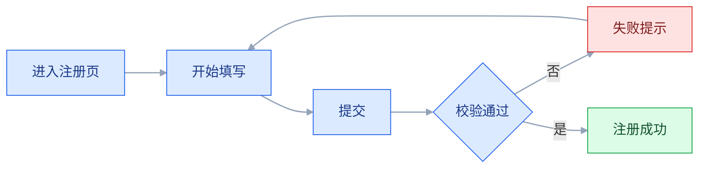
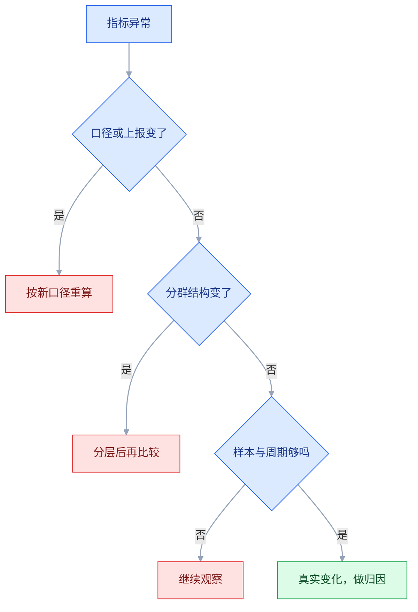

# 数据驱动设计

## 一、工程案例：给一条注册漏斗做埋点方案并验证一次改版

**场景**：一个 B2B SaaS 的试用注册页，从「进入注册页」到「注册成功」的转化率长期在 38% 左右。产品团队判断是「表单太长」，砍掉了「公司规模」「职位」两个字段，改版后转化率 39%，几乎没动。第二次改版前，要求先补齐埋点、用数据定位，再做一次可验证的实验。

**约束**：

| 约束 | 具体内容 | 影响 |
|---|---|---|
| 流量 | 日均进入注册页约 2400 人 | 大改动可分实验，小改动样本不够 |
| 埋点现状 | 只有页面曝光与「注册成功」，点击与失败原因全缺 | 必须补埋点，且要兼容历史数据 |
| 归因 | 多渠道投放，来源参数不统一 | 分群口径要先统一 |
| 排期 | 埋点 3 天，观察 2 周，实验 2 周 | 不能边改边看 |
| 合规 | 收集手机号、邮箱，需告知与脱敏 | 参数里不能带明文个人信息 |

**动手前先统一一句话**：这次要回答的问题不是「表单长不长」，而是「用户在哪一步、因为什么离开」。前者是假设，后者是问题。埋点方案围绕后者设计。

### 1.1 第一步：画出流程，标出可观测点



四个关键节点：进入、开始填写、提交、成功。每个节点都要能回答「多少人到这里」「从哪来」「什么设备」「失败原因是什么」。

**「开始填写」的定义必须先定死**：是「任意输入框获得焦点」，还是「第一个字段输入了字符」。定义不同，漏斗数字会差很多。本项目取「第一个字段输入了至少 1 个字符」，因为它排除了误触。

### 1.2 第二步：写埋点方案

埋点按用途分五类：页面曝光、元素曝光、元素点击、业务事件、错误事件，本方案用到其中四类。**业务事件是主口径，点击只用于定位**。

| 事件名 | 类型 | 触发时机 | 关键参数 | 用途 |
|---|---|---|---|---|
| `signup_page_view` | 曝光 | 注册页可见 | `source` `campaign` `device` `variant` | 漏斗起点、渠道归因 |
| `signup_form_start` | 业务 | 首个字段输入首个字符 | `field` `device` | 漏斗第二步 |
| `signup_field_blur` | 交互 | 字段失焦 | `field` `valid` `error_code` | 定位哪个字段卡住 |
| `signup_submit_click` | 点击 | 点「注册」 | `filled_count` `device` | 提交意愿 |
| `signup_submit_result` | 业务 | 接口返回 | `success` `error_code` `http_status` | 失败归因 |
| `signup_success` | 业务 | 服务端注册成功（前端成功页兜底补报） | `user_id` `plan` `variant` | 漏斗终点、实验指标 |
| `signup_login_click` | 点击 | 点「已有账号，去登录」 | `from` | 识别老用户误入 |

**公共参数**（每个事件都带）：

| 字段 | 示例 | 说明 |
|---|---|---|
| `user_id` / `anon_id` | `u_8231` / `a_9f2c` | 登录前用匿名 ID，登录后关联 |
| `session_id` | `s_20261020_xxx` | 串联一次会话 |
| `ts` | 毫秒时间戳 | 时序分析 |
| `page_path` | `/signup` | 页面归因 |
| `device` | `mobile` / `desktop` | 分群 |
| `os` / `browser` | `iOS` / `Safari` | 分群 |
| `app_version` | `2.14.0` | 口径变更追踪 |
| `variant` | `control` / `exp_a` | 实验分组 |
| `source` / `campaign` | `google` / `brand_cn` | 渠道 |

**命名规范**：`{模块}_{对象}_{动作}`，全小写下划线。`signup_form_start`、`checkout_payment_submit`。**禁止** `click1`、`btn_ok`、`test_event`。

**参数规范**：

```text
✔ error_code: "email_exists"        枚举，稳定
✔ filled_count: 3                    数值
✔ device: "mobile"                   枚举
✘ phone: "138****"                   明文个人信息，禁止
✘ msg: "邮箱已被注册，请直接登录"      自由文本，口径不稳定
```

### 1.3 第三步：定义漏斗与口径

| 步骤 | 事件 | 口径 | 备注 |
|---|---|---|---|
| 1 进入 | `signup_page_view` | 去重：同一 `anon_id` 同一天算 1 次 | 排除刷新 |
| 2 开始填写 | `signup_form_start` | 首次触发，同一会话只算 1 次 | 排除误触 |
| 3 提交 | `signup_submit_result` | 接口返回即算，同一表单一次提交算 1 次 | 含校验失败；`signup_submit_click` 只用于定位连点 |
| 4 成功 | `signup_success` | 同一 `anon_id` 24 小时内算 1 次 | 排除重复注册 |

**口径三件事必须写清**：去重键、时间窗、异常排除。缺一个，两个人跑出的漏斗就对不上。

**口径变更要打标**：`app_version` 从 `2.14` 升到 `2.15` 时如果改了事件定义，报表要标一条竖线，否则前后不可比。

### 1.4 第四步：跑数、分群、找最大流失

第一版数据（上线埋点后 7 天，约 16800 人进入）：

| 步骤 | 人数 | 相对上一步 | 相对进入 |
|---|---|---|---|
| 进入注册页 | 16800 | — | 100% |
| 开始填写 | 11659 | 69% | 69% |
| 提交 | 8400 | 72% | 50% |
| 注册成功 | 6375 | 76% | 38% |

**按绝对值看流失**：

| 环节 | 流失人数 | 排序 |
|---|---|---|
| 进入 → 开始填写 | 5141 | 最大 |
| 开始填写 → 提交 | 3259 | 次之 |
| 提交 → 成功 | 2025 | 再次 |

**按设备分群**：

| 设备 | 进入 | 开始填写率 | 提交率（占开始填写） | 成功率（占提交） | 总转化 |
|---|---|---|---|---|---|
| 桌面 | 9240 | 82% | 78% | 80% | 51% |
| 移动 | 7560 | 54% | 61% | 67% | 22% |

**结论**：桌面端 51%，移动端 22%。移动端占了 45% 的进入量，却只贡献 26% 的成功量，整体转化被它拉低；而移动端最大的问题在「进入 → 开始填写」，只有 54%，近一半人连第一个字段都没碰。**砍字段优化的是「填写 → 提交」，正好避开了最大的流失环节。**

### 1.5 第五步：用定性方法找原因

数据指出「哪里」，不指出「为什么」。补三种低成本方法：

| 方法 | 抽样 | 发现 |
|---|---|---|
| 会话录屏 | 移动端 30 条未填写会话 | 首屏只有 logo 与标题，表单在折叠线以下 |
| 5 人可用性测试 | 移动端新用户 | 3 人以为要「先注册账号才能试用」，直接退出 |
| 客服工单聚类 | 近 30 天「注册」相关 | 高频词：收不到验证码、提示已注册 |

**录屏的看法**：不看「用户点了哪」，看「用户停在哪、有没有滑动、有没有返回」。停留超过 3 秒且无操作，通常意味着「没看懂」或「没找到」。

### 1.6 第六步：改动与实验设计

| 问题 | 改动 | 依据 |
|---|---|---|
| 移动端首屏看不到表单 | 压缩头图，表单上移到首屏 | 46% 移动用户未开始填写 |
| 用户以为要先注册 | 标题改为「14 天免费试用，无需信用卡」 | 可用性测试 3/5 误解 |
| 「邮箱已注册」提示不清 | 提示改为「该邮箱已注册，点此直接登录」 | 失败原因中 `email_exists` 占 71% |
| 验证码收不到 | 增加「重新发送」倒计时与备用邮箱 | 工单高频 |

**实验假设**（必须可验证）：

```text
✘ 「新版注册页会更好」
✔ 「移动端首屏直接展示表单，会使移动端注册转化率从 22% 提升到 26% 以上」
```

| 实验项 | 设定 |
|---|---|
| 核心指标 | 移动端注册成功率（`signup_success` / `signup_page_view`） |
| 护栏指标 | 注册后 7 日激活率、客服工单量 |
| 分流 | 只对移动端流量按 `anon_id` 哈希，50 / 50 |
| 样本 | 按基线 22%、最小可检测提升 4 个百分点计算，每组约 1800–2000 人，以统计工具为准 |
| 时长 | 2 周（覆盖完整工作日与周末） |
| 决策规则 | 提升 ≥ 3 个百分点且护栏不降才上线；否则回滚 |

**为什么不是「涨了就上」**：小幅波动也会「涨」，提前写下阈值，能避免事后解释。

### 1.7 第七步：结果与复盘

| 指标 | 对照组 | 实验组 | 变化 |
|---|---|---|---|
| 移动端开始填写率 | 54% | 78% | +24pp |
| 移动端注册成功率 | 22% | 27% | +5pp |
| 桌面端注册成功率 | 51% | 51% | 持平 |
| 7 日激活率 | 41% | 42% | 持平 |
| 客服工单量 | 基线 | 下降 18% | 改善 |

**两组数字之间的落差要解释**：开始填写率涨了 24 个百分点，成功率只涨 5 个百分点——新增的这批「愿意开始填」的人意图更弱，提交率与单步成功率都下降，把前面的收益吃掉了一部分。所以看单步指标会高估收益，决策必须看端到端指标。

> 以上为示例数据，用来说明判断方法；真实结论以实际数据为准。

**结论**：达到预设阈值，全量上线。桌面端持平只说明改动没有外溢到桌面；**真正的「没有副作用」要看护栏指标**——7 日激活率没降、工单量下降，才算过关。

**复盘的三个问题**：假设对不对（对，问题在首屏不在字段长度）、数据口径有没有坑（有一次重复上报，已修）、下次能不能更快（录屏 + 工单聚类只花了 2 天）。

### 1.8 关键产出物

交付物要能让研发照着埋、让评审照着验。

**① 埋点方案表**：事件名、类型、触发时机、参数、用途、负责人。

**② 漏斗定义表**：步骤、事件、去重键、时间窗、排除规则。

**③ 实验设计表**：假设、核心指标、护栏指标、分流、样本、时长、决策规则。

**④ 改版方案对照表**：问题、改动、依据、影响面、负责人。设计方案必须能对应到具体问题和数据依据，否则评审时无法判断该不该做。

**⑤ 验收表**：

| # | 检查项 | 怎么验 | 通过标准 |
|---|---|---|---|
| 1 | 事件能上报 | 测试环境触发一次，看调试工具 | 事件名、参数、时间都对 |
| 2 | 参数完整 | 抽查 20 条上报 | 公共参数无缺失 |
| 3 | 无重复上报 | 同一动作连点 5 次 | 业务事件只记 1 条 |
| 4 | 无明文个人信息 | 搜参数值 | 无手机号、邮箱、姓名 |
| 5 | 漏斗能复现 | 用 SQL 从原始表重算 | 与报表数字一致 |
| 6 | 口径有文档 | 看埋点文档 | 去重键、时间窗、排除规则齐全 |
| 7 | 分群可用 | 按设备/渠道/新老拆分 | 各组之和等于总数 |
| 8 | 实验分流稳定 | 同一用户多次访问 | 始终同一组 |
| 9 | 指标可下钻 | 从总转化点到步骤 | 每层都能落到人数 |
| 10 | 异常有监控 | 人为断开上报 | 30 分钟内告警 |
| 11 | 历史可比 | 对比改版前后 | 有口径变更标注 |
| 12 | 决策有记录 | 看实验文档 | 阈值、结论、负责人齐全 |

> 第 5 项是最有效的验收方式：**从原始表独立重算一遍**。报表配置错、去重写错、时间窗错，都会在这一步暴露。

---

## 二、高频问答：会卡住你的地方，也是面试最常问的

数据一出问题，多数人凭直觉直接改方案。先按顺序排除三种「不是效果变化」的原因，再谈设计和优化：



### 2.1 埋了点，但没人看得懂数据

**现场**

拿一个具体问题去查，比如「移动端为什么流失」，看现有事件能否回答。

**要点**

- 只有「点击」，没有「结果」和「上下文」，无法回答业务问题。
- 事件数量不等于信息量。
- 每个事件问一句「它能支持哪个决策」，答不上来的就先不埋。

**追问**

- 主口径用什么？→ 业务事件，点击只用于定位。
- 一次埋多少事件合适？→ 按决策反推，不按页面堆。
- 缺「结果」会怎样？→ 只知道想做什么，不知道做成了什么。

### 2.2 同一个按钮的点击量比页面访问量还高

**现场**

抽一个用户会话，按时间排序看同一事件出现几次。

**要点**

- 重复上报：事件绑在冒泡链路上、组件重复渲染、连点未去重。
- 先怀疑埋点实现，不是先怀疑数据平台。
- 调试工具里点一次看发出几条请求；检查事件绑定是否随组件挂载重复注册。

**追问**

- 业务事件怎么防重复？→ 同一动作连点 5 次只记 1 条。
- 冒泡导致的重复怎么修？→ 阻止冒泡或只在目标元素绑定。
- 连点怎么处理？→ 前端去重 + 上报侧去重。

### 2.3 改版后转化率「暴跌」，其实是口径变了

**现场**

对比改版前后的埋点文档与 `app_version`，看事件定义是否一致。

**要点**

- 事件名、触发时机、去重规则在改版时一起变了，前后不可比。
- 把「口径变化」当成「效果变化」，会误判成设计问题。
- 口径变更必须在报表上打标，并保留一段双埋点并行期。

**追问**

- 怎么打标？→ 报表上标竖线，`app_version` 记录版本。
- 双埋点并行多久？→ 够覆盖一个完整对比周期。
- 历史数据能回溯吗？→ 按新口径重算，不能直接拼接。

### 2.4 漏斗里每一步都在掉，但不知道先修哪

**现场**

同时算「相对上一步的转化率」与「相对起点的绝对流失人数」。

**要点**

- 最低百分比不等于最大流失人数；分母不同，百分比会误导。
- 百分比低的那步可能基数很小，修它带不来多少增量。
- 按绝对流失人数排序，再结合修复成本决定优先级。

**追问**

- 为什么不能只看相对转化？→ 每步分母不同，不能横向比。
- 修最大的流失就一定有效吗？→ 还要看修复成本和可执行性。
- 还要看什么？→ 分群后的结构差异。

### 2.5 A/B 实验跑到第三天就「显著」，赶紧上线

**现场**

看实验是否预先设定了样本量与结束时间。

**要点**

- 中途反复查看并择机停止，会大幅提高假阳性率。
- 把「某一时刻的显著」当成「最终结论」是典型错误。
- 实验前定样本量与时长，到点再看；必须提前停止时用序贯检验并记录原因。

**追问**

- 为什么偷看会涨假阳性？→ 多看了很多次，总会撞上显著。
- 必须提前停怎么办？→ 用序贯检验。
- 时长还要考虑什么？→ 覆盖完整业务周期（含周末）。

### 2.6 测了 20 个指标，总有一个「显著」

**现场**

数一数事先声明的核心指标有几个，事后加了多少个。

**要点**

- 多重比较：检验次数越多，偶然出现显著的概率越高。
- 从 20 个里挑一个好看的，等于先看结果再定假设。
- 实验前只定 1 个核心指标 + 少量护栏指标，其余作为探索性分析并标注。

**追问**

- 护栏指标看什么？→ 留存、工单量这类不能被伤害的。
- 探索性分析能当结论吗？→ 不能，只能作为下一轮假设。
- 为什么不许多指标？→ 偶然显著会被当成效果。

### 2.7 几百个样本就得出结论

**现场**

用样本量计算器，按基线、最小可检测效应、显著性水平、功效反算。

**要点**

- 样本不足时，随机波动就能造成几个百分点的差异。
- 把小样本的噪音当成信号，是最常见的误判。
- 样本不足时用「灰度 + 前后对比」只能作为参考，不能宣称因果。

**追问**

- 反算要哪几个参数？→ 基线、最小可检测效应、显著性水平、功效。
- 常用值是多少？→ 显著性 0.05、功效 0.8。
- 小流量产品怎么办？→ 灰度 + 前后对比，但因果性弱。

### 2.8 新版本上线第一周涨了，第二周回落

**现场**

看 4 周以上的趋势，并按新老用户分群。

**要点**

- 新奇效应，或早期用户与后期用户构成不同。
- 用一周数据下结论太早。
- 实验至少覆盖一个完整周期（含周末），并观察长期指标（留存、复购）。

**追问**

- 新奇效应怎么识别？→ 看 4 周以上是否回落。
- 还要看哪些长期指标？→ 留存、复购。
- 早期用户有什么不同？→ 构成与后期用户不同。

### 2.9 分组看都涨，整体反而跌了

**现场**

按设备/渠道/新老拆分，同时看各组占比变化。

**要点**

- 辛普森悖论：各组流量结构变化，低转化组占比上升拉低整体。
- 只看汇总数、不看结构，就会以为数据自相矛盾。
- 任何整体指标变化，先拆一层结构，再下结论。

**追问**

- 怎么快速判断？→ 看各组占比是否变了。
- 怎么排除数据 bug？→ 用原始表独立重算。
- 结构变了怎么办？→ 分层后再比较。

### 2.10 留存用户说功能很好用，但整体数据没起色

**现场**

对比「留存用户满意度」与「整体留存/流失率」。

**要点**

- 幸存者偏差：只调研了留下来的用户，离开的人没发声。
- 用一小群人的反馈代表全部用户，会高估效果。
- 流失用户访谈、退出问卷、工单聚类，补齐另一半样本。

**追问**

- 怎么补流失样本？→ 退出问卷、流失访谈、工单聚类。
- 退出问卷有什么偏差？→ 自愿填写，样本有偏。
- 留存用户的话完全没用吗？→ 有用，但要和整体数据一起看。

### 2.11 看板做了 50 个图，没人看

**现场**

问每个图的负责人：「它变差时你会做什么」。

**要点**

- 没有明确的使用场景与责任人，图表无法支持任何决策。
- 把「信息齐全」当成「有用」，是看板失败的主因。
- 一屏不超过 8 个图，每个图有对比基线、有阈值、能下钻。

**追问**

- 可行动性原则是什么？→ 答不上「变差时做什么」就删。
- 看板要分层吗？→ 要，管理层、业务、分析师各看各的。
- 一张看板服务所有人呢？→ 等于谁也不服务。

### 2.12 埋点上线后，App 审核被问隐私问题

**现场**

列出自采字段清单，对照隐私政策与合规要求。

**要点**

- 采集了设备标识、位置、明文联系方式，未告知也未脱敏。
- 把「技术可行」当成「合规可行」，审核一定卡。
- 最小化采集、脱敏、告知、可关闭，必要时做合规评审。

**追问**

- 最小必要怎么判？→ 采集与功能无关的字段就不要。
- 明文信息怎么处理？→ 脱敏或哈希，参数里不能带。
- 用户能拒绝吗？→ 要提供替代路径，不能不给权限就不让用。

### 2.13 两个实验同时跑，结论互相打架

**现场**

算重叠用户占比；检查同一 `anon_id` 是否落进多个实验、多次访问是否始终同一组。

**要点**

- 同一批用户同时进了两个实验，或分流按随机数每次重算，两组人本来就不可比。
- 把「叠加后的效果」算到单个改动头上，是归因错误。
- 实验前划分互斥层、按稳定 ID 哈希分流。

**追问**

- 怎么验证分流稳定？→ 同一用户多次访问始终同一组。
- 上线前还要看什么？→ 两组在设备、渠道、新老上的分布。
- 分布差异明显说明什么？→ 分流有问题。

### 2.14 登录之后，漏斗就断了

**现场**

找一个刚注册的用户，看登录前后的事件是否挂在同一个 ID 上。

**要点**

- 登录前用匿名 ID、登录后换成用户 ID，两段没关联，漏斗被算成两批人。
- 把「数据断了」当成「行为变了」，会误判用户不活跃。
- 注册/登录成功时补一次 ID 关联（`identify`、`alias`），保留匿名 ID 做回溯。

**追问**

- 关联失败怎么办？→ 做关联失败率监控。
- 匿名 ID 要保留吗？→ 要，用于回溯。
- 跨端同一人怎么算？→ 靠登录关联和设备图去重。

---

## 三、核心知识：从零开始要建立的东西

### 3.1 数据在设计流程中的位置

数据不能直接告出「该设计成什么样」，它只能定位问题；方案来自对用户的理解；效果靠实验验证。


| 环节 | 回答 | 缺失的后果 |
|---|---|---|
| 数据 | 哪里出了问题 | 凭感觉优化 |
| 定性 | 为什么出问题 | 改错地方 |
| 设计 | 怎么解决 | 有洞察没方案 |
| 实验 | 有没有效 | 不知道是否值得上线 |

**跳过任何一步都会出问题**：只看数据不看用户，会优化错误的点；只做设计不做实验，不知道有没有用；只做实验不做归因，知道涨了但不知道为什么。

### 3.2 指标分层

| 层级 | 作用 | 例子 |
|---|---|---|
| 北极星 | 一个数代表产品价值 | 每周完成的订单数 |
| 一级指标 | 拆解北极星 | 转化率、客单价、留存 |
| 二级指标 | 定位问题 | 各步骤转化率、各渠道转化 |
| 过程指标 | 日常监控 | 曝光、点击、停留 |

**北极星的作用是防止局部优化**：把广告点击率做高很容易，但可能伤害留存。北极星把「短期局部」拉回「长期整体」。

**指标不是越多越好**：一个团队同时盯 20 个指标，等于没有优先级。**每个层级保留 1–3 个**。

> **面试**：常问「北极星指标有什么用？」答：防止局部优化，把短期局部拉回长期整体。

### 3.3 HEART 框架

| 维度 | 含义 | 示例指标 |
|---|---|---|
| Happiness | 满意度 | NPS、CSAT、SEQ |
| Engagement | 参与度 | 使用频次、时长、深度 |
| Adoption | 采纳率 | 新功能使用率、首用时间 |
| Retention | 留存 | 次日/7 日/30 日留存 |
| Task success | 任务完成 | 完成率、耗时、错误率 |

**HEART 的价值**：把「体验好不好」拆成可测量的五块，避免只用满意度问卷。

**使用方式**：先选与目标最相关的 2–3 个维度，再为每个维度定 1–2 个指标。全选五项会失去焦点。

### 3.4 埋点模型

| 类型 | 触发 | 用途 | 例子 |
|---|---|---|---|
| 页面曝光 | 页面可见 | 漏斗起点、流量 | `signup_page_view` |
| 元素点击 | 点击 | 意愿、定位 | `signup_submit_click` |
| 业务事件 | 业务动作完成 | 主口径、结果 | `signup_success` |
| 曝光事件 | 元素进入视口 | 内容触达 | `banner_impression` |
| 错误事件 | 异常发生 | 稳定性、失败归因 | `api_error` |

**主口径用业务事件，不用点击事件**。点击只说明「想做什么」，业务事件说明「做成了什么」。两者之差就是失败与放弃。

**曝光事件的判定**：常见口径是「元素可见面积超过 50% 且持续 1 秒」（视频类通常更长），行业里有约定但不唯一。**同一份报表内必须统一阈值**，否则曝光数会差几倍。

### 3.5 命名与参数规范

```text
{模块}_{对象}_{动作}
signup_form_start
checkout_payment_submit
profile_avatar_upload
```

| 规范 | 要求 | 反例 |
|---|---|---|
| 大小写 | 全小写 | `SignupClick` |
| 分隔 | 下划线 | `signup-click` |
| 语义 | 动词明确 | `btn_ok` |
| 版本 | 不复用旧名 | `signup_v2` 改语义 |
| 参数值 | 枚举稳定 | 自由文本、动态文案 |

**参数设计三原则**：能枚举就不自由文本、能数值就不字符串、不放个人信息。**自由文本参数三个月后一定无法聚合**。

### 3.6 埋点口径

| 口径要素 | 说明 | 例子 |
|---|---|---|
| 去重键 | 按什么算「一个人一次」 | `anon_id` + 自然日 |
| 时间窗 | 多长算同一次 | 24 小时 |
| 触发时机 | 请求前还是成功后 | 成功回调里上报 |
| 异常排除 | 测试账号、爬虫、内部 IP | 按名单过滤 |
| 版本标记 | 口径变更可追溯 | `app_version` |

**「提交」埋在请求前还是成功后**，会直接改变漏斗形状。请求前埋，失败也算提交；成功后埋，失败不可见。**正确做法是两个都埋**：点击一个、结果一个。

> **面试**：常问「『提交』该埋在请求前还是成功后？」答：两个都埋，点击一个、结果一个，否则失败不可见或失败也算提交。

### 3.7 漏斗分析

```text
进入 10000
→ 开始填写 7100   (71%)
→ 提交     5400   (76%)
→ 成功     3800   (70%)
```

| 读法 | 看什么 | 用途 |
|---|---|---|
| 绝对流失 | 每一步少了多少人 | 决定先修哪 |
| 相对转化 | 每一步的转化率 | 对比行业与历史 |
| 趋势 | 同一指标随时间变化 | 发现恶化 |
| 分群 | 新老、设备、渠道 | 发现结构问题 |

**漏斗的局限**：只说明「哪一步掉了」，不说明「为什么掉」。必须配合录屏、访谈、工单。

**漏斗的时间窗**：跨天流程（注册后 7 天激活）不能用简单漏斗，要用「同期群 + 完成事件」的方式计算。

### 3.8 分群分析

| 维度 | 常见分组 | 能发现 |
|---|---|---|
| 设备 | 移动 / 桌面 / 平板 | 端上体验差异 |
| 新老 | 首访 / 回访 / 老用户 | 学习成本、习惯 |
| 渠道 | 搜索 / 投放 / 直接访问 | 用户意图差异 |
| 地区 | 国内 / 海外、城市级别 | 网络、语言、习惯 |
| 版本 | 改版前 / 后 | 效果 |
| 行为 | 高频 / 低频 | 需求差异 |

**辛普森悖论的防范**：任何整体指标变化，先拆一层结构再解释。**分群后各组都涨、整体反跌**，说明结构变了，不是数据错。

### 3.9 A/B 实验的原理

A/B 实验通过随机分流，让两组除改动外尽可能一致，从而把差异归因于改动。

| 要素 | 要求 | 常见错误 |
|---|---|---|
| 随机分流 | 按稳定 ID 哈希 | 按时间分流，两组用户不同 |
| 单变量 | 一次只改一个主要因素 | 同时改文案 + 布局 + 流程 |
| 核心指标 | 实验前定 1 个 | 事后从多个里挑 |
| 样本量 | 事前计算 | 跑几天看着差不多就停 |
| 决策规则 | 事前写阈值 | 事后解释结果 |

**分流稳定性**：同一用户多次访问必须落在同一组，否则体验割裂、数据污染。用 `anon_id` 哈希，不用随机数。

> **面试**：常问「A/B 实验凭什么能归因？」答：随机分流让两组除改动外尽可能一致，差异才能归到改动上。

### 3.10 样本量与实验时长

| 概念 | 含义 | 影响 |
|---|---|---|
| 基线转化率 | 对照组的当前水平 | 越低越难检测小提升 |
| 最小可检测效应 | 希望发现的最小提升 | 越小需要的样本越多 |
| 显著性水平 | 假阳性容忍度 | 常用 0.05 |
| 统计功效 | 真有效时能检出的概率 | 常用 0.8 |

**直觉**：转化率 5% 左右、希望检测 10% 的相对提升（5% → 5.5%），按显著性 0.05、功效 0.8 估算，每组约需 3 万人。**小流量产品很难做 A/B**，可改用灰度 + 前后对比，但因果性弱。

**时长**：至少覆盖一个完整业务周期（含周末），通常 1–2 周。**不要用「跑够样本就停」**，还要考虑周期效应。

> **面试**：常问「实验要跑多久、多少样本？」答：事前按基线、最小可检测效应、显著性、功效反算，并覆盖完整业务周期。

### 3.11 实验陷阱

| 陷阱 | 后果 | 防范 |
|---|---|---|
| 偷看提前停 | 假阳性升高 | 固定样本与结束时间 |
| 多指标挑选 | 偶然显著被当成效果 | 事前定核心指标 |
| 样本不足 | 噪音被当成信号 | 事前算样本量 |
| 新奇效应 | 短期涨、长期回落 | 观察 4 周以上 |
| 分流不均 | 两组不可比 | 检查分组特征分布 |
| 实验互斥 | 同一用户进多个实验 | 分流层与互斥组 |
| 指标漂移 | 前后不可比 | 口径变更打标 |
| 季节因素 | 大促、假期影响 | 避开或作为分层 |

**最实用的一条**：实验前写下「如果结果是 X，就做 Y」。事后解释结果，一定会自欺欺人。

### 3.12 定性方法

| 方法 | 得到 | 成本 | 样本 |
|---|---|---|---|
| 可用性测试 | 卡在哪、为什么 | 低 | 5 人可发现多数问题 |
| 用户访谈 | 动机、心智模型 | 中 | 6–12 人 |
| 会话录屏 | 真实操作路径 | 低 | 几十条 |
| 热力图 | 注意力与点击分布 | 低 | 需足够流量 |
| 客服工单 | 高频抱怨 | 极低 | 全量 |
| 退出问卷 | 离开原因 | 低 | 自愿填写，有偏 |

**工单是被低估的金矿**：免费、量大、真实。按关键词聚类，能快速找到高频痛点。

**热力图的局限**：只看「点了哪」，看不到「为什么没点」；滚动深度、折叠内容会影响结果。

### 3.13 设计度量

| 类别 | 指标 | 采集方式 |
|---|---|---|
| 效率 | 任务完成时间、点击次数、步骤数 | 可用性测试、埋点 |
| 效果 | 完成率、错误率、放弃率 | 埋点、测试 |
| 满意度 | SEQ、CSAT、NPS | 问卷 |
| 一致性 | 组件使用率、设计系统覆盖率 | 代码扫描 |
| 质量 | 走查缺陷数、还原偏差 | 走查记录 |

**最有说服力的组合**：任务完成率 + 任务耗时 + 满意度。三者一起看，既能反映「能不能完成」，也能反映「顺不顺、爽不爽」。

**SEQ 的用法**：每个任务后问一题「这个任务有多难」，1–7 分。轻量、即时，适合可用性测试。

### 3.14 数据看板

| 特征 | 要求 |
|---|---|
| 一屏看完 | ≤ 8 个图 |
| 有对比 | 环比、同比、目标线 |
| 有阈值 | 异常变色 |
| 能下钻 | 点到分群与明细 |
| 有更新时间 | 知道数据多新 |
| 有口径说明 | 每个指标可查定义 |

**可行动性原则**：每个图都要能回答「它变差时我会做什么」。答不上来就删掉。

**看板分层**：管理层看北极星与一级指标，业务看二级与过程指标，分析师看明细。**一张看板服务所有人，等于谁也不服务**。

### 3.15 数据伦理

| 问题 | 表现 | 底线 |
|---|---|---|
| 过度采集 | 采集与功能无关的字段 | 最小必要 |
| 明文存储 | 手机号、邮箱直接进参数 | 脱敏或哈希 |
| 未告知 | 用户不知道被采集什么 | 隐私政策 + 显著提示 |
| 诱导授权 | 不给权限就不让用 | 提供替代路径 |
| 指标造假 | 为了数字好看伤害体验 | 看长期与护栏指标 |
| 标签固化 | 用户被永久分类 | 可纠正、可退出 |

**判断标准**：这个优化如果被公开报道，是否经得起质疑。经不起，就不要做。

---

## 四、冷门知识汇总

| 知识点 | 为什么冷门 | 用到时的关键词 |
|---|---|---|
| 批量上报与丢失 | 关页面时队列未发完 | `sendBeacon`、`visibilitychange` |
| 采样上报 | 高流量下采样，小数看不出来 | 采样率、权重、放大系数 |
| 广告拦截与埋点 | 部分插件会拦统计请求 | 自建域名、代理、丢失率 |
| 爬虫与内部流量 | 不排除会污染数据 | IP 名单、UA、测试账号 |
| 时区与跨天 | 服务器时区与用户时区不同 | UTC、自然日、`timezone` |
| 夏令时 | 海外业务会出现 23/25 小时的一天 | DST、时间窗 |
| 数据延迟 | 实时表与离线表数字不同 | T+1、实时流、对账 |
| 报表与原始表不一致 | 配置错、去重错 | 独立重算、对账 |
| 缺失值的含义 | 空不代表 0 | `null`、未上报、不适用 |
| 平均值陷阱 | 平均耗时被极端值拉高 | 中位数、P90 |
| 留存曲线 | 看是否走平，不看单点 | 次日、7 日、30 日、flat |
| 同期群分析 | 不同批次不可直接比 | cohort、批次、时间对齐 |
| 回归均值 | 极端值之后自然回落 | 异常高的基线、复测 |
| 序贯检验 | 需要提前停止时的正确方法 | 阿尔法消耗、`sequential test` |
| NPS 的局限 | 受样本与行业影响大 | 推荐者、贬损者、样本偏差 |
| 问卷的诱导性 | 题目措辞影响答案 | 中性表述、预测试 |
| utm 参数丢失 | 跳转、短链、App 内打开会丢来源 | 落地页、302、referrer |
| 跨端同一人 | App 与 Web 各算一个用户 | 设备图、登录关联、跨端去重 |
