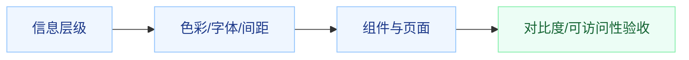
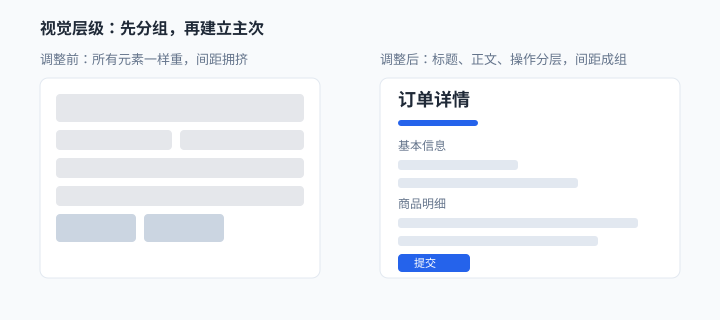
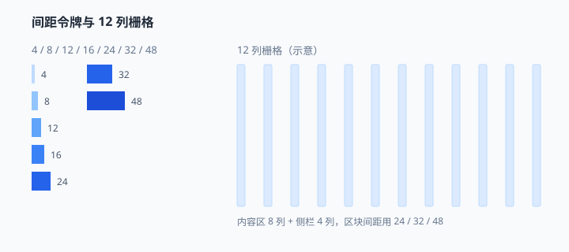
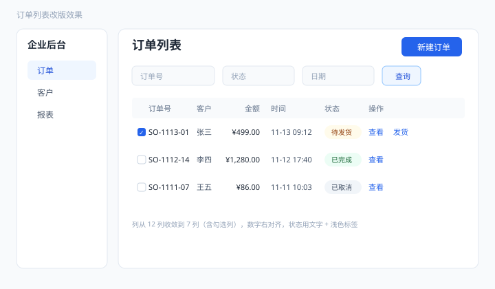

# 视觉基础与设计原则

> 这篇从视觉层级和四个基础原则讲起，经过色彩、字体、间距、栅格，再落到后台表格、表单、详情页与暗色模式，最后用一套验收方法和订单列表改版收尾。
>
> 学完能判断一个后台页面是否清楚、一致、可读，并把它落成可复用的设计令牌。

## 一、视觉设计的目标

视觉设计不是“做好看”，而是让信息在正确的层级上被快速理解。一个页面先要能回答：先看什么、再看什么、哪里可以操作、哪里不能点。

判断标准：

- **层级**：标题、正文、辅助信息、操作按钮的视觉重量依次递减；
- **一致**：相同类型的元素使用相同的颜色、字号、间距和交互；
- **可达**：文字可读、对比度达标、键盘可操作、颜色不是唯一的信息载体。



视觉层级靠对比，不靠堆装饰；一致性靠规则和令牌，不靠设计师记忆；可读性靠对比度、字号和行高，不靠“感觉清楚”。

## 二、四个基础原则

| 原则 | 作用 | 常见错误 |
|---|---|---|
| 对比（Contrast） | 区分主次、引导视线 | 标题和正文一样重；按钮和背景混在一起 |
| 重复（Repetition） | 建立统一语言 | 每个页面按钮样式都不同 |
| 对齐（Alignment） | 建立秩序、降低扫描成本 | 左边缘参差；表单标签不对齐 |
| 亲密性（Proximity） | 用距离表达关系 | 相关字段离得很远，不相关内容挤在一起 |

### 2.1 对比

对比可以来自字号、字重、颜色、留白和位置。一个页面不需要所有手段一起用，通常选 1–2 个主手段。

| 层级 | 字号 | 字重 | 用途 |
|---|---:|---|---|
| 页面标题 | 24–32px | 600 | 页面主题 |
| 区块标题 | 18–20px | 600 | 分组 |
| 正文 | 14–16px | 400 | 主要内容 |
| 辅助信息 | 12–13px | 400 | 时间、说明、次要状态 |

> 边界：对比不是越强越好。所有文字都加粗、所有按钮都用主色，等于没有层级。

### 2.2 重复、对齐与亲密性

- 重复：同一类卡片、表格、按钮、标签使用同一套样式；
- 对齐：优先左对齐；数字右对齐；表单标签与输入框基线对齐；
- 亲密性：用 8–24px 的间距把相关内容分组，用更大的间距分隔不同组。



## 三、色彩

### 3.1 色彩的三个维度

| 维度 | 含义 | 设计用途 |
|---|---|---|
| 色相（Hue） | 颜色的种类 | 品牌色、语义色 |
| 饱和度（Saturation） | 颜色的纯度 | 降低饱和度可减少视觉噪音 |
| 明度（Lightness） | 颜色的明暗 | 建立层级、适配暗色模式 |

### 3.2 语义色

后台系统不要用“好看的颜色”随意表示状态，要建立固定的语义：

| 语义 | 常用色 | 用途 |
|---|---|---|
| 主色 | 蓝/品牌色 | 主按钮、选中、链接 |
| 成功 | 绿 | 已完成、通过 |
| 警告 | 橙/黄 | 待处理、即将到期 |
| 危险 | 红 | 失败、删除、不可逆操作 |
| 中性 | 灰 | 辅助文字、边框、禁用 |

> 边界：颜色不能作为唯一信息载体。成功/失败状态要同时有文字或图标，照顾色觉障碍用户。

### 3.3 对比度

WCAG 2.2 的最低要求：

| 内容 | 对比度 |
|---|---:|
| 普通文字（<18pt 或 <14pt 粗体） | ≥ 4.5:1 |
| 大文字（≥18pt 或 ≥14pt 粗体） | ≥ 3:1 |
| 图标、边框、输入框等 UI 组件 | ≥ 3:1 |

```css
/* 用 CSS 变量建立语义色，不要在组件里写死十六进制 */
:root {
  --color-primary: #2563eb;
  --color-success: #15803d;
  --color-warning: #b45309;
  --color-danger: #b91c1c;
  --color-text: #1f2937;
  --color-text-secondary: #6b7280;
  --color-border: #d1d5db;
  --color-bg: #ffffff;
}
```

## 四、字体与排版

### 4.1 字号阶梯

不要为每个页面单独定字号，建立一套有限的阶梯：

| 令牌 | 字号 | 行高 | 用途 |
|---|---:|---:|---|
| `text-xs` | 12px | 1.5 | 辅助说明 |
| `text-sm` | 14px | 1.5 | 表格、表单 |
| `text-base` | 16px | 1.6 | 正文 |
| `text-lg` | 20px | 1.4 | 区块标题 |
| `text-xl` | 24px | 1.3 | 页面标题 |
| `text-2xl` | 32px | 1.2 | 大标题/数字 |

### 4.2 字体选择

- 中文界面优先使用系统字体栈，保证加载速度和字形完整；
- 数字和代码使用等宽字体；
- 一个页面最多两种字体族，不要再叠加装饰字体。

```css
body {
  /* 系统字体栈：中文优先 PingFang / 微软雅黑，减少加载成本 */
  font-family: -apple-system, BlinkMacSystemFont, "Segoe UI",
    "PingFang SC", "Microsoft YaHei", sans-serif;
  font-size: 14px;
  line-height: 1.5;
  color: var(--color-text);
}

code, pre, .number {
  font-family: "SFMono-Regular", Consolas, "Liberation Mono", monospace;
}
```

> 边界：行高不是越大越好。正文 1.5–1.6 适合阅读；表格和按钮内部通常用更紧凑的行高。

## 五、间距与栅格

### 5.1 间距令牌

用 4/8px 的倍数建立间距阶梯，避免 7px、13px 这种随手值：

```css
:root {
  /* 4/8px 倍数，避免 7px、13px 这种随手值 */
  --space-1: 4px;
  --space-2: 8px;
  --space-3: 12px;
  --space-4: 16px;
  --space-5: 24px;
  --space-6: 32px;
  --space-7: 48px;
}
```

| 场景 | 建议间距 |
|---|---:|
| 图标与文字 | 8px |
| 表单标签与输入框 | 8px |
| 表单字段之间 | 16–24px |
| 卡片内边距 | 16–24px |
| 区块之间 | 24–48px |

### 5.2 栅格

后台页面常用 12 列栅格，配合 24px gutter 和最大内容宽度：

```css
.container {
  /* 12 列栅格，24px gutter，最大内容宽度 1440px */
  display: grid;
  grid-template-columns: repeat(12, minmax(0, 1fr));
  gap: 24px;
  max-width: 1440px;
  margin: 0 auto;
  padding: 0 24px;
}

.span-8 { grid-column: span 8; }
.span-4 { grid-column: span 4; }
```

> 边界：栅格是布局约束，不是每个组件都必须套 12 列。表格、代码块、全宽图表可以打破栅格，但要保持对齐和留白。



## 六、后台界面落地

### 6.1 表格

- 行高 40–48px，表头与内容区分层级；
- 数字右对齐，文本左对齐，状态用标签；
- 操作列固定在右侧，危险操作二次确认；
- 空态、加载态、错误态都要设计。

### 6.2 表单

- 标签在输入框上方或左侧，保持全局一致；
- 必填项有标记，错误信息紧贴字段；
- 提交按钮与取消按钮有主次；
- 长表单分组，不要一屏几十个字段。

### 6.3 详情页

- 顶部是标题、状态和主操作；
- 中部按“摘要 → 明细 → 日志”组织；
- 关联信息用卡片或标签页，不要把所有字段堆在一起。

### 6.4 暗色模式

暗色模式不是把白色换成黑色，而是重新建立层级：

- 背景用深灰而不是纯黑，避免纯白文字刺眼；
- 用不同亮度的表面表示层级；
- 降低高饱和颜色的面积，保留语义；
- 图片、图表、阴影需要单独适配。

```css
:root[data-theme="dark"] {
  /* 暗色模式用深灰表面，不用纯黑，避免纯白文字刺眼 */
  --color-bg: #111827;
  --color-surface: #1f2937;
  --color-text: #f3f4f6;
  --color-text-secondary: #9ca3af;
  --color-border: #374151;
}
```

> 边界：暗色模式要成对设计，不能只改背景色。对比度、图表颜色、图片背景和阴影都要重新检查。

## 七、验收与排障

| 现象 | 最可能原因 | 处理 |
|---|---|---|
| 页面“灰蒙蒙” | 对比不足、层级不清 | 拉开字号/字重/颜色差异 |
| 表单很乱 | 标签对齐和间距不统一 | 统一标签位置和字段间距 |
| 表格扫描慢 | 列太多、数字未右对齐 | 精简列、数字右对齐、固定操作列 |
| 暗色模式刺眼 | 纯黑背景 + 纯白文字 | 改用深灰表面和降亮文字 |
| 颜色状态看不清 | 只用颜色表达状态 | 同时加文字/图标 |

## 八、最佳实践案例

### 8.1 案例背景

某企业后台的订单列表页有 12 列、5 种按钮颜色、正文 12px。用户平均要 8 秒才能找到目标列，误点操作按钮的情况每周都有（示例数据）。

目标是不改变业务字段，只调整布局和视觉；继续使用现有组件库；暗色模式可用。

### 8.2 案例实操

1. 信息分级：订单号、状态、金额为主信息；时间、客户为次信息；查看、发货为主操作。
2. 列收敛：12 列减到 7 列，次要字段进详情页。
3. 颜色语义化：只保留主色、成功、警告、危险、中性五种语义。
4. 间距和字号令牌化：正文 14px，间距使用 8/16/24。
5. 对比度检查：正文 ≥ 4.5:1，输入框与按钮的边界 ≥ 3:1；表格分隔线属装饰性元素，不套用该阈值。



### 8.3 案例结果

用 10 名用户做任务测试：找到“待发货订单并发货”的平均时间从 48 秒降到 31 秒，误点从 3 次降到 1 次（示例）。axe 检查无严重可访问性问题，暗色模式下正文对比度仍达标。

复盘：视觉改造的收益来自“减少选择”和“建立层级”，不是换了更花的颜色。列收敛和主操作唯一化比调色更有效。
