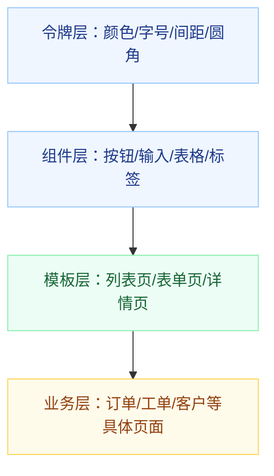
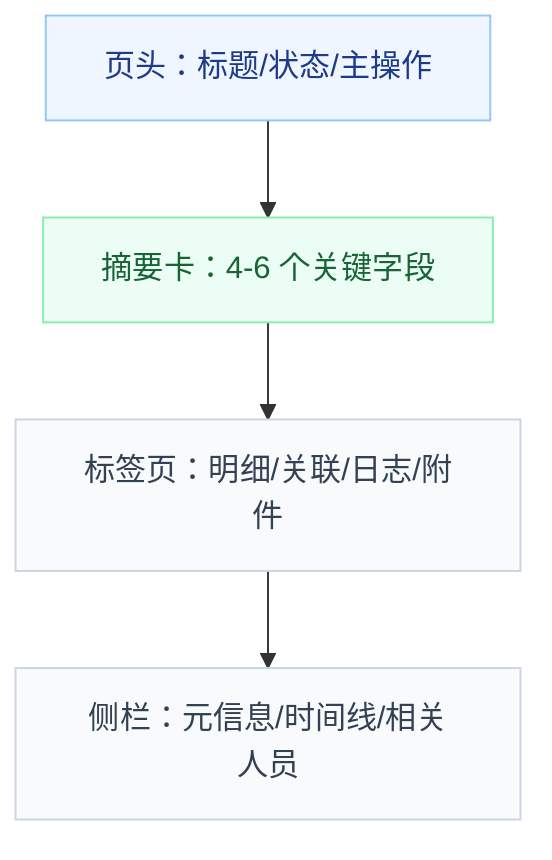
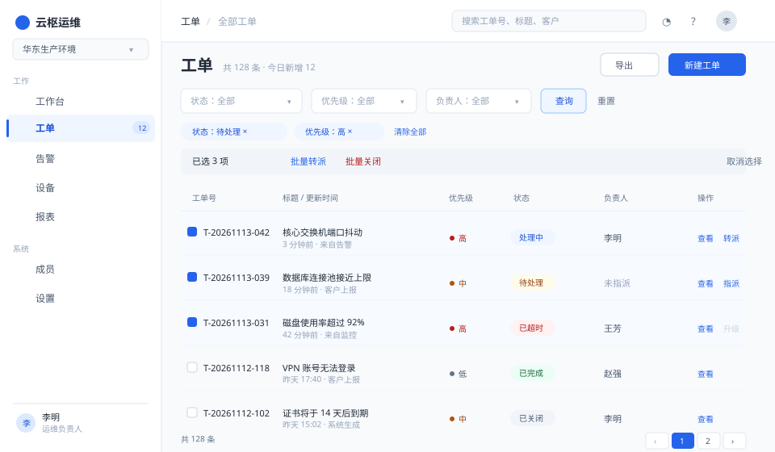

# 后台界面规范

> 这篇从后台界面的骨架与导航讲起，经过表格、表单、详情页三类核心页面，再补齐加载、空态、错误态和暗色模式，最后落到一套可走查的验收清单和一次 12 个页面的规范落地。
>
> 学完能把一套后台系统收敛成少数几种页面模板，并写出团队能执行、能验收的界面规范。

## 一、规范约束的范围

后台界面（Admin UI）是长时间停留、高频操作、数据密集的界面，规范要保证同类任务在同一位置以同一方式完成，而不是把页面做得更漂亮。

### 1.1 三条判据

判断一条后台界面规则该不该写进规范，看它是否同时满足三条：

| 判据 | 含义 | 反例 |
|---|---|---|
| 可预测 | 同类页面、同类操作在同一位置 | 有的列表主按钮在右上，有的在左下 |
| 密度可控 | 一屏信息量与操作量有上限 | 12 列表格 + 8 个行内按钮 |
| 状态完整 | 加载、空、错误、无权限都有去处 | 只做了有数据时的页面 |

三条都不满足的规则，是个人偏好，不写进规范。只满足一条的，写成建议，不写成红线。

### 1.2 规范的四个层次

规范不是一份组件库文档。它从抽象到具体分四层，越往下变更成本越低、数量越多：



- 令牌层由设计系统维护，业务方只消费；
- 组件层允许封装，不允许业务页面绕过组件直接写样式；
- 模板层是规范的主战场：角色分工、区域尺寸、字段顺序都在这层定；
- 业务层只允许填内容，不允许改结构。

> 边界：团队少于 3 人、页面少于 8 个时，先立令牌和两张模板（列表、表单），不要一开始就写一本 80 页的规范。规范的成本在维护，不在编写。

### 1.3 与组件库的分工

组件库解决“一个按钮长什么样”，规范解决“按钮该出现在哪、同一屏放几个”。2026 年主流后台实现是 Vue 3.5 + Element Plus 2.11.x，第二线是 React 19 + Ant Design 5.2x；两套库的变量名不同，语义可以一一映射：

| 规范语义 | Element Plus 变量 | Ant Design 变量 |
|---|---|---|
| 主色 | `--el-color-primary` | `colorPrimary` |
| 正文文字 | `--el-text-color-primary` | `colorText` |
| 次级文字 | `--el-text-color-secondary` | `colorTextSecondary` |
| 边框 | `--el-border-color` | `colorBorder` |
| 圆角 | `--el-border-radius-base` | `borderRadius` |

规范写语义，不写十六进制值；组件库升级时只改映射表，页面不用动。

## 二、页面骨架：侧栏、顶栏、内容区

后台页面的第一层规范是骨架。骨架定错，后面每个页面都要单独修补。

### 2.1 三种骨架及其适用场景

| 骨架 | 结构 | 适用 |
|---|---|---|
| 侧栏型 | 左侧固定导航 + 顶栏 + 内容区 | 模块多、层级深的业务后台 |
| 顶栏型 | 顶部横向导航 + 内容区 | 模块 ≤ 6、以工具为主的轻后台 |
| 主从型 | 左列表 + 右详情，导航收进顶栏 | 高频连续处理同类对象 |

选择依据是“用户一天在几个模块之间跳”。超过 5 个模块、模块内还有二级页面，用侧栏型；只在 2–3 个模块内反复处理同一种对象，用主从型。两种骨架不要在同一产品里混用，否则用户每次进入新页面都要重新找导航。

### 2.2 尺寸基线

尺寸不是审美问题，是肌肉记忆问题。同一产品内只允许一套：

| 区域 | 尺寸 | 约束 |
|---|---|---|
| 侧栏展开 | 240px | 一级菜单 ≤ 7 项 |
| 侧栏收起 | 64px | 仅图标 + tooltip |
| 顶栏 | 56px | 不放主操作 |
| 页头 | 64px | 标题 + 状态 + 主操作 |
| 内容内边距 | 24px | 卡片之间 16px |
| 内容最大宽 | 1440px | 超宽屏居中，不拉伸表格 |

```css
/* 三区骨架：侧栏固定列，顶栏与内容各自独立，整页不产生外层滚动 */
.app {
  display: grid;
  grid-template-columns: 240px minmax(0, 1fr);
  grid-template-rows: 56px minmax(0, 1fr);
  grid-template-areas:
    "sidebar topbar"
    "sidebar content";
  height: 100vh; /* 只有最外层用视口高度，内部滚动不带动整页 */
}

.content {
  grid-area: content;
  overflow-y: auto; /* 滚动条留在内容区，侧栏和顶栏始终可见 */
}

/* 收起态只改一列宽度，图标与 tooltip 逻辑不变，避免两套导航 */
.app[data-collapsed="true"] {
  grid-template-columns: 64px minmax(0, 1fr);
}
```

### 2.3 侧栏

侧栏承担“我在哪个模块”。结构固定为：品牌区 56px、菜单区、底部账号或帮助。

- 一级菜单行高 40px，图标 18px，图标与文字间距 10px；
- 选中态用浅主色底 + 左侧 3px 指示条，不使用整块深色，避免和内容区抢注意力；
- 菜单层级最多两级；需要第三级时，改为“一级菜单 + 页内标签页”，不加深侧栏；
- 分组标题 12px 次级文字，分组之间 16px 间距；
- 折叠后图标必须有 tooltip，tooltip 延迟不超过 300ms；
- 未读、待办等计数用右侧数字徽标，超过 99 显示 `99+`。

> 边界：侧栏不是功能入口的仓库。放不进 7 项一级菜单时，先合并模块，而不是加第三级或做滚动菜单。

### 2.4 顶栏

顶栏承担“我在哪个产品、我能全局做什么”，不放当前页面的业务操作。

从左到右固定四段：产品名或租户切换、面包屑、全局搜索、通知与账号。全局搜索框宽度 240–320px，占位文案写“搜索订单、客户、工单”，明确搜索对象，不写“搜索”。

顶栏另外两个细节：

- 通知、帮助、账号的图标尺寸和点击区一致（32×32），不因为图标大小不同导致误点；
- 顶栏不随内容滚动，但内容区的页头在滚动 64px 后吸顶，只保留标题和主操作。

### 2.5 内容区与页头

内容区自上而下四段：页头、筛选或工具条、主内容、分页或底部操作条。

页头只放四类信息：标题、状态、辅助说明（ID、更新时间）、主操作。主操作全页唯一，用主色实心按钮；次要操作用描边或文字按钮，最多 3 个，其余收进“更多”。

```html
<!-- 页头四件事：标题、状态、辅助信息、唯一主操作 -->
<header class="page-header">
  <div class="page-header__main">
    <h1>工单 T-1024</h1>
    <span class="badge badge--warning">处理中</span>
    <span class="page-header__meta">创建于 2026-11-12 14:20 · 最后更新 3 分钟前</span>
  </div>
  <div class="page-header__actions">
    <button class="btn btn--ghost">转派</button>
    <button class="btn btn--primary">回复并关闭</button>
  </div>
</header>
```

> 边界：页头不是信息展示区。字段超过 4 个就下沉到摘要卡；把 10 个字段堆在页头，会让主操作被挤出首屏。

### 2.6 折叠与响应

侧栏在 1024px 以下转为抽屉，顶栏只保留菜单按钮、产品名、账号。断点规则集中在第八章，骨架层只需保证一件事：任何宽度下，主操作都在首屏可见。

## 三、导航与当前位置

用户在任何页面都要能回答三个问题：在哪个模块、在这条路径的哪一层、还开着哪些对象。三个问题分别由侧栏、面包屑、页签回答，不重叠。

### 3.1 三个定位装置的分工

| 装置 | 回答 | 出现条件 |
|---|---|---|
| 侧栏选中态 | 在哪个模块 | 始终 |
| 面包屑 | 在哪个层级路径 | 层级 ≥ 3 |
| 页签栏 | 还开着哪些对象 | 同时处理 ≥ 3 个 |
| 页内标签页 | 当前对象的哪一组信息 | 详情页信息分组 ≥ 3 |

同一页面只允许一个侧栏选中项。详情页归属父列表菜单，编辑页继承详情的选中项，不允许编辑页把侧栏选中切到“设置”。

### 3.2 面包屑

面包屑只在层级大于等于 3 时出现，且只表达“对象层级”，不表达操作步骤。

- 最后一项是当前页，用正文色、不可点；
- 中间项可点，点击回到该层并保留该层的筛选条件；
- 不写“首页 > 首页”，首页由产品名承担；
- 名称用用户词，不用内部编码，例如“客户 > 华东区 > 上海分部”，不写“cust > region=2 > branch=17”。

### 3.3 菜单命名与层级

菜单名用名词，页内动作用动词。一级菜单是对象域（订单、客户、工单），二级是列表（全部订单、待发货），页内按钮才是动作（发货、关闭）。

三条命名规则：

- 不在每级重复“管理”：写成“订单 > 全部订单”，不写“订单管理 > 订单列表管理”；
- 单复数统一：一级用单数域，二级用“全部 / 待处理 / 已完成”这种状态词，不混用“订单列表”“客户管理”；
- 不用内部项目代号、数据库表名、状态枚举值。

> 边界：菜单深度不超过 3 级。第 4 级信息用页内标签页承载，因为侧栏每深一层，可发现性下降一半。

### 3.4 页签栏

页签栏解决“在多个对象之间来回切换”的问题，只有同时处理 3 个以上对象时才值得出现。

- 固定一个不可关闭的首页或工作台；
- 页签标题用对象主键 + 简短描述，超长截断并给 tooltip；
- 关闭当前页签后跳到左邻页签，不跳首页；
- 刷新后从 `sessionStorage` 恢复，恢复失败时回到首页，不报错；
- 提供“关闭其他 / 关闭右侧”，不做“关闭全部”。

### 3.5 全局搜索与页内搜索

两者职责不同，不能合并：

- 全局搜索跨对象，结果按对象类型分组，回车进入对象详情；
- 页内搜索只过滤当前列表，命中项高亮，不跳页；
- 页内搜索不做模糊纠错，全局搜索可以做拼音首字母和别名。

> 边界：页内筛选不要做成搜索框。状态、时间这类枚举用下拉和日期选择，搜索框只接文本字段，否则用户不知道能输入什么。

## 四、表格

表格是后台使用频率最高的组件，规范要回答四件事：放哪些列、列多宽、怎么操作、没有数据怎么办。

### 4.1 列的取舍

一屏可见列不超过 8 列，超过的进“列设置”，默认隐藏。列的优先顺序固定：

| 优先级 | 列类型 | 处理 |
|---|---|---|
| 1 | 主键（订单号、工单号） | 固定在左，可点进详情 |
| 2 | 状态 | 标签展示，不只用颜色 |
| 3 | 金额、数量 | 右对齐，等宽数字 |
| 4 | 时间 | 相对时间 + 绝对时间 tooltip |
| 5 | 操作 | 固定在右，≤ 2 个直接展示 |

客户名、地址、备注这类长文本列，默认截断一行并给 tooltip；不要为了“信息完整”让单元格换行，行高一变，扫描节奏就断了。

### 4.2 列宽与对齐

| 列类型 | 建议宽度 | 对齐 |
|---|---|---|
| 主键 | 160–200px | 左 |
| 状态 | 96px | 左 |
| 金额 | 120px | 右 |
| 数量 | 88px | 右 |
| 时间 | 160px | 左 |
| 操作 | 120–160px | 右 |

数字右对齐是为了让个位、小数点对齐，眼睛能纵向比较；文本左对齐是为了阅读起点一致。两者混用会让表格看起来“歪”。

### 4.3 行高与分隔

- 常规行高 48px，紧凑模式 40px，表头 40px；
- 用 1px 分隔线或 8px 行间距区分行，不用斑马纹；
- hover 行整行浅色底，同时显示该行的次要操作；
- 选中行用浅主色底 + 左侧 2px 主色条，和 hover 区分；
- 表头吸顶，横向滚动时主键列和操作列固定。

> 边界：斑马纹只在列很多、分隔线看不清的密集报表里用，且条纹与底色的明度差不超过 3 个百分点。普通业务列表用斑马纹会加重视觉噪音。

### 4.4 排序与筛选

排序和筛选的位置分开：排序在表头，筛选在工具条。

- 可排序列表头右侧显示排序图标，三态循环：无 → 升序 → 降序；
- 默认排序必须在表头可见，不允许“后端默认按创建时间倒序”但界面不显示；
- 筛选条件生效后，在工具条下方显示可单独清除的条件标签（chips）；
- 筛选条件超过 4 个时折叠为“已选 4 项”，点开显示全部；
- 筛选变更后页码回到第 1 页，这是最容易漏的一条。

### 4.5 批量操作

批量操作条只在有选中项时出现，固定在表格上方，显示“已选 N 项”和可用动作。

- 表头复选框支持全选当前页；跨页选择时明确显示“已选 3 页共 57 项”；
- 危险批量操作（删除、作废）用红色文字按钮，二次确认里写明影响数量；
- 批量执行后给结果摘要：成功多少、失败多少、失败原因可下载；
- 关闭批量条或切换筛选时清空选择，不静默保留。

### 4.6 分页

默认每页 20 条，可选 20 / 50 / 100。分页器固定在表格右下方，包含总数、页码、每页条数、跳页。

总数超过 10 万时不做精确 count，显示“约 12 万条”，并禁用跳页；这是性能与准确性的取舍，必须写进规范，否则每个页面各写一套。

### 4.7 表格与卡片列表的选择

| 场景 | 用表格 | 用卡片 |
|---|---|---|
| 字段 ≥ 5 且需要对比 | 是 | 否 |
| 需要排序、批量 | 是 | 否 |
| 每项有图片或长描述 | 否 | 是 |
| 每屏 ≤ 6 项、以浏览为主 | 否 | 是 |

同一种对象只允许一种主视图。需要两种时，用视图切换并记住选择，不并行维护两套页面。

## 五、表单

表单规范的目标是让填写过程可预期：标签在哪、错误在哪、保存后发生什么，三件事在所有表单里一致。

### 5.1 标签与字段宽度

标签位置二选一，全产品统一：

- 字段 ≤ 6 个的常规表单：标签在输入框上方，左对齐；
- 字段密集的配置页：标签在左侧、右对齐，标签列宽 120px。

字段宽度按预期内容定，不全部拉满：

| 内容 | 宽度 |
|---|---|
| 姓名、数量 | 160px |
| 手机号、编号 | 240px |
| 地址、备注 | 100% 或 480px |
| 日期、下拉 | 240px |

必填项在标签前加红色星号，表单顶部写“* 为必填项”。不用 placeholder 代替标签——输入后标签消失，用户回看时不知道这格是什么。

### 5.2 校验时机

校验分三个时机，不能只做提交时校验：

- 失焦（blur）校验格式，错误立即显示在字段下方 8px；
- 输入时不清除错误，等再次失焦且通过后清除，避免边输边闪红；
- 提交时校验全部，滚动到第一个错误字段并聚焦，同时把错误数量汇总在提交按钮上方。

错误文案写“怎么改”，不写“格式错误”：

```html
<!-- 错误文案给出可执行动作，并关联 aria-describedby 供读屏器朗读 -->
<div class="field field--error">
  <label for="phone">联系电话 <span class="required">*</span></label>
  <input id="phone" aria-invalid="true" aria-describedby="phone-error" />
  <p id="phone-error" class="field__error">请输入 11 位手机号，例如 13800138000</p>
</div>
```

### 5.3 分组与长表单

字段超过 7 个就分组，每组用小标题，组间 32px；分组按用户心智，不按数据库表。

- 组内字段顺序：先必填后选填、先常用后少用；
- 一组不超过 6 个字段，超过再拆；
- 长表单分步时，步骤名用任务词（填写信息、确认价格、提交审核），不用“第一步”；
- 每一步可返回，返回不丢已填内容。

### 5.4 承载方式的选择

新增、编辑不一定都要独立页面。按复杂度选：

| 方式 | 适用 | 代价 |
|---|---|---|
| 行内编辑 | 单字段、低风险 | 无上下文丢失 |
| 弹窗 | ≤ 5 个字段、无需参考背景 | 遮挡信息 |
| 抽屉 | 6–12 个字段、需保留列表上下文 | 宽度受限 |
| 独立页 | > 12 个字段、需分步或上传 | 丢失列表状态 |

选独立页时，返回必须带回原来的筛选和页码；做不到就不要用独立页。

### 5.5 提交与离开保护

- 主按钮在右、取消在左；主按钮文案写结果（“保存并发布”），不写“确定”；
- 提交中按钮进入 loading 并禁用，防止重复提交；
- 表单有改动时，路由离开和关闭页面都要拦截，提示“有未保存的修改”；
- 保存成功后给明确结果：留在当前页并提示“已保存”，或跳到详情页并高亮修改字段，二选一，全产品统一。

### 5.6 危险操作

删除、作废、退款这类不可逆操作，确认框必须包含三件事：影响对象、影响范围、是否可恢复。

高风险操作要求输入对象名确认，例如输入订单号后“删除”按钮才可用。普通删除用二次确认即可，不要所有操作都加输入确认，否则用户会形成盲点。

> 边界：能软删除就不要硬删除。界面上的“删除”默认是移入回收站，保留 30 天，文案写“移入回收站，30 天内可恢复”。

## 六、详情页

详情页的任务是“让用户在一次浏览里完成判断和操作”，不是把所有字段列出来。

### 6.1 四段结构

自上而下固定四段：页头、摘要卡、标签页、侧栏。



摘要卡只放 4–6 个字段，选“用户判断下一步必须知道的”：金额、客户、负责人、截止时间、来源。其余字段进明细标签页。

### 6.2 状态与可用操作

状态用“标签 + 一句解释 + 下一步”三件套，不只用颜色。

- 标签颜色对应语义：进行中蓝、成功绿、待处理琥珀、失败红、已关闭灰；
- 状态旁给一句人话，例如“已发货，等待客户签收”；
- 可用操作由状态机决定，不可用的操作禁用并给 tooltip 说明原因，不静默隐藏——隐藏会让用户以为功能不存在。

> 边界：只有涉及权限或安全的功能才隐藏；其余一律禁用 + 原因。可发现性优先于界面干净。

### 6.3 摘要与明细的字段排版

明细区用两列“标签在上、值在下”的字段组，列间距 24px，行间距 20px。

- 空值显示 `—`，不留空白，否则用户分不清“没有”和“没加载”；
- 长文本（备注、描述）单独占整行，最多显示 6 行，超出折叠；
- 金额带币种，时间带时区或明确写“北京时间”；
- 枚举值翻译成用户词，不直接显示 `status=3`。

### 6.4 侧栏与关联信息

侧栏宽度 280–320px，放元信息和关联对象，不放主操作。

- 元信息：创建人、创建时间、最后修改人、来源渠道；
- 关联对象用卡片，每张卡显示对象类型、主键、状态，可点进对应详情；
- 时间线按时间倒序，只显示关键事件（状态变更、金额变更、人工备注），不显示每次字段读取；
- 关联对象超过 5 个时给“查看全部”，不在侧栏内滚动。

### 6.5 编辑入口

详情页默认只读，编辑走独立入口。行内编辑只允许单字段、低风险、可即时保存的场景（备注、标签、负责人）。

进入编辑后，页头主操作变为“保存 / 取消”，并显示“正在编辑”状态；离开时按表单规则拦截。保存后回到详情，并把修改过的字段高亮 2 秒。

## 七、加载、空态与错误态

三类状态不是异常分支，是页面的正常组成部分。每个列表页、详情页、表单页都要在设计稿里画出这四种状态：有数据、加载中、空、错误。

### 7.1 加载

加载反馈的时长阈值决定形态：

| 时长 | 呈现 | 说明 |
|---|---|---|
| < 300ms | 不显示 | 避免一闪而过的闪烁 |
| 300ms–3s | 骨架屏 | 保持布局，减少跳动 |
| > 3s | 骨架 + 文案 + 进度 | 告知在做什么 |
| 提交按钮 | 按钮内 loading | 按钮宽度不变 |

骨架屏按真实布局画：表格 5 行、卡片 3 张、详情页按摘要 + 标签页结构。不要用一个居中转圈代替整页骨架，那会让布局在加载完成后整体跳动。

> 边界：骨架屏超过 5 秒要换成带文案的加载态，并给“取消”或“稍后重试”。用户无法判断卡死和慢加载的区别。

### 7.2 空态的三种类型

空态必须区分原因，否则用户不知道下一步做什么：

| 类型 | 触发 | 内容 |
|---|---|---|
| 首次空 | 从未创建过数据 | 说明 + 主操作 + 一句示例 |
| 筛选空 | 条件无匹配 | 说明 + 清除筛选 |
| 无权限空 | 角色不可见 | 说明 + 申请权限入口 |

首次空可以放插画，但插画高度不超过 120px，且不遮挡主操作。筛选空最容易被做成“暂无数据”，这是后台最常见的体验缺陷：用户以为系统没数据，实际是自己筛掉了。

### 7.3 错误的分级

错误按影响范围分三级，呈现方式不同：

| 级别 | 范围 | 呈现 |
|---|---|---|
| 页面级 | 整页取数失败 | 整页错误 + 重试 + 错误码 |
| 区块级 | 某个卡片或标签页失败 | 区块内错误 + 局部重试 |
| 操作级 | 提交、删除失败 | 保留输入 + 就地提示 |

页面级错误不要只写“系统繁忙”。文案结构固定为：发生了什么、可能原因、下一步、错误码。

```text
工单列表加载失败
可能是网络中断或服务暂时不可用。
[重新加载]  [返回工作台]        错误码：E-503-20261113-0421  [复制]
```

### 7.4 重试策略

- GET 请求可以自动重试，间隔 1s / 2s / 4s，最多 3 次，之后转人工重试；
- 写操作不自动重试，避免重复下单、重复扣款；
- 重试按钮点击后立即进入 loading，不允许连点；
- 错误码必须可复制，客服和研发靠它定位，不要只显示“未知错误”。

### 7.5 状态矩阵

把状态写进模板，避免每个页面重新讨论：

| 状态 | 触发 | 呈现 | 可操作 |
|---|---|---|---|
| 加载 | 请求发出 | 骨架屏 | 无 |
| 有数据 | 请求成功 | 表格/详情 | 正常 |
| 首次空 | 0 条且无筛选 | 说明 + 创建 | 创建 |
| 筛选空 | 0 条且有筛选 | 说明 + 清除 | 清除筛选 |
| 无权限 | 403 | 说明 + 申请 | 申请 |
| 页面错误 | 5xx/超时 | 整页错误 | 重试 |
| 区块错误 | 局部失败 | 区块内提示 | 局部重试 |

## 八、暗色模式与响应式

暗色模式和响应式都不是“最后调一下”，它们会改变层级和密度，必须和浅色版一起设计。

### 8.1 暗色模式的表面层级

暗色不是把白色换成黑色。用三层表面表达层级，靠亮度差，不靠阴影：

| 层级 | 浅色 | 暗色 | 用途 |
|---|---|---|---|
| 底色 | `#f8fafc` | `#0f172a` | 页面背景 |
| 表面 1 | `#ffffff` | `#1e293b` | 卡片、表格 |
| 表面 2 | `#f8fafc` | `#334155` | 表头、悬浮、选中 |

```css
:root {
  --bg: #f8fafc;
  --surface: #ffffff;
  --text: #1f2937;
  --text-secondary: #6b7280;
  --border: #e2e8f0;
}

/* 暗色用深灰表面而非纯黑，文字降到 #e5e7eb 避免纯白刺眼 */
:root[data-theme="dark"] {
  --bg: #0f172a;
  --surface: #1e293b;
  --text: #e5e7eb;
  --text-secondary: #94a3b8;
  --border: #334155;
  --shadow-card: none; /* 暗色下阴影不可见，改用 1px 边框表达边界 */
}
```

### 8.2 语义色的暗色适配

- 主色提高亮度（`#2563eb` → `#60a5fa`），否则深底上发闷；
- 状态标签改为“深色底 + 亮色文字”，不用浅色底，浅底在暗色下会过亮；
- 图表降低饱和度、提高明度，相邻系列色差 ≥ 20%；
- 图片和插画需要单独提供暗色版，或加中性底，避免白底图在暗色下变成发光块。

### 8.3 切换与首屏

主题三态：跟随系统、浅色、暗色，默认跟随系统。选择存 `localStorage`，并在应用挂载前把 `data-theme` 写到 `<html>`，避免首屏白闪。

```html
<!-- 放在 head 内、样式表之前：先定主题再渲染，消除暗色模式下的白闪 -->
<script>
  const saved = localStorage.getItem('theme');
  const dark = saved === 'dark' ||
    (!saved && matchMedia('(prefers-color-scheme: dark)').matches);
  document.documentElement.dataset.theme = dark ? 'dark' : 'light';
</script>
```

> 边界：暗色模式必须成对验收。只改背景色的“伪暗色”会让表格边框消失、图表不可读、图片刺眼，比不做更糟。

### 8.4 断点与降级

| 断点 | 骨架 | 表格 | 筛选 |
|---|---|---|---|
| ≥ 1440px | 侧栏展开 | 全列 | 全部平铺 |
| 1024–1439px | 侧栏收起 | 隐藏次要列 | 平铺 ≤ 4 个 |
| 768–1023px | 侧栏抽屉 | 横向滚动 + 首列固定 | 收进“筛选”抽屉 |
| < 768px | 抽屉 + 单列 | 卡片列表 | 抽屉 |

降级顺序固定：先收筛选，再收次要列，再转卡片列表。不要一上来就把表格改成卡片，卡片无法对比金额和状态。

### 8.5 表格与筛选的降级细节

- 横向滚动时，主键列固定在左、操作列固定在右，中间列可滚；
- 滚动条常显，不自动隐藏，否则用户不知道还有列；
- 筛选抽屉底部固定“重置 / 应用”，应用后回到第 1 页；
- 小屏下页头主操作变成底部固定操作条，始终可见。

## 九、验收清单与排障

规范能否落地，取决于能否被走查。验收不靠“看着差不多”，靠逐条对照。

### 9.1 骨架与导航

- 侧栏、顶栏、内容区尺寸与规范一致，滚动条只在内容区；
- 侧栏同时只有一个选中项，详情页归属父菜单；
- 面包屑在 ≥ 3 级时出现，末项不可点；
- 主操作全页唯一，且首屏可见；
- 页签可恢复，关闭后跳到左邻。

### 9.2 表格与表单

- 可见列 ≤ 8，主键列可点，操作列固定；
- 金额右对齐、文本左对齐，时间有绝对时间 tooltip；
- 筛选变更后页码重置，条件标签可单个清除；
- 批量条显示已选数量，跨页选择有明确提示；
- 表单标签位置全产品统一，错误文案写“怎么改”；
- 提交中按钮禁用，离开有未保存拦截。

### 9.3 状态与暗色

- 列表、详情、表单都有加载、空、错误、无权限四态；
- 空态区分首次空、筛选空、无权限空；
- 页面级错误有错误码和重试，写操作不自动重试；
- 暗色下正文对比度 ≥ 4.5:1，输入框与按钮边界 ≥ 3:1，图表可读；表格分隔线按装饰处理，不套用该阈值；
- 1024px 以下侧栏转抽屉，表格横向滚动可用。

### 9.4 排障对照

| 现象 | 最可能原因 | 处理 |
|---|---|---|
| 页面看起来“挤” | 行高 40 以下 + 列过多 | 行高 48、列收敛到 8 |
| 主操作找不到 | 页头堆了太多字段 | 字段下沉到摘要卡 |
| 用户反复点错按钮 | 操作列按钮过多且同色 | 只留 2 个，其余进“更多” |
| 筛选项莫名消失 | 筛选未进 URL | 筛选状态写入查询参数 |
| 暗色下表格看不清 | 只换了背景色 | 补边框与表头表面层级 |
| 加载时页面跳动 | 用转圈代替骨架 | 按真实布局画骨架 |

### 9.5 可量化的验收指标

规范落地后用四个数验收，样本不少于 8 人、每人不低于 5 个任务（示例口径）：

| 指标 | 口径 | 目标 |
|---|---|---|
| 任务完成时间 | 从进入页面到完成主任务 | 较改版前降 25% |
| 误操作率 | 点错按钮或重复提交次数 | ≤ 1 次/人 |
| 规范覆盖率 | 走查项通过数 / 总项数 | ≥ 85% |
| 可访问性 | axe 严重问题数 | 0 |

## 十、最佳实践案例

### 10.1 案例背景

某 SaaS 运维平台“云枢”有 12 个后台页面，由 4 个小组在 9 个月里分别开发（示例场景）。现状：

- 侧栏有 3 种宽度、2 种选中态，有的页面甚至没有侧栏；
- 表格最少 9 列、最多 14 列，金额列 7 个页面左对齐、5 个右对齐；
- 表单标签有的在左、有的在上，错误提示出现在页面顶部；
- 12 个页面里只有 2 个做了空态，错误页统一显示“请求失败，请稍后重试”；
- 暗色模式只改了三处背景色，表格边框直接消失。

目标是两个迭代内收敛到 3 种页面模板，不改后端接口，不换组件库（Element Plus 2.11.x），暗色模式可用。

约束：4 个小组并行开发，不能停下来等规范；没有专职设计系统团队，规范由 2 名设计 + 1 名前端兼管。

### 10.2 案例实操

**第一步：盘点 12 个页面，按问题归类。** 用同一张表记录，不写主观评价，只记可核对的事实（下表节选）：

| 页面 | 主要问题 | 处理 |
|---|---|---|
| 工单列表 | 14 列、无空态 | 列收敛到 7，补四态 |
| 工单详情 | 字段堆在页头 | 改四段结构 |
| 告警列表 | 金额左对齐、无筛选标签 | 对齐修正、筛选入 URL |
| 设备详情 | 无侧栏、关联信息埋在文本里 | 加关联卡片 |
| 巡检表单 | 标签在左、错误在顶部 | 统一标签在上、错误就地 |
| 报表页 | 斑马纹 + 9 种颜色 | 去斑马纹、语义色收敛 |

盘点只花 1 天，结论是问题集中在列、状态、标签三处，不在配色。

**第二步：定骨架与令牌。** 采用侧栏型骨架，侧栏 240px、顶栏 56px、页头 64px；先改全局布局和 8 个间距令牌、6 个语义色，页面结构暂不动。这一步只改 CSS 变量和布局容器，风险最低，先拿到“看起来是一套系统”的收益。

**第三步：表格模板收敛。** 定义 8 列上限、主键列固定、金额右对齐、操作列最多 2 个直接展示。把 12 个表格的列按“判断下一步是否需要”重排，次要字段下沉到详情页。补批量条和四态。



**第四步：表单与详情模板。** 表单统一标签在上，错误就地显示；详情统一页头 + 摘要卡 + 标签页 + 侧栏。模板做成 3 个页面骨架，业务方只填字段，不允许改结构。


**第五步：四态组件化。** 封装 `Skeleton`、`EmptyState`、`ErrorState`、`NoPermission` 四个组件，参数只有标题、说明、主操作、错误码。所有列表页强制接入，接入情况进走查表。


**第六步：暗色与响应式。** 补三层表面令牌、暗色下的状态标签样式、图表色板；在 1024px 断点把侧栏转抽屉、表格首列固定。用主题脚本消除首屏白闪。

**第七步：走查与验收。** 按第九章清单逐页走查，每页 5 分钟，记录通过项；不通过的进入下一轮，不口头整改。两个迭代后覆盖率从 41% 到 87%。

### 10.3 案例结果

两个迭代（4 周）后（示例数据）：

| 指标 | 改版前 | 改版后 |
|---|---|---|
| 页面模板数 | 12 套各自为政 | 3 套 |
| 表格可见列 | 9–14 | 6–8 |
| 规范走查通过率 | 41% | 87% |
| 找“批量重派”平均时间 | 42 秒 | 18 秒 |
| 误点操作次数/人 | 4 | 1 |
| axe 严重问题 | 17 | 0 |

失败模式与复盘：

- 第一轮只改了 CSS，没改结构，用户仍说“乱”。原因是指标盯的是“颜色统一”，而痛点是列太多、主操作不唯一。第二轮转向结构收敛，收益才出现。
- 暗色模式第一版只改背景，表格边框和图表全部失效。补了表面层级和图表色板后，正文对比度 4.8:1，才敢上线。
- 报表页的斑马纹和 9 种颜色没有强行改，因为该页是只读导出场景，改动收益低。规范允许“只读报表”作为例外，但要在规范里写明例外条件与负责人，否则例外会扩散。

遗留风险：超宽表格（> 20 列）的打印布局没有覆盖；4 个小组的权限模型不同，禁用态文案尚未完全统一；暗色模式下的第三方图表库仍需逐个配置。
