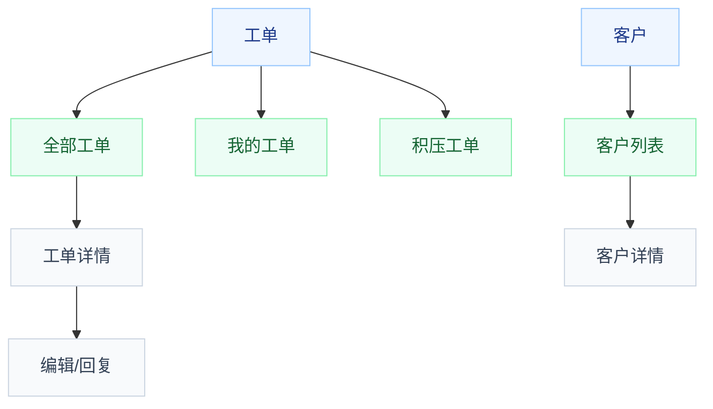
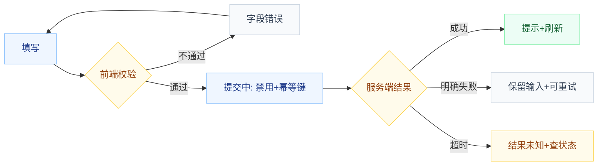
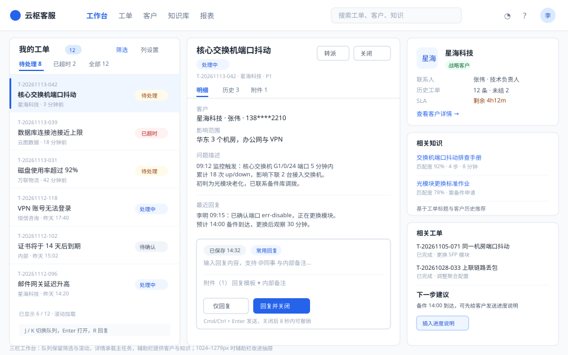
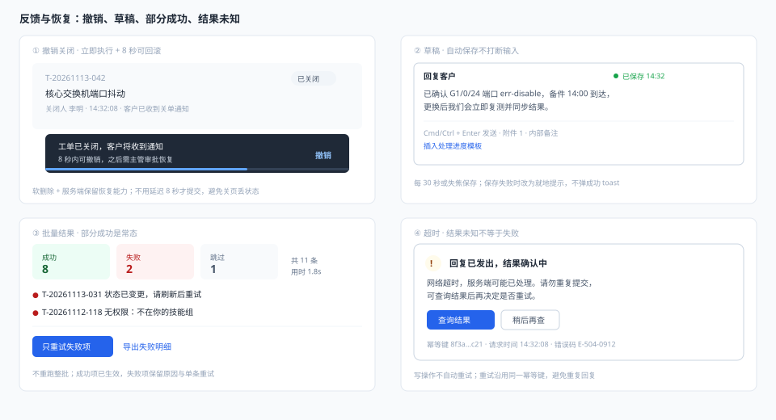

# 交互与页面结构

> 这篇从“页面由任务决定还是由字段决定”讲起，经过任务表、信息架构、页面结构与 URL 状态，再进入提交状态机和反馈恢复，最后落到一次客服工单工作台的改版。
>
> 学完能把一组零散需求拆成任务表，据此排出信息架构与页面结构，并让每个状态可分享、可回退、可恢复。

## 一、交互以任务为单位

交互设计的单位是任务，不是页面，也不是功能。功能是系统能做什么，任务是用户要完成什么；一个功能可以服务多个任务，一个任务也可能跨多个功能。

### 1.1 任务与功能的差别

“订单管理”是功能，“把一批待发货订单在今天下班前发出去”是任务。前者回答系统有什么，后者回答人要做什么。

| 维度 | 功能视角 | 任务视角 |
|---|---|---|
| 起点 | 数据表、接口 | 角色、触发场景 |
| 组织 | 按模块 | 按目标与顺序 |
| 成功 | 页面上线 | 任务完成且可核对 |
| 失败 | 报错 | 重做、漏做、做错 |

按功能建页面，最容易出现“一个实体一个页面”：客户、联系人、合同、账单各一页，完成一次续约要开四个页面、重复输入三次客户名。按任务建页面，续约是一个页面上的四步。

### 1.2 三条结构判断

任何页面结构先用三条判断，不通过就不进入视觉设计：

- **单主任务**：一个页面只有一个主任务，其余是从任务；两个主任务说明该拆页；
- **首屏可达**：主任务的入口、当前状态、下一步操作都在首屏，不需要滚动；
- **输入输出可见**：任务需要的输入在页面内可取得，任务的产出在完成后可核对。

三条里最容易违反的是第二条。筛选区占了半屏、主操作被挤到页脚，是后台最常见的结构问题。

### 1.3 交互成本的四个来源

交互成本不是“点击次数”，而是完成任务要付出的额外动作与等待：

| 成本 | 来源 | 削减手段 |
|---|---|---|
| 跳转 | 任务被拆到多个页面 | 合并同一任务链的步骤 |
| 等待 | 串行请求、整页刷新 | 并行加载、骨架屏、局部更新 |
| 重输 | 上一步的信息下一步要再填 | 带入上下文、记住最近选择 |
| 纠错 | 状态不明、操作不可撤销 | 明确状态、提供撤销与恢复 |

“三次点击内完成”不是硬指标。三次无脑点击比一次要思考的点击更便宜；反过来，一次点击打开一个需要重新定位的页面，成本远高于三次原地操作。

> 边界：后台以效率优先，不用向导式流程包装每一步。只有步骤之间存在强依赖、且顺序不能颠倒时，才用分步；C 端的引导式设计不适用于熟练用户每天用几十次的后台。

## 二、任务表：把场景拆成可执行任务

任务表是交互设计的第一份产出。它把“用户说要一个批量功能”这类需求，翻译成可判断、可排期、可验收的任务条目。

### 2.1 任务卡的字段

| 字段 | 写什么 | 判断作用 |
|---|---|---|
| 编号 | T-01 这样的短号 | 需求、设计、测试共用 |
| 角色 | 谁来做 | 决定权限与入口 |
| 触发 | 什么情况下开始 | 决定首页与通知 |
| 目标 | 完成后得到什么 | 决定成功判据 |
| 输入 | 需要哪些信息 | 决定页面字段 |
| 决策 | 中途要判断什么 | 决定状态与分支 |
| 成功 | 怎么算完成 | 决定验收 |
| 失败 | 出错后怎么办 | 决定恢复设计 |
| 频率 | 每天/每周几次 | 决定优先级 |

九个字段挤在一张表里会看不清，实际使用时拆成“任务清单 + 单任务卡”：清单只留编号、角色、目标、频率、优先级；单任务卡再展开输入、决策、成功、失败。

### 2.2 一张可用的任务清单

以客服工单系统为例（示例）：

| 编号 | 角色 | 目标 | 频率 | 优先级 |
|---|---|---|---|---|
| T-01 | 一线客服 | 回复并关闭一条工单 | 60 次/天 | P0 |
| T-02 | 一线客服 | 把工单转给二线 | 8 次/天 | P0 |
| T-03 | 值班主管 | 批量重派积压工单 | 2 次/天 | P0 |
| T-04 | 值班主管 | 查看某人当前负载 | 5 次/天 | P1 |
| T-05 | 质检 | 抽查已关闭工单 | 10 次/周 | P1 |
| T-06 | 管理员 | 调整技能组与权限 | 1 次/月 | P2 |

P0 的共同点不是“重要”，而是“每天发生且失败代价高”：回复错客户、转错人、积压超时都会直接产生投诉。

### 2.3 从任务表推出页面

任务表到页面结构有三条规则：

- **同链合并**：T-01 的“看历史、看客户、回复、关闭”在一条任务链上，合并进一个工作台，不拆成四个页面；
- **异角色分开**：T-03 的批量重派与 T-01 的单条回复操作对象和风险不同，放在不同入口，不共用一套批量条；
- **高频前置**：频率 ≥ 20 次/天的任务，入口必须在首屏，且支持键盘直达。

T-04“查看某人负载”是典型的次级任务：不需要独立页面，做成列表页的一个筛选维度或侧栏卡片即可。把次级任务做成一级页面，是后台膨胀的主要原因。

### 2.4 优先级：频率乘失败代价

| 频率 | 失败代价低 | 失败代价高 |
|---|---|---|
| 高（≥ 20 次/天） | P1 | P0 |
| 中（2–20 次/天） | P1 | P0 |
| 低（< 2 次/天） | P2 | P1 |

这张表只用于排期，不用于砍需求。P2 不是不做，是晚做；P1 中频率低但失败代价极高的任务（如权限变更）仍需完整的状态与确认设计。

### 2.5 任务粒度

一个任务应在 30 秒到 5 分钟内完成。超过 5 分钟，拆成有明确中间产物的步骤；少于 10 秒的，不单独设计页面，做成列表行内操作或快捷键。

> 边界：任务表不写系统内部步骤（校验、入库、发消息），只写用户看得到、做得到的动作。把内部流程写进任务表，会让页面结构跟着后端实现走。

## 三、信息架构：对象、导航与命名

信息架构（Information Architecture，IA）决定用户能不能“猜到东西在哪”。后台的 IA 优先按对象组织，因为对象稳定、可预期；按流程或角色组织只适合流程固定或角色差异极大的系统。

### 3.1 三个维度

- **对象**：订单、客户、工单、设备，是名词，构成一级菜单；
- **属性**：状态、金额、负责人，是字段，构成筛选与列；
- **动作**：创建、转派、关闭，是动词，构成按钮，不进菜单。

三者混用会产生“创建订单”这样的菜单项。动作应该出现在对象页面里，而不是导航里。

### 3.2 三种组织方式

| 方式 | 一级菜单 | 适用 | 风险 |
|---|---|---|---|
| 按对象 | 订单、客户、工单 | 多数业务后台 | 对象多时一级膨胀 |
| 按流程 | 待处理、处理中、已完成 | 状态驱动的工作流 | 同一对象出现在多处 |
| 按角色 | 我的、团队、全部 | 角色差异大的平台 | 角色调整时结构失效 |

按对象是默认选择。按流程只用于“状态就是工作队列”的场景，例如客服工单；按角色只用于多租户或强分工平台，且角色维度应做成筛选，而不是一级菜单。

### 3.3 层级与宽度

- 一级菜单不超过 7 项，超过先合并对象域；
- 菜单深度不超过 3 级；
- “列表 → 详情 → 编辑”是页面深度，不计入菜单深度；
- 同一层级的命名保持同一颗粒度，不混“订单”“客户管理”“报表中心”三种风格。



### 3.4 命名

命名用用户的词，不用内部代号。三条对照：

| 反例 | 正例 | 问题 |
|---|---|---|
| 订单管理 > 订单列表管理 | 订单 > 全部订单 | 重复“管理”，层级啰嗦 |
| 客户信息维护 | 客户 | 动词化，菜单应是名词 |
| 工单（status=3） | 工单 > 已超时 | 暴露枚举值 |
| CRM 商机池 | 商机 | 内部代号，用户不认 |

单复数也要统一：一级用单数对象名，二级用范围或状态词（全部、待处理、已关闭），不要一级写“订单”、二级写“订单列表”、三级写“订单明细”。

### 3.5 交叉入口落到同一处

同一对象可以从四个地方进入：全局搜索、通知、关联卡片、外部深链。四个入口必须落到同一个详情 URL，否则用户会在不同页面看到不同的字段和操作。

判断方法：从任一入口进入详情，复制地址发给同事，对方打开后看到的状态应完全一致。

### 3.6 对象关系的呈现

| 关系 | 呈现方式 | 例子 |
|---|---|---|
| 1:1 | 详情页字段 | 工单与告警 |
| 1:N | 详情页标签页或列表 | 客户与工单 |
| N:N | 关联卡片 + 搜索添加 | 工单与标签 |
| 层级 | 面包屑 + 树形筛选 | 区域与门店 |

关联数量超过 5 个时不要全部铺开，给“查看全部”进入带筛选的关联列表。

> 边界：不要按组织架构建 IA。部门会重组，对象不会；按部门建的菜单在半年后一定需要重做。

## 四、页面结构：列表、详情、编辑、工作台

后台页面只有四类，结构可以复用。新需求先判断属于哪一类，再套结构，不从空白画布开始。

### 4.1 四类页面的主任务

| 类型 | 主任务 | 首屏必须有 | 常见错误 |
|---|---|---|---|
| 列表页 | 找到一批对象并处理 | 筛选、表格、主操作 | 筛选过多、列过多 |
| 详情页 | 判断一个对象并操作 | 状态、关键字段、下一步 | 字段全堆在页头 |
| 编辑页 | 修改并保存 | 字段、校验、保存 | 与详情分离过远 |
| 工作台 | 连续处理同类对象 | 队列、详情、回复区 | 三栏都放满 |

### 4.2 列表与详情：主从还是独立页

| 条件 | 主从结构 | 独立详情页 |
|---|---|---|
| 每天连续处理 ≥ 20 条 | 是 | 否 |
| 需要把链接发给别人 | 否 | 是 |
| 详情宽度需求 > 700px | 否 | 是 |
| 手机端为主 | 否 | 是 |
| 列表需要长时间保留筛选 | 是 | 需额外处理 |

主从结构的收益是“不丢上下文”：左边列表的筛选、滚动位置、选中项都不变。代价是详情宽度受限，复杂表单放不下。

判断顺序：先看是否需要分享与深链，再看宽度，最后看处理频率。三者冲突时，优先保证深链，因为分享是硬需求，频率可以靠快捷键弥补。

### 4.3 承载方式与上下文成本

同一个编辑任务可以放在行内、弹窗、抽屉或独立页，差别在“上下文保留”和“可撤销性”：

| 方式 | 上下文 | 适合的修改 | 撤销难度 |
|---|---|---|---|
| 行内编辑 | 完全保留 | 单字段、低风险 | 低 |
| 弹窗 | 部分遮挡 | ≤ 5 个字段 | 中 |
| 抽屉 | 保留列表 | 6–12 个字段 | 中 |
| 独立页 | 丢失列表 | 复杂表单、分步 | 高 |

选独立页时，必须在返回时恢复列表的筛选、页码、滚动位置；做不到就退回抽屉。

### 4.4 页面骨架的四个分区

任何后台页面都可以分成四段，顺序固定：

1. **页头**：我在哪、这是什么、能做什么；
2. **工具条**：筛选、搜索、视图切换、批量入口；
3. **主内容**：表格、表单或详情；
4. **操作条**：分页、保存、批量动作。

视觉重量从上到下递减：页头标题最重，工具条次之，内容最轻。反过来会让用户先看到筛选器，找不到页面主题。

### 4.5 首屏预算

首屏只放四样东西，多一样就要挤掉一样：

- 主任务的对象或队列；
- 主操作，且全页唯一；
- 当前状态（数量、进度、异常）；
- 下一步提示（空态、错误、待办）。

按 1440×900 的常见笔记本屏计算，扣掉浏览器 120px、顶栏 56px、页头 64px、工具条 48px，主内容只剩约 610px。表格一行 48px，能显示 12 行；再多就要靠分页，不能靠缩行高。

### 4.6 工作台的三栏结构

工作台用于连续处理同类对象，典型是三栏：队列（320–360px）、详情（自适应）、辅助（280–320px）。

- 队列栏保留筛选和选中态，滚动独立；
- 详情栏是主区，回复框固定在底部；
- 辅助栏放客户信息、历史工单、知识库；
- 三栏总宽低于 1280px 时，辅助栏收进抽屉，不压缩详情。

> 边界：三栏不是所有后台的默认形态。只有“处理对象需要同时参考另外两类信息”时才成立；否则两栏更清晰。

## 五、URL 与可分享状态

URL 是交互状态的一部分。凡是用户希望“刷新还在、返回还在、发给同事也一样”的状态，都必须写进 URL。

### 5.1 哪些状态进 URL

| 状态 | 进 URL | 参数示例 |
|---|---|---|
| 筛选条件 | 是 | `status=open&priority=high` |
| 分页 | 是 | `page=2&size=20` |
| 排序 | 是 | `sort=updated_at&order=desc` |
| 搜索词 | 是 | `q=交换机` |
| 当前标签页 | 是 | `tab=logs` |
| 选中的对象（主从） | 是 | `id=T-1024` |
| 弹窗是否打开 | 视情况 | `panel=assign` |
| 悬停、展开、草稿 | 否 | 存组件状态 |
| 滚动位置 | 否 | 存内存或 history state |

判断标准只有一句：这个状态是否需要被复制、刷新或回退后保留。需要就进 URL，不需要就留在内存。

### 5.2 URL 的形状

```text
列表：/tickets?status=open&assignee=me&page=2&size=20&sort=updated_at
详情：/tickets/T-1024
详情某标签：/tickets/T-1024?tab=logs
工作台：/workbench?queue=my&id=T-1024
```

四条命名规则：

- 资源用复数名词，`/tickets` 不是 `/ticket`；
- 多词用连字符，`/audit-logs` 不是 `/auditLogs`；
- 对象 ID 放路径，筛选放查询参数；
- 查询参数用小写蛇形或短横，全站统一一种。

### 5.3 push 与 replace

不是每次状态变化都产生一条历史记录，否则用户按返回要退十几次：

| 操作 | 历史行为 | 原因 |
|---|---|---|
| 点选筛选、切标签 | push | 用户可能想退回上一个视图 |
| 输入搜索词 | replace（防抖后） | 每个字符一条历史无法使用 |
| 翻页 | push | 返回上一页符合预期 |
| 打开详情 | push | 返回列表是常见动作 |
| 关闭弹窗 | replace 或 back | 不留下空历史 |

### 5.4 返回行为

列表 → 详情 → 返回，必须回到原来的筛选、页码和滚动位置。三种实现按可靠性排序：

1. 状态全在 URL：返回时重新请求，最可靠，可分享；
2. URL + `history.state` 存滚动位置：体验最好，但刷新后滚动丢失；
3. 只存内存：刷新即丢，不满足可分享，不推荐。

深链（通知、邮件、IM 卡片）必须带完整状态。只发 `/tickets/T-1024` 而不带来源队列，用户打开后返回会落到默认列表，等于丢失上下文。

### 5.5 敏感信息与长度

- URL 不放 token、完整手机号、身份证号；需要定位用户时用内部 ID；
- 查询参数总长控制在 2000 字符以内，筛选条件多时改用短键或服务端保存视图；
- 不要把整段 JSON 塞进 URL，既难读也容易被日志采集。

> 边界：弹窗状态进 URL 只用于“需要分享的弹窗”（例如直接打开指派面板）。普通确认框不进 URL，否则返回键会变成关闭弹窗，破坏预期。

## 六、提交状态机

提交是交互里最容易出错的地方：重复点击、超时未知、部分成功、失败丢输入。用状态机约束，比在每个按钮上写 `if (loading)` 可靠。

### 6.1 六个状态

| 状态 | 进入条件 | 界面 | 允许操作 |
|---|---|---|---|
| idle | 初始 | 按钮可点 | 编辑、提交 |
| validating | 点提交 | 字段错误就地显示 | 修改、再提交 |
| submitting | 校验通过 | 按钮 loading + 禁用 | 仅取消（若支持） |
| succeeded | 服务端确认 | 结果提示 + 数据刷新 | 继续下一任务 |
| failed | 明确失败 | 就地错误 + 保留输入 | 重试、修改 |
| unknown | 超时/网络断 | “结果未知”提示 | 查状态，不重试 |

第六个状态最常被漏掉。请求超时不代表失败，可能已经成功；此时直接让用户重试，会制造重复数据。

### 6.2 防重复的三道闸

只做按钮禁用不够，网络重试、用户连点、页面回退都可能重复提交：

- **界面闸**：点击瞬间禁用并进入 loading，按钮宽度不变，避免布局跳动；
- **请求闸**：同一表单在 submitting 期间不发出第二个请求，用状态机而不是计时器；
- **服务端闸**：每次提交带幂等键（Idempotency-Key），服务端在 24 小时内对同一键只处理一次。

幂等键在进入提交时生成，失败重试沿用同一个键，用户修改内容后生成新键。这样“网络超时后重试”不会产生两单，“改了金额再提交”仍然是一笔新操作。

### 6.3 提交路径



### 6.4 乐观更新

乐观更新是先改界面、后等结果，只适合低风险且可回滚的操作：

| 适合 | 不适合 |
|---|---|
| 勾选完成、收藏、排序 | 支付、退款、删除 |
| 列表内轻量状态切换 | 影响他人的批量操作 |
| 失败可自动回滚 | 失败后无法判断是否生效 |

乐观更新失败时必须回滚界面并说明，不能只弹一个 toast 而让界面停在错误状态。

### 6.5 超时与结果未知

- 前端超时设 15 秒，超过后进入 unknown，不自动重试写操作；
- 提示写“请求已发出，结果确认中，请勿重复提交”，并给“查询结果”；
- 查询结果用幂等键或业务单号，查到成功就刷新，查到失败才允许重试；
- 批量操作同样处理，不能因为 1 条超时就重发整批。

### 6.6 部分成功

批量操作必须假设“部分成功”是常态：

- 结果摘要写清成功数、失败数、跳过数；
- 失败项列出原因（无权限、状态已变更、对象不存在），可导出；
- 提供“只重试失败项”，不重跑整批；
- 部分成功后刷新列表，成功的行状态已变，失败的行保持原状。

### 6.7 离开保护

- 表单有改动时，路由切换和关闭页面都拦截，文案写“有未保存的修改”；
- 提交中禁止离开，或提示“正在提交，离开可能导致结果未知”；
- 失败后保留全部输入，包括上传的文件和已选标签；
- 成功后清理草稿，避免下次打开旧内容。

> 边界：前端只负责“提交态”，业务状态以服务端为准。不要在页面里自己推断“应该已成功”，也不要用前端计时器判断超时后的最终结果。

## 七、反馈与恢复

反馈不是“弹个 toast”，而是让用户随时知道：系统收到了吗、现在到哪了、失败了怎么办。

### 7.1 四层反馈

| 层级 | 回答 | 形式 | 时机 |
|---|---|---|---|
| 即时 | 点到了吗 | 按下态、焦点环、hover | 0–100ms |
| 字段 | 填对了吗 | 就地提示、错误文案 | 失焦/提交 |
| 操作 | 这件事成了吗 | toast、按钮结果、行状态 | 请求返回 |
| 系统 | 整体是否可用 | banner、状态页 | 降级/维护 |

四层缺一层，用户就会在某个环节失去确定感。只做 toast、不做按钮 loading，是“操作层有了、即时层没有”的典型缺失。

### 7.2 通道选择

| 通道 | 适合 | 时长 | 阻断 |
|---|---|---|---|
| toast | 成功、轻提示 | 3–5 秒 | 否 |
| 行内提示 | 字段错误、区块失败 | 持续 | 否 |
| 弹窗 | 需要确认或决策 | 持续 | 是 |
| 横幅 | 全局降级、维护通知 | 持续 | 否 |
| 空态 | 无数据、无权限 | 持续 | 否 |

错误提示不要用会自动消失的 toast 承载。用户还没读完就消失，等于没提示；需要用户处理的错误必须就地保留。

### 7.3 文案结构

一句可用的反馈包含三部分：发生了什么、影响是什么、下一步做什么。

| 反例 | 正例 |
|---|---|
| 操作失败 | 工单未能关闭：还有 2 条未回复消息。回复后可再次关闭。 |
| 保存失败 | 保存失败，网络中断。内容已保留，恢复网络后重试。 |
| 无权限 | 没有转派权限。请联系值班主管开通，或选择“申请权限”。 |
| 请求异常 | 工单列表加载失败，服务暂时不可用。已自动重试 3 次。错误码 E-503-0421 |

反例的共同问题是把“系统视角”直接给用户：失败、异常、无权限，都是结论，不是行动。

### 7.4 恢复手段

| 手段 | 适用 | 约束 |
|---|---|---|
| 撤销 | 关闭、删除、批量改状态 | 5–10 秒内可点，之后不可 |
| 草稿 | 长表单、回复内容 | 30 秒自动保存，显示保存时间 |
| 失败保留 | 提交失败 | 输入、附件、选中项全保留 |
| 回收站 | 删除 | 30 天内可恢复，文案写明 |
| 重试 | 只读请求、明确失败的写操作 | 写操作需幂等 |

撤销有两种实现：延迟执行（倒计时结束才真正提交）和立即执行 + 可回滚（服务端支持软删除）。后台优先第二种，因为用户关掉页面后延迟任务可能丢失，且期间数据状态不确定。

### 7.5 焦点与读屏

- 弹窗打开时焦点进入第一个可操作元素，关闭后归还触发按钮；
- 错误汇总用 `aria-live="assertive"`，普通成功提示用 `polite`；
- 提交失败后焦点移到第一个错误字段，并朗读错误文案；
- 所有操作可用键盘完成，焦点环不能被 `outline: none` 去掉；
- 自定义下拉、日期选择必须支持 Esc 关闭、方向键选择。

### 7.6 反馈的节制

- 同一时刻最多 3 条 toast，超出合并为“另有 2 条提示”；
- 成功提示不阻断，不需要用户点“知道了”；
- 连续批量操作时合并提示，不要每行弹一次；
- 用户重复同一操作失败两次后，给“查看帮助”或“联系支持”，不再重复同一句错误。

## 八、走查与度量

结构问题很难靠“看着不错”发现，要靠固定走查和可量化指标。

### 8.1 交互走查清单

按任务逐条走，不走页面：

- 任务入口在首屏，且从侧栏、搜索、通知进入都落到同一处；
- 完成任务所需页面数 ≤ 2，超出的有明确理由；
- 每个提交都有 loading、成功、失败、结果未知四种反馈；
- 失败后输入不丢，且能只重试失败部分；
- 刷新、返回、分享三条路径都能恢复同一状态；
- 空态区分首次空、筛选空、无权限；
- 键盘可完成主任务，焦点顺序合理；
- 危险操作有确认，且确认文案写明影响范围。

### 8.2 缺陷分级

| 级别 | 判据 | 例子 |
|---|---|---|
| 阻断 | 任务无法完成 | 提交后无响应、按钮永久禁用 |
| 严重 | 可能造成数据错误 | 重复提交、返回丢筛选导致改错对象 |
| 一般 | 增加成本但可绕过 | 需多跳一次、提示不明确 |
| 轻微 | 体验瑕疵 | 提示语略啰嗦、图标不齐 |

只有“阻断”和“严重”值得阻塞上线；一般和轻微进入迭代列表，不因它们推迟发布。

### 8.3 四个指标

| 指标 | 口径 | 用途 |
|---|---|---|
| 任务完成率 | 完成任务人数 / 开始人数 | 判断结构是否成立 |
| 任务耗时 | 开始到成功的中位数 | 判断跳转与等待成本 |
| 操作错误率 | 错误提交 / 总提交 | 判断确认与校验 |
| 放弃率 | 中途离开 / 开始 | 判断卡点 |

埋点按任务打，不按页面浏览量打：`task_start`、`task_success`、`task_fail`、`task_abandon`，带任务编号和耗时。PV 高不代表任务顺畅，只能说明入口显眼。

### 8.4 小样本先做定性

上线前用 5–8 人做任务测试，每人 3–5 个 P0 任务，观察三件事：第一次点击落在哪、卡在哪一步、失败后是否知道怎么办。定性发现结构问题，定量验证收益，顺序不能反。

> 边界：指标不能替代观察。完成率高但耗时长，说明用户在硬撑；耗时长但完成率高，也可能只是任务本身复杂。两者要一起看。

## 九、最佳实践案例

### 9.1 案例背景

某 SaaS 客服系统有 40 名一线客服，工单处理分散在 5 个页面：工单列表、工单详情、客户详情、历史工单、知识库（示例场景）。处理一条工单的平均路径是“列表筛选 → 详情 → 客户页 → 返回列表 → 历史页 → 回复”，平均耗时 6.5 分钟。

现状问题：

- 每天 40 人 × 约 60 条工单，页面跳转约 1.2 万次；
- 从详情返回列表后筛选被重置，客服要重新筛一次，平均每天多花 18 分钟；
- 回复按钮没有防重复，网络慢时连点导致重复回复，约占工单量的 3%；
- 关闭工单后没有撤销，误关后要走主管审批恢复，平均 25 分钟；
- 错误提示统一为“操作失败”，客服只能截图发到支持群。

目标是 8 周内改成单页工作台，不改后端接口，继续用 Vue 3.5 + Element Plus 2.11.x；一线客服的 P0 任务耗时下降 30%，重复提交降到 0.5% 以下。

约束：不能停机切换，按小组灰度；客服每天在线，培训时间不超过 30 分钟。

### 9.2 案例实操

**第一步：写任务表，先砍页面。** 访谈 6 名客服和 2 名主管，记录 2 周的实际操作，得到 9 个任务，其中 3 个 P0（节选）：

| 编号 | 角色 | 目标 | 频率 | 优先级 |
|---|---|---|---|---|
| T-01 | 一线客服 | 回复并关闭工单 | 40 次/天 | P0 |
| T-02 | 一线客服 | 转派给二线 | 8 次/天 | P0 |
| T-03 | 主管 | 批量重派积压 | 2 次/天 | P0 |
| T-04 | 一线客服 | 查客户历史工单 | 25 次/天 | P1 |
| T-05 | 质检 | 抽查已关闭工单 | 10 次/周 | P1 |

T-01 与 T-04 在同一条任务链上，T-04 不需要独立页面，改为工作台右侧的客户卡片。仅这一步就砍掉了 2 个页面。

**第二步：重排信息架构。** 一级菜单从 9 项收敛到 5 项：工作台、工单、客户、知识库、报表。工单下的“全部 / 我的 / 积压”从三个菜单项改为同一列表的三个默认视图，用 URL 的 `view` 参数区分。

对象关系按 1:N 处理：客户详情内用标签页展示工单，不再单独开“历史工单”页。

**第三步：确定页面结构。** T-01 需要一个连续处理的工作台，采用三栏：队列 340px、详情自适应、辅助 300px。队列保留筛选和滚动位置；详情顶部是状态与主操作，底部固定回复框；辅助栏放客户卡片、历史工单、知识库推荐。

1024–1279px 时辅助栏收进抽屉，详情栏不低于 560px；小于 1024px 退回“列表 → 详情”两页结构，不强行三栏。



**第四步：把状态写进 URL。** 工作台地址统一为：

```text
/workbench?view=mine&status=open&priority=high&page=2&id=T-1024&tab=history
```

- `view`、`status`、`priority`、`page` 决定左侧队列；
- `id` 决定中间详情，切换工单用 push、不用 replace，返回可回上一条；
- `tab` 决定详情内的标签页；
- 搜索输入用 `replace`，避免每个字符一条历史；
- 通知和 IM 卡片直接带完整参数，点开即定位到同一条工单的同一标签。

**第五步：重做提交状态机。** 回复、转派、关闭三个动作共用一套提交态：点击即禁用、进入 loading、生成幂等键；超时 15 秒进入“结果未知”，提供“查询结果”；失败保留回复内容。

重复回复的根因不是用户手快，而是按钮在请求返回前一直可点。加上状态机和幂等键后，同一毫秒的两次点击只会产生一条回复。

**第六步：补反馈与恢复。** 关闭工单改为软关闭，底部提示“已关闭，8 秒内可撤销”；回复草稿每 30 秒保存，标题旁显示“已保存 14:32”；批量重派给结果摘要，失败项可单独重试；所有错误文案改成“发生了什么 + 下一步 + 错误码”。



**第七步：灰度与走查。** 先给 8 人小组试用 1 周，按第八章清单走查，修掉阻断与严重问题后再扩到 40 人；第二周对比任务耗时、重复提交率、返回丢筛选次数。

### 9.3 案例结果

灰度 4 周后（示例数据）：

| 指标 | 改版前 | 改版后 |
|---|---|---|
| 单条工单平均处理时长 | 6.5 分钟 | 4.1 分钟 |
| 完成任务所需页面数 | 5 | 1 |
| 返回后筛选丢失 | 每天 12 次 | 0 |
| 重复回复率 | 3.0% | 0.4% |
| 误关恢复时长 | 25 分钟 | 8 秒（撤销） |
| 支持群求助量 | 35 条/周 | 24 条/周 |

失败模式与复盘：

- 第一版三栏在 1280px 笔记本上把详情压到 480px，回复框换行严重。改为 1024–1279px 收起辅助栏后解决；结构设计必须按真实屏幕宽度算，不能只看设计稿的 1440px。
- 键盘快捷键第一版只在详情区生效，焦点在队列时按 `R` 无反应。补齐全局焦点管理后，熟练客服才愿意用。
- 深链参数早期只带 `id`，从通知进入后返回落到默认队列。补全 `view` 与筛选参数后，返回行为才符合预期。
- 撤销最初做成“延迟 8 秒提交”，用户关页面导致状态不一致。改为立即软关闭 + 8 秒内可撤销，服务端保留恢复接口，问题消失。

遗留风险：主管的批量重派仍走独立弹窗，尚未并入工作台；知识库推荐依赖后端排序，相关性不足时客服会忽略整个辅助栏；小于 1024px 的移动端只做了查看，没有回复能力。
