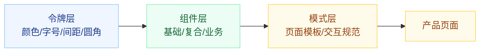
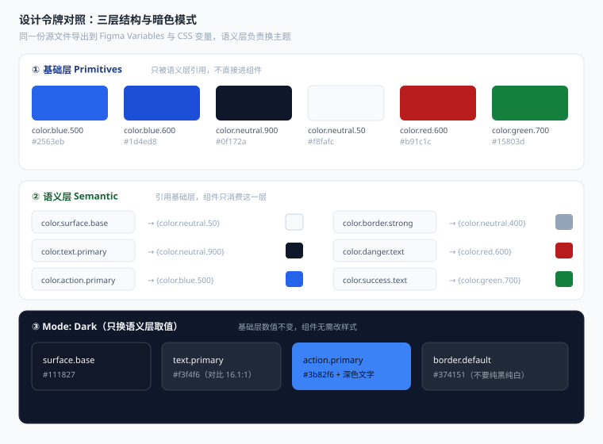
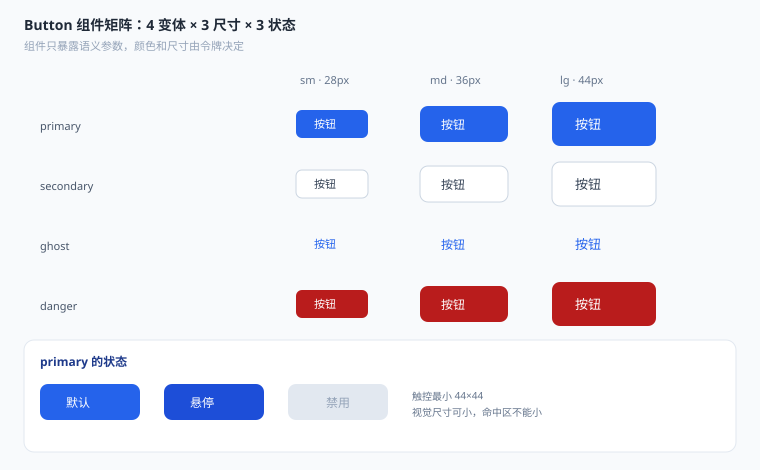

# 设计系统与DesignToken

> 这篇从设计系统要解决的规模化一致性问题讲起，经过组件分层与准入、组件 API 与变体、令牌分层与命名、W3C Design Tokens 与 Figma Variables、构建管线与代码映射，最后落到版本治理和一次完整的设计系统重构案例。
>
> 学完能把散落在页面里的颜色、间距和组件收敛成有层级、有版本、能被设计端与代码同时消费的设计系统。

## 一、设计系统解决什么问题

设计系统是把“可复用的设计决策”从页面里抽出来，变成有命名、有约束、有版本、能被工具消费的资产。它解决的不是“好不好看”，而是同一类决策被不同人重复做、且每次做得不一样。

### 1.1 症状与根因

典型症状与根因：

| 症状 | 根因 | 设计系统的对策 |
|---|---|---|
| 同是主按钮，三个产品三种蓝 | 颜色没有语义层 | 语义令牌 + 单一来源 |
| 改一次品牌色要改 200 个页面 | 组件里写死十六进制 | 运行时变量 + 构建产物 |
| 新增暗色模式要重画全部页面 | 只做了浅色模式 | 模式化令牌，成对设计 |
| 组件库有 17 个 Button | 没有准入与 API 约束 | 分层准入 + 变体收敛 |
| 设计师和前端对不上尺寸 | 各维护一份数值 | 令牌同源导出 |
| 升级组件导致页面崩 | 没有版本与弃用周期 | 语义化版本 + codemod |

### 1.2 三层资产

设计系统由三层资产构成，缺一层就会退化：



三层的关系是依赖，不是并列：组件只能引用令牌，页面只能引用组件和模式；反向引用（令牌引用组件、组件绕过令牌写死数值）是设计系统腐化的起点。

设计系统也不等于组件库。组件库只解决“有现成控件可用”，令牌解决“同一决策只有一个值”，模式解决“页面该怎么组织”。只有组件库的团队，仍会在间距、空态、错误提示和页面结构上重复决策。

> 边界：页面少于 20 个、维护者只有 1–2 人的产品，完整设计系统的维护成本高于收益，用一份样式指南加少量共享组件即可。设计系统的收益随产品线数量、页面数量和变更频率增长，不是所有团队都需要。

## 二、组件分层与准入

组件按复用范围和语义稳定性分四层，每层有不同的准入标准和变更成本。

### 2.1 四层职责

| 层级 | 示例 | 维护者 | 变更影响 |
|---|---|---|---|
| 基础组件（Primitive） | Button、Input、Select、Tag | 设计系统团队 | 全产品线 |
| 复合组件（Composite） | 表单组、筛选栏、数据表格 | 设计系统团队 | 多产品线 |
| 业务组件（Domain） | 订单状态标签、金额展示 | 业务前端 | 单产品线 |
| 页面模板（Template） | 列表页、详情页、设置页 | 业务前端 + 设计 | 单产品线 |

### 2.2 准入与退出

准入用四条硬指标，满足三条才进基础层：

1. 在至少 2 个产品线或 3 个页面中重复出现；
2. 交互状态不少于 3 种（默认、悬停、禁用、加载、错误等）；
3. 语义在 6 个月内不会因业务变化而改写；
4. 不依赖具体业务字段（例如“订单号”不能进基础组件）。

反例判断：

| 候选 | 复用 | 语义稳定 | 结论 |
|---|---|---|---|
| 通用按钮 | 全站 | 高 | 进基础层 |
| 订单状态标签 | 3 个页面 | 中，状态会新增 | 进业务层 |
| 首页营销大横幅 | 1 个页面 | 低 | 不进库 |
| 金额格式化文本 | 多页面 | 高 | 做成工具函数 + 基础文本组件 |

组件进库不是“画完放进文件”。一个可用的基础组件同时交付四样东西：API 文档（属性、默认值、事件）、状态矩阵（默认/悬停/聚焦/禁用/加载/错误）、Do/Don't 示例、可访问性说明（键盘路径、ARIA 角色、对比度）。缺文档的组件，使用者只能读源码猜用法，复用率不会高。

退出用同一套数据：连续两个季度引用次数为 0、覆盖页面少于 2 个、近 90 天没有变更请求，就标记弃用。弃用不是直接删除，而是在文档和类型里标 `@deprecated`，给一个 minor 周期的迁移时间。

> 边界：准入不是一次性评审。组件进库后每季度按引用次数和变更频率复核，连续两个季度零引用的组件应标记弃用，而不是继续维护。

## 三、组件 API 与变体

组件 API 只暴露语义参数，不暴露实现细节。使用者传“危险按钮”，不传“红色按钮”；传“小尺寸”，不传“高度 28px”。

### 3.1 API 的五类参数

一套可维护的 API 通常只有五类参数：

| 参数类 | 取值示例 | 说明 |
|---|---|---|
| 语义变体 | `primary` / `secondary` / `danger` | 决定颜色和强调级别 |
| 尺寸 | `sm` / `md` / `lg` | 映射到高度、内边距、字号 |
| 状态 | `disabled` / `loading` | 由组件内部处理，不由外部拼样式 |
| 内容 | 默认插槽 / `icon` 插槽 | 文本和图标分开，避免拼接字符串 |
| 布局 | `block` / `inline` | 是否占满父容器 |

```ts
// 设计系统包对外暴露的 Button 类型；只允许语义值，禁止颜色、像素这类实现细节
export interface ButtonProps {
  variant?: 'primary' | 'secondary' | 'ghost' | 'danger';
  size?: 'sm' | 'md' | 'lg';
  loading?: boolean;
  disabled?: boolean;
  block?: boolean;
  icon?: string;
}
```

### 3.2 变体属性化

变体不是“每个组合画一个画板”。Figma 的组件属性（Component Properties）把组合拆成独立维度：

- Variant：`variant`（4 值）× `size`（3 值）× `state`（3 值）共 36 个组合，但只需 4 + 3 + 3 个属性维度；
- Boolean：`loading`、`disabled`、`icon` 用开关，不再乘进变体矩阵；
- Instance Swap：图标、头像用实例替换；
- Text：按钮文案用文本属性。

组合爆炸的代价可以按维度相乘估算：4 变体 × 3 尺寸 × 3 状态 × 2 主题 = 72 个画板；改成属性后是 4 + 3 + 3 + 2 = 12 个维度值，维护量下降一个数量级。

代码侧同样只暴露语义类，内部用令牌组合，不把颜色写进类名：

```css
/* 语义类名 + 令牌，换主题时类名不变 */
.btn--primary { background: var(--color-action-primary); color: var(--color-text-on-action); }
.btn--danger  { background: var(--color-action-danger);  color: var(--color-text-on-action); }
.btn--ghost   { background: transparent; color: var(--color-text-link); }

.btn--sm { height: 28px; padding-inline: var(--space-2); font-size: var(--font-size-sm); }
.btn--md { height: 36px; padding-inline: var(--space-3); font-size: var(--font-size-body); }
.btn--lg { height: 44px; padding-inline: var(--space-4); font-size: var(--font-size-body); }
```

| 做法 | 可接受 | 原因 |
|---|---|---|
| `variant="danger"` | 是 | 语义稳定，换色不影响调用方 |
| `color="#b91c1c"` | 否 | 主题和暗色无法接管 |
| `size="lg"` | 是 | 尺寸映射由组件维护 |
| `height={44}` | 否 | 破坏密度和触控规则的一致性 |
| `className="btn-primary"` | 视情况 | 只用于布局微调，不用于改视觉 |

> 边界：属性化只适用于正交维度。如果两个属性组合后需要完全不同的内部结构（例如“带下拉的按钮”和“普通按钮”），应拆成两个组件，而不是继续加布尔开关。

## 四、令牌的分层与命名

令牌分三层：基础令牌（Primitive）、语义令牌（Semantic）、组件令牌（Component）。分层的目的不是好看，是让“改颜色”只改一处，“换主题”只换一层。

### 4.1 三层结构

| 层 | 命名示例 | 值 | 谁引用 |
|---|---|---|---|
| 基础 | `color.blue.500` | `#2563eb` | 仅语义层 |
| 语义 | `color.action.primary` | `{color.blue.500}` | 组件、页面 |
| 组件 | `button.primary.bg` | `{color.action.primary}` | 仅该组件 |

### 4.2 命名规则

命名按“类别—属性—变体—状态”的顺序，全部小写，层级用点号：

```text
color.text.primary
color.text.secondary
color.surface.raised
color.border.strong
space.4
radius.md
font.size.body
shadow.overlay
```

四条命名禁令：

1. 语义层不出现具体色名：`color.red.500` 只能存在于基础层；
2. 语义层不出现组件名：不能有 `color.button.blue`；
3. 不在名字里写值：`space.16px` 改值时名字就错了；
4. 不用同义词：`primary` 与 `brand`、`danger` 与 `error` 只能选一个。

```json
{
  "color": {
    "blue": {
      "500": { "$type": "color", "$value": "#2563eb" }
    },
    "neutral": {
      "900": { "$type": "color", "$value": "#0f172a" },
      "50": { "$type": "color", "$value": "#f8fafc" }
    },
    "text": {
      "primary": { "$type": "color", "$value": "{color.neutral.900}" },
      "on-action": { "$type": "color", "$value": "#ffffff" }
    },
    "action": {
      "primary": { "$type": "color", "$value": "{color.blue.500}" }
    }
  },
  "space": {
    "4": { "$type": "dimension", "$value": "16px" }
  },
  "radius": {
    "md": { "$type": "dimension", "$value": "8px" }
  }
}
```

`{color.blue.500}` 是别名（alias），构建时解析成最终值，设计端和代码端都保留“引用关系”而不是复制值。别名断了，主题就不可换。

令牌类型按 DTCG 的 `$type` 取值，每个类型对应固定的产物形态：

| `$type` | 示例值 | CSS 产物 |
|---|---|---|
| `color` | `#2563eb` | 颜色变量 |
| `dimension` | `16px` | 间距/圆角/尺寸变量 |
| `fontFamily` | 系统字体栈 | `--font-*` |
| `fontWeight` | `600` | 字重变量 |
| `duration` | `150ms` | 动效时长变量 |
| `shadow` | 复合值 | 构建期合成 |

别名解析最多两层：语义层引用基础层，组件层引用语义层。出现“基础引用语义”或三层以上的链，说明分层已经混乱，构建期应直接报错。

> 边界：小团队至少建两层（基础 + 语义），不要跳过语义层直接让组件引用基础色，否则暗色主题和品牌换色会重新变成全局搜索替换。组件层只在组件有独立语义时才建，不是每个组件都必须有。

## 五、W3C Design Tokens 与 Figma Variables

W3C Design Tokens Community Group（DTCG）格式是令牌的交换标准：用 `$value`、`$type`、`$description` 描述一个令牌，用别名连接层级。Figma Variables 是设计端的事实来源，两者通过导出或同步工具对接。

### 5.1 DTCG 格式

```json
{
  "color": {
    "$type": "color",
    "surface": {
      "base": {
        "$value": "{color.neutral.50}",
        "$description": "页面最底层背景"
      }
    }
  },
  "font": {
    "size": {
      "body": { "$type": "dimension", "$value": "14px" }
    }
  }
}
```

概念对照：

| 概念 | Figma Variables | DTCG | 代码产物 |
|---|---|---|---|
| 分组 | Collection | Group | 命名空间/对象 |
| 别名 | Alias | `{group.token}` | `var(--...)` |
| 主题 | Mode | 多文件或 `$extensions` | `[data-theme]` |
| 类型 | Variable Type | `$type` | TS 类型 |
| 说明 | Description | `$description` | JSDoc / 注释 |

### 5.2 Figma Variables 的落地约束

Figma Variables 的落地约束：

- Collection 分 `Primitives` 与 `Semantic` 两个，Primitives 不对组件开放引用；
- Mode 至少 `Light` / `Dark`，需要紧凑密度时再加 `Compact`；
- 变量按用途设 Scope（文字、填充、描边），避免把背景色变量误用到文字；
- 用 Code Syntax 标注每个变量的 CSS/Android/iOS 名称，减少前端猜名；
- 导出用 Tokens Studio 或 Figma 原生导出，产物进仓库，不让设计师手工维护第二份 JSON。

Mode 的划分与用途：

| Mode | 用途 | 切换方式 |
|---|---|---|
| Light | 默认浅色 | 系统或手动 |
| Dark | 暗色 | `data-theme="dark"` |
| Compact | 高密度表格 | 用户偏好 |

同步方向只有一个：Figma 是设计端源，DTCG JSON 是唯一交换文件，代码产物由构建生成。反向同步（代码改令牌再回写 Figma）会制造两份事实来源，除非有专门的令牌平台统一管理。

> 边界：Figma Variables 能表达颜色、数字、字符串、布尔，复合类型（阴影、排版组合）在 2026 仍需构建层展开。不要把“一个阴影令牌”直接当单个变量，拆成 `offsetX`、`offsetY`、`blur`、`spread`、`color` 五个变量，或在导出时合成。

## 六、令牌构建管线

令牌只维护一份源文件，其余产物全部由构建生成。管线是：源 JSON → 校验 → 解析别名 → 转换平台格式 → 输出 CSS/TS/iOS/Android。

### 6.1 源目录与配置

```text
tokens/
  core.json          # 基础令牌
  semantic.json      # 语义令牌，引用 core
  component.json     # 组件令牌，引用 semantic
build/
  css/tokens.css
  ts/tokens.d.ts
  ios/Tokens.swift
  android/tokens.xml
```

用 Style Dictionary v4 的配置（片段，需先安装依赖）：

```js
// style-dictionary.config.mjs
// outputReferences: true 让 CSS 产物保留 var(--...) 引用而不是拍平成十六进制，
// 暗色模式只换基础层变量值即可生效
export default {
  source: ['tokens/**/*.json'],
  platforms: {
    css: {
      transformGroup: 'css',
      buildPath: 'build/css/',
      files: [{
        destination: 'tokens.css',
        format: 'css/variables',
        options: { outputReferences: true }
      }]
    },
    ts: {
      transformGroup: 'js',
      buildPath: 'build/ts/',
      files: [{ destination: 'tokens.d.ts', format: 'typescript/es6-declarations' }]
    }
  }
};
```

```bash
npm i -D style-dictionary@4
npx style-dictionary build
# 预期输出
# css
# ✔︎ build/css/tokens.css
# ts
# ✔︎ build/ts/tokens.d.ts
```

### 6.2 构建前校验

生成 CSS 之前先跑三类校验，任何一类失败都终止构建：

| 校验 | 规则 | 失败后果 |
|---|---|---|
| 命名 | 小写、点分层级、无具体值 | 令牌难以检索 |
| 别名 | 不跨层、不成环 | 变量解析为空 |
| 对比度 | 文字 ≥4.5:1，UI ≥3:1 | 可访问性不达标 |
| 类型 | `$type` 与 `$value` 匹配 | 产物格式错误 |

CI 里只留一段固定流程，避免本地和流水线行为不一致：

```yaml
# .github/workflows/tokens.yml（片段）
- run: npm ci
- run: npm run tokens:check   # 命名 + 别名 + 对比度 + 类型
- run: npm run tokens:build   # 生成 CSS/TS/平台产物
- run: git diff --exit-code build/  # 产物未提交则失败
```

生成的 CSS 关键片段：

```css
:root {
  --color-blue-500: #2563eb;
  --color-neutral-900: #0f172a;
  --color-text-primary: var(--color-neutral-900);
  --color-action-primary: var(--color-blue-500);
  --space-4: 16px;
  --radius-md: 8px;
}

[data-theme="dark"] {
  --color-neutral-900: #f3f4f6;
  --color-neutral-50: #111827;
  --color-text-primary: var(--color-neutral-900);
}
```

> 边界：生成产物要进版本控制并标记 `generated`，但不在产物上手工修改；构建失败要阻断 CI。别名解析环（A 引用 B、B 引用 A）必须在构建期报错，不能留到运行时变成空值。

## 七、代码映射与组件库实现

令牌在运行时的载体是 CSS 自定义属性，主题切换靠改变量作用域，不靠给组件换类名或写两套样式。

### 7.1 CSS 变量与主题

```css
/* 组件只消费语义令牌，不直接引用基础色 */
.button--primary {
  background: var(--color-action-primary);
  color: var(--color-text-on-action);
  padding: var(--space-2) var(--space-4);
  border-radius: var(--radius-md);
}

/* 主题切换只换作用域里的变量值 */
:root[data-theme="dark"] {
  --color-action-primary: #3b82f6;
  --color-text-on-action: #0b1220;
}
```

### 7.2 类型与组件映射

TypeScript 侧由构建产物提供类型，避免字符串拼错：

```ts
// 由 tokens.d.ts 生成，组件库按令牌名取变量，拼错在编译期报错
export type ColorToken = 'color-text-primary' | 'color-action-primary' | 'color-surface-raised';
export type SpaceToken = 'space-1' | 'space-2' | 'space-4' | 'space-6';

export const cssVar = (token: ColorToken | SpaceToken) => `var(--${token})`;
```

映射关系：

| 令牌类型 | CSS 产物 | TS 类型 | 备注 |
|---|---|---|---|
| color | `--color-*` | `ColorToken` | 支持暗色作用域 |
| dimension | `--space-*` / `--radius-*` | `SpaceToken` | 单位统一 px 或 rem |
| fontFamily | `--font-*` | `FontToken` | 输出字体栈字符串 |
| shadow | 组合属性 | `ShadowToken` | 构建期合成 |
| duration | `--duration-*` | `DurationToken` | 动效统一节奏 |

> 边界：CSS 变量不能用在媒体查询条件里，断点值仍需构建期常量；颜色若用 `oklch()` 表达，需确认目标浏览器与设计工具都支持，并在构建层提供 sRGB 回退。变量名一旦对外发布就是 API，改名按破坏性变更处理。

## 八、版本治理与变更管理

设计系统按语义化版本发布，令牌改名等同于 API 改名。破坏性变更走“标记弃用 → 警告 → 移除”的周期，不做静默替换。

### 8.1 版本规则

| 变更 | 版本 | 处理 |
|---|---|---|
| 新增令牌或组件 | minor | 发版说明标注 |
| 修改令牌值、修 bug | patch | 自动同步下游 |
| 删除/重命名令牌、改组件 API | major | 弃用期 + codemod |
| 改语义令牌含义 | — | 禁止，宁新增不改义 |

### 8.2 弃用与迁移

```ts
// 弃用期：旧令牌仍可用，但开发环境给一次警告，便于统计迁移进度
export const deprecated = (oldName: string, newName: string) => {
  if (import.meta.env.DEV) {
    console.warn(`[design-system] ${oldName} 已弃用，请迁移到 ${newName}`);
  }
};
```

变更流程固定五步：

1. 提 RFC：写清动机、影响面、迁移方式；
2. 扫描引用：用代码搜索和 Figma 库分析统计使用量；
3. 双版本共存：旧令牌保留一个 minor 周期；
4. 提供 codemod 或映射表，批量替换；
5. 发版说明写清“改了什么、为什么、怎么迁”。

发版说明用固定结构，扫描器可以直接读：

```md
## 2.3.0

### 新增
- `color.action.danger`：危险主操作

### 弃用
- `color.button.blue` → `color.action.primary`（3.0.0 移除）

### 修复
- 暗色模式 `border.default` 对比度从 2.8:1 提升到 3.4:1
```

Figma 侧同步：Library 发布时写 changelog，Variables 改名要在同一版本内完成，避免设计文件引用断链。

> 边界：不要频繁修改语义令牌的“含义”。`color.action.primary` 从蓝改成紫是改值，从“主操作”改成“危险操作”是改义，后者会让所有引用处语义错位，只能新增令牌。

## 九、最佳实践案例

### 9.1 案例背景

一家 B2B SaaS 公司有四条产品线，共用一套 Vue 3.5 + Element Plus 技术栈。现状是三套品牌色、17 种 Button 实现、暗色模式只覆盖了两个页面；每次品牌换色需要 6 名前端改两周，且经常漏改。设计团队用 Figma，但没有 Variables，颜色靠样式库手工同步。

目标是在 8 周内建立一套令牌 + 组件基础层，让新页面默认一致、暗色模式可整体切换、品牌换色只改基础层。约束是不改业务功能、不引入新的运行时框架、现有页面按迁移节奏逐步替换。

### 9.2 案例实操

第一步，盘点与分层。把现有颜色按出现频率排序，保留 34 个基础色阶（4 个色相 × 6 阶 + 中性 10 阶），其余合并。组件按第二章的四层归类，17 个 Button 收敛为 4 个语义变体、3 个尺寸。

第二步，建立令牌三层。基础层只放色阶和数值；语义层定义 `text`、`surface`、`border`、`action` 四组；组件层只给 Button、Input、Tag 三个高频组件建独立令牌。命名统一为“类别—属性—变体—状态”。

第三步，Figma Variables 落地。建 `Primitives` 与 `Semantic` 两个 Collection，`Light` / `Dark` 两个 Mode，给颜色变量设 Scope，Code Syntax 与 CSS 变量名一一对应，再用 Tokens Studio 导出 DTCG JSON 进仓库。

第四步，构建管线。Style Dictionary 生成 CSS 与 TS 声明，接入 CI；令牌校验包含别名环检测、命名规则检查和对比度检查，任一失败阻断合并。

第五步，组件 API 收敛。Button 对外只暴露 `variant`、`size`、`loading`、`disabled`、`block`、`icon`，内部用语义令牌取色；旧类名保留一个 minor 周期并输出迁移提示。

第六步，治理与迁移。发版说明附映射表，codemod 批量替换旧类名；每周统计旧令牌引用数，降到 0 后删除。

令牌在浅色与暗色下的实际效果：



组件收敛后的变体与状态矩阵：



### 9.3 案例结果

以下为示例指标，按 8 周周期统计：

| 指标 | 改造前 | 改造后 |
|---|---|---|
| Button 实现数量 | 17 | 4 |
| 品牌换色工时 | 6 人 × 10 天 | 1 人 × 0.5 天 |
| 暗色模式覆盖页面 | 2 / 46 | 46 / 46 |
| 新页面首次视觉走查问题 | 平均 11 个 | 平均 3 个 |
| 令牌别名断链 | 未统计 | 0（构建期拦截） |

失败模式与复盘：

- 第一周试图一次性替换所有页面，导致业务回归压力过大；改为“新页面强制、老页面按迭代迁移”后节奏稳定；
- 初期把组件令牌建得过细，一个 Input 有 14 个令牌，维护成本高于收益；后来只保留背景、边框、文字、焦点环四个；
- Figma 变量改名没有同步 changelog，设计文件出现一批断链引用；之后把“改名必须同版本发 changelog”写进流程；
- 对比度检查放在人工走查阶段太晚，移到构建期后，暗色模式的低对比问题在合并前就被拦下。

复盘的结论是：设计系统的收益来自“减少重复决策”和“变更可预测”，不是组件数量。令牌分层和准入规则比视觉细节更决定长期成本。
