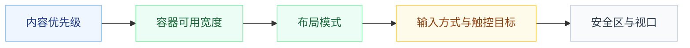
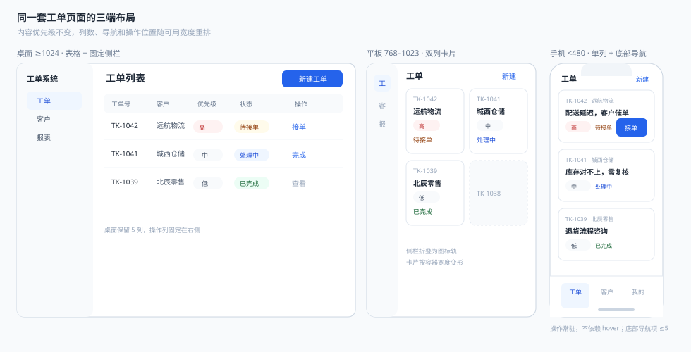
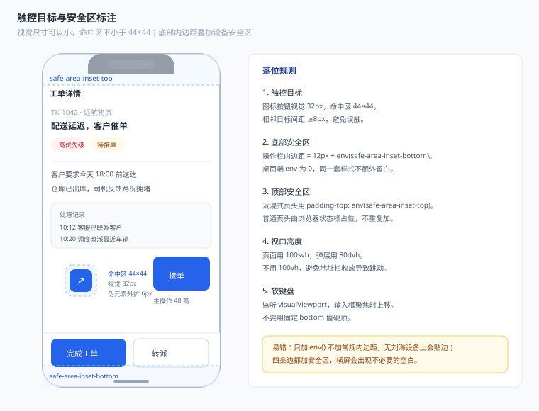

# 多端适配

> 这篇从多端适配的判断标准讲起，经过内容驱动的断点、容器查询、移动与平板与桌面的差异、触控目标、安全区与视口，最后落到响应式令牌、验收排障和一次工单系统的三端改造案例。
>
> 学完能把一个桌面页面重排成手机、平板、桌面都能用的一整套界面，并给出可验收的断点、触控和安全区规则。

## 一、多端适配的判断标准

多端适配是按可用空间、输入方式和使用场景重新排布信息与交互，不是把桌面页面等比缩小。等比缩小的结果是手机上字太小、按钮点不中、表格横向滚动，桌面上又留下大片空白。

判断一个页面是否需要适配，看三个变量，而不是看设备品牌。

### 1.1 三个变量

| 变量 | 影响 | 判断问题 |
|---|---|---|
| 可用宽度 | 能放几列、多少信息 | 最窄要多窄仍可用 |
| 输入方式 | 点击精度、悬停、键盘 | 是否依赖 hover 和右键 |
| 使用场景 | 停留时长、单手/双手 | 主操作是否要常驻底部 |

适配的推导顺序固定：



先确定“手机上必须保留什么”，再决定布局；反过来先画三套稿，最后一定会为塞不下的字段发明横向滚动。

### 1.2 适配深度分级

| 级别 | 做到什么 | 适用 |
|---|---|---|
| 可用下限 | 不横向滚动、可点、能读 | 内部系统移动访问少 |
| 效率适配 | 重排布局、改导航、主操作常驻 | 移动访问占比 20% 以上 |
| 原生体验 | 手势、离线、推送、原生控件 | 移动是主场景 |

适配深度由访问分布和场景决定，不由“响应式”这个词决定。三级之间不是升级关系，按实际访问分布选择。

> 边界：不是所有产品都要做完整三端。内部系统 95% 的访问来自 1440px 以上桌面，移动端只需保证“能看、能点、不横向滚动”，不需要为手机重做导航和全部操作。

## 二、断点由内容决定

断点不是设备型号表，是布局开始失效的宽度。做法是把浏览器拖窄，记录内容第一次挤坏、换行难看或操作够不着的宽度，那里就是断点。

### 2.1 断点与布局

一套后台系统常用的断点及其布局变化：

| 断点 | 宽度 | 布局 | 导航 | 列表 |
|---|---|---|---|---|
| xs | < 480 | 单列 | 底部标签 / 抽屉 | 卡片 |
| sm | 480–767 | 单列加宽 | 抽屉 | 卡片 |
| md | 768–1023 | 双列 | 折叠侧栏 | 双列卡片 |
| lg | 1024–1279 | 主内容 + 侧栏 | 固定侧栏 | 表格 |
| xl | ≥ 1280 | 主内容 + 侧栏 + 辅助栏 | 固定侧栏 | 表格 |

### 2.2 移动优先写法

移动优先写法，先写窄屏，再用 `min-width` 逐级增强：

```css
/* 先保证 320px 可用，再逐级加列；不要先写桌面再 max-width 往回删 */
.ticket-list {
  display: grid;
  grid-template-columns: 1fr;
  gap: 12px;
}

@media (min-width: 768px) {
  .ticket-list {
    grid-template-columns: repeat(2, minmax(0, 1fr));
    gap: 16px;
  }
}

@media (min-width: 1024px) {
  .ticket-list {
    grid-template-columns: repeat(3, minmax(0, 1fr));
    gap: 24px;
  }
}
```

### 2.3 内容压力测试

用内容压力测试代替猜断点：

1. 从 320px 开始，每次加 1px 拖宽，记录布局跳变的宽度；
2. 把最长标题、最长客户名、最大金额填进去再测；
3. 浏览器缩放到 200%，确认文字放大后不溢出；
4. 把系统字号调到最大，确认按钮文字不被裁切。

断点值不能写成 CSS 自定义属性，因为变量不能出现在媒体查询条件里；统一放在构建期常量、预处理器变量或一份断点清单里。2026 的浏览器已支持范围语法，`@media (width >= 768px)` 比 `min-width` 更直观，两者选一种并全库统一。

> 边界：断点控制在 3–5 个。为 320、375、390、414、430 每个机型写一套断点是维护灾难，这些宽度应由同一套流式布局覆盖。断点值写进令牌统一管理，不要在几十个文件里散落 `@media (max-width: 767px)`。

## 三、容器查询与组件级响应

页面排布看视口宽度，组件变形看自身容器宽度。同一个卡片放在主栏是三列，放进 280px 的侧栏就应该变成单列，这时视口媒体查询给不出正确答案。

### 3.1 建立容器上下文

```css
/* 列表容器建立查询上下文；卡片按容器宽度而不是屏幕宽度变形 */
.ticket-panel {
  container-type: inline-size;
  container-name: panel;
}

.ticket-card {
  display: grid;
  grid-template-columns: 1fr;
  gap: 8px;
}

@container panel (min-width: 420px) {
  .ticket-card {
    grid-template-columns: 1fr auto; /* 宽容器里把状态放到右侧 */
    align-items: center;
  }
}

@container panel (min-width: 720px) {
  .ticket-card__meta {
    display: flex; /* 只有够宽才把次要信息铺开成一行 */
    gap: 16px;
  }
}
```

### 3.2 视口查询与容器查询的选择

选择依据：

| 场景 | 用什么 | 原因 |
|---|---|---|
| 页面整体列数 | 视口媒体查询 | 依赖整页宽度 |
| 卡片在侧栏/主栏两处复用 | 容器查询 | 同一组件不同容器 |
| 表格是否切成卡片 | 容器查询 | 表格只关心自己有多宽 |
| 导航折叠 | 视口媒体查询 | 与页面框架绑定 |
| 字号流式变化 | `clamp()` | 连续变化，不跳变 |

> 边界：`container-type: inline-size` 会建立布局包含（layout containment），元素因此成为绝对定位和固定定位后代的包含块，内部若有 `position: fixed` 的浮层会被限制在容器内。浮层要挂到 `body` 或用 Portal。容器查询在 2023 年后进入主流浏览器稳定版，2026 可作为基线使用，但仍要为极旧内核留降级样式。

## 四、移动、平板与桌面的差异

三端的差异在导航模型、信息密度、操作入口和输入方式，不在换一套颜色。把桌面布局压窄只解决了宽度，没解决交互。

### 4.1 导航与信息密度

| 维度 | 移动 | 平板 | 桌面 |
|---|---|---|---|
| 导航 | 底部标签 ≤5 项 | 折叠侧栏或顶部标签 | 固定侧栏 + 顶栏 |
| 列表 | 单列卡片 | 双列卡片 | 多列表格 |
| 主操作 | 底部常驻按钮 | 工具栏按钮 | 行内 + 工具栏 |
| 信息密度 | 宽松，隐藏次要字段 | 中等 | 紧凑，全部字段 |
| 输入 | 触控、软键盘 | 触控 + 外接键盘 | 键鼠 |
| 反馈 | 全屏弹层、Toast | 侧滑面板 | 对话框、Popover |

导航按断点切换组件，不是把桌面侧栏 `display: none` 就算完成：

```css
.app-nav--desktop { display: none; }
.app-nav--mobile  { display: flex; }

@media (min-width: 1024px) {
  .app-nav--desktop { display: flex; }
  .app-nav--mobile  { display: none; }
}
```

平板横屏经常被当作桌面使用：1024px 及以上直接给桌面布局，不要因为“它是平板”就强制双列。iPad 横屏 1024–1366px，竖屏 768–1024px，按宽度走比按设备走稳定。

### 4.2 表格、表单与详情的三端形态

三端不是把同一张表格改宽度，而是换信息容器：

| 内容 | 移动 | 平板 | 桌面 |
|---|---|---|---|
| 列表 | 卡片，主字段 3 个 | 双列卡片 | 多列表格 |
| 表格 | 转卡片 | 4–5 列 | 全列 + 固定操作列 |
| 表单 | 单列，标签在上 | 单列或双列 | 双列或三列 |
| 筛选 | 底部抽屉 | 顶部抽屉 | 行内筛选栏 |
| 详情 | 分段折叠 | 两栏 | 主栏 + 侧栏 |

三条硬规则：

1. 表格在 768px 以下转卡片，不做横向滚动；确需保留表格时，只冻结主键列和操作列，并在边缘给出渐隐提示。
2. 表单标签在移动端置顶，桌面端可左对齐；输入框高度不小于 44px，错误信息紧贴字段。
3. 详情页在移动端把次要字段折叠进“更多信息”，主操作固定在底部安全区之上。

> 边界：平板不是大号手机。把手机底部标签直接放大到平板，会让主内容区被一条空旷的底栏占掉；平板更适合折叠侧栏或顶部标签。手机也不适合照搬桌面表格，横向滚动表格在触控下的可用性极差。

## 五、触控目标与输入方式

触控目标的最小尺寸：Apple HIG 建议 44×44 pt（约 44 CSS px），Material Design 建议 48×48 dp，WCAG 2.2 的 AA 级要求 24×24、AAA 级要求 44×44。企业后台按 44×44 做下限，主操作按 48×48。

### 5.1 最小目标与命中区

| 平台/规范 | 最小目标 | 相邻间距 |
|---|---|---|
| Apple HIG | 44×44 pt | 8pt |
| Material Design 3 | 48×48 dp | 8dp |
| WCAG 2.2 AA | 24×24 CSS px | 有例外条款 |
| WCAG 2.2 AAA | 44×44 CSS px | — |

视觉尺寸可以小，命中区不能小。图标按钮视觉 32px，用伪元素把点击区域扩到 44px：

```css
.icon-button {
  position: relative;
  width: 32px;
  height: 32px;
  display: inline-grid;
  place-items: center;
}

/* 视觉保持 32px，命中区扩到 44px，且不改变布局 */
.icon-button::before {
  content: "";
  position: absolute;
  inset: -6px;
}

/* 相邻目标至少留 8px，避免误触 */
.icon-button + .icon-button {
  margin-left: 8px;
}
```

### 5.2 悬停替代与手势冲突

悬停只对精确指针开放：

```css
/* 触屏没有 hover，把依赖 hover 才出现的操作改成常驻或长按 */
.ticket-actions { display: flex; }

@media (hover: hover) and (pointer: fine) {
  .ticket-actions {
    opacity: 0;
    transition: opacity 120ms ease;
  }
  .ticket-row:hover .ticket-actions {
    opacity: 1;
  }
}
```

> 边界：`pointer: coarse` 不能可靠区分触屏笔记本，不要用它做功能开关，只用来调整密度。依赖 hover 展示的“更多操作”在触屏上等于不存在；删改这类操作必须在触屏下常驻，或提供长按菜单并在界面上给出提示。

手势还有一层冲突：屏幕左右边缘的横滑通常被系统返回手势占用。自定义侧滑菜单、轮播、滑动删除要离边缘至少 24px，或改成明确的按钮触发；长按菜单不能是唯一入口，界面上要有可见的替代路径。

### 5.3 输入方式带来的交互差异

| 交互 | 触屏 | 键鼠 |
|---|---|---|
| 主要触发 | 点击、长按 | 单击、右键、快捷键 |
| 悬停信息 | 不可用 | 可用 |
| 精确选择 | 手指，误差约 8–10mm | 指针，像素级 |
| 文本输入 | 软键盘，遮挡视口 | 物理键盘 |
| 滚动 | 惯性、下拉刷新 | 滚轮、滚动条 |

桌面端可以保留右键菜单和快捷键作为效率入口，但同一功能必须在界面上有可点击入口；触屏端不能假设用户知道长按。

## 六、安全区与视口

全面屏设备的内容会被刘海、挖孔和底部手势条遮挡，必须用 `viewport-fit=cover` 配合 `env(safe-area-inset-*)` 留出安全区。

### 6.1 安全区内边距

```html
<!-- cover 让页面铺满屏幕，安全区才有意义；否则浏览器会自己留白 -->
<meta name="viewport" content="width=device-width, initial-scale=1, viewport-fit=cover" />
```

```css
/* 底部操作栏：常规内边距 + 设备安全区，桌面端 env 为 0 不影响布局 */
.bottom-bar {
  position: sticky;
  bottom: 0;
  padding: 12px 16px calc(12px + env(safe-area-inset-bottom));
  background: var(--color-surface-base);
  border-top: 1px solid var(--color-border-default);
}

.page {
  padding-left: max(16px, env(safe-area-inset-left));
  padding-right: max(16px, env(safe-area-inset-right));
}
```

| 变量 | 含义 | 典型用途 |
|---|---|---|
| `safe-area-inset-top` | 顶部刘海/状态栏 | 沉浸式页头 |
| `safe-area-inset-bottom` | 底部手势条 | 底部操作栏、标签栏 |
| `safe-area-inset-left` | 横屏左侧圆角/刘海 | 全屏内容 |
| `safe-area-inset-right` | 横屏右侧 | 全屏内容 |

### 6.2 视口高度与软键盘

视口高度用动态单位，不用 `100vh`：

```css
/* 移动浏览器地址栏收放会改变可视高度，dvh 跟随变化，svh 取最小高度 */
.screen {
  min-height: 100svh;
}

.sheet {
  max-height: 80dvh;
  overflow-y: auto;
}
```

软键盘弹出时，`100vh` 不会缩小，输入框容易被挡住。用 VisualViewport 修正：

```js
// 键盘弹出时把可视高度写进变量，表单容器用 max-height 跟随，避免输入框被遮
const vv = window.visualViewport;
const root = document.documentElement;
const syncViewport = () => root.style.setProperty('--vvh', `${vv.height}px`);
if (vv) {
  vv.addEventListener('resize', syncViewport);
  syncViewport();
}
```

```css
/* --vvh 由上面的脚本更新；不支持 visualViewport 时回退到 dvh */
.form-panel {
  max-height: var(--vvh, 100dvh);
  overflow-y: auto;
}
```

> 边界：安全区只在刘海屏和手势条设备上非零，桌面端为 0，不要用固定 34px 硬编码底部内边距。也不要把四条边都加上安全区，横向安全区只在横屏全屏内容时需要。`env()` 不能单独使用，要与常规间距用 `max()` 或 `calc()` 合并；只写 `env()` 会在无安全区设备上变成 0。

## 七、流式排版与响应式令牌

字号和间距在断点之间连续变化，能减少“跳一下”的突变；关键结构仍在断点处切换。两者配合，不是二选一。

### 7.1 流式字号与间距

```css
:root {
  /* 14px 起步，随视口增长，最大 16px；中间项用 vw 控制斜率 */
  --font-body: clamp(14px, 1.2vw + 10px, 16px);
  /* 页面标题跨度更大，但要有上限，避免大屏标题失控 */
  --font-title: clamp(20px, 2.4vw + 12px, 28px);
  --space-page: clamp(16px, 4vw, 32px);
}

.page-title {
  font-size: var(--font-title);
  line-height: 1.25;
}

.content {
  /* 正文行宽控制在 45–75 字符，超过就加大留白而不是拉满 */
  max-width: 72ch;
  margin-inline: auto;
}
```

| 令牌 | 移动取值 | 桌面取值 | 规则 |
|---|---|---|---|
| 正文字号 | 14px | 16px | `clamp(14, 1.2vw+10, 16)` |
| 页面标题 | 20px | 28px | `clamp(20, 2.4vw+12, 28)` |
| 页面内边距 | 16px | 32px | `clamp(16, 4vw, 32)` |
| 卡片间距 | 12px | 24px | 断点切换 |
| 内容最大宽 | 100% | 1440px | `max-width` |

### 7.2 响应式令牌的维护

断点、间距、字号三类值各自有归属：断点是构建期常量，间距走 4/8 倍数阶梯，字号走 `clamp()` 区间。同一个值不要同时由断点和 `clamp()` 控制，否则两块代码会互相覆盖。

容器查询单位（`cqw`、`cqi`）适合让卡片内的图标和留白跟随容器缩放，但它和 `vw` 一样没有上限，必须配 `clamp()`。优先用固定令牌，只有在“同一组件要适配 280–1200px 多种容器”时才引入容器单位。

> 边界：`clamp()` 的中间项含 `vw`，在大屏会持续增长，必须给上限；在极窄屏要给下限，否则文字会小于 12px。正文行长不要用百分比控制，`ch` 单位更贴近可读性；表格和代码块可以突破行宽限制，但要自带横向滚动容器。

## 八、验收与排障

多端问题大多不是“写错了”，而是“只在一个宽度下看过”。验收按宽度、输入方式、设备特征三个维度覆盖。

### 8.1 常见现象与第一条检查

| 现象 | 最可能原因 | 处理 |
|---|---|---|
| 手机横向滚动 | 固定宽度、长单词、绝对定位溢出 | 查 `overflow-x`，加 `min-width: 0` |
| 按钮点不中 | 命中区小于 44px | 扩伪元素或加内边距 |
| 底部内容被挡 | 未处理安全区 | 加 `env(safe-area-inset-bottom)` |
| 输入框被键盘遮住 | 用 `100vh` 布局 | 改 `dvh`，监听 VisualViewport |
| 平板大片空白 | 只写了两档断点 | 补 768–1279 区间布局 |
| 图片变形 | 固定宽高 | `aspect-ratio` + `object-fit` |
| 悬浮操作在手机消失 | 依赖 hover | 触屏下常驻或长按 |

### 8.2 真机矩阵与回归

真机矩阵至少覆盖这些宽度和形态：

| 类别 | 覆盖 | 重点检查 |
|---|---|---|
| 小屏手机 | 320–375 | 文字换行、横向滚动 |
| 大屏手机 | 390–430 | 安全区、底部栏 |
| 折叠屏 | 展开 600–800 | 布局重排、状态保持 |
| 平板竖屏 | 768–834 | 双列、侧栏折叠 |
| 平板横屏 | 1024–1366 | 是否误用手机布局 |
| 桌面 | 1280 / 1440 / 1920 | 最大宽度、留白 |
| 放大 | 200% 缩放 | 溢出、裁切 |

断点回归可以用截图脚本自动跑，避免每次改样式靠肉眼：

```js
// Playwright 片段：三个宽度各截一张，用于人工比对或视觉回归
import { chromium } from 'playwright';

const widths = [390, 768, 1440];
const browser = await chromium.launch();
for (const width of widths) {
  const page = await browser.newPage({ viewport: { width, height: 900 } });
  await page.goto('http://localhost:5173/tickets');
  await page.screenshot({ path: `shots/tickets-${width}.png`, fullPage: true });
  await page.close();
}
await browser.close();
```

> 边界：截图回归只能发现“变了”，不能判断“对不对”；布局语义、触控手感、安全区仍要真机确认。浏览器设备模拟不模拟刘海和手势条，安全区必须用真机或带安全区的模拟器验证。

## 九、最佳实践案例

### 9.1 案例背景

某工单系统原本只服务桌面：固定 1200px 最小宽度、左侧固定侧栏、工单列表 9 列表格、行内 hover 才显示操作。外勤人员开始用手机处理工单后，出现三个问题：页面必须横向拖动、状态标签点不中、底部操作按钮被手势条挡住。

目标是在不开发原生 App 的前提下，让同一套 Vue 3.5 + Element Plus 页面在手机、平板、桌面都可用。约束是 8 周内完成、不改后端接口、不新增设计工具链、老页面逐步迁移。

### 9.2 案例实操

第一步，确定内容优先级。把 9 个字段分三档：工单号、状态、优先级为主信息；客户、处理人、更新时间为此信息；来源、渠道、内部备注在手机上收进详情。主操作统一为“接单 / 完成”。

第二步，做内容压力测试。从 320px 开始拖宽，记录三个跳变点：480px 卡片开始有富余、768px 可放双列、1024px 表格 5 列不再挤压。断点定为 480 / 768 / 1024，不再按机型加档。

第三步，三端布局落位。手机单列卡片 + 底部标签导航 + 底部常驻主操作；平板双列卡片 + 折叠侧栏；桌面保留表格 + 固定侧栏。导航用两套组件按断点切换，不做 `display: none` 式隐藏。

第四步，组件级响应。列表容器加 `container-type: inline-size`，工单卡片在 420px 以上把状态移到右侧、在 720px 以上展开次要信息；同一张卡片复用到详情页侧栏时自动变单列。

第五步，触控与安全区。所有图标按钮命中区扩到 44×44，相邻间距 8px；行内操作在触屏下常驻；底部操作栏内边距叠加 `env(safe-area-inset-bottom)`；页面高度改用 `100svh`，弹层用 `80dvh`。

第六步，验收与回归。按真机矩阵跑一遍，补 Playwright 三宽度截图；把“320px 无横向滚动”“200% 缩放不裁切”“底部按钮不被遮挡”写成合并前检查项。

三端布局的实际差异：



触控目标与安全区的标注：



### 9.3 案例结果

以下为示例指标，按 8 周统计：

| 指标 | 改造前 | 改造后 |
|---|---|---|
| 手机端横向滚动页面 | 12 / 12 | 0 / 12 |
| 触控误点（每百次操作） | 9 次 | 3 次 |
| 外勤单均处理时长 | 6.5 分钟 | 4.8 分钟 |
| 平板横屏可用页面 | 3 / 12 | 12 / 12 |
| 新页面适配返工 | 平均 4 次 | 平均 1 次 |

失败模式与复盘：

- 第一版把桌面表格直接加 `overflow-x: auto`，手机能滑但操作列滑出屏幕，误操作更多；后来改成卡片，把操作固定在卡片底部；
- 平板竖屏一度套用手机布局，内容区两侧留白过大；补了 768px 双列后恢复正常；
- 底部按钮最初用固定 `padding-bottom: 34px`，在无手势条设备上偏高、在有手势条设备上仍被挡；改成 `env()` 后两端都对；
- 容器查询加上后，详情页内的固定定位浮层被限制在容器里；把浮层改为挂载到 `body` 后解决。

复盘的结论是：多端适配的收益主要来自“重新排优先级”和“改交互方式”，不是加媒体查询。断点数量、触控命中区和安全区这三件事做对，页面在真机上的可用性就有下限保证。
