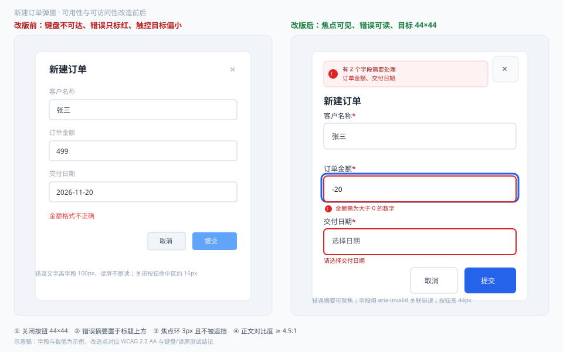

# 可用性与可访问性

> 这篇从可用性与可访问性的边界讲起，经过可用性测试、启发式评估、WCAG 2.2 标准、键盘路径与焦点管理、读屏语义、对比度与错误预防，最后落到一次完整的新建订单弹窗改造。
>
> 学完能独立设计并执行一轮可用性测试与无障碍审计，把发现的问题改到 WCAG 2.2 AA 可验收，并给出复测证据。

## 一、可用性与可访问性的边界

可用性回答“普通用户能不能顺利完成”，可访问性回答“不同能力、不同设备的用户能不能同样完成”。两者共用同一套界面，但验收证据不同：前者看任务指标，后者看标准条款与辅助技术实测。

| 维度 | 可用性（Usability） | 可访问性（Accessibility） |
|---|---|---|
| 关注对象 | 目标用户在真实场景中的任务 | 残障用户与受限环境下的等效使用 |
| 判断依据 | 完成率、耗时、错误、满意度 | WCAG 2.2 条款、辅助技术实测 |
| 典型产出 | 测试报告、问题清单、改版方案 | 审计表、修复单、合规声明 |
| 失败表现 | 找不到入口、填错、放弃 | 键盘进不去、读屏读不出、看不清 |
| 责任角色 | 产品、设计、用研 | 设计、前端、测试、内容 |

可用性不是“用户喜欢”，可访问性也不是“加个 alt”。两者的共同底线是：用户不需要额外的帮助，就能完成同一个任务。

### 1.1 什么时候必须做

- 面向公众的产品：上线前至少做一轮键盘走查与对比度检查，这是法律与采购的常见门槛；
- 企业内部系统：键盘效率直接决定录单、审核、客服等岗位的产出，不能只按“内部使用”降级；
- 涉及资金、医疗、政务、教育的流程：错误预防和可访问性属于功能需求，不是优化项；
- 设计系统与组件库：一处组件缺陷会复制到全部页面，必须在上游修。

### 1.2 什么时候不必做全量

原型探索阶段不做完整合规审计，但要做三件事：键盘能走通主流程、文字对比度达标、错误有文字说明。全量 WCAG 审计放在视觉与交互稳定之后，否则返工成本高，结论也不稳定。

> 边界：可访问性不是上线前的一次性检查。组件升级、主题换色、弹窗改版都会重新引入问题，验收要跟着变更走。

### 1.3 角色分工

| 角色 | 负责的部分 | 交付物 |
|---|---|---|
| 产品 | 任务定义、错误预防规则、法务确认 | 任务清单、验收标准 |
| 设计 | 焦点样式、层级、对比度、错误文案 | 交互稿、标注、状态说明 |
| 前端 | 语义结构、键盘行为、ARIA、焦点管理 | 可运行页面、组件 |
| 测试 | 键盘矩阵、读屏矩阵、自动化扫描 | 缺陷单、复测记录 |
| 内容 | 标签、帮助文本、错误与成功提示 | 文案表 |

## 二、可用性测试

可用性测试让真实用户执行真实任务，通过观察行为定位界面障碍。它产出的是可复现的失败点，不是“用户觉得挺好”。

### 2.1 测试计划

一份能执行的计划至少写清五件事：

| 项目 | 要写的内容 | 示例 |
|---|---|---|
| 研究问题 | 这轮要回答什么 | 用户能否独立完成退款 |
| 任务 | 用户要达成的结果 | 为订单 SO-001 发起退款 |
| 样本 | 人数、招募条件 | 6 名有后台操作经验的客服 |
| 环境 | 设备、网络、账号 | 桌面 Chrome，测试环境 |
| 产出 | 报告与优先级 | 问题清单 + 录像片段 |

样本量按目的定，不按“越多越专业”定：

| 目的 | 常见样本 | 说明 |
|---|---:|---|
| 发现严重问题 | 5–8 人 | 定性为主，迭代多轮 |
| 比较两版方案 | 每版 8–12 人 | 任务指标对比 |
| 定量基准 | 30 人以上 | 完成率、SUS 才有区间意义 |
| 专家走查 | 3–5 人 | 与真实用户互补 |

> 边界：5 人发现大部分问题只是经验规律，不是统计保证。高风险流程要增加人数，并覆盖新手与熟练用户两类。

### 2.2 任务写法

任务要描述目标，不描述操作步骤。任务里出现“点击右上角按钮”，测的就是指令理解，不是界面。

| 差的任务 | 好的任务 | 成功标准 |
|---|---|---|
| 点击新建按钮填写表单 | 为客户“李四”创建一笔 1280 元的订单 | 订单出现在列表且金额正确 |
| 使用筛选器 | 找出上周未发货的订单 | 结果集与标准答案一致 |
| 试试导出 | 把本月订单导出给财务 | 得到可打开的 CSV |

任务卡只给用户看目标与必要背景，操作路径由用户自己找。主持人读完任务后停止提示，观察用户的第一动作。

### 2.3 主持与记录

主持的核心是不引导。用户问“点这里对吗”，回答“你觉得呢”；用户沉默超过 20 秒，追问“现在在想什么”，不指方向。

记录模板固定四列，边看边填：

| 时间点 | 用户行为 | 卡点判断 | 原话 |
|---|---|---|---|
| 00:42 | 在列表页上下滚动 | 找不到新建入口 | “新建在哪” |
| 01:15 | 点进详情再返回 | 路径绕远 | “是不是在详情里” |
| 02:03 | 金额填成含税价 | 字段含义不清 | “这里填税前还是税后” |

“卡点判断”是主持人的推断，必须和原话、录像分开记。报告里把推断当结论，是可用性测试最常见的失真。

### 2.4 指标

定性测试也能量化，只要任务与成功标准事先定义：

| 指标 | 计算方式 | 用途 |
|---|---|---|
| 任务完成率 | 独立完成人数 / 总人数 | 判断流程是否可用 |
| 任务耗时 | 从读题到完成的中位数 | 比较版本效率 |
| 错误次数 | 提交错误或走错分支的次数 | 定位错误预防缺口 |
| 求助次数 | 主动询问主持人的次数 | 判断自解释程度 |
| SUS | 10 题量表换算 0–100 | 跨版本横向比较 |
| SEQ | 单题 1–7 分 | 单任务即时满意度 |

SUS 的换算规则：奇数题计“得分 − 1”，偶数题计“5 − 得分”，求和后乘 2.5。行业经验均值约 68，低于 60 通常意味着需要改版，但 SUS 不能替代任务完成率。

> 边界：不要用“愿不愿意推荐”替代任务指标。满意度高但完成率低的界面，说明用户还没意识到自己错了。

### 2.5 远程与实验室

| 方式 | 适合 | 风险 |
|---|---|---|
| 实验室 | 复杂设备、需要观察表情 | 成本高、样本窄 |
| 远程主持 | 跨地域、快速迭代 | 网络与干扰不可控 |
| 无主持 | 大样本、标准化任务 | 卡住无人追问，原因缺失 |

远程测试要提前检查屏幕共享、录音授权和测试账号。无主持测试必须设计“卡住时怎么办”，否则只能得到完成率，拿不到原因。

## 三、启发式评估

启发式评估由评估者按固定原则独立走查界面，在真实用户测试之前快速暴露结构性问题。它便宜、快，但只能发现“可被原则描述”的问题。

### 3.1 十条启发式

| 编号 | 原则 | 在后台界面里的表现 |
|---|---|---|
| H1 | 系统状态可见 | 保存中、已保存、失败要有反馈 |
| H2 | 贴近真实世界 | 用“发货”而不是“状态迁移” |
| H3 | 用户控制与自由 | 可撤销、可返回、可关闭 |
| H4 | 一致性与标准 | 同一动作同一位置、同一措辞 |
| H5 | 错误预防 | 约束输入、危险操作二次确认 |
| H6 | 识别优于回忆 | 选项可见，不要求记编码 |
| H7 | 灵活与高效 | 快捷键、批量操作、最近使用 |
| H8 | 简约设计 | 一屏只留当前任务需要的信息 |
| H9 | 帮助用户识别与恢复错误 | 说清错在哪、怎么改 |
| H10 | 帮助与文档 | 就地帮助，不用跳出手册 |

### 3.2 走查流程

1. 选定 3–5 条关键任务，覆盖正常路径、边界值和失败路径；
2. 每名评估者独立走查，不讨论，避免结论相互污染；
3. 汇总去重，按“位置 + 原则 + 证据”记录；
4. 评严重度，排修复顺序；
5. 把高严重度问题转成可用性测试的观察点。

评估记录必须带截图或录屏时间点。只写“表单体验不好”无法排期，也无法复测。

### 3.3 严重度评级

| 级别 | 含义 | 处理 |
|---:|---|---|
| 0 | 不是问题 | 记录，不修 |
| 1 | 轻微，影响体验 | 排入常规迭代 |
| 2 | 次要，增加成本 | 本版本修 |
| 3 | 严重，任务受阻 | 上线前必修 |
| 4 | 灾难，数据或合规风险 | 立即修，阻断发布 |

严重度同时看影响人数、频率和后果。一个只在月末出现的导出错误，如果导致财务对账失败，严重度仍然是 4。

> 边界：启发式评估不能替代真实用户。评估者熟悉界面，会低估首次使用的学习成本；真实用户的失败往往来自与评估者不同的心智模型。

## 四、WCAG 2.2 的层级与新要求

WCAG 2.2 是 W3C 2023 年 10 月发布的推荐标准，企业验收通常以 AA 为基线。它按四项原则组织：可感知（Perceivable）、可操作（Operable）、可理解（Understandable）、健壮（Robust）。

### 4.1 四项原则与常见条款

| 原则 | 含义 | 高频条款 |
|---|---|---|
| 可感知 | 信息能被看见、听见 | 1.1.1 非文本内容、1.4.3 对比度 |
| 可操作 | 所有功能可操作 | 2.1.1 键盘、2.4.7 焦点可见 |
| 可理解 | 文案与行为可预测 | 3.3.1 错误识别、3.3.3 错误建议 |
| 健壮 | 兼容辅助技术 | 4.1.2 名称角色值 |

### 4.2 合规级别

| 级别 | 要求 | 适用 |
|---|---|---|
| A | 最低门槛 | 任何公开产品 |
| AA | 企业采购与法规常见基线 | 默认目标 |
| AAA | 增强要求，难以全站达到 | 特定场景，不作全站承诺 |

合规声明必须写清范围：哪些页面、哪些流程、哪个级别、哪些已知例外。只写“符合 WCAG 2.2”而不写范围，等于没有声明。

### 4.3 WCAG 2.2 新增条款

| 条款 | 级别 | 要点 |
|---|---|---|
| 2.4.11 焦点不被遮挡（最低） | AA | 键盘焦点不能被固定头尾遮住 |
| 2.4.12 焦点不被遮挡（增强） | AAA | 焦点元素完整可见 |
| 2.4.13 焦点外观 | AAA | 焦点指示的面积与对比度下限 |
| 2.5.7 拖动操作 | AA | 拖动要提供单点替代方式 |
| 2.5.8 目标尺寸（最低） | AA | 指针目标至少 24×24 CSS px |
| 3.2.6 一致的帮助 | A | 帮助入口在同站同位置 |
| 3.3.7 冗余输入 | A | 不要求重复填写同一信息 |
| 3.3.8 可访问认证（最低） | AA | 登录不依赖认知测验 |
| 3.3.9 可访问认证（增强） | AAA | 不依赖识别物体或用户内容 |

WCAG 2.2 同时移除了 4.1.1 解析（Parsing）。移除不等于可以写错标签，而是浏览器容错已足够，检查重点转到 4.1.2 名称、角色、值。

### 4.4 数字口径

- 普通文字对比度 ≥ 4.5:1，大文字 ≥ 3:1；大文字指 ≥ 24px，或 ≥ 18.66px 且加粗；
- 图标、边框、输入框边界等非文本元素 ≥ 3:1；
- 目标尺寸最低 24×24 CSS px，移动端仍建议 44×44 或 48×48；
- 页面在 400% 缩放、320 CSS px 宽度下不出现双向滚动；
- 文本间距放大到行高 1.5 倍、段距 2 倍、字距 0.12 倍、词距 0.16 倍时，内容不丢失。

> 边界：24×24 是 AA 的最低线，不是设计目标。手指操作、误触代价高的场景按 44×44 起步；相邻目标之间还要留间距。

## 五、键盘路径与焦点管理

键盘可用的判断只有一句：不碰鼠标，能完成全部任务，且始终知道焦点在哪。满足不了这一条，读屏支持也无从谈起。

### 5.1 顺序与可聚焦性

Tab 顺序默认等于 DOM 顺序。视觉顺序与 DOM 顺序不一致时，键盘用户会跳着走，读屏用户会听到错误的前后关系。

- 用原生 `button`、`a`、`input`、`select`，不要给 `div` 加点击事件充当按钮；
- `tabindex="0"` 只用于确实需要聚焦的自定义控件；
- `tabindex="-1"` 用于脚本聚焦，例如弹窗标题、错误摘要；
- 不要用正数 `tabindex`，它会打乱整页顺序且难以维护。

### 5.2 常见控件的键位

| 控件 | 键位 | 易错点 |
|---|---|---|
| 按钮 | Enter、Space | 只监听 click，键盘不触发 |
| 链接 | Enter | 用 `href="#"` 丢失语义 |
| 复选框 | Space | 自定义样式后隐藏原生输入 |
| 单选组 | 方向键切换 | 每个选项都进 Tab 序列 |
| 菜单 | 方向键、Esc | 打开后焦点不进入 |
| 弹窗 | Esc 关闭、Tab 循环 | 焦点跑回背景页 |
| 标签页 | 方向键、Home/End | 全部标签都可 Tab |

### 5.3 复合组件的 roving tabindex

一组选项只保留一个 Tab 停靠点，进入后用方向键移动。这样既减少 Tab 次数，也符合用户预期。

```html
<!-- 片段：单选组只让选中项进入 Tab 序列，方向键移动焦点 -->
<div role="radiogroup" aria-labelledby="ship-label">
  <span id="ship-label">配送方式</span>
  <button role="radio" aria-checked="true" tabindex="0">标准配送</button>
  <button role="radio" aria-checked="false" tabindex="-1">次日达</button>
  <button role="radio" aria-checked="false" tabindex="-1">自提</button>
</div>
```

```javascript
// 片段：方向键切换，同步 aria-checked 与 tabindex
group.addEventListener('keydown', (event) => {
  if (!['ArrowRight', 'ArrowLeft'].includes(event.key)) return;
  event.preventDefault(); // 阻止页面滚动
  const items = [...group.querySelectorAll('[role="radio"]')];
  const current = items.indexOf(document.activeElement);
  const next = (current + (event.key === 'ArrowRight' ? 1 : -1) + items.length) % items.length;
  items.forEach((item, index) => {
    item.setAttribute('aria-checked', String(index === next)); // 状态与视觉同步
    item.tabIndex = index === next ? 0 : -1;
  });
  items[next].focus();
});
```

### 5.4 弹窗的焦点闭环

弹窗打开时必须做四件事：记录触发元素、把焦点移入弹窗、把 Tab 限制在弹窗内、关闭后把焦点还给触发元素。缺任何一步，键盘用户都会迷失。

```javascript
// 片段：打开时保存来源焦点，关闭时归还
const dialog = document.querySelector('#order-dialog');
let returnFocus = null;

function openDialog(trigger) {
  returnFocus = trigger;              // 关闭后要回到这里
  dialog.showModal();                 // 原生 dialog 自带焦点限制与 Esc
  dialog.querySelector('[data-autofocus]')?.focus();
}

dialog.addEventListener('close', () => {
  returnFocus?.focus();               // 不归还焦点，用户会被丢回页首
});
```

用原生 `<dialog>` 的 `showModal()` 可以减少手写焦点陷阱的漏洞；自定义弹窗则要自己处理 Tab 首尾循环、Esc、背景 `inert` 和滚动锁定。

### 5.5 跳转链接与焦点样式

长页面在正文前放“跳到主内容”，让键盘用户跳过几十个导航项。焦点样式不能被全局 `outline: none` 清掉。

```css
/* 跳转链接默认移出视口，聚焦时出现在左上角 */
.skip-link {
  position: absolute;
  left: -9999px;
  top: 0;
  background: #ffffff;
  color: #1d4ed8;
  padding: 12px 16px;
  z-index: 100;
}
.skip-link:focus {
  left: 16px;
  top: 16px;
}

/* 只在键盘聚焦时显示焦点环，鼠标点击不出现 */
:focus-visible {
  outline: 3px solid #2563eb;
  outline-offset: 2px;
}

/* 固定头部会遮住锚点目标，用 scroll-margin 预留空间 */
:target,
[data-focus-target] {
  scroll-margin-top: 88px;
}
```

### 5.6 焦点不被遮挡

固定顶栏、吸底工具栏、浮层都会遮住焦点元素。WCAG 2.4.11 要求焦点至少部分可见，实际项目按“完整可见”做更稳。

- 给可聚焦元素设置 `scroll-margin-top` / `scroll-margin-bottom`；
- 弹窗和抽屉打开时，背景内容设 `inert`，避免焦点跑到看不见的区域；
- 吸底工具栏出现时，给页面底部留出等高的安全区；
- 用键盘逐屏走查，不只看首屏。

> 边界：`outline: none` 是最常见的严重缺陷。要移除默认样式，必须同时提供对比度 ≥ 3:1 的替代焦点指示，并且不能用颜色单独表达。

## 六、屏幕阅读器与语义

读屏质量取决于语义结构，不取决于补了多少 `aria-label`。先用原生元素表达“这是什么”，再用 ARIA 补充“现在是什么状态”。

### 6.1 语义优先

| 需求 | 正确做法 | 常见错误 |
|---|---|---|
| 可点击动作 | `<button>` | `<div onclick>` 无键盘支持 |
| 页面跳转 | `<a href>` | `<span>` 加 click |
| 表单分组 | `<fieldset><legend>` | 只用一个标题视觉分隔 |
| 数据表格 | `<table><th scope>` | 用 div 拼格子 |
| 页面区域 | `<header><nav><main><footer>` | 整页都是 div |
| 进度与提示 | `<output>`、`role="status"` | 只改颜色不播报 |

### 6.2 地标与标题层级

地标让读屏用户按区域跳转：`header`、`nav`、`main`、`aside`、`footer`，每个页面只保留一个 `main`。多个 `nav` 要用 `aria-label` 区分，例如“主导航”“面包屑”。

标题层级按内容嵌套，不按字号选 `h` 标签。从 `h1` 跳到 `h3` 会让“按标题导航”的用户以为漏了一节。视觉字号用 CSS 控制，语义层级用标签控制。

### 6.3 替代文本

| 图片类型 | 写法 | 示例 |
|---|---|---|
| 装饰图 | `alt=""` | 背景纹理、分隔线 |
| 信息图 | 描述图表达的内容 | “销售额环比增长 12%” |
| 功能图 | 描述动作目的 | “搜索”“关闭对话框” |
| 复杂图 | 短替代 + 正文长描述 | 图表给数据表链接 |

替代文本不写“图片”“图标”，也不重复相邻文字。按钮里的图标加 `aria-hidden="true"`，让读屏只读按钮文字。

### 6.4 表单的名称与描述

每个输入框都要有可编程名称。视觉标签用 `<label for>` 关联，错误和帮助文本用 `aria-describedby` 关联，出错时用 `aria-invalid` 标记。

```html
<!-- 片段：标签、必填、错误、帮助四者互相关联 -->
<div class="field">
  <label for="amount">订单金额 <span aria-hidden="true">*</span></label>
  <input
    id="amount"
    name="amount"
    type="text"
    inputmode="decimal"
    required
    aria-required="true"
    aria-invalid="true"
    aria-describedby="amount-help amount-error"
  />
  <p id="amount-help">填写含税金额，最多两位小数。</p>
  <p id="amount-error" role="alert">金额需为大于 0 的数字，例如 499.00。</p>
</div>
```

`aria-required` 不是必填校验的替代，服务端仍要校验。视觉上的星号要配文字说明“带 * 为必填”，否则读屏用户不知道为什么必填。

### 6.5 动态状态播报

保存成功、批量处理完成、异步校验失败，都需要通过 live region 播报，否则读屏用户不知道页面已经变化。

```html
<!-- 片段：polite 用于普通状态，assertive 只用于必须立刻打断的错误 -->
<div id="toast" role="status" aria-live="polite"></div>
<div id="form-alert" role="alert" aria-live="assertive"></div>
```

更新 live region 时只改文本内容，不要整块替换节点；节点被移除重建，部分读屏不会播报。`assertive` 会打断当前朗读，只留给阻断性错误。

### 6.6 名称、角色、值

自定义控件必须同时具备三者：用户听到的名称、控件类型、当前状态。`aria-expanded`、`aria-checked`、`aria-selected`、`aria-disabled` 都是状态，不是装饰。

> 边界：ARIA 的第一规则是“能用原生元素就不要用 ARIA”。给 `div` 加 `role="button"` 只改变了读屏播报，不会自动获得 Enter、Space 和焦点能力。

### 6.7 读屏测试矩阵

| 系统 | 读屏 | 浏览器 | 覆盖场景 |
|---|---|---|---|
| Windows | NVDA | Chrome、Firefox | 企业后台主力 |
| Windows | JAWS | Chrome | 金融、政务采购 |
| macOS | VoiceOver | Safari | 设计与开发自测 |
| iOS | VoiceOver | Safari | 移动端审批 |
| Android | TalkBack | Chrome | 移动端现场作业 |

每轮至少覆盖一个桌面组合和一个移动组合。只用一种读屏通过，不代表其他组合通过；浏览器与读屏的配合差异，往往在弹窗和表格上暴露。

## 七、对比度与可感知性

可感知的第一道门槛是“看得见”。对比度、字号、缩放、颜色编码，任何一项不达标，后面的交互设计都失效。

### 7.1 对比度口径

| 内容 | 最低对比度 | 说明 |
|---|---:|---|
| 普通文字 | 4.5:1 | 小于 24px，或小于 18.66px 粗体 |
| 大文字 | 3:1 | 24px 以上，或 18.66px 以上粗体 |
| 图标与图形 | 3:1 | 传达信息的图标 |
| 输入框与边框 | 3:1 | 相对相邻背景 |
| 焦点指示 | 3:1 | 相对未聚焦状态与背景 |

灰字最容易出问题。`#9ca3af` 放在白底上约 2.5:1，只能做装饰；正文辅助信息至少用 `#6b7280`（约 4.8:1）。

### 7.2 非文本对比与状态

输入框边界、开关轨道、图表折线、选中态背景都属于非文本内容，同样要满足 3:1。浅灰边框配白底，在强光屏幕下几乎消失。

### 7.3 颜色不是唯一载体

| 场景 | 只靠颜色 | 补充手段 |
|---|---|---|
| 表单错误 | 红框 | 图标 + 文字说明 |
| 订单状态 | 色块 | 状态文字 + 色块 |
| 必填项 | 红色星号 | 星号 + “必填”说明 |
| 图表系列 | 不同颜色 | 线型、标记、直接标注 |
| 链接 | 蓝色文字 | 下划线或足够对比 + 非颜色提示 |

### 7.4 缩放、回流与文本间距

- 200% 文字缩放不丢内容，不出现截断；
- 400% 缩放、320 CSS px 宽时，内容单列回流，不出现横向滚动；
- 文本间距放大后，按钮文字不溢出、表格不重叠；
- 固定高度容器是回流失败的高发点，改用 `min-height` 和自适应高度。

### 7.5 暗色模式

暗色模式要成对检查：正文、次要文字、边框、状态色、图表、焦点环。把白底方案直接反相，常见结果是纯白文字刺眼、语义色过饱和、阴影消失。

> 边界：禁用态文字在 WCAG 中不强制对比度，但“看不出是禁用”仍是可用性问题。禁用原因要用文案或提示说明，不能只靠更浅的灰。

## 八、错误预防与表单

错误处理分三层：能预防的不让发生，发生了要立刻说清，改完之后要能恢复。三层都做到，表单才算可用。

### 8.1 预防优先

| 手段 | 做法 | 适用 |
|---|---|---|
| 约束输入 | 日期选择器、数字键盘、格式掩码 | 金额、日期、电话 |
| 默认值 | 带出常用值，允许修改 | 收货地址、税率 |
| 事前说明 | 标签旁写清单位与口径 | 含税/未税、张/箱 |
| 二次确认 | 删除、作废、批量提交 | 不可逆操作 |
| 可撤销 | 撤销条、回收站 | 误删、误改 |
| 自动保存 | 草稿定时保存 | 长表单、工单 |

### 8.2 错误信息的三段式

一条能用的错误信息包含：哪个字段、为什么错、怎么改。缺“怎么改”，用户只能猜。

| 差 | 好 |
|---|---|
| 输入有误 | 订单金额需为大于 0 的数字，例如 499.00 |
| 日期无效 | 交付日期不能早于今天（2026-11-13） |
| 操作失败 | 库存不足，当前可发 3 件，请调整数量 |

错误文本紧贴字段，放在字段下方，不要集中到页面底部。字段多时在顶部加错误摘要，摘要项可点击跳到对应字段。

### 8.3 提交时的焦点与播报

提交失败后，把焦点移到错误摘要，或移到第一个错误字段。焦点留在提交按钮，读屏用户会以为页面没反应。

```javascript
// 片段：提交失败后聚焦摘要，并让读屏播报错误数量
const summary = document.querySelector('#error-summary');
summary.textContent = `有 ${errors.length} 个字段需要处理`;
summary.hidden = false;
summary.focus(); // 摘要容器需要 tabindex="-1"
```

### 8.4 实时校验的节奏

不要在每次按键后立刻报错。输入过程中只在失焦时校验，格式提示可以实时给，错误结论等用户填完再给。否则用户刚输入第一个字符就看到红字，会误以为整个表单失败。

### 8.5 冗余输入与自动填充

WCAG 3.3.7 要求同一流程中已经提交过的信息不重复索取。常见做法：

- 收货地址与账单地址提供“同上”；
- 分步表单保留上一步数据，返回不丢；
- 支持浏览器和密码管理器自动填充，`autocomplete` 写对字段语义；
- 上传材料后在确认页展示，不要求重新上传。

### 8.6 可访问认证

登录不能依赖记忆难题、图形识别或拼图。允许粘贴密码、允许密码管理器、提供显示密码开关、支持邮箱或短信验证码。验证码输入框加 `autocomplete="one-time-code"`，让系统自动填。

> 边界：错误预防不等于多加确认框。每一步都弹确认，用户会形成“无脑点确定”的习惯，真正的危险操作反而失去警示作用。

## 九、自动化检查与人工验收

自动化能稳定拦住结构性和对比度问题，但拦不住“读屏听到的顺序是否合理”这类判断。验收必须两条腿走路。

### 9.1 自动化扫描

```bash
# 片段：本地起静态服务后用 axe 扫描，需 Node 22+
npx http-server dist -p 4173
npx @axe-core/cli http://localhost:4173/orders --exit
```

```bash
# 片段：pa11y 按 WCAG2AA 规则集扫描并输出报告；WCAG 2.2 新增条款另用 axe 补扫
npx pa11y http://localhost:4173/orders --standard WCAG2AA --reporter json > a11y-report.json
```

预期输出：无问题时 axe 返回 0 个 violation，pa11y 输出 `No issues found!`；有问题时按规则名列出节点、选择器和修复建议。命令退出码可用于 CI 阻断。

### 9.2 自动化能覆盖什么

| 类型 | 自动化 | 说明 |
|---|---|---|
| 图片替代文本 | 能 | 缺失会报，质量需人工判断 |
| 表单标签 | 能 | 名称缺失可检测 |
| 对比度 | 能 | 纯色可算，渐变与图片需人工 |
| 键盘顺序 | 部分 | 可测可聚焦性，难测合理性 |
| 焦点管理 | 部分 | 可测焦点存在，难测是否被困 |
| 读屏语义 | 部分 | 可测角色名称，难测理解成本 |
| 错误恢复 | 不能 | 依赖任务与文案判断 |

### 9.3 键盘走查清单

1. 只用 Tab、Shift+Tab、Enter、Space、方向键、Esc，能否完成主流程；
2. 每一步焦点是否可见，是否被固定头尾遮挡；
3. 弹窗打开后焦点是否进入，关闭后是否回到触发按钮；
4. 是否存在键盘陷阱，Tab 是否能离开每个区域；
5. 自定义下拉、日期选择、富文本是否支持方向键与 Esc；
6. 跳转链接是否是第一个可聚焦元素。

### 9.4 读屏走查清单

1. 关闭显示器，能否听完页面结构与主流程；
2. 表单字段是否读出名称、必填、格式、错误；
3. 提交后是否播报成功或失败；
4. 表格是否读出表头与单元格关系；
5. 图标按钮是否读出动作，而不是“按钮”；
6. 动态加载是否播报结果数量。

### 9.5 审计表

| 页面 | 条款 | 证据 | 结论 |
|---|---|---|---|
| 订单列表 | 1.4.3 | 正文 4.9:1 | 通过 |
| 新建订单 | 2.4.11 | 焦点被顶栏遮挡 | 不通过 |
| 新建订单 | 3.3.1 | 错误仅红框 | 不通过 |
| 客户详情 | 4.1.2 | 图标按钮无名称 | 不通过 |

结论只有“通过 / 不通过 / 不适用”三种，不用“基本通过”。每条不通过都要有截图或录屏时间点，修复后在同一位置复测。

> 边界：自动化 0 violation 不等于无障碍。工具只能判断机器可判定的部分，键盘与读屏实测才是验收依据。

## 十、最佳实践案例

### 10.1 案例背景

某 B2B 订单后台的“新建订单”弹窗是客服最高频入口，日均创建 1200 单。客服团队 40 人，其中 2 人使用键盘完成大部分操作，1 人使用 NVDA 读屏。

现状问题：键盘用户 Tab 进入弹窗后焦点仍停留在背景列表；金额填错只有红框，读屏不播报；关闭按钮约 16px，移动审批时经常点不中；正文辅助文字用 `#9ca3af`，强光下看不清。

目标是把弹窗改到 WCAG 2.2 AA，键盘独立完成率达到 100%，且不改业务字段与提交流程。约束是两周内上线、组件库版本冻结、只能改弹窗与表单组件。

### 10.2 案例实操

**第一步：定义任务与基线。** 招募 6 名客服，执行 3 个任务：创建一笔含税订单、修改金额后重新提交、处理日期错误。记录完成率、耗时、错误数和 SUS。

| 指标 | 改版前 | 说明 |
|---|---:|---|
| 键盘独立完成率 | 2/6 | 4 人中途改用鼠标 |
| 平均任务耗时 | 142 秒 | 含找错误原因 |
| 平均错误数 | 3.2 次 | 金额口径与日期格式 |
| axe violations | 17 | 对比度 9、标签 4、名称 4 |
| SUS | 58 | 低于行业均值 |

**第二步：启发式评估。** 3 名评估者独立走查，汇总出 11 条问题，按严重度排序：

| 问题 | 原则 | 严重度 |
|---|---|---:|
| 弹窗无标题关联，读屏只读“对话框” | H1 | 3 |
| 错误只在字段下方，提交后焦点不动 | H9 | 4 |
| 关闭按钮命中区过小 | H5 | 3 |
| 金额单位未说明含税 | H2 | 3 |
| 关闭弹窗丢失已填内容，无提示 | H3 | 2 |

**第三步：修语义与结构。** 弹窗改为原生 `dialog`，用 `aria-labelledby` 关联标题；每个字段补 `<label for>`、`aria-required`、`aria-describedby`；错误摘要放在标题上方，容器加 `tabindex="-1"`，提交失败后聚焦并播报错误数量。

**第四步：修焦点与键盘路径。** 打开时聚焦客户名称，Tab 在弹窗内循环，Esc 关闭，关闭后焦点回到“新建订单”按钮；背景内容设 `inert`；给固定顶栏预留 `scroll-margin-top`，保证焦点不被遮挡。

**第五步：修目标尺寸与对比度。** 所有按钮和输入框高度统一为 44px，关闭按钮 44×44；正文辅助文字从 `#9ca3af` 改为 `#6b7280`，错误文字用 `#b91c1c`，焦点环用 3px `#2563eb` 加 2px 偏移。

**第六步：加错误预防。** 金额输入限制为数字与两位小数，提交前校验大于 0；交付日期最小值设为当天；有未保存内容时关闭弹窗给出确认；收货信息支持“同上”，不重复填写。



**第七步：复测。** 同一批任务、同一批用户类型，换 6 名未参与首轮的客服；键盘走查按清单逐项过；NVDA + Chrome 与 VoiceOver + Safari 各跑一遍；axe 与 pa11y 重扫。

### 10.3 案例结果

| 指标 | 改版前 | 改版后 | 变化 |
|---|---:|---:|---|
| 键盘独立完成率 | 2/6 | 6/6 | +67 个百分点 |
| 平均任务耗时 | 142 秒 | 78 秒 | −45% |
| 平均错误数 | 3.2 次 | 0.7 次 | −78% |
| axe violations | 17 | 0 | 清零 |
| SUS | 58 | 81 | +23 |

以上为示例数据，采集口径为 6 人 × 3 任务的单轮测试，不代表统计显著性。读屏复测中，NVDA + Chrome 与 VoiceOver + Safari 两套组合均能正确朗读字段名称、必填状态与错误原因；键盘用户不再需要鼠标救援。

失败模式与复盘：

- 只加 `aria-label` 不改可见标签，语音控制用户无法用可见文字定位按钮，违反 2.5.3；可见标签必须包含在可访问名称里；
- 手写焦点陷阱漏掉 Shift+Tab，焦点从第一个元素倒着跑回背景；优先用原生 `dialog`；
- 错误摘要没有 `tabindex="-1"`，脚本调用 `focus()` 无效，读屏不播报；
- 只改正文对比度，占位符仍是浅灰，输入后看似正常、输入前看不清；
- 移动端做到 44px 但相邻按钮间距为 0，误触没有下降，目标之间还要留 8px 以上间距。

复盘的结论是：这次收益最大的三项是焦点闭环、错误摘要、可见标签，而不是新增 ARIA 属性。修复放在表单组件层，后续 14 个使用同一组件的页面自动获益；把键盘走查、对比度、错误文案加入组件 Definition of Done，才能防止回退。

