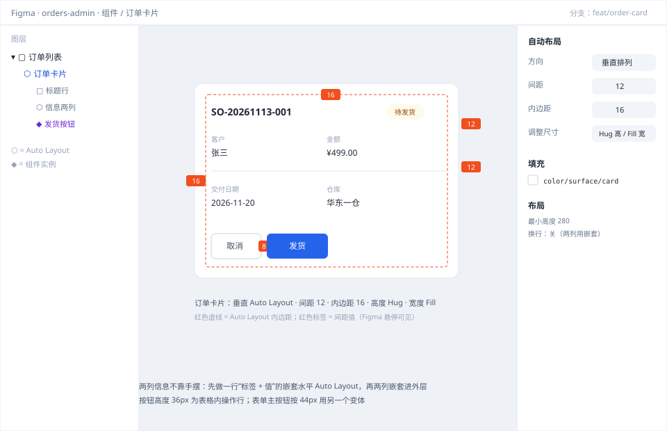
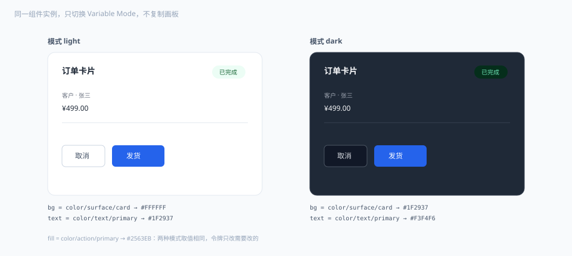
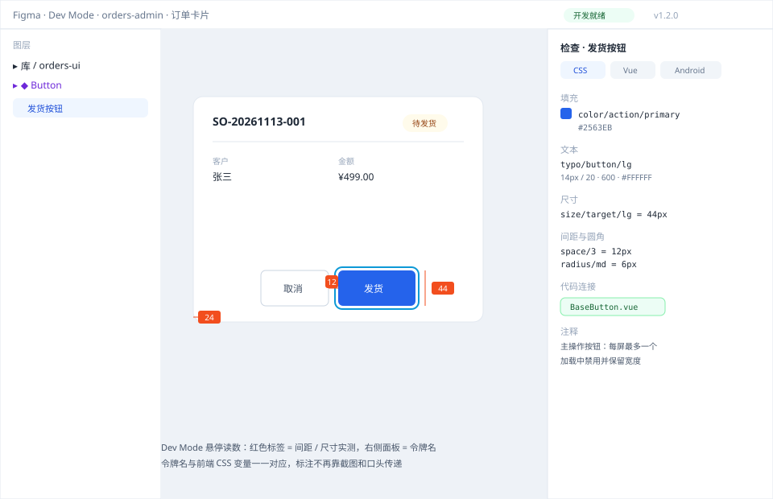

# Figma与设计交付

> 这篇从 Figma 的交付链与文件组织讲起，经过 Auto Layout、组件与 Variants、Variables 与 Modes、组件库治理、Dev Mode 标注、切图与资产导出，最后落到一次完整的后台组件库搭建与交付。
>
> 学完能独立组织一个 Figma 交付文件，用 Auto Layout、组件变量和 Dev Mode 把设计稳定交到前端，并按清单完成还原走查。

## 一、Figma 交付链与文件组织

Figma 在交付链中承担“单一事实源”：视觉、交互规格、令牌、切图都从同一个文件出。交付质量取决于文件组织和组件建模，不取决于画板画得多细。


探索草稿不进交付文件；走查结果回流到组件库，而不是在页面文件里就地修。

### 1.1 文件拆分

| 文件 | 放什么 | 不放什么 |
|---|---|---|
| `orders-ui` 库文件 | 基础组件、令牌、规范 | 具体业务页面 |
| 项目设计文件 | 页面画板、流程、注释 | 组件源定义 |
| 评审归档文件 | 已定稿版本快照 | 继续编辑的画板 |

组件源定义只放在库文件里。项目文件里看到“实心菱形”（组件定义），说明有人把组件源复制进了业务文件，后续库更新再也同步不到它。

### 1.2 页面与画板命名

| 层级 | 命名规则 | 示例 |
|---|---|---|
| Page | 按阶段或模块分组 | `迭代/2026-W46` |
| Frame | 页面名 + 状态 | `订单列表/默认态` |
| 状态画板 | 同名 + 状态后缀 | `订单列表/空态` |
| 组件 | 类别/组件 | `Button/Primary` |

命名决定检索。前端按名称搜组件，走查按画板名对任务；出现“未命名画板 7”，两个环节都断。

### 1.3 分支与版本

组织版以上支持分支（Branches）。改组件库走分支：从主干拉出 `feat/button-rework`，改完在分支上比对差异（Compare changes），评审合入后统一发布新版本。直接在主干上改库，正在使用旧版的项目会被动接受变更。

版本历史（Version history）用于回滚，不用于交付：关键节点手动存版本并命名，例如 `v1.2.0 发布前`。自动保存的历史记录能找回内容，但没有命名的版本节点不构成交付依据。

> 边界：Figma 不做动效细节的最终交付，复杂动效参数（弹性曲线、时长编排）落到动效笔记的交付物；也不做数据建模与接口定义，这些属于产品与后端文档。

## 二、Auto Layout

Auto Layout 让容器的尺寸由内容决定，是“改一处、全站跟着变”的基础。不用 Auto Layout 的文件，每个间距都靠手摆，还原走查必然反复。

### 2.1 四个基础属性

| 属性 | 含 | 典型取值 |
|---|---|---|
| 方向 | 子元素排列轴 | 垂直、水平 |
| 间距 | 子元素之间的距离 | 8、12、16 |
| 内边距 | 容器到内容的留白 | 16、24 |
| 对齐 | 主轴与交叉轴分布 | 左对齐、上对齐 |

间距与内边距只取令牌值（4/8/12/16/24/32），出现 13、18 这种值，说明设计师在“目测”，要回到令牌表。

### 2.2 Hug、Fill、Fixed

| 设置 | 行为 | 用在哪 | 易错点 |
|---|---|---|---|
| Hug | 随内容收缩 | 按钮文字长度不一 | 放长文案被压缩 |
| Fill | 撑满父容器 | 卡片宽度、表单行 | 嵌套后上下 Fill 失控 |
| Fixed | 固定尺寸 | 侧栏宽度、头像 | 内容变化后溢出 |

常用组合：页面级容器固定最大宽度；卡片宽度 Fill、高度 Hug；行内文字宽度 Hug；输入框宽度 Fill。只给“宽度 Fill + 高度 Hug”的卡片换文案，不会破坏布局，这是判断 Auto Layout 是否成立的直接测试。

### 2.3 最小值与最大值

给 Hug 加最小宽度，避免短文案把按钮压扁；给 Fill 加最大宽度，避免长文案把表格撑破。列表卡片常见 `min-height: 280`，徽标常见 `min-width: 24`。

### 2.4 嵌套而不是换行

“两列信息”不要用 wrap 硬排：先做一个“标签 + 值”的水平 Auto Layout，再把两个这样的行放进外层垂直 Auto Layout。wrap 适合标签组、头像堆这类数量不定、关系对等的元素。

| 结构 | 做法 | 适用 |
|---|---|---|
| 表单行 | 标签 + 控件水平嵌套 | 长表单 |
| 信息两列 | 两个行容器并排嵌套 | 卡片摘要 |
| 标签组 | wrap | 数量不定 |
| 表格 | 行容器垂直排列 | 列对齐要求高 |

绝对定位（Absolute position）只用于角标、悬浮关闭按钮这类脱离文档流的元素，且要固定相对边（右上角），不要相对中心。



### 2.5 常见故障

| 现象 | 最可能原因 | 处理 |
|---|---|---|
| 文字一长布局散架 | 行内手摆，未用 Auto Layout | 重构为嵌套 |
| 卡片高度参差 | 高度 Fixed | 改 Hug |
| 内容溢出被裁切 | 容器固定高度 | 改 Hug + min/max |
| 间距读数出现 13px | 目测摆放 | 回归令牌值 |
| 图标和文字对不齐 | 图标没进文字的 Auto Layout | 图标入行容器 |

## 三、组件与 Variants

组件解决“同一控件长相一致”，Variants 解决“同一控件的不同表达”。页面里应该只出现组件实例（空心菱形），不出现散画的控件。

### 3.1 主组件、实例与覆盖

- 主组件（Main component）：唯一定义，只放在库文件；
- 实例（Instance）：页面中的拷贝，跟随主组件更新；
- 覆盖（Override）：实例上改文字、换图标，不破坏关联；
- 分离（Detach）：断开关联，之后不再同步——只在确实需要“一次性”结构时使用。

覆盖内容是安全的，覆盖结构（增删子层）会在主组件变化时产生冲突提示。团队规则建议：实例上只改内容，不改结构；要改结构，回库文件改主组件。

### 3.2 属性类型

| 属性 | 控制什么 | 示例 |
|---|---|---|
| Variant | 一组互斥形态 | type: primary / ghost / danger |
| Boolean | 显示或隐藏子层 | icon: 开/关 |
| Text | 实例内文字 | 标签、占位符 |
| Instance swap | 嵌套换组件 | 左图标换成别的图标 |

### 3.3 维度设计，避免变体爆炸

先列维度，再看组合数量。一个按钮若做 `type × size × state × icon = 5 × 3 × 3 × 2`，就是 90 个变体，既没人维护也没人找得到。

| 维度 | 建模方式 | 理由 |
|---|---|---|
| type（5 种） | Variant | 互斥，视觉差异大 |
| size（3 档） | Variant | 涉及字号与高度联动 |
| state（hover/禁用/加载） | Variant | 视觉差异大 |
| 图标有无 | Boolean | 只影响一个子层 |
| 是否通栏 | Boolean | 只影响宽度 |

同样的表达从 90 个变体降到 5 × 3 × 3 = 45 个，再由 Boolean 挂两个开关。经验线：单组件变体总数超过 50，先怀疑维度拆错了。

### 3.4 嵌套组件与插槽

按钮内嵌图标组件，卡片内嵌按钮、徽标。嵌套后改图标组件一处，所有按钮同步变化。页面组件（Page component）用 Instance swap 提供内容插槽：卡片结构固定，头像、徽标可换。

> 边界：一次性插图、营销头图不做组件。组件化的成本只在“会重复且会变化”的结构上回本。

## 四、Variables 与 Modes

变量把“值”与“用途”分开：`#2563EB` 是值，`color/action/primary` 是用途。前端拿到的是用途，换主题、换品牌只改变量的指向，不动组件。

### 4.1 变量类型

| 类型 | 存什么 | 示例 |
|---|---|---|
| Color | 颜色值 | `#2563EB` |
| Number | 尺寸与间距 | `space/3 = 12` |
| String | 文案与枚举 | `font-family/base` |
| Boolean | 开关 | `supports-dark: true` |

### 4.2 两层结构：原始层与语义层

| 层 | 命名 | 存什么 | 谁来改 |
|---|---|---|---|
| 原始层 | `color/blue/600` | 具体色值 | 视觉定稿时 |
| 语义层 | `color/action/primary` | 指向原始层 | 换主题时 |

组件里只允许出现语义层变量。出现原始层变量，说明有人绕过语义直接取色，暗色模式和换品牌都会漏改。变量可以套变量（别名），换主题时改的是语义层指向，组件不动。

### 4.3 Modes：明暗与多品牌

一个颜色集合（Collection）可以有多个模式（Mode）：`light`、`dark`、`brand-b`。同一份组件实例，切换集合的模式即可整体切换主题，不需要复制画板。



模式切换改变的是语义层在各模式下的指向或取值，原始层色阶保持不变；两种模式取值相同的令牌（如主操作色）不用拆成两份，保持单一指向。

### 4.4 作用域

变量可以限定作用域：`radius` 只用于圆角、`space` 只用于间距。限定后右键“查看应用到哪些位置”能反查使用面，为弃用和改名提供证据。

### 4.5 导出为代码令牌

变量面板支持导出，配合插件可落成 W3C Design Tokens 标准格式（DTCG）的 JSON，交给前端生成 CSS 变量。下面为结构片段：

```json
{
  "color": {
    "action": {
      "primary": {
        "$type": "color",
        "$value": "#2563EB"
      }
    }
  },
  "space": {
    "3": { "$type": "dimension", "$value": "12px" }
  }
}
```

> 边界：不是所有值都要变量化。只把“会被复用、会被切换、会跨端一致”的值做成变量；一次性装饰值进了变量表，反而增加维护负担。

## 五、组件库治理

组件库的价值等于“被使用”乘“可维护”。只发布不治理，半年后会出现三个同名按钮、两套间距、无人敢删的旧组件。

### 5.1 命名、描述与检索

| 字段 | 要求 | 示例 |
|---|---|---|
| 名称 | 类别/组件/形态 | `Button/Primary` |
| 描述 | 用途、禁忌、对应代码 | “主操作，每屏一个” |
| 关键词 | 同义词、业务叫法 | 主按钮、提交、primary |
| 分类 | 基础 / 业务 / 布局 | 基础组件 |

描述里写清“什么时候不用”，比写“这是一个按钮”有用。前端搜不到组件时，第一反应是搜关键词，所以同义词要进关键词。

### 5.2 发布流程

1. 在分支完成修改，跑一遍组件自检（Auto Layout、变量、命名）；
2. 用 Compare changes 看差异，确认没有误改其他组件；
3. 写变更说明：新增、修改、弃用各列一条；
4. 发布（Publish changes），版本号按语义化规则递增；
5. 在团队频道公布，附迁移指引；
6. 观察一周采用情况，处理回退。

| 版本位 | 何时递增 | 示例 |
|---|---|---|
| 主版本 | 破坏性改名、删属性 | 2.0.0 |
| 次版本 | 新增组件或属性 | 1.3.0 |
| 修订 | 修视觉、补描述 | 1.3.1 |

### 5.3 弃用而不是删除

删除组件会让所有实例变成“缺失组件”，页面直接破相。正确做法是标记弃用：名称加 `Deprecated/`，描述写替代组件和迁移步骤，保留至少两个版本周期，再清理。

### 5.4 采用率

采用率用“使用实例的页面数 / 应使用组件的页面数”估算，每周抽样一次。低于 60% 时先查原因：找不到、太难用、还是旧页面没排期迁移。把采用率当成库的健康指标，而不是设计师的考核指标。

### 5.5 权限与席位

| 权限 | 能做什么 | 给谁 |
|---|---|---|
| 编辑 | 改文件、改组件、发布库 | 设计师 |
| 查看 + Dev Mode | 读标注、导出资产、评论 | 前端、产品 |
| 只读 | 看画板 | 相关方 |

前端只需要 Dev Mode 的查看席位，不要给编辑权限。误改主组件的代价远高于权限申请的成本。发布权限单独控制在 1–2 人手里，发布前必须走分支评审。

> 边界：库不是越大越好。基础组件保持少而稳，业务组件（订单卡片、审批流）单独成组，避免基础库被业务字段污染。

## 六、Dev Mode 与标注

Dev Mode 把设计文件切成“开发视图”：读出尺寸、间距、颜色、字体和导出设置，并把组件映射到代码。它的价值是让规格可检索，不是自动生成生产代码。

### 6.1 读规格

选中任意图层，右侧面板给出宽高、位置、内边距、间距、填充、描边、圆角、字体、阴影。悬停相邻元素显示实测距离，不需要再用截图加箭头标注。

读规格时看令牌名，不看十六进制。看到 `color/action/primary` 才说明变量接对了；看到 `#2563EB`，说明这个图层绕过了变量，暗色模式会漏。

### 6.2 开发就绪状态

画板可以标记“Ready for dev”，前端据此排期。标记前要满足：组件来自库、变量已接、文案是终稿、交互状态齐全、切图设置完成。状态不是装饰，它决定前端是否开始实现。

### 6.3 注释

注释（Annotations）写“规格读不出来的信息”：动效时长、错误态触发条件、空态文案来源、埋点位置。注释要挂在对应图层上，不要集中写在画板角落。

### 6.4 Code Connect

Code Connect 把 Figma 组件映射到代码组件，Dev Mode 会显示项目里真实的组件用法，而不是通用 CSS。映射时注意：

- 一个 Figma 组件对应一个代码组件，不要多对一；
- 属性映射写清 variant 到 prop 的对应；
- 映射的是“用法”，业务状态与数据仍由前端处理；
- 只映射稳定组件，频繁改动的组件先不接。

### 6.5 自动生成的 CSS

```css
/* 片段：Dev Mode 对“发货按钮”给出的规格，不是生产代码 */
.button-primary {
  display: flex;
  align-items: center;
  justify-content: center;
  height: 44px;
  padding: 0 16px;
  border-radius: 6px;
  background: var(--color-action-primary, #2563eb);
  color: #ffffff;
  font: 600 14px/20px "PingFang SC", sans-serif;
}
```

这段 CSS 只描述静态外观，不含 hover、禁用、加载、焦点态，也不含业务逻辑。直接粘进项目，等于把状态和可访问性丢掉了。

### 6.6 比较变更

库更新后，Dev Mode 的比较视图能按组件逐项列出“改了什么”：尺寸、填充、字体、结构。前端据此评估影响面，决定要不要同步升级库版本。

比较视图的读法：

| 差异类型 | 前端动作 | 风险 |
|---|---|---|
| 只改视觉 | 升级库，回归截图 | 低 |
| 改属性名 | 改调用处 prop | 中 |
| 改结构 | 检查插槽内容 | 高 |
| 删属性 | 全局搜索调用处 | 高 |

没有比较视图的团队靠口头传达“这次改了点样式”，漏改的页面要到走查才发现。把“发布必附变更摘要”写进发布流程，比较视图只是校验手段。

> 边界：Dev Mode 不替代组件文档。命名、禁忌、迁移说明仍要在库文件和团队文档里维护。

## 七、切图与资产导出

资产交付的目标是“前端拿到就能用”：格式对、倍率对、命名对、体积可控。

### 7.1 格式选择

| 资产 | 格式 | 理由 |
|---|---|---|
| 图标 | SVG | 无损、可换色、体积小 |
| 插画与空态 | SVG 或 WebP | 简单图形用 SVG |
| 照片与复杂渐变 | WebP / PNG | 位图保留细节 |
| Logo | SVG 为主 | 需要多尺寸复用 |

图标不要导出多倍 PNG。位图插画按 1x/2x 导出，用 `@2x` 后缀，前端按 `srcset` 取用。

### 7.2 导出设置

- 选中图层，在导出区添加倍率，命名带后缀，例如 `empty-orders@2x.png`；
- 导出前隐藏参考线、选中态、标注层；
- SVG 勾选“简化描边”（Simplify stroke），必要时“轮廓化描边”（Outline stroke），避免前端拿到无法缩放的粗描边；
- 背景透明的资产不要带白色底；
- 批量导出用相同前缀，按目录归档。

### 7.3 命名

| 类型 | 规则 | 示例 |
|---|---|---|
| 图标 | `icon-动作.svg` | `icon-shipment.svg` |
| 插画 | `illustration-场景.svg` | `illustration-empty-orders.svg` |
| 位图 | `名称@倍率.png` | `banner@2x.png` |
| 组件切图 | `组件-状态@倍率` | `button-primary@2x.png` |

命名不用中文、空格和大写混排。前端按名称直接引用，改名成本比设计时多想一步高得多。

### 7.4 体积预算

| 资产 | 建议上限 | 处理 |
|---|---:|---|
| 单色图标 SVG | 2 KB | 合并路径、去元数据 |
| 插画 SVG | 40 KB | 简化节点、去隐藏层 |
| 首屏位图 | 200 KB | WebP + 合适尺寸 |
| 列表缩略图 | 60 KB | 按展示尺寸导出 |

导出后用 SVGO 或构建工具压缩，压缩后再走查一次清晰度。SVG 里残留的编辑器元数据、隐藏图层和重复路径，往往占掉一半体积。

### 7.5 图标交付流程

图标是一套系统，不是一张张图。统一网格与线宽，前端换色和缩放才不会出问题。

| 检查项 | 标准 |
|---|---|
| 画布 | 24×24，内容区 20×20 |
| 安全边距 | 四周至少 2px |
| 线宽 | 1.5px 或 2px，全库统一 |
| 圆角 | 端点与转角一致 |
| 填充 | 单色，`currentColor` 可继承 |
| 路径 | 布尔合并，去掉隐藏层 |

流程：按网格绘制 → 轮廓化描边 → 合并路径 → 按 `icon-动作.svg` 命名 → 放进图标页 → 与现有图标并排比对线宽 → 导出。

> 边界：照片、复杂渐变、阴影不要硬转 SVG。转出来体积更大，渲染还可能出现色带。

## 八、交付流程与排障

交付不是“发个链接”，而是一条有入口、有状态、有验收的链。每一环都要有可检查的产物。

### 8.1 交付前清单

| 检查项 | 通过标准 |
|---|---|
| 组件来源 | 页面只用库实例，无分离组件 |
| 变量 | 颜色、间距、字体均引用语义变量 |
| 状态 | 默认、悬停、禁用、加载、错误、空态齐全 |
| 文案 | 终稿，无 Lorem ipsum |
| 响应式 | 关键断点有画板或约束说明 |
| 资产 | 切图已导出，命名与倍率正确 |
| 标注 | 规格读不出的信息已写注释 |
| 权限 | 前端有查看权限，画板已标记就绪 |

### 8.2 还原走查

走查按结构、令牌、状态、资产四项检查，不按像素眼判断：

| 项 | 检查方法 | 通过标准 |
|---|---|---|
| 结构 | 对比 Auto Layout 行为 | 改文案不破版 |
| 令牌 | 查 CSS 变量来源 | 无硬编码色值 |
| 状态 | 逐态触发 | 六态齐全 |
| 资产 | 对比导出文件 | 清晰、无底色 |

走查发现问题记到组件层，不在页面里打补丁。同一问题出现三次，说明组件定义错了。

### 8.3 现场排障

| 现象 | 最可能原因 | 第一条动作 |
|---|---|---|
| 前端还原后间距全错 | 设计用了手摆，不是 Auto Layout | 打开图层看是否 ⬡ |
| 暗色模式漏改 | 组件用了原始色值 | 查变量是否语义层 |
| 组件更新不到页面 | 实例被分离 | 查菱形是否空心 |
| 找不到某个组件 | 命名或关键词缺失 | 搜库文件与描述 |
| 切图模糊 | 倍率不足或位图放大 | 查导出设置 |
| SVG 变色失效 | 填充写死或用了图片 | 检查 fill 与 `` 用法 |
| 库发布后页面错位 | 主组件结构大改 | 回滚版本，走分支重发 |

### 8.4 交付物清单

每次交付固定四类产物，缺一项都会在实现阶段变成来回沟通：

| 交付项 | 形式 | 位置 | 验收人 |
|---|---|---|---|
| 页面画板 | Figma 链接 + 就绪标记 | 项目文件 | 前端 |
| 组件与令牌 | 已发布库版本 | `orders-ui` | 前端 |
| 规格说明 | Dev Mode 注释 + 变更摘要 | 画板与发布记录 | 前端 |
| 资产 | 导出文件 + 命名表 | 资产目录 | 前端 |

链接之外必须给一句“这次交付的范围与已知例外”。只发链接，接收方不知道哪些画板是终稿、哪些还在改。

> 边界：走查不是挑像素。1px 的偏差如果来自字体渲染差异，不值得返工；结构错、令牌错、状态缺失才是必须修的问题。

## 九、最佳实践案例

### 9.1 案例背景

某中型 SaaS 公司有 6 个后台子系统，设计团队 3 人、前端 8 人。改版前的问题：按钮有 12 种写法，间距出现 37 个不同值，暗色模式靠复制画板维护，前端每周平均 23 次在群里问尺寸，切图靠聊天工具传压缩包。

目标是用两个迭代搭出 `orders-ui` 组件库，覆盖 80% 的后台页面；交付统一走 Dev Mode；还原走查一次通过率达到 85% 以上。约束是设计 3 人只能兼职投入、代码侧已使用 Element Plus、Figma 为组织版。

### 9.2 案例实操

**第一步：盘点和收敛。** 抽取 20 个高频页面，统计控件出现次数与变体数量，确定先做哪三个组件。

| 组件 | 出现次数 | 现有变体 | 结论 |
|---|---:|---:|---|
| 按钮 | 214 | 12 | 首批重建 |
| 卡片 | 96 | 7 | 首批重建 |
| 表格 | 41 | 5 | 首批重建 |
| 日期选择 | 33 | 4 | 第二迭代 |

**第二步：定令牌。** 间距只保留 4/8/12/16/24/32/48 七档；颜色建原始层与语义层；字体保留 6 档。37 个间距值映射到 7 档，超出档位的按最近档取。

**第三步：建库文件与分支。** 新建 `orders-ui` 库文件，分 Pages：`Tokens`、`Foundation`、`Components`、`Patterns`。所有改动在分支完成，主干只接受评审后的合入。

**第四步：重建核心组件。** 卡片改为垂直 Auto Layout，内边距 16、间距 12、高度 Hug；两列信息用嵌套水平容器；按钮的高度、内边距、图标位置全部进 Auto Layout。


**第五步：接变量与模式。** 组件填充只允许语义变量；建立 `light` / `dark` 两个模式；主操作色在两种模式下同值，背景与文字分别指向不同的原始色。


**第六步：建模属性。** 按钮保留 `type`、`size`、`state` 三个 Variant 维度，图标与通栏用 Boolean。按钮从 12 种散画收敛为 3 类 × 2 档 × 3 态，共 18 个变体。

| 属性 | 类型 | 取值 |
|---|---|---|
| type | Variant | primary / ghost / danger |
| size | Variant | md / sm |
| state | Variant | default / hover / disabled |
| icon | Boolean | 有 / 无 |
| block | Boolean | 是 / 否 |

**第七步：发布与迁移。** 发布 `v1.0.0`，写变更说明与迁移表；旧页面按子系统排期替换，替换时只换实例、不改布局；弃用组件加 `Deprecated/` 前缀，保留两个版本。

**第八步：Dev Mode 交付。** 三个核心组件接 Code Connect，页面画板标记“Ready for dev”；规格读不出的信息写注释；切图按 `icon-动作.svg` 命名导出。



**第九步：走查与回灌。** 每个子系统上线前做一次还原走查，问题记到组件而不是页面；两周汇总一次，把高频问题回灌到库。

### 9.3 案例结果

| 指标 | 改版前 | 改版后 | 说明 |
|---|---:|---:|---|
| 按钮写法 | 12 种 | 3 类 × 2 档 | 变体统一 |
| 间距取值 | 37 个 | 7 档 | 令牌化 |
| 前端尺寸答疑 | 23 次/周 | 6 次/周 | 示例统计 |
| 走查一次通过率 | 61% | 88% | 20 页抽样 |
| 暗色新增页面工时 | 2 天 | 0.5 天 | 切模式 |
| 切图缺失导致返工 | 5 次/迭代 | 0 | 命名与导出规范 |

以上为示例数据，统计口径为两个迭代的团队记录，不代表行业基准。

失败模式与复盘：

- 第一版把图标、通栏都做成 Variant，按钮变体一度到 72 个，设计师自己都找不到；改成 Boolean 后降到 18 个；
- 语义变量只建了颜色，没建间距，前端仍拿到 13px、18px 的标注；第二迭代补了 number 变量；
- Code Connect 一开始给所有组件都接，维护成本超过收益；后来只接 3 个稳定组件；
- 有页面为了赶进度分离了实例，库更新后这些页面全部脱节；走查清单把“空心菱形”列为必查项后不再出现；
- 暗色模式最初复制画板，改一处漏三处；切到 Modes 后维护量降到一次切换。

复盘结论：交付效率的提升来自三件事——组件收敛、令牌统一、规格可检索。工具本身不解决协作问题，命名、发布、弃用和走查规则才决定库能不能长期用下去。

