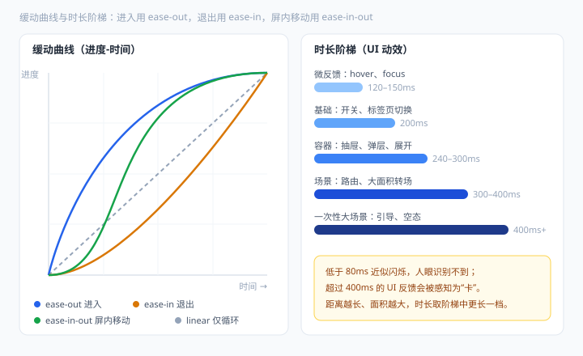
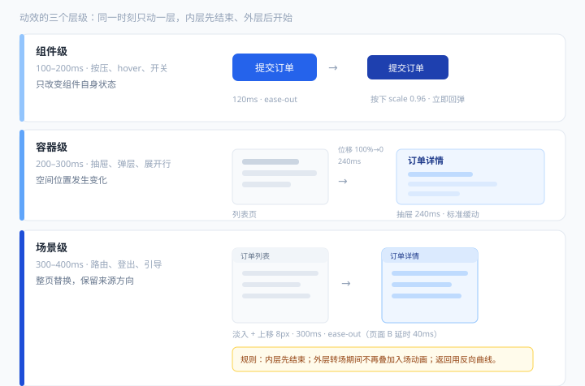
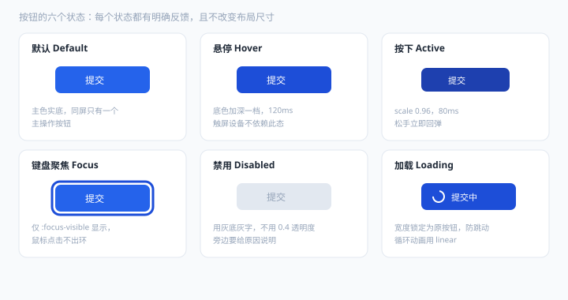
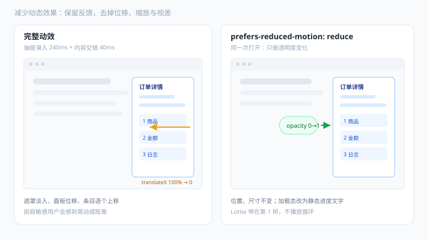
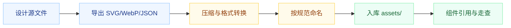
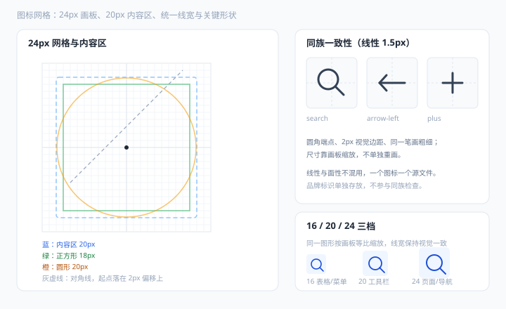
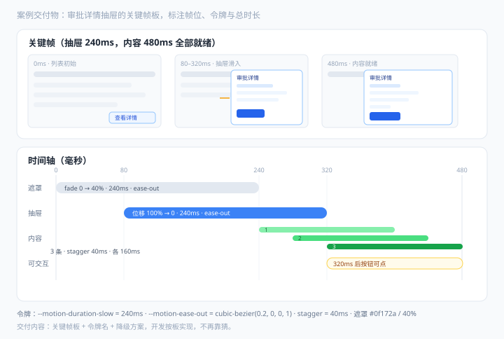

# 动效与资产

> 这篇从动效的目标与判断标准讲起，经过时长与缓动令牌、动效层级与转场、微交互反馈、prefers-reduced-motion 降级，再进入资产体系：图标、图片与插画、字体、Lottie，最后落到压缩、命名与交付验收。
>
> 学完能为一个中后台产品定义完整的动效规范与资产规范，把设计稿里的动效和素材落成可命名、可压缩、可降级、可交接的交付物。

## 一、动效的目标与判断标准

动效只做四件事：维持空间连续、确认操作已生效、引导注意力、提供情绪价值；前三件是功能，最后一件是装饰，顺序不能颠倒。

### 1.1 动效回答的四个问题

一个动效如果说不清自己回答哪个问题，就应当删掉。判断时先问用途，再谈参数。

| 目标 | 回答的问题 | 典型用法 | 失败表现 |
|---|---|---|---|
| 连续性 | 新内容从哪里来 | 抽屉从右侧滑入 | 突兀出现，用户丢失位置感 |
| 反馈 | 操作生效了吗 | 按钮按压、提交转圈 | 点了没反应，重复提交 |
| 聚焦 | 现在该看哪里 | 错误字段抖动、行高亮 | 满屏都在动，没有重点 |
| 愉悦 | 值得多一点情绪吗 | 空态插画、完成动效 | 每次操作都放烟花 |

前三类动效属于可用性投入，必须做；第四类只在低频、非阻断的节点使用。企业后台里，删除、审批、导出这类高频操作不做装饰性动效。

### 1.2 动效的成本与边界

动效有明确成本：实现成本、性能成本、维护成本、可访问性风险。中后台的默认立场是克制，只在状态切换和空间变化时加动效。

- 性能：只动 `transform` 和 `opacity`，这两者不触发布局与重绘；动 `width`、`height`、`top`、`box-shadow` 会掉帧；
- 频率：同一操作每天执行上百次时，动效必须短，否则等待感会被放大；
- 数量：一屏同时最多一处主动效，其余只做状态色变化；
- 可访问性：位移、缩放、视差、循环闪烁对前庭功能障碍用户不友好，必须有降级方案。

> 边界：动效不能替代加载状态、不能掩盖接口延迟，也不能作为“设计感”的证明。接口慢 800ms 时，再顺滑的转场也只是把等待包装了一遍。

### 1.3 版本基线与协作分工

版本基线为 2026-11-13。浏览器侧以仍在安全更新周期内的 Chrome、Edge、Safari、Firefox 为准，CSS 动效与 `prefers-reduced-motion` 全部原生支持；设计侧仍是 Figma 出稿、After Effects 加 Bodymovin 导出 Lottie 的链路。

分工按产物划分，避免规范只停留在设计稿：

| 角色 | 负责 | 交付物 |
|---|---|---|
| 交互设计 | 动效目的、层级、触发条件 | 动效说明与关键帧板 |
| 视觉设计 | 参数、曲线、资产风格 | 令牌表与资产源文件 |
| 前端 | 落地、降级、性能 | 令牌变量与组件实现 |
| 测试 | 一致性、降级、边界 | 走查清单与回归用例 |

设计与前端共用同一套令牌名（如 `duration-300`、`easing-standard`），否则“240ms”会在交接中变成“大概 0.25 秒”。

## 二、动效令牌：时长与缓动

动效参数必须令牌化：先定义有限的时长阶梯和曲线，再让组件引用，不允许在组件里写裸数值。

### 2.1 时长阶梯

时长由距离、面积和触发频率共同决定，不是一个固定值。距离越长、面积越大，取更长一档；同一操作越频繁，取更短一档。

| 令牌 | 时长 | 用途 | 注意 |
|---|---|---|---|
| `instant` | 80–100ms | 按压回弹、颜色微调 | 低于 80ms 近似闪烁 |
| `fast` | 120–150ms | hover、focus、tooltip | 后台最高频的一档 |
| `base` | 200ms | 开关、标签页、轻量展开 | 组件级上限 |
| `slow` | 240–300ms | 抽屉、弹层、折叠面板 | 容器级默认 |
| `scene` | 300–400ms | 路由、整页转场 | 超过 400ms 感知为卡 |

三条派生规则：

1. 进入比退出慢一点。出现需要被看清，消失只需要被确认，退出可以取进入的 70%；
2. 大面积移动取长档，小面积取短档。全屏转场 300ms，按钮反馈 120ms；
3. 阻尼感来自曲线，不来自加时长。想“稳重”应换曲线，不是把 200ms 改成 500ms。



### 2.2 缓动曲线

UI 动效的默认曲线是 ease-out：起步快、收尾慢，符合物体进入视野后被“接住”的直觉。线性只用于持续循环的动画。

| 曲线 | 常用值 | 用途 | 反例 |
|---|---|---|---|
| ease-out | `cubic-bezier(0.2, 0, 0, 1)` | 元素进入、展开 | 用于退出会显得拖沓 |
| ease-in | `cubic-bezier(0.4, 0, 1, 1)` | 元素退出、收起 | 用于进入会显得迟疑 |
| ease-in-out | `cubic-bezier(0.4, 0, 0.2, 1)` | 屏内位移、尺寸变化 | 用于出现/消失，两端都慢 |
| linear | `linear` | 进度条、骨架屏、旋转 | 用于有起止的位移，起停生硬 |
| spring | 物理参数 | 手势拖拽、可回弹的卡片 | 用于表格、表单等精确操作 |

手势驱动的动效（拖拽排序、侧滑删除）用弹簧或速度衔接，松手时按当前速度继续，不重新从零播放。其余场景一律用贝塞尔曲线，便于跨端复现。

### 2.3 令牌化与代码落地

令牌写成 CSS 变量，组件只引用变量。改一次全局生效，降级时也只改变量。

```css
/* 片段：动效令牌，组件不写裸数值 */
:root {
  --motion-duration-instant: 80ms;    /* 按压回弹，只做状态确认 */
  --motion-duration-fast: 120ms;      /* hover、focus、颜色过渡 */
  --motion-duration-base: 200ms;      /* 开关、标签页、轻量展开 */
  --motion-duration-slow: 240ms;      /* 抽屉、弹层 */
  --motion-duration-scene: 300ms;     /* 路由、整页转场 */

  --motion-ease-out: cubic-bezier(0.2, 0, 0, 1);      /* 进入：先快后慢 */
  --motion-ease-in: cubic-bezier(0.4, 0, 1, 1);       /* 退出：先慢后快 */
  --motion-ease-in-out: cubic-bezier(0.4, 0, 0.2, 1); /* 屏内移动 */
  --motion-ease-linear: linear;                       /* 仅循环动画 */
}
```

```css
/* 片段：组件引用令牌，260ms 这类随手值不允许出现 */
.drawer {
  transform: translateX(100%);
  transition: transform var(--motion-duration-slow) var(--motion-ease-out);
}

.drawer.is-open {
  transform: translateX(0);
}
```

> 边界：令牌表要能一屏看完。时长超过 7 档、曲线超过 5 条时，团队会重新开始随手写数值，规范就失效了。

## 三、动效层级与转场

动效分三层：组件级、容器级、场景级。层级决定时长、缓动和叠加规则，混层是最常见的“动效很乱”的原因。

### 3.1 三个层级

同一时刻只动一层；内层先结束，外层后开始。抽屉滑入时，抽屉内部不再逐个飞入；页面转场时，列表项不做交错入场。

| 层级 | 时长 | 例子 | 与相邻层的关系 |
|---|---|---|---|
| 组件级 | 100–200ms | 按钮、开关、标签页 | 只改自身状态，不影响布局 |
| 容器级 | 200–300ms | 抽屉、弹层、折叠面板 | 改变空间位置，遮罩同步淡入 |
| 场景级 | 300–400ms | 路由切换、登录到工作台 | 整页替换，保留来源方向 |



### 3.2 转场模式选型

转场模式只有四种常用选择，选错模式比调错时长更伤体验。

| 模式 | 适用 | 时长 | 注意 |
|---|---|---|---|
| 淡入淡出 | 同级内容替换、弹层 | 120–200ms | 最安全，默认选它 |
| 位移滑入 | 从边缘进入的抽屉、面板 | 200–300ms | 方向必须来自触发位置 |
| 缩放 | 从按钮展开的菜单、气泡 | 120–200ms | 原点设在触发元素上 |
| 共享元素 | 列表项到详情页 | 250–350ms | 仅用于有明确对应物的场景 |

共享元素转场（shared element transition）成本最高：要保证两端元素的位置、尺寸、圆角、内容都能插值。内容差异大时，退化成“淡入 + 轻微位移”比强行共享更稳。

### 3.3 空间连续性与打断

转场必须回答“从哪里来、回到哪里去”。返回动效使用进入的反向路径，不重新编排一套。

- 抽屉从右侧进入，关闭就向右侧退出，不能改成淡出；
- 列表第 8 行打开详情，返回后滚动位置和该行高亮必须保留；
- 动画进行中允许再次点击：新状态从当前插值位置继续，不跳回起点；
- 连续点击同一个按钮时，动画不排队重播，只更新目标状态。

> 边界：路由级转场在后台系统里应尽量少用。审批、报表这类需要来回切换的场景，300ms 的整页动画会在一天里累积成几分钟的等待。

## 四、微交互与状态反馈

微交互是用户与组件之间的一次完整对话：触发、规则、反馈、结束。它不追求好看，只保证用户知道“发生了什么”。

### 4.1 微交互的四段结构

每个微交互都要写清四段，缺一段就会出现“点了没反应”或“不知道成功了没有”。

| 段落 | 要回答 | 示例 |
|---|---|---|
| 触发 | 什么动作启动 | 鼠标悬停、按下、聚焦、数据到达 |
| 规则 | 系统怎么判断 | 表单校验通过才允许提交 |
| 反馈 | 用户看到什么 | 按钮变深、转圈、行高亮 |
| 结束 | 如何收尾 | 成功提示 2 秒后自动消失 |

反馈要落在离触发点最近的位置。表单错误标在字段下方，不要只弹全局提示；批量操作的进度显示在工具栏，不要跳到页面顶部。

### 4.2 组件反馈基线

按钮是微交互的基准件，把它定死，其余组件按同一逻辑推导。

| 状态 | 视觉变化 | 令牌 | 注意 |
|---|---|---|---|
| 默认 | 主色实底 | — | 同屏只有一个主按钮 |
| 悬停 | 底色加深一档 | `fast` + ease-out | 触屏不依赖此态 |
| 按下 | 缩放 0.96、加深两档 | `instant` | 松手立即回弹 |
| 聚焦 | 外环 2px、偏移 2px | `fast` | 仅 `:focus-visible` 显示 |
| 禁用 | 灰底灰字 | — | 旁边必须说明原因 |
| 加载 | 宽度锁定、图标转圈 | linear 循环 | 防止布局跳动 |



```css
/* 片段：按压用 transform，避免改 padding 引起重排 */
.button {
  transition: background-color var(--motion-duration-fast) var(--motion-ease-out),
              transform var(--motion-duration-instant) var(--motion-ease-out);
}

.button:active {
  transform: scale(0.96);   /* 只做视觉压缩，不改变可点击区域 */
}

.button:focus-visible {
  outline: 2px solid #1d4ed8;
  outline-offset: 2px;
}
```

### 4.3 加载、空态与结果反馈

三类反馈各有分工：加载解决“还在处理”，空态解决“为什么没有”，结果解决“成没成功”。

- 加载：超过 300ms 才显示指示器，避免一闪而过；超过 3 秒给进度或阶段文案，超过 10 秒给取消入口；
- 骨架屏：结构与真实内容一致，只做透明度呼吸，不做位移扫光；
- 空态：一句原因、一个主操作、可选插画；插画不能替代文案；
- 成功：轻量提示 2 秒自动消失，不阻断下一步；
- 失败：保留用户输入，给出可执行的下一步，不用抖动代替说明。

> 边界：不要用动效补偿性能问题。接口 2 秒才返回时，先解决接口或分页，再谈加载动效。

## 五、动效降级与可访问性

动效必须可降级。系统级“减少动态效果”打开后，页面仍要完成同样的信息传达，只是不再位移、缩放和视差。

### 5.1 谁需要减少动态效果

前庭功能障碍、偏头痛、眩晕症用户会因大幅位移和缩放产生生理不适；注意力敏感用户也会被循环动画持续干扰。这不是小众偏好，操作系统已把它做成全局开关。

WCAG 2.2 对交互触发动画有明确要求：由交互产生的动效应当可以关闭，除非该动效对功能必不可少。轮播、视差、自动播放的循环动画都属于高风险项。

### 5.2 降级不是删除

降级的核心是“换手段，不丢信息”。反馈必须保留，运动和装饰可以去掉。

| 原方案 | 降级后 | 必须保留 |
|---|---|---|
| 抽屉从右侧滑入 240ms | 直接就位，透明度 0→1 | 遮罩、层级、关闭按钮 |
| 列表交错上移入场 | 一次性淡入 | 内容顺序与分组 |
| 卡片 hover 上浮 4px | 只变阴影或边框 | 可点击的视觉提示 |
| 视差滚动背景 | 固定背景 | 主体内容层级 |
| Lottie 循环播放 | 显示第 1 帧静态图 | 空态说明与主操作 |
| 数字滚动计数 | 直接显示终值 | 数值与单位 |



### 5.3 实现与验证

降级写在一处，不要在几十个组件里分别判断。

```css
/* 片段：所有动效走变量，降级时统一收口 */
.drawer {
  transform: translateX(100%);
  transition: transform var(--motion-duration-slow) var(--motion-ease-out);
}

@media (prefers-reduced-motion: reduce) {
  :root {
    --motion-duration-instant: 1ms;
    --motion-duration-fast: 80ms;
    --motion-duration-base: 120ms;
    --motion-duration-slow: 120ms;
    --motion-duration-scene: 120ms;
  }

  .drawer {
    transform: none;              /* 不再滑入，直接出现在目标位置 */
    opacity: 0;
    transition: opacity 120ms linear;  /* 只留淡入，保留层级变化 */
  }

  .drawer.is-open { opacity: 1; }

  .decorative-parallax { transform: none !important; }
  .lottie-loop { display: none; }     /* 循环动画整体停用 */
  .lottie-still { display: block; }   /* 用首帧静态图替代 */
}
```

验证分三步：

1. 在 macOS 打开“辅助功能 → 显示 → 减少动态效果”，在 Windows 打开“辅助功能 → 视觉效果 → 动画效果”，在 Android 开发者选项里把动画缩放设为关闭；
2. 走查抽屉、弹层、路由、轮播、空态五条路径，确认没有位移、没有自动循环、没有闪烁；
3. 确认降级后仍能完成操作：能关闭抽屉、能看懂空态、能区分成功与失败。

> 边界：`prefers-reduced-motion` 不能替代手动开关。产品若提供“紧凑模式”“低动态模式”，仍需独立实现，不能假定系统设置一定被打开。

## 六、资产体系与交付流程

资产不是“设计稿旁边的附件”，而是有源文件、有格式、有命名、有体积预算的交付物。资产混乱的代价最终落在加载速度和维护成本上。

### 6.1 资产清单

一个中后台项目的资产通常只有五类，先把清单定死，再谈规范。

| 类型 | 源文件 | 交付格式 | 责任 |
|---|---|---|---|
| 图标 | Figma 组件 / SVG | SVG symbol | 视觉设计 |
| 插画 | Figma / Illustrator | SVG 或 WebP | 视觉设计 |
| 图片 | 拍摄原图 / 渲染图 | AVIF、WebP | 视觉设计 |
| 字体 | OTF / TTF / 可变字体 | WOFF2 | 前端与法务 |
| 动效 | AE 工程 | Lottie JSON / dotLottie | 动效设计 |

源文件与交付物必须分开存放。设计源文件是唯一事实来源，导出的 SVG、WebP、JSON 都是构建产物，可以随时重新生成。

### 6.2 目录组织与单一来源

目录按资产类型分，不按页面分。按页面分会导致同一图标出现十几份副本。

```text
assets/
├── icons/            # 单个 SVG 源，构建时合并为 sprite
│   ├── icon-search.svg
│   └── icon-arrow-left.svg
├── illustrations/    # 场景插画，按场景命名
├── images/           # 位图，按业务对象命名
├── fonts/            # 仅 WOFF2，含子集
└── lottie/           # 动效 JSON 与首帧 PNG
```

三条约束：

- 一个资产只有一个源文件，多端引用同一份；
- 图标不切片成 PNG，位图不冒充图标；
- 首帧图与 Lottie 文件同名同目录，替换时不会漏。

### 6.3 交付流程

资产从设计稿到上线要经过导出、优化、命名、入库、引用五步，每一步都有可检查的产物。



交付给开发的不是一堆散图，而是“规范页 + 资产目录 + 命名表”。Figma 里的图层结构、组件命名和 Dev Mode 标注见 `./01-Figma与设计交付.md`，这里只处理资产本身。

## 七、图标规范

图标的第一要求是同族一致，第二才是好看。网格、线宽、圆角、端点四项统一后，图标才像一套。

### 7.1 网格、线宽与关键形状

所有图标画在 24px 画板上，内容落在 20px 内容区内，四周留 2px 视觉边距。

| 尺寸 | 画板 | 内容区 | 线宽 |
|---|---|---|---|
| 16px | 16×16 | 14×14 | 1–1.25px |
| 20px | 20×20 | 18×18 | 1.25–1.5px |
| 24px | 24×24 | 20×20 | 1.5px |
| 32px | 32×32 | 28×28 | 2px |

关键形状决定图标的“体重”：正方形取 18px，圆形取 20px，对角线从内容区左下到右上。同一套图标里，圆形看起来总比正方形小，画的时候要让圆形的直径略大于正方形。



### 7.2 同族一致性

一致性靠四条硬规则，不靠肉眼感觉。

- 线宽统一：同一套图标只用一种描边宽度，缩放时按画板等比处理，不单独改线宽；
- 端点与拐角统一：圆头圆角或平头直角，二选一，全套一致；
- 风格统一：线性图标不混面性图标；面性图标不混线性细节；
- 透视统一：全部正视或全部等距，不出现两个视角。

> 边界：品牌 Logo、支付渠道标识、第三方平台图标不能改画。这类资产按原样嵌入，单独放 `icons/brand/`，不参与同族检查。

### 7.3 命名、导出与使用

命名用“类型-语义-可选变体”的连字符结构，全部小写，不带尺寸和颜色。

| 类型 | 前缀 | 示例 |
|---|---|---|
| 图标 | `icon-` | `icon-search`、`icon-arrow-left` |
| 插画 | `illus-` | `illus-empty-approval` |
| 图片 | `img-` | `img-product-cover` |
| 动效 | `lottie-` | `lottie-success-submit` |

图标导出为 SVG 后用 symbol 内联，颜色继承 `currentColor`，一次请求、可换色、可缩放。

```html
<!-- 片段：symbol 内联，图标颜色由父级 color 决定 -->
<svg xmlns="http://www.w3.org/2000/svg" style="display:none" aria-hidden="true">
  <symbol id="icon-search" viewBox="0 0 24 24" fill="none"
          stroke="currentColor" stroke-width="1.5" stroke-linecap="round">
    <circle cx="11" cy="11" r="7"/>
    <path d="M16.5 16.5 21 21"/>
  </symbol>
</svg>

<svg class="icon" width="16" height="16" aria-hidden="true">
  <use href="#icon-search"/>
</svg>
```

```bash
# 片段：SVG 只做安全优化，保留 viewBox，避免尺寸被写死
npx svgo --config svgo.config.mjs assets/icons/icon-search.svg
```

```js
// 片段：多图标同页时给 id 加前缀，防止渐变、遮罩互相覆盖
export default {
  multipass: true,
  plugins: [
    'preset-default',
    { name: 'prefixIds', params: { prefix: 'ic' } },
    'removeDimensions',   // 尺寸交给 CSS，viewBox 保留
  ],
};
```

## 八、图片与插画

图片规范的核心是“按用途选格式、按显示尺寸出图”。一张 4000px 的原图直接塞进 320px 的卡片，是后台首屏变慢的头号原因。

### 8.1 格式选型

2026 年的默认答案是 AVIF 与 WebP 二选一，SVG 只给矢量图形，JPG 只作兜底。

| 格式 | 适用 | 体积 | 注意 |
|---|---|---|---|
| SVG | 图标、插画、图表 | 极小 | 不含位图细节，路径要精简 |
| AVIF | 照片、复杂插画 | 最小 | 需要兜底，老环境可能不支持 |
| WebP | 通用位图 | 小 | 兼容性好，作为主格式稳妥 |
| PNG | 需要无损透明 | 大 | 仅用于小面积透明图 |
| JPG | 兼容兜底 | 中 | 不用于带文字的图 |

同一张图给出 AVIF 与 WebP 两档，用 `<picture>` 让浏览器自选；PNG 只在必须保留透明且面积很小时使用。

### 8.2 尺寸、DPR 与响应式

导出尺寸按最大显示宽度与 DPR 准备：常规组件按 2 倍，全宽横幅按 1.33 倍控制体积。

| 场景 | 显示宽度 | 导出宽度 | 说明 |
|---|---|---|---|
| 表格缩略图 | 48px | 96px | 2 倍足够，3 倍收益极低 |
| 卡片封面 | 320px | 640px | 主流 2 倍屏 |
| 详情主图 | 800px | 1600px | 配合 `srcset` 给 1 倍 |
| 全宽横幅 | 1440px | 1920px | 按 1.33 倍，控制首屏体积 |

```html
<!-- 片段：按视口给候选图，浏览器自己挑，避免手机下大图 -->
<picture>
  <source type="image/avif" srcset="img-cover-640.avif 640w, img-cover-1280.avif 1280w" sizes="(max-width: 768px) 100vw, 640px">
  
</picture>
```

`width` 与 `height` 必须写，用于预留位置，避免图片到达时页面跳动。首屏以外的图片一律 `loading="lazy"`。

### 8.3 插画风格与场景

插画承担“解释空态、说明流程、缓解失败情绪”三类任务，风格必须来自同一套令牌。

- 色彩：只取品牌色板中的 5–7 个颜色，不引入新色相；
- 线条：与图标同线宽，圆角半径与卡片一致；
- 人物：比例、肤色、服饰风格统一，不出现写实与扁平混排；
- 构图：主体居中偏左，右侧或下方留文案区；
- 数量：一个产品 6–10 张场景插画足够，不为每个页面单独画。

命名按场景而不是按画面内容：`illus-empty-approval`、`illus-error-network`、`illus-guide-import`。这样替换插画时不需要改代码。

> 边界：插画不能承担关键信息。空态插画旁必须有标题和操作按钮，色觉障碍用户和读屏用户都要能获得同等信息。

## 九、字体资产交付

字体是资产里最容易失控的一项：中文字体动辄 5–10MB，直接自托管会把首屏拖垮。结论是西文用 WOFF2 可变字体，中文必须子集化或使用系统字体。

### 9.1 格式与加载

WOFF2 是唯一需要交付的 Web 字体格式，压缩率最高且现代浏览器全支持。TTF、EOT、WOFF 不再单独提供。

| 场景 | 方案 | 注意 |
|---|---|---|
| 中文正文 | 系统字体栈 | 零加载成本，字形有平台差异 |
| 中文标题 | 子集化 WOFF2 | 只含实际用到的字 |
| 西文与数字 | 可变字体 WOFF2 | 一个字重轴覆盖多档 |
| 代码与数字 | 等宽字体 | 数字用 `tabular-nums` 对齐 |

```css
/* 片段：中文优先系统字体，标题字体按需加载并允许回退 */
body {
  font-family: -apple-system, BlinkMacSystemFont, "Segoe UI",
    "PingFang SC", "Microsoft YaHei", sans-serif;
}

@font-face {
  font-family: "Brand Sans";
  src: url("/assets/fonts/brand-sans-subset.woff2") format("woff2");
  font-weight: 400 700;          /* 可变字体覆盖常规与粗体 */
  font-display: swap;            /* 先显示回退字体，避免空白 */
  unicode-range: U+4E00-9FFF;    /* 只接管中日韩统一表意文字区段 */
}
```

`font-display` 的选择：正文用 `swap`，标题用 `optional`（网络差时直接用回退字体，不重排）。`block` 会造成最长 3 秒的空白，后台系统不要用。

### 9.2 中文字体子集化

中文字体必须按实际字符集裁剪。全量思源黑体约 8–9MB，子集后通常能降到几百 KB。

```bash
# 片段：从页面文案提取字符，再生成 WOFF2 子集
python3 - <<'PY'
import pathlib, re
text = "".join(p.read_text(encoding="utf-8") for p in pathlib.Path("src").rglob("*.vue"))
chars = sorted({c for c in text if "\u4e00" <= c <= "\u9fff"})
pathlib.Path("chars.txt").write_text("".join(chars), encoding="utf-8")
print(len(chars))   # 预期输出：常用后台约 1200–2500 个不同汉字
PY

pyftsubset SourceHanSansSC-Regular.otf \
  --text-file=chars.txt \
  --flavor=woff2 \
  --layout-features='*' \
  --output-file=assets/fonts/brand-sans-subset.woff2
```

预期输出（示例）：源文件 8.6MB，子集后 380–520KB。字符集变化后要重新生成，所以这一步必须进构建脚本，不能手工做一次。

> 边界：子集化只适合文案可控的产品。用户可输入任意汉字且需要特殊字体的场景（如可编辑海报），要么回退系统字体，要么按 Unicode 区段拆成多个分包，用 `unicode-range` 按需加载。

### 9.3 授权与回退

商用字体必须确认授权范围：桌面授权不等于 Web 嵌入授权，Web 授权还要看域名和 PV 限制。可免费商用的中文字体包括思源黑体（Source Han Sans，开源）、MiSans、HarmonyOS Sans、OPPO Sans 等；后三者按厂商许可免费商用，交付时把许可证文件一并入库。

回退字体栈要写全，且回退后不能破坏布局：中文回退到苹方、微软雅黑，西文回退到系统无衬线，等宽回退到 SFMono、Consolas。字重不足时浏览器会合成粗体，效果差，应避免只提供单一字重。

## 十、Lottie 动效资产

Lottie 把 After Effects 的矢量动画导出为 JSON，体积小、可缩放、跨端一致，适合空态、成功反馈、引导这三类动效。

### 10.1 适用边界

Lottie 只适合短时、矢量、非交互的动画。超出这个范围，视频或代码动画更合适。

| 需求 | 方案 | 原因 |
|---|---|---|
| 空态、成功、引导 | Lottie | 体积小、矢量清晰 |
| 真实拍摄、复杂光影 | 视频 | Lottie 无法表达位图质感 |
| 与手势联动的拖拽 | 代码动画 | 需要实时响应速度与位置 |
| 长时间循环背景 | 代码或视频 | JSON 长时间播放占用 CPU |

交付阈值：单个 Lottie 文件超过 50KB 或时长超过 5 秒，就该重新简化或改用视频。GIF 不再作为交付格式，色彩和体积都吃亏。

### 10.2 制作与导出规范

导出前在 AE 里做简化，导出后再压一层，两步都不能省。

| 限制 | 后果 | 做法 |
|---|---|---|
| 表达式 | 部分播放器不执行 | 导出前烘焙为关键帧 |
| 轨道遮罩与混合模式 | 渲染结果不一致 | 改为预合成或蒙版路径 |
| 位图层 | 体积暴涨 | 转成矢量或改用图片叠加 |
| 图层过多 | 首帧解析慢 | 合并同色形状，删除隐藏层 |
| 画布过大 | 内存占用高 | 按最大显示尺寸的 2 倍设置 |

导出设置：Bodymovin 选 JSON，勾选“Glyphs 转形状”，关闭“包含未使用的资源”，帧率 30fps 足够。命名 `lottie-{场景}-{状态}.json`，同目录放 `lottie-{场景}-{状态}-poster.png` 作为首帧。

### 10.3 接入、循环与降级

接入时控制三件事：是否自动播放、循环几次、降级显示什么。

```js
// 片段：循环播放前先看系统偏好，降级时只显示首帧
const reduce = window.matchMedia('(prefers-reduced-motion: reduce)');

const anim = lottie.loadAnimation({
  container: document.querySelector('#empty-state'),
  renderer: 'svg',                 // svg 渲染更清晰，canvas 更省内存
  loop: !reduce.matches,           // 降级时只播一次或不播
  autoplay: false,
  path: '/assets/lottie/lottie-empty-approval.json',
});

if (!reduce.matches) {
  anim.play();
} else {
  anim.goToAndStop(0, true);       // 停在第 1 帧，作为静态插画
}
```

三条使用约束：

- 同屏最多一个循环 Lottie，且不放在首屏关键路径上；
- 动画不阻断操作，关闭按钮始终可点；
- 提供 `poster` 首帧，网络失败时也有内容，不留白块。

## 十一、压缩、命名与验收

资产交付的最后一步是压缩和验收。没有体积预算的规范只是审美偏好，落不到上线。

### 11.1 压缩目标

每类资产给一个可检查的体积上限，超出就打回。

| 资产 | 工具 | 目标 | 验收 |
|---|---|---|---|
| 单色图标 SVG | SVGO | ≤ 2KB | 去元数据、留 viewBox |
| 场景插画 SVG | SVGO | ≤ 40KB | 路径精简、无嵌入位图 |
| 位图 WebP | cwebp / sharp | 质量 75–80 | 1 倍尺寸下无明显块状 |
| Lottie JSON | Bodymovin 精简 | ≤ 50KB | 首帧可读、无表达式 |
| 中文字体子集 | pyftsubset | ≤ 500KB | 覆盖实际字符集 |

```bash
# 片段：位图批量转 WebP 与 AVIF，原图不入库
cwebp -q 78 assets/src/cover.png -o assets/images/img-cover-640.webp
avifenc --min 20 --max 32 assets/src/cover.png assets/images/img-cover-640.avif
```

预期输出（示例）：一张 1600×900 的 PNG 原图 1.8MB，WebP 约 180KB，AVIF 约 120KB。转换后必须目视检查文字边缘和渐变，压缩过度会先坏在这两处。

### 11.2 命名规范

命名要能不看文件就判断类型、用途和归属。

| 类型 | 规则 | 示例 |
|---|---|---|
| 图标 | `icon-{语义}-{变体}` | `icon-filter-active` |
| 插画 | `illus-{场景}-{对象}` | `illus-empty-orders` |
| 位图 | `img-{对象}-{宽度}` | `img-cover-640` |
| Lottie | `lottie-{场景}-{状态}` | `lottie-submit-success` |
| 字体 | `{家族}-{字重}-subset` | `brand-sans-400-subset` |

禁止项：中文文件名、空格、`final`、`v2`、`new`、`副本`、像素尺寸后缀以外的版本号。版本用 Git 管理，不用文件名管理。

### 11.3 交付验收清单

交付前逐条打勾，任何一条不过都不算完成。

- 每个资产都有唯一源文件，且源文件不进构建产物；
- 图标全部为 SVG，同一套线宽与端点一致；
- 位图同时提供 AVIF 与 WebP，PNG 仅用于小面积透明；
- 所有图片写了 `width`、`height`，首屏外开启懒加载；
- 字体为 WOFF2，中文已子集化，许可证已入库；
- Lottie 无表达式、无位图层，附首帧图；
- 动效全部引用令牌，无裸数值；
- `prefers-reduced-motion` 下五条核心路径走查通过；
- 体积在预算内，构建产物无未引用资产。

### 11.4 资产排障

上线后资产类问题集中在格式、路径和缓存三处，按现象查即可。

| 现象 | 最可能原因 | 处理 |
|---|---|---|
| 图标显示为方块 | 字体图标未加载或字符缺失 | 改用 SVG symbol |
| 图标颜色改不动 | SVG 内写死 `fill` | 改为 `currentColor` |
| 图片模糊 | 导出尺寸小于 2 倍显示宽 | 按 2 倍重出并压缩 |
| 首屏抖动 | 图片未写宽高 | 补 `width`/`height` |
| 中文标题字体闪烁 | `font-display: block` | 改 `swap` 或 `optional` |
| Lottie 不动 | 表达式或遮罩不支持 | 烘焙关键帧，简化图层 |

> 边界：更换 CDN 或加哈希文件名后，旧缓存会与新资源混用。资产路径统一带内容哈希，并在发布时清理旧版本，避免“本地正常、线上错图”。

## 十二、最佳实践案例

### 12.1 案例背景

某制造企业的采购审批后台，PC 端为主，12 个页面、日均 400 次审批操作。系统由三个团队在不同时期开发，动效和资产各自为政：47 处动效时长从 80ms 到 800ms 不等，缓动曲线有 5 种；83 个图标混用线性、面性和位图三种风格；14 张业务图是未压缩 PNG，平均 620KB；审批通过的空态是一张 1.2MB 的 GIF。

目标是统一动效参数与资产规范，让降级可用、首屏变轻，且不更换现有组件库（Element Plus）、不重做页面结构。约束是 3 周、1 名前端配合、设计只有 2 人，改造必须能分批上线。

### 12.2 案例实操

**第一步，审计现状（2 天）。** 录屏 12 条核心路径，逐帧记录动效参数；导出全部图标与图片，统计体积和格式。

| 问题 | 数量 | 影响 |
|---|---|---|
| 不同动效时长 | 47 处、23 个值 | 同类操作手感不一致 |
| 图标风格 | 3 种混用 | 界面像拼装 |
| 未压缩 PNG | 14 张、均值 620KB | 首屏 3.1MB |
| 无降级方案 | 全部动效 | 系统开启减少动态后仍晃动 |

**第二步，定令牌（1 天）。** 把 23 个时长值收敛为 5 档，曲线收敛为 4 条，写进全局变量。替换规则写死：小于 200ms 归 120ms，200–400ms 归 240ms，大于 400ms 归 300ms，循环动画保留 linear。

**第三步，分层整改（8 天）。** 组件级只改 hover、聚焦（120ms）与按压（80ms）；容器级抽屉、弹层改为 240ms，遮罩同步淡入；场景级路由统一 300ms 淡入加 8px 上移。同时删掉 6 处无意义的视差和无限脉冲，模态框从 600ms 收到 240ms。

**第四步，降级（2 天）。** 在根节点统一处理 `prefers-reduced-motion`：位移与缩放归零，只保留透明度变化；Lottie 停在第 1 帧；装饰性视差直接移除。走查 12 条路径，确认关闭按钮、遮罩、成功提示都仍然可用。

**第五步，资产治理（6 天）。** 图标统一为 24px 网格、1.5px 线性，合并成一个 symbol sprite；14 张 PNG 转 WebP 与 AVIF，按 2 倍显示宽度重出；中文字体子集化，从 8.6MB 降到 412KB；空态 GIF 改为 Lottie，附首帧 PNG。

**第六步，交接（2 天）。** 每个复杂动效交付一张关键帧板，标注帧位、令牌名、总时长和降级方案，前端照此实现，设计走查三轮。



关键帧板是这次交接的核心产物。它把“抽屉滑入要顺滑”翻译成可执行的三行：遮罩 0–240ms 淡到 40%，面板 80–320ms 从 100% 位移到 0、用 `ease-out`，内容 240ms 起每条错开 40ms、各 160ms，320ms 后按钮可点。开发不需要再问“多快算合适”。

### 12.3 案例结果

改造后 6 周的数据（示例）：

| 指标 | 改造前 | 改造后 |
|---|---|---|
| 动效时长取值 | 23 个 | 5 个 |
| 图标请求数 | 83 次 | 1 次（sprite） |
| 空态资源体积 | 1.2MB GIF | 38KB Lottie + 6KB 首帧 |
| 首屏资产体积 | 3.1MB | 1.05MB |
| 动效相关缺陷单 | 23 张 | 3 张 |

可用性方面，8 名用户的任务测试中，“操作卡顿”的反馈从 5 人降到 1 人；2 名前庭敏感用户开启减少动态效果后完成全部审批路径，无不适反馈。设计走查发现 2 处降级遗漏，均在一轮内修复。

失败模式有三条值得记录：

1. **600ms 的模态框**让用户以为点击没生效，出现重复提交；时长收到 240ms 后重复提交消失，说明反馈延迟会直接变成操作错误；
2. **第一版降级删得太干净**：hover 完全无变化，用户以为按钮不可点。降级要保留颜色或边框变化，只去掉位移；
3. **Lottie 用了表达式**，在 iOS 端只显示首帧。导出前必须烘焙关键帧，这条要写进资产验收清单。

复盘：动效治理的收益来自“收敛取值”和“明确层级”，不是加了更多动画；资产治理的收益来自“统一源文件”和“按显示尺寸出图”，不是换了更先进的格式。先做审计和令牌，再谈动效创意，顺序反了就会返工。
