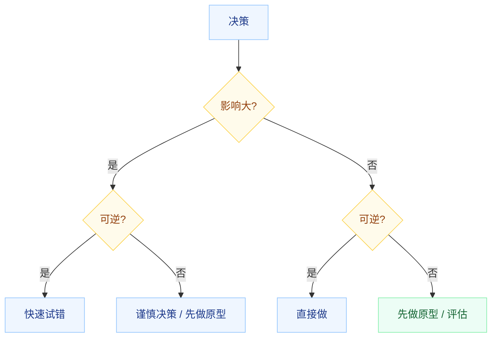

# 架构认知与质量属性

> 这篇从架构的决策成本讲起，经过四视角、质量属性、六要素场景、P99/SLO、损失模型和可逆性，最后落到 ADR 和决策验证。
>
> 学完能写出可验证的质量属性场景，做取舍并留下可追溯的决策记录。

## 一、架构是什么

架构是**那些改起来很贵的决策**。它决定系统的边界、通信方式、数据归属、部署形态和技术约束；具体到某个类怎么命名、某个接口用什么参数，属于设计，不是架构。

判断标准：

- 改这个决策，需要改几个团队、几套部署、多少数据？
- 改错之后，能不能在两周内回退？
- 这个决策是否限制了后续至少两个季度的选择？

架构不是图，是约束和取舍；质量属性不是形容词，是可测量的场景；好的架构让大多数变更变便宜，而不是让所有变更都容易。

### 1.1 架构与设计的边界

| 维度 | 架构 | 设计 |
|---|---|---|
| 关注点 | 系统边界、通信、数据归属、部署 | 模块、类、接口、算法 |
| 影响范围 | 多团队、多系统、长期 | 单模块、短周期 |
| 变更成本 | 高 | 低 |
| 典型产物 | 架构图、ADR、接口契约 | 类图、时序图、详细设计 |

> 边界：不是所有“画在图上的东西”都是架构。一个随时能替换的缓存客户端不是架构决策；把缓存作为唯一数据源才是。

## 二、四视角

架构需要从四个视角同时看，缺一个就会留下盲区。

| 视角 | 回答什么 | 典型问题 |
|---|---|---|
| 业务视角 | 系统支撑哪些业务能力 | 订单、支付、库存的边界在哪里 |
| 数据视角 | 数据的权威源、流向、一致性 | 订单状态以谁为准，如何对账 |
| 应用视角 | 服务/模块如何拆分与协作 | 同步还是异步，谁调用谁 |
| 技术视角 | 部署、中间件、基础设施 | 单机房还是多活，用什么消息队列 |


> 边界：四视角不是四张独立的图。业务边界变化会改变数据归属，数据归属又决定应用拆分和技术选型。

## 三、质量属性

质量属性（Quality Attribute）是系统“做得怎么样”的度量，不是功能列表。

| 属性 | 问题 | 可观测指标 |
|---|---|---|
| 可用性 | 系统多久能用 | 可用率、MTTR、MTBF |
| 性能 | 多快响应 | P50/P95/P99、吞吐、排队时间 |
| 可扩展性 | 流量/数据增长时能否扩展 | 扩容时间、线性度、热点 |
| 安全性 | 能否防止越权、泄漏、篡改 | 漏洞数、越权拦截率、审计覆盖 |
| 可维护性 | 改一个需求要多久 | 变更前置时间、回归范围 |
| 可观测性 | 出问题能否定位 | 日志覆盖率、Trace 采样、告警准确率 |

> 边界：质量属性之间会冲突。提高一致性通常牺牲可用性或延迟；增加缓存提高性能，但会引入一致性和失效问题。

## 四、六要素场景

质量属性必须写成可验证的场景，不能写“系统要高可用”。六要素场景：

| 要素 | 含义 | 示例 |
|---|---|---|
| 来源 Source | 谁/什么触发 | 大促期间的移动端用户 |
| 刺激 Stimulus | 发生什么 | 发起订单查询 |
| 制品 Artifact | 作用于什么 | 订单查询 API |
| 环境 Environment | 什么条件 | 峰值流量、数据库主库正常 |
| 响应 Response | 系统怎么反应 | 返回订单列表，不报错 |
| 度量 Measure | 怎么判定 | P99 ≤ 300ms，错误率 < 0.1% |

### 4.1 一个完整场景

```text
来源：大促期间的移动端用户
刺激：以 200 QPS 查询最近 3 个月订单
制品：订单查询 API
环境：峰值流量，主库正常，缓存命中率 85%
响应：返回分页列表；缓存未命中时回源数据库
度量：P99 ≤ 300ms，错误率 < 0.1%，持续 5 分钟
```

### 4.2 P99 与 SLO

P99 表示 99% 的请求在多少毫秒内完成。它比平均值更能反映尾延迟，因为平均值会被大量快请求拉低。

SLO（Service Level Objective）是内部目标，SLI（Service Level Indicator）是实际测量值，错误预算 = 1 − SLO。

| 指标 | 示例 |
|---|---|
| SLI | 过去 30 天订单查询成功率 |
| SLO | 99.95% |
| 错误预算 | 0.05% × 30 天 ≈ 21.6 分钟 |
| 告警 | 1 小时错误预算消耗 > 20% |

> 边界：SLO 不是越高越好。99.99% 的成本可能比 99.9% 高一个数量级；目标要和业务损失匹配。

## 五、损失模型与可逆性

### 5.1 损失模型

架构决策要用“损失”而不是“技术先进性”来比较。损失可以按分钟、按订单、按合规罚款估算。

| 假设 | 数值 |
|---|---:|
| 峰值订单 | 5,000 单/分钟 |
| 客单价 | 80 元 |
| 故障期间下单失败率 | 30% |
| 每分钟损失 | 5,000 × 80 × 30% = 120,000 元 |

> 数字是示例。实际要用自己的业务数据，并明确假设；不要用“大概很重要”代替损失估算。

### 5.2 可逆性

| 决策 | 可逆性 | 处理方式 |
|---|---|---|
| 页面布局、按钮位置 | 高 | 快速试错，小步发布 |
| 缓存策略、超时参数 | 中 | 可回滚，但要验证 |
| 数据库选型、多租户模型 | 低 | 先做原型和迁移方案 |
| 公开 API 契约、数据格式 | 低 | 版本化，保留兼容期 |



> 边界：可逆性不是“能改代码”这么简单。数据迁移、客户端兼容、合同承诺都会让“技术上可回滚”变成“业务上不可回滚”。

## 六、决策与 ADR

架构决策记录（Architecture Decision Record，ADR）把“为什么这样选”留下来，避免后人只看到结果。

```markdown
# ADR-001 订单查询采用读写分离

日期：2026-11-13
状态：已接受

## 背景
订单查询 P99 在峰值达到 800ms，主库 CPU 长期 80% 以上。

## 决策
查询走只读副本，写走主库；副本延迟超过 3 秒时降级读主库。

## 备选
1. 加缓存：命中率不稳定，订单状态变化频繁。
2. 分库分表：当前数据量未到瓶颈，迁移成本高。
3. 读写分离：改造成本低，能覆盖当前读多写少。

## 后果
- 需要处理副本延迟和读一致性；
- 需要监控复制延迟和降级次数；
- 未来数据量继续增长时，仍需分库分表。
```

验证方式：

- 原型验证关键假设；
- 压测验证容量和尾延迟；
- 故障演练验证降级和恢复；
- ATAM（Architecture Tradeoff Analysis Method）评审取舍和风险。

## 七、决策清单与失败模式

决策前问：

1. 要解决的问题是什么，证据是什么？
2. 有哪些约束：预算、团队、合规、遗留系统？
3. 至少三个选项是什么，各自的代价？
4. 这个决策可逆吗，回退方案是什么？
5. 怎么验证，失败信号是什么？

常见失败模式：

- 用技术时髦代替业务损失；
- 只画架构图，不写约束和取舍；
- 把质量属性写成形容词，无法验收；
- 所有决策都追求“未来可扩展”，导致过度设计；
- 没有 ADR，后人反复推翻同一决策。

## 八、最佳实践案例

### 8.1 案例背景

订单查询服务在峰值 P99 达到 800ms，主库 CPU 长期 80%（示例数据）。团队 4 人，不能停机迁移，预算只够做一次中等改造。

约束是查询读多写少、订单状态变化频繁；不能停机；监控和降级能力有限。

### 8.2 案例实操

| 选项 | 代价 | 风险 |
|---|---|---|
| 加缓存 | 低 | 命中率不稳定，状态变化时容易读到旧数据 |
| 读写分离 | 中 | 副本延迟导致读不一致 |
| 分库分表 | 高 | 迁移周期长，当前数据量未到瓶颈 |

决策是读写分离：查询走只读副本；副本延迟超过 3 秒时降级读主库；缓存只做短 TTL 的订单摘要；分库分表暂缓。


实施步骤：申请只读副本并监控复制延迟；查询接口读写分离；写后立即读强制走主库；压测 200 QPS；做一次副本延迟故障演练。

### 8.3 案例结果

压测后 P99 从 800ms 降到 280ms，主库 CPU 降到 45%（示例）。复盘：读写分离解决了读压力，但没有解决“写后立即读”的一致性问题；这类查询必须显式走主库，不能依赖默认路由。
