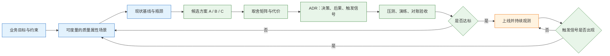
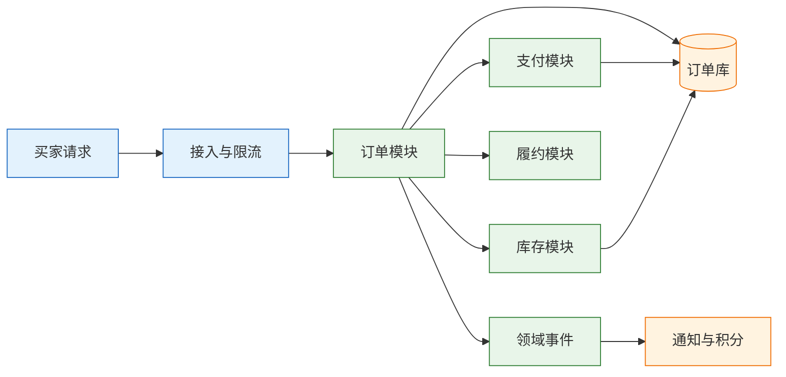

# 架构认知与质量属性

---

## 一、架构认知是什么

### 1.1 核心概念

架构（Architecture）是系统在给定约束下的一组结构性决策：系统由哪些部分组成、部分之间如何依赖、数据归谁所有、通信采用什么方式、失败时如何降级、以什么单元部署。它描述的不是代码细节，而是“改起来最贵的那部分”。

这个定义有两个关键词。第一是“结构”，架构关心元素和关系，不关心某个方法怎么写；第二是“约束”，架构从来不是在无限资源下做最优解，而是在预算、工期、团队和存量系统的夹缝里做可落地的选择。脱离约束谈“最佳实践”，得到的通常是一张无法施工的图。

判断一个决策是否属于架构级，可以看两条标准：

- **影响范围**：是否跨多个模块、多个团队或多个部署单元；
- **变更成本**：修改它所需的时间、资金和风险，是否显著高于日常需求。

给订单表加一个索引，影响局限在一张表，变更以小时计，属于设计或实现决策。把订单库按用户拆成 16 个库，影响写入链路、查询方式、数据迁移和运维值班，变更以季度计，属于架构决策。两条标准不必同时满足，但变更成本是更硬的判别线。

架构还要区分“稳定部分”和“易变部分”。稳定的部分是边界、数据归属和依赖方向；易变的部分是具体框架、中间件版本和部署参数。把易变部分写死进架构，半年后就会被版本升级拖住；把稳定部分留给“以后再定”，团队就会在边界不清的代码里反复返工。

| 层级 | 决策内容 | 典型变更周期 | 例子 |
|---|---|---|---|
| 架构级 | 系统边界、数据归属、通信方式 | 季度到年 | 按用户分库、拆支付服务 |
| 设计级 | 模块接口、事务边界、缓存策略 | 周到月 | 读写分离、Outbox 表 |
| 实现级 | 类结构、SQL、参数配置 | 小时到天 | 加索引、调超时 |

### 1.2 与相邻技术的关系

架构容易和几个相邻概念混在一起，混用会让评审失焦。

**架构与架构风格**：架构是某个系统的具体结构，架构风格是可复用的结构模板。单体、分层、微服务、事件驱动都是风格；某个订单系统最终采用“模块化单体 + 订单事件”，这是架构。风格提供候选，架构是在约束下选出的那一个。

**架构与设计模式**：设计模式解决类与对象之间的局部协作，架构解决系统级的结构与依赖。用对策略模式不等于架构合理；反过来，架构边界清楚时，局部模式用错也只是小范围问题。

**架构与技术选型**：选型是架构决策的一种，但架构不止选型。选 Kafka 还是 RabbitMQ 是选型；决定“哪些数据允许异步、哪些必须同步确认”才是架构。先定通信语义，再定产品，顺序反了就会被产品能力牵着走。

**架构与运维**：架构决定故障的形态，运维决定故障的恢复速度。一个没有超时、没有幂等、没有降级开关的架构，运维只能靠重启和加班兜底。可观测性、容量、发布方式都属于架构约束，不是上线后再补的附属品。

| 相邻概念 | 解决的问题 | 与架构的关系 |
|---|---|---|
| 架构风格 | 可复用的结构模板 | 提供候选方案 |
| 设计模式 | 局部对象协作 | 架构之下的实现手段 |
| 技术选型 | 具体产品与版本 | 架构决策的一个子集 |
| 运维体系 | 故障恢复与容量保障 | 架构约束的来源与验收方 |

### 1.3 判断框架与架构组成

架构约束通常来自三个方向，缺任何一类，方案都会在落地时变形。

- **业务约束**：上线时间、预算、合规要求、增长曲线、损失承受度；
- **技术约束**：存量系统、数据量、现有中间件、团队熟悉度、集成协议；
- **组织约束**：团队边界、值班能力、发布流程、跨团队协作成本。

技术上正确的微服务拆分，撞上“一个团队维护 20 个服务、没有链路追踪、发布靠手工”的现实，就会变成灾难。这不是技术判断错误，而是组织约束没有进入决策。

从结构上看，一份可执行的架构描述至少包含四个视角：逻辑视角说明模块与职责，运行视角说明进程、线程与调用关系，部署视角说明节点、网络与数据分布，数据视角说明数据归属、流向与一致性口径。四个视角不必画四张漂亮的图，但每个关键组件都要能回答“谁负责、放在哪、数据从哪来、坏了怎么办”。



这张图的重点是两条回边：验收不达标要回到场景，触发信号出现要重新评估。架构不是一次性设计，而是一个带反馈的决策循环。没有回边的架构文档，只是一次性快照。

| 约束来源 | 典型内容 | 被忽略后的后果 |
|---|---|---|
| 业务 | 上线时间、预算、合规、增长 | 方案超期或成本失控 |
| 技术 | 存量系统、数据量、中间件 | 迁移中断、性能不达标 |
| 组织 | 团队边界、值班、发布能力 | 服务无人负责、故障扩散 |

---

## 二、质量属性与验收场景

### 2.1 质量属性的分类

质量属性（Quality Attribute）是系统在特定场景下可被度量的行为特征。它回答“系统在压力、故障、变更面前表现如何”，而不是“系统有哪些功能”。功能是系统做什么，质量属性是系统做得怎么样。

“高可用、高性能、可扩展”不是质量属性，是方向。方向无法验收，也无法指导测试。可验收的质量属性必须落到指标、阈值和条件上。

| 属性 | 核心问题 | 可验收的度量 |
|---|---|---|
| 性能 | 请求多快返回、能扛多少 | P99、吞吐、并发数、错误率 |
| 可用性 | 多长时间可服务 | SLO、MTTR、RTO、RPO |
| 可靠性 | 消息与数据是否可靠 | 丢失率、重复率、积压量 |
| 一致性 | 多处数据是否一致 | 对账差异笔数、重复入账笔数 |
| 安全 | 是否被越权或泄露 | 越权拦截率、高危漏洞数、审计覆盖率 |
| 可修改性 | 改一个需求要动多少 | 需求 lead time、改动文件数 |
| 可观测性 | 出问题能否定位 | Trace 覆盖率、告警准确率、定位时长 |
| 成本 | 单位业务要花多少 | 单笔订单基础设施成本 |

这些属性不是并列关系。可用性通常以性能和成本为代价，一致性通常以可用性和延迟为代价，可修改性通常以性能和理解成本为代价。把它们列成一张愿望清单，评审就会变成“全都要”的表态。

### 2.2 场景六要素

一条合格的质量属性场景包含六要素：刺激源、刺激、受影响部分、环境、响应、响应度量。缺哪一项，测试就没法设计，验收就会变成吵架。

以订单创建为例：

> 大促峰值 3000 TPS 持续 30 分钟（环境），用户（刺激源）发起创建订单（刺激），订单服务（受影响部分）必须在 P99 300 ms 内返回，且错误率不超过 0.1%（响应与度量）。

这条场景可以直接转成压测脚本：3000 TPS、持续 30 分钟、统计 P99 和错误率。如果写成“下单要快”，压测人员只能猜并发数和目标值，最后测出来的数字无法用于决策。


| 要素 | 订单场景取值 | 缺失后的后果 |
|---|---|---|
| 刺激源 | 大促期间的买家 | 不知道压力从哪来 |
| 刺激 | 创建订单请求 | 测试动作不明确 |
| 受影响部分 | 订单服务与订单库 | 无法定位责任边界 |
| 环境 | 峰值 3000 TPS 持续 30 分钟 | 测不出真实负载 |
| 响应 | 成功返回或明确失败 | 无法判断降级是否可接受 |
| 响应度量 | P99 300 ms、错误率 0.1% | 通过与否无法判定 |

### 2.3 度量口径与数值计算

**平均值会掩盖长尾。** 1000 个请求里 990 个耗时 50 ms、10 个耗时 5 s，平均耗时是：

```text
(990 × 50 + 10 × 5000) / 1000 = 99.5 ms
```

平均值只有 99.5 ms，看起来很好；但 P99 落在 5 s，每 100 个用户就有 1 个在等 5 秒。对外承诺用 P99，容量规划看 P99 和错误率，平均值只适合看趋势。

**可用性必须落到时间。** 按一年 365 天、8760 小时计算：

```text
99.9%   → 8760 × 0.001  = 8.76 h  = 8 h 45.6 min
99.95%  → 8760 × 0.0005 = 4.38 h  = 4 h 22.8 min
99.99%  → 8760 × 0.0001 = 0.876 h = 52.56 min
99.999% → 8760 × 0.00001 = 0.0876 h = 5.26 min
```

很多团队嘴上要 99.99%，实际值班人数、演练频率和预算都按 99.9% 配。数字写进 SLA 之前，先确认对应的冗余、切换和演练是否真的存在。

**串行与并行的可用性算法不同。** 三个可用性 99.9% 的组件串行依赖，整体可用性为 0.999³ ≈ 99.70%，年停机约 26.3 小时；两个 99.9% 的组件互为备份，整体可用性为 1 − (1 − 0.999)² = 99.9999%。这就是“减少串行依赖”和“增加冗余”的数学依据。

**容量要用利特尔法则估算。** 系统在途请求数 L = 到达率 λ × 平均停留时间 W。峰值 1000 TPS、平均处理 300 ms，则同时在途约 300 个请求；线程池只有 200 时，多出来的请求只能排队，P99 会迅速恶化。这个公式不能替代压测，但能在设计阶段排除明显不合理的池大小。

| 指标 | 公式 | 数值示例 |
|---|---|---|
| 平均延迟 | 总耗时 / 请求数 | 99.5 ms |
| P99 | 第 99 百分位请求的耗时 | 5000 ms |
| 年停机 | 8760 × (1 − SLO) | 99.9% 对应 8.76 h |
| 串行可用性 | A₁ × A₂ × … × Aₙ | 0.999³ ≈ 99.70% |
| 并行可用性 | 1 − (1 − A)ⁿ | 两个 99.9% 得 99.9999% |
| 在途请求 | L = λ × W | 1000 × 0.3 = 300 |

> **注意**：P99 不是“平均值的 99%”，也不是“99% 的请求都低于某个固定值”。它必须先有明确的统计窗口和样本量；窗口太短、样本太少，P99 会被少量抖动放大，不能直接用于容量承诺。

### 2.4 质量属性的分层

SLO 不能全链路一个数。下单、支付是 P0，商品详情、购物车是 P1，推荐、评价是 P2。故障时的降级顺序由分层决定：先关推荐，再关评价，最后才动下单。

分层不是给不同团队贴标签，而是把有限的稳定性预算投到损失最大的链路。支付链路停 1 分钟可能产生资损和投诉，推荐链路停 1 分钟只是少一些曝光；两者用同一个可用性目标，等于让推荐占用支付的值班和冗余资源。

| 层级 | 典型链路 | 可用性目标 | 故障策略 |
|---|---|---|---|
| P0 | 下单、支付、库存扣减 | 99.99% | 多可用区、自动切换、人工兜底 |
| P1 | 商品详情、购物车 | 99.95% | 主备、限流、缓存降级 |
| P2 | 推荐、评价、报表 | 99.9% | 允许短时不可用，异步补偿 |

---

## 三、质量属性的冲突与成本

### 3.1 属性之间的取舍

质量属性之间一定冲突。架构的工作不是让所有属性同时最优，而是明确“哪些必须保、哪些可以降、降的时候业务能不能接受”。

- **强一致与延迟**：同步复制要等多数派确认，写延迟上升；多数派写入在节点故障时还可能降低可用性。
- **多副本与成本**：双可用区约等于两份资源；双活还要加流量调度、数据同步和冲突处理，成本不止两倍。
- **抽象与性能**：多一层抽象换来可修改性，代价是调用链更长、理解成本更高。
- **安全与体验**：多一次校验、多一次加密，换来延迟和运维负担。
- **可观测性与存储**：日志、指标、Trace 的存储和计算成本随流量线性增长，必须采样和分级保留。

| 属性组合 | 冲突表现 | 常见缓解 |
|---|---|---|
| 一致性 ↔ 可用性 | 网络分区时无法同时满足 | 按业务选 CP 或 AP，明确降级口径 |
| 性能 ↔ 安全 | 加密与校验增加延迟 | 会话复用、硬件加速、异步审计 |
| 可用性 ↔ 成本 | 冗余资源平时闲置 | 按损失分级，只给 P0 双活 |
| 可修改性 ↔ 性能 | 抽象层增加调用与转换 | 只在变化频繁处抽象 |
| 可观测性 ↔ 成本 | 全量采集费用高 | 采样、分级保留、按链路开关 |

> **架构红线**：在没有基线数据、没有回滚通道的情况下做不可逆拆分，等于把一次性赌注押在未经验证的假设上。任何“先拆了再说”的方案，都必须先回答失败后怎么退。

### 3.2 可用性等级的成本

每提高一个 9，成本不是线性增加，而是阶梯式上升。99.9% 可以靠单活加快速重启；99.95% 需要主备和健康检查；99.99% 需要多可用区、自动切换和定期演练；99.999% 往往要跨地域、持续演练和专门的稳定性团队。

| SLO | 年停机 | 月停机 | 典型代价 |
|---|---:|---:|---|
| 99.9% | 8h46m | 43m12s | 单活 + 快速重启 |
| 99.95% | 4h23m | 21m36s | 主备 + 健康检查 |
| 99.99% | 52m36s | 4m19s | 多可用区 + 自动切换 |
| 99.999% | 5m15s | 25.9s | 多地域 + 持续演练，成本陡增 |

> **注意**：可用性不是单机指标，而是链路指标。数据库做了主备，但应用只有一个实例、DNS 只有一个出口、证书只有一份手工续期，整条链路的可用性仍然受最薄弱环节约束。做可用性设计时先画串行依赖，再决定在哪一层加冗余。

> **架构红线**：链路上的任何单点都会把局部冗余归零。单实例应用、单 DNS、单证书、单配置中心、单可用区数据库，只要存在一个，其他层做再多副本也不能把整条链路提升到目标 SLO。

### 3.3 单位经济性与复杂度守恒

质量属性不是免费的，成本要落到单位经济性：

```text
单笔订单基础设施成本 =（计算 + 存储 + 网络 + 中间件）/ 订单量
```

假设基线月成本 90 万元、月订单 300 万笔，单笔成本为 0.30 元。流量增长 3 倍后，如果月成本涨到 288 万元、订单涨到 900 万笔，单笔成本变成 0.32 元，说明架构没有规模效应，增长反而更贵；如果成本只涨到 240 万元，单笔成本降到 0.27 元，才说明扩容方式有效。

复杂度也守恒。复杂度不会消失，只会从业务代码转移到框架、平台或运维。微服务让代码边界清楚了，但把复杂度转移到了网络、数据和发布；Serverless 省了运维，但把复杂度转移到了冷启动、可观测性和供应商约束。选型时要问的不是“哪种方案没有复杂度”，而是“复杂度落在哪个团队、用什么能力接住”。

| 成本项 | 内容 | 易漏点 |
|---|---|---|
| 资源 | 计算、存储、网络、中间件 | 公网流量、跨区复制 |
| 人力 | 部署、补丁、值班、排障 | 夜间与节假日值班 |
| 稳定性 | 冗余、演练、灾备 | 演练本身的人力 |
| 可观测性 | 日志、指标、Trace 存储 | 保留期与查询费用 |
| 迁移 | 数据导出、双跑、改造 | 专有 API 适配层 |

---

## 四、架构决策的量化方法

### 4.1 业务损失与 SLO 推导

不要先问“要几个 9”，先问“停一小时损失多少”。如果一小时损失 20 万元，当前 SLO 是 99.9%，年停机 8.76 小时，年损失约 175.2 万元；提升到 99.99% 后年停机 0.526 小时，年损失约 10.5 万元，每年少损失约 164.7 万元。若改造一次性投入 100 万元、每年运维增加 30 万元，第一年净收益约 34.7 万元，之后每年约 134.7 万元。这笔账能算清，才值得立项。

这套推导有三个前提：损失可以按小时估算、停机与损失近似线性、改造确实能把可用性提升到目标值。三者任一不成立，结论都要重算。例如品牌声誉损失、监管罚款、数据永久丢失，不能简单按小时计价，需要单独列风险项。

| 参数 | 示例值 | 说明 |
|---|---|---|
| 每小时业务损失 | 20 万元 | 按订单、广告、履约综合估算 |
| 当前 SLO | 99.9% | 年停机 8.76 h |
| 目标 SLO | 99.99% | 年停机 0.526 h |
| 年减少损失 | 164.7 万元 | (8.76 − 0.526) × 20 |
| 改造投入 | 100 万元 | 一次性 |
| 年增运维 | 30 万元 | 冗余、演练、值班 |

### 4.2 加权矩阵与敏感性

多个候选方案比较时，加权矩阵能把“感觉”拆成可讨论的维度。评分用 1 到 5，权重合计 100%，加权总分是各维度得分乘以权重之和。

订单中心的三个候选方案：

**A. 单体优化。** 加缓存、读写分离、异步化、冷热分离，订单表按时间分区。改动小、团队熟、没有分布式事务；但复杂度继续堆在一个进程和一张大表里，3 倍增长后很快撞到下一个天花板。

**B. 模块化单体。** 按订单、支付、库存、履约划清模块，模块之间只走进程内接口和领域事件；支付回调、对账、通知异步化；数据库先读写分离，预留按用户分片的能力。边界清楚、部署仍是一个单元、没有跨服务事务；代价是模块纪律靠代码评审和 CI 约束，赶工期时容易被绕过。

**C. 微服务。** 订单、支付、库存、履约独立部署、独立扩容。增长和故障隔离最好；代价是模块边界升级成网络边界，要处理超时、重试、幂等、分布式事务、链路追踪、联调、发布编排，团队和运维成本显著上升。

| 维度（权重） | A 单体优化 | B 模块化单体 | C 微服务 |
|---|---:|---:|---:|
| 支撑 3 倍增长（30%） | 2 | 5 | 5 |
| 交付与变更风险（20%） | 5 | 4 | 2 |
| 一致性可控（15%） | 4 | 4 | 3 |
| 运维与故障成本（15%） | 5 | 4 | 2 |
| 团队现有能力（10%） | 5 | 4 | 3 |
| 迁移成本（10%） | 5 | 4 | 2 |
| **加权总分（100%）** | **3.95** | **4.30** | **3.15** |

以 B 为例：0.30×5 + 0.20×4 + 0.15×4 + 0.15×4 + 0.10×4 + 0.10×4 = 4.30。矩阵的价值不在小数点，而在敏感性：把“团队能力”权重提到 30%，其余维度按原比例压缩到 70%，A 约 4.18、B 约 4.23、C 约 3.12，B 的领先从 0.35 缩到 0.05，结论对权重高度敏感。权重依赖业务阶段，所以必须由业务、技术、运维一起定，不能架构师一个人关起门来打分。

选 B，但真正要记录的不是“B 赢了”，而是“B 在 6 个月约束下赢，什么信号出现时重新评估”。

### 4.3 决策的可逆性分级

架构决策按可逆性分三类，处理方式完全不同。

| 类型 | 例子 | 做法 |
|---|---|---|
| 可逆 | 加索引、加缓存、调超时、加限流 | 快速试，错了就回退 |
| 半可逆 | 读写分离、模块拆分、接口版本化 | 小步走，保留回退路径 |
| 不可逆 | 分库分表、拆服务、换数据库、换协议 | 等基线数据充分，先做双跑 |

“先加缓存试试”和“先拆成 8 个服务试试”不是同一类决策。前者的失败成本是几天，后者是几个季度。很多架构事故不是选错方向，而是把不可逆决策当可逆决策做了。

对应的反模式叫“过度设计”：把“可能发生”当“一定发生”，提前引入一堆抽象层、中间件和部署单元。判断标准是有没有触发信号和验证方式；说不清什么时候用得上、怎么验证的预留，就是过度。真正需要的预留是接口和边界，不是一堆空实现。

> **注意**：可逆性不等于“可以随便改”。加缓存也可能引入脏数据，加限流也可能误伤核心流量；可逆决策的风险低，是因为回退成本低，不是因为不需要验证。每次试验都要有指标、观察窗口和回退开关。

---

## 五、订单中心架构评审案例

### 5.1 现状基线与约束

订单中心日订单 300 万，大促峰值 1000 TPS，创建订单 P99 800 ms，订单库 2 TB，发布一次 40 分钟、回滚靠手工。业务要求 6 个月支撑 3 倍增长，大促不宕机，财务日对账差异为 0。

第一次评审，有人主张拆微服务，有人主张加 Redis，有人主张换数据库。三种主张都可能有道理，但当时没人能回答：瓶颈在哪、3 倍之后哪里先断、做到什么程度算达标。没有这三个答案，方案比较只是偏好比较。

| 基线项 | 当前值 | 6 个月目标 | 判断意义 |
|---|---:|---:|---|
| 日订单 | 300 万 | 900 万 | 写入与存储增长 3 倍 |
| 峰值 TPS | 1000 | 3000 | 容量与连接数要重算 |
| 创建订单 P99 | 800 ms | 300 ms | 延迟目标收紧 |
| 订单库容量 | 2 TB | 6 TB | 备份、迁移、DDL 成本上升 |
| 发布耗时 | 40 分钟 | 20 分钟以内 | 发布不是唯一瓶颈，但会放大风险 |
| 回滚方式 | 手工 | 一键回滚 | 失败恢复能力必须补齐 |
| 对账差异 | 未量化 | 日终为 0 | 一致性口径必须可验收 |

### 5.2 候选方案与代价

A、B、C 三个方案的描述与评分见 4.2 节。这里补充每个方案在落地层面的代价。

A 的代价是“天花板可见”：单库写入、单表行数、单进程发布仍然存在，3 倍增长后很可能需要二次改造。B 的代价是“纪律成本”：模块边界没有物理隔离，必须用 CI 和评审守住，否则半年后回到大泥球。C 的代价是“系统间成本”：网络超时、重试、幂等、分布式事务、链路追踪、契约测试、发布编排，每一项都要有人负责。

| 方案 | 主要收益 | 主要代价 | 可逆性 |
|---|---|---|---|
| A 单体优化 | 改动小、上线快 | 天花板低，可能二次改造 | 高 |
| B 模块化单体 | 边界清楚、部署简单 | 依赖 CI 纪律，单进程故障影响全局 | 中 |
| C 微服务 | 独立扩容、故障隔离 | 分布式治理与平台成本高 | 低 |

### 5.3 评分、决策与触发信号

加权结果 B 为 4.30，高于 A 的 3.95 和 C 的 3.15。决策为 B，但附三条触发信号，任一出现就重新评估：

- 订单库写入持续超过 70%，且读写分离与分区后仍无改善；
- 单个模块的发布频率或扩容需求，达到其他模块的 3 倍以上；
- 团队规模超过 25 人，或模块 owner 已经能独立承担值班。

这三条信号把“什么时候拆”从争论变成观测。没有触发信号，拆分就是提前支付成本；信号出现却不敢拆，就会错过窗口。

ADR（Architecture Decision Record，架构决策记录）只写一页：背景、决策、备选方案、后果、触发信号、owner。它不追求完整，追求半年后还能看懂当时为什么这么选。

评审材料提前 48 小时发，固定六样：现状数字表、六条质量属性场景、三个候选方案及代价、加权矩阵与敏感性、一页 ADR、失败矩阵。结论只允许四种：通过、有条件通过、退回补充、不通过。“有条件通过”的条件必须写成有负责人、有截止时间、有验收标准的待办，否则等于放行。

### 5.4 验收场景与失败矩阵

B 方案上线前，用六条场景验收：峰值 3000 TPS 下 P99 ≤ 300 ms；订单库故障切换 RTO ≤ 60 s；支付回调重复 3 次只入账一次；对账日终差异为 0；发布期间错误率不超过 0.1%；回滚在 10 分钟内完成。每条场景都要有压测脚本、演练记录或对账报告，不能只写“已验证”。



失败矩阵至少覆盖这些分支：

| 分支 | 要回答的问题 |
|---|---|
| 调用超时 | 重试几次、退避多久、是否幂等 |
| 重复请求 | 幂等键是什么、去重表存多久 |
| 乱序到达 | 用版本号还是状态机拒绝旧事件 |
| 部分成功 | 补偿、回滚，还是留待对账 |
| 补偿失败 | 谁告警、谁手工处理、多久兜底 |
| 下游不可用 | 降级返回什么、是否熔断 |

主流程跑通只证明 happy path 可用，故障和资损几乎都来自这张表。

---

## 六、常见失败模式与排查

### 6.1 失败模式判断表

| 现象 | 最可能原因 | 处理 |
|---|---|---|
| 评审变成挑刺会 | 没有统一维度和验收口径 | 先对齐目标、场景、约束，再谈方案 |
| 方案越讨论越多 | 没定决策边界和截止时间 | 明确谁决策、何时决策、什么信号推翻 |
| 上线后“感觉慢了” | 没有基线，也没有 P99 | 补监控三项：P99、错误率、慢查询 |
| 所有链路都要 99.99% | 没按业务损失分级 | 分层 SLO，非核心链路允许降级 |
| 微服务拆完故障更多 | 边界不清、治理能力不足 | 先模块化单体，补超时/幂等/追踪再拆 |
| 文档半年后全过期 | 没有 owner、没有触发信号 | ADR 进代码仓库，季度对照触发信号 |
| 指标很好看，业务没改善 | 把技术指标当业务指标 | 用“少丢多少单、少多少投诉”校验 |
| 预留了一堆“以后用”的扩展 | 把可能当必然 | 只留接口和边界，不留实现 |

### 6.2 排查与决策顺序

1. 业务目标是什么，停机和错误各损失多少；
2. 现状基线在哪里，瓶颈是应用、数据库还是网络；
3. 质量属性场景能不能测试，验收口径是什么；
4. 候选方案的代价分别是什么，哪个不可逆；
5. 选中的方案怎么验证，失败怎么退；
6. 什么信号出现时重新评估。

这个顺序不能反。先谈方案，会陷入技术偏好；先谈价格，会忽略停机和迁移成本；先谈“几个 9”，会把稳定性当成孤立指标。顺序正确的标志是：每一步的结论都能被下一步直接使用。

| 步骤 | 产出 | 不合格的表现 |
|---|---|---|
| 业务目标 | 损失模型与增长假设 | 只写“提升稳定性” |
| 现状基线 | TPS、P99、容量、发布耗时 | 只有监控截图，没有统计窗口 |
| 质量场景 | 六要素完整的场景表 | 只有“高可用”三个字 |
| 方案代价 | 每案的收益、代价、可逆性 | 只列收益，不列代价 |
| 验证 | 压测、演练、对账报告 | 用“已联调”代替验收 |
| 触发信号 | 可观测的阈值与 owner | 写在文档里但没人看 |

> **核心结论**：架构是在约束下做取舍，不是把所有好东西都堆上去；质量属性必须能验收，没有数字和场景的“高可用”只是愿望；先做可逆决策，用数据换不可逆决策的时间，每个 9 都有价格。
