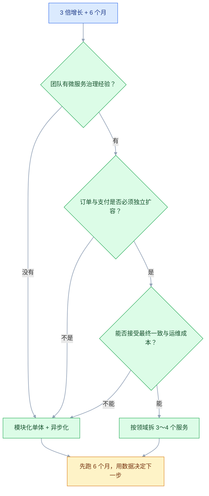

# 架构认知与质量属性

## 一、工程案例：给订单中心写一页架构决策书

**场景**：订单中心现在是一个单体应用，日订单 30 万，大促峰值 3000 TPS，订单库 2 TB，发布一次 40 分钟。支付回调偶发重复，财务每天对账差 3～5 笔，出问题只能靠人翻日志。业务要求 6 个月内支撑 3 倍增长，大促不宕机，财务能对平，发布能回滚。

**目标**：不写厚文档，只交付一页能评审、能验证的架构决策书：

- 一张现状数字表；
- 六条可度量的质量属性场景；
- 三个候选方案与一张决策矩阵；
- 一份 ADR（架构决策记录）；
- 一张验收清单。

**为什么必须做**：架构工作的产出不是“图”，而是“在约束下做出的、可被验证的决策”。这个案例把“架构认知、质量属性、权衡、决策、验收”串成一条线。只会画图的人，做完这一页会发现缺的不是工具，而是判断依据。

**动手前确认**：先拿到最近 30 天的监控、慢日志、发布记录、对账差异明细。没有数据就先补数据，不要先画目标架构。下面的数字是示例假设，落地时必须换成自己的真实值。


### 1.1 先把现状变成数字

架构讨论最容易变成“我觉得”。先把下面这张表填满，填不满的格子就是接下来要补的观测能力。

| 维度 | 现状（示例） | 怎么取 | 目标 |
|---|---|---:|---:|
| 日订单量 | 30 万 | 订单表按天计数 | 90 万 |
| 峰值 TPS | 1000 | 网关或应用监控的分钟峰值 | 3000 |
| 创建订单 P99 | 800 ms | APM 或应用埋点 | ≤ 300 ms |
| 订单库容量 | 2 TB | 库表容量统计 | 可在线扩容 |
| 单库写入上限 | 约 3000 TPS | 压测或历史峰值 | 留 50% 余量 |
| 发布耗时 | 40 分钟 | 发布平台记录 | ≤ 10 分钟 |
| 发布回滚 | 手工，约 60 分钟 | 发布记录 | ≤ 10 分钟，一条命令 |
| 支付回调重复 | 每日数笔 | 回调日志去重统计 | 0 笔重复入账 |
| 对账差异 | 每日 3～5 笔 | 财务对账文件 | 0 笔 |
| 故障定位时间 | 平均 30 分钟 | 事故复盘 | ≤ 5 分钟 |

这张表有三个作用：第一，判断“3 倍增长”到底卡在哪；第二，给质量属性场景提供基线；第三，验收时不用吵架，直接对数字。

### 1.2 写六条质量属性场景

质量属性不是形容词，是“在什么条件下，系统必须做出什么反应，达到什么指标”。一条合格的场景至少包含：刺激源、刺激、受影响部分、环境、响应、度量。

| 属性 | 场景 | 验收口径 |
|---|---|---|
| 性能 | 大促峰值 3000 TPS 持续 30 分钟，订单创建接口 | P99 ≤ 300 ms，错误率 ≤ 0.1% |
| 可用性 | 单可用区故障，订单写入链路切换到另一区 | RTO ≤ 5 分钟，RPO ≤ 1 分钟 |
| 一致性 | 支付回调重复、乱序、延迟到达 | 订单最终状态正确，重复入账 0 笔，日对账差异 0 笔 |
| 可修改性 | 新增一种支付方式，不改订单主流程 | 2 人周上线，主流程代码改动 ≤ 3 个文件 |
| 可观测性 | 任一订单投诉“状态不对” | 1 分钟内定位到状态、系统、消息和失败原因 |
| 成本 | 流量增长 3 倍 | 单笔订单基础设施成本增长 ≤ 50% |

注意“可修改性”和“成本”也是质量属性。很多架构方案技术上更“先进”，但改一个支付方式要动五个服务、单位成本翻倍，这种方案在业务上是不合格的。

### 1.3 三个候选方案

**方案 A：单体优化**。加缓存、读写分离、异步化、冷热分离，数据库按时间分区。优点是改动小、团队熟、没有分布式事务；缺点是把复杂度继续堆在一个进程和一张大表里，3 倍增长后很快遇到下一个天花板。

**方案 B：模块化单体 + 读写分离 + 异步化**。按订单、支付、库存、履约划清模块边界，模块之间只走进程内接口和领域事件；先把支付回调、对账、通知等旁路链路异步出去；数据库先读写分离，预留按用户分片的能力。优点是边界清楚、部署仍是一个单元、没有跨服务事务；缺点是模块化靠纪律，边界容易在赶工期时被绕过。

**方案 C：微服务拆分**。订单、支付、库存、履约独立部署、独立扩容。优点是增长和故障隔离最好；缺点是把“模块边界”升级成“网络边界”，要处理超时、重试、幂等、分布式事务、链路追踪、联调、发布编排，团队和运维成本显著上升。



### 1.4 决策矩阵

权重和评分必须由业务、技术、运维一起定，不能架构师一个人关起门来打分。下面的权重是示例，重点是过程，不是精确到小数点后两位。

| 维度 | 权重 | A 单体优化 | B 模块化单体 | C 微服务 |
|---|---:|---:|---:|---:|
| 支撑 3 倍增长 | 30% | 2 | 5 | 5 |
| 交付与变更风险 | 20% | 5 | 4 | 2 |
| 一致性可控 | 15% | 4 | 4 | 3 |
| 运维与故障成本 | 15% | 5 | 4 | 2 |
| 团队现有能力 | 10% | 5 | 4 | 3 |
| 迁移成本 | 10% | 5 | 4 | 2 |
| **加权总分** | **100%** | **3.95** | **4.30** | **3.15** |

结论是 B，但真正要写进 ADR 的不是“B 赢了”，而是“B 在 6 个月约束下赢，6 个月后用什么信号触发重新评估”。如果团队没有模块化经验，A 更稳；如果订单和支付已经必须独立扩容、团队有成熟的服务治理能力，C 才有意义。

### 1.5 写一份 ADR

ADR 不是会议纪要，是一份可追溯的决策记录。长度控制在一页，模板如下。

```markdown
# ADR-001 订单中心采用模块化单体，暂不拆微服务

- 状态：已接受
- 日期：2026-10-22
- 决策人：业务负责人、技术负责人、运维负责人

## 背景

日订单 30 万，峰值 1000 TPS，订单库 2 TB；目标 6 个月支撑 3 倍增长。
团队 12 人，没有微服务治理经验；发布一次 40 分钟，回滚靠手工。
财务要求日对账差异为 0；支付回调存在重复和乱序。

## 决策

采用模块化单体：按订单、支付、库存、履约划模块，模块间只走进程内接口和领域事件；
支付回调、对账、通知异步化；数据库先读写分离，预留按用户分片能力。
暂不拆微服务。

## 备选方案

A 单体优化：改动最小，但 3 倍增长后仍会遇到单库和单进程天花板。
C 微服务：扩容和隔离最好，但团队没有治理经验，6 个月内交付风险过高。

## 后果

正面：交付风险低，没有跨服务事务，团队能掌控。
负面：模块边界靠纪律；单进程故障仍会影响全部模块；后续拆分要补防腐层。
触发重新评估的信号：订单峰值持续超过 2000 TPS、单库写入超过 70%、发布回滚超过 10 分钟、团队具备服务治理经验。

## 验证

3 倍峰值压测、单可用区故障演练、支付回调重复与乱序演练、连续 7 天对账、发布与回滚演练。
```

ADR 的关键是“后果”和“触发信号”。只写“我们选了什么”，不写“什么情况下推翻”，这份 ADR 半年后就会变成历史文件。

### 1.6 验收（8 项全过才算交付）

1. 3 倍峰值压测：3000 TPS 持续 30 分钟，P99 ≤ 300 ms，错误率 ≤ 0.1%。
2. 单可用区故障演练：订单写入 5 分钟内恢复，RPO ≤ 1 分钟。
3. 支付回调重复、乱序、延迟各 100 次：重复入账 0 笔，最终状态正确。
4. 连续 7 天对账：每日差异 0 笔，差异可定位到订单号和批次。
5. 发布与回滚：各 3 次，单次 ≤ 10 分钟，回滚后数据一致。
6. 可观测性：随机抽 20 笔订单，1 分钟内查到全链路状态与失败原因。
7. 成本：3 倍流量下，单笔订单基础设施成本增长 ≤ 50%。
8. 评审：ADR、C4 图、失败矩阵、容量表齐全，业务、技术、运维三方签字。

### 1.7 这套文档怎么落地

不要一次性写 50 页。先写一页 ADR，再补三张表：质量属性场景、容量与成本、失败矩阵。C4 图只画 Context 和 Container 两层，Component 层等真正拆分时再画。每季度复盘一次，把“触发信号”拿出来对照，该推翻就推翻。

## 二、高频问答：会卡住你的地方，也是面试最常问的

### 2.1 把“高可用、高性能”当质量属性

**现场**

评审时追问三个数：多少 TPS、P99 多少毫秒、故障后多久恢复。答不上来就是没定义，先把数字补齐再谈方案。

**要点**

- 质量属性不是形容词，是“在什么条件下、系统必须做出什么反应、达到什么指标”。
- 把“方向”当“指标”是这一步的核心错误：没有验收口径，开发和测试无法判断做到什么程度，最后变成“上线再说”。
- 一条合格场景至少要有刺激源、刺激、受影响部分、环境、响应、度量，缺一项就写不成可测试的场景。

**追问**

- “高可用”到底要几个 9？→ 先定能接受一年停多久，再换算成 SLA，不要反着来。
- 可用性和一致性冲突怎么选？→ 看业务：支付账务要一致，商品浏览可以降级。
- 场景写不出来怎么办？→ 先补监控和基线，不要先画目标架构。

### 2.2 一上来就拆微服务

**现场**

问三个问题：团队有没有服务治理经验？订单和支付是否必须独立扩容？能否接受最终一致？三个都是“否”，就先做模块化单体。

**要点**

- 微服务不是更先进，它只是把模块边界升级成网络边界。
- 只看到扩容优点，没看到复杂度从代码转移到了网络、数据和运维：超时、重试、幂等、分布式事务、链路追踪、联调、发布编排都要多一套。
- 边界不清时拆，等于把跨模块 JOIN 变成跨服务调用，风险更大。

**追问**

- 什么时候才该拆？→ 独立扩容、团队边界已成、单库写入到顶、故障隔离是硬要求，出现两条再谈。
- 拆之前先做什么？→ 先划模块、定接口、拆 schema，把跨模块直接读表降到 0。
- 单体撑不住增长怎么办？→ 先缓存、读写分离、异步化、冷热分离，多数瓶颈不在部署单元。

### 2.3 只画图，不做决策

**现场**

指着图问两句：“为什么不用另一个方案？”“这个选择的代价是什么？”答不出来就是缺 ADR。

**要点**

- 架构工作的产出不是图，而是在约束下做出的、可被验证的决策。
- 图只描述结构，不记录约束、备选方案、取舍和后果；换个人看，不知道为什么要这样画。
- 一份能评审的交付至少要有现状数字、备选方案、决策矩阵、ADR 和验收清单。

**追问**

- ADR 里最不能省的是哪两段？→ “后果”和“触发信号”，只写选了什么，半年后就成历史文件。
- 图画到哪一层够用？→ C4 只画 Context 和 Container，Component 等真拆时再画。
- 怎么判断图有没有撒谎？→ 图和部署、代码对得上，且能回答“帮谁做什么决策”。

### 2.4 没有基线，凭感觉优化

**现场**

先拉最近 30 天的监控、慢日志、发布记录、对账差异明细，填一张现状数字表：峰值 TPS、P99、库容量、发布耗时、故障定位时间。填不满的格子就是接下来要补的观测能力。

**要点**

- 没有基线就不知道瓶颈在数据库、应用还是网络，优化后也无法证明有效。
- 加缓存、加机器、换框架是动作，不是诊断；方向错了只会把问题推后。
- 现状表有三个作用：判断增长卡在哪、给质量属性场景提供基线、验收时直接对数字。

**追问**

- 没有监控怎么起步？→ 先补接口 P99、错误率、数据库慢查询这三项，其他后加。
- 怎么判断瓶颈在库还是应用？→ 先看数据库等待事件和慢日志，再看线程栈和 GC。
- 优化完怎么证明有效？→ 用同一口径做前后对比，别用“感觉快了”。

### 2.5 只考虑正常路径

**现场**

画一张失败矩阵：每个跨系统调用列出超时、失败、重复、乱序、部分成功、回滚失败时，系统分别怎么反应。

**要点**

- 架构风险主要来自失败路径，不是主流程。
- 主流程跑通只证明 happy path 可用，异常分支才是故障和资损的来源。
- 失败矩阵要落到动作：重试几次、幂等键是什么、降级返回什么、谁来对账。

**追问**

- 重试会不会放大故障？→ 会，要有上限、退避和熔断，非幂等接口不能盲重试。
- 重复和乱序怎么兜？→ 幂等键 + 状态机 + 对账，三层都要有。
- 部分成功怎么处理？→ 要么补偿回滚，要么留待对账，不能假装成功。

### 2.6 架构文档写完就过期

**现场**

看文档最后一次更新时间，再对比最近一次架构变更时间；对不上就是过期。

**要点**

- 架构是持续演进的，文档没有 owner、没有更新触发点，半年后一定和代码对不上。
- 文档要和代码同仓库、一起评审、一起版本化，才能 diff、能回滚、能跟版本走。
- 只写在文档里的原则迟早被绕过，能进 CI 的约束才活得久。

**追问**

- 文档放哪儿？→ 放代码仓库，PR 评审时一起看，别放只有架构师能访问的平台。
- 怎么防过期？→ 每份 ADR 都有触发信号，每季度拿出来对照一次。
- 一页纸够吗？→ 够，先写一页 ADR 加三张表，覆盖主链路再扩。

### 2.7 忽略团队和组织

**现场**

把服务边界图和团队分工图叠在一起，看是否一一对应；对不上就会长期扯皮。

**要点**

- 康威定律：系统结构会复制组织的沟通结构，团队边界不清，服务边界一定不清。
- 架构决策影响开发、运维、财务、业务，没有利益相关者参与，落地一定走样。
- 反过来用（逆康威）可以先调团队边界再让系统边界长出来，但调整组织比改代码慢。

**追问**

- 组织一时改不了怎么办？→ 先把边界规则写进 CI，用约束顶住，别等组织调整。
- 一个团队管两个服务合理吗？→ 合理，人少时合并比硬拆划算，只要数据和发布能独立。
- 怎么发现边界和团队错位？→ 看发布是否总要两个团队排队、故障是否总要跨团队排查。

### 2.8 过度设计

**现场**

对每个复杂设计追问三句：当前业务量是否已经触发？不做会损失什么？有没有更小的可逆方案？

**要点**

- 过度设计的本质是把“可能发生”当“一定发生”。
- 提前引入的复杂度在需求变化后会变成负债：多的抽象层、多的中间件、多的运维面。
- 判断标准是可逆性：可逆决策快做，不可逆决策等信息更充分再做。

**追问**

- 前瞻和过度设计怎么分？→ 看有没有触发信号和验证方式，说不清什么时候用上的就是过度。
- 预留扩展点算过度吗？→ 留缝可以，别留实现，接口和边界先定，实现等需求来。
- 复杂度守恒怎么理解？→ 复杂度只是从代码转移到平台、框架或运维，不会消失。

### 2.9 评审变成挑刺会

**现场**

评审前先对齐六项：业务目标、质量属性、约束、备选方案、失败矩阵、验收口径；逐项过，不跑题。评审只解决决策项，实现细节会后开小会。

**要点**

- 评审的价值不是证明方案对，是把不确定性和代价摆到桌面上，让决策可追溯。
- 没有统一维度，大家凭经验各说各话，结论不可执行。
- 结论只有四种：通过、有条件通过、退回补充、不通过，其中“有条件通过”最容易失控。

**追问**

- 有条件通过怎么才不算放水？→ 条件写成可验收待办，有 owner、截止时间、验收标准。
- 评审该在什么时候开？→ 分方向、方案、上线前三段，只有上线前一次就是太晚。
- 会上没人说话怎么办？→ 多半是没看材料，提前 48 小时发材料并指定反方角色。

### 2.10 把技术指标当业务指标

**现场**

问这个指标对应哪个业务结果：少丢多少单、少多少投诉、省多少成本；答不上来就是自嗨。

**要点**

- 技术指标只说明系统状态，不说明业务收益。
- 可用性提升可能带来成本翻倍，订单却没增长，这种提升在业务上不合格。
- 可修改性和成本同样是质量属性：改一个支付方式要动五个服务的方案，再先进也不合格。

**追问**

- 业务指标和技术指标怎么挂钩？→ 用场景串起来，故障少 5 分钟对应少丢多少单。
- 成本怎么算才可信？→ 按单笔订单的基础设施成本算，增长 3 倍时看增幅。
- 指标会不会被玩坏？→ 会，指标一旦成为考核目标就不再是好指标。

## 三、核心知识

### 3.1 架构是什么

架构是系统在给定约束下，对“组件、组件关系、环境边界、演进原则”做出的重要决策集合。判断一个决策是否“架构级”，看两点：影响范围是否跨多个模块或团队；变更成本是否显著高于日常开发。

架构不是“最高级的设计”，也不是“把细节都画出来”。它关心的是那些**改起来最贵**的部分：边界、依赖、数据归属、通信方式、失败策略、部署单元。

> **面试**：常问「怎么判断一个决策是不是架构级的？」答：看影响范围是否跨多个模块或团队，变更成本是否显著高于日常开发。

### 3.2 架构的层级

| 层级 | 关注点 | 典型产出 |
|---|---|---|
| 应用架构 | 单个应用的模块、分层、依赖 | 模块图、包结构、接口清单 |
| 解决方案架构 | 一个业务问题涉及的多系统协作 | 上下文图、集成方案、部署视图 |
| 企业架构 | 全企业的业务、应用、数据、技术 | 能力地图、应用全景、路线图 |
| 技术架构 | 基础设施、中间件、运行时 | 部署拓扑、网络、容量、容灾 |

企业架构常用 4A 描述：业务架构（Business）、应用架构（Application）、数据架构（Data）、技术架构（Technology）。4A 不是四个文档，而是四个视角，必须能互相对齐。

### 3.3 质量属性清单

| 类别 | 属性 | 常见度量 |
|---|---|---|
| 运行期 | 性能 | 吞吐、P95/P99、并发数 |
| 运行期 | 可用性 | SLA、MTTR、RTO、RPO |
| 运行期 | 可靠性 | 错误率、消息丢失率、重复率 |
| 运行期 | 一致性 | 对账差异、重复入账、状态正确率 |
| 运行期 | 安全性 | 漏洞数、越权拦截率、审计覆盖率 |
| 运行期 | 可观测性 | 定位时间、指标覆盖率、Trace 采样率 |
| 开发期 | 可修改性 | 变更 lead time、影响文件数 |
| 开发期 | 可测试性 | 测试覆盖、环境搭建时间 |
| 开发期 | 可部署性 | 发布时长、回滚时长、发布频率 |
| 经济性 | 成本 | 单请求成本、单位订单成本 |

质量属性之间会冲突：提高一致性通常牺牲可用性和性能；提高可用性通常增加成本；提高可修改性通常增加抽象层。架构的工作就是显式地做取舍，而不是假装所有属性都能同时最优。

### 3.4 质量属性场景怎么写

一条场景 = 刺激源 + 刺激 + 受影响部分 + 环境 + 响应 + 度量。

```text
当【大促峰值 3000 TPS】（环境）
【用户】（刺激源）发起【创建订单】（刺激）时，
【订单服务】（受影响部分）必须在【P99 300 ms 内】完成，
且【错误率不超过 0.1%】（度量）。
```

场景要能被测试。不能测试的场景，改写成能测试的；改不了，说明还没想清楚。

> **面试**：常问「质量属性场景怎么写才算合格？」答：刺激源、刺激、受影响部分、环境、响应、度量六要素齐全，并且能被测试。

### 3.5 权衡与 ATAM

ATAM（Architecture Tradeoff Analysis Method）是 SEI 提出的一种架构评估方法，核心不是打分，而是把“质量属性、场景、决策、风险、敏感点、权衡点”摆到桌面上。

- **敏感点**：某个质量属性对某个设计决策特别敏感。
- **权衡点**：一个决策同时影响多个质量属性，且方向相反。
- **风险**：可能不达标的地方。
- **非风险**：已经验证过、不需要再讨论的地方。

实际评审不需要完整跑一遍 ATAM，但可以借用它的结构：先列质量属性场景，再列决策，再标出敏感点、权衡点和风险，最后形成行动项。

### 3.6 架构决策记录（ADR）

ADR 的最小结构：

| 字段 | 写什么 |
|---|---|
| 标题 | 一个决策一句话 |
| 状态 | 提议、已接受、已废弃、被替代 |
| 背景 | 业务目标、约束、现状数字 |
| 决策 | 选了什么，不选什么 |
| 备选方案 | 至少两个，写清优缺点 |
| 后果 | 正面、负面、风险 |
| 验证 | 怎么证明这个决策成立 |
| 触发信号 | 什么情况下重新评估 |

ADR 要放在代码仓库里，和代码一起评审、一起版本化。不要放在只有架构师能访问的文档平台。

> **面试**：常问「ADR 里最不能省的是哪几段？」答：备选方案、后果和触发信号，缺了就只是会议纪要。

### 3.7 常见架构风格

| 风格 | 适合 | 代价 |
|---|---|---|
| 分层架构 | 业务简单、团队小、需要快速交付 | 层间依赖容易腐化 |
| 单体 | 早期产品、边界不清、需要快速迭代 | 长期容易变成大泥球 |
| 模块化单体 | 边界清楚但不需要独立部署 | 模块纪律靠代码审查 |
| 微服务 | 多团队、独立扩容、故障隔离 | 分布式复杂度、运维成本 |
| 事件驱动 | 异步解耦、削峰、跨系统集成 | 最终一致、消息治理、排查困难 |
| SOA/ESB | 企业系统集成、遗留系统多 | 总线成为瓶颈和单点 |
| Serverless | 流量波动大、事件触发、低运维 | 冷启动、供应商锁定、调试困难 |
| CQRS/事件溯源 | 读写模型差异大、需要审计 | 最终一致、投影重建、复杂度高 |

风格没有绝对优劣，只有“在当前约束下是否合适”。选型时先问业务增长曲线、团队能力、一致性要求、运维能力，再谈技术。

### 3.8 架构评估与适应度函数

架构评估分两种：上线前的评审，上线后的验证。上线前用场景、矩阵、ADR；上线后用指标和演练。适应度函数（fitness function）是把架构约束写成可自动检查的指标，例如：

- 订单模块不能直接依赖支付模块的内部包；
- 所有跨服务调用必须有超时和重试上限；
- 核心接口 P99 不得超过 300 ms；
- 任何新服务必须注册健康检查和 Trace。

适应度函数的价值是把“架构原则”从文档变成流水线门禁。只写在文档里的原则，迟早会被绕过。

> **面试**：常问「架构原则怎么才能不被绕过？」答：写成适应度函数进 CI，从文档变成流水线门禁。

### 3.9 架构治理

治理不是审批，而是让决策可追溯、可复用、可纠正。最小治理机制：

- 一份架构原则清单，不超过 10 条；
- 一个 ADR 目录，所有架构级决策必须留档；
- 一次月度架构评审，只看跨团队、不可逆的决策；
- 一份技术债清单，按业务影响排序；
- 一套适应度函数，进 CI。

治理过重会拖慢交付，治理过轻会积累技术债。判断标准是：这个机制是否帮助团队更快做出更好的决策。

### 3.10 架构师的能力结构

| 能力 | 具体表现 |
|---|---|
| 业务理解 | 能把业务目标翻译成质量属性和约束 |
| 技术判断 | 知道不同方案的代价，不追新 |
| 权衡决策 | 能在信息不完整时做可逆决策 |
| 沟通协作 | 能让业务、开发、运维对同一个决策达成共识 |
| 落地能力 | 能把方案拆成迁移步骤、回滚点和验收 |
| 复盘能力 | 能从故障和变更中修正架构 |

架构师不是“技术最强的人”，而是“对系统整体负责、能做出别人愿意执行的决策的人”。

## 四、冷门知识汇总

- **ISO/IEC/IEEE 42010**：架构描述的国际标准，核心是“视图和视角”（view/viewpoint），强调不同利益相关者看不同的架构视图。它不规定具体画法，C4、4+1 都可以映射进去。
- **4+1 视图**：逻辑视图、进程视图、开发视图、物理视图，加场景视图。适合传统企业架构文档，和 C4 的 Context/Container/Component/Code 可以互补。
- **C4 的 Code 层**：很多人一上来画到类图，实际上 Code 层只适合解释关键实现，不适合作为架构评审的主图。Context 和 Container 两层信息量最大。
- **ATAM 的效用树**：把“业务驱动因素 → 质量属性 → 场景 → 架构决策”组织成树，用来找敏感点和权衡点。效用树不是装饰，它能暴露“哪个质量属性其实没人负责”。
- **QAW（Quality Attribute Workshop）**：在架构早期，把利益相关者聚在一起生成质量属性场景的工作坊。比架构师一个人拍脑袋写场景可靠。
- **适应度函数**：来自演进式架构实践，把架构约束写成自动化检查。常见形式有依赖检查、性能门禁、契约测试、混沌演练。
- **康威定律**：组织沟通结构会映射到系统结构。反过来用（Inverse Conway Maneuver）就是先调整团队边界，再让系统边界跟着长出来。
- **Gall 定律**：复杂系统都是从简单可用系统演化出来的，不能一开始就设计得很复杂。它是“模块化单体优先”的理论依据之一。
- **Tesler 定律**：复杂度守恒。把复杂度从业务代码转移到平台、框架或运维，不等于消灭了复杂度，只是换了一个地方承担。
- **Hyrum 定律**：用户足够多时，系统所有可观察行为都会有人依赖。API、日志格式、错误码一旦公开，就不能随便改。
- **Goodhart 定律**：指标一旦成为目标，就不再是好指标。用 P99 考核团队，团队就可能把慢请求挪到别的接口。
- **最后责任时刻**：不要过早锁定不可逆决策，把可逆决策尽量往后放，等信息更充分再做。和“过度设计”是一体两面。
- **架构债**：不是代码债，而是“架构决策在业务变化后不再合适”产生的债务。代码债可以重构，架构债往往要迁移、双跑、切流。
