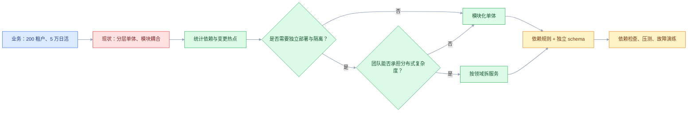
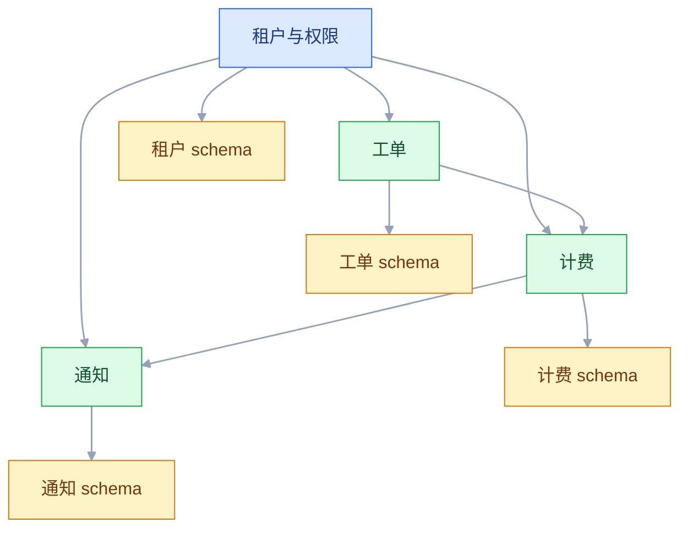

# 架构风格与选型

## 一、工程案例：给多租户 SaaS 选架构风格

**场景**：一个 B2B SaaS 产品，8 人研发团队，200 个租户，5 万日活，核心模块是租户、权限、工单、计费、通知。现在是一个分层单体：Controller → Service → Mapper，所有模块共用一张大库。问题是：改工单会碰到计费代码，改权限会影响所有模块；每周发一次版，回归要两天；有两个大客户要求独立数据库，现有结构做不到。

**目标**：选一个能撑 2 年、团队能掌控的架构风格，并交付：

- 一张风格选型矩阵；
- 一张模块边界与依赖规则图；
- 一份部署视图；
- 一套依赖检查与验收清单；
- 一份“什么时候该换风格”的触发信号。

**为什么必须做**：架构风格不是“微服务还是单体”的二选一，而是一组关于“边界、部署、通信、数据、失败”的组合决策。选错风格的代价，通常不是性能，而是团队长期在错误边界上改代码。

**动手前确认**：先统计模块间的真实依赖，不要按文件夹猜。用 `git log` 看最近 3 个月哪些文件经常一起改，用编译依赖或 import 关系看谁引用了谁。下面的数据是示例。



### 1.1 先看现状：模块到底怎么耦合

不要按目录判断模块。按“变更”和“依赖”两个维度看：

| 观察项 | 现状（示例） | 说明 |
|---|---|---|
| 最近 3 个月变更最多的 5 个文件 | 工单、计费、权限、通知、租户 | 变更热点集中，说明边界没切开 |
| 工单模块直接引用的其他模块 | 计费、权限、通知、租户 | 4 个方向，典型“中心模块依赖一切” |
| 计费模块被哪些模块引用 | 工单、租户、通知 | 计费是下游，却被上游反向依赖 |
| 跨模块数据库 JOIN | 37 处 | 数据边界和代码边界不一致 |
| 单次发布耗时 | 40 分钟 | 部署单元太大 |
| 回归测试耗时 | 2 天 | 变更影响面不可控 |
| 独立部署诉求 | 2 个大客户要独立库 | 租户隔离是硬约束 |

结论：当前不是“单体不好”，而是“单体的模块边界失效”。直接拆微服务，会把 37 处 JOIN 变成 37 个跨服务调用，风险更大。

### 1.2 候选风格

| 风格 | 边界靠什么 | 部署单元 | 数据边界 | 适合 | 主要代价 |
|---|---|---|---|---|---|
| 分层单体 | 包和目录 | 1 个 | 共享库 | 早期产品、边界不清 | 层间反向依赖，容易腐化 |
| 模块化单体 | 模块接口 + 依赖规则 | 1 个 | 模块独立 schema 或表前缀 | 团队小、边界清楚、要快速交付 | 纪律靠审查，故障隔离弱 |
| 微服务 | 服务契约 | N 个 | 每服务独立库 | 多团队、独立扩容、隔离 | 分布式事务、联调、运维 |
| 事件驱动 | 事件契约 | 可单可多 | 事件日志 + 读模型 | 异步解耦、削峰、跨系统 | 最终一致、重复、乱序 |
| SOA/ESB | 总线服务 | N 个 | 共享或独立 | 企业遗留系统集成 | 总线瓶颈、单点、治理重 |
| Serverless | 函数/触发器 | 托管 | 托管存储 | 流量波动、事件处理 | 冷启动、锁定、调试难 |
| CQRS | 读写模型分离 | 可单可多 | 写库 + 读库 | 读写差异大、审计 | 投影延迟、重建复杂 |
| 事件溯源 | 事件即事实 | 可单可多 | 事件存储 | 审计、回放、复杂领域 | 版本迁移、查询复杂 |
| 微内核 | 插件契约 | 1 个核心 | 核心 + 插件 | 可扩展产品、插件生态 | 插件隔离与版本管理 |

这张表不是让读者背，而是提醒：**每种风格都在解决一个特定问题，同时引入一组特定代价**。选型就是匹配“当前最痛的问题”和“团队能承担的代价”。

### 1.3 选型矩阵

| 维度 | 权重 | 分层单体 | 模块化单体 | 微服务 | 事件驱动 |
|---|---:|---:|---:|---:|---:|
| 边界清晰、可持续演进 | 25% | 2 | 5 | 4 | 4 |
| 交付速度与变更风险 | 20% | 4 | 4 | 2 | 3 |
| 租户隔离能力 | 20% | 2 | 3 | 4 | 3 |
| 团队能力匹配 | 15% | 5 | 4 | 2 | 2 |
| 运维与故障成本 | 10% | 5 | 4 | 2 | 2 |
| 迁移成本 | 10% | 5 | 4 | 2 | 2 |
| **加权总分** | **100%** | **3.35** | **4.20** | **3.00** | **3.05** |

结论：**模块化单体 + 模块独立 schema + 事件驱动的旁路链路**。理由：

- 8 人团队没有微服务治理经验，拆成 5 个服务会让联调和运维成本超过收益；
- 37 处跨模块 JOIN 需要先拆数据边界，而不是先拆网络边界；
- 两个大客户要独立库，用“租户分库 + 模块 schema”就能解决，不需要每个模块一个服务；
- 通知、审计、计费出账可以异步，先用事件解耦，保留后续拆服务的可能。

### 1.4 模块边界与依赖规则



规则要写成可检查的，不是“大家注意”：

1. `工单` 只能通过 `计费` 的公开接口调用，不能直接读 `计费` 的表。
2. `计费` 不能反向依赖 `工单`，需要工单数据时订阅事件。
3. 每个模块只能访问自己的 schema，跨模块查询走接口或读模型。
4. 模块之间禁止共享实体类，传递用模块自己的 DTO。
5. 跨模块调用必须有超时、重试上限和降级策略。
6. 新增跨模块依赖必须在 ADR 里登记，不能悄悄加。

### 1.5 部署视图

```text
┌──────────────────────────────────────────────┐
│                  负载均衡 / 网关              │
└───────────────────┬──────────────────────────┘
                    │
┌───────────────────▼──────────────────────────┐
│              应用实例（可水平扩展）           │
│  租户与权限 │ 工单 │ 计费 │ 通知 │ 审计      │
└───────┬──────────┬──────────┬───────────────┘
        │          │          │
   ┌────▼───┐ ┌────▼───┐ ┌────▼───┐
   │租户库  │ │工单库  │ │计费库  │
   └────────┘ └────────┘ └────────┘
        │          │          │
        └──────事件总线（通知、审计、出账）─────┘
```

模块化单体仍然是**一个部署单元**，但数据按模块分 schema，事件总线负责旁路。这样既保留了单体的交付效率，又为未来拆服务留了缝。

### 1.6 验收（7 项）

1. 依赖检查：模块间没有直接引用内部包，CI 失败率为 0。
2. 数据边界：每个模块只访问自己的 schema，跨 schema 查询为 0。
3. 租户隔离：大客户独立库切换后，数据不串租户。
4. 发布：单次发布 ≤ 15 分钟，回滚 ≤ 10 分钟。
5. 峰值：5 万日活的 3 倍压测，P99 ≤ 500 ms，错误率 ≤ 0.5%。
6. 故障：通知服务不可用时，工单创建不受影响，事件进入重试队列。
7. 演进：新增一个模块，不改现有模块代码，只加依赖和事件订阅。

### 1.7 什么时候换风格

不要因为“别人都拆了”就拆。出现下面任意两条，再考虑拆服务：

- 单个模块的发布频率和回滚需求明显高于其他模块；
- 单个模块的流量需要独立扩容，且扩容成本超过拆分成本；
- 模块间团队边界已经形成，两个团队经常为同一个发布窗口排队；
- 单库写入或容量达到上限，分库分表已经无法解决；
- 故障隔离成为硬要求，一个模块的故障不能影响其他模块。

触发信号要写进 ADR，每季度复盘一次。

## 二、高频问答：会卡住你的地方，也是面试最常问的

### 2.1 “微服务一定比单体先进”

**现场**

问三句：模块边界清了吗？团队有治理经验吗？独立扩容是硬需求吗？三个都否，先做模块化单体。

**要点**

- 微服务和单体不是先进与落后的关系，只是部署单元的粒度不同。
- 微服务把模块边界升级成网络边界；边界不清时拆，等于把耦合搬到网络上，更难改。
- 选型匹配的是“当前最痛的问题”和“团队能承担的代价”，不是别人的成功案例。

**追问**

- 单体什么时候是真撑不住？→ 单模块要独立扩容、发布频率远高于其他、单库写入到顶、故障隔离成硬要求。
- 模块化单体和普通单体差在哪？→ 模块接口 + 依赖规则 + 独立数据，缺一条就退回大泥球。
- 拆了还能合回去吗？→ 能，但数据已经分家，合并要迁移和双跑，成本不低。

### 2.2 分层架构就是 MVC

**现场**

看依赖方向：Service 是否直接引用 Controller，Mapper 是否被 Controller 直接调用；有反向依赖就是假分层。

**要点**

- MVC 是表现层模式，分层架构是依赖方向约束，两者不是一回事。
- 只有目录分层、没有依赖规则，等于没分层。
- 分层是否成立，看“能不能换掉一层而不动其他层”，不是看有几个包。

**追问**

- 分层架构最常见的腐化是什么？→ 反向依赖和万能 Service，业务逻辑全堆在 Service 里。
- 六边形、洋葱、整洁架构和分层什么关系？→ 都强调依赖指向内部，差别在术语和分层细节。
- 怎么强制依赖方向？→ 用依赖检查工具进 CI，靠评审记不住。

### 2.3 事件驱动能解决所有解耦

**现场**

问四句：消费者幂等吗？消息顺序有要求吗？积压了怎么告警？死信谁来处理？

**要点**

- 事件驱动解耦的是调用关系，不是复杂度。
- 它把“同步调用失败”换成了“消息重复、乱序、丢失、积压”，后者更难排查。
- 换来最终一致和削峰，代价是消息治理和链路追踪，没有这两样不要上。

**追问**

- 什么场景不该用事件？→ 需要强一致、需要立刻拿到结果的同步查询。
- 至少要有哪几个机制？→ 幂等、重试与死信、积压告警、消息版本。
- 事件洪水和正常事件驱动怎么分？→ 看有没有消费者治理，所有变更都发、没人消费就是洪水。

### 2.4 Serverless 一定便宜

**现场**

按 3 个月真实调用量算总账：计算、存储、网络、日志、冷启动补偿，不要只看单价。

**要点**

- 按调用付费便宜的是“低负载、事件型”场景，不是所有场景。
- 高频常驻流量下，函数调用次数、日志、托管存储可能比常驻实例更贵。
- 冷启动不只是第一次慢，还包括运行时初始化、依赖加载、连接池建立。

**追问**

- 什么业务适合 Serverless？→ 流量波动大、事件触发、低运维诉求，比如定时任务和文件处理。
- 延迟敏感的核心链路怎么办？→ 预留实例，或者改回常驻服务。
- 供应商锁定怎么评估？→ 看存储、消息、认证绑了多少专有服务，迁走要重写多少。

### 2.5 CQRS 就要配事件溯源

**现场**

问两句：需要审计和回放吗？读模型能否接受延迟？不能接受就先别上事件溯源。

**要点**

- CQRS 只是读写模型分离，事件溯源是“用事件存事实”，两者可以独立使用。
- 组合是选择不是定义：读写分离不等于 CQRS，CQRS 也不强制事件溯源。
- 事件溯源的代价是版本迁移、投影重建和查询复杂，没有审计回放需求就别付这个代价。

**追问**

- 不上事件溯源，读模型怎么维护？→ 写库后发事件更新读模型，或定时重建。
- 写完立刻查怎么办？→ 读自己的写、前端乐观更新，或关键查询回源。
- 事件结构变了旧事件读不出来怎么办？→ 事件版本 + 向上转换 + 重放策略。

### 2.6 SOA 已经过时了

**现场**

看现有系统是否以 ESB 为中心、是否有大量 SOAP/文件接口；是的话，问题不是“过时”，是“场景不同”。

**要点**

- SOA 和微服务解决的都是服务化，差别在治理方式、通信协议、部署粒度。
- SOA 常以 ESB 做协议转换和编排，容易变成瓶颈和单点；微服务强调去中心化和独立部署。
- 企业遗留系统集成里 SOA/ESB 仍然常见，替换要看收益，不是看年代。

**追问**

- ESB 和 Service Mesh 有什么区别？→ Mesh 只管通信横切能力，ESB 还管业务编排和协议转换。
- 老 ESB 怎么演进？→ 用绞杀者模式，外层路由先切流量，旧系统保留回退。
- 什么情况不该动 SOA？→ 遗留系统多、协议杂、预算不够时，先加防腐层比推倒重来划算。

### 2.7 模块化单体是伪概念

**现场**

看三条：CI 有没有依赖检查、模块有没有公开接口、跨模块是否只走接口；三条都有才是模块化单体。

**要点**

- 模块化单体的关键不是部署单元，是“模块接口 + 依赖规则 + 独立数据”。
- 没有规则约束，一个部署单元确实会退回大泥球，这正是它被当成伪概念的原因。
- 它的价值是保留单体交付效率，先把边界立起来，为将来拆服务留缝。

**追问**

- 怎么防止边界被绕过？→ 依赖检查进 CI，跨模块依赖必须在 ADR 登记。
- 它和微服务的边界规则一样吗？→ 一样，只是调用从网络换回进程内。
- 什么时候它会失效？→ 模块必须独立扩容或独立发布时，纪律顶不住物理需求。

### 2.8 架构风格可以随便混

**现场**

画出组合后的依赖图，检查有没有“服务之间共享数据库/实体”的反模式。

**要点**

- 风格可以组合，但组合会产生新的约束，不是简单叠加优点。
- 典型反例是微服务 + 共享库，最后变成分布式单体：既没有单体效率，也没有微服务隔离。
- 每加一种风格，都要写清“它负责哪一段、不负责哪一段、失败时怎么退”。

**追问**

- 常见的健康组合有哪些？→ 模块化单体 + 事件驱动、微服务 + CQRS、微服务 + BFF、核心单体 + 插件。
- 组合的边界怎么定？→ 按主链路和旁路分，主链路同步，旁路异步。
- 混到几种算多？→ 没有数字，标准是团队能不能说清每种风格负责哪一段。

### 2.9 选型看大厂就对了

**现场**

对比四个变量：流量规模、团队规模、一致性要求、运维能力；差两个以上就不能照抄。

**要点**

- 大厂的方案是“在他们的规模、团队、成本、历史”下的解，不是通用解。
- 照抄会把别人的复杂度搬到自己身上，而收益依赖的前提你并不具备。
- 选型先列业务驱动因素和硬约束，再列候选风格，最后才打分。

**追问**

- 大厂方案里哪些能直接借？→ 边界划分思路和失败处理经验，规模相关的技术选型不能借。
- 8 人团队该选什么？→ 模块化单体最划算，沟通成本低，边界靠审查顶住。
- 权重谁来定？→ 业务、技术、运维一起定，不能架构师关起门来打分。

### 2.10 拆分后性能一定更好

**现场**

先定位瓶颈：CPU、数据库、锁、网络、GC；只有瓶颈模块需要独立扩容时才拆。

**要点**

- 拆分把本地调用变成网络调用，多了序列化、网络、重试、排队。
- 没有按瓶颈拆，性能可能更差；按瓶颈拆，才可能更好。
- 拆分真正的收益是发布边界和故障隔离，性能只是可能的副产品。

**追问**

- 拆完变慢先查什么？→ 调用链层数和序列化开销，再看是不是拆出了跨服务查询。
- 同步链超过几层该警惕？→ 三层以上，延迟叠加和级联失败风险明显上升。
- 不拆能解决性能吗？→ 多数能：加缓存、读写分离、异步化、SQL 和索引优化。

## 三、核心知识

### 3.1 风格、模式、策略的区别

- **架构风格**：描述组件、关系、约束的整体套路，如分层、微服务、事件驱动。
- **架构模式**：在某个风格下解决特定问题的惯用结构，如 CQRS、BFF、Strangler Fig。
- **设计模式**：代码级或对象级的复用方案，如工厂、策略、观察者。

选型先定风格，再定模式，最后才谈框架。顺序反了，就会变成“先选 Spring Cloud，再找理由拆服务”。

> **面试**：常问「架构风格、架构模式、设计模式怎么区分？」答：风格定整体套路，模式解决风格下的特定问题，设计模式是代码级方案。

### 3.2 耦合与内聚

架构风格的本质是管理耦合：

| 耦合类型 | 表现 | 处理 |
|---|---|---|
| 内容耦合 | 一个模块直接改另一个模块的内部数据 | 禁止，改为接口 |
| 公共耦合 | 多个模块共享全局变量或全局配置 | 收敛为显式依赖 |
| 控制耦合 | 一个模块传标志位控制另一个模块流程 | 改为事件或策略 |
| 数据耦合 | 只通过参数传数据 | 可接受，尽量窄 |
| 标记耦合 | 传整个对象但只用其中几个字段 | 改为专用 DTO |

内聚看“一个模块里的东西是否因为同一个原因变化”。如果两个文件总是一起改，它们大概率应该在一个模块里；如果一个文件总因为两个不同原因改，它应该被拆开。

### 3.3 架构量子与边界

“架构量子”指一个可以独立部署、独立运行、拥有自己数据的最小单元。量子内部的耦合可以很紧，量子之间必须通过明确契约通信。

判断边界是否合理，看三个问题：

1. 这个边界内的东西是否一起变化？
2. 这个边界能否独立部署和回滚？
3. 这个边界是否拥有自己的数据，而不是和别人共享表？

三个问题有一个答“否”，边界就还不成立。

> **面试**：常问「怎么判断服务边界划得对不对？」答：看是否一起变化、能否独立部署回滚、是否拥有自己的数据，有一个否就不成立。

### 3.4 常见风格对比

| 风格 | 通信 | 数据 | 部署 | 典型反模式 |
|---|---|---|---|---|
| 分层 | 进程内调用 | 共享库 | 单部署 | 反向依赖、万能 Service |
| 模块化单体 | 模块接口/事件 | 模块 schema | 单部署 | 模块间直接读表 |
| 微服务 | HTTP/gRPC/消息 | 每服务独立库 | 多部署 | 分布式单体、共享库 |
| 事件驱动 | 事件 | 事件日志/读模型 | 可单可多 | 事件洪水、无幂等 |
| SOA/ESB | 总线 | 共享/独立 | 多部署 | 总线单点、编排过重 |
| Serverless | 事件/HTTP | 托管存储 | 托管 | 冷启动、函数编排复杂 |
| 微内核 | 插件契约 | 核心+插件 | 单部署 | 插件版本冲突、隔离不足 |

### 3.5 选型方法

1. **列业务驱动因素**：增长、合规、租户隔离、上线速度、成本。
2. **列硬约束**：团队人数、运维能力、现有技术栈、迁移窗口。
3. **列候选风格**：至少三个，包含“保持现状 + 局部优化”。
4. **定评估维度与权重**：业务、技术、组织、成本四类。
5. **打分并写理由**：分数不重要，理由要被评审挑战。
6. **写 ADR 与触发信号**：什么情况下重新评估。
7. **做小范围验证**：选一个模块试点，不搞全量切换。

### 3.6 从单体到微服务的迁移路径

| 阶段 | 动作 | 退出条件 |
|---|---|---|
| 0 现状 | 统计依赖、变更热点、数据边界 | 依赖图和数据地图完成 |
| 1 模块化 | 划模块、定接口、拆 schema | 跨模块直接读表为 0 |
| 2 旁路异步 | 通知、审计、出账先出进程 | 事件幂等、重试、死信齐全 |
| 3 试点拆分 | 选一个边界清楚的模块独立部署 | 试点稳定运行 1 个月 |
| 4 逐步拆分 | 按触发信号拆，不按组织口号拆 | 每个服务有 owner、SLO、回滚 |
| 5 治理 | 契约、链路追踪、容量、故障演练 | 能定位、能限流、能降级 |

迁移的关键不是“拆得快”，而是“每一步都可回滚”。先拆读、再拆写；先拆旁路、再拆主链路；先双跑、再切流。

> **面试**：常问「从单体迁到微服务，第一步做什么？」答：先统计依赖和变更热点，做模块化和拆 schema，不是先拆服务。

### 3.7 混合风格

真实系统很少是纯风格。常见组合：

- 模块化单体 + 事件驱动：主流程同步，旁路异步。
- 微服务 + CQRS：写服务负责命令，读服务负责查询。
- 微服务 + BFF：每个端一个聚合层，避免客户端拼接口。
- 核心单体 + 插件：核心稳定，插件扩展。
- 边缘 Serverless + 核心常驻：事件触发用函数，核心交易用常驻服务。

混合不是问题，问题是没有边界规则。每加一种风格，都要写清“它负责哪一段、不负责哪一段、失败时怎么退”。

### 3.8 反模式

| 反模式 | 表现 | 后果 |
|---|---|---|
| 大泥球 | 模块间随意引用，无边界 | 改一处坏一片 |
| 分布式单体 | 服务拆分但共享库、共享事务 | 既没有单体效率，也没有微服务隔离 |
| 金色锤子 | 所有问题都用微服务/消息队列 | 复杂度失控 |
| 万能服务 | 一个服务什么业务都做 | 团队瓶颈、发布排队 |
| 事件洪水 | 所有变更都发事件，没有消费者治理 | 消息积压、排查困难 |
| 过早抽象 | 为未来可能的需求建一堆扩展点 | 代码难懂、迭代变慢 |
| 共享数据库 | 多个服务直连同一个库 | 数据边界失效、变更互相影响 |

> **面试**：常问「什么是分布式单体，怎么识别？」答：服务拆了但共享库、共享事务，改一个功能要发多个服务。

### 3.9 组织与风格

架构风格要和团队拓扑匹配：

- 一个小团队：模块化单体最划算，沟通成本低。
- 多个团队按业务域划分：每个团队一个服务或一组服务，边界和团队边界对齐。
- 平台团队：负责网关、消息、可观测性、CI/CD，让业务团队少踩基础设施坑。
- 外包/多供应商：契约和边界要更硬，否则联调成本会吞掉收益。

康威定律不是宿命，可以用“逆康威”调整团队边界来塑造系统边界，但调整组织比改代码慢，别指望一次组织调整就能解决架构问题。

### 3.10 选型的决策记录

选型 ADR 至少写清：

- 业务驱动因素和硬约束；
- 候选风格及不选的理由；
- 权重和评分过程；
- 选择的风格、边界规则、部署方式；
- 代价和风险；
- 触发重新评估的信号；
- 试点范围和退出条件。

没有“不选的理由”，评审就无法判断你是“比较过”还是“拍脑袋”。

## 四、冷门知识汇总

- **架构量子（Architecture Quantum）**：可独立部署、独立运行、拥有独立数据的最小单元。它比“服务”更适合判断边界，因为一个量子可以是一个模块化单体的模块，也可以是一个微服务。
- **自包含系统（Self-Contained Systems）**：每个系统包含 UI、业务、数据，独立交付，通过少量异步事件协作。适合多团队、弱一致性的业务场景。
- **垂直切片（Vertical Slice）**：按功能纵向切，而不是按技术层横切。一个切片包含 UI、接口、领域、数据，减少跨层改动。
- **六边形/洋葱/整洁架构**：三者都强调“领域在中心、依赖指向内部”，差别在术语和分层细节。不要把它们当成三套完全不同的架构。
- **模块化单体的“Majestic Monolith”**：Basecamp 提出的说法，强调小团队用一个部署单元也能支撑大规模产品。它不是“懒”，而是“把复杂度花在业务上”。
- **微内核架构**：核心系统只提供最小能力，功能通过插件扩展。适合产品化软件、IDE、规则引擎；难点在插件隔离、版本兼容和权限。
- **空间架构（Space-Based Architecture）**：用内存数据网格和异步持久化处理高并发、不可预测的流量，常出现在票务、交易类系统。代价是数据一致性和运维复杂度。
- **管道与过滤器**：把处理拆成一系列独立过滤器，适合数据清洗、ETL、编译器。它和事件驱动的区别是“数据流是主动的，事件是通知”。
- **SOA 与微服务的核心差异**：SOA 常以 ESB 为中心做协议转换和编排，微服务强调去中心化、独立部署和轻量通信。两者不是新旧替代，而是治理哲学不同。
- **服务网格与 ESB 的区别**：Service Mesh 处理服务间通信的横切能力（流量、安全、观测），不负责业务编排；ESB 往往承担协议转换和业务流程编排，容易变成单点。
- **CQRS 的读模型延迟**：写模型成功后，读模型可能还没更新。对“写完立刻查”的场景，要么读自己的写（read-your-writes），要么前端做乐观更新，要么关键查询回源。
- **事件溯源的版本迁移**：事件不可变，但事件结构会变。需要事件版本、向上转换（upcasting）和重放策略，否则旧事件永远读不出来。
- **Serverless 的冷启动**：冷启动不是“第一次调用慢”这么简单，还包括运行时初始化、依赖加载、连接池建立。对延迟敏感的核心链路，通常要预留实例或改用常驻服务。
- **绞杀者模式（Strangler Fig）**：用新系统逐步替换旧系统，外层路由先切流量，旧系统保留回退。迁移遗留系统时，比“一次性重写”风险低。
- **防腐层（Anti-Corruption Layer）**：在新旧系统之间加一层转换，隔离旧模型和新模型。它不是多此一举，而是防止旧系统的概念污染新系统。
