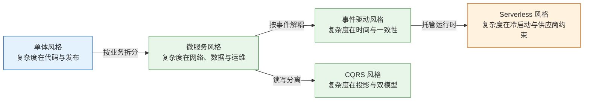
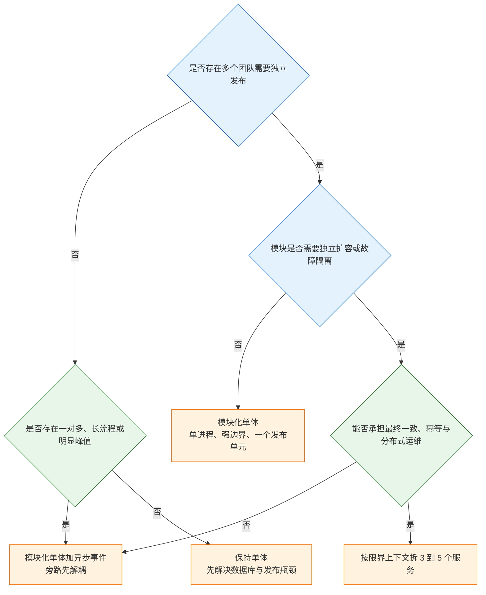
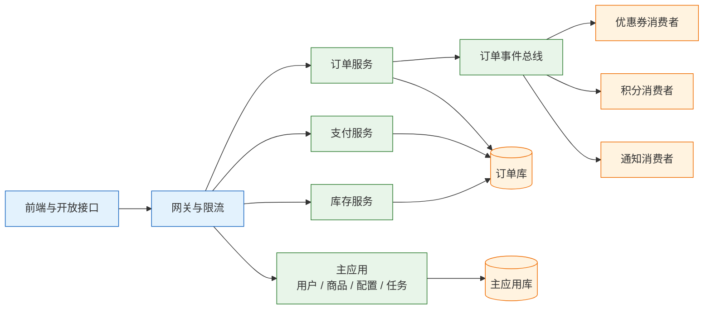

# 架构风格与选型

---

## 一、架构风格是什么

### 1.1 核心概念

架构风格（Architecture Style）是一组可复用的结构约束：它规定系统按什么单元部署、组件之间通过什么方式通信、数据由谁拥有、状态在时间上如何保持一致。风格不是“先进程度排行榜”，而是把复杂度放在哪里的选择。

同一个业务，换一种风格，代码量可能差不多，但故障形态、发布方式、团队分工和账单结构会完全不同。单体把复杂度留在代码里，微服务把它推到网络和运维，事件驱动把它推到时间和一致性。选型就是选一种自己付得起的复杂度。

判断风格差异，可以看四个结构变量：

- **部署单元**：所有代码一起发，还是按服务独立发；
- **调用边界**：进程内方法调用，还是跨网络调用；
- **数据归属**：共享一张库表，还是每个服务独立数据；
- **时间耦合**：调用方必须等结果，还是通过事件异步通知。

这四个变量决定了大部分成本。部署单元越多，发布越灵活，但平台与联调成本越高；调用跨网络，扩容越独立，但超时、重试、幂等必须补齐；数据不共享，边界越清楚，但跨服务查询和一致性越难；时间解耦越彻底，削峰能力越强，但延迟和排查难度越大。

| 风格 | 部署单元 | 调用方式 | 数据与一致性 |
|---|---|---|---|
| 分层单体 | 一个 | 进程内 | 共享库表，强一致 |
| 模块化单体 | 一个 | 进程内接口 | 模块独立表，本地事务 |
| 微服务 | 多个 | 网络接口 | 每服务独立，最终一致为主 |
| 事件驱动 | 多个 | 消息/事件 | 每服务独立，最终一致 |
| CQRS | 多个 | 命令与查询分离 | 读写模型分离，最终一致 |
| Serverless | 函数 | 事件/HTTP | 托管存储，最终一致 |

### 1.2 与相邻技术的关系

**风格与模式**：风格约束系统级结构，模式解决局部协作。分层是风格，策略模式是模式；事件驱动是风格，观察者模式是它在进程内的局部形态。用对模式不能弥补风格错配，风格正确也不保证局部实现优雅。

**风格与框架**：Spring Boot 可以帮助实现分层单体，也可以实现微服务，但框架不决定边界。把 12 个模块放进 12 个 Spring Boot 工程，不等于微服务；如果它们共享数据库、必须一起发布，那只是分布式部署的单体。

**风格与拓扑**：拓扑描述节点和网络的物理连接，风格描述逻辑结构与责任边界。同一套微服务可以部署在一台机器、一个 Kubernetes 集群或多个地域，风格不变，拓扑变了。评审时把两者混在一起，容易出现“上了 K8s 就是微服务”的误判。

**风格与组织**：康威定律指出，系统结构会趋向于组织的沟通结构。团队按技术分层划分，系统就容易按 controller、service、dao 分层；团队按业务能力划分，才更容易按限界上下文拆分。组织不调整，只改代码目录，边界很快会被沟通路径拉回去。

| 相邻概念 | 关注点 | 与风格的关系 |
|---|---|---|
| 设计模式 | 局部对象协作 | 风格之下的实现手段 |
| 框架 | 代码组织与运行支撑 | 可服务多种风格 |
| 拓扑 | 节点、网络、地域 | 风格的部署形态 |
| 组织架构 | 团队边界与沟通 | 风格的现实约束 |

### 1.3 判断框架与架构组成

一种风格能否落地，取决于它把复杂度转移到了哪里，以及团队有没有能力接住。判断时看三件事：转移后的复杂度是否可观测、是否有配套治理、是否与业务变化频率匹配。



这张图不是演进路线，而是成本转移图。每一步都买到一项能力，也都要支付一笔新成本；没有哪一步是“升级”，只有“换一种付法”。

风格的组成可以用三个要素描述：组件（做什么）、连接件（怎么连）、约束（什么不允许）。例如模块化单体的组件是业务模块，连接件是进程内公开接口和领域事件，约束是“跨模块不得读对方数据表”。约束写不清，风格就只剩目录结构。

| 要素 | 模块化单体示例 | 微服务示例 | 判断意义 |
|---|---|---|---|
| 组件 | 订单、支付、库存模块 | 独立部署的服务 | 责任边界 |
| 连接件 | 进程内接口、领域事件 | HTTP、RPC、消息 | 故障形态 |
| 约束 | 禁止跨模块读表 | 每服务独立数据库 | 是否真拆 |

---

## 二、单体与模块化风格

### 2.1 分层单体

分层单体的价值在于把变化隔开：接口层处理协议，应用层编排用例，领域层放业务规则，基础设施层封装数据库和外部系统。依赖方向必须指向领域层，而不是领域层依赖框架。

| 层 | 职责 | 典型组件 | 常见错误 |
|---|---|---|---|
| 接口层 | 协议转换、参数校验 | Controller、消息监听器 | 把业务规则写进 Controller |
| 应用层 | 用例编排、事务边界 | Application Service | 直接调用外部系统 |
| 领域层 | 业务规则、状态流转 | 实体、值对象、领域服务 | 依赖框架注解与数据库 |
| 基础设施层 | 持久化、消息、外部集成 | Repository、DAO、Client | 反向依赖应用层 |

问题出在“分层”只约束了纵向，没约束横向。订单、库存、支付三个模块互相直接调用对方的 Mapper、共享一张表、共用一套 DTO，最后变成“分层很清楚的大泥球”。纵向看每层都在，横向看边界全无。

分层单体的适用条件很明确：业务早期、团队小、边界还在探索、发布频率不高。它的优势是调试简单、事务本地、部署一个单元；劣势是单进程故障影响全部、模块之间容易腐化、无法按模块独立扩容。

### 2.2 模块化单体

模块化单体补的是横向边界。它不是“把代码分文件夹”，而是给模块之间加四条可执行的约束：

- 每个模块有公开接口和内部实现，跨模块只能调公开接口；
- 模块拥有自己的数据表，别的模块不能直接读写；
- 模块间同步调用走进程内接口，异步通知走领域事件；
- 用 ArchUnit 或类似工具把“不能依赖某包”写进 CI。

| 约束 | 落地手段 | 失效表现 |
|---|---|---|
| 公开接口 | 模块 API 包、internal 包 | 跨模块直接 new 实现类 |
| 数据归属 | 每模块独立 schema 或表前缀 | 一条 SQL 联三张模块表 |
| 调用方式 | 接口 + 领域事件 | 直接注入对方 Mapper |
| 依赖门禁 | ArchUnit、依赖检查 | 评审靠人记，半年后失守 |

它的好处很实际：一次发布仍是一个单元，没有网络超时、没有分布式事务、没有链路追踪也能排障；坏处是模块纪律没有物理隔离，赶工期时一个 `@Autowired` 就能绕过。所以模块化单体必须配 CI 约束，否则半年后边界就没了。

> **注意**：模块化单体不是“微服务的过渡阶段”，而是一种可以长期成立的终态。把模块化单体写成“迟早要拆”，团队就会在边界还没稳定时提前支付分布式成本。

### 2.3 适用边界与演进

**适用条件**：团队少于 15 人、业务边界还在变、没有独立扩容的硬需求、发布不是瓶颈。多数公司在这一档。15 人是经验阈值，不是硬标准；真正的判断依据是变更成本和故障成本是否已经超过团队承受范围。

| 信号 | 含义 | 建议动作 |
|---|---|---|
| 一个需求改动 3 个以上模块 | 边界与业务能力不匹配 | 重组模块，不是先拆服务 |
| 发布排队超过一周 | 发布单元成为瓶颈 | 先做 CI/CD 与灰度，再评估拆分 |
| 单模块需要独立扩容 | 资源画像差异明显 | 只拆该模块，保留其余单体 |
| 单进程故障影响全部 | 故障域过大 | 先做冗余与隔离，再拆服务 |
| 模块边界半年未变 | 边界趋于稳定 | 具备拆分前提，但仍需治理能力 |

演进路径应该是“先模块化，再异步化，最后按需服务化”。跳过前两步直接拆服务，得到的往往不是微服务，而是分布式单体。

---

## 三、微服务与分布式代价

### 3.1 三项真实收益

微服务真正提供的是三件事：独立部署、独立扩容、故障隔离。其他收益大多是这三项的推论，或者需要额外治理才能成立。

| 收益 | 成立条件 | 可观测指标 |
|---|---|---|
| 独立部署 | 服务之间无共享库表、契约向后兼容 | 发布频率、发布失败率 |
| 独立扩容 | 服务无状态或状态可外置 | 单服务资源利用率、扩容耗时 |
| 故障隔离 | 有超时、熔断、舱壁、降级 | 故障影响面、MTTR |

如果服务之间仍然共享数据库、必须按依赖顺序发布、一个请求串行经过八个服务，那么三项收益都不成立，只剩下一堆网络调用。

### 3.2 七类新增问题

微服务把七类问题从“框架内”搬到“系统间”，每一类都要有配套机制。

| 新增问题 | 具体表现 | 必须配套 |
|---|---|---|
| 超时与重试 | 下游慢导致线程池耗尽 | 超时、重试上限、退避、熔断 |
| 幂等 | 重试或消息重复造成重复扣款 | 幂等键、去重表、状态机 |
| 数据一致性 | 跨服务写无法用一个事务 | Saga、本地消息表、对账 |
| 查询 | 不能跨库 JOIN | API 组合、读模型、宽表 |
| 可观测性 | 一次请求跨 8 个服务 | Trace ID、集中日志、指标 |
| 发布 | 版本兼容、依赖顺序 | 契约测试、灰度、向后兼容 |
| 平台 | 12 个服务的部署、配置、证书 | CI/CD、服务网格或统一网关 |

这些成本不是“上线后再说”的附属品，而是拆分的前置条件。没有超时和幂等，重试会把小故障放大成资损；没有 Trace ID，一次跨服务故障的定位时间会从分钟级变成小时级。

### 3.3 前提条件与分布式单体

前提条件可以压成四条：**团队边界已经清楚、每个服务有明确 owner、有自动化发布和回滚、有基本的可观测性**。缺两条以上，拆完大概率是分布式单体。

分布式单体的典型特征：

- 服务之间共享数据库或共享表；
- 一个需求必须同时发布多个服务；
- 服务间是一长串同步调用，任何一环慢全链路慢；
- 没有契约测试，靠“联调时试一下”。

出现这些特征，说明拆的是代码目录，不是系统边界。

> **架构红线**：共享数据库加同步发布，是分布式单体的判定线。只要这两条还在，服务数量越多，故障面和发布成本越高，独立部署与独立扩容都是纸面收益。

### 3.4 拆分粒度与团队容量

拆分粒度按限界上下文（Bounded Context）确定，不按技术分层确定。用户、商品、库存、订单、支付各自有明确的业务语言和数据归属，才适合成为服务边界；把“查询服务”“写入服务”“定时任务服务”拆开，是按技术分层拆，业务一变就要同时改多个服务。

团队容量是硬约束。8 人团队维护 12 个服务，平均每个服务 0.67 人；如果每个服务的值班、发布、证书、容量评估合计需要 0.2 个全职人力，12 个服务需要 2.4 个全职人力，只剩 5.6 个全职人力做业务。

| 团队规模 | 可维护服务数（经验区间） | 说明 |
|---|---:|---|
| 5–8 人 | 2–4 个 | 每人至少覆盖一个服务的值班 |
| 8–15 人 | 4–8 个 | 需要平台与自动化支撑 |
| 15–30 人 | 8–15 个 | 需要专职平台与 SRE |
| 30 人以上 | 按业务域分组 | 服务数不是目标，边界才是 |

> **注意**：服务数量不是成熟度指标。12 个服务不一定比 4 个服务先进，4 个服务也不一定比 12 个服务保守；判断依据是每个服务是否有独立 owner、独立数据和独立发布理由。

---

## 四、事件驱动与读模型

### 4.1 事件驱动的适用场景

事件驱动适合三类场景：

1. **一对多**：下单后要发券、加积分、发短信、更新报表，主流程不该等四个下游；
2. **长流程**：支付成功后要履约、开票、通知，步骤跨小时甚至天；
3. **削峰**：秒杀流量瞬间打进来，用队列把峰值摊平。

| 场景 | 特征 | 收益 | 代价 |
|---|---|---|---|
| 一对多 | 一个事件多个消费者 | 主流程不被下游拖慢 | 下游延迟、重复消费 |
| 长流程 | 跨小时、跨系统 | 步骤可重试、可补偿 | 状态机与对账复杂 |
| 削峰 | 瞬时流量远高于均值 | 保护数据库与下游 | 队列积压、延迟上升 |

**不适用场景**：需要立即返回结果的下单扣库存、需要强一致的账务记账、简单 CRUD。把同步调用改成事件，不会让系统更快，只会让问题更晚暴露。

### 4.2 解耦的时间与一致性代价

事件驱动换来的代价是：

- **最终一致**：下游看到事件有延迟，用户可能先看到“已支付”、几秒后才看到“已发货”；
- **重复与乱序**：至少一次投递意味着可能重复；多分区意味着同一业务键的事件可能乱序，需要按业务键分区或加版本号；
- **排查困难**：同步调用有栈，异步链路只有 Trace ID 和消息轨迹；
- **Schema 演进**：事件一旦发出去就有消费者依赖，字段不能随便删改。

重复不是小概率事件，而是机制必然。假设单次投递的重复率为 0.1%，同一事件最多投递 3 次，至少出现一次重复的概率为：

```text
1 − (1 − 0.001)³ = 1 − 0.997002999 ≈ 0.2997%
```

也就是说，大约每 334 个事件就有 1 个可能被重复处理。消费端必须用幂等键去重，不能依赖“消息不会重复”的假设。

| 代价 | 机制 | 治理手段 |
|---|---|---|
| 最终一致 | 异步投递与消费 | 明确最长延迟、对账周期、补偿流程 |
| 重复 | 至少一次投递 | 幂等键、去重表、状态机 |
| 乱序 | 多分区并行消费 | 按业务键分区、版本号、拒绝旧事件 |
| 排查困难 | 无同步调用栈 | Trace ID、消息轨迹、消费位点监控 |
| Schema 演进 | 消费者长期存在 | 向后兼容、版本化、契约测试 |

### 4.3 事件形态与 CQRS

事件驱动还有三个容易混淆的形态，选错形态会把简单问题做复杂。

| 形态 | 事件里带什么 | 用途 | 代价 |
|---|---|---|---|
| 事件通知 | 只带 ID 和类型 | 下游自行回查，耦合最低 | 多一次调用 |
| 状态转移 | 带完整状态快照 | 下游不用回查 | 事件体积大、含敏感数据 |
| 事件溯源 | 存全部变更事件 | 可回放、可审计 | 重建、快照、版本管理复杂 |

多数业务用“事件通知 + 下游回查”就够了，不要一上来做事件溯源。事件溯源适合审计要求高、状态可由事件完整重建的领域；把它当默认存储模型，会带来快照、重放、事件版本升级和隐私删除难题。

**CQRS** 把写模型和读模型分开。写侧负责校验和一致性，读侧为查询建宽表、搜索索引或缓存。它解决的是“同一张表既要扛高频写、又要支持多维查询”的矛盾。

| 维度 | 写模型 | 读模型 |
|---|---|---|
| 目标 | 校验、事务、状态变更 | 查询性能、维度灵活 |
| 存储 | 规范化表、事件流 | 宽表、搜索索引、缓存 |
| 一致性 | 强一致或本地事务 | 最终一致 |
| 代价 | 模型维护 | 投影延迟、重建成本 |

代价是投影延迟和双模型维护：写侧成功后，读侧可能几百毫秒到几秒才更新；投影失败要能重建。**只有读负载远大于写、查询维度多、能接受延迟时才值得**。普通后台管理系统的列表页，加索引就够了。

### 4.4 Serverless 与 SOA 的边界

**Serverless** 适合流量波峰波谷明显、事件触发、低频定时任务。它的计费按调用和时长，空闲不花钱；代价是冷启动、执行时长和包大小限制、本地调试困难、供应商锁定。常驻高并发服务用 Serverless，账单和延迟都可能失控。

**SOA / ESB** 在企业集成里仍然常见：多个遗留系统通过总线做协议转换和路由。问题是总线容易变成单点和瓶颈，所有变更都排队等集成团队。能点对点或走事件的地方，不要什么都往总线塞。

| 风格 | 适用负载 | 主要收益 | 主要风险 |
|---|---|---|---|
| Serverless | 突发、低频、事件触发 | 免容量规划、按用量计费 | 冷启动、执行限制、锁定 |
| SOA / ESB | 多遗留系统、协议异构 | 统一路由与协议转换 | 总线单点、治理瓶颈 |
| 事件驱动 | 一对多、长流程、削峰 | 解耦、削峰、可重试 | 最终一致、重复乱序 |

---

## 五、选型维度与决策顺序

### 5.1 硬约束与软指标

选型先把硬约束列出来，再比较软指标。硬约束不满足的方案直接淘汰，不进入打分环节。

| 维度 | 判断依据 | 淘汰条件 |
|---|---|---|
| 组织边界 | 团队数量、owner、值班能力 | 无人能独立负责服务 |
| 数据一致性 | 业务可接受的最长延迟 | 要求强一致却选最终一致 |
| 运维能力 | 发布、监控、排障、平台 | 缺自动化发布与可观测性 |
| 成本 | 资源、人力、迁移、退出 | 总成本超过业务收益 |
| 演进路径 | 边界稳定性、增长曲线 | 方案无法小步回退 |

软指标包括上线速度、生态集成、单位成本、供应商支持质量。软指标适合加权评分，不适合一票否决；硬约束必须先过。

### 5.2 决策顺序与决策树



四个问题的顺序不能反：先看组织，再看扩容，再看一致性成本，最后看异步收益。反过来先问“要不要事件驱动”，很容易为了技术而技术。

### 5.3 演进路径

选型要看演进路径，而不是一次到位：

1. 先把单体按业务能力划模块，禁止跨模块读表；
2. 把通知、报表、对账等旁路链路异步出去；
3. 数据库读写分离，预留分片键；
4. 只把“必须独立扩容”或“故障必须隔离”的模块拆成服务；
5. 每次拆一个，双跑、灰度、可回滚。

| 阶段 | 动作 | 验证 | 回退 |
|---|---|---|---|
| 模块化 | 划边界、建 API、加 CI 门禁 | 跨模块依赖数为 0 | 保留原包结构 |
| 异步化 | 旁路事件、幂等消费 | 延迟与重复率达标 | 开关切回同步 |
| 数据分离 | 读写分离、独立 schema | 复制延迟与一致性达标 | 保留主库直连 |
| 服务化 | 一次拆一个模块 | 契约测试、灰度指标 | 路由切回单体 |
| 稳定化 | 补 Trace、告警、演练 | MTTR 与错误预算达标 | 保留双跑通道 |

### 5.4 成本估算

风格成本可以用三个公式快速估算，避免只比较“机器单价”。

**串行调用可用性**：五个服务串行依赖，单服务可用性 99.9%，链路可用性为 0.999⁵ ≈ 99.50%，年停机从 8.76 小时恶化到约 43.7 小时。每增加一跳，都在放大整体故障概率；减少串行依赖或增加并行降级，比单纯提高单服务可用性更有效。

**延迟预算**：每跳 P99 预算 50 ms，五跳串行累加为 250 ms。实际 P99 不是简单相加，排队和重试会放大长尾，所以预算要留余量；如果端到端目标 300 ms，五跳串行几乎没有余量，应考虑并行化或减少跳数。

**发布协调成本**：12 个部署单元每周各发一次，一个月约 48 次发布；如果按 3 层依赖排序，每次跨层变更都要协调联调窗口。发布单元越多，协调成本上升得越快，通常快于线性增长。

| 估算项 | 公式 | 示例 |
|---|---|---|
| 链路可用性 | A₁ × A₂ × … × Aₙ | 0.999⁵ ≈ 99.50% |
| 年停机 | 8760 × (1 − A) | 约 43.7 h |
| 延迟预算 | 单跳预算 × 跳数 | 50 ms × 5 = 250 ms |
| 月发布次数 | 部署单元 × 每周次数 × 4 | 12 × 1 × 4 = 48 |
| 人均服务数 | 服务数 / 团队人数 | 12 / 8 = 1.5 |

> **注意**：这些公式只用于数量级判断，不能替代压测和账单。可用性相乘假设故障独立，同一机房或同一中间件会让故障相关，实际可用性可能更低。

---

## 六、电商系统风格收敛案例

### 6.1 初始状态与问题

一个 8 人团队维护电商系统，日订单 5 万、峰值 200 TPS。两年前按“最佳实践”拆成 12 个服务：用户、商品、库存、订单、支付、优惠券、积分、通知、搜索、网关、配置、任务。现在一个“下单送积分并支持优惠券叠加”的需求，要改订单、优惠券、积分、通知四个服务，联调三天，发布还要按依赖顺序排。

另一个团队相反：30 人维护一个单体，日订单 80 万、峰值 4000 TPS，一次发布要回归两周，数据库单表 8 亿行。他们开始讨论“是不是该上微服务”。

这两个案例的共同点不是“服务数量”，而是**变更成本和故障成本已经超过了团队能承受的范围**。架构风格要解决的是这个，不是“别人都在用”。

| 指标 | 12 服务团队 | 30 人单体团队 |
|---|---|---|
| 团队规模 | 8 人 | 30 人 |
| 日订单 | 5 万 | 80 万 |
| 峰值 TPS | 200 | 4000 |
| 单次需求改动 | 4 个服务 | 1 个应用、多个模块 |
| 发布方式 | 按依赖顺序排 | 整体回归两周 |
| 主要痛点 | 联调与发布协调 | 回归慢、单表过大 |

### 6.2 诊断与处置

诊断从三个问题开始：哪些服务必须独立扩容、哪些服务必须独立故障隔离、哪些服务只是按技术目录拆出来的。12 个服务逐个核对后，发现用户、商品、配置、任务四个服务变更频率低、没有独立扩容需求，也没有独立 owner，属于“拆了但不需要独立部署”的部分。

| 服务 | 变更频率 | 独立扩容需求 | 处置 |
|---|---|---|---|
| 用户 | 低 | 无 | 合回主应用 |
| 商品 | 低 | 无 | 合回主应用 |
| 配置 | 低 | 无 | 合回主应用 |
| 任务 | 低 | 无 | 合回主应用 |
| 订单 | 高 | 有 | 保留为核心服务 |
| 支付 | 高 | 有 | 保留为核心服务 |
| 库存 | 高 | 有 | 保留为核心服务 |
| 优惠券 | 中 | 无 | 改为订阅订单事件 |
| 积分 | 中 | 无 | 改为订阅订单事件 |
| 通知 | 中 | 无 | 改为订阅订单事件 |
| 搜索 | 中 | 有 | 保留独立读模型 |
| 网关 | 低 | 有 | 保留接入层 |

处置原则不是“合并回单体”，而是按独立部署理由重新划分部署单元。没有独立理由的服务合回去，有独立理由的服务留下，旁路链路改为事件订阅。

### 6.3 目标结构与迁移



迁移分三步：先把四个低频服务合回主应用，减少部署单元；再把优惠券、积分、通知改为订阅订单事件，去掉订单服务的同步扇出；最后补统一的 Trace ID、契约测试和灰度发布。每一步都保留回退路径：合并期间双写路由，事件化期间保留同步开关，灰度期间按流量比例切换。

### 6.4 结果、代价与第二个案例

三个月后，一个需求平均改动从 4 个服务降到 1.8 个，降幅约 55%；发布从“排依赖”变成“核心服务单独发、旁路服务跟着事件走”。代价是事件链路多了延迟和重复处理，需要幂等表和对账任务，这些成本在拆分前没人提。

第二个团队没有拆微服务。他们先做了三件事：按订单、库存、履约划模块；把报表查询迁到只读库；把通知和积分异步化。峰值 4000 TPS 时，数据库写入到 65%，应用 CPU 到 70%，还没有必须拆服务的信号。于是他们暂缓拆分，把预算投到分库分表预案和压测上。这个“不拆”的决策，和“拆”一样是架构决策。

| 决策 | 触发信号 | 动作 | 结果 |
|---|---|---|---|
| 12 服务团队收敛 | 需求跨 4 服务、联调 3 天 | 合并低频服务、旁路事件化 | 改动服务数 4 → 1.8 |
| 30 人单体暂缓拆分 | DB 65%、CPU 70%、无独立扩容刚需 | 模块化、读库分离、异步化 | 保留单体，补分片预案 |

> **架构红线**：把“服务数量”当成绩，把“拆分”当升级，是最典型的过度拆分。没有独立 owner、独立数据和独立发布理由的服务，每增加一个都在增加故障面。

---

## 七、常见失败模式与排查

### 7.1 失败模式判断表

| 现象 | 最可能原因 | 处理 |
|---|---|---|
| 拆完发布更慢 | 服务间强耦合，必须一起发 | 消除共享库/共享表，改契约和事件 |
| 一个需求改五个服务 | 按技术分层拆，不是按业务能力拆 | 按限界上下文重组，合并过细服务 |
| 调用链一长就超时 | 同步串联、没有超时和熔断 | 并行化、异步化、设超时预算 |
| 事件丢了或重复了 | 把“发消息”当“事务提交” | 本地消息表/Outbox + 消费幂等 |
| 读模型总是旧的 | 投影延迟没算进产品体验 | 读己之写走主库，或前端显示“处理中” |
| Serverless 账单暴涨 | 高并发常驻流量按调用计费 | 常驻服务回到容器，Serverless 只做峰谷任务 |
| 单体越改越慢 | 模块边界失守，跨模块直接读表 | 加 ArchUnit 门禁，拆表、拆 schema |
| 为了“先进”上事件溯源 | 只需要解耦，却引入了重放和版本管理 | 先用事件通知，确有审计/回放需求再升级 |

### 7.2 排查顺序

1. 当前最贵的成本是什么：发布、扩容、故障，还是理解代码；
2. 这个问题换个风格真的能解决，还是只是换个地方承担；
3. 团队有没有对应的运维和治理能力；
4. 能不能小步验证，失败了怎么退；
5. 三年后数据量、团队规模、合规要求变了，这个选择还成立吗。

排查时先量化再讨论。发布成本看“从提交到上线的时间”和“每次发布涉及的服务数”；故障成本看 MTTR 和影响面；理解成本看新成员独立改一个需求所需的时间。没有这三个数，风格讨论就会回到偏好。

| 排查项 | 观测指标 | 判断阈值示例 |
|---|---|---|
| 发布成本 | 发布耗时、涉及服务数、回滚耗时 | 涉及 3 个以上服务即需复盘 |
| 故障成本 | MTTR、故障影响面、告警量 | MTTR 超过 30 分钟需补可观测性 |
| 理解成本 | 新人首个需求交付时间 | 超过 2 周说明边界不清 |
| 一致性成本 | 对账差异、补偿失败率 | 日终差异不为 0 即需治理 |
| 平台成本 | 单位请求基础设施成本 | 增长快于流量即无规模效应 |

### 7.3 选型决策清单

| 检查项 | 通过标准 | 不通过的动作 |
|---|---|---|
| 独立部署理由 | 每个服务有独立发布节奏 | 合并或改为模块 |
| 数据归属 | 每服务独立库或 schema | 先拆数据，再谈服务 |
| 团队容量 | 人均服务数在可维护区间 | 合并低频服务或补平台 |
| 治理能力 | 超时、幂等、Trace、契约测试齐备 | 先补治理，再拆下一个 |
| 回退路径 | 每次拆分可灰度、可回切 | 不允许一次性切换 |
| 成本模型 | 单位成本随流量下降或持平 | 重新评估风格与容量 |

> **核心结论**：风格是成本结构的选择，不是成熟度排名；微服务的前提是组织边界、独立数据和可观测性；事件驱动买的是解耦和削峰，付的是时间与一致性；不需要立即结果的地方才用。
