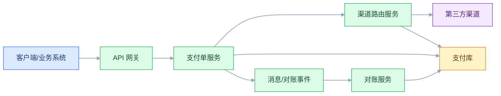
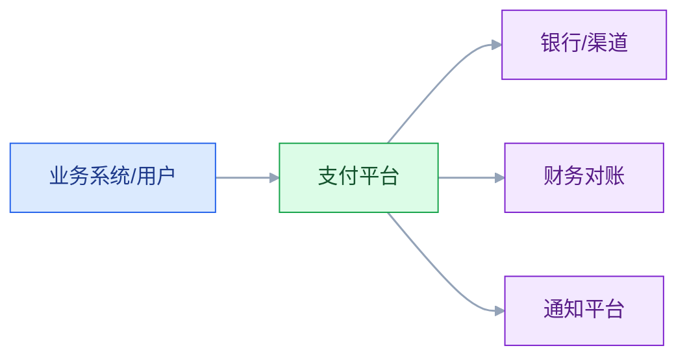

# 架构决策、文档与评审

## 一、工程案例：给支付系统做一次能落地的架构评审

**场景**：支付团队准备把现有支付服务从单体拆成三个服务：支付单、渠道路由、对账。方案 PPT 写了 40 页，评审会开了三次，每次都在争论“要不要拆”“用什么中间件”，没有结论。上线前两周发现：支付单和渠道路由都要改交易表，对账服务拿不到实时流水；回滚方案只有一句“切回旧系统”。

**目标**：不写更厚的文档，交付一套能评审、能追溯、能执行的决策材料：

- 一份 ADR（架构决策记录）；
- 一张 C4 Context + Container 图；
- 一张质量属性场景表；
- 一份评审清单与结论；
- 一份决策日志与待办；
- 一份验收与回滚方案。

**为什么必须做**：架构评审的价值不是“证明方案对”，而是“把不确定性和代价摆到桌面上，让决策可追溯”。没有 ADR，三个月后没人记得为什么这样拆；没有验收，评审结论只是意见。

**动手前确认**：评审前 48 小时把材料发给参会人，明确要决策的问题，不要现场才第一次看。下面的支付系统数据是示例。



### 1.1 先明确评审要决策什么

一次评审不要讨论十个问题。把问题写成“决策项”，每项有选项、推荐、代价：

| 决策项 | 选项 | 推荐 | 代价 |
|---|---|---|---|
| 是否拆服务 | 保持单体 / 拆三服务 | 拆支付单与渠道路由，对账先独立进程 | 分布式事务、联调 |
| 数据归属 | 共享库 / 每服务独立库 | 支付单与渠道路由共享支付库，对账只读 | 边界不彻底 |
| 通信方式 | 同步 / 异步 | 支付主链路同步，对账异步 | 最终一致 |
| 回滚 | 代码回滚 / 流量切回 | 双跑 + 流量开关 | 短期成本 |

评审会只解决“决策项”，不解决“实现细节”。实现细节会后开小会。

### 1.2 ADR

```markdown
# ADR-007 支付单与渠道路由拆分，对账先独立进程

- 状态：已接受
- 日期：2026-10-22
- 决策人：支付负责人、架构、运维、财务

## 背景

支付服务日交易 200 万笔，峰值 3000 TPS；支付单和渠道路由耦合在一个进程，
渠道变更会影响支付主链路；对账每天延迟 4 小时。

## 决策

拆出支付单服务与渠道路由服务，共享支付库；对账先独立进程，只读流水。
主链路同步，对账异步；双跑两周后切流。

## 备选方案

A 保持单体，只做模块化：风险低，但渠道变更仍影响主链路。
B 全拆三服务、独立库：隔离最好，但分布式事务和迁移成本过高。

## 后果

正面：渠道变更隔离，支付主链路更稳；对账可独立扩容。
负面：共享库边界不彻底；对账有延迟；需要双跑和回滚开关。

## 验证

3000 TPS 压测、渠道故障演练、连续 7 天对账、回滚演练。

## 触发重新评估

渠道路由发布影响支付主链路两次以上，或支付库写入达到 70%。
```

ADR 要写“不选什么、为什么”，否则评审无法判断是否比较过。

### 1.3 C4 图

C4 分四层，但评审通常只需要前两层：

| 层 | 回答 | 评审用 |
|---|---|---|
| Context | 系统与外部谁交互 | 必看 |
| Container | 有哪些部署单元、数据存储 | 必看 |
| Component | 容器内部模块 | 按需 |
| Code | 类/接口 | 几乎不看 |



图要配“图例 + 边界 + 数据流方向”。只有方框没有边界，评审看不出哪里是系统内、哪里是外部。

### 1.4 质量属性场景

评审必须带可度量的场景，否则只能争论“稳不稳”。

| 属性 | 场景 | 验收 |
|---|---|---|
| 性能 | 峰值 3000 TPS | P99 ≤ 300 ms，错误率 ≤ 0.1% |
| 可用性 | 单渠道故障 | 支付主链路 1 分钟内切换，成功率 ≥ 99% |
| 一致性 | 回调重复/乱序 | 重复入账 0，最终状态正确 |
| 可修改性 | 新增渠道 | 2 人周上线，不改支付单核心 |
| 可观测性 | 支付失败投诉 | 1 分钟定位到渠道、订单、错误码 |
| 回滚 | 新版本异常 | 10 分钟内切回旧版本 |

### 1.5 评审清单

| 维度 | 检查项 |
|---|---|
| 业务 | 目标、范围、成功指标是否清楚 |
| 质量属性 | 是否有可度量场景，是否覆盖失败路径 |
| 边界 | 系统 of record、数据归属、依赖方向 |
| 一致性 | 跨服务事务、幂等、补偿、对账 |
| 容量 | 峰值、单实例容量、连接池、下游限流 |
| 可用性 | 单点、降级、熔断、容灾、回滚 |
| 安全 | 认证、授权、敏感数据、审计 |
| 运维 | 监控、告警、发布、回滚、值班 |
| 迁移 | 双跑、灰度、回滚点、数据迁移 |
| 文档 | ADR、C4、接口契约、决策日志 |

评审不是逐条念，而是按风险排序，先看“错了会赔钱/停服”的项。

### 1.6 评审结论

结论只有四种：

| 结论 | 含义 | 后续 |
|---|---|---|
| 通过 | 可以进入实施 | 记录决策与待办 |
| 有条件通过 | 有风险，但可控 | 明确条件、owner、截止时间 |
| 退回补充 | 信息不足 | 补齐材料再评 |
| 不通过 | 方案不可接受 | 重新设计 |

“有条件通过”最容易失控。条件必须写成可验收的待办，不能写“注意风险”。

### 1.7 文档即代码

架构文档要和代码一起版本化：

- ADR 放 `docs/adr/`，一个决策一个文件；
- C4 用 diagrams-as-code（Mermaid/Structurizr/PlantUML）；
- 接口契约放 OpenAPI/Proto；
- 评审记录放 Issue/PR，关联 ADR；
- 决策日志按时间排序，可搜索。

文档即代码的好处：能 diff、能评审、能回滚、能跟版本走。

### 1.8 验收（8 项）

1. 每个架构级决策都有 ADR，包含背景、选项、后果、验证。
2. C4 Context/Container 图与部署一致，图例和边界清楚。
3. 质量属性场景可度量，覆盖性能、可用性、一致性、回滚。
4. 评审结论明确，待办有 owner、截止时间、验收标准。
5. 决策日志可搜索，能回答“为什么这样拆”。
6. 接口契约有版本，消费者能验证兼容性。
7. 文档与代码同仓库，最近一次变更可追溯。
8. 评审后 30 天回看，决策是否仍成立，触发信号是否出现。

## 二、高频问答：会卡住你的地方，也是面试最常问的

### 2.1 架构文档就是 PPT

**现场**

问两句：这份文档和当前代码一致吗？能查到谁改的、为什么改吗？答不上来就是 PPT。

**要点**

- PPT 不能 diff、不能追溯、不能跟代码同步，三个月后没人知道哪版是真的。
- 文档的价值是让决策可追溯、让新人快速理解、让评审有依据，不是证明做过架构。
- 文档要和代码同仓库、一起评审、一起版本化，才能跟版本走。

**追问**

- 文档该用什么形式？→ ADR 用 Markdown，C4 用 diagrams-as-code，接口契约用 OpenAPI/Proto。
- 读者不同怎么办？→ 管理层看 Context 和决策，开发看 Container 和契约，运维看部署和依赖。
- 图和代码不同步怎么办？→ 用 Structurizr 这类工具从模型生成视图，别手画。

### 2.2 ADR 就是会议纪要

**现场**

看 ADR 有没有“备选方案”和“后果”两段；没有就是纪要。

**要点**

- ADR 记录的是“决策 + 选项 + 后果”，不是谁说了什么。
- 没有备选方案和代价，评审无法判断你是比较过还是拍脑袋。
- ADR 要小、要快、要进版本库，不要写成 20 页设计文档。

**追问**

- 最小结构有哪些字段？→ 标题、状态、背景、决策、备选、后果、验证、触发信号。
- 状态怎么流转？→ 提议、已接受、已废弃、被替代，被替代的要链到新的 ADR。
- 什么决策值得写？→ 跨模块、不可逆、变更成本高的，日常实现细节不用写。

### 2.3 C4 要把四层都画完

**现场**

指着图问：这张图帮助谁做什么决策？答不上来就是装饰。

**要点**

- Code 层变化快、信息密度低，评审主要看 Context/Container，Component 按需。
- C4 的核心是“不同层次给不同读者看”，不是画得越细越好。
- 图要配图例、边界和数据流方向，只有方框，评审看不出哪里是系统内。

**追问**

- Context 和 Container 各回答什么？→ 前者是系统与外部谁交互，后者是有哪些部署单元和数据存储。
- 除了四层静态图还要画什么？→ 动态图和部署图，对评审更有用。
- 一上来画类图有什么问题？→ Code 层只适合解释关键实现，不适合当评审主图。

### 2.4 评审就是挑刺

**现场**

看评审有没有决策项、清单、结论、待办；没有就是聊天。

**要点**

- 评审的价值不是证明方案对，是把不确定性和代价摆到桌面上。
- 没有统一维度和决策项，评审会变成经验之争，结论不可执行。
- 评审按风险排序，先看“错了会赔钱/停服”的项，不逐条念清单。

**追问**

- 评审该带哪些材料？→ ADR、C4、质量属性场景、评审清单、待办。
- 一次评审讨论几个问题？→ 只讨论决策项，十个问题一次会必然没结论。
- 什么方法够用？→ 轻量评审 + 关键场景原型，不必完整跑 ATAM。

### 2.5 评审越晚越省事

**现场**

看评审发生在需求、设计还是上线前；只有上线前一次评审就是太晚。

**要点**

- 越晚发现边界和一致性问题，返工成本越高。
- 评审要分阶段：方向、方案、上线前，每阶段解决不同层级的问题。
- 上线前才评，剩下的只有“敢不敢上”，结构已经改不动了。

**追问**

- 三个阶段各评什么？→ 方向评目标和约束，方案评边界和取舍，上线前评回滚和验收。
- 早期信息不足怎么评？→ 只评可逆性差的决策，其余留到最后责任时刻。
- 评审太频繁会不会拖慢交付？→ 按风险分级，不可逆决策走重流程，其余轻量过。

### 2.6 架构是架构师一个人的事

**现场**

看评审参会人是否有业务、开发、运维、安全；只有架构师就是闭门造车。

**要点**

- 架构决策影响开发、运维、财务、业务，没有利益相关者参与，落地一定走样。
- 架构师不是技术最强的人，是能做出别人愿意执行的决策的人。
- 决策人要在 ADR 里留名，共识要写进文档，不能只停在会上。

**追问**

- 业务方不懂技术怎么参与？→ 让他们评目标和代价，不评技术选型。
- 人太多开不动怎么办？→ 决策人少而明确，其他人给意见但不进决策圈。
- 没人反对怎么判断是真同意？→ 指定反方角色，或用“不同意请说明”的显式确认。

### 2.7 决策日志没用

**现场**

问：为什么不用另一个方案？如果没人答得上来，就是缺日志。

**要点**

- 人员会流动、上下文会丢失，没有决策日志，后人只能猜。
- 日志要能搜索、能链接到 ADR、能标记被替代。
- 记的是决策索引，不是会议记录：日期、决策、状态、对应 ADR 就够。

**追问**

- 日志和 ADR 什么关系？→ ADR 存完整上下文，日志是按时间排序的索引。
- 决策被推翻怎么写？→ 旧的标“被替代”，链到新 ADR，不删历史。
- 谁来维护？→ 决策人，评审后当场补，不要攒到季度末。

### 2.8 文档写完就锁进知识库

**现场**

看文档最后更新时间，对比最近一次架构变更；对不上就是过期。

**要点**

- 架构是演进的，文档没有 owner 和更新触发点，很快过期。
- 超过半年未更新的文档，默认不可信。
- 每份 ADR 都该有触发信号，没有触发信号的决策默认永久有效，最容易过期。

**追问**

- 怎么让文档跟着变更走？→ 文档和代码同仓库，改架构的 PR 必须带文档变更。
- 谁来负责更新？→ 每份文档有 owner，评审后 30 天回看一次。
- 过期文档直接删吗？→ 标废弃并链到新版本，删了后人更查不到。

### 2.9 评审结论“有条件通过”

**现场**

看条件是否可验收、有负责人、有日期；没有就是放水。

**要点**

- “有条件通过”最容易失控：条件不写清、没有 owner 和截止时间，等于没通过。
- 条件必须写成可验收的待办，不能写“注意风险”。
- 结论只有四种：通过、有条件通过、退回补充、不通过，每种对应不同后续。

**追问**

- 条件到期没完成怎么办？→ 升级到决策人，或按不通过处理，不能自动续期。
- 什么情况该直接不通过？→ 边界或一致性有硬伤、方案不可接受时，别用条件掩盖。
- 待办怎么跟踪？→ 进 Issue、关联 ADR，评审后定期回看。

### 2.10 工具越贵越专业

**现场**

问两句：图能跟代码一起版本化吗？能自动更新吗？不能就是画图工具。

**要点**

- 工具解决画图效率，不解决边界、决策、一致性。
- 图和代码不同步，再贵的工具也没用。
- diagrams-as-code 的价值是能 diff、能进 Git，代价是对复杂布局控制弱。

**追问**

- C4 用什么工具？→ Structurizr 从模型生成多视图，或 Mermaid 直接写进仓库。
- 买了工具为什么还是乱？→ 缺的是决策和边界，不是渲染能力。
- 图要画多细？→ 够回答评审问题就行，Context 和 Container 两层信息量最大。

## 三、核心知识

### 3.1 架构文档的目的

文档不是为了“证明做过架构”，而是为了：

- 让决策可追溯；
- 让新成员快速理解；
- 让评审有依据；
- 让变更可评估；
- 让运维知道边界和依赖。

文档的读者决定内容：管理层看 Context 和决策，开发看 Container 和契约，运维看部署和依赖。

### 3.2 ADR

ADR（Architecture Decision Record）记录“一个重要决策及其上下文”。

最小结构：

| 字段 | 内容 |
|---|---|
| 标题 | 一个决策一句话 |
| 状态 | 提议/已接受/已废弃/被替代 |
| 背景 | 业务目标、约束、现状 |
| 决策 | 选了什么 |
| 备选 | 至少两个，写清代价 |
| 后果 | 正面、负面、风险 |
| 验证 | 怎么证明 |
| 触发 | 何时重新评估 |

ADR 要小、要快、要进版本库。不要写成 20 页设计文档。

> **面试**：常问「ADR 和设计文档有什么区别？」答：ADR 记一个决策及其上下文，一页就够；设计文档描述整个方案，篇幅更长。

### 3.3 C4 模型

| 层 | 元素 | 读者 |
|---|---|---|
| Context | 人、系统、外部依赖 | 业务、管理层 |
| Container | 应用、服务、数据库、队列 | 开发、运维 |
| Component | 模块、组件 | 开发 |
| Code | 类、接口 | 开发（按需） |

C4 的核心是“不同层次给不同读者看”，不是“画得越细越好”。

> **面试**：常问「C4 四层各给谁看？」答：Context 给业务和管理层，Container 给开发和运维，Component 和 Code 按需给开发。

### 3.4 4+1 视图

| 视图 | 关注 |
|---|---|
| 逻辑 | 功能、模块、关系 |
| 进程 | 运行时、并发、通信 |
| 开发 | 代码组织、构建 |
| 物理 | 部署、节点、网络 |
| 场景 | 用用例串起四个视图 |

4+1 适合传统企业架构文档；C4 更适合现代软件团队。两者可以混用，不要为了“标准”画一堆没人看的图。

### 3.5 评审方法

| 方法 | 特点 |
|---|---|
| 轻量评审 | 清单 + 决策项，1～2 小时 |
| ATAM | 质量属性、场景、敏感点、权衡点，较重 |
| SAAM | 场景驱动的架构分析，较早 |
| 架构冲刺 | 一周内快速验证风险 |
| 原型验证 | 用代码验证关键假设 |

大多数团队用“轻量评审 + 关键场景原型”就够了，不必完整跑 ATAM。

> **面试**：常问「架构评审有哪几种方法，日常用哪种？」答：轻量评审、ATAM、SAAM、架构冲刺、原型验证，多数团队用轻量评审加关键场景原型。

### 3.6 评审清单

评审按风险排序：

1. 业务目标是否清楚；
2. 质量属性是否可度量；
3. 边界与数据归属是否明确；
4. 一致性与失败路径是否覆盖；
5. 容量与下游是否算过；
6. 可用性与回滚是否可演练；
7. 安全与合规是否满足；
8. 迁移与灰度是否可执行；
9. 文档与契约是否齐全；
10. 待办是否有 owner。

### 3.7 决策日志

决策日志是按时间排序的决策索引：

| 日期 | 决策 | 状态 | ADR |
|---|---|---|---|
| 2026-10-01 | 支付单与路由拆分 | 已接受 | ADR-007 |
| 2026-10-10 | 对账先独立进程 | 已接受 | ADR-008 |
| 2026-10-15 | 共享支付库 | 有条件接受 | ADR-009 |

日志要能搜索、能链接到 ADR、能标记被替代。

### 3.8 文档即代码

| 文档 | 工具 | 版本化 |
|---|---|---|
| ADR | Markdown | Git |
| C4 | Mermaid/Structurizr | Git |
| API | OpenAPI/Proto | Git |
| 部署 | Helm/K8s YAML | Git |
| 决策日志 | Markdown 索引 | Git |

文档和代码同仓库，PR 评审时一起看。文档变更也要 review。

> **面试**：常问「文档即代码具体怎么做？」答：ADR、C4、契约、部署清单都放 Git，和代码走同一个 PR 评审。

### 3.9 评审后的跟踪

评审不是终点。要跟踪：

- 待办是否完成；
- 条件是否满足；
- 风险是否出现；
- 触发信号是否达到；
- 决策是否被替代。

没有跟踪，评审就是一次性活动。

### 3.10 架构治理

治理不是审批，而是：

- 原则：不超过 10 条；
- 决策：ADR + 日志；
- 评审：按风险分级；
- 适应度函数：进 CI；
- 技术债：清单 + 预算；
- 复盘：事故和变更。

治理的目标是“更快做出更好的决策”，不是“增加审批环节”。

## 四、冷门知识汇总

- **ISO/IEC/IEEE 42010**：架构描述标准，核心是“视图、视角、利益相关者、关注点”。它不规定画法，C4/4+1 都可以映射。
- **arc42**：一个实用的架构文档模板，包含 12 个章节：目标、约束、上下文、方案、构建块、运行时、部署、横切概念、决策、质量、风险、术语。
- **ADR 的多种格式**：Nygard 格式（背景/决策/状态/后果）、MADR（Markdown ADR）、Y-Statement（情境-选择-替代-后果）。选一种团队能坚持的。
- **C4 的“补图”**：系统全景、动态图、部署图。C4 不只是四个静态层，动态和部署图对评审更有用。
- **Structurizr**：C4 的建模工具，用代码定义模型，自动生成多个视图。适合“图跟代码同步”。
- **Diagrams-as-code**：Mermaid、PlantUML、D2、Graphviz。优点是能 diff、能进 Git；缺点是对复杂布局控制弱。
- **架构海洛因（Architecture Haiku）**：用一页纸描述系统的问题、约束、方案、取舍。适合快速评审，不适合详细设计。
- **RFC 流程**：把重要变更写成 RFC，公开评论、限期决策。适合跨团队、影响大的决策。
- **设计文档（Design Doc）**：比 ADR 更细，包含背景、目标、非目标、方案、替代、风险、测试、发布。适合大型项目。
- **决策的可逆性**：可逆决策快做，不可逆决策慢做。不要把所有决策都走重流程。
- **架构适应度函数**：把架构约束写成自动化检查，如依赖规则、性能门禁、契约测试。它是“文档原则”的执行抓手。
- **“架构图会撒谎”**：没有图例、边界、数据流的图，容易让人误解。图要配文字说明“看什么、不看什么”。
- **评审的“沉默成本”**：参会人不说话，通常是没看材料或不敢挑战。评审前指定“反方角色”，能提高质量。
- **决策的“过期”**：所有 ADR 都应有触发信号；没有触发信号的决策，默认永久有效，容易过期。
- **文档的“最后更新时间”**：比文档内容更能判断可信度；超过半年未更新，默认不可信。