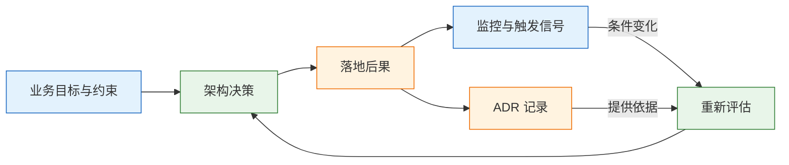
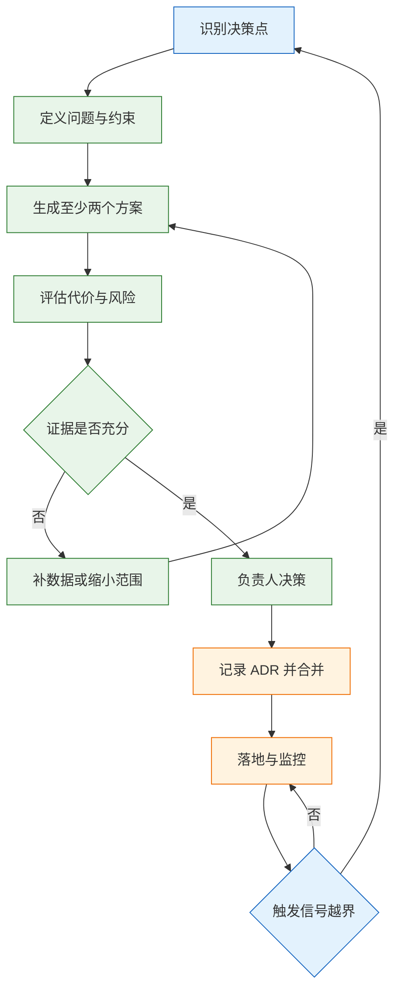
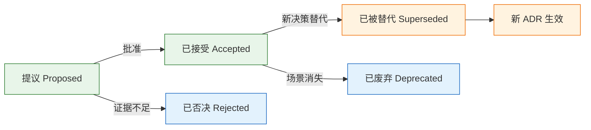
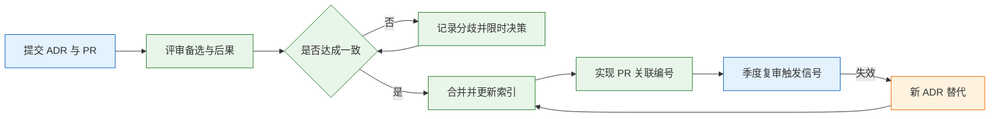

# 架构决策记录（ADR）

---

## 一、ADR 是什么

### 1.1 核心概念

架构决策记录（Architecture Decision Record，ADR）是一份围绕**单个架构决策**的短文档，记录当时的约束、比较过的方案、最终选择、预期代价，以及什么条件下需要重新评估。它回答的不是系统“是什么”，而是“为什么是现在这个样子，为什么不是另一种”。

一份合格的 ADR 至少包含四个要素：约束（业务目标、数据规模、团队能力、合规要求）、选项（至少两个真实可执行的方案）、选择（选了什么，明确不选什么）、代价（负面后果、残余风险、成本归属）。缺任何一项，文档都会退化成结论通告。

ADR 的价值集中在三点：

- **可追溯**：半年后有人质疑某个设计，能查到当时的数字和判断依据，而不是靠回忆。
- **可复用**：新项目遇到同类问题，可以直接沿用论证过程，只复核约束是否变化。
- **可纠正**：把重评条件写成可监控的阈值，条件触发时主动复盘，而不是等故障倒逼。

ADR 也有明确边界。它不替代设计文档，不记录类名、接口参数、目录结构这类实现细节；它不追求覆盖所有决定，日常可逆的小改动写进提交说明或 PR 描述即可；它也不保证决策正确，只保证决策过程可检查、可推翻。

记录本身有成本。写一份 ADR 通常需要一到两小时，评审再加一次会议；如果一年写上百份，团队会把时间花在文档格式上。控制数量的办法不是降低质量，而是把门槛设在难回退、跨边界的决策上，让每一份记录都能在未来某次重评中被真正翻出来。



图中的闭环说明 ADR 不是一次性的立项文档。决策落地后产生的指标，会反过来验证当初的假设；触发信号一旦越界，决策重新进入评估，而不是继续沿用一份已经失效的记录。

| 文档 | 回答的问题 | 生命周期 | 典型篇幅 |
|---|---|---|---|
| ADR | 为什么做这个决策，代价是什么 | 长期，可被替代 | 1 页 |
| 设计文档 | 系统或模块怎么实现 | 随版本更新 | 5～30 页 |
| RFC | 方案是否可行，如何收敛共识 | 讨论期有效 | 3～10 页 |
| 会议纪要 | 谁在何时说了什么 | 存档 | 不限 |

### 1.2 与相邻文档的关系

ADR 与设计文档最容易混淆。设计文档描述目标状态和实现路径，会随版本不断修改；ADR 描述一次选择及其理由，写完之后原则上不再改动，只通过新 ADR 替代。把实现细节写进 ADR，会导致文档随代码漂移，最后没人敢引用。

RFC（Request for Comments）是征求意见的过程文档，允许反复修改；ADR 是过程结束后的决策结果。一个议题可以先有 RFC，收敛后沉淀为一到多份 ADR。两者不是二选一，而是前后衔接。

三者的更新频率不同：设计文档随代码演进持续修订，RFC 在讨论期频繁改版，ADR 一旦接受就冻结。把三者混在一个文件里，必然出现“为了改实现而篡改历史理由”的情况，追溯价值随之消失。

会议纪要记录讨论过程，不承担决策效力；运行手册记录故障时的操作步骤，可以直接引用 ADR 里的降级策略和触发阈值；变更单记录某次发布做了什么，ADR 解释为什么允许这次发布改变系统结构。

| 相邻文档 | 核心作用 | 与 ADR 的衔接方式 |
|---|---|---|
| 设计文档 | 描述实现结构与接口 | 引用 ADR 编号，受其约束 |
| RFC | 征集意见、暴露分歧 | 收敛后产出 ADR |
| 会议纪要 | 留存讨论过程 | 只作为证据，不代替决策 |
| 运行手册 | 指导故障处置 | 引用降级方案与阈值 |
| 变更单 | 记录一次发布内容 | 关联触发本次变更的 ADR |

> **注意**：ADR 里写“采用事件驱动架构，具体用 Kafka，topic 命名为 order.created，分区数为 12”，后半句已经越界。topic 和分区数属于设计文档，改一次就要改 ADR，历史记录随即失真。ADR 应停在“写侧通过变更数据捕获异步投影到检索集群”这一层。

### 1.3 判断框架

并非所有决定都值得单独成文。用四个条件筛选，满足两条以上再写：

| 条件 | 判断问题 | 典型例子 |
|---|---|---|
| 跨边界 | 是否影响多个模块、服务或团队 | 统一身份模型、服务间通信协议 |
| 难回退 | 改回去是否需要迁数据、双跑或停机 | 分库分表、租户隔离级别 |
| 定质量属性 | 是否直接决定延迟、可用性、一致性、安全或成本 | 同步改异步、多可用区部署 |
| 引入新依赖 | 是否新增中间件、云产品、外部服务 | 引入消息队列、检索集群 |

“难回退”有一个简单的检验方法：假设三个月后要改回原方案，需要做什么。只改配置或发一版代码，属于可逆；需要迁移数据、修改表结构、双写过渡、停机切换或变更对外协议，就属于架构级。

反过来，下面这些不值得单独写 ADR：日志格式、超时值、重试次数等参数调整；类名、包名、接口参数顺序；当天上线、次日可回退的局部优化；供应商后台的一次配置变更。这些内容写进 PR 描述、变更单或运行手册，检索效率更高。

> **注意**：把“引入新依赖”理解成“只要装了新库就写 ADR”，会让记录泛滥。判断标准是依赖是否改变系统的失败模式和责任边界。引入一个纯计算的工具库通常不需要；引入一个需要独立部署、独立备份、独立值班的中间件，就需要。

---

## 二、决策识别与分级

### 2.1 决策类型

架构决策不是单一层级。按影响范围划分，可以把决策分成战略、架构、设计、实现四层，每层对应不同的记录载体和复审节奏。层级错位是 ADR 质量下降的主要原因：战略决策写成技术选型，或者实现细节被抬成架构决策。

| 层级 | 影响范围 | 记录载体 | 复审周期 |
|---|---|---|---|
| 战略 | 技术路线、自建与采购 | 技术规划、ADR | 年度 |
| 架构 | 系统边界、质量属性、数据归属 | ADR | 季度或触发时 |
| 设计 | 模块结构、接口契约 | 设计文档 | 随版本 |
| 实现 | 类、函数、配置参数 | 代码与 PR | 不固定 |

战略层的例子是“核心交易系统自建，分析型系统采购 SaaS”；架构层的例子是“订单检索采用变更数据捕获同步”；设计层的例子是“投影服务按订单号哈希分片”；实现层的例子是“消费者批量大小设为 500”。只有前两层通常需要 ADR。

层级错位的后果是记录与决策权不匹配。把实现细节抬成架构决策，会让一线工程师每改一个参数都要走评审；把架构决策压成实现细节，则会在出故障时找不到责任人和论证依据。判断层级时看两件事：谁有权拍板，以及改动会影响哪些团队。

### 2.2 可逆性判断

可逆性比“重要性”更适合做记录门槛。一个重要但随时能回退的决策，可以先用实验推进；一个看起来边缘但不可逆的决策，必须留下论证。按回退代价可以分为四级：

| 可逆性 | 判断依据 | 记录要求 |
|---|---|---|
| 易逆 | 改配置或重启即可恢复 | 不需要 ADR |
| 可逆 | 发一版代码、短时间双跑 | PR 描述即可 |
| 难逆 | 需要数据迁移、协议兼容、停机窗口 | 必须写 ADR |
| 不可逆 | 数据删除、对外承诺、合规备案 | ADR 加评审签字 |

“不可逆”最常见的是数据处置和对外契约。删除历史字段、改变计费口径、把内部接口开放给合作方，这类决定即使代码量很小，也应该有正式记录，因为它们无法靠回滚恢复。

### 2.3 记录粒度

一份 ADR 只回答一个决策。粒度太大的文档，状态无法独立演进：其中一部分被推翻时，整份文档只能标成“部分失效”，后来者无法判断哪一段仍然有效。

| 粒度 | 表现 | 处理方式 |
|---|---|---|
| 过粗 | “订单系统架构方案” | 拆成存储、检索、同步、降级多份 |
| 过细 | “订单表增加 idx_status” | 移入变更单或 PR |
| 合适 | “订单检索使用 CDC 同步到 Elasticsearch” | 独立成文，可被替代 |

标题应该是一句可判断真假的陈述句，包含对象、动作和关键手段。好标题让读者只看索引就知道结论；“订单检索方案”“关于缓存的讨论”这类标题没有决策信息，无法复用。

---

## 三、决策流程

### 3.1 问题定义

决策质量的上限由问题定义决定。背景部分要写清四类输入：业务目标、现状数字、硬约束、非目标。业务目标说明为什么现在要做；现状数字给出基线；硬约束排除不可行方案；非目标防止讨论范围失控。

| 输入 | 要求 | 证据来源 |
|---|---|---|
| 业务目标 | 可验收，不写“提升体验” | 产品指标、合同条款 |
| 现状数字 | 基线、峰值、增长趋势 | 监控、慢查询日志、账单 |
| 硬约束 | 合规、预算、团队能力、交付时间 | 合规要求、编制、合同 |
| 非目标 | 明确本次不解决什么 | 评审共识 |

现状数字必须能指向来源。写“查询很慢”无法支撑任何选择；写“列表接口 P99 为 2.8 秒，大促期间主库 CPU 达到 85%”才能推导出“检索负载需要外置”。数字允许是区间或估算，但要标注口径和采样时间。

非目标同样重要。一份 ADR 如果声称同时解决检索延迟、成本优化和实时风控，评审就无法判断成败。把本次不解决的问题写出来，既限定了方案范围，也为后续 ADR 留下接口。

### 3.2 方案生成与比较

备选方案至少两个，其中一个是“维持现状”。只列被选方案，等于把 ADR 写成立项申请；列了备选但不写代价，等于没有比较。每个方案至少写清机制、适用条件、主要代价和结论。

比较可以用加权评分，但评分只用于暴露分歧，不用于代替判断。权重由业务阶段决定，评分要有证据来源。算完之后做一次敏感性分析：某个权重上下浮动一成，结论是否翻转。会翻转，说明当前信息不足以支撑决策，应补数据或改选更可逆的方案。

“维持现状”必须作为基线参与比较，并写清继续现状的代价。很多方案之所以显得划算，是因为基线被省略了：没有把主库继续承压、故障频率上升、临时补丁人力算进去。基线写清后，选择新方案的理由才有参照。

| 方案 | 机制 | 主要代价 | 结论 |
|---|---|---|---|
| 增加组合索引 | 在 MySQL 建多列索引 | 写入放大，组合无法穷举 | 否 |
| 应用双写 | 业务代码同时写库和检索 | 无原子性，长期不一致 | 否 |
| 变更数据捕获 | 读日志投递消息，异步投影 | 链路长，最终一致 | 采用 |
| 维持现状 | 继续查主库 | 延迟与写入互相拖累 | 否 |

> **注意**：备选方案里不要放“稻草人”。故意设计一个明显不可行的方案来衬托结论，评审时一眼就能看穿，反而让真正的取舍失去说服力。被否方案也要写到“换个人能据此判断条件是否变化”的程度。

### 3.3 评审与收敛

决策责任采用“一个负责人、明确咨询范围、时间盒”的结构。负责人对结果负责，通常由该领域的技术负责人担任，而不是委员会；受影响团队在截止前提交意见；意见不一致时记录分歧和理由，负责人决定，团队执行。

| 角色 | 职责 | 边界 |
|---|---|---|
| 负责人 | 定方案、承担后果 | 不能绕过合规与安全底线 |
| 咨询方 | 提供专业判断与风险 | 不拥有最终决定权 |
| 知情方 | 了解决策并准备落地 | 不参与方案拉扯 |
| 评审会 | 暴露盲点、校验证据 | 不做投票表决 |

时间盒是收敛的关键。到期用现有信息决策，把未解决的问题写成风险或触发信号，而不是用“再调研一下”无限延期。拖延本身也是一种决策，而且通常代价更高。



---

## 四、ADR 模板

### 4.1 字段规范

模板的价值在于强制补齐容易被省略的部分，尤其是备选方案、负面后果和触发信号。字段不追求多，追求每一项都能被验收。

| 字段 | 写什么 | 验收标准 |
|---|---|---|
| 编号与标题 | 全局唯一编号，一句陈述句 | 只看标题知道结论 |
| 状态 | 提议、已接受、已否决、已被替代、已废弃 | 与索引一致 |
| 日期与负责人 | 决策日期、负责到底的人 | 能追溯到具体角色 |
| 背景 | 目标、现状数字、约束、非目标 | 数字有来源和口径 |
| 决策 | 选什么、不选什么、边界在哪 | 不陷入实现细节 |
| 备选方案 | 至少两个，含维持现状 | 每个都有代价与否决理由 |
| 后果 | 收益、代价、残余风险、成本归属 | 可量化、可验收 |
| 验证 | 如何证明决策成立 | 有方法、有通过标准 |
| 触发信号 | 何时重评 | 阈值可监控、事件有 owner |

一页是篇幅上限，不是硬性字数。背景、决策、备选、后果、验证、触发信号六段齐全，通常一页足够。超过两页，往往是把设计文档的内容搬了进来，或者把多个决策塞进了一份文件。评审时先看篇幅，能快速发现这两类问题。

> **注意**：状态字段不是装饰。它决定这份文档能否被引用：`Proposed` 的方案不能作为排期依据，`Superseded` 的文档不能直接指导新系统，`Deprecated` 只保留历史价值。索引里的状态必须与正文一致，否则检索结果会误导。

### 4.2 通用模板

下面的骨架可以直接复制到 `docs/adr/NNNN-<slug>.md`，替换尖括号内容。尖括号内是写作提示，成文后删除。

```markdown
# ADR-<编号> <一句陈述句标题>

- 状态：<提议 | 已接受 | 已否决 | 已替代 | 已废弃>
- 日期：<YYYY-MM-DD>
- 负责人：<角色或姓名>
- 替代：<ADR-XXX，无则写“无”>
- 关联：<设计文档、RFC、事故编号>

## 背景

<业务目标；现状数字与口径；硬约束；本次不解决的非目标。>

## 决策

<选了什么；明确不选什么；适用范围与边界。>

## 备选方案

A. <方案名>：<机制>；<代价>；<否决或采用理由>。
B. <方案名>：<机制>；<代价>；<否决或采用理由>。
C. 维持现状：<继续现状的代价>。

## 后果

- 正面：<指标改善，改善幅度>
- 负面：<延迟、成本、一致性窗口、学习成本>
- 风险：<仍然存在的故障模式与影响>
- 成本：<金额、人力、由哪个团队承担>

## 验证

1. <验证方法>，通过标准 <阈值>。
2. <验证方法>，通过标准 <阈值>。

## 触发信号

- 阈值型：<指标> 持续 <时长> 超过 <阈值>。
- 事件型：<组织或业务事件>，责任人 <角色>。
- 时间型：<YYYY-MM-DD> 复审。
```

### 4.3 状态与替代关系

ADR 的状态流转必须显式记录。被替代的文档不删除，新文档写明替代关系，旧文档改状态并指向新编号。删除历史等于把“为什么改”一并删掉，后来者只能看到当前结论，无法判断旧约束是否仍然成立。



| 状态 | 含义 | 允许的下一步 |
|---|---|---|
| 提议 | 等待评审，尚未生效 | 接受、否决 |
| 已接受 | 当前有效，指导实现 | 被替代、废弃 |
| 已否决 | 明确不采用 | 条件变化后重开新 ADR |
| 已被替代 | 有新决策接管 | 只读，指向新编号 |
| 已废弃 | 场景消失，不再适用 | 只读 |

---

## 五、完整案例

### 5.1 背景与约束

一个订单系统，订单表约 8 亿行，列表页支持 6 个筛选条件任意组合。复杂检索落到主库，P99 达到 2.8 秒，大促期间拖慢写入。读写比约 12:1，产品允许检索结果延迟 3 秒。团队已有 Kafka 和 Elasticsearch 的运维能力，但没有跨库实时同步经验。

这些数字是示例，落地时必须替换为自身监控值。案例的重点不是具体阈值，而是约束如何推导出方案，以及代价如何被写清。

| 约束 | 示例值 | 对方案的影响 |
|---|---|---|
| 数据规模 | 8 亿行，持续增长 | 排除全表扫描与内存缓存 |
| 查询形态 | 6 个条件任意组合 | 排除固定组合索引 |
| 延迟容忍 | 检索 3 秒内 | 允许异步投影 |
| 团队能力 | 熟悉 Kafka、ES | 排除需新建 Flink 的链路 |

### 5.2 备选方案比较

四个方案里，组合索引和双写都被否决，理由分别是组合无法穷举、缺少原子性。离线同步被延迟要求排除。变更数据捕获成为唯一同时满足延迟、一致性和团队能力的选项。

| 方案 | 机制 | 主要代价 | 结论 |
|---|---|---|---|
| 组合索引 | 针对高频条件建联合索引 | 写入放大，低频组合仍慢 | 否 |
| 应用双写 | 事务内写库，事务外写检索 | 失败无法回滚，长期不一致 | 否 |
| 离线同步 | 数仓定时导入检索集群 | 小时级延迟 | 否 |
| 变更数据捕获 | 读日志投递消息，投影后写入 | 链路长，需对账与重建 | 采用 |

### 5.3 决策与后果

```markdown
# ADR-014 订单检索使用 CDC 同步到 Elasticsearch

- 状态：已接受
- 日期：2026-09-12
- 决策人：订单域技术负责人（accountable）、DBA、SRE
- 替代：ADR-009（订单列表直接查主库）

## 背景

订单表 8 亿行，列表页支持 6 个筛选条件组合，MySQL 模糊查询 P99 2.8 s，
大促时拖慢主库写入。读写比约 12:1，产品允许检索结果延迟 3 s。
团队已有 Kafka 和 Elasticsearch 运维能力，但没有跨库实时同步经验。

## 决策

写侧只写 MySQL；用 Debezium 读 binlog 投递到 Kafka，投影服务消费后写入
Elasticsearch；列表查询走 ES；按订单号的精确查询仍走主库。
不做应用双写。

## 备选方案

A. 加组合索引：多条件任意组合无法穷举，且会增加写入放大，否。
B. 应用双写：实现简单，但数据库事务与 ES 写入无法原子，失败会长期不一致。
C. 离线数仓同步：延迟小时级，不满足在线检索，否。

## 后果

正面：列表 P99 降到 200 ms 量级；主库不再承担复杂检索；投影可重建。
负面：链路变成 binlog → Kafka → 投影 → ES，任一段故障都会造成延迟；
      检索结果最终一致，最长延迟按 3 s 设计；需要全量重建和抽样对账工具。
风险：投影漏事件会导致订单查不到；ES 集群故障时列表不可用，需降级到主库
      仅支持订单号查询。
成本：新增 Kafka topic、ES 集群、投影服务及相应监控，估算每月增加 1.8 万元。

## 验证

1. 回放 1 亿条历史订单，投影延迟 P99 ≤ 3 s；
2. 与 MySQL 抽样 10 万条比对，字段一致率 100%；
3. 注入 ES 故障 10 分钟，恢复后 5 分钟内追平；
4. 全量重建演练，4 小时内完成。

## 触发信号

- 投影延迟 P99 持续 5 分钟 > 10 s；
- 全量重建超过 2 小时，或对账差异 > 0.01%；
- 检索 QPS 超过 5000，ES 成本超预算 30%；
- 合规要求订单数据不得进入外部检索集群。
出现任一条，重新评估本 ADR。
```

这份记录的重点在三处：备选方案写清了“为什么不选”，后果写清了延迟窗口和故障降级，触发信号写成了可监控的阈值。技术实现只写到组件和职责，没有绑定 topic 名、分区数和索引映射。

后果段最容易被写空。合格的写法是把每一项落到可观测指标或可核对账单：延迟写分位值，成本写月度金额，风险写触发场景与降级动作，承担者写到具体团队。这样评审时能逐项追问，而不是停留在“整体可控”。

### 5.4 验证与触发信号

验证项要能在上线前执行，不能只写“上线后观察”。回放、抽样、故障注入、重建演练，都是可以在预发环境完成的活动；每项都要有通过标准，否则验证会变成走流程。

| 验证项 | 方法 | 通过标准 |
|---|---|---|
| 投影延迟 | 回放历史订单 | P99 不超过 3 秒 |
| 数据一致 | 与主库抽样比对 | 字段一致率 100% |
| 故障恢复 | 注入检索集群故障 | 恢复后 5 分钟追平 |
| 可重建 | 全量重建演练 | 4 小时内完成 |

触发信号分三类：阈值型靠监控告警，事件型靠组织或业务节点，时间型靠日历。三类都要有明确的责任人，否则信号出现也无人处理。

验证和触发信号的区别要分清：验证证明“决策在当下成立”，触发信号判断“决策在未来是否仍成立”。前者是一次性的，后者是持续监控。只做验证不做触发，系统会在条件变化后继续按旧假设运行。

> **注意**：示例中的金额、行数、延迟都是演示值，不能直接作为容量规划依据。复制模板时先替换为自身监控与账单数据，再让 DBA、SRE 会签，否则 ADR 会变成一份看起来精确、实际无法验证的文档。

---

## 六、反模式

### 6.1 常见反模式

| 反模式 | 表现 | 后果 |
|---|---|---|
| 事后补写 | 上线后补一份“已接受” | 理由被结果美化，无法复用 |
| 结论通告 | 只有决策，没有备选 | 无法判断条件是否变化 |
| 方案书化 | 大段接口与表结构 | 随代码漂移，无人维护 |
| 无负责人 | 只写团队名 | 评审无人收敛 |
| 永久提议 | 状态停在 Proposed | 无法作为实现依据 |
| 只写优点 | 后果全是收益 | 风险被隐藏到故障时 |
| 触发信号缺失 | 写“以后再看” | 决策过期无人发现 |
| 孤岛存放 | 放在个人网盘或聊天群 | 新成员找不到 |

### 6.2 根因与纠正

反模式背后通常只有三种根因：把 ADR 当成文档任务，而不是决策工具；没有明确的负责人和时间盒；没有复审机制，文档写完即归档。

| 根因 | 典型表现 | 纠正动作 |
|---|---|---|
| 当作文档任务 | 追求篇幅与格式 | 限定一页，只写选择与代价 |
| 责任分散 | 评审变成投票 | 指定单一负责人，记录分歧 |
| 缺少复审 | 过期文档仍被引用 | 季度复审，状态与索引同步 |

纠正顺序是先建立最小闭环：一份真实决策、一个负责人、一次评审、一条可监控的触发信号。闭环跑通后再扩展模板和索引，比一开始设计复杂流程更可持续。

---

## 七、治理机制

### 7.1 仓库与目录

ADR 应放在代码仓库，与实现同源、同权限、同历史。放在只有架构师能登录的平台，会让文档脱离开发流程，最终无人更新。

```text
docs/adr/
  README.md          # 索引：编号、标题、状态、日期、负责人
  0001-....md
  0014-订单检索使用-cdc-同步到-elasticsearch.md
  0021-....md
```

| 位置 | 内容 | 维护方式 |
|---|---|---|
| README.md | 编号、标题、状态、负责人 | 合并时同步更新 |
| 单篇 ADR | 背景、决策、后果、触发信号 | 只读，靠新 ADR 替代 |
| 设计文档 | 实现结构与接口 | 引用 ADR 编号 |
| PR 模板 | ADR 检查项 | 仓库统一配置 |

### 7.2 评审与复审节奏

| 机制 | 频率 | 产出 | 责任人 |
|---|---|---|---|
| 提案评审 | 每个决策 | 状态与评审意见 | 决策负责人 |
| 季度复审 | 每季度 | 触发信号核对表 | 架构负责人 |
| 年度盘点 | 每年 | 失效与替代清单 | 技术委员会 |
| 新人导读 | 入职 | 最近十份已接受 ADR | 团队负责人 |

复审只做一件事：对照触发信号，确认决策仍然成立。成立就保留，不成立就开新 ADR 替代，不在旧文档上直接改结论。

复审会需要输入：最近一个季度的监控指标、事故复盘、成本账单、组织变化。没有这些输入，复审会退化成“大家觉得还行”。把输入列进议程，能让复审从表态变成核对。

### 7.3 索引与度量

索引至少包含编号、标题、状态、日期、负责人、替代关系、相关服务。状态和替代关系必须人工确认，不能完全依赖脚本推断。

| 指标 | 定义 | 用途 |
|---|---|---|
| 决策覆盖率 | 有 ADR 的架构决策占比 | 判断流程是否落地 |
| 平均收敛时长 | 从提议到接受的时间 | 发现评审瓶颈 |
| 替代率 | 年度被替代 ADR 占比 | 判断假设是否稳定 |
| 引用率 | 设计文档与 PR 引用 ADR 的比例 | 判断文档是否被使用 |



数量需要控制。二十人左右的团队，一年十五到三十份比较健康；超过一百份，通常是把设计文档、会议纪要、操作手册都塞了进来。数量不是目标，能被引用和复审才是。

> **注意**：PR 模板里应加一条检查：“是否引入跨模块依赖、难回退的数据变更或新的外部依赖？是，请附 ADR。” 靠流程触发比靠自觉可靠。检查项要能一票打回，否则很快会退化成勾选框。

---

## 八、常见失败模式与排查

### 8.1 失败模式判断表

| 现象 | 最可能原因 | 处理 |
|---|---|---|
| ADR 只有结论 | 事后补写或省略备选 | 补被否方案与否定理由 |
| 所有决策都要 ADR | 缺少筛选标准 | 按四条件筛，局部改动入 PR |
| 长期停在提议 | 无负责人或截止时间 | 指定负责人，设评审日期 |
| 过期文档仍被引用 | 无复审与替代机制 | 季度复审，更新状态与索引 |
| 决策反复推翻 | 触发信号不可监控 | 改成阈值、事件、时间三类 |
| 评审久拖不决 | 责任分散或追求全员同意 | 一人负责，限时收敛 |
| 文档像方案书 | 把实现当决策 | 只留选择、代价、验证 |
| 新成员不读 | 存放孤岛、没有索引 | 入仓库，建索引，PR 关联 |

### 8.2 处置顺序

1. 判断这是不是“改起来很贵”的决策，可逆的小改动直接移出 ADR。
2. 检查备选方案是否至少两个，每个是否写了代价与否决理由。
3. 检查后果是否覆盖负面、残余风险和成本承担者，是否可验收。
4. 检查验证项能否在上线前执行，触发信号是否可监控、有责任人。
5. 检查状态、索引、替代关系是否一致，旧文档是否保留。
6. 半年后回看：这份记录是否仍能被找到、读懂，并支撑一次重评。

> **核心结论**：ADR 记录的是“为什么”，不是“是什么”；没有备选和后果的记录只是会议纪要。好 ADR 一定写代价与触发信号，被替代的文档保留，决策一人负责、多人咨询、限时收敛。
