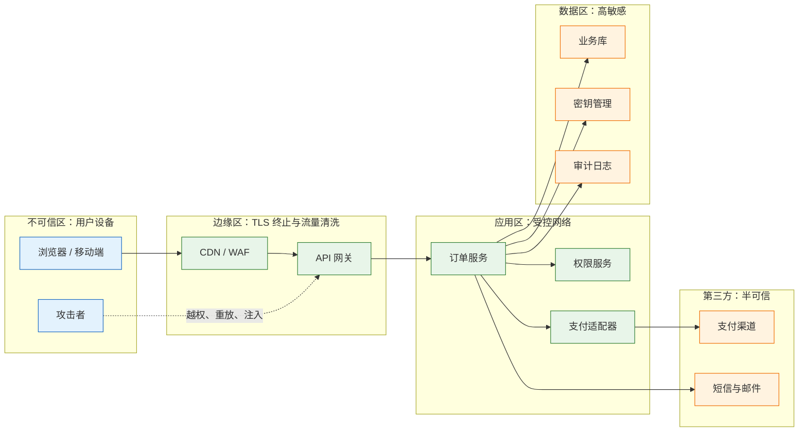
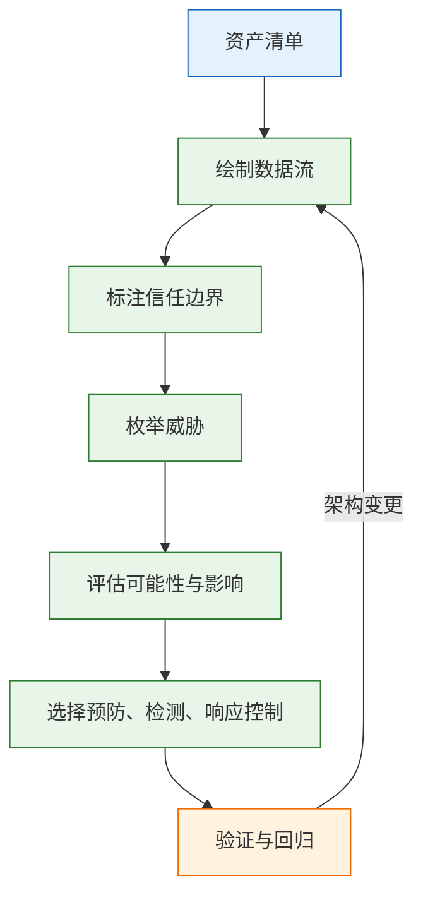
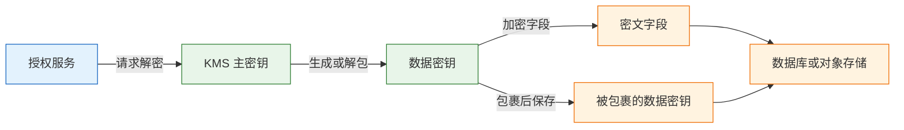

# 应用安全架构

---

## 一、应用安全架构是什么

### 1.1 核心概念

应用安全架构是一组围绕**身份、授权、信任边界、数据保护和可观测性**的约束与组件，用来回答四个问题：请求方是谁、它能对哪些数据做什么、数据在哪些边界之间流动、出了事能否发现并追溯。

它不追求“绝对安全”。任何系统都有攻击面，安全架构做的是抬高攻击成本、把事故影响限制在可承受范围内。判断一个控制项是否值得做，看它降低了哪类攻击的成功率、缩短了多长的暴露窗口、代价由谁承担。

多数真实事故不是因为加密算法被攻破，而是因为某个接口忘了校验“这条数据是否属于当前主体”，或者密钥被写进了代码仓库。密码学通常不是短板，身份与授权的落地一致性才是。

| 安全目标 | 含义 | 应用层落地 |
|---|---|---|
| 机密性 | 数据只对授权方可见 | 传输加密、字段加密、脱敏 |
| 完整性 | 数据未被未授权修改 | 签名、服务端重算、参数校验 |
| 可用性 | 服务在攻击与故障下仍可用 | 限流、配额、超时、降级 |
| 问责性 | 操作可归属到具体主体 | 审计日志、操作留痕 |



这张图的重点不是组件数量，而是每条连线的信任级别都在变化。浏览器不可信，边缘只做粗粒度清洗，应用区默认不信任任何入站请求，数据区默认不信任应用进程，第三方默认不可信且可能被冒充。

### 1.2 与相邻技术的关系

应用安全常被等同于网络安全或身份管理。三者有交集，但责任不同：网络安全管网络层可达性，IAM 管账号与身份治理，应用安全管业务请求在应用内部如何被判定。

| 相邻领域 | 主要解决的问题 | 与应用安全的边界 |
|---|---|---|
| 网络安全 | 网段隔离、边界防护、流量清洗 | 不能判断订单是否属于当前用户 |
| IAM | 账号生命周期、组织架构、单点登录 | 不决定单条数据的访问策略 |
| 密码学 | 加密、签名、哈希的算法与协议 | 提供工具，不决定用在哪里 |
| 合规审计 | 基线要求、证据留存 | 合规是最低线，不等于安全 |
| 供应链安全 | 依赖、镜像、构建链完整性 | 与运行时控制互补 |

防火墙放行一个端口，不代表经过该端口的请求都合法；网关校验了登录态，不代表业务接口可以跳过数据归属校验。把安全责任全部压给边缘设备，是越权漏洞最常见的组织成因。

> **安全警告**：WAF 只能匹配已知攻击特征，无法理解业务语义。攻击者用合法账号、合法参数、只改资源编号的方式越权，流量在 WAF 看来完全正常。凡是涉及“这条数据属于谁”的判断，必须在应用内、在取数时完成。

### 1.3 架构组成

应用安全架构可以拆成五层。每层都有明确的产出物，缺一层就会出现一类系统性缺口。

| 层 | 核心组件 | 产出物 |
|---|---|---|
| 身份层 | 登录、令牌、会话、多因素认证 | 可信主体标识 |
| 授权层 | 策略引擎、数据访问层、租户上下文 | 可判定的访问决策 |
| 边界层 | 网关、服务间认证、出站代理 | 明确的信任分区 |
| 数据层 | 分级、加密、令牌化、密钥管理 | 数据全生命周期保护 |
| 响应层 | 审计、告警、会话吊销、密钥轮换 | 发现与止损能力 |

信任边界不是机房围墙，而是“信任级别发生变化”的任何位置：浏览器到网关、网关到服务、服务到数据库、服务到第三方、生产到测试、CI 到生产环境。跨过边界的数据都要重新验证，不能因为“来自内网”就放行。

> **安全警告**：内网不是信任边界。攻击者通过钓鱼或供应链进入一台机器后，内网横向移动几乎没有阻力：数据库无口令、服务间不鉴权、管理端口对全网开放。服务间调用要认证，管理面与数据面要分开，出站请求同样要受控。

> **注意**：画架构图时只画组件不画边界，评审时就会漏掉服务间调用和出站请求。建议在每条跨边界连线上标注三件事：认证方式、授权位置、审计落点。标不出来，说明这条路径还没设计完。

---

## 二、威胁建模流程

### 2.1 资产与数据流梳理

威胁建模从资产开始，不从框架开始。先列出需要保护的对象：账号凭据、订单与支付数据、身份信息、密钥、审计日志、管理接口。再画数据流：数据从哪里进入、经过哪些服务、落在哪些存储、流向哪些第三方。

资产清单要带影响描述。写“订单数据”没有优先级；写“订单数据含姓名、手机号、地址、金额，泄露会影响两百个企业租户，需按个人信息事件处置”才能支撑排序。

| 资产 | 敏感级别 | 泄露影响 |
|---|---|---|
| 登录凭据与会话 | 高 | 账号接管、横向移动 |
| 订单与支付记录 | 高 | 客户信息泄露、资金损失 |
| 身份与联系方式 | 敏感 | 个人信息事件、合规责任 |
| 密钥与证书 | 高 | 批量解密、伪造签名 |
| 审计日志 | 敏感 | 追溯失效、证据缺失 |

### 2.2 信任边界识别

沿着数据流每跨过一次信任级别变化，就标一条边界。边界两侧的默认假设不同：外网默认不可信，内网默认“可能已被渗透”，第三方默认“可能被冒充或重放”。

每条边界回答四个问题：对方是谁、怎么证明；它能做什么、谁授权；数据在传输和存储时怎么保护；出问题能否发现和追溯。四个问题有一个答不上来，这条路径就存在设计缺口。

以支付回调为例，链路是“支付平台 → 公网 → 网关 → 支付适配器 → 订单服务”。这条链上至少有三个边界：公网入口、适配器到订单服务、订单服务到账务。每个边界都要独立校验。

### 2.3 威胁枚举与优先级

STRIDE 适合查漏，不适合当八股。按六类威胁逐条对照数据流，能快速发现被忽略的面。

| 威胁 | 典型表现 | 主要控制 |
|---|---|---|
| 伪造身份 | 盗用 Cookie、伪造 JWT、撞库 | 多因素认证、短会话、签名校验、限流 |
| 篡改数据 | 改价格、改订单状态、改回调金额 | 服务端重算、签名、参数校验 |
| 否认操作 | 管理员删数据后否认 | 追加写审计日志、操作留痕 |
| 信息泄露 | 越权读订单、日志含手机号 | 授权校验、脱敏、加密 |
| 拒绝服务 | 刷接口、超大文件、慢查询 | 限流、配额、超时、熔断 |
| 权限提升 | 普通用户调用管理员接口 | 服务端鉴权、默认拒绝、角色隔离 |

优先级按“可利用性 × 影响”排，不按威胁名称排。一个需要本地网络、需要管理员配合的漏洞，优先级低于一个只需改 URL 参数就能拖库的越权。排序结果要落到修复时间窗。

### 2.4 控制项选择

控制分三类：预防、检测、响应。只做预防会在被绕过时毫无察觉；只做检测会在告警堆积时失去响应能力。

| 控制类型 | 作用 | 局限 |
|---|---|---|
| 预防 | 阻止攻击发生 | 可能被绕过，规则会过期 |
| 检测 | 发现异常与已发生事件 | 依赖日志质量与基线 |
| 响应 | 缩短暴露窗口 | 依赖预案与演练 |



> **注意**：威胁建模不是上线前做一次的表单。新增外部接口、新增第三方、改变租户模型、引入新的文件上传路径，都会改变信任边界，需要增量更新模型。把模型放进架构评审材料，比单独归档更容易被维护。

---

## 三、身份认证与会话

### 3.1 方案选型

认证只回答“主体是谁”，不回答“主体能做什么”。方案选择取决于客户端形态、注销要求和跨域需求。

| 方案 | 状态存放 | 适合场景 | 主要代价 |
|---|---|---|---|
| 服务端 Session | 服务端存储，Cookie 带会话 ID | 同源 Web、需要即时注销 | 共享存储与跨域配置 |
| JWT 访问令牌 | 客户端持有，服务端验签 | 服务间调用、短时 API | 难撤销，泄露后到期前有效 |
| OAuth2 授权码 + PKCE | 授权服务器签发 | 第三方登录、SPA、移动端 | 流程复杂，回调校验易错 |
| OIDC | OAuth2 之上的身份层 | 统一登录、单点登录 | 依赖身份提供商可用性 |
| mTLS | 双向证书 | 服务间零信任 | 签发、轮换、吊销成本 |

浏览器登录态优先使用 `HttpOnly`、`Secure`、`SameSite` 的 Cookie。把 JWT 放进 `localStorage`，一次 XSS 就能读走；`HttpOnly` 至少让脚本读不到。公开客户端使用授权码加 PKCE，不使用隐式流程，也不把客户端密钥放进前端。

### 3.2 令牌校验

JWT 校验不是“解出 payload 看 userId”。服务端必须固定允许的算法，校验签名、签发方、受众、过期时间与生效时间，并通过 JWKS 获取公钥、支持密钥轮换。

| 校验项 | 要求 | 失败处理 |
|---|---|---|
| 算法 | 服务端白名单，拒绝 `none` | 直接拒绝 |
| 签名 | 使用可信公钥验证 | 拒绝并记录 |
| 签发方 | 与预期身份提供商一致 | 拒绝 |
| 受众 | 包含当前服务标识 | 拒绝 |
| 时间 | 校验 `exp`、`nbf`，容忍时钟偏移 | 拒绝或要求刷新 |
| 令牌标识 | 校验 `jti`，支持重放检测 | 拒绝并告警 |

> **安全警告**：历史上最常见的 JWT 漏洞之一是接受客户端指定的算法，包括 `alg: none`。服务端不能相信头部里的算法字段，必须先按自身配置选定算法，再验证签名。公钥与私钥的用途也不能混用。

### 3.3 会话生命周期

访问令牌要短，刷新令牌要能旋转。访问令牌五到十五分钟，刷新令牌一次一换；旧刷新令牌被再次使用时，应判定为泄露并吊销整个会话。

| 机制 | 建议 | 作用 |
|---|---|---|
| 访问令牌有效期 | 5～15 分钟 | 缩短泄露窗口 |
| 刷新令牌旋转 | 每次刷新换新，旧值失效 | 检测重放 |
| 空闲超时 | 按业务敏感度设置 | 回收长期不活跃会话 |
| 绝对超时 | 无论是否活跃都强制重登 | 限制长期驻留 |
| 撤销名单 | 按用户或会话维度 | 支持封禁与离职止损 |

注销和封禁要真的生效。纯无状态 JWT 没有服务端记录，封禁账号后旧令牌仍能用到过期。可选做法是维护撤销名单、引入令牌版本号，或把会话放在 Redis 中并接受一次查询。

CSRF 防护不能只依赖 `SameSite`。状态变更接口还应校验 CSRF Token 或 `Origin`，尤其是跨子域、跨站嵌入和旧浏览器场景。

---

## 四、授权与租户隔离

### 4.1 功能权限与数据权限

授权有两个维度：功能权限决定能否调用某个接口，数据权限决定能看哪些行、哪些字段、哪些租户的数据。只做前者，系统仍然可以被水平越权拖库。

| 越权类型 | 表现 | 根因 |
|---|---|---|
| 水平越权 | A 用户读取 B 用户的同级数据 | 查询只按资源 ID，未带归属条件 |
| 垂直越权 | 普通用户调用管理员接口 | 接口未做角色校验 |
| 字段越权 | 返回了不该展示的敏感字段 | 序列化未按场景裁剪 |
| 租户越权 | 跨租户读取或写入 | 租户上下文缺失或被覆盖 |

### 4.2 授权模型选型

| 模型 | 判定依据 | 适合场景 | 代价 |
|---|---|---|---|
| RBAC | 角色到权限的映射 | 后台管理、权限稳定 | 角色爆炸，难表达数据范围 |
| ABAC | 主体、资源、环境属性 | 细粒度、动态策略 | 策略难写、难测试 |
| ReBAC | 主体与资源的关系 | 协作型 SaaS、文档权限 | 关系存储与递归查询复杂 |
| 数据隔离 | 租户标识或行级安全 | 多租户系统 | 每个查询都必须带条件 |

模型可以组合：RBAC 管功能入口，租户上下文与资源归属条件兜底数据权限，协作场景再引入 ReBAC。

### 4.3 多租户隔离级别

| 隔离方式 | 隔离强度 | 成本 | 适合场景 |
|---|---|---|---|
| 共享库共享表 + 租户列 | 低，依赖代码与行级安全 | 最低 | 大量小租户、标准版 |
| 共享库独立 schema | 中 | 中 | 中型租户、独立备份 |
| 独立数据库 | 高 | 高 | 大客户、合规要求 |
| 独立部署 | 最高 | 最高 | 金融、政企私有化 |

共享表方案必须配行级安全或统一数据访问层。只要有一个手写查询忘了租户条件，隔离就破了。代码评审不能替代机制，机制要能在框架层强制注入条件。

### 4.4 授权落地规则

三条规则不能省：默认拒绝，没有明确允许就是拒绝；服务端校验，且在校验时取数；前端隐藏不是权限，接口必须自己判断。

“校验时取数”意味着把租户和归属条件写进查询，而不是先查出记录再在内存里比较。先查出来，数据已经进入应用进程，日志、缓存、异常信息都可能带出；正确做法是查询条件带 `tenant_id` 与 `owner_id`，查不到统一返回 404，避免泄露资源是否存在。

```sql
-- 正确：租户与归属条件进入查询本身
SELECT id, status, amount
FROM orders
WHERE id = :order_id
  AND tenant_id = :tenant_id
  AND owner_id = :user_id;
```


> **安全警告**：越权多数不是认证失效，而是查询缺少归属条件。把资源编号直接拼进查询、先取数再比较、依赖前端隐藏，都会造成水平越权。权限缓存还必须以“租户 + 用户 + 策略版本”作为键，并在角色变更、租户迁移、账号禁用时主动失效；只按用户标识缓存，会让同一用户在多个租户之间串权。

---

## 五、数据分级与密钥管理

### 5.1 数据分级

先分级，再决定控制强度。所有字段都上字段级加密，会牺牲查询能力和运维效率；所有字段都不加密，则一次备份泄露就会造成大面积事件。

| 级别 | 例子 | 控制要求 |
|---|---|---|
| 公开 | 商品标题、门店地址 | 完整性校验 |
| 内部 | 运营报表、库存 | 登录与授权 |
| 敏感 | 手机号、地址、订单金额 | 加密、脱敏、审计 |
| 高敏 | 身份证、银行卡、密码 | 字段加密或令牌化、最小留存 |

### 5.2 保护手段

| 手段 | 保护对象 | 代价 |
|---|---|---|
| 传输加密 | 链路 | 证书与协议配置 |
| 磁盘加密 | 存储介质 | 无法防止应用层越权 |
| 字段加密 | 单个敏感字段 | 无法范围查询与模糊搜索 |
| 令牌化 | 卡号、身份证等标识 | 额外服务与映射表 |
| 加盐哈希 | 密码 | 不可逆，无法恢复原文 |
| 带密钥 HMAC | 需等值查询的字段 | 需要密钥管理与轮换 |

密码使用 Argon2id、bcrypt 或 scrypt 加盐存储，不使用 SHA-256 这类快速哈希。需要等值查询的字段，例如手机号，可以用带密钥的 HMAC 生成索引值，而不是裸哈希；裸哈希在弱口令和低熵数据上容易被彩虹表反推。

字段加密会牺牲查询能力，取舍要提前写进设计。需要范围查询、排序或模糊匹配时，通常要维护可查询的派生列，或把字段留在受控的明文索引中并加强访问控制。

### 5.3 密钥生命周期

密钥管理比算法选择更容易出问题。常见错误是把密钥写进代码、镜像、配置文件或聊天记录；容器环境变量也会通过进程信息、崩溃转储、日志等路径泄露。

| 阶段 | 要求 | 常见错误 |
|---|---|---|
| 生成 | 使用可信随机源，足够长度 | 自造随机算法 |
| 分发 | 通过密钥管理服务或挂载注入 | 写进镜像与环境变量 |
| 使用 | 最小权限，短期凭据 | 全应用共用一把主密钥 |
| 轮换 | 定期轮换，保留过渡期 | 从不轮换，或轮换即断服 |
| 吊销 | 泄露时立即失效并重签 | 只改配置不吊销旧密钥 |
| 销毁 | 按留存策略删除与证明 | 备份中残留旧密钥 |

信封加密把主密钥与数据密钥分开：主密钥留在 KMS 中不导出，每次加密生成数据密钥，用它加密字段，再把被主密钥包裹的数据密钥随密文保存。解密时先解包数据密钥，再解字段。



> **安全警告**：密钥不能与密文放在同一权限边界内。数据库备份、对象存储快照、日志归档都可能被完整下载；如果数据密钥与密文同库保存且主密钥也在应用配置里，加密只剩形式。主密钥应由独立密钥服务持有，访问需要独立身份与审计。

日志与备份同样要管：日志默认脱敏手机号、身份证、银行卡和令牌；审计日志单独存储、追加写、访问受控；备份加密并定期做恢复演练；生产数据进入测试环境前必须脱敏。

---

## 六、上线前安全检查清单

### 6.1 清单设计原则

清单不是知识测验，而是可执行的核对工具。每条检查项要能指向一个证据：配置截图、代码位置、测试记录、扫描报告或演练结果。没有证据的“已确认”，在事故复盘时没有价值。

清单分两类：阻断项与改进项。阻断项不通过不能上线，例如越权、回调伪造、密钥硬编码；改进项可以带风险上线，但要有负责人和期限。

### 6.2 通用检查清单

```markdown
## 身份与会话
- [ ] 登录失败有限流与锁定策略，不泄露账号是否存在
- [ ] 密码使用 Argon2id/bcrypt/scrypt 加盐存储
- [ ] 管理员与高风险操作启用多因素认证
- [ ] 会话 Cookie 设置 HttpOnly、Secure、SameSite
- [ ] 访问令牌短于 15 分钟，刷新令牌可旋转
- [ ] 注销、封禁、离职能在一个会话周期内生效

## 授权与租户
- [ ] 每个业务接口在服务端做功能权限校验
- [ ] 数据查询带 tenant_id 与 owner_id 条件
- [ ] 默认拒绝，未配置权限时不放行
- [ ] 资源不存在与无权访问统一返回 404
- [ ] 权限缓存按租户与策略版本隔离
- [ ] 管理接口不暴露在公网，或单独加固

## 数据与密钥
- [ ] 敏感字段有分级与清单，覆盖新增字段流程
- [ ] 传输使用 TLS 1.2 及以上，内部调用不默认明文
- [ ] 高敏字段字段级加密或令牌化
- [ ] 密钥存放在密钥管理服务，不进代码与镜像
- [ ] 密钥有轮换周期与吊销预案
- [ ] 日志脱敏手机号、身份证、银行卡、令牌
- [ ] 备份加密，且完成过一次恢复演练

## 边界与第三方
- [ ] 服务间调用有 mTLS 或服务令牌
- [ ] 出站请求走白名单代理，元数据地址不可达
- [ ] 支付与外部回调验签、校验时间窗、金额、订单号
- [ ] 回调按事件 ID 幂等，重复回调不重复入账
- [ ] 文件上传限制类型、大小，私有桶加预签名 URL
- [ ] 第三方集成使用最小 scope，令牌可单独吊销

## 供应链与配置
- [ ] 依赖锁定版本，已知漏洞有处置记录
- [ ] 生成 SBOM，镜像签名并在部署时校验
- [ ] 容器非 root、只读文件系统、最小 capability
- [ ] CI 密钥最小权限，fork PR 无法读取生产密钥
- [ ] 生产配置与代码分离，默认口令已更换
- [ ] 错误页面不返回堆栈、SQL、内部地址
```

### 6.3 证据与签署

| 检查域 | 证据形式 | 阻断条件 |
|---|---|---|
| 身份 | 配置截图、令牌样例 | 存在长期不过期令牌 |
| 授权 | 越权测试记录、代码位置 | 任一接口可跨租户读取 |
| 数据 | 字段清单、加密配置 | 高敏字段明文存储 |
| 边界 | 网络策略、验签日志 | 回调可无签名通过 |
| 供应链 | SBOM、扫描报告 | 生产镜像来源不可追溯 |

评审结束要有明确结论：通过、带条件通过、不通过。带条件通过必须写清条件、责任人和截止日期；不通过要写清阻断项和复评时间。没有结论的评审等于没评。

> **注意**：清单不能替代威胁建模。清单覆盖的是已知通用项，威胁建模针对的是当前系统的数据流和业务语义。两者都做，才能同时防住“常见错误”和“这个系统特有的错误”。

---

## 七、完整案例

### 7.1 系统与边界

一个 B2B 订单 SaaS，约 200 个企业租户，功能包括后台管理、开放 API、支付回调、文件上传。系统有登录、JWT、HTTPS 和 WAF，团队一度认为安全基础已经具备。

评审按数据流重画边界后，发现真正的风险集中在业务语义：订单详情只按订单号查询，开放 API 的令牌权限过宽，支付回调只判断订单存在，上传桶允许公开读。

| 边界 | 认证方式 | 授权位置 | 主要风险 |
|---|---|---|---|
| 浏览器到网关 | 会话 Cookie | 网关粗粒度加服务细粒度 | CSRF、会话固定 |
| 开放 API 到服务 | API 令牌 | 服务内按 scope | 令牌越权、重放 |
| 支付平台到适配器 | 签名 | 适配器验签 | 伪造到账、重复入账 |
| 服务到数据库 | 连接凭据 | 数据库账号权限 | 注入后删表 |
| 服务到对象存储 | 访问密钥 | 桶策略 | 附件公开 |

### 7.2 发现与修复

| 发现 | 风险 | 修复 |
|---|---|---|
| 订单详情只按 `orderId` 查询 | 水平越权，可拖库 | 查询加 `tenant_id`，查不到返回 404 |
| JWT 有效期 7 天，封禁后仍可用 | 被盗号无法止损 | 访问令牌 15 分钟，刷新旋转，加撤销名单 |
| 支付回调只校验订单存在 | 伪造到账 | 验签、时间窗、金额校验、回调 ID 去重 |
| 应用日志打印完整手机号 | 个人信息泄露 | 统一脱敏，限制日志访问 |
| 上传桶可公开读 | 附件泄露 | 私有桶加短过期预签名 URL |
| 数据库账号有 DDL 权限 | 注入后可删表 | 应用账号只给 DML，迁移独立账号 |
| 内网服务间无认证 | 横向移动 | mTLS 或服务令牌，管理端口隔离 |
| 开放 API 令牌 scope 过宽 | 第三方越权 | 按租户与资源收窄 scope |

### 7.3 修复排序

修复顺序按“可利用性 × 影响”排，不按发现顺序排。越权和回调伪造可以直接造成数据泄露与资金损失，先修；日志脱敏和桶权限影响面广但利用门槛稍高，紧随其后；mTLS 改造涉及全链路，放在有维护窗口时推进。

| 优先级 | 项目 | 理由 |
|---|---|---|
| 立即 | 订单查询加租户条件 | 只需改参数即可利用 |
| 立即 | 支付回调验签与幂等 | 可直接伪造到账 |
| 短期 | 令牌缩短与撤销机制 | 泄露后暴露窗口过长 |
| 短期 | 日志脱敏与桶权限 | 影响面广，修复成本低 |
| 计划 | 服务间 mTLS | 需要证书体系与灰度 |

### 7.4 验证与复盘

| 验证项 | 方法 | 通过标准 |
|---|---|---|
| 水平越权 | 双租户账号交叉请求 | 全部返回 404 |
| 垂直越权 | 普通账号调用管理接口 | 全部返回 403 |
| 回调伪造 | 重放、改金额、去签名 | 全部拒绝且告警 |
| 令牌撤销 | 封禁后继续使用旧令牌 | 一个刷新周期内失效 |
| 日志脱敏 | 抽样检索敏感字段 | 无明文命中 |

复盘时要区分“控制缺失”和“控制存在但未生效”。前者补设计，后者补验证。这个案例里，登录、JWT、HTTPS、WAF 都存在，但授权没有落到查询条件，属于控制存在却未覆盖关键路径。

> **注意**：案例中的租户数量、令牌时长、修复顺序都是示例。实际项目要按自身数据分类、合规要求和攻击面重新排序，不能直接照搬优先级。

---

## 八、反模式

反模式不是零散错误，而是同一种思维在不同环节的重复。列成清单逐条对照，比事故后追责更能改变行为。

| 反模式 | 表现 | 后果 |
|---|---|---|
| 把登录当授权 | 有 JWT 就认为接口安全 | 水平越权拖库 |
| 前端隐藏当权限 | 按钮隐藏，接口不校验 | 直接调用接口绕过 |
| 网关包办安全 | 服务内不做数据归属校验 | 内部调用与绕过路径失守 |
| 内网默认可信 | 服务间无认证、管理端口开放 | 一台机器失陷即横向移动 |
| 长期令牌 | 访问令牌数天有效 | 泄露后无法止损 |
| 回调只判断收到 | 不验签、不校验金额 | 伪造到账、重复入账 |
| 密钥硬编码 | 写进代码、镜像、配置 | 泄露后批量解密 |
| 日志全量留存 | 手机号、身份证进日志 | 二次泄露与合规风险 |
| 公开桶图省事 | 附件可直接访问 | 链接扩散即数据事件 |
| 扫描通过即安全 | 只依赖工具报告 | 业务逻辑漏洞被忽略 |

反模式的共同点是把“有一个安全组件”当成“这条路径已经安全”。组件只提供能力，是否覆盖具体路径，要靠数据流和测试证明。

| 根因 | 表现 | 纠正 |
|---|---|---|
| 责任边界不清 | 安全、开发、运维互相假设 | 按共享责任矩阵逐项签字 |
| 缺少数据流视图 | 只按接口清单检查 | 每次架构变更重画边界 |
| 把合规当安全 | 只准备审计材料 | 用攻击路径验证控制 |
| 没有止损预案 | 发现泄露后临时讨论 | 预置吊销、轮换、隔离流程 |

---

## 九、治理机制

安全能力会随迭代衰减：新接口绕过统一鉴权、新字段没进分级清单、新第三方没做验签。治理的作用是让衰减可见，并在造成事故前修正。

| 机制 | 频率 | 产出 | 责任 |
|---|---|---|---|
| 安全设计评审 | 新服务与新边界 | 威胁模型与控制清单 | 架构与安全 |
| 越权回归测试 | 每次发布 | 双租户交叉用例结果 | 测试与开发 |
| 依赖与镜像扫描 | 每日 | 漏洞清单与处置期限 | 平台团队 |
| 密钥轮换 | 按策略 | 轮换记录与吊销证明 | 安全与 SRE |
| 权限复核 | 每季度 | 角色、令牌、第三方授权清单 | 业务负责人 |
| 应急演练 | 每半年 | 泄露、吊销、恢复记录 | 安全与运维 |

| 指标 | 定义 | 用途 |
|---|---|---|
| 越权用例覆盖率 | 有交叉租户用例的接口占比 | 发现授权测试盲区 |
| 令牌平均有效期 | 访问令牌有效时长 | 衡量泄露窗口 |
| 密钥轮换及时率 | 按期完成轮换的密钥占比 | 发现运维欠账 |
| 高危漏洞修复时长 | 从确认到修复的时间 | 衡量响应能力 |

治理要保留例外通道，但例外必须有期限和补偿控制。业务紧急上线时允许带风险发布，条件是：风险条目登记、负责人明确、补偿控制生效、到期强制复评。没有期限的例外，会变成永久缺口。

> **注意**：安全评审不是上线盖章。评审的价值在前期把边界和授权画清，在后期用测试证明控制生效。只在上线前一天收材料、签字、归档，既发现不了越权，也挡不住回调伪造。

---

## 十、常见失败模式与排查

### 10.1 失败模式判断表

| 现象 | 最可能原因 | 处理 |
|---|---|---|
| 改 URL 能看别人数据 | 只校验登录，未校验数据归属 | 查询带租户与所有者条件，统一数据访问层 |
| 前端隐藏按钮仍能调接口 | 把界面当权限 | 服务端逐接口鉴权，默认拒绝 |
| JWT 泄露后无法注销 | 纯无状态、有效期过长 | 短令牌、刷新旋转、撤销名单 |
| 回调被伪造 | 不验签、不校验金额与时间 | 验签、时间窗、金额校验、幂等 |
| 密钥出现在 Git 历史 | 硬编码或配置提交 | 轮换密钥，改用密钥管理，扫描历史 |
| 日志能搜到身份证 | 未脱敏 | 统一日志切面脱敏，限制访问 |
| 内网被横向移动 | 服务间无认证、管理端口暴露 | 分段、mTLS、最小权限、堡垒机 |
| SSRF 访问云元数据 | 应用可请求任意 URL | 出站白名单、禁用元数据地址、独立出口 |
| 权限缓存长期不失效 | 缓存键缺租户或版本 | 变更即失效，短 TTL，带策略版本 |
| 上传附件被公开访问 | 桶策略为公开读 | 私有桶、预签名 URL、短过期 |

### 10.2 处置顺序

1. 确认身份来源：令牌或会话是否可伪造、可重放，算法与受众是否校验。
2. 确认授权位置：功能权限与数据权限分别在哪一层做，能否被内部调用绕过。
3. 确认数据边界：跨租户、跨服务、跨公网、跨第三方分别怎么校验。
4. 查日志与审计：判断是否已经发生、影响哪些租户、暴露多长时间。
5. 先止损：吊销会话、轮换密钥、关闭入口、隔离受影响租户，再定位根因。
6. 修复后补回归用例、监控指标与责任矩阵，防止同类路径再次失守。

> **安全警告**：止损阶段不要先删日志、先重建环境。日志是判断影响范围的唯一证据，重建会破坏现场。正确顺序是先隔离与吊销，保留证据，再修复。

> **核心结论**：认证解决“主体是谁”，授权解决“能不能动这条数据”，越权多数是后者缺失。内网不是信任边界，服务间调用、第三方回调、出站请求都按不可信设计。安全控制按数据分级与攻击成本取舍，密钥管理比算法更常出问题。
