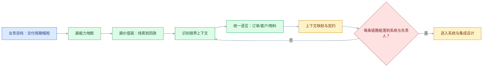
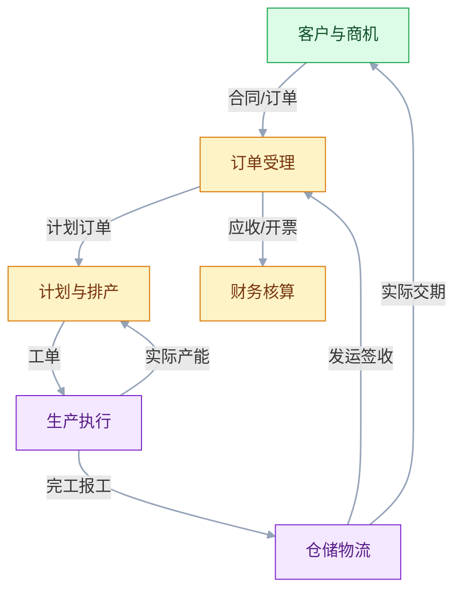

# 业务架构与领域建模

## 一、工程案例：把“订单到回款”拆成能落地的限界上下文

**场景**：一家做设备销售与服务的公司，订单链路很长：销售在 CRM 里签单，运营在 ERP 里建订单，计划在 ERP 里排产，车间在 MES 里报工，仓库在 WMS 里发货，最后财务在 ERP 里收款出账。问题是每个系统都说“这是我的订单”，改一个字段要跨四个部门确认；销售承诺的交货期，生产端根本看不到；客户投诉时，没人能一条链路说清订单现在到底在哪一步。

**目标**：不做系统设计，先把业务架构和领域边界理清楚，交付：

- 一张业务能力地图；
- 一张端到端价值链图；
- 五个限界上下文及其职责、核心概念、系统 of record；
- 一张上下文映射图（上下游、契约、失败模式）；
- 一份验收清单，确保每条链路能落到具体系统和负责人。

**为什么必须做**：领域建模的目的不是画图好看，而是让“同一个词在不同部门指不同东西”这件事显式化。订单、客户、产品、物料这四个词，在这家公司里至少有三种含义。不先把词义对齐，后面所有系统集成都建立在沙地上。

**动手前确认**：找业务方聊的时候，不要问“系统该怎么做”，要问“这个决定谁拍板、失败一次损失什么、数据从哪来、下游等什么”。这些答案才是建模输入。

### 1.1 画能力地图

能力地图不是系统清单，是“为了达成业务目标，企业必须具备哪些能力”。它按业务稳定性分层，不按技术分层。

| 能力域 | 能力项 | 业务目标 |
|---|---|---|
| 客户经营 | 获客、报价、签约、客户成功、售后 | 提升客单价与留存 |
| 订单履约 | 接单、排产、生产、仓储、发运、签收 | 缩短交付周期 |
| 采购供应 | 需求预测、寻源、采购、供应商协同、来料 | 降低缺料与库存成本 |
| 财务核算 | 应收、应付、成本、税务、对账 | 回款及时、账实相符 |
| 生产制造 | 工艺、工单、质量、追溯、设备 | 良率与产能 |
| 产品研发 | 设计、BOM、变更、试制、量产 | 缩短新品上市周期 |
| 支撑治理 | 组织、权限、合规、数据标准 | 风险可控 |

画完这张图要问业务方三个问题：

- 这张图漏了哪个业务动作？
- 哪两个能力之间最容易扯皮？
- 哪个能力目前的负责人缺位？

### 1.2 画价值链

价值链把能力串成业务流。这里画“从线索到收款”（Lead to Cash），这是贯穿 CRM、ERP、MES、WMS 的主线。

这条链路不是“流程”，是“价值流”：每一段都有明确的业务承诺（交期、良率、准时发运、准时回款），每一段都有失败成本。后续所有架构决策，都要回答“它是否让这条链路更快或更稳”。

### 1.3 识别限界上下文

限界上下文的划分依据是“语言一致”和“模型自治”，不是“数据库表”或“服务”。判断标准：

- 同一个词在这个边界里只有一个含义；
- 边界内有自己的规则、术语和负责人；
- 边界之间通过明确契约通信，不共享内部模型。

| 限界上下文 | 核心职责 | 关键概念 | 系统 of record | 负责人 |
|---|---|---|---|---|
| 客户与商机 | 线索、商机、报价、合同、客户主数据 | 客户、联系人、商机、报价单 | CRM | 销售运营 |
| 订单受理 | 接单、审核、拆单、履约承诺 | 客户订单、订单行、履约状态 | ERP | 运营 |
| 计划与排产 | 需求、产能、物料、主生产计划 | 计划订单、排产结果、物料需求 | ERP/APS | 计划部 |
| 生产执行 | 工单、报工、质量、追溯、设备 | 工单、工序、报工记录、质量记录 | MES | 生产部 |
| 仓储物流 | 收货、上架、拣货、发运、盘点 | 库位、库存、发运单、签收 | WMS | 仓储部 |
| 财务核算 | 应收、开票、成本、对账 | 应收单、发票、收款 | ERP | 财务 |

注意“订单”这个词在六个上下文里有不同含义：

| 上下文 | “订单”指什么 | 关键字段 |
|---|---|---|
| 客户与商机 | 客户签署的合同/意向 | 客户、商机、报价、签约日期 |
| 订单受理 | 待履约的客户订单 | 订单号、行项目、交期、状态 |
| 计划与排产 | 转化为生产的需求 | 计划订单、数量、开工日期 |
| 生产执行 | 车间执行的生产订单 | 工单、工序、报工、完工数量 |
| 仓储物流 | 发运任务 | 发运单、箱单、签收状态 |
| 财务核算 | 开票与收款的凭据 | 应收单、发票号、收款日期 |

同一份客户订单，在 ERP 里是“订单”，在 MES 里变成“工单”，在 WMS 里变成“发运任务”。它们不是同一个对象，是同一件事在不同上下文里的投影。建模要做的就是把“投影关系”写清楚，而不是强行用一个“统一订单表”涵盖所有语义。

### 1.4 上下文映射

映射要写清四件事：方向、契约、频率、失败怎么办。

| 上游 | 下游 | 传递内容 | 频率 | 失败模式 |
|---|---|---|---|---|
| CRM | ERP | 客户、合同、订单需求 | 准实时 | ERP 不可用则订单暂存，恢复后重放 |
| ERP | MES | 工单、BOM、工艺 | 准实时 | 工单重发，带版本号 |
| MES | WMS | 报工、领料请求 | 准实时 | WMS 超时则 MES 重试并记录 |
| WMS | ERP | 出库、发运、签收 | 准实时 | 签收丢失需人工补录，可追踪 |
| WMS | CRM | 实际交期 | 日批量 | 延迟 1 天可接受 |
| ERP | BI | 应收、订单、库存 | 日批量 | 延迟不影响业务，只影响看板 |

### 1.5 统一语言

统一语言（Ubiquitous Language）不是一套全公司通用词典，是**每个上下文内部的一套词**。实操上，给每个上下文建一张术语表：

| 术语 | 上下文 | 定义 | 同义词 | 反例 |
|---|---|---|---|---|
| 客户订单 | 订单受理 | 客户已确认、待履约的采购需求 | 销售订单 | 不能叫“工单” |
| 工单 | 生产执行 | 车间执行的生产指令 | 生产订单 | 不能叫“订单” |
| 发运任务 | 仓储物流 | 一次拣货发货的执行单元 | 出库单 | 不能叫“订单” |
| 客户 | 客户与商机 | 签约主体，含法人信息 | 企业客户 | 不等于“联系人” |
| 物料 | 计划/生产 | 生产用原材料、半成品、成品 | 零件 | 不等于“商品” |

术语表要放在 Wiki 首屏，代码里的类名、表名、接口名必须一致。术语不一致的地方，往往就是后面接口对不上的地方。

### 1.6 验收（7 项）

1. 能力地图经业务负责人签字，无遗漏、无重叠。
2. 价值链每一段都有明确的业务承诺和负责人。
3. 六个上下文每个都有系统 of record 和负责人。
4. 四个高频词（订单、客户、物料、产品）在每个上下文中的含义写清楚。
5. 上下文映射表覆盖所有跨系统数据流，每条有失败模式。
6. 一次客户投诉演练：从 CRM 线索查到 ERP 收款，30 分钟内给出全链路状态。
7. 术语表和代码命名抽查 20 个类名，不一致少于 2 个。

### 1.7 建模之后做什么

业务架构和领域建模不是终点，它决定后面三件事：

- 服务拆分：按上下文拆，不按技术层拆。
- 数据归属：每个核心实体只有一个系统 of record。
- 集成契约：上下文之间的接口就是后续系统集成的契约。

顺序不能反。先拆服务再补边界，最后一定变成“分布式单体 + 接口对不上”。

## 二、高频问答：会卡住你的地方，也是面试最常问的

### 2.1 按数据库表划上下文

**现场**

问两句：这张表里的字段是否都在同一套业务规则下变化？换一个部门来看，这个词含义一样吗？

**要点**

- 表是技术实现，不是业务边界；同一张表里的字段可能属于多个上下文。
- 按表划边界，拆表时才发现语义纠缠，那时改动成本已经很高。
- 划分依据是“语言一致”和“模型自治”：同一个词在边界里只有一个含义。

**追问**

- 那数据库表还有用吗？→ 有用，它是系统 of record 的落地，只是不能反过来决定边界。
- 一个上下文能有几张表？→ 可以很多，关键是这些表在同一套规则、同一个 owner 下变化。
- 怎么验证边界划对了？→ 同一份客户订单在 ERP 是订单、MES 是工单、WMS 是发运任务，投影关系能说清。

### 2.2 上下文越细越好

**现场**

问两句：这个上下文独立存在有意义吗？它的负责人是谁？答案是“为了拆而拆”就合并。

**要点**

- 上下文太小会产生大量契约和联调成本，收益抵不过协调成本。
- 一个上下文至少要有明确的职责、规则和负责人，缺一条就该合并。
- 粒度不是目标，边界能独立演进才是。

**追问**

- 两个上下文该合还是该拆？→ 看是否共享一批强一致数据、是否同一个 owner，是就合。
- 拆细了会怎样？→ 契约数量暴涨，改一个功能要跨多个上下文，这是模型腐化的信号。
- 合并会不会丢边界？→ 会，所以合并要保留模块接口和独立 schema，别合成大泥球。

### 2.3 统一语言变成全公司词典

**现场**

看术语表是否区分上下文；如果一张表覆盖全公司且没有“上下文”列，方向就错了。

**要点**

- 统一语言是每个上下文内部的一套词，不是全公司通用词典。
- 不同业务域关注点不同，强行统一会丢失关键差异。
- 术语表要放在 Wiki 首屏，代码里的类名、表名、接口名必须一致。

**追问**

- 同一个词在不同上下文含义不同怎么办？→ 各自定义，映射关系写进上下文映射表。
- 代码命名怎么对齐？→ 用 SalesOrder 而不是泛泛的 OrderInfo，命名不一致就是模型不一致。
- 术语表谁来维护？→ 上下文的 owner，业务和开发一起定。

### 2.4 领域模型里塞满技术字段

**现场**

问一句：如果换成另一种存储，这些字段还成立吗？不成立的就是技术字段。

**要点**

- 技术字段属于持久化模型，不属于领域模型。
- 混在一起会让模型随技术演进不断变，业务规则被存储细节淹没。
- 创建时间、修改人这类字段该留在持久化层或审计层，不要进聚合。

**追问**

- 领域对象怎么落库？→ 用仓储做转换，领域模型和表结构各管各的。
- 状态位算技术字段吗？→ 看语义，业务状态（待支付、已发货）属于领域，同步标记属于技术。
- 一定要严格分离吗？→ 小系统可以简化，核心域建议分开，否则模型很快被存储绑死。

### 2.5 领域服务滥用

**现场**

问一句：这段逻辑是否只涉及一个实体？是就放实体，不要建服务。

**要点**

- 领域服务只放“不属于任何实体”的领域逻辑。
- 实体自己的规则放实体，应用服务放编排，三者混用会变成事务脚本。
- 判断口诀：一个实体自己的事放实体，跨实体协作才考虑领域服务。

**追问**

- 跨上下文呢？→ 一律用事件或接口，不进领域服务。
- 应用服务和领域服务怎么分？→ 应用服务管流程和事务，领域服务管领域规则。
- 事务脚本有什么问题？→ 规则散在流程里，改一处要通读全部，模型没法演进。

### 2.6 用微服务替代领域建模

**现场**

问两句：上下文地图画了吗？核心概念在每个上下文的含义写了吗？没有就先画图。

**要点**

- 拆分是物理边界，领域是逻辑边界；逻辑边界不清就拆物理边界，等于把复杂度固化到网络里。
- 先拆服务再补边界，最后一定是“分布式单体 + 接口对不上”。
- 顺序是先业务架构和上下文，再数据归属，最后才是服务拆分。

**追问**

- 已经拆了怎么办？→ 先画真实调用图和数据访问图，该合的合回去，再按触发信号拆。
- 领域建模要做多久？→ 覆盖主链路和核心概念就够，不要追求一次画全。
- 不建模直接拆的典型症状？→ 同一个概念在不同服务有不同字段，新增功能要改三个以上上下文。

### 2.7 事件风暴变成头脑风暴

**现场**

看会议产出：有没有事件列表、命令列表、聚合、边界划分和争议点清单。

**要点**

- 事件风暴要有明确输入（业务目标、现状痛点）和输出（事件、命令、聚合、边界），否则容易发散。
- 有产出清单才能判断会议是否有效，没清单就是聊了一下午。
- 顺序是先贴事件（过去式），再贴命令，最后划聚合边界，反过来容易跑偏。

**追问**

- 便签颜色怎么分？→ 橙色事件、蓝色命令、黄色聚合/角色。
- 谁必须参加？→ 业务方和开发一起，只有技术方会漏掉隐性规则。
- 一次工作坊覆盖多大范围？→ 一条端到端价值链，太大会失焦。

### 2.8 建模不考虑组织

**现场**

看每个上下文是否有明确负责人；没有的话先解决组织问题。

**要点**

- 上下文要有人负责，没有 owner 的上下文，模型画得再好也会腐化。
- 模型腐化的信号之一，就是核心字段的 owner 不明确。
- 组织边界和上下文边界要能对齐，对不上就会长期扯皮。

**追问**

- 一个人能负责多个上下文吗？→ 能，只要规则和发布能独立，人少时合并比硬拆划算。
- 没 owner 时先做什么？→ 先指一个，再谈模型；组织问题不解决，建模只是画图。
- 康威定律在这里怎么用？→ 先调团队边界再让上下文边界跟着长，但调整组织比改代码慢。

### 2.9 客户和联系人混为一谈

**现场**

问一句：这个客户换联系人，业务会受影响吗？会，说明两者必须分开建模。

**要点**

- 客户是签约主体，有法人、信用、合同；联系人是自然人。
- 混在一起会导致信用评估、合同主体、权限全部出错。
- 两者是一对多关系，换人不该改变签约主体和合同。

**追问**

- 客户和用户是一回事吗？→ 不是，用户是系统账号，客户是业务签约主体。
- 客户主数据放哪个上下文？→ 放客户与商机，其他上下文引用 ID 或读模型。
- 个人客户怎么建模？→ 主体仍是“客户”，联系人可以就是本人，但模型上仍要分开。

### 2.10 忽略异常流程

**现场**

列异常事件：订单取消、付款失败、退货、改地址、坏账；看模型里有没有对应状态和规则。

**要点**

- 异常流程往往才是业务成本所在：退货、取消、补发、改期、坏账。
- 它们定义了模型的状态机和补偿逻辑，正常流程反而简单。
- 先覆盖主链路再补异常可以，但异常不能留到上线后。

**追问**

- 异常建模从哪儿下手？→ 从业务方最常吵的几个场景开始，列状态和责任人。
- 状态机要画多细？→ 覆盖所有会被查询和对外承诺的状态，中间态可以合并。
- 补偿和回滚是一回事吗？→ 不是，补偿是业务动作（退款、补发），回滚是技术动作。

## 三、核心知识

### 3.1 DDD 的战略设计与战术设计

| 层 | 关注 | 产出 |
|---|---|---|
| 战略设计 | 边界、上下文、统一语言 | 限界上下文、上下文映射、术语表 |
| 战术设计 | 边界内的模型与规则 | 实体、值对象、聚合、领域事件、领域服务 |

战略设计错误，战术设计再精细也救不回来。实践顺序永远是：先战略，后战术。

> **面试**：常问「DDD 的战略设计和战术设计分别产出什么？」答：战略出限界上下文、上下文映射、术语表，战术出实体、值对象、聚合、领域事件。

### 3.2 限界上下文的判断标准

| 判断 | 结论 |
|---|---|
| 同一词在不同团队含义不同 | 必须拆 |
| 变更频率和负责人不同 | 应该拆 |
| 规则独立，不需要跨上下文事务 | 可以拆 |
| 只为了技术分层而拆 | 不要拆 |
| 共享一批强一致数据 | 不要拆，先合 |

> **面试**：常问「什么情况下必须拆限界上下文？」答：同一个词在不同团队含义不同、变更频率和负责人不同，就必须拆；只为技术分层而拆不要拆。

### 3.3 上下文映射关系

| 关系 | 含义 | 例子 |
|---|---|---|
| 合作关系 | 两个上下文目标一致 | CRM 和 ERP 协同交付 |
| 共享内核 | 共享一小块模型 | 客户主数据 |
| 客户-供应商 | 上游按下游需求演进 | ERP 给 MES 提供工单 |
| 遵奉者 | 下游照上游模型建模 | BI 按 ERP 模型建数仓 |
| 防腐层 | 下游隔离上游模型 | 新系统对接遗留 ERP |
| 开放主机服务 | 上游提供标准化接口 | ERP 开放订单查询 API |
| 发布语言 | 双方用统一协议通信 | 事件 Schema、OpenAPI |
| 大泥球 | 无清晰边界 | 遗留系统一团乱麻 |

> **面试**：常问「防腐层解决什么问题？」答：隔离上游模型，做翻译、适配和协议转换，防止旧模型渗透进新领域代码。

### 3.4 领域事件

领域事件是“业务上已经发生的事实”，命名用过去式：订单已创建、工单已下发、签收已完成。

事件建模的三个作用：

- 表达上下文之间的因果，而不是调用；
- 支撑异步和最终一致；
- 记录业务历史，便于审计和复盘。

事件不要带“意图”。“请求创建订单”是命令，“订单已创建”是事件。混在一起会让消费者无法判断该不该响应。

### 3.5 聚合与聚合根

聚合是一组必须保持一致的对象，聚合根是外部访问聚合的唯一入口。

| 规则 | 说明 |
|---|---|
| 聚合尽量小 | 只包含必须同生共死的对象 |
| 一个事务只改一个聚合 | 跨聚合用事件或 Saga |
| 通过聚合根访问 | 不让外部直接改内部实体 |
| 用 ID 引用其他聚合 | 不要持有对象引用，避免级联加载 |

“订单”和“订单行”是一个聚合；“订单”和“客户”不是，客户在另一个上下文。

> **面试**：常问「聚合为什么要小，一个事务能改几个聚合？」答：聚合只保留必须同事务变更的对象，一个事务只改一个聚合，跨聚合用事件或 Saga。

### 3.6 值对象与实体

| 维度 | 实体 | 值对象 |
|---|---|---|
| 标识 | 有唯一 ID | 无 ID，按属性判等 |
| 可变性 | 可变更 | 不可变，改即替换 |
| 生命周期 | 有生命周期 | 随创建销毁 |
| 例子 | 订单、工单、客户 | 地址、金额、时间段 |

金额、税率、地址这类概念，用值对象比用 float/String 安全得多。金额用值对象还能统一处理精度和币种。

### 3.7 业务架构的四个层次

| 层次 | 内容 | 产出 |
|---|---|---|
| 业务架构 | 价值链、能力、组织、流程 | 能力地图、流程 |
| 应用架构 | 系统、服务、集成 | 应用全景、接口契约 |
| 数据架构 | 数据域、主数据、指标 | 数据地图、主数据清单 |
| 技术架构 | 基础设施、运行时、安全 | 部署、网络、容灾 |

四层必须对齐：应用系统的边界来自业务能力，数据归属来自业务流程，技术承载来自应用部署。四层对不上，就会出现“系统功能很全，但业务目标没达成”。

### 3.8 从价值链到验收指标

每个能力域都要有可度量的业务指标，否则建模会停留在“很全面但没用”。

| 能力域 | 指标 |
|---|---|
| 客户经营 | 线索转化率、客单价、续约率 |
| 订单履约 | 交付周期、准时交付率 |
| 采购供应 | 缺料率、库存周转天数 |
| 财务核算 | 回款周期、对账差异笔数 |
| 生产制造 | 良率、OEE、产能利用率 |
| 产品研发 | 新品上市周期、BOM 变更次数 |
| 支撑治理 | 权限合规率、主数据一致率 |

### 3.9 领域建模的演进

模型不是一次画完。演进原则：

- 先覆盖主链路，再补异常分支；
- 先保证核心概念清晰，再优化边界粒度；
- 用事件和聚合约束数据边界，不要过早引入复杂模式；
- 每次业务变化都先看模型是否需要演进，再改代码。

模型腐化的信号：同一个概念在不同服务里有不同字段；核心字段的 owner 不明确；新增功能要改三个以上上下文。

### 3.10 建模工具与产出

| 工具 | 用途 | 产出 |
|---|---|---|
| 事件风暴工作坊 | 拉齐业务方，识别事件与边界 | 事件/命令列表、聚合、上下文 |
| 能力地图 | 对齐业务能力 | 能力地图 |
| 上下文映射图 | 描述上下文关系 | 映射图 |
| 术语表 | 统一语言 | 术语表 |
| 状态机 | 描述核心对象流转 | 状态机图 |
| ADR | 记录建模决策 | ADR |

产出不需要精美，能评审、能改、能落到系统就行。

## 四、冷门知识汇总

- **事件风暴的三色便签**：橙色=事件，蓝色=命令，黄色=聚合/角色。先贴事件（过去式），再贴命令，最后聚合边界；反过来开会容易跑偏。
- **核心域、支撑域、通用域**：核心域是竞争优势所在，要投入最好的资源；支撑域是必要的但无差异化；通用域（如认证、支付）尽量买或复用。判断错核心域会导致团队把精力花在边缘。
- **领域事件与集成事件的区别**：领域事件是模型内部的事实，集成事件是跨上下文传递的契约。后者要版本化、要兼容旧消费者，前者不需要。
- **Bounded Context 与 Subdomain**：Subdomain 是问题空间（业务切分），Bounded Context 是解空间（模型边界）。一个 Subdomain 可能对应多个 Bounded Context，反之亦然。
- **聚合的“小即好”**：大聚合会带来锁竞争和加载开销。经验法则是：聚合只保留必须同事务变更的对象，其他用 ID 引用。
- **CQRS 与聚合的关系**：命令侧用聚合保证一致性，查询侧直接读模型，不走聚合。不要把查询逻辑塞进聚合，否则聚合会被查询需求撑大。
- **防腐层不是“加一层接口”**：防腐层要隔离模型，不只是包一层。它包括翻译、适配、协议转换，还要防止上游模型渗透到领域代码。
- **统一语言与代码命名**：DDD 的最终检验标准是代码里有没有“订单已创建”这样的领域事件类、有没有 `SalesOrder` 而不是泛泛的 `OrderInfo`。命名不一致就是模型不一致。
- **业务规则分三类**：领域规则（属于模型，如“订单金额必须大于 0”）、应用规则（属于流程，如“审批流”）、基础设施规则（属于技术，如“幂等键存储”）。混淆三类会导致规则散落各处。
- **领域服务的判断口诀**：这段逻辑是“一个实体自己的事”还是“跨实体协作的事”？前者放实体，后者才考虑领域服务；跨上下文一律用事件或接口。
- **Context Map 的画法**：用上下游关系和关系类型（防腐层、共享内核等）标注，而不是画方框。关系比边界更重要，因为关系决定了契约和失败处理。
- **建模中的“隐性概念”**：政策、规则、资质、限额这类常被漏掉的概念，往往是业务纠纷的源头。建模时专门列一遍“哪些概念在系统里没有，但在业务谈话里高频出现”。
