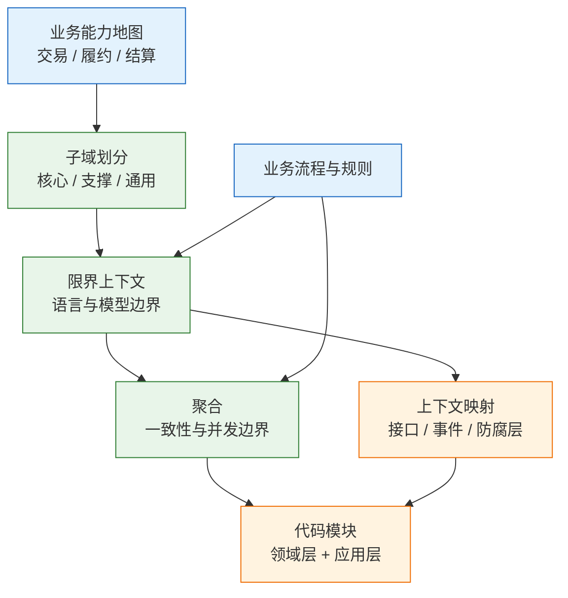
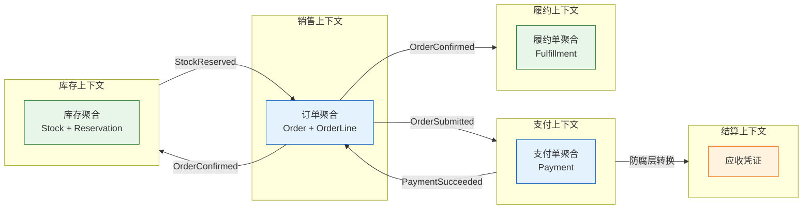
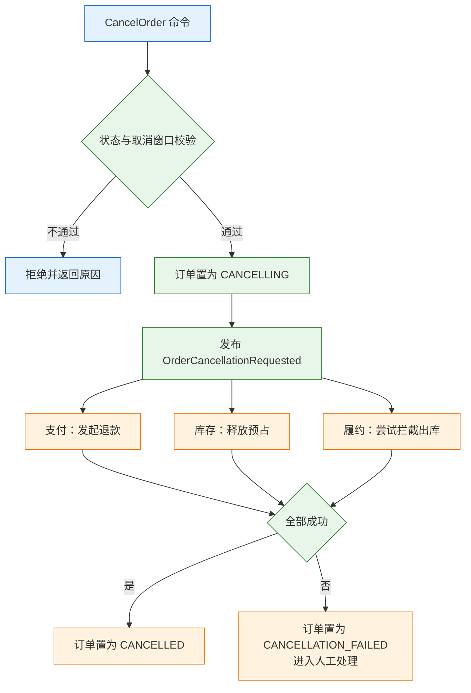

# 业务架构与领域建模

---

## 一、业务架构与领域建模是什么

### 1.1 核心概念

一张订单被取消时，订单、支付、库存、履约四个团队对“取消”的理解并不相同。订单团队理解为状态变更，支付团队理解为退款，库存团队理解为回补可售，履约团队理解为拦截出库。四件事被塞进一个 1200 行的 `OrderService.cancel()`，直接更新三张库表、调用两个外部接口，失败只记一条日志。上线半年后出现了三种状态：订单显示已取消而库存没有回补，退款成功而订单仍是待发货，仓库已经出库而订单已经取消。

根因不是代码水平，而是“取消”这个词在四个团队里含义不同，边界也没有定清楚。四件事被当成一个事务处理，可它们分别属于四个模型、四种失败语义和四条补偿路径，没有任何一个本地事务能保证全部成功。

业务架构（Business Architecture）是对业务能力、价值链、流程和组织支撑的结构化描述。它回答企业靠哪些能力创造价值、能力之间如何协作、哪一层组织对结果负责，常见产出是能力地图、价值链和业务流程清单。

领域建模（Domain Modeling）是在一个明确边界内，把业务中的名词、规则、状态迁移和不变量表达成可讨论、可测试、可落地的模型。它回答这个词在这个边界里指什么、哪些规则必须同时成立、哪些变化可以分开处理。

| 概念 | 回答的问题 | 典型产出 |
|---|---|---|
| 业务架构 | 企业需要哪些能力、如何协作 | 能力地图、价值链 |
| 子域 | 哪些能力构成差异、哪些必须自建 | 核心域、支撑域、通用域清单 |
| 限界上下文 | 模型在哪个范围内保持语言一致 | 上下文清单、上下文映射 |
| 聚合 | 哪些对象必须同事务保持一致 | 聚合根、不变量清单 |
| 领域事件 | 已经发生、需要被下游知道的事实 | 事件清单、状态迁移 |

业务架构与领域建模是同一个问题的两端。前者确定企业需要哪些能力、能力之间如何协作、由谁对结果负责；后者确定能力内部的词义、规则、状态迁移和一致性边界。两者都不是画图工作，产出必须能约束代码结构、接口契约和数据归属，否则就只是墙上的海报。

### 1.2 与相邻技术的关系

领域建模经常被混同于需求分析、数据建模或微服务拆分。四者解决的问题不同，混用会让讨论失焦。

需求分析收集“要做什么”，产出用例与验收条件；领域建模确定“这些事如何成立”，产出词义、不变量和状态机。需求描述期望，模型描述约束，前者替代不了后者。

数据建模描述存储结构，关心表、字段、索引；领域模型描述行为与约束，关心对象何时允许改变。表是模型的持久化投影，先画表会让模型退化成字段容器。

微服务是部署形态，限界上下文是模型边界。一个上下文可以是一个模块、一个服务或一组服务；把上下文等同进程，会把本地事务拆成跨服务调用。

| 相邻方法 | 解决的问题 | 与本文的关系 | 混用的后果 |
|---|---|---|---|
| 需求分析 | 要做什么、验收标准 | 提供业务事实 | 把需求当模型，规则无处安放 |
| 数据建模 | 数据如何存储 | 模型的持久化投影 | 表驱动设计，行为缺失 |
| 微服务拆分 | 进程与部署边界 | 上下文的一种落地形态 | 按表拆服务，跨服务事务 |
| 平台架构 | 中间件与基础设施 | 为模型提供运行支撑 | 用技术分层替代业务边界 |

> **注意**：限界上下文不是微服务的同义词。上下文是语言和模型边界，服务是部署和故障边界；两者可以重合，也可以不重合。判断依据是模型是否需要独立演进。

### 1.3 建模框架与架构组成

从业务架构到可执行代码，中间有一条固定的收敛链路。每一层都有明确的输入、输出和验收证据，缺一层就会出现“图很好看、代码没变”的情况。



| 层 | 输入 | 输出 | 验收证据 |
|---|---|---|---|
| 能力层 | 业务目标、组织分工 | 一级到三级能力地图 | 能力有 owner、有指标 |
| 子域层 | 能力地图、竞争差异 | 核心域、支撑域、通用域 | 投入策略与外包决策 |
| 上下文层 | 语言分叉、变化频率 | 上下文清单与映射 | 每个上下文有统一术语表 |
| 聚合层 | 不变量、并发场景 | 聚合根与状态机 | 用例测试可验证 |
| 代码层 | 聚合与上下文 | 包结构、接口、事件 | 依赖检查通过 |

每一层都是收敛关系，不是一一映射；任何一层没有证据，下一层就只能靠猜。

> **注意**：模型不是一次成型的文档。它随业务变化持续演进，但每次演进都要回到不变量和上下文边界上确认，不能只在代码里打补丁。

---

## 二、业务架构的能力视图

### 2.1 能力地图的结构

能力地图按层级组织。一级能力是企业的业务板块，二级能力是板块内的稳定职责，三级能力才是可交付的功能。以交易为例，一级是交易，二级是下单、改单、取消、支付，三级是具体的下单页、改单审核、取消申请、退款渠道。

| 层级 | 粒度 | 例子 | 稳定性 |
|---|---|---|---|
| 一级能力 | 业务板块 | 交易、履约、结算 | 多年稳定 |
| 二级能力 | 稳定职责 | 下单、取消、支付 | 一到三年 |
| 三级功能 | 可交付功能 | 取消申请、退款审核 | 随迭代变化 |

能力地图的核心价值是稳定。流程、组织、渠道都会变，但“必须具备交易能力”长期不变；用能力做边界参照，比用某一版流程图可靠。

能力地图不是服务清单。一个能力可能由一个服务实现，也可能由一个模块实现；一个服务也可能覆盖多个能力。把能力地图逐格翻译成微服务，是服务拆分失控的常见起点。

### 2.2 价值链与业务流程

能力回答“具备什么”，价值链回答“按什么顺序创造价值”，业务流程回答“一次业务如何流转”。三张图各自成立，不能互相替代。

| 视图 | 回答 | 例子 | 更新频率 |
|---|---|---|---|
| 能力地图 | 具备哪些能力 | 商品、交易、履约、售后 | 低 |
| 价值链 | 价值如何依次产生 | 选品、定价、下单、支付、履约 | 中 |
| 业务流程 | 一次业务如何流转 | 下单流程、退款流程、调拨流程 | 高 |

价值链适合发现断点，例如选品到定价缺审核、定价到下单缺库存校验，这些在能力地图上看不出来。业务流程适合发现异常分支，超时、失败、取消、人工介入才是模型复杂度的来源。

> **注意**：能力地图稳定，不代表它可以当组织架构图。组织调整频繁而能力相对稳定；用能力做边界参照，不要用它做汇报归属。

### 2.3 从能力到子域的收敛

子域按业务重要性划分，分为核心域、支撑域和通用域。划分依据不是技术难度，也不是代码量，而是这项能力是否构成竞争差异。

| 子域类型 | 判定问题 | 投入策略 | 例子 |
|---|---|---|---|
| 核心域 | 是否直接决定差异化与利润 | 自研，配最强的人 | 交易规则、定价、履约调度 |
| 支撑域 | 是否必须做但不构成差异 | 自研或外包，控制成本 | 发票、对账、内部审批 |
| 通用域 | 是否有成熟标准产品 | 采购或复用 | 身份认证、短信、邮件 |

核心域看三条：客户是否因此选择产品、对手是否难以复制、规则是否持续演化。仅“代码复杂”不构成核心域，很多复杂逻辑只是历史包袱。

支撑域的价值在稳定支撑而非领先，用核心域的投入方式做支撑域会挤占真正的竞争力。通用域则应采购，自建短信、邮件、身份认证长期几乎没有收益。

> **注意**：核心域外包等于把竞争力交给供应商。支撑域和通用域可以买，核心域的规则、数据和演进节奏必须掌握在自己手里。

---

## 三、领域边界的识别

### 3.1 语言分叉信号

语言分叉是最可靠的边界信号。同一个词在不同团队里指向不同对象、不同状态机或不同生命周期，就说明一个模型已经装不下两种含义。

“订单完成”是典型例子。销售团队指客户签收，履约团队指出库完成，结算团队指货款到账。三个含义对应三个时间点、三套前置条件和三种下游动作。如果代码里只有一个 `status=COMPLETED`，三种逻辑必然争抢同一个字段，最后谁也不敢改。

| 词 | 销售上下文 | 履约上下文 | 结算上下文 |
|---|---|---|---|
| 订单完成 | 客户签收 | 出库交接 | 货款到账 |
| 订单取消 | 客户撤单 | 拦截出库 | 冲销应收 |
| 发货 | 通知客户 | 生成出库单 | 确认收入时点 |

语言分叉不等于同义词。含义接近但状态机不同仍是分叉；多种叫法指向同一状态机只是术语问题，靠术语表解决。把同一个词在两个团队的状态迁移各画一遍，状态数量、迁移条件、终态含义有一项不同，就不能共用模型。

### 3.2 变化频率与所有权信号

变化频率是边界的经济学依据。一个模块每周变、另一个每季度变，放在同一发布单元里，稳定部分会被频繁变更拖累。

所有权是组织依据。不同团队、不同发布节奏、不同合规要求，会让“改一处要协调三方”成为常态。

| 信号 | 观察方式 | 边界结论 |
|---|---|---|
| 变化频率差异 | 统计近半年提交与需求 | 高频部分独立上下文 |
| 发布节奏差异 | 对比发布记录与回滚次数 | 独立发布单元 |
| 合规要求差异 | 数据分类、审计范围 | 独立数据与权限边界 |
| 数据生命周期 | 保留期、归档策略 | 独立存储与清理策略 |
| 团队所有权 | owner、on-call 名单 | 边界与团队对齐 |

多个信号指向同一处时边界最稳；只有单一信号时先做模块化，不急着拆进程。组织边界会变，模型边界要经得起一次组织调整。

### 3.3 边界候选的验证

找到候选边界后，用四项检查验证。四项都通过，才进入详细建模；任何一项不通过，回到上一节重新划分。

| 验证项 | 通过标准 | 不通过的处理 |
|---|---|---|
| 语言一致 | 上下文内每个词只有一种含义 | 拆出子上下文或统一术语 |
| 独立演进 | 模型变更不需要同步改别的上下文 | 检查共享内核与共享表 |
| 所有权明确 | 有唯一 owner 和发布节奏 | 合并到有 owner 的边界 |
| 写入唯一 | 每份数据只有一个写方 | 先收敛写方再谈边界 |

边界过大表现为多套术语、多个状态机、多个团队共用一个模型；过小表现为大量跨上下文调用、每个上下文只有一两个用例。前者先拆语言，后者先合并职责。

> **注意**：按部门分边界会得到“组织图架构”，按技术层分会得到“Controller 层服务”。领域边界只看语言、规则和一致性。

---

## 四、领域建模的步骤

### 4.1 事件风暴的准备与执行

事件风暴把业务专家和开发放在一起，用便利贴把流程拆成事件、命令、策略、读模型和聚合。它的价值不是产出图，而是让词义分歧当场暴露。

准备工作有三项：参与者覆盖业务、产品、开发、测试；材料用不同颜色贴纸和一面长墙，按时间轴从左到右排；规则提前说明，只写业务事实、事件用过去式、一个事件一张贴。

| 阶段 | 动作 | 产出 | 常见偏差 |
|---|---|---|---|
| 贴事件 | 按时间顺序写已发生的事实 | 事件时间轴 | 写成“要做的事” |
| 补命令 | 找出触发事件的动作 | 命令与触发者 | 命令与事件混用 |
| 找策略 | 标注条件与自动反应 | 策略清单 | 把规则写成流程 |
| 标读模型 | 记录每个角色要看什么 | 读模型清单 | 只考虑后台页面 |
| 圈聚合 | 圈出必须同事务的对象 | 聚合候选 | 圈得过大 |
| 画边界 | 在语言分叉处划线 | 上下文候选 | 按团队划线 |

两小时工作坊通常产出三样东西：业务全景图，含事件顺序、依赖和补偿点；上下文候选图；分歧清单。第三样最值钱，直接决定要拆几个模型。

> **注意**：事件风暴不是画图会议。如果两小时里没有人争论词义，要么参与者不对，要么大家习惯了用模糊词掩盖分歧。主持人要主动追问“这个词在各自团队里具体指哪个状态”。

### 4.2 聚合与不变量的确定

聚合（Aggregate）是一组必须一起保持一致的对象，聚合根是外部访问的唯一入口。聚合的边界由不变量决定，不由对象之间的引用关系决定。

确定聚合按五步：列出不变量，也就是无论并发如何都必须成立的条件；找出同时修改这些对象的用例；把必须同事务成立的部分圈在一起；选对外唯一入口作为根；把跨聚合引用改成 ID。

| 候选范围 | 必须同事务的规则 | 结论 |
|---|---|---|
| 订单 + 订单行 | 金额汇总、行数上限 | 同一聚合 |
| 订单 + 支付单 | 支付状态与订单状态 | 分开，事件协作 |
| 库存 + 预占记录 | 可售数量不被超卖 | 同一聚合 |
| 库存 + 采购单 | 无同事务规则 | 分开 |

硬规则有五条：聚合根是外部唯一入口，外部只能调根方法；一个事务只改一个聚合，跨聚合靠事件和补偿；聚合间用 ID 引用；值对象不可变；领域事件描述事实，命令描述请求。

> **注意**：聚合不是越大越安全。聚合越大，一致性越强，但锁范围、加载成本和并发冲突同时上升。把支付和物流塞进订单聚合，等于每次改订单都锁住整条链路。

### 4.3 上下文映射的选择

上下文之间必然协作，协作方式决定耦合程度。常见关系有六种，代价依次不同。

| 关系 | 含义 | 适用 | 代价 |
|---|---|---|---|
| 客户-供应商 | 下游依赖上游，上游按需供接口 | 上下游目标一致 | 下游排期受上游影响 |
| 开放主机服务 | 上游提供稳定协议供多方接入 | 平台型能力 | 协议演进要兼容 |
| 发布语言 | 用共享的稳定 schema 交换数据 | 跨团队事件 | schema 治理成本 |
| 防腐层 | 下游加一层转换隔离上游模型 | 上游老旧或外部系统 | 多一层映射维护 |
| 共享内核 | 两个上下文共享一小块模型 | 模型极稳定、沟通紧密 | 改一处影响双方 |
| 遵奉者 | 下游直接照搬上游模型 | 上游强势、下游无议价 | 下游被模型绑架 |

选择从松到紧：能异步的不共享模型；必须同步的用开放主机服务加防腐层；共享内核放最后，只共享值对象和稳定标识。遵奉者只在上游强势、下游无议价时使用。

> **注意**：多数团队会低估共享内核的代价。共享一个 `Order` 包，短期省事，长期两个团队互相改对方字段，最后没人敢动。能通过 ID 和事件交互的，不要共享模型。

### 4.4 模型到代码的落地结构

模型必须落到包结构上，否则会停留在文档里。一个可维护的结构按上下文分包，上下文内部再分领域、应用、基础设施和接口四层。

```text
order-context/
  domain/            # 聚合、实体、值对象、领域事件、仓储接口
    Order.java
    OrderLine.java
    Money.java
    OrderCancelled.java
    OrderRepository.java
  application/       # 用例编排、事务边界、权限校验
    CancelOrderService.java
  infrastructure/    # 仓储实现、消息、外部适配器
    JpaOrderRepository.java
    PaymentAdapter.java
  interfaces/        # HTTP 与消息入口
```

| 层 | 职责 | 禁止事项 |
|---|---|---|
| 领域层 | 不变量、状态迁移、领域事件 | 依赖框架、访问数据库 |
| 应用层 | 加载聚合、编排用例、提交事务 | 写业务规则、拼 SQL |
| 基础设施层 | 仓储实现、消息、外部适配 | 反向依赖领域行为 |
| 接口层 | 协议转换、参数校验 | 直接操作聚合内部 |

领域层不依赖框架。ORM 注解可放在独立持久化对象上，但领域行为必须留在领域对象里，不能退化成只有 getter 和 setter 的数据袋。

应用服务只编排：加载聚合、调用聚合方法、保存、发事件；取消窗口、退款资格等规则属于聚合。仓储按聚合根定义，不为每张表建 Repository。

领域事件在上下文内使用；跨上下文要转成集成事件，使用稳定字段、schema 版本和幂等键，不能直接序列化内部对象。

---

## 五、数据归属与模型落地

### 5.1 聚合的持久化边界

聚合是事务边界，也是持久化边界；仓储只负责整个聚合的加载与保存，不暴露中间表查询。一个聚合可以映射多张表，但入口只有聚合根。

| 对象 | 持久化方式 | 访问入口 |
|---|---|---|
| 聚合根 | 主表一行 | 仓储直接加载 |
| 聚合内实体 | 从表，随根保存 | 只能经根方法访问 |
| 值对象 | 内嵌列或独立表 | 随根读写，不可变 |
| 跨聚合对象 | 只存 ID | 通过接口或事件获取 |

聚合内多表允许，关键是整体写入成功。订单与订单行在同一事务保存，金额汇总才不会出现半成品。

仓储不要泄漏懒加载。聚合加载后应完整可用，否则事务边界会延伸到视图层。

### 5.2 引用、快照与跨上下文一致性

跨上下文取数只有三种正当方式：按 ID 查询、交易快照、事件投影，取舍取决于一致性与失败代价。

| 方式 | 一致性 | 适用 | 代价 |
|---|---|---|---|
| ID 实时查询 | 强，取到最新值 | 必须当场知道结果 | 同步依赖、需超时降级 |
| 交易时快照 | 弱，固定为当时事实 | 地址、名称、价格 | 历史与现值不同 |
| 事件投影 | 最终一致 | 查询多、能接受延迟 | 延迟、重复、重建成本 |

快照不是缓存，而是交易事实。订单里的地址、商品名、价格都应是快照；用户改地址、商品改名后，历史订单不能跟着变。

> **架构红线**：任何上下文不得直连另一个上下文的数据库读表或写表。跨上下文数据只能通过接口、事件或快照获得。直连数据库会把发布、索引、故障和权限重新绑在一起，等于放弃边界；两个服务还能写同一张表，它们就还是一个系统，只是多了一次网络调用。

### 5.3 领域事件与集成事件

事件是跨聚合、跨上下文协作的主要手段。事件设计要区分范围、内容和消费方式，否则内部模型会顺着事件泄漏到外部。

| 事件类型 | 传播范围 | 内容 | 消费方式 |
|---|---|---|---|
| 领域事件 | 单个上下文 | 聚合 ID、关键状态 | 进程内同步或异步 |
| 集成事件 | 跨上下文 | 稳定字段、schema 版本 | 消息中间件 |
| 通知事件 | 跨系统 | 最小必要字段 | Webhook 或消息 |

事件发布必须与写入一致。提交后直接 `send()` 可能丢事件，先发再提交可能让消费者读到未成立的事实。可靠做法是本地消息表或 Outbox：业务数据与待发消息在同一本地事务写入，再由投递器发送。

消费端要幂等。事件会重复、乱序、延迟，用业务键加事件 ID 去重，用版本号处理乱序，用重放支持投影重建。

> **注意**：领域事件被外部系统直接消费，是最隐蔽的耦合。内部字段一改，外部消费者就崩；正确做法是转成集成事件，固定字段语义，加版本号，并在契约测试里锁住。

---

## 六、完整案例：电商订单域建模

一个日订单 50 万的电商系统，原有实现是单体加共享库，取消逻辑集中在一个 1200 行的服务方法里。按能力、上下文、聚合、协作、落地五步收敛。

### 6.1 能力与子域划分

先列一级能力：商品、交易、履约、售后、结算、营销。再判断子域类型，决定投入方式。

| 能力 | 子域类型 | 建模投入 |
|---|---|---|
| 交易 | 核心域 | 自研，规则与状态机重点建模 |
| 履约 | 支撑域 | 自研，控制复杂度 |
| 结算 | 支撑域 | 自研，对齐财务口径 |
| 商品 | 支撑域 | 自研，维护主数据 |
| 身份、短信 | 通用域 | 采购或复用 |

交易是核心域，因为下单规则、优惠叠加、取消窗口直接决定客户体验和利润。履约是支撑域，必须做但不构成差异，建模目标是稳定和可追踪，不是领先。身份与短信是通用域，自建没有规模收益。

### 6.2 上下文与聚合设计

按语言分叉划出五个上下文。销售管客户承诺，支付管资金流，库存管可售数量，履约管出库任务，结算管应收凭证。五者各有状态机，通过事件协作。



| 上下文 | 聚合根 | 保护的不变量 | 明确不负责 |
|---|---|---|---|
| 销售 | 订单 | 金额汇总、状态机、取消窗口 | 退款执行、库存扣减 |
| 支付 | 支付单 | 支付金额、退款上限、幂等 | 订单状态、履约节奏 |
| 库存 | 库存 | 可售不为负、预占可释放 | 订单价格、客户信息 |
| 履约 | 履约单 | 出库数量、拦截条件 | 资金、应收 |
| 结算 | 应收凭证 | 金额与账期 | 在线交易状态 |

订单聚合只含订单与订单行，负责金额汇总、状态机和取消窗口；支付、库存、履约各自独立，用事件协作，不共享表。

### 6.3 取消订单的协作流程

取消不再是一个大事务，而是一条带补偿的状态链。订单先进入处理中，再等待三个下游结果，最后收敛为成功或失败。



| 步骤 | 动作 | 失败处理 |
|---|---|---|
| 1 | 校验状态与取消窗口 | 直接拒绝，不改状态 |
| 2 | 订单置 CANCELLING | 记录操作者与原因 |
| 3 | 支付发起退款 | 超时重试，保留退款单号 |
| 4 | 库存释放预占 | 幂等释放，重复请求无副作用 |
| 5 | 履约尝试拦截 | 已出库转退货流程 |
| 6 | 汇总结果并收敛 | 失败进入人工队列 |

这条链路没有分布式事务，只有状态机和补偿。代价是取消不再立刻完成，客服页面要显示处理中；收益是每步可追踪、可重试，不会出现退款成功而库存没回补却无人知晓。

### 6.4 落地结构与验收

落地按上下文分包，内部再分领域、应用、基础设施、接口四层。取消用例在应用层，状态迁移与窗口判断在订单聚合，退款调用在基础设施适配器。

| 验收项 | 方法 | 通过标准 |
|---|---|---|
| 不变量 | 聚合单元测试 | 非法状态迁移全部被拒绝 |
| 状态机 | 覆盖所有迁移路径 | 无不可达状态、无死锁终态 |
| 事件一致性 | Outbox 故障注入 | 提交成功则事件最终必达 |
| 跨上下文契约 | 消费者驱动契约测试 | 字段与语义变更提前发现 |
| 模型落地 | 依赖检查 | 领域层不依赖框架与仓储实现 |

验收的核心是三件事：聚合能否用小用例表达，状态机能否被测试穷举，事件能否重放并重建读模型。

---

## 七、反模式与边界判断

### 7.1 结构型反模式

建模失败通常不是概念不懂，而是结构上偷了懒。以下几类反模式在代码里都有明确痕迹。

| 反模式 | 表现 | 后果 | 纠正方式 |
|---|---|---|---|
| 贫血模型 | 实体只有字段和 getter | 规则散落在服务里 | 把不变量移回聚合 |
| 大聚合 | 一个聚合几十个对象 | 锁竞争、加载慢 | 按不变量拆分 |
| 共享内核 | 多团队共用实体包 | 改一处影响多方 | 改为 ID 加事件 |
| 表驱动模型 | 一个类对应一张表 | 行为缺失、事务碎片 | 先建聚合再映射 |
| 事件滥用 | 所有调用都改成事件 | 链路难追踪、时序错乱 | 同步查询保留同步 |
| 过度设计 | 简单 CRUD 也上 DDD | 成本高、收益低 | 按规则复杂度选型 |

贫血模型不是原罪。业务简单、以 CRUD 为主时事务脚本更直接；规则复杂、状态多、需要保护不变量时，充血模型才值得。

### 7.2 聚合与一致性的取舍

聚合大小只看一个问题：这些规则是否必须在同一事务里同时成立。必须就放进一个聚合，可以稍后一致就分开。

| 放进聚合 | 独立聚合 |
|---|---|
| 必须同事务成立的规则 | 可以最终一致的步骤 |
| 生命周期一致、并发修改少 | 生命周期独立、并发修改多 |
| 订单与订单行（金额汇总） | 订单与支付单 |
| 库存与预占记录（防超卖） | 库存与采购单 |

聚合越大，一致性越强，但锁范围、加载成本、并发冲突同时上升。订单聚合塞进支付和物流，等于每次改订单都锁住整条链路。

### 7.3 模型腐化的早期信号

模型腐化是渐进的，早期信号很微弱，但都可以量化观察。

| 信号 | 含义 | 动作 |
|---|---|---|
| 单个类超过两千行 | 职责堆叠，边界消失 | 按不变量拆聚合 |
| 状态枚举超过十个 | 多套状态机混用 | 拆上下文，分别定义状态 |
| 改一个字段动五个模块 | 共享模型或共享表 | 收敛写方，改事件协作 |
| 术语表长期为空 | 语言从未统一 | 补术语表并评审 |
| 模型只存在于文档 | 没有代码承载 | 建包结构，加依赖检查 |

> **注意**：模型评审只看图不看用例，等于没有评审。每张上下文图至少配一个端到端用例，每张聚合图至少配一个并发场景；说不出用例的边界，通常也守不住。

---

## 八、常见失败模式与排查

### 8.1 失败模式判断表

| 现象 | 最可能原因 | 处理 |
|---|---|---|
| 一个实体几千行、状态几十个 | 没有聚合边界 | 按不变量拆聚合 |
| 三个团队各有一个“订单完成” | 没有限界上下文 | 拆上下文，事件同步 |
| 改一个字段要动五个模块 | 共享内核或共享表 | 收敛模型，改 ID 与事件 |
| 聚合加载慢、并发冲突多 | 聚合过大 | 拆分，跨聚合最终一致 |
| 模型与表一一对应 | 数据库驱动建模 | 先画行为与不变量 |
| 事件发出但业务未提交 | 事务与消息非原子 | Outbox 加投递确认 |
| 外部系统直接消费领域事件 | 内外事件未隔离 | 转集成事件并版本化 |

### 8.2 排查与处置顺序

1. 确认词义：同一个词在各团队的状态机、前置条件和终态是否相同。
2. 确认一致性：这些规则是否必须同事务成立，能否改为事件加补偿。
3. 确认聚合大小：是否被高频并发修改，锁范围是否覆盖无关对象。
4. 确认跨上下文方式：同步接口、异步事件还是快照，是否存在直连数据库。
5. 确认落地结构：领域层是否依赖框架，规则是否散落在应用服务。
6. 确认验收证据：是否有聚合单测、状态机覆盖、事件重放和契约测试。

处置顺序不能颠倒。先拆代码再补模型，通常会把错误边界固化；先统一语言再谈拆分，返工最少。跨上下文直连数据库属于架构红线，发现即停止新增，按“收敛写方、改接口、再迁移”的顺序处理。

### 8.3 建模检查清单

| 检查项 | 通过标准 | 证据 |
|---|---|---|
| 能力覆盖 | 一级到三级能力有 owner | 能力地图 |
| 子域判断 | 核心域有自研投入 | 投入决策记录 |
| 上下文边界 | 每个上下文有术语表 | 术语表与映射图 |
| 聚合不变量 | 每条不变量有测试 | 聚合单元测试 |
| 状态机 | 所有迁移路径可达且可终止 | 状态迁移表 |
| 事件契约 | 集成事件有版本与幂等键 | schema 与契约测试 |
| 数据归属 | 每份数据只有一个写方 | 数据归属表 |
| 落地结构 | 领域层不依赖框架 | 依赖检查报告 |

> **注意**：清单不是一次性的验收表。每次业务规则变化，回到对应行确认证据是否仍然成立；模型的价值在于持续约束，不在于一次性交付。

> **核心结论**：业务架构给稳定边界，领域模型给精确语言；聚合是一致性边界而非对象容器；模型必须落到包结构、测试和事件契约上，否则只是一张图。
